# Guide by views — CIRCUIT-HACKS (RC4)

Circuit Tracks running the official firmware 1.2.1 (build 4486), patched. This guide is the mod's manual: it walks through the device's views, explains everything each one can do and, in every chapter, each feature used in that view. The [glossary](#glossary) lists them all under the groups of the former [feature list](MANUAL.en.md).

## Views

**0. Introduction**

- [0.1 How to read this guide](#convenciones)
- [0.2 Buttons that work in every view](#botones)

**1. Setup**

- [1.1 Setup view](#setup)
- [1.2 Advanced Setup view](#advanced-setup)

**2. Stock synths (Synth 1 / 2)**

- [2.1 Synth 1 / 2 track view (Note, Velocity, Gate)](#synth-nota)
- [2.2 Scales view and custom scale](#escalas)
- [2.3 Synth source view](#synth-fuente)
- [2.4 Synth 1 / 2 Preset view](#synth-preset)

**3. MIDI tracks (MIDI 1 / 2)**

- [3.1 MIDI 1 / 2 Preset view](#midi-preset)
- [3.2 Own-synth voices: polyphony and the voice limiter](#midi-voces)
- [3.3 Knob pages of the MIDI 1 / 2 engine](#midi-knobs)
- [3.4 Mod matrix](#midi-matriz)
- [3.5 4-operator FM](#midi-fm)
- [3.6 8-operator FM](#midi-fm8)
- [3.7 CC editor of the MIDI macros (pad 25)](#midi-cc)
- [3.8 Step-drummer view](#step-drummer)
- [3.9 Sample mode and sample picker](#midi-muestra)

**4. Pattern Settings**

- [4.1 Pattern Settings view](#pattern-settings)
- [4.2 Micro Step view (note tracks)](#micropasos)
- [4.3 Probability view (note tracks and drums)](#probabilidad)

**5. Drums**

- [5.1 Drum track view (knobs)](#drum-pista)
- [5.2 Drum Preset view](#drum-preset)
- [5.3 Chromatic and scale view of the drums](#drum-cromatica)

**6. Master FX**

- [6.1 Master FX](#master-fx)

**7. FX**

- [7.1 FX view](#vista-fx)

**8. Sidechain**

- [8.1 Sidechain view](#sidechain)

**9. Scenes and patterns**

- [9.1 Patterns view and pattern chains](#patterns)
- [9.2 Mixer view and scenes](#mixer)

**10. Projects and packs**

- [10.1 Projects view](#projects)
- [10.2 Packs view](#packs)

**11. Data: saving, MIDI and modulation**

- [11.1 What a pattern holds and how to make sure it is saved](#datos-patron)
- [11.2 What comes back after a restart and where it is saved](#guardado)
- [11.3 What is lost at a restart](#datos-perdido)
- [11.4 MIDI: own behaviours, new CCs and NRPNs](#midi)
- [11.5 Mod matrix and macro destinations](#destinos)

**A. Appendix**

- [A.1 Installing and going back](#instalar)
- [A.2 Card and device app](#app-sd)

**[Glossary](#glossary)**

## 0. Introduction

### 0.1 How to read this guide

*How to get there:* Each chapter is a view of the device: how to get there, what every pad, knob and button does, and the sub-menus it opens.

*Also used here:* [Shortcut map](#f-atajos)

- **Pads 1-32** from top-left to bottom-right: row 1 = 1-8, row 2 = 9-16, row 3 = 17-24, row 4 = 25-32.
- **Knobs K1-K4** on top, **K5-K8** below. «**Shift + X**» = hold Shift while using X; the same with Clear and Duplicate.
- Anything not described here works as on the original device (Novation's official manual).
- *(since RC2)* = new since RC2 (not in RC0.9 / RC0.9S). The safer build, RC4S (and the earlier S builds), writes nothing of its own to the card: what is marked «writes to the card» does nothing there (the Save LED turns red).
- *(since RC2.02)* = new in RC2.02 (not in RC2.01).
- *(since RC4)* = new in **RC4** (not in RC2.11 or earlier).
- *(since RC4.05)* = a fix of **RC4.05** (in RC4.11 and Alpha 7 too; not in RC4.02 or earlier).
- *(Beta 5.65 only)* = only in **Alpha 7** (not in RC4.11).
- **The features are in the chapter of the view where they are used** (before, in the feature list): every chapter starts with the index of its features, goes on with the view and ends with each feature in its own section, with its drawings and animations. The **glossary**, at the end, lists them all under the groups of the former list (A-E).

### 0.2 Buttons that work in every view

*How to get there:* Shift, Clear, Duplicate, Save and Octave gain functions depending on the view; here, the ones valid almost everywhere.

**In this view**

- **Put a knob back or delete what was recorded** — Clear + knob, without hunting for the value or clearing the whole pattern.
- **Metronome and count-in** *(since RC2)* — a bar of clicks before recording, to come in on time.
- **Split keyboard** *(since RC2)* — both synths at once, one per hand.
- **Custom scale** *(since RC2)* — scales the unit does not have, even with periods other than the octave.
- **Shortcuts in yellow** — while Shift is held, the view shows what it offers.

**Features in this view:** [A1 Shortcut map](#f-atajos) · [A4 Clear + knob = default value](#f-clear-knob) · [A13 LFO synced to the tempo (since RC4)](#f-lfo-sync) · [A21 Shift = a flash on every note (Beta 5.65 only)](#f-luces-disparo) · [A22 Shift + Preset = the project's sound (Beta 5.65 only)](#f-proyecto-init)

*Also used here:* [Master FX on the Mixer button](#f-master-fx-acceso) · [Cue mode, mutes on the bar and quantize (since RC2)](#f-mixer-cue) · [Split keyboard Synth 1 + Synth 2](#f-teclado-partido) · [Drum knobs as printed on the panel](#f-knobs-drums)

| Gesture | Where | What it does |
|---|---|---|
| **Clear + knob to the right** | drums, MIDI track engine, Master FX | The knob goes back to its default (both layers, with and without Shift). **Lavender** LED = done, as on the original. |
| **Clear + knob to the left** | drums (stock knobs), MIDI track engine *(since RC2)* | Deletes that knob's automation in the playing pattern, as on the original (**red** LED). On the MIDI engine, that of the knob's two lanes (with and without Shift) that have automation. |
| **Shift** | all | While Shift is held, the shortcuts available light **yellow**; the chosen option, another colour. *(Beta 5.65 only)* Also, the eight **track buttons** (Synth 1 / 2, MIDI 1 / 2, Drum 1-4) flash **white** for 100 ms on every note their track plays, from the sequencer, the pads, the arpeggiator or MIDI. A tied note is one note: one flash. |
| **Save** | all | Saves the project as always; it also writes into the pack the samples replaced by captures (drum Preset), if they fit in the sample memory *(writes to the card)*. |
| **Press the track button again** | Synth 1 / 2 | Opens the synth's source view (2.3). |
| **Clear + Synth 1 / 2** | its view | *(since RC2)* Its eight macros back to the loaded patch's values. |
| **Clear + Duplicate twice** | any view of a track (Preset, Note, expanded Note, Velocity, Gate, Micro Step, Pattern Settings, Probability, the drums' chromatic view), all eight tracks | *(Beta 5.65 only)* **Puts the pattern back as it is saved on the card**: the pattern that view shows loses its changes since the last Save. The first time it **asks**: Duplicate blinks white for about 5 s; **Clear + Duplicate again** within that time does it (same track, same pattern; later, it asks again). The steps, the automation and the pattern settings come back (first and last step, sync rate, direction, fractal / deconstructed order; on drums, each step's frequency and dynamics); on MIDI 1 / 2 its **extra lanes** too. The pattern's arpeggiator settings do not. **Save red** for a moment = nothing done: a new project not saved yet, a save pending (the delayed save, or one under way) or a file missing from the card. In the other views (Patterns, Mixer, FX…), Clear + Duplicate still ends the pattern mutate lists. |
| **Shift + Preset** | Synth 1 / 2's and MIDI 1 / 2's views (the own synth on) | *(Beta 5.65 only)* That track's sound back to the project's: Synth 1 / 2, the whole patch as the project saved it; MIDI 1 / 2, the own synth saved with the project (without it, its defaults). With Shift, Preset lights **yellow** where it works. |
| **Clear + a drum's button** | its view | *(since RC2)* Deletes the automation of its knobs in the playing pattern and puts its eight knobs back to their defaults. |
| **Two note-track buttons together** | all | Split keyboard *(since RC2)*: Synth 1 + Synth 2; *(since RC2.02)* any pair of Synth 1, Synth 2, MIDI 1 and MIDI 2. |
| **Shift + Clear** | all | Metronome in four states *(since RC2)*: no metronome → metronome → count-in only → count-in and metronome. While Shift is held the Clear LED shows the state: red (no metronome) / green (metronome) / magenta (count-in only) / teal (both). The click's volume is the stock's: **Tempo/Swing** and **K5**. *(since RC4)* With the Mixer's cue mode, the click in the cue only (right output). |
| **Play** with Record armed and the count-in | stopped | One bar of count-in (4 clicks at the project's tempo or, as a slave, at the external clock's, not aligned to its bar; Record blinks red), then recording starts *(since RC2)*. *(Beta 5.65 only)* With the click's level at 0 (K5 of Tempo / Swing), Clear flashes orange on each click, with the metronome too. Play during the count cancels it. The count-in is saved with the project. |
| **Shift + Play** | all | *(since RC2)* **Quantizes** the pattern the selected track plays: notes and hits recorded off the grid go to the nearest step (micro steps 1-2 → the start of their step; 3-5 → the start of the next; the last step's, to the first). On the drums, a step with several hits (a roll) stays. While Shift is held the Play LED is yellow; green after quantizing. It replaces the original's Shift + Play (another way to start playback). |
| **Shift + Scales** | all | Custom scale editor *(since RC2)* (2.2). *(since RC4)*: also **Scales twice**. |
| **Velocity twice** *(since RC4)* | Velocity view | **Fixed velocity** on / off, like the stock's Shift + Velocity. |
| **Shift + Synth 1 / 2, Shift + MIDI 1 / 2** *(since RC4)* | all | The same as pressing the button twice: Synth = the source view (2.3), MIDI = its Preset view. |
| **Mixer twice** | all | Master FX (6.1). *(Beta 5.65 only)* In the Mixer, **Mixer held** for ½ s or more = Master FX only until you let go; in Master FX, held = the Mixer until you let go. |
| **Scales + Preset + Note** at power-up | — | Novation's bootloader recovery mode: lets you install any firmware again. |

- The knob LEDs show the value of the new functions with their **brightness** (brighter = more; bipolar knobs are dark in the middle). *(Beta 5.65 only)* On bipolar knobs, **dim at the centre**, their usual colour to the right and **a lighter shade of the same colour to the left**, brighter further out (the MIDI 1 / 2 engine, drums, Digitise K4, the synced rate of Auto-Filter / Phaser).
- Animated (pulsing) colours are never used for steady states.
- **LFO synced to the tempo** *(since RC4)*: the **LFO rate** knobs (K7 of the VCA-VCF page of the MIDI 1 / 2 engine, Shift + K4 of the matrix, Shift + K7 of the drums, K1 of the Auto-Filter and of the Phaser in Master FX) are **bipolar**: at the centre the LED is dim; **to the right, a free LFO** (faster further right); **to the left, synced to the tempo**, from the centre outwards 1/16T, 1/16, 1/8T, 1/8, 1/4T, 1/4, 1/2T, 1/2, 1 bar T, 1 bar, 2T, 2, 4T, 4, 8T and 8 bars (4 clicks each), each cycle starting on the **bar's first beat** (it is put back in place on every sequencer tick; stopped, it keeps the tempo). In the matrix, each shape of Shift + K4 is a stretch with its own centre. What was saved before with another rate may sound different.


*Step by step: Record with the count-in · since RC2*


*Step by step: Quantize a pattern · since RC2*

#### A1 Shortcut map

- Every shortcut of the mod on a drawing of the device: double presses, Shift + button, Clear + knob and the special pads of each view.

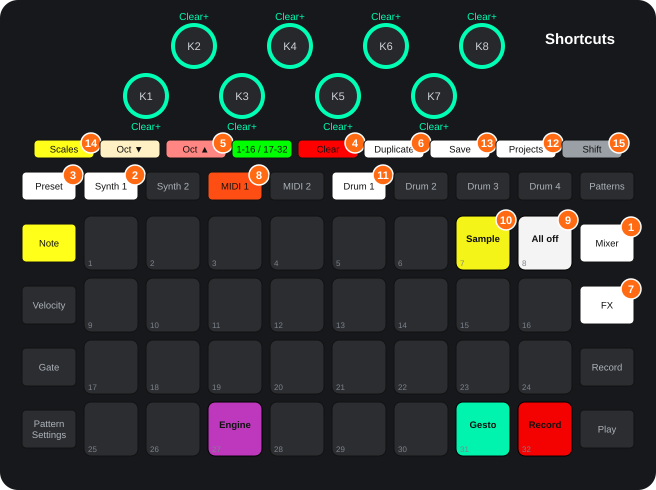

*Shortcut map: the numbers refer to the table.*

| No. | Shortcut | Function |
|---|---|---|
| 1 | **Mixer**, **Mixer** | Master FX (A2); **Beta 5.65 only:** held ½ s, only until you let go |
| 2 | **Synth 1 / 2** with its view on screen, again | Synth source view and its step-drummer (A6) |
| 3 | **Shift + Preset** with a drum | Chromatic / scale view (A7) |
| 4 | **Clear + knob** | Default value of the knob, also in Master FX; on the drums, turned left it deletes the automation (A4) |
| 5 | **Octave ▲ / ▼** in the FX view | Delay / reverb sends; **Shift + knob** = their parameters (A3, B2) |
| 6 | **Duplicate** / **Shift + Octave ▲ / ▼** (since RC4; before, **1-16 / 17-32**) in the FX view | Reset of sends and Master FX / master filter resonance (A3) |
| 7 | **Shift + FX**, then **Octave ▼**, with the drums | Sidechain between drums (D7) |
| 8 | **MIDI 1 / 2**, **Preset** | Pad 27 engine, 25 CC editor, 26 patch flip, 30 step-drummer (C1) |
| 9 | Master FX: **pad 8** | Switch off everything latched (A5) |
| 10 | Master FX: **pad 7** / **pad 32** / **pad 6** | Play / record the sample (C5), Glitch (C6) |
| 11 | Drum / synth Preset: **Clear + pad twice** / **Duplicate + pad + pad** | Replace with the capture / swap or copy samples and patches between packs (A9, A8) |
| 12 | Packs view: **Clear**, the pack, **Clear** | Delete a pack (A8) |
| 13 | **Save** | Also saves the captures used as samples (A8) |
| 14 | **Scales + Preset + Note** at power-on | Bootloader recovery mode (E2) |
| 15 | Mixer: **Shift + knob** | Track level to 100 (right) / 0 (left) (A11) |
| 16 | Master FX: **Shift + pad 7** | Sample in a latched loop until pad 7 is pressed again (C5). **Beta 5.65 only:** it keeps playing through a project or pack load; Play starts the new project when the loop comes round, and the loop keeps playing |
| 17 | MIDI 1 / 2 Preset: **Clear + a page pad (1-5)** | The values of that knob page back to their initial values (C1, **since RC2**) |
| 18 | Advanced Setup: **Duplicate** | MIDI Thru: Thru → Out 2 → Merge → Filter (B7, **since RC2**) |
| 19 | **Synth 1 + Synth 2** together | Split keyboard: Synth 1 on top, Synth 2 below (A12, **since RC2**); **Since RC2.02**: any pair of Synth 1, Synth 2, MIDI 1 and MIDI 2, the track you held first on top |
| 20 | Pattern Settings: **pad 25**, a step, **row 4** | Random-mutate of the step: random octave / scale changes (C8, **since RC2**; **Beta 5.65 only:** rows 3-4 redesigned, with a factor on Octave) |
| 21 | MIDI 1 / 2 Preset: **pads 9-24**, **Clear + pad** twice, **Duplicate + A + B**, **Octave ▼ / ▲** | Patches of the own synth: load, save, exchange, page (A14, **since RC2**) |
| 22 | MIDI 1 / 2: **Clear + the track button** | The track engine back to its initial values (A14, **since RC2**) |
| 23 | Synth 1 / 2 Preset: **Clear + pad** twice | Saves the synth’s patch into that slot of the pack (A15, **since RC2**) |
| 24 | Synth source view: **pad 32** | Editor of the macro knob destinations (A16, **since RC2**) |
| 25 | Projects: **Duplicate + pad A**, **Duplicate + pad B** | Copies project A into slot B, in another pack too (A17, **since RC2**) |
| 26 | MIDI 1 / 2 Preset: **Duplicate + slot A**, another pack, **Duplicate + slot B** | Copies an own-synth patch into another pack (**since RC2**) |
| 27 | Sidechain (**Shift + FX**): **K1-K4**, **K7 / K8** | Side-chain of the chosen track; attack / release of the master compressor (**since RC2**) |
| 28 | Setup: **Record** | Record into the synth what the MIDI track sends it: yellow = yes (**since RC2**) |
| 29 | **Pattern Settings** twice, **row 4** | Step frequency: it plays every n plays of the pattern (**since RC2**) |
| 30 | Pattern Settings: **pad 25** | Dynamics (row 3) and random-mutate (row 4); **Clear + pad 25** clears them from the pattern (**since RC2**; **Beta 5.65 only:** the step's micro steps too) |
| 31 | Pattern Settings: **pads 26 / 27 / 28** | Nudge, fractal order, deconstructed order (**since RC2**; **since RC4.05**: Nudge = the content of the range one step back, Shift + pad 26 forward, without moving the first and last steps; **since RC4**: Shift + pads 1-16 with the arpeggiator on = its modifiers) |
| 32 | Patterns: **Shift + Octave ▲ / ▼** | Pattern chain mode on / off (**since RC2**) |
| 33 | Mixer: **Shift + pads 9-16** | Repeats of the current scene (**since RC2**) |
| 34 | Setup: **pad 29 / pad 30**, then a channel pad | Listen / output channel of the project’s Program Changes (B7, **since RC2**) |
| 35 | **Shift + Clear** | Metronome / count-in in four states; with the count-in, Record + Play = one bar before recording (**since RC2**) |
| 36 | Pattern Settings: **Shift + pad 25**, **Shift + pads 27-32** | The pattern's arpeggiator on / off and its order; chords of the sequence and notes held together, one a step (**since RC2**) |
| 37 | **Shift + Scales** | Custom scale editor: up to 7 notes and a period; one iteration a row (**since RC2**; **since RC4**: also Scales twice; Velocity twice = fixed velocity (on the drums, Beta 5.65 only: the automation view); Shift + Synth / MIDI = pressing them twice; MIDI 1 / 2 again with its Note view on the screen = its Preset; a MIDI 1 / 2 knob page held ½ s = only while held) |
| 38 | Step-drummer: **pad 32**; velocity page: **pads 17-24** | Pitch-vel toggle (transpose in the scale / velocity) and page 2's own destination (**since RC2**) |
| 39 | **Shift + Play** | Quantize the pattern the selected track plays (**since RC2**) |
| 40 | MIDI 1 / 2 in the sample mode: **Note twice**; **a held step + a sample** | Picker of the pack's 64 samples (Octave ▼ / ▲) and a sample flip per step, also live with Record (**since RC2**) |
| 41 | MIDI 1 / 2 Preset: **pad 6**; **K1-K8**, **Shift + K4 / K5 / K6 / K8**, **Clear + pad 6** | Mod matrix of the own synth: each knob a source, its position = destination and amount (C16, **Since RC2.02**) |
| 42 | Setup: **K4**, **K5-K8**, **Shift** | General MIDI mode of the drums: on / off and the GM note of Drum 1-4 (35-81; it sounds and its number shows; Shift confirms) (**since RC4**) |
| 43 | Custom scale editor: **Shift + pad 8** / **Shift + pad 24** | The isomorphic **Jankó** layout of the note tracks' keyboard: the row above a semitone lower (pad 8) or the earlier one, every row a semitone higher (pad 24); Octave = a semitone, held = an octave (**since RC4**). **Beta 5.65 only:** pad 8 alone; the upper pair repeats the lower one and, with a key held in the expanded Note view, Octave moves only the other pair |
| 44 | Expanded Note view: **Shift + pad 8** | **Chord screen**: type, inversion and modifiers; the roots play the chord; a change of type or modifier changes the sounding chord (and the arpeggio) at once; Shift + a root = latch of the whole chord (**since RC4**) |
| 45 | Advanced Setup: **pad 23** | USB merge: what comes in on the DIN In also goes out over USB (**since RC4**) |
| 45 | Advanced Setup: **pad 22** | Delayed save: saving the project while it plays waits until you stop; off by default (**since RC4.05**) |
| 46 | Note view: **Shift + a key** | Latch: the note keeps sounding until the next press of that note; with the arpeggiator, an arpeggio latch; with Shift, the latched notes in teal; Shift + a step = the latched notes written into that step (**since RC4**; **Beta 5.65 only:** no yellow steps with Shift; the step being written lights teal while held) |
| 48 | MIDI 1 / 2 Preset: **pad 32** | The own synth's voice mode: retrigger, legato, **glide**, **uni retrig / uni legato / uni glide / uni always-glide**, poly (**since RC4**) |
| 47 | Setup: **Note** | External keyboard to the arpeggiator: notes coming in over MIDI are arpeggiated like the pads (off by default) (**since RC4**) |
| 49 | Advanced Setup: **K1** | The pads' velocity curve: −8 … +8, the centre = the original; more sensitive to the right, harder to the left (**since RC4**). **Beta 5.65 only:** the curve goes; K1 / K2 of the Setup view = velocity → amplitude / filter for patches without velocity (Synth 1 / 2 and the own synth) |
| 51 | MIDI 1 / 2 with the step-drummer: **Note** | Note → expanded Note → step-drummer (**since RC4**) |
| 52 | Cue mode: choosing a synth patch / drum **Shift + sample** | The preview in the cue only (right); a live hit goes back to the mix (**since RC4**) |
| 53 | Cue mode + metronome (**Shift + Clear**) | The metronome's and the count-in's click in the cue only (right); the mix without the click (**since RC4**) |
| 50 | FM page: **pad 8** held | 16 starter sounds (piano, pluck, strings, winds, drums…) on pads 9-24 (**since RC4**) |
| 54 | MIDI 1 / 2 Preset: **Duplicate + empty slot** | Saves the own-synth patch there at once (**Beta 5.65 only**) |
| 55 | MIDI 1 / 2 Preset: **pads 1 / 4** | Pad 1 = sequenceable knobs (Shift + pad 1 = non-sequenceable), pad 4 = Filter / VCA (**Beta 5.65 only**) |
| 56 | Advanced Setup: **K3** | External input gain: 0 … +24 dB, the number on the pads (**Beta 5.65 only**) |
| 57 | Expanded Note with Jankó: keys in **rows 2 and 4** + **Octave** | Only rows 1 and 3 move (a semitone; held, an octave) (**Beta 5.65 only**) |
| 58 | Bipolar knobs | Left in a lighter shade of the same colour, dim centre; K5 FM past the maximum in violet (**Beta 5.65 only**) |
| 59 | OSC 1 with one oscillator: **K5 / K6 / K8** | K5 = sub-oscillator level, K6 = noise level, Shift = envelope → them; K8 = LFO → sub, Shift + K8 = LFO → noise (**Beta 5.65 only**) |
| 60 | MIDI 1 / 2 Preset: **pad 26** | Flip view: row 3 = patch flip (PGM seq, pad 17) or step flip (pad 18); row 2 = the step flip's target (**Beta 5.65 only**) |
| 61 | Patterns / Mixer: **Shift + Duplicate** | Pattern mutate: each selected track plays a list of patterns from its chain in another order; held in Patterns = its settings; Clear + Duplicate ends it (**Beta 5.65 only**) |
| 62 | Setup: **Preset** | Knob hold: a knob being turned keeps its view, track, page and Shift until it rests 1 s; its light stays as it was (**Beta 5.65 only**) |


*Step by step: Latch notes and write them into a step · since RC4*

#### A4 Clear + knob = default value

- Hold **Clear** and turn a knob right: it goes back to its default. The LED turns **lavender** (the original's blue). On the drums, turned left it deletes the automation of the stock knobs (red LED), as on the original. Also on the MIDI track engine and in **Master FX**.

| Where | Clear + knob right | Clear + knob left |
|---|---|---|
| Drums (stock and new knobs) | Default value; **lavender** LED (the original's blue) | Stock knobs: deletes their automation; **red** LED (as on the original) |
| MIDI track engine and oscillator | Default value; **lavender** LED | **Since RC2:** deletes the knob's automation (the lanes with and without Shift); **red** LED |
| **Master FX** (from RC0.3) | The knob of the selected effect goes back to its default | Nothing (Master FX has no automation) |

- On the drums and the MIDI engine it resets **both layers** of the knob: the plain one and the Shift one.
- **Master FX:** while Clear is held, the knobs of the selected effect that are at their default show **lavender** (no red: there is no automation; in RC0.9, blue / red). It works for the effects of pads 1-6, the Glitch (normal speed, no repeat, no delay or chaos) and the sample (no transposition, one-shot, start 0, end at maximum).
- RC0.3: the drum blue is the original’s (before, a dim red-orange showed).

#### A13 LFO synced to the tempo (since RC4)

- **Since RC4.** The LFO rate knobs are bipolar: right = a free LFO, left = synced to the tempo with the cycle on the bar's first beat.

- **Where:** K7 of the VCA-VCF page of the MIDI 1 / 2 engine, Shift + K4 of the modulation matrix (in each shape, the left half of its stretch), Shift + K7 of the drums, K1 of the Auto-Filter and of the Phaser (Master FX).
- **At the centre** the LED is dim; brighter towards both sides.
- **To the left**, from the centre outwards: 1/16T, 1/16, 1/8T, 1/8, 1/4T, 1/4, 1/2T, 1/2, 1 bar T, 1 bar, 2T, 2, 4T, 4, 8T and 8 bars (4 clicks each). The cycle is put back in place on every sequencer tick to start on the bar's first beat; stopped, it keeps the tempo.
- **To the right**, the free LFO as always (faster further right).
- What was saved before with another rate may sound different.

#### A21 Shift = a flash on every note (Beta 5.65 only)

- With Shift held, each track's button flashes white on every note it plays.

- **Beta 5.65 only.** With **Shift** held, in every view, the eight **track buttons** (Synth 1 / 2, MIDI 1 / 2, Drum 1-4) flash **white** for 100 ms on every note their track plays, from the sequencer, the pads, the arpeggiator or MIDI (with Shift the original leaves them dark).
- A note tied to the next one is one note: one flash.

#### A22 Shift + Preset = the project's sound (Beta 5.65 only)

- Shift + Preset brings the track's sound back to the one saved in the project.

- **Beta 5.65 only.** In Synth 1 / 2's views, **Shift + Preset** = the synth's whole patch back to how the project saved it (or how it was loaded: what was turned since is lost).
- In MIDI 1 / 2's views with the own synth on: the own synth back to the one saved with the project; a project without it, to its defaults (as Clear + MIDI 1 / 2).
- With Shift, Preset lights yellow where it works (in the original, Shift + Preset did nothing).

## 1. Setup

### 1.1 Setup view

*How to get there:* Open it as on the original. MIDI channels and device options as always, plus:

**In this view**

- **Shared channels (internal loopback)** — a MIDI track plays a synth or the drums of the unit itself.
- **Returns through strips 3 / 4** — the reverb and the delay as mixer channels.
- **Program Change channels** *(since RC2)* — listens to and sends program changes on channels of their own.
- **Record the internal routings** *(since RC2)* — what the MIDI track plays on a synth is recorded into it too.
- **Knob hold** *(Beta 5.65 only)* — a knob you are turning keeps doing what it did when you change view or press Shift, until you leave it still for a second.

**Features in this view:** [B4 Recording the internal MIDI routes](#f-grabar-interno) · [B7 Setup and device MIDI](#f-setup)

*Also used here:* [Patch flip on MIDI 1 / 2](#f-patch-flip) · [Arpeggiator (since RC2)](#f-arpegiador) · [Audio inputs and returns](#f-entradas)

| Control | What it does |
|---|---|
| Track buttons + pads 1-15 | Each track's channel; MIDI 1 / 2 may use a channel another track has (what they send reaches it internally: **internal loopback**). Synth 1 / 2 can also be picked when you entered from their view. |
| **Pad 16** | Channel 16 (project and FX): receiving and sending what is not a Program Change. |
| **Pad 22 / 23** | The reverb return goes through mixer strip 3 / the delay return through strip 4 (cream / peach). |
| **Pad 29 (PGM Rx)** *(since RC2)* | First touch: pads 1-16 show the **listen channel** of the project's Program Changes (white); a pad picks it; again = on / off. |
| **Pad 30 (PGM Tx)** *(since RC2)* | The same with the **output channel**. Both are 16 by default. What arrives on the listen channel is sent again on the output one. |
| **Record** *(since RC2)* | Yellow = what a MIDI track sends to a synth over the shared channel is also recorded into that synth (scale or octave changes in real time). Off by default; off again after a restart. *(since RC4)*: while yellow, nothing is recorded into a note track muted in the Mixer: its steps sound and are recorded only into the synth on the shared channel (a chord bank). |
| **Note** *(since RC4)* | **External keyboard to the arpeggiator**: the notes coming in over MIDI (DIN or USB) on the channel of Synth 1 / 2 or MIDI 1 / 2 go through its arpeggiator (when on in the pattern that plays) like the pads. Green = on, dim red = off (the default); saved in the settings. *(Beta 5.65 only)* When on, with a **step held** in that track's view, the external keyboard's notes **go into that step** like the pads. |
| **K4** *(since RC4)* | **General MIDI** mode of the drums: to the right on (green), to the left off (dim): **turning it off closes the number** and the drums go out as on stock again. While on, every hit of Drum 1-4 goes out over MIDI with **its GM note** instead of the stock one (60 / 62 / 64 / 65), on the drums' channel (10 by default, the one you pick here). Inside the device it sounds the same. |
| **K5-K8** *(since RC4)* | With the mode on, the GM note of Drum 1-4 (the knobs over the drum tracks; off, they do nothing): 35-81, two clicks a note; by default 36 kick, 38 snare, 42 closed hat, 46 open hat. **Every new note sounds** once on the drums' channel and **its number shows on the pads**, in the drum's colour; **Shift** or leaving Setup confirms it (saved in the settings) and the Setup pads come back. While the number shows, the Setup pads do nothing. LEDs: each drum's colour, brighter for a higher note (dark with the mode off). |
| **Preset** *(Beta 5.65 only)* | **Knob hold**: green = on, dim red = off (the default). On, a knob you are turning **keeps doing what it did** even if you change view, track, page (MIDI 1 / 2's knob pages, the Mixer's level / pan, FX's delay / reverb, Master FX, Sidechain, the step-drummer) or press or release **Shift** mid-turn, until you leave it still for **one second**; then it follows the screen. Each knob on its own: one you were not touching does what the new view says at once. Clear is not held (Clear + knob acts at once). The held knob's light stays as it was before the change (colour and brightness); the others show the new view. Saved in the settings. |
| **K1 / K2** *(Beta 5.65 only)* | **velocity → amplitude / velocity → filter**: from 0 (off, the default: as the original) to 127, for Synth 1 / 2 and the own synth of MIDI 1 / 2. **K1** gives velocity to the volume of patches that have none (amp velocity at 0): to the right, soft notes sound quieter (at the maximum, about 22 dB between velocity 20 and 120). **K2** gives velocity to the filter frequency of patches with no velocity in their matrix: hard notes brighter (on Synth 1 / 2 it takes the matrix's last free slot). On the own synth they work while its velocity source (page 6, K1) is at 0: soft notes quieter and darker. A patch that already uses velocity does not change. Their LEDs white, brighter the higher; saved in the settings. |

- Patch flip always goes out on its MIDI track's channel.

#### B4 Recording the internal MIDI routes

- **Since RC2.** In the Setup view, **Record** decides whether what a MIDI track sends to an internal synth over a shared channel is also recorded into that synth: **yellow = yes**, dark = no (the default).

- When MIDI 1 / 2 shares a channel with Synth 1 / 2, what you play or turn on the MIDI track sounds on the synth without a cable. By default that is **not** recorded into the synth’s pattern, only into the MIDI track’s.
- With **Record yellow** (Setup view, not Advanced Setup) it is recorded into the synth too, as if it came from external MIDI: useful to record scale or octave changes made from the MIDI track in real time.
- It switches off at power-off. With the toggle on, the auditions of the step-drummer of Synth 1 / 2 are recorded as well.
- **since RC4 — chord bank:** with Record yellow, **nothing is recorded into a note track muted in the Mixer** (its track pad off). The steps you play on it sound and go out on its channel, and are recorded only into the synth sharing the channel: the muted track stays a chord bank that nothing writes into.

#### B7 Setup and device MIDI

- Channel 16 Rx / Tx (pad 16), shared channels, **internal loopback** without a cable and **reverb / delay returns through strips 3 / 4** (pads 22 / 23, cream / peach like the reverb and delay of the FX view).
- **since RC2:** MIDI Thru with four modes (Duplicate in Advanced Setup): Thru, Out 2, **Merge** (DIN In + the device’s MIDI) and **Filter** (DIN In without the channels the device listens to).
- **since RC2:** own **Program Change** channels: pads 29 / 30 show and pick the listen / output channel (16 by default); what is received is forwarded on the output one.
- **since RC2:** **metronome with count-in**: Shift + Clear walks no metronome, metronome, count-in only and both; the count-in is one bar before recording.
- **since RC4:** **General MIDI mode of the drums**: in Setup, K4 turns it on; K5-K8 = the GM note of Drum 1-4 (35-81), sent on the drums' channel instead of 60 / 62 / 64 / 65.

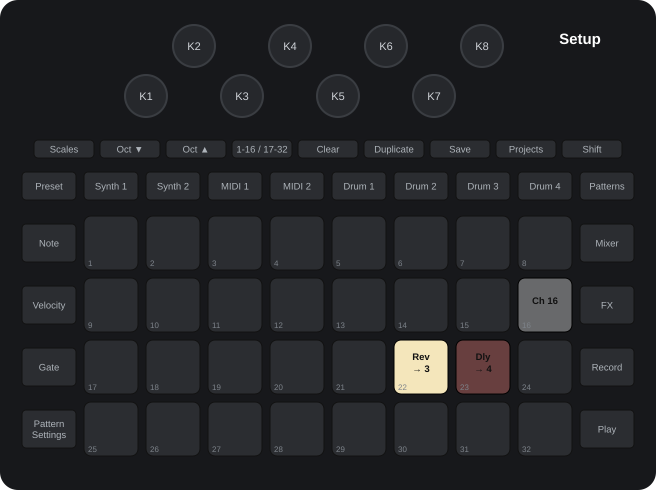

*Setup: pad 22 = reverb return through strip 3 (cream), pad 23 = delay return through strip 4 (peach).*

| Where | Function |
|---|---|
| Setup, pad 16 | Channel 16 (project and FX): receive and send |
| Setup, pad 22 | The reverb return goes through mixer strip 3 |
| Setup, pad 23 | The delay return goes through strip 4 |
| Setup, channels | MIDI 1 / 2 may use a channel already used by another track |
| Advanced Setup, Duplicate | MIDI Thru: Thru → Out 2 → **Merge** → **Filter** (**since RC2**) |
| Advanced Setup, pad 23 | **USB merge**: the DIN In also to the USB out, without the DIN In's clock with Clock Tx (**since RC4**) |
| Advanced Setup, pad 22 | **Delayed save**: saving the project while it plays waits until you stop; off by default, as the original (**since RC4.05**) |
| Setup, Note | **External keyboard to the arpeggiator** (green on / dim red off, the default) (**since RC4**) |
| Advanced Setup, K1 | The pads' **velocity curve** (−8 … +8; the centre = the original; the number on the pads and Velocity lit while turning) (**since RC4**) |
| Setup, pad 29 / 30 | Listen / output channel of the project’s Program Changes (**since RC2**) |
| Any view, Shift + Clear | Metronome: off / on / count-in only / count-in and metronome (**since RC2**) |
| Setup, K4 / K5-K8 | General MIDI mode of the drums and the GM note of Drum 1-4 (**since RC4**) |

- **Internal loopback:** if a MIDI track shares its channel with a synth or the drums, what it sends reaches them internally.
- Pads 22 / 23 light cream (reverb) and peach (delay), the colours of the FX view; dim = off.

##### Metronome and count-in (since RC2)
**Shift + Clear**, in any view, walks four states (the original only turned the metronome on and off):

| State | Clear LED while Shift is held |
|---|---|
| No metronome | red |
| Metronome | green |
| Count-in only | magenta |
| Count-in and metronome | teal |

- With the count-in, **Record armed and Play from stopped**: one bar of count-in plays (4 clicks, the stock metronome's sound, at the project's tempo) with Record blinking red; then recording starts. **Play** during the count cancels it.
- Without Record armed, Play starts at once, as always.
- The metronome is the stock setting; the count-in is saved with the project.
- **Click volume:** the stock's, pressing **Tempo/Swing** and turning **K5**. At 0 (**Beta 5.65 only**), Clear flashes orange on each click.
- As the slave of a MIDI clock, the count-in runs at the clock's tempo (**since RC4.07**), not aligned to its bar.

##### MIDI Thru: Merge and Filter (since RC2)
The original only lets the Thru jack be **Thru** (a hardware copy of DIN In, Duplicate dim red) or **Out 2** (a second MIDI output, green). Duplicate in the Advanced Setup view now steps through four modes:

| Mode | Duplicate LED | Out of the Thru jack |
|---|---|---|
| Thru | dim red | DIN In, by hardware |
| Out 2 | green | The device’s MIDI |
| **Merge** | yellow | DIN In and the device’s MIDI |
| **Filter** | blue | DIN In except the messages on the channels the device listens to |

- DIN In SysEx is not copied in Merge / Filter. In Merge, if the device follows the DIN In clock and has Clock Tx on, the Thru jack carries two clocks: switch Clock Tx off.
- It is saved in the settings. With the original firmware, Merge / Filter go back to Out 2.

##### Program Change channels (since RC2)
In the Setup view (not Advanced Setup):

1. **Pad 29 (PGM Rx)**: pads 1-16 show the **listen channel** (white = the chosen one, dim white = the rest). This first touch does not change PGM Rx.
2. Touch a channel pad to pick it.
3. **Pad 29 again** = PGM Rx on / off, as always.
4. **Pad 30 (PGM Tx)**: the same with the **output channel**.
5. A track button or another pad: pads 1-16 show the tracks’ channels again.

- Both are **16** by default, as on the original. They are saved in the settings; with the original firmware they go back to 16.
- **Receive** (PGM Rx): a Program Change on the listen channel picks the project. If the listen channel is not 16, channel 16 no longer picks projects. If it is the channel of Synth 1, Synth 2 or the drums, it goes to that track.
- **Forward**: with PGM Tx, what arrives on the listen channel goes out again on the output channel.
- **Send** (PGM Tx): a project picked on the panel sends its Program Change on the output channel. The project’s CCs stay on 16.
- In Setup, Synth 1 / 2 pick their track also when you entered Setup from their view (before, they arrived as Preset).
- Patch flip (B8) still goes out on its MIDI track’s channel, never on the general output channel.

##### General MIDI mode of the drums (since RC4)
To play a General MIDI drum module or plugin with the device's drums. In the Setup view (not in Advanced Setup):

| Knob | What it does |
|---|---|
| **K4** | GM mode: to the right on (green), to the left off (dim; it closes the number and the drums go out as on stock). Saved at once |
| **K5-K8** (over the drum tracks) | With the mode on, the GM note of Drum 1-4: 35-81, two clicks a note; by default 36 / 38 / 42 / 46 (kick, snare, closed hat, open hat) |

- While on, every hit of Drum 1-4 (from the sequencer or the pads) goes out over MIDI with its GM note instead of 60 / 62 / 64 / 65, on the Setup's **drums channel** (10 by default). The internal sound does not change.
- **Heard and seen:** every new note sounds once on the drums' channel, and its number is drawn on the 32 pads in the drum's colour. **Shift** or leaving Setup confirms it (saved in the settings) and the Setup pads come back; while the number shows, the Setup pads do nothing.
- LEDs: K4 green / dim; K5-K8 in each drum's colour, brighter for a higher note (dark with the mode off).
- A note already sounding ends with the note it started with, even if you change the GM note or turn the mode off meanwhile.
- Saved in the device settings (bytes nobody uses); the original firmware ignores it.


*Step by step: Send the drums as General MIDI notes · since RC4*


*Step by step: Choose the Program Change channels · since RC2*

*Step by step: Record with the count-in · since RC2*


*Step by step: Choose the MIDI Thru jack's mode · since RC2*


*Step by step: Save while playing without a stumble · since RC4.05*

### 1.2 Advanced Setup view

*How to get there:* Open it as on the original. Besides its stock settings (master compressor, etc.):

**In this view**

- **MIDI Thru, Merge and Filter** *(since RC2)* — the Thru jack can merge the incoming MIDI with the unit's own, or filter it.
- **Velocity curve** *(since RC4)* — K1 makes the pads more sensitive or harder.

*Also used here:* [Side-chain and master compressor on the knobs](#f-sidechain-comp) · [Setup and device MIDI](#f-setup)

- **Duplicate** = mode of the MIDI Thru jack *(since RC2)*: Thru (dim red, DIN In by hardware) → Out 2 (green) → **Merge** (yellow: DIN In + the device's MIDI) → **Filter** (blue: DIN In without the channels the device listens to). No SysEx in Merge / Filter. Saved in the settings.
- **K1 = the pads' velocity curve** *(since RC4)* (in the RCs; the beta has no curve: K1 / K2 of the [Setup view](#setup) are the global velocity): −8 to +8 (2 clicks a step); the centre (0) is the original response, the default. **To the right, more sensitive** (soft hits sound louder); **to the left, harder** (you have to hit harder). While you turn it, the pads show the number (green to the right, orange to the left, white at the centre) and **Velocity** lights for 1.5 s. It applies to every pad in every view; fixed velocity (Shift + Velocity = 96) does not change. Saved in the settings.
- **Pad 23 = USB merge** *(since RC4)*: what comes in on the **DIN In** (a keyboard on a MIDI cable) also goes out over **USB** to the computer, together with the device's own MIDI. Green on, dim off; saved in the settings. With Clock Tx on, the DIN In's clock and transport are not copied (the computer would get two clocks); SysEx is not copied; what comes in over USB is not sent on.
- **K3 = external input gain** *(Beta 5.65 only)*: **0 to +24 dB** (2 clicks per dB); 0 = as the original, the default. Raises the maximum level of what comes in through the audio inputs (MIDI 1 / 2's in the Mixer), also what reaches the own synth and the granular; with a lot of gain it clips. While you turn it, the pads show the dB for 1.5 s and K3's LED is brighter the more gain. Saved in the settings.
- **Pad 22 = delayed save** *(since RC4.05)*: off (the default), Save saves at once, as the original. On, saving with the sequencer running waits until you stop, so the clock does not stumble ([what happens while it waits](#guardado)). Green on, dim off; saved in the settings.
- The master compressor's attack / release are set in the Sidechain view, K7 / K8.

*Step by step: Choose the MIDI Thru jack's mode · since RC2*

*Step by step: Save while playing without a stumble · since RC4.05*

## 2. Stock synths (Synth 1 / 2)

### 2.1 Synth 1 / 2 track view (Note, Velocity, Gate)

*How to get there:* Press **Synth 1** or **Synth 2**. The pads play the synth as always.

**In this view**

- **Source view** — the synth can process an audio input instead of its noise.
- **Split keyboard** *(since RC2)* — one synth on top and the other below, each with its scale, octave and velocity; *(since RC2.02)* with any pair of note tracks.

**Features in this view:** [A14 Split keyboard Synth 1 + Synth 2](#f-teclado-partido) · [C17 Chord screen (since RC4)](#f-acordes)

*Also used here:* [Synth source view](#f-fuente-sinte) · [Automation of the MIDI engine](#f-automatizacion) · [Arpeggiator (since RC2)](#f-arpegiador) · [Custom scale (since RC2)](#f-escala-propia)

- **Pressing the same button again** (with its view on screen) opens the synth's **source view** (2.3).
- **Synth 1 + Synth 2 together** (hold one, press the other) opens the **split keyboard** *(since RC2)*; *(since RC2.02)* **any pair of note tracks** (Synth 1, Synth 2, MIDI 1, MIDI 2: hold one button and press another):
- the top two rows play the track you held first and the bottom two the other one, each with its scale, octave, velocity and colours (in RC2: Synth 1 always on top);
- the knobs and Octave are those of the track you pressed first; a drum button does not open the split keyboard;
- *(since RC4)* **hold a track button** (Synth 1 / 2, MIDI 1 / 2, Drum 1-4) with the split keyboard open: while you hold it, **the 8 knobs (and their lights) are that track's**; let go and they go back to the first one;
- any track button (*(since RC4)* a short tap, no knob turned) or view button closes it (held notes are released); Play, Record, Octave and Shift do not.
- The macro knobs work as always; their destinations can be edited on the device (source view, pad 32).
- **Velocity view, Shift + a step pad** *(since RC4)* (Synth 1 / 2 and MIDI 1 / 2): that step **lets go of the automation**: no lane plays there and the parameters the automation had moved go back to **the project's values** *(since RC4.02; before, to their knob's position)*: on Synth 1 / 2, the macros of the patch as the project saved it (or as it was loaded: turning knobs afterwards does not count); on MIDI 1 / 2, the own synth saved with the project (a project without it: its defaults). A knob turned by hand after the automation stays where you left it. Again = off. With Shift, in the Velocity view, the step pads are yellow and the marked ones red; on the 17-32 page, steps 17-32. Saved with the pattern. *(Beta 5.65 only)* With Shift, the steps **keep their colour** and only **the ones with automation are yellow** (the marked ones, red); **Shift + a yellow step** does not mark it: it **puts its automation values on the knobs and into the sound** until Shift is let go, and letting go puts everything back as it was (Shift + any other step marks or unmarks it as always); meanwhile **the knobs it moves light yellow**, as bright as their value. *(Beta 5.65 only)* **Clear + a step** in the Velocity view (with or without Shift; Clear first, since Shift + Clear is the metronome) **erases that step's knob automation** and keeps its notes, its mark and the level / pan / send automation.
- **Sweep between two steps** *(Beta 5.65 only)* (Synth 1 / 2 and MIDI 1 / 2): in the Velocity view with Shift, **hold a yellow step and press another yellow step**, in either order: every lane with a value at both becomes a straight line between them, on the steps in between (one value a step, what the playback reads). The two ends do not change; a lane with a value at only one of them is left alone. With a step without automation as the second one nothing happens. It is the gesture of the drums' ramps.
- **Snapshot of the macros into a step** *(Beta 5.65 only)*: in the track view (Note), **Record held + a step pad** (pads 1-16; with 17-32, steps 17-32) writes into that step the **macros that are not where the loaded patch keeps them** (where Clear + Synth would put them back), each into its lane. The step keeps its notes and Record stays as it was. Mixer and FX are left alone (scenes already keep them). *(Beta 5.65 only)* While you hold the step, it lights **yellow**.
- **Shift + a key = latch** *(since RC4)* (Synth 1 / 2 and MIDI 1 / 2, Note and expanded Note view, no step held): the note sounds and **keeps sounding when you let go of the pad**; the **next press of that note** (on any pad that has it, with or without Shift) stops it, and that press does nothing else. **While Shift is held, the keys of the latched notes light bright teal**; the other keys keep their colours (without Shift, a sounding note lights white as always). *(Up to Beta 3.39, with Shift the keys lit yellow and the latched ones green; in Beta 3.40, no colours.)* With the **arpeggiator** on, the latched notes stay in the arpeggio: an **arpeggio latch**. **Clear + the track's button** lets go of all its latched notes (and its latched chords). **Shift + a step** (Note view, pads 1-16) with notes latched on the track: **the latched notes are written into that step** (notes already there are not repeated; up to 6 a step; one step long, velocity 100); while Shift is held with notes latched, the step pads light **yellow** (in *(Beta 5.65 only)*, not: the steps keep their colours and the step being written lights **teal**, the latch colour, while it is held, until you let go); with nothing latched, Shift + step is the stock one. On the chord screen, **Shift + a root** latches the whole chord (below). Not on the sample picker (Shift + pad already does something else there); not saved.
- **Chord screen** *(since RC4)* (Synth 1 / 2 and MIDI 1 / 2, only in the **expanded Note view**: Note twice): **Shift + pad 8** turns it on and off (with Shift pad 8 is yellow, green with the screen on).

| Pads | What they do |
|---|---|
| Row 1 | The chord type: major, minor, 7, m7, maj7, sus4, dim, aug. **Shift + pads 1-7**: sus2, 6, m6, add9, 9, 7sus4, fifth (with Shift the row yellow; the chosen one white) |
| Pads 9-12 | The inversion: root position, 1st, 2nd, 3rd (blue; the same again = root position) |
| Pad 13 | Open voicing: the second note an octave up |
| Pad 14 | The root added an octave down |
| Pad 15 | Diatonic: the chord made of thirds of the project's scale (the custom one and Jankó too): 3 notes, 4 when the type has 4 or more |
| Pad 16 | *(Beta 5.65 only)* **Inverse chord**: the chord mirrored downwards from the root, which sounds as the highest note (C major → C A♭ F = F minor; C minor → F major; C7 → Dm7(♭5)). Notes out of the scale fit it as they sound. On the RCs, pad 16 is still the chord latch |
| Rows 3-4 | The roots: the same notes as the Note view's keyboard (scale, root, Octave, Jankó). While you hold the pad its chord sounds, up to 6 notes, with the pad's velocity |

- Pads 13-16 green on, dim off.
- **Two chords at once**: the notes they share sound once and go on until the last chord that has them is let go.
- **With the arpeggiator**: the arpeggio goes on with the track muted in the Mixer (that track's sequence stays silent), and it holds up to **6 notes**: if two chords add up to more, those that do not fit stay out and do not come back when the other is let go.
- **The chord changes at once**: change the type, the inversion or a modifier (pads 13-16) while a chord sounds (held or latched) and the new chord sounds without pressing the root again: the notes that leave stop, the new ones sound and the ones that stay keep sounding. The **arpeggiator** follows the change too (its arpeggio goes on with the new notes).
- **Shift + a root = chord latch**: the whole chord keeps sounding after you let go of the pad, until you **press that root again** (which only stops it), **Clear + the track's button** or the screen goes off; several can be latched at once and they follow the type and modifiers. With Shift, its root lights **bright teal**. In the Note view, **Shift + a step** writes its notes into that step. Pad 16's latch is as before.
- What you play sounds and is recorded with Record as **plain notes of the pattern**: it plays back the same without the chord screen. With the **arpeggiator** on, the chord is arpeggiated from one finger.
- Each track's type and modifiers are **not saved** (lost at power-off).
- On MIDI 1 / 2 in the sample mode, the expanded Note view stays the sample picker.

*Step by step: Latch notes and write them into a step · since RC4*


*Step by step: Make a step let go of the automation · since RC4*

#### A14 Split keyboard Synth 1 + Synth 2

- **Since RC2.** Hold **Synth 1** and press **Synth 2** (or the other way round): the two top rows play the synth you held first and the two bottom rows the other one; **since RC2.02**, any pair of Synth 1, Synth 2, MIDI 1 and MIDI 2.

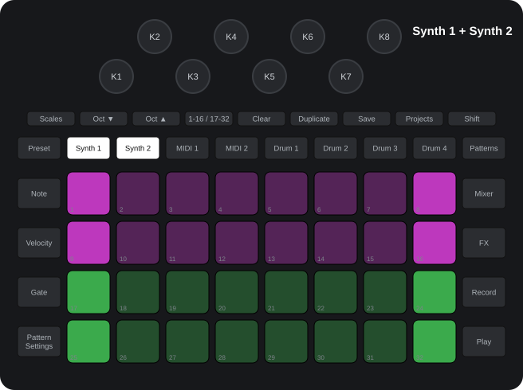

*Split keyboard: rows 1-2 = Synth 1, rows 3-4 = Synth 2.*

- Each half is its synth’s keyboard: its scale, octave and velocity (the same keys as the lower half of its Note view), in its colours.
- The knobs and Octave belong to the synth you pressed first.
- **Leaving:** any track or view button (Note, Preset, Mixer, FX, a single Synth…). Held notes are released. Play, Record, Octave and Shift do not close it.
- Synth 1 or Synth 2 alone work as always (twice = the source view, A6).
- **Since RC2.02: any pair of note tracks** (Synth 1, Synth 2, MIDI 1, MIDI 2): hold one button and press another; the top rows play the one you held first (in RC2, Synth 1 always on top). The drum buttons do not open it.
- **since RC4 — another track's knobs:** with the split keyboard open, **hold a track button** (Synth 1 / 2, MIDI 1 / 2, Drum 1-4): while you hold it, the 8 knobs (and their lights) are that track's; let go and they go back to the first one. A short tap (no knob turned) closes it as always.


*Step by step: Split the keyboard between two tracks · since RC2*

#### C17 Chord screen (since RC4)

- **Since RC4.** In the **expanded Note view** of Synth 1 / 2 and MIDI 1 / 2, **Shift + pad 8** opens the chord screen: row 1 the type, row 2 the inversion and the modifiers, rows 3-4 the roots; each root plays its chord while it is held.

- **Row 1:** major, minor, 7, m7, maj7, sus4, dim, aug; **Shift + pads 1-7**: sus2, 6, m6, add9, 9, 7sus4, fifth (yellow with Shift, the chosen one white; Shift + pad 8 = on / off).
- **Row 2:** pads 9-12 the inversion (root position, 1st, 2nd, 3rd; blue), pad 13 open voicing, pad 14 the root an octave down, pad 15 diatonic (thirds of the project's scale, the custom one and Jankó too), pad 16 latch.
- **Rows 3-4:** the roots, the same notes as the Note view's keyboard (scale, root, Octave, Jankó); up to 6 notes, with the pad's velocity.
- It sounds and is recorded with Record as plain notes of the pattern (it plays back the same without the screen); the arpeggiator arpeggiates the chord. The type and the modifiers are not saved.


*Step by step: Play chords from one pad · since RC4*

### 2.2 Scales view and custom scale

*How to get there:* Press **Scales** as always (root and stock scale); **Shift + Scales** for the custom scale.

**In this view**

- **Custom scale** *(since RC2)* — up to 7 notes over the root and a free period (for example, a scale that repeats every 7 semitones). The note tracks' pads, the quantising and random-mutate use it; saved with the project.

**Features in this view:** [C16 Custom scale (since RC2)](#f-escala-propia)

*Also used here:* [Chromatic and scale view of the drums](#f-cromatica)

- **Shift + Scales** opens the Scales view with the **custom scale editor** *(since RC2)*; with Shift held the Scales button shows yellow. Scales again, Shift + Scales or another view close it. *(since RC4)*: **Scales twice** = Shift + Scales (with the Scales view on screen, Scales opens and closes the editor).
- **The editor's keyboard** is two octaves of a piano from the **root** (the Scales view's, picked as always out of the editor): row 4 = the white keys of the first octave (root, +2, +4, +5, +7, +9, +11, +12), row 3 = its black keys; rows 2 / 1 = the second octave (+12 … +24).
- **Pressing a key** adds or removes it (up to **7**). The highest one pressed is the **period**: the root of the next iteration (not necessarily the octave); the others are the scale's notes. Colours: root white, notes green, period blue, free keys dim.
- **On the note tracks** (Synth 1 / 2, MIDI 1 / 2) every row of pads is **one iteration**: its notes and the period note at the end, like the octaves of a stock scale. With **4 notes or fewer**, **two iterations a row** (one in each half). Octave ▼ / ▲ move one row.
- The custom scale also drives **which notes of the sequence light up**, the quantising and **random-mutate** (another note of the same iteration).
- **Picking a stock scale** (pads 17-32 out of the editor) switches the custom scale off; the keys are kept: going back to the editor switches it on again. While it is on, no stock scale shows as selected.
- Saved **with the project**; a new project starts without a custom scale.
- **Jankó** *(since RC4)*: in the editor, **Shift + pad 8** (top right; yellow with Shift) turns on the **isomorphic Jankó layout** (pad 8 teal while on): on the note tracks every column goes up a **whole tone** and the rows come **in pairs**, as on the stock's chromatic keyboard: the lower one starts on the Scales view's **root** (with root C: C D E F♯ G♯ A♯ C D) and the one above is **a semitone lower** (B C♯ D♯ F G A B C♯). Every chord type has the same shape in any key. The **root** pads show in the stock's root colour. All 12 notes are there: the notes that sound light on their pads and random-mutate picks any of the 12 of its octave. **Octave ▼ / ▲: a tap = a semitone; held for about half a second = an octave** from where it was (Shift + Octave still transposes the pattern an octave). The same pad again, a key of the editor or a stock scale turn it off. Saved with the project. On the RCs, in the expanded Note view the upper pair is the lower one an octave up and **Shift + pad 24** turns on the earlier layout (every row a semitone above the one below). *(Beta 5.65 only)* **One layout, Shift + pad 8:** in the expanded Note view the upper pair **repeats** the lower one and pad 24 does nothing; a project saved with either earlier layout opens with this one. **Each pair moves on its own:** in the expanded Note view, with a key held, Octave moves **only the pair the key does not belong to** by a semitone (held for about half a second, an octave from where it was); the key keeps sounding. With keys held in both pairs nothing moves. With no key held, in the Note view and on the chord screen, Octave moves both. The distance between the pairs is not saved: it goes back to 0 at power-off. *(Beta 5.65 only)* **Keys held in rows 2 and 4** (at least one in each, none in rows 1 / 3): Octave moves **only rows 1 and 3** (the upper row of each pair), a semitone a tap, an octave held; not saved either.

#### C16 Custom scale (since RC2)

- **Since RC2.** **Shift + Scales** = an editor of a custom scale for the note tracks: up to 7 notes over the root and any **period** (up to 24 semitones) that is the root of the next iteration; every row of pads is one iteration (two with 4 notes or fewer). Saved with the project.

- The editor's keyboard: two octaves of a piano from the root (rows 4 / 3 the first octave, white / black; rows 2 / 1 the second). The highest key pressed is the period (blue), the others the notes (green).
- It drives playing, the lit notes of the sequence, quantising and random-mutate. A stock scale switches it off; the editor switches it on again.
- **since RC4 — Jankó:** in the editor, **Shift + pad 8** turns on the isomorphic Jankó layout: every column a whole tone up; the rows come in pairs as on the stock's chromatic keyboard: the lower one starts on the root and the one above is a semitone lower (C D E F♯… / B C♯ D♯ F…); in the expanded Note view the upper pair is an octave up. **Shift + pad 24** = the earlier layout (every row a semitone above the one below). Every chord type has the same shape in any key; the root pads in the root colour. All 12 notes are in the scale (they all light, random-mutate picks any of its octave). Octave: a tap = a semitone, held = an octave; Shift + Octave still transposes the pattern. Saved with the project. **Beta 5.65 only:** one layout (Shift + pad 8): in the expanded Note view the upper pair repeats the lower one; with a key held, Octave moves only the pair the key does not belong to; pad 24 does nothing.


*Step by step: Make a custom scale · since RC2*


*Step by step: Switch on the Jankó layout · since RC4*

### 2.3 Synth source view

*How to get there:* With the Synth 1 / 2 view on screen, **press its button again** (*since RC4*: or **Shift + Synth 1 / 2** from any view). Any button closes it.

**In this view**

- **Noise source** — replaces the patch's noise with audio input 1 or 2 (normal or inverted): the synth's filter, envelopes and effects process your outside signal in time with the notes.
- **Macro destinations** *(since RC2)* — decide what each macro knob moves (up to 4 destinations a macro, with their range and depth) without Components.
- **The synth's step-drummer** — sequences the macros by pairs of steps: each knob sets a macro's position on two steps of the pattern.

**Features in this view:** [A6 Synth source view](#f-fuente-sinte) · [A18 Macro knob destinations](#f-destinos-macro) · [D8 Audio inputs and returns](#f-entradas)

*Also used here:* [Step-drummer](#f-step-drummer)

#### Pads 25-30: the source
| Pad | Source of the synth's noise |
|---|---|
| 25 | Noise (normal) |
| 26 | Audio input 1 |
| 27 | Audio input 2 |
| 28 | Input 1, phase inverted |
| 29 | Input 2, phase inverted |
| 30 | Opens the synth's **step-drummer** (below) |

- The patch needs some noise level (CC 56) for the source to be heard. The source is saved with the project.
- If Setup routes the reverb / delay returns through strips 3 / 4, that signal is what reaches the synth.

#### Pad 32: editor of the macro knob destinations *(since RC2)*
Every macro knob has 4 slots; every slot, a destination, a span of the travel (start and end) and a depth.
1. **Pad 32** (teal) = editor on; the knobs no longer move the macros.
2. **Turn a knob** to pick its macro (white LED); the first turn changes nothing.
3. The knob changes the current field; **Octave ▼ / ▲** = next / previous field: slot (1-4, yellow) → start (green) → end (amber) → destination (white = CC; light blue, magenta, violet = NRPN of banks 0, 1, 2) → depth (teal positive, red negative). The pads draw the number.
4. Any pad releases the macro; pad 32 turns the editor off.
- The destination walks first the 31 parameters with a CC (by number), then the 39 that only have an NRPN. Changes sound at once; to keep them in the pack, save the patch (Preset view).

#### Pad 30: the synth's step-drummer
The step-drummer view is the MIDI tracks' one ([step-drummer view](#step-drummer)): pads 1-16 steps, 17-24 = **macro 1-8** as destination, K1-K8 = the 8 step pairs. Each pair's value is the macro's position, written as automation; an empty pair starts at 0 *(since RC2)* (it started at the macro's present position).
- *(since RC2)* Play and Record no longer close the synth's step-drummer; if you go to another view, **pressing Synth 1 / 2** opens it again (until you close it with pad 30).

#### A6 Synth source view

- With Synth 1 / 2 on screen, **press its button again**: pads 25-29 pick the source (noise, inputs, inverted inputs), pad 30 = step-drummer.

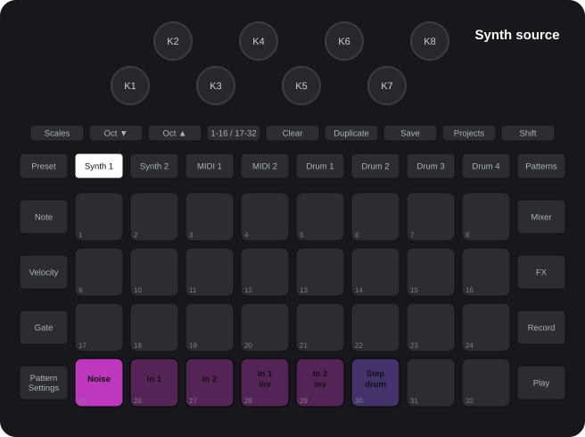

*Synth source view (Synth 1 / 2 pressed twice).*

1. With the Synth 1 or Synth 2 view on screen, press its button again.
2. Pick the source:

| Pad | Source |
|---|---|
| 25 | Noise (normal) |
| 26 | Input 1 |
| 27 | Input 2 |
| 28 | Input 1, phase inverted |
| 29 | Input 2, phase inverted |
| 30 | Step-drummer of the synth (C2) |

3. Any button closes the view.

- The patch needs some noise level (CC 56) for the source to be heard.
- If Setup routes the reverb / delay return to strip 3 / 4, that is the signal the synth receives.
- The source is saved with the project.

#### A18 Macro knob destinations

- **Since RC2.** In the synth source view (A6), **pad 32** opens the editor: a knob picks its macro, **Octave ▼ / ▲** steps the field and the pads draw the number.

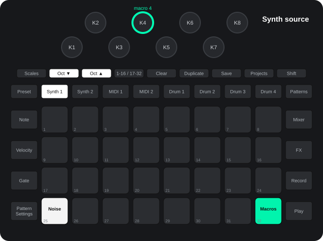

*Source view with the macro editor: pad 32 lit, the picked knob white.*

Each of the 8 macro knobs of a patch has 4 slots, and each slot a destination, a stretch of the knob’s travel (start and end) and a depth. On the original they can only be edited with Components.

1. Source view: with Synth 1 / 2 on screen, press its button again. **Pad 32** (teal) = editor on; the knobs no longer move the macros.
2. **Turn a knob** = you pick its macro (its LED white). The first turn changes nothing.
3. The knob changes the current field; **Octave ▼** = next field, **Octave ▲** = previous:

| Field | Value | Colour of the number |
|---|---|---|
| Slot | 1-4 | yellow |
| Start | 0-127 | green |
| End | 0-127 | amber |
| Destination | its CC or NRPN number | white = CC; light blue, magenta, violet = NRPN of banks 0, 1, 2 |
| Depth | 0-63 | teal = positive, red = negative |

4. **Any pad** drops the macro (the pads of the source view come back); pad 32 turns the editor off; any view button closes it.

- **Destination:** the knob first walks the 31 parameters that have a CC, by CC number (5, 20, 21 … 91, 93), then the 39 that only have an NRPN (envelopes 2 and 3, LFOs, chorus, depths of the modulation matrix). The numbers are those of Novation’s *Programmer’s Reference Guide*: e.g. 74 = filter cutoff, 71 = resonance.
- The changes are heard at once and live in the project’s patch. To keep them in the pack, save the patch (A15).


*Step by step: Edit the macro knobs' destinations · since RC2*

#### D8 Audio inputs and returns

- Line input (normal or inverted) as a synth source; reverb / delay returns through strips 3 / 4 with feedback.

- The synths can use input 1 / 2 (or inverted) instead of the noise (A6).
- With the Setup returns on strips 3 / 4, the sends of those strips send the return again, already processed by the VCF / FX of the track, to the reverb and the delay.

### 2.4 Synth 1 / 2 Preset view

*How to get there:* Press **Preset** with Synth 1 / 2 selected. The pads pick a patch as always (4 pages, the pack's 128 patches).

**In this view**

- **Patches by category** *(Beta 5.65 only)* — each patch in the colour of its Components category; the category is picked when saving.
- **Patch morph** *(Beta 5.65 only)* — hold several patches and move between them with a knob, LFOs and an envelope.
- **Save the patch** *(since RC2)* — stores the sound as you left it into the pack (the original only saves patches from Components).
- **Swap and copy** — reorder the pack's patches or take one to another pack.

**Features in this view:** [A15 Synth patch colours](#f-colores-patch) · [C1 Patch morph (Beta 5.65 only)](#f-morph) · [A17 Saving the synth’s patch into the pack](#f-guardar-patch)

*Also used here:* [Pack management on the device](#f-pack) · [Shift + Preset = the project's sound (Beta 5.65 only)](#f-proyecto-init)

| Gesture | What it does |
|---|---|
| Patch colours | *Since RC4.10*: the original's, the patches in the track colour and the chosen one white (RC2 to RC4.08 used the voice mode's colour: its card reads sometimes loaded the initial patch). |
| *(Beta 5.65 only)* Colours by **category** | Each patch in the colour of its **Components category**: Arp teal, Bass steel blue, Bell light blue, Classic amber, Drum orange, Keyboard pale lime, Lead yellow, Movement violet, Pad blue, Poly green, SFX red, String peach, User sand, Voc lavender; None = the track colour, **empty slot dim white**, the chosen one white. The card is read on entering the view, on a new page or pack and after a save or a copy, never on a patch tap. |
| **Clear + pad**, **Clear + the same pad** within ~5 s *(since RC2)* | **Saves** the patch as it sounds (knobs, received MIDI, macro destinations) into that slot. The first touch asks (blinks white); another pad moves the question *(writes to the card)*. |
| *(Beta 5.65 only)* **K1** while it asks | Picks the **category** to save (None, Arp, Bass… Voc; 4 clicks each; it starts at the patch's own): K1 and the slot in its colour, the other knobs dark and inactive. Confirming saves it with that category. |
| **Duplicate + pad A + pad B** (same pack) | Swaps the two patches. |
| **Duplicate + pad A**, load another pack, **Duplicate + pad B** | Copies patch A over B in the other pack (A's pack does not change); B may be empty *(writes to the card)*. |

- The original cannot save patches from the device. The saved patch keeps the name of the one that was loaded.
- Not in the internal memory's pack (read-only for the mod): the Save LED turns red.
- **Patch morph** *(Beta 5.65 only)*: in the Preset view, **hold two to four patches** for 0.4 s (or hold them + Duplicate): the **morph view** opens and moves from one held patch to the next, in pad order. Only the knobs work: **K1** = the position along the chain; **K2** = square LFO (depth); **K3** = the rate of both LFOs; **K4** = random-step LFO (depth; a new value every half cycle); **K5** = the **slow morph**'s destination; **K6** = its length (fully left, at once; then ¼ to 32 bars of the project's tempo: further right, longer); **K7 / K8** = envelope (depth / time); **K8** also smooths both LFOs (further right, slower changes). The depths to the right go towards the chain's end. **Slow morph:** turn K5 and leave it for half a second: the sound moves from K1 to K5 over K6's time and, once there, K1 takes K5's value; turning K5 again re-aims from where the sound is; turning K1 stops it there. **K1 and K5 in colour:** patch 1 red, 2 yellow, 3 green, 4 blue, with shades in between. **Clear + knob** = 0 (Clear stays in the view); **Clear + the track button** = every knob to 0. **Pads 1 / 8** = the envelope from the top, **held while you hold them**; K8 sets only the fall (on Synth 1 / 2, since Beta 5.56, the attack reaches the whole patch at once). **Pad 32** (red) = out. **Preset** = the patches, the chain's in white: a tap loads that patch and leaves; holding 0.4 s = a new chain with the knobs as they are. The morph keeps going in the other views; the **track button** brings the morph view back (from it, to the Note view). **One morph at a time:** holding patches for 0.4 s in another track's Preset view opens that track's morph and stops the previous one (its sound stays where it is); a tap on another track only loads that patch. Continuous parameters blend; type parameters (wave, algorithm, mode…) take the nearest patch's. Nothing is saved.


*Step by step: Swap two Synth 1 / 2 patches*


*Step by step: Copy a Synth 1 / 2 patch to another pack*

#### A15 Synth patch colours

- **From RC2 to RC4.08** every patch of the Synth 1 / 2 Preset view was drawn by its voice mode. **Since RC4.10** the colours are the original's: those card reads sometimes loaded the initial patch. **Beta 5.65 only:** each patch in the colour of its **Components category**.

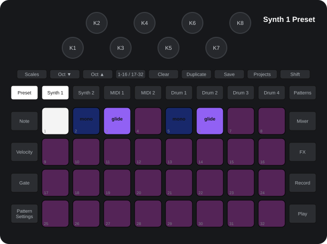

*Preset view of Synth 1 from RC2 to RC4.08: mono dark blue, glide lavender, poly the track colour.*

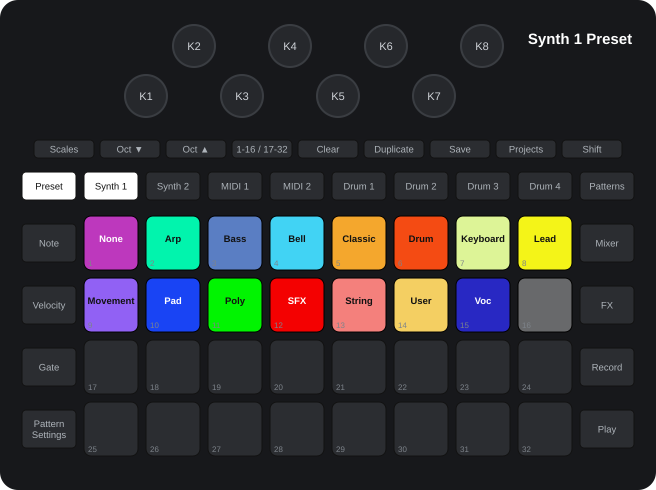

*Beta 5.65 only: Synth 1's Preset view with one patch of each Components category; pad 1 = None (the track's colour), pad 16 = an empty slot (dim white).*

- **Since RC4.10:** the patches in the track colour and the chosen one white, as on the original.
- **Beta 5.65 only:** the colour of the patch's category (Arp teal, Bass steel blue, Bell light blue, Classic amber, Drum orange, Keyboard pale lime, Lead yellow, Movement violet, Pad blue, Poly green, SFX red, String peach, User sand, Voc lavender); None = the track colour; **empty slot = dim white**; the chosen one white. The card is read on entering the view, on a new page or pack and after a save or a copy, never on a patch tap. When saving (Clear + pad), **K1** picks the category.
- RC2 to RC4.08: mono = dark blue; mono with glide (Mono AG) = lavender; poly = the track colour.
- In Advanced Setup pads 22 / 23 no longer light up (they never did anything there).

#### C1 Patch morph (Beta 5.65 only)

- **Beta 5.65 only.** In the Preset view of Synth 1 / 2 or MIDI 1 / 2 (own synth, with its 8-operator FM): **hold two to four patches** for 0.4 s and a knob moves from one to the next, with LFOs, an envelope and a slow morph.

- **K1** = the position along the chain (up to 4 patches, in pad order; in colour: red, yellow, green, blue); **K2** square LFO; **K3** the LFOs' rate; **K4** random-step LFO; **K5 / K6** slow morph: destination (in colour) and length (at once … 32 bars); **K7 / K8** envelope (depth / time; K8 also smooths the LFOs).
- **Slow morph:** K5 left for half a second = the sound moves from K1 to K5 over K6's time; once there, K1 = K5.
- **Pads 1 / 8** = the envelope (at once, held while held; K8 = the fall); **pad 32** = out; **Clear + knob** = 0; **Clear + the track button** = all to 0.
- **Preset** = the patches with the chain's in white: a tap loads one and leaves; holding 0.4 s = a new chain.
- Synth 1 / 2: the morph view is their alternative view (Synth or Preset twice). MIDI 1 / 2: Preset switches between the morph and the slots. The track button brings the morph view back.
- One morph at a time: holding patches for 0.4 s on another track opens its morph and stops the previous one.
- Continuous parameters blend; type parameters take the nearest patch's. Nothing is saved.


*Step by step: Morph between patches · Beta 5.56 only*

#### A17 Saving the synth’s patch into the pack

- **Since RC2.** In the Preset view of Synth 1 / 2: **Clear + pad** asks (it blinks white) and **Clear + the same pad again** saves the patch as it sounds into that slot.

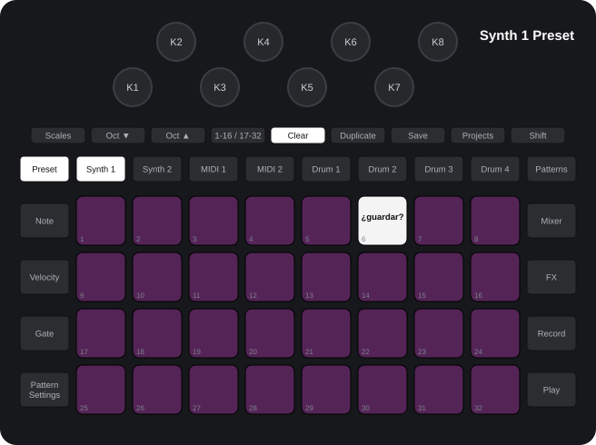

*Preset view of Synth 1: Clear + pad asks (it blinks), Clear + the same pad saves.*

- The original device cannot save patches (only Components can). What is saved is the patch in use with every change: the knobs, what came in over MIDI and the macro destinations (A16).
- **Clear + pad** = a question, nothing is written. **Clear + the same pad** within ~5 s = saved: it replaces the patch that was there and the slot becomes the chosen one. Clear + another pad moves the question; a touch without Clear, or the time, drops it.
- Any of the 4 pages (128 slots). A slot past the end of the bank too: the slots in between stay empty.
- The saved patch keeps the name of the one that was loaded. Synth patches are managed with Components; `tools/patchtool.py slist / sname` lists and renames them on the card.
- The own-synth patch that shares the slot (A14) is not touched.
- Duplicate + A + B still copies / exchanges patches (A8).
- **Beta 5.65 only:** while it asks, **K1** picks the category to save (the other knobs dark); the slot blinks in its colour.
- In the safer build (RC2S) it does not write to the SD card: the Save LED turns red.


*Step by step: Save a Synth 1 / 2 patch · since RC2*

## 3. MIDI tracks (MIDI 1 / 2)

### 3.1 MIDI 1 / 2 Preset view

*How to get there:* Press **MIDI 1** or **MIDI 2**, then **Preset** (*since RC4*: or **MIDI 1 / MIDI 2 again** with its Note view on the screen, or **Shift + MIDI 1 / 2**). Besides the stock templates, the track's own synth lives here.

**In this view**

- **A synth on each MIDI track** — MIDI 1 and 2 sound on the unit itself with their engine (processed line input, oscillator, two oscillators, VA-drum, granular, sample mode; *(since RC4)* FM) and still send MIDI.
- **FX sequencer** — an engine with no sound: it triggers Master FX effects on the steps you choose.
- **Own-synth patches** *(since RC2)* — 64 sounds a pack for those engines, one touch away.
- **Mod matrix** *(since RC2.02)* — eight sources (velocity, note, random, LFO 2, envelope 2, a drum hit, the pattern position, stepped random) that move any parameter of the engine.
- **Patch flip** — every note sends a program change: the outside gear changes sound step by step.
- **Jump sequencer** *(Beta 5.65 only)* — the track's notes make another track's pattern jump to the step they indicate.
- **CC editor** — changes which CC each knob of the template sends, without Components.

**Features in this view:** [A16 Patches of the own synth (MIDI 1 / 2)](#f-patches-midi) · [A20 Own-synth patches to another pack](#f-patches-entre-packs) · [B8 Patch flip on MIDI 1 / 2](#f-patch-flip) · [C2 Engine of the MIDI tracks (pad 27)](#f-motor-midi) · [C22 Jump sequencer of MIDI 1 / 2 (Beta 5.65 only)](#f-saltos) · [C25 Wavetable (Beta 5.65 only)](#f-wavetable)

*Also used here:* [CC editor of the MIDI macros](#f-editor-cc) · [Patch morph (Beta 5.65 only)](#f-morph) · [Shift + Preset = the project's sound (Beta 5.65 only)](#f-proyecto-init) · [Step-drummer](#f-step-drummer) · [FX sequencer](#f-fx-seq) · [Chord screen (since RC4)](#f-acordes) · [Sample mode of the MIDI tracks (since RC2)](#f-modo-muestra) · [4-operator FM (since RC4)](#f-fm4) · [8-operator FM (Beta 5.65 only)](#f-fm8) · [VCA-VCF of the MIDI tracks](#f-vca-vcf) · [VA-drum engine](#f-va-drum) · [Granular synth](#f-granular) · [Audio inputs and returns](#f-entradas)

- **External keyboard** *(since RC2.08)*: notes coming in over MIDI (USB or DIN) on the channel of MIDI 1 / 2 **play its own synth** (before, they were only recorded); they are not sent again to the MIDI out.
- **Patch morph** *(Beta 5.65 only)*: as in the [Synth 1 / 2 Preset view](#synth-preset), with the own synth's slots (engine on; its 8-operator FM too). Here the morph view sits over the Preset view: **Preset** switches between the morph and the slots.
#### Pads
| Pad | Function |
|---|---|
| 1-5 | Engine knob page: 1 VCA-VCF, 2 OSC 1 (granular in that engine), 3 OSC 2, 4 **sequenceable knobs** (*(since RC4)* **Shift + pad 4** = non-sequenceable knobs), 5 modulation. *(Beta 5.65 only)* **Pad 1 = sequenceable knobs** (Shift + pad 1 = non-sequenceable), 2 OSC 1, 3 OSC 2, **pad 4 = Filter / VCA**, 5 modulation (pads 1 and 4 swap places). **Clear + the pad** *(since RC2)*: that page's values (with and without Shift) back to their defaults. *(since RC4)*: a tap keeps the page; **holding the pad ½ s or more** = that page only while you hold it (the previous one comes back on release). |
| 6 | *(since RC2.02)* **Mod matrix** (light blue; see “Mod matrix”). **Clear + pad 6**: every source off. |
| 9-24 | **Own-synth patches** *(since RC2)*: see below. |
| 25 | **CC editor** of the MIDI macros ([CC editor](#midi-cc)). |
| 26 | **Patch flip**: every note of the track goes out as a Program Change (on the track's channel; if that is a synth's or the drums' channel, also internally). Exclusive with the engine. |
| 27 | Track **engine**: off → amber (line input) → green (oscillator) → orange (VA-drum) → magenta (granular) → teal (sample *(since RC2)*) → blue (FX sequencer). *(since RC4)* With the engine off, the pad shows grey (dim white). |
| 28 | One / two oscillators (oscillator and VA-drum). |
| 29 | Chain order: VCA → FX → filter / filter → VCA → FX (in the VCA-VCF page's colour *(since RC2)*). *(Beta 5.65 only)*: **filter → VCA → FX by default**; on, VCA → FX → filter. A saved project or patch keeps the pad, so its order swaps. |
| **Shift + 29** *(since RC2)* | **Gate retrigger**: on (green with Shift, the default) = every new note restarts the envelope; off (yellow) = **legato**: with other notes held, a new note only changes the pitch. *(since RC4)* It steps through the eight **voice modes** of pad 32 (with Shift, in the mode's colour). |
| 30 | Opens the **step-drummer**; **Shift + pad 30** turns it off. |
| 31 | VA-drum only: velocity scales the pitch and filter envelopes. |
| 32 | *(since RC4)* **Voice mode** (a row): see «Voice mode» below. |

#### Voice mode (pad 32) *(since RC4)*
*(Beta 5.65 only)* Pad 32 (and Shift + pad 29) only show and work with an engine that uses them (oscillator, FM, VA-drum, sample); with no voice, VCA / VCF / FX only, granular or the FX sequencer they go dark. With the engine on, **a touch on pad 32** opens the voice modes on **pads 17-24** (modes with the same name share a colour) (the current one bright, the others dim; pads 9-24 do not load patches meanwhile); touching one picks it; pad 32 again (or leaving the view) closes it. Pad 32 always shows the mode's colour. With the row open, **K1 = the glide's amount** (teal: its time; fully left, no glide; up to about 2 s) and **K2 = the unison's detune** (blue; up to ±50 cents between the outer voices). The mode, the time and the detune are saved with the own-synth patch and with the project.

| Pad | Mode |
|---|---|
| 17 (green) | **Retrigger**: every new note restarts the envelope. |
| 18 (yellow) | **Legato**: with other notes held, a new note only changes the pitch. |
| 19 (teal) | **Glide**: like legato (with other keys held the gate is not restarted), but the pitch **slides** from the held note to the new one (K1 = the amount: the glide's time). A note played with none held starts at its pitch and restarts. In the oscillator (one or two), the VA-drum and FM; the sample mode and the granular do not slide. |
| 20 (green) | **Uni retrig**: the voices (4; in FM 6, or 3 with both tracks in FM) play the same note, spread symmetrically by K2; every new note moves them all and restarts the envelope; they sound until every note is let go. In the oscillator (one or two), the VA-drum and FM; in the sample mode, one voice. |
| 21 (yellow) | **Uni legato**: the unison like legato: with other keys held, the voices only change pitch (without restarting the gate nor, in FM and the VA-drum, their own envelopes). |
| 22 (teal) | **Uni glide**: the unison sliding only from a held note to another (legato); a note played with none held starts at its pitch, with no glide, and restarts the envelope. |
| 23 (violet) | **Uni always-glide**: the unison always sliding from the previous note to the new one, even after every key was let go (then the gate restarts); with other keys held, the voices only change pitch. |
| 24 (magenta) | **Poly**: In the **oscillator** (one or **two oscillators**; the supersaw too), the **VA-drum**, **FM** and the **sample mode** (stereo too), **up to 4 notes at once** (in FM, up to 6), each with its own velocity; the envelope, the filter and the effect are the track's and every new note restarts them; letting go of a note while others are held silences it and the last one rings through the release; one note too many takes the oldest one's voice. **In the VA-drum** every hit has **its own pitch and level envelopes and its own noise**: a new hit does not restart the earlier ones and letting go of the note does not cut the hit (the filter is still the track's). **In FM** every note has its own four operators with their envelopes and its own noise, and rings through its release even if you play others; **6 FM voices between the two tracks**: a track alone has 6; with MIDI 1 and MIDI 2 both in FM poly (or unison), 3 each. In granular, one voice. *Since RC4*: each voice is turned down by how many are sounding (one or two notes, the same; four, at 0.71; six, at 0.58), so chords do not clip; **poly is the mode of a project that never chose another**; and when the DSP is about to run out of time (many FM voices with long releases), **the quietest voice already ringing out is switched off** (or, with none, the oldest held note) before any rattle is heard; then it plays with the voices that fit and tries one more every 2 s (the unison modes too, which follow the same level rule). While two or more voices sound, **Synth 1 and Synth 2 do not lose voices** to the time they take (the device used to drop its own when short of time: they went silent until the chord was let go); when time really runs out, the own synth's voices are the ones switched off. |

How many voices each mode gives, the chord level and the voice limiter when the DSP is short of time: [Own-synth voices](#midi-voces).

#### Jump sequencer *(Beta 5.65 only)*
A MIDI track can move another track's pattern: instead of sounding, its notes make that track **jump to the step they indicate**.

- **Pointing (step flip)** *(Beta 5.65 only)*: **pad 26** opens and closes the **flip view** (pad 26 white while open; the mode does not change; it closes by itself when you leave the view and when the engine row opens). On **row 3** you pick the mode, one or the other: **pad 17 = patch flip (PGM seq)**, in pad 26's usual colour; **pad 18 = step flip**, in the target track's colour; the one on bright, the other dim; **tapping the one on turns it off**. With step flip, **row 2** is the eight tracks, in the order of their buttons and in their colours (the track's own dark, the target bright): a tap changes the target. Turning step flip on without picking a target uses **the last target** (Synth 1 from the factory). With the view closed, in step flip **pad 26 blinks** in the target's colour. (Pad 19 is kept for a future morph mode.)
- **Jumps or an engine:** pointing turns the track's engine off, and turning an engine on stops pointing: only one of the two at a time.
- **While pointing, the track plays no notes:** not on its engine, not over MIDI, not on a shared channel. Each of its notes, from the sequencer, the pads or the arpeggiator, is a jump: it lands on the note's own step and the other track goes on from there.
- **Several notes on a step** *(Beta 5.65 only)*: the jump goes to one of their steps **at random**, each with the same chance; every loop picks again. The same with several pads played within one step.
- **Which step:** in its Note view, **pads 17-32 are steps 1-16** and with **Octave ▲ steps 17-32**; in the **expanded Note view the 32 pads are steps 1-32 in order**. When it starts pointing the track goes to steps 1-16, and Octave only moves between 1-16 and 17-32: the Octave that cannot move any further goes dark, both in the expanded view. The scale and the root change nothing: while you see that track, its keyboard is a Jankó layout with a different note on every pad, and the other tracks keep theirs.
- **Everything about a step still applies:** probability, 1 in N, random-mutate. A track muted in the Mixer makes no jump.
- **Pads and other speeds:** a pad while playing jumps on the other track's next step; a slower track waits for its next step. **Stopped, a pad sounds that step of the other track** while you hold it, with no jump (on the drums, its hit with the step's sample flip or, without one, the chosen sample; an empty step is silent). With Record, pads are recorded and jump when played back.
- **Same length:** if the other track and the MIDI track have the same length, a jump is only noticeable the first time: on the next passes the other track is already on that step. To hear it on every pass, use different lengths or two jumps in the pattern: one to move it and one to bring it back.
- A step outside the pattern's first / last plays once and the pattern ends as usual. MIDI 1 and MIDI 2 can point at the same time. **Saved with the project.**

#### Own-synth patches (pads 9-24) *(since RC2)*
- 16 slots per page; **Octave ▼ / ▲** = 4 pages (64 slots per pack, shared by MIDI 1 and MIDI 2); *(since RC4)* **8 pages, 128 slots**.
- **Touch** = load (the tonic sounds while you hold the pad; *(since RC4)*: **Shift + pad** = load without the sound). **Clear + pad** twice = save. *(Beta 5.65 only)* **Duplicate + an empty slot** = save there at once. **Duplicate + A + B** = swap; **Duplicate + A**, another pack, **Duplicate + B** = copy to another pack (Duplicate yellow while one is waiting).
- Colours: dim peach = has a patch, bright = the last used, violet = empty. *(Beta 5.65 only)*: each patch in **its engine's colour** (the pad 27 row's; FM violet; *(Beta 5.65 only)* wavetable sand), bright = the last used; **empty = dim white**.
- A patch stores the whole engine: chosen engine, oscillators, order, every value and the step-drummer setting *(writes to the card)*.
- **Clear + the track button** *(since RC2)* puts every engine value back to its default (the chosen engine stays; *(since RC4)*: the FM's too, and the matrix keeps its destinations with the amounts at zero).

#### The engines (pad 27)
- **Choosing the engine** *(since RC4)*: a tap on **pad 27** opens the **engine row** on **pads 17-23**: off (white), line input, oscillator, VA-drum, granular, sample and FX sequencer, in their colours; the current one bright, the others dim. *(Beta 5.65 only)*: **pads 17-24** = no voice (white), VCA / VCF / FX only (the line input), oscillator, oscillator VA-drum, oscillator wavetable (sand), sample, granular and FM; **the FX sequencer leaves the row: it is pad 31** with «no voice» (dim blue; a tap turns it on, bright, and the row keeps showing «no voice»; another tap turns it off). Tapping one picks it and the row stays open; **pad 27 again** closes it and the patch list comes back (pads 9-24, which load nothing meanwhile). Shift + pad 27 still steps to the next engine (before RC4, every tap of pad 27).
- **Wavetable** *(Beta 5.65 only)* (sand, pad 21): the oscillator reading a table of up to 9 frames, for both oscillators; **K3** of OSC 1 / OSC 2 = the position (in Beta 5.24-5.26, K7), K7 of OSC 1 = LFO → position, Shift + K3 = envelope → position, SHAPE (K4) = warp. While it plays (with the engine row open too), **pad 7 held** = the stock's 16 wavetables (a tap fills the table; **Shift** + a table = only the frame the position (K3) points at, with the same frame of that table) and **pad 8 held** = the pack's samples (Octave = page; a tap puts a cycle of the sample **in the frame the position points at**). Every tap on a list sounds the tonic until the pad is let go. Pad 27 shows sand. *(Beta 5.65 only)* **Clear + pad 7** = the frame the position (K3) points at goes back to its table's (the stock table it had, or the starting one), with the tonic. **Warp** (SHAPE away from the centre): far less aliasing on high notes; in exchange, at the ends it sounds a little duller.
- **Line input** (yellow): the track's audio input (line 1 on MIDI 1, line 2 on MIDI 2) goes through the VCA-VCF; the track's notes trigger it.
- **Oscillator** (green): morph sine → triangle → saw → square, SHAPE, second oscillator (pad 28) with FM, ring, sync and bitwise modes; two notes = paraphony (with one oscillator, *(since RC2)*: the last note has priority and releasing it goes back to the previous one).
- **VA-drum** (orange): one-shot VCA, decay envelopes for pitch (Sustain knob) and filter (Release knob), white noise (LFO speed) and random values instead of the LFO.
- **Granular** (magenta): up to 16 grains from a pack sample or the capture (page 2, next section).
- **FX sequencer** (blue): the track's step-drummer triggers the slots of Master FX's bottom row (6.1).
- **FM** (violet) *(since RC4)*: **pad 24** of the row: a 4-operator FM synth, a variant of the oscillator, with 16 algorithms (classic, percussive, bells and strings) and its knobs on **page 7** (chapter «4-operator FM»).
- The track keeps sending its MIDI with any engine.

#### A16 Patches of the own synth (MIDI 1 / 2)

- **Since RC2.** In the Preset view of MIDI 1 / 2, rows 2 and 3 are 16 patch slots of the track engine: touch = load (the root note sounds), **Clear + pad** twice = save, **Duplicate + A + B** = exchange; **Octave ▼ / ▲** = the pages (**since RC4**: 8 pages, 128 slots per pack; before, 4 pages, 64 slots).

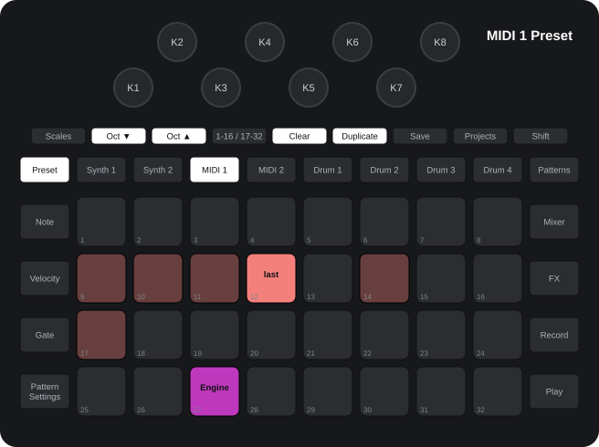

*Preset view of MIDI 1: rows 2-3 = patches of the own synth.*

- A patch holds the whole track engine: the engine chosen (line, oscillator, VA-drum, granular, FX sequencer), two oscillators, the chain order, every value of every page and the step-drummer setting (enabled and destination). The steps of the step-drummer and of the FX sequencer belong to the pattern: they travel with the project.
- The 64 slots (**since RC4**: 128, 8 pages) belong to the pack and are shared by MIDI 1 and MIDI 2: a patch saved from one track can be loaded into the other.
- **Load:** touch a slot. While you hold the pad, the root of the scale sounds on that track with the patch just loaded.
- **Save:** **Clear + pad** = the slot blinks white (a question); **Clear + the same pad again** within ~5 s = saved, replacing what was there. Clear + another pad moves the question.
- **Exchange:** hold **Duplicate**, touch slot A (it blinks) and then slot B: they change places. Onto an empty slot, the patch moves. No gesture empties a slot: overwrite it or move it.
- **Initial values:** **Clear + the track button** (MIDI 1 or MIDI 2, with a view of that track on screen and the CC editor closed) puts every value of the engine back to its initial value; the chosen engine stays.
- Colours: dim peach = a slot with a patch; bright peach = the last one loaded or saved; **violet = empty** (touching it does nothing).
- **On the PC:** `tools/patchtool.py` (on the PC, with the card in a reader) treats each patch as a `.ctm` file: `list` shows the 64 slots with their index, name and engine; `copy` uploads a file into a slot, downloads it or copies it between slots and packs; `show` reads the engine and every parameter and `set` changes them (`set bass.ctm filt=90 engine=granular`); `new` makes a patch with the initial values; `name` names it and `clear` empties a slot. The device has no screen: the name is for the tool; Duplicate + A + B moves it with the patch, saving over the slot removes it.
- **Example patches:** [81 `.ctm` files](https://github.com/Ghillermo/CIRCUIT-HACKS-RC/tree/main/docs/patches) (the list with their destinations in `README.md`): 33 classic sounds (ladder, acid, Reese, sub and wobble basses; sync, supersaw and hoover leads; string, PWM and sweep pads; brass, plucks, organ, bell; the VA-drum's kick, snare, hi-hat and effects) and the 48 instruments of the 8-operator FM; each with page 4's and Shift + pad 4's destinations chosen for its sound. Upload them with the card app (**Custom patches → Upload .ctm**). The FM ones and the one-oscillator sub / noise need the beta; what a build does not know is ignored.
- BETA2 / BETA3 had other gestures: Duplicate + pad saved, Clear + pad emptied and the empty slots were dark.
- **Octave ▼** = next page, **Octave ▲** = previous page (lit when there is a page that way). Coming back from Master FX or a synth’s Preset view starts at page 1.
- Where they are kept: in the free space behind each of the pack’s first 64 synth patches (`Patches/`). If that synth patch does not exist yet, it is created from the Initial Patch (with the missing ones before it in the bank).
- They are not shown while the CC editor or the step-drummer is open (those use the pads and Octave).
- In the safer build (RC2S) it does not write to the SD card: the Save LED turns red.


*Step by step: Load, save and swap own-synth patches · since RC2*

#### A20 Own-synth patches to another pack

- **Since RC2.** In the Preset view of MIDI 1 / 2: **Duplicate + slot A**, load another pack and **Duplicate + slot B** copies the patch (engine, parameters and name).

- **Duplicate + slot A** with the source pack loaded: the patch is remembered.
- Load the other pack and go back to the Preset view of MIDI 1 / 2: **Duplicate lights yellow** (a patch is waiting).
- **Duplicate + slot B** writes it there. It serves several slots.
- Inside one pack, Duplicate + A + B still exchanges the two patches.
- Nothing is copied when A is empty or when the destination pack lacks that patch bank.
- In the safer build (RC2S) it does not write to the SD card: the Save LED turns red.


*Step by step: Copy an own-synth patch to another pack · since RC2*

#### B8 Patch flip on MIDI 1 / 2

- Pad 26 of the MIDI Preset view: every note is sent as a Program Change (exclusive with the track engine).

- MIDI 1 / 2 Preset view, **pad 26**: the notes of the track send Program Change.
- It switches off when the track engine is switched on (pad 27), and the other way round.

#### C2 Engine of the MIDI tracks (pad 27)

- **Since RC2.08:** an external keyboard on the channel of MIDI 1 / 2 (USB or DIN) plays its own synth; its notes are not sent again to the MIDI out.
- Pad 27 of the MIDI 1 / 2 Preset view picks the engine: off, **line**, **oscillator**, **VA-drum**, **granular**, **sample** (since RC2), **FX sequencer** and, **since RC4**, **FM**. **Since RC4** a tap opens them as a row on pads 17-24 (tap one to pick it; before, each tap stepped to the next) and Shift + pad 27 steps to the next.
- Pads 1-5 pick the knob page; 28 = two oscillators, 29 = chain order, 30 = step-drummer, 31 = velocity (VA-drum). **since RC2:** Clear + a page pad = the values of that page back to their initial values; rows 2-3 hold patches (A14).

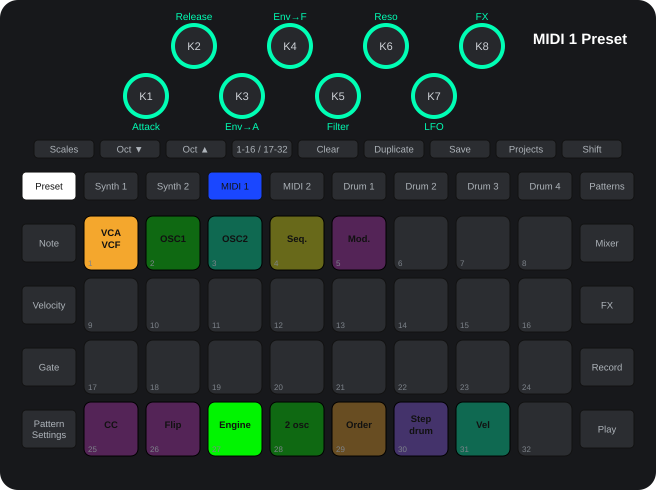

*MIDI 1 Preset view with the oscillator (pad 27 green): page row and engine pads; pad 28 shows only with the oscillator or VA-drum.*

Each MIDI track gets its own “synth”: the track’s **audio input** (line 1 for MIDI 1, line 2 for MIDI 2) or an **internal engine** goes through VCA, effect and filter, with envelope and LFO, before mixer strip 3 / 4. The notes of the track trigger it. The track still sends its MIDI.

**Since RC4:** a tap on pad 27 opens the engines on pads 17-23 (in their colours, the current one bright); tapping one picks it; pad 27 again brings the patch list back. Shift + pad 27 steps to the next.

##### States of pad 27

| Colour | Engine |
|---|---|
| off | the knobs are the normal MIDI macros |
| amber | **line input** through the VCA-VCF |
| green | **oscillator** (D3) |
| orange | **VA-drum** (D4) |
| magenta | **granular** (D5) |
| teal | **sample**: a pack sample one-shot, at the note's pitch (C15, since RC2) |
| blue | **FX sequencer** (C3) |

##### Pads of the Preset view

| Pad | Function |
|---|---|
| 1-5 | Knob page: 1 VCA-VCF, 2 OSC 1 (granular with that engine), 3 OSC 2, 4 sequenceable knobs (**since RC4**: Shift + pad 4 = non-sequenceable), 5 modulation |
| 25 | CC editor (A10) |
| 26 | Patch flip (B8) |
| 27 | Engine |
| 1-5 | Knob page. **Clear + the pad** (since RC2): the values of that page (with and without Shift) go back to their initial values; the engine stays |
| 28 | One / two oscillators (only with the oscillators or VA-drum; dark with the other engines) |
| 29 | Chain order: VCA → FX → filter / filter → VCA → FX (**since RC2**: Shift + 29 = gate retrigger; off = legato; **since RC4**: it steps through the eight voice modes of pad 32) |
| 30 | Step-drummer (C2) |
| 31 | VA-drum only: velocity scales the pitch and filter envelopes |
| 32 | **Since RC4:** voice mode, a row on pads 17-24: retrigger, legato, glide (legato sliding; K1 = its time with the row open), uni retrig, uni legato, uni glide and uni always-glide (unison; K2 = the detune), poly (4 voices in the oscillator (one or two), the VA-drum (envelopes per hit) and the sample mode; in FM 6 between MIDI 1 and MIDI 2; poly is the mode of a project that never chose another); saved with the patch |

##### Page 1 — VCA-VCF

| Knob | Alone | With Shift |
|---|---|---|
| K1 | Attack | Sustain |
| K2 | Release | Decay |
| K3 | Envelope → level | LFO → level |
| K4 | Envelope → filter | LFO → filter |
| K5 | Filter | Filter type (DJ, LP 12, HP 12, BP, notch, LP 24, HP 24) |
| K6 | Resonance | VCA gain (up to +18 dB with saturation) |
| K7 | LFO speed | — |
| K8 | Effect amount | Effect type (soft, hard, folded, wavefold, ring, comb, chorus) |

Type knobs: colour = type, brightness = position inside the type.

##### Page 2 — OSC 1 (with the oscillator / VA-drum)

| Knob | Alone | With Shift |
|---|---|---|
| K1 | TUNE | FINE |
| K2 | SHAPE | MIX OSC 1 ↔ OSC 2 |
| K3 | Envelope → pitch | BITSYNC |
| K4 | Envelope → shape | — |
| K5 | LFO → pitch | — |
| K6 | LFO → shape | — |
| K7 | WAVE (morph sine → triangle → saw → square) | — |
| K8 | LFO → morph | Envelope → morph |

**Beta 5.65 only** (oscillator, VA-drum and wavetable): K1 TUNE / Shift env → pitch, K2 FINE / Shift LFO → pitch, K3 WAVE (on the wavetable, the position) / Shift env → morph, K4 SHAPE (warp) / Shift env → shape, **K5 LFO → FM / Shift env → FM**, **K6 LFO → ring / Shift env → ring**, K7 LFO → morph / Shift LFO → shape, **K8 LFO → mix / Shift env → mix**. Page 3: K1 ratio, K2 detune, K3 WAVE 2, K4 SHAPE 2, **K5 FM with a centre** (right OSC 2 → OSC 1, left OSC 1 → OSC 2, the ends 50 / 50), K6 RING, **K7 classic sync + bitwise**, K8 MIX.

Page 3 (OSC 2): K1 TUNE 2 / FINE 2, K2 SHAPE 2 / FM, Shift + K3 RING, K7 WAVE 2 (**since RC2**: all eight without Shift, K1 TUNE 2, K2 SHAPE 2, K3 MIX, K4 FM, K5 FINE 2, K6 BITSYNC, K7 WAVE 2, K8 RING; **Beta 5.65 only**, except with the granular: K1 OSC 2's ratio (¼, ½, 1, 2 … 31), K2 detune ±50 cents, K3 SHAPE 2, K4 MIX, K5 FM, K6-K8 the same). Page 4 (sequenceable knobs): the 8 sequenceable values (B6). Page 5: ADSR on top, LFO at the bottom (**since RC2**: Shift + K8 = the LFO's shape, six shapes; **Since RC2.02**: seven, with the slewed sample & hold, and the triangle when the project saves none).

- **since RC4:** the whole MIDI 1 / 2 own synth (engine, values, matrix, knob destinations, FM) is saved **with the project** and comes back when it is loaded (in the free bytes of MIDI 1 / 2's patterns 1-5; an older project does not carry it and the sound stays).
- The engine values are saved in the device (not with the project); the OSC 2 ones, the Shift knobs of the granular and the oscillator and pads 28 / 29 too since Beta 1.28 (before, they went back to their defaults at power-up).


*Step by step: Choose an engine on the engine row · since RC4*


*Step by step: Choose the own synth's voice mode · since RC4*

#### C22 Jump sequencer of MIDI 1 / 2 (Beta 5.65 only)

- The notes of a MIDI track make another track's pattern jump to the step they indicate.

- **Beta 5.65 only.** MIDI 1 / 2 Preset view: **pad 26** opens the flip view; on row 3, **pad 17 = patch flip (PGM seq)** and **pad 18 = step flip** (one or the other; tapping the one on turns it off); with step flip, **row 2** is the eight tracks and a tap picks the target (none picked: the last one used). With the view closed, in step flip pad 26 blinks in the target's colour.
- While pointing, the track does not sound: each note, from the sequencer, the pads or the arpeggiator, makes the other track jump on that very step. Pointing turns the engine off and turning an engine on stops pointing.
- Several notes on a step: the jump goes to one of their steps at random, each with the same chance.
- Note view: pads 17-32 = steps 1-16, Octave ▲ = 17-32; expanded Note view: the 32 pads = steps 1-32. The scale changes nothing.
- With the transport stopped, a pad sounds that step of the other track, with no jump.
- Saved with the project.

#### C25 Wavetable (Beta 5.65 only)

- **Beta 5.65 only.** **Pad 21** of the engine row (sand) = the oscillator reading a **wavetable**: both oscillators, the FM / ring / sync between them, the filter, the VCA, polyphony and the voice modes stay as they are.
- **One table per patch, up to 9 frames**, for both oscillators; each its own **position**: **K3** of the OSC 1 / OSC 2 page (WAVE; in Beta 5.24-5.26, K7), K7 = LFO → position, Shift + K3 = envelope → position. **SHAPE** (K2) and envelope / LFO → shape (K4 / K6) = **warp**, a bend of the phase.

- **Nova tables:** with the wavetable playing, **pad 7 held** = the stock synth's 16 wavetables (waves 14-29: sine table, analogue pulse, analogue sync, digital vocal…) on pads 9-24, in sand (the loaded one bright); a tap fills the table with its 9 frames; **Shift** + a table changes only the frame the position (K3) points at (with the same frame of that table). With the engine row open too. The first time the table comes filled with the 7th (digital saw-square).
- **Samples:** **pad 8 held** = the pack's samples on pads 9-32 (Octave ▼ / ▲ = page); a tap puts **one cycle** of that sample **in the frame the position points at** (OSC 1's K3): the device finds its period, cuts it and makes its band-limited versions (it takes a moment).
- **Audition:** every tap on either list sounds the tonic until the pad is let go. With the wavetable, pad 27 shows sand.
- **Clear + pad 7:** the frame the position points at goes back to its table's (the Nova table it had or the starting one).
- **Warp without aliasing:** with SHAPE away from the centre, the band-limited version is chosen for the fastest part of the bent wave (at the ends it sounds a little duller).
- **Wavetable patches in sand** in the own-synth patch list.
- **No aliasing up high:** every frame has 18 band-limited versions (as the stock's); each note uses the one its pitch needs.
- **Saved** with the own-synth patches (the record's padding) and with the project. On a table change the new frames are copied one by one (a moment of mix meanwhile).

### 3.2 Own-synth voices: polyphony and the voice limiter

*How to get there:* With the MIDI 1 / 2 own synth on, **pad 32** of its [Preset view](#midi-preset) picks the voice mode *(since RC4)*. With diagrams and every table of engines, knobs, saving and MIDI: [MIDI tracks and voice modes](https://ghillermo.github.io/CIRCUIT-HACKS-RC/voices.html). Here: how many voices each mode and engine gives, how chords sound and what the device does when the DSP is short of time.

*Also used here:* [Oscillators and paraphony](#f-osciladores)

#### How many voices
| Voice mode | Engine | The track's voices |
|---|---|---|
| Retrigger, legato, glide | all | 1 |
| Poly | oscillator (one or two, the supersaw too), VA-drum, sample | **4** |
| Poly | FM | **6**; with MIDI 1 and MIDI 2 both in FM poly (or FM unison), **3 each** |
| Uni retrig, uni legato, uni glide, uni always-glide | oscillator, VA-drum, FM | the poly ones (4; in FM 6 or 3), all on the same note, spread by K2 (with pad 32's row open) |
| Unison | sample | 1 |
| All | granular | 1 |

- That is **each track's maximum**: MIDI 1 and MIDI 2 have their own; only the FM voices are shared between the two.
- **One note too many** (every voice busy) takes the voice of the track's oldest note, with a 2 ms fade.
- **A released note keeps its voice** while its release rings: with long releases the voices fill up even when you play single notes, and the next note takes the oldest.
- In poly the envelope, filter and effect are the track's: every new note restarts them. In the VA-drum and FM every voice also has its own envelopes and noise, and rings through its whole release.

#### Chord level
Each voice is turned down by how many are sounding, so the sum does not clip: **1 or 2 notes, full level; 3, at 0.82; 4, at 0.71; 5, at 0.63; 6, at 0.58**. The unison modes follow the same rule. A chord sounds louder than a single note, but not twice as loud.

#### When the DSP is short of time: the voice limiter
The DSP computes the audio in blocks, and everything sounding shares its time: the own synth, Synth 1 / 2, the drums, the effects and Master FX. Every own-synth voice takes time; **FM takes the most**, and long releases keep many voices sounding at once. A block that is not ready in time is heard as a **rattle**. To prevent it:
- With **two or more own voices** sounding, the device checks every 2 ms how much time the DSP has left. When it is about to run out, it **switches off one own-synth voice**: the quietest one already ringing out (FM ones before the other engines'); with none ringing out, **the oldest held note**, cut as in a voice steal. At most one voice every 12 ms (every 4 ms when very short).
- Then the track plays **with the voices that fit** (2 at least): a new note first switches off the quietest one ringing out, and the unison uses at most that many. **Every 2 s with no trouble it tries one more voice**, back up to the table's maximum.
- **What you hear:** a long release ending early, or the oldest note of a chord going away when a lot is sounding. How many voices fit depends on the whole project: with Master FX, many drums or Synth 1 / 2 with heavy patches, fewer fit.
- **Synth 1 and Synth 2 do not lose voices to the own synth.** The device has its own limiter for them (when the DSP is short, it switches Synth 1 / 2 voices off); while two or more own voices sound it is not used, and when time runs out it is the own synth's voices that go. With the DSP very short, a new Synth 1 / 2 note may use a voice of its own synth instead of a free one (what the device does under load): a Synth 1 / 2 chord may sound with fewer notes, but it does not go silent.
- With **a single own voice** (the mono modes, or poly with one note) the limiter does not act: the device shares the DSP as always.

#### Tips
- For more voices at once: shorter releases, fewer loud operators in FM, or just one track in FM poly (6 voices instead of 3 + 3). *(Beta 5.65 only)* The FM voices are computed by the DSP's **other core**: 6 a track even with MIDI 1 and MIDI 2 both in FM poly (12 in all), and they take no time from the rest; when that core cannot keep up (about 10 FM voices, about 8 with the granular playing), the limiter switches an FM voice off as above. FM sounds 1.3 ms later than the rest, as the granular does.
- If a long chord loses notes, try the patch with a shorter release or a lighter engine (one oscillator, VA-drum, sample).
- The mono modes (retrigger, legato, glide) use one voice: they never reach the limiter.

### 3.3 Knob pages of the MIDI 1 / 2 engine

*How to get there:* With the engine on, pads 1-5 of the Preset view pick what the 8 knobs do; Shift gives a second layer.

**In this view**

- **VCA-VCF** — level and filter with their envelope and LFO; with Shift, the filter type and the effect type.
- **Oscillators** — a waveform that morphs from sine to square, and a second oscillator with FM, ring and sync.
- **Granular** — turns a sample into textures: grains that read it at another place, speed or direction, to freeze, stretch or slice it.
- **Page 4, sequenceable knobs** — the 8 parameters that can be recorded as automation (*(since RC4)*: with Shift + knob, any of the 33; Record + step = a snapshot of the values).
- *(since RC4)* **Shift + pad 4, non-sequenceable knobs** — 8 knobs with an assignable destination that are not recorded.

**Features in this view:** [B6 Automation of the MIDI engine](#f-automatizacion) · [D2 VCA-VCF of the MIDI tracks](#f-vca-vcf) · [D3 Oscillators and paraphony](#f-osciladores) · [D4 VA-drum engine](#f-va-drum) · [D5 Granular synth](#f-granular)

*Also used here:* [Clear + knob = default value](#f-clear-knob) · [LFO synced to the tempo (since RC4)](#f-lfo-sync) · [Patch morph (Beta 5.65 only)](#f-morph) · [MIDI for everything new](#f-midi-io) · [Engine of the MIDI tracks (pad 27)](#f-motor-midi) · [Wavetable (Beta 5.65 only)](#f-wavetable)

#### Page 1 — VCA-VCF
| Knob | Alone | With Shift |
|---|---|---|
| K1 | Attack | Sustain |
| K2 | Release | Decay |
| K3 | Envelope → level | LFO → level |
| K4 | Envelope → filter | LFO → filter |
| K5 | Filter | Filter type (DJ, LP 12, HP 12, BP, notch, LP 24, HP 24) |
| K6 | Resonance | VCA gain (up to +18 dB with saturation) |
| K7 | LFO speed (bipolar *(since RC4)*: right free, left synced; 0.2) | — |
| K8 | Effect amount | Effect type (soft, hard, fold, wavefold, ring, comb, chorus) |

#### Page 2 — OSC 1 (oscillator and VA-drum)
| Knob | Alone | With Shift |
|---|---|---|
| K1 | TUNE | FINE |
| K2 | SHAPE | MIX OSC 1 ↔ OSC 2 |
| K3 | Envelope → pitch | BITSYNC |
| K4 | Envelope → shape | — |
| K5 | LFO → pitch | — |
| K6 | LFO → shape | — |
| K7 | WAVE (morph); *(since RC4)* in the sample mode, the stereo width | — |
| K8 | LFO → morph | Envelope → morph |

*(Beta 5.65 only)* With the oscillator, the VA-drum and the wavetable the page is another (your parameters are kept, only their knobs change):

| Knob | Alone | With Shift |
|---|---|---|
| K1 | TUNE | Envelope → pitch |
| K2 | FINE | LFO → pitch |
| K3 | WAVE (morph); on the wavetable, the position (the frame); in the sample mode, the stereo width | Envelope → morph |
| K4 | SHAPE (on the wavetable, warp) | Envelope → shape |
| K5 | **LFO → FM** | **Envelope → FM** |
| K6 | **LFO → ring** | **Envelope → ring** |
| K7 | LFO → morph | LFO → shape |
| K8 | **LFO → mix** | **Envelope → mix** |

K5, K6 and K8 are new: how much the engine's LFO and envelope move page 3's FM, ring and mix (centre = none, each side one way; Clear + knob = 0). Saved with the patch and with the project.

*(Beta 5.65 only)* **With a single oscillator** (the oscillator or wavetable engine, two oscillators off) K5, K6 and K8 have their own functions, with their own values (turning two oscillators on brings back the ones above with theirs):

| Knob | Alone | With Shift |
|---|---|---|
| K5 | **Sub-oscillator level** (a square one octave below) | Envelope → sub |
| K6 | **Noise level** | Envelope → noise |
| K8 | LFO → sub | LFO → noise |

The levels go from off (fully left; Clear + knob) to the oscillator's; their LED is brighter the higher the level. The depths are bipolar (centre = none). The sub and the noise go through the filter and the VCA, and in poly every voice has its own. Saved with the patch and with the project.

**What SHAPE does on each waveform** (K2; *(Beta 5.65 only)* K4; SHAPE 2 on OSC 2, the same). The knob's centre is the pure wave (on the saw *(since RC4)*, fully left); the envelope (K4) and the LFO (K6) move SHAPE from the knob's position. With WAVE between two waves, SHAPE acts on both at once, each in its own way:

| Wave (WAVE) | SHAPE left of centre | Centre | SHAPE right of centre |
|---|---|---|---|
| Sine (0) | Nothing: the pure wave | Pure | **Wavefold**: the wave is amplified (up to about 8 times fully right) and folds back on itself: more harmonics the further right. *(since RC4)* On high notes the maximum gain drops so as not to alias: about 6.7 times at note 72, 3.9 an octave higher, 2.4 two octaves higher |
| Triangle (42) | *(since RC4)* **Exponential ramps**: sharp peaks and wide valleys, more harmonics the further left (before RC4, nothing) | Pure | **Wavefold**, as the sine |
| Saw (84) | *(since RC4)* The whole travel: fully left a plain saw; towards the right, a **supersaw** of 7 saws (the centre one and 6 detuned ones that get louder and spread apart; fully right, the full supersaw) | Half a supersaw | The full supersaw fully right |
| Saw before RC4 | The ramp bends upwards (rises fast at first, then flattens) | Straight ramp | The ramp bends downwards (starts flat, rises at the end) |
| Square (126) | An ever narrower pulse (down to about 3 %) | Square (50 %) | An ever narrower pulse the other way (up to about 97 %; it sounds like the left one) |

**Less aliasing** *(since RC4)*: the saw, the supersaw's seven saws and the square / pulse are made with PolyBLEP: on high notes the metallic tones that do not belong to the note are gone (about 40 dB less); low notes sound the same. The sine and the triangle without folding do not change. *(Fix in RC4.08 and Beta 5.28)* The pulse at a width other than 50 % (SHAPE off its centre, or the envelope / LFO moving it) had only one edge corrected: now both (note 96: from −22 to −73 dB of aliasing below 8 kHz). *(Beta 5.65 only)* The antialiasing is a **4-sample BLEP** (it was 2): below 8 kHz, at notes 72 and 96, saw and pulse go from about −60 to about −87 dB and the supersaw from −65 to −95; the top end is a little duller (about −2.5 dB at 10 kHz).

#### Page 2 — granular
| Knob | Alone | With Shift |
|---|---|---|
| K1 | Pitch ±24 st | Fine ±1 st |
| K2 | Position in the sample | Position spread |
| K3 | Scan (centre frozen) | *(since RC4)* **Bipolar**: to the left, the chance of a reversed grain (up to 100 %); to the right, the pitch spread (up to ±24 st). Before RC4: reverse grain probability |
| K4 | Grain size 5-500 ms | *(since RC4)* **Stereo spread** (see below). Before RC4: pitch spread |
| K5 | Density 1-16 grains | Window |
| K6 | Scan zone | Note mode: pitch / slicer / stretch *(since RC2)* |
| K7 | LFO → position | LFO → size |
| K8 | Envelope → position | Source: the capture or a drum's sample *(since RC2)* |

- **Note mode (Shift + K6):** **pitch** = the notes change the grains' pitch; **slicer** = the sample is cut into 16 slices and each note plays one (note 36 the first one, each note up the next one; it starts again every 16 notes); **stretch** *(since RC2)* = the notes change the pitch and the stretch from the position (K2) to the end lasts **K3 steps** (1-64) at any tempo, without changing the pitch, aligned with the start of the transport; stopped, the position stays frozen.

- **Stereo granular** *(since RC4)*: with **Shift + K4** above 0, each grain goes to one side at random, further apart the higher it is; the **track's pan** (Mixer) sets the proportion: centred, half and half; to the right, more grains on the right. The stereo part (what differs between the sides) follows the track's VCA, level, pan, mute and sidechain; the engine's filter and effect and the sends act on the centre only.

#### Pages 3-5
- **Page 3 (OSC 2):** *(since RC2)*: the eight values without Shift, following the printed labels: K1 Oscillator TUNE 2, K2 Osc mod SHAPE 2, K3 Amp envelope MIX OSC 1 ↔ OSC 2, K4 Filter envelope FM, K5 Filter frequency FINE 2, K6 Resonance BITSYNC, K7 Modulation WAVE 2, K8 FX RING (in RC0.9: K1 TUNE 2 / FINE 2, K2 SHAPE 2 / FM, Shift + K3 RING, K7 WAVE 2). *(Beta 5.65 only)* With the oscillator, the VA-drum and the wavetable: **K1 = OSC 2's ratio to its note** (centre = 1; to the left ½ and ¼; to the right 2, 3, 4 … 31, about two clicks a ratio), **K2 = detune** (±50 cents, centre = in tune), K3 WAVE 2, K4 SHAPE 2, **K5 FM**, **K6 RING**, **K7 sync + bitwise**, **K8 MIX OSC 1 ↔ OSC 2** (in Beta 5.25 / 5.26: K3 SHAPE 2, K4 MIX, K5 FM, K6 BITSYNC, K7 WAVE 2, K8 RING). With the granular, page 3 stays as before. With two notes held, OSC 2 plays the second note × its ratio.
  - **K5 FM with a centre** *(Beta 5.65 only)*: its LED: dim at the centre, the track's colour to the right and its lighter shade to the left; past the maximum (the reciprocal, towards 50 / 50), **violet**. At the centre, no FM; to the right **OSC 2 modulates OSC 1** (finer at first: the first half of the travel reaches the maximum); past the maximum, OSC 2 → OSC 1 goes down while **OSC 1 → OSC 2** goes up, to 50 / 50 fully right. To the left, the same with the roles swapped. Older patches and projects load with the same amount of FM in its new place.
  - **K7 sync** *(Beta 5.65 only)*: the sync zone is now the **classic sync**: OSC 2 starts again on every cycle of OSC 1; inside the zone, the knob raises OSC 2 by up to about 32 semitones (the usual sync sweep; the timbre also follows K1 / K2's ratio / detune). The old one (OSC 2 reversed every 1-8 cycles) made subharmonics off the note: it sounded like noise. The bitwise zones (xor, or, nor, and, nand) stay, with a **soft low-pass** on what they add (less white noise).
  - **Less noise in the interactions** *(Beta 5.65 only)*: OSC 1's antialiasing takes FM into account (it used to correct in the wrong place and crackled). Measured in emulation (note 84, noise below 8 kHz): FM saw ← sine from −37 to −63 dB, FM at its maximum from −18 to −57 dB, sync from −5 to −36 dB. **Fix:** in poly (the factory mode) with two oscillators, OSC 2's ratio (K1) other than 1 sent it to the top of the pitch range.
- **Page 4 — sequenceable knobs:** the 8 sequenceable values: with Record + Play their moves are recorded into the pattern (TUNE, Release, Env → level, Env → filter, Filter, Resonance, LFO speed, Effect). *(Beta 5.65 only)* **While recording** (Record armed and playing), turning a knob of the engine that is **not one of these 8** records it into its **extra lane** (below). *(since RC4)*: **Shift + knob** = that knob's **destination**: the engine's 33 parameters in the modulation matrix's order and colours (the LED in its page's colour; 4 clicks a parameter); with **Clear held before Shift**, the factory one. While you pick, **pads 9-24 show where the destination lives**, as when a matrix knob turns: its page's pad bright and that page's knobs (K1-K8 above, Shift + K1-K8 below; the destination bright). The lane records and plays the new destination (what it already held now moves that parameter). They are saved with the own-synth patches (MIDI 1 / 2's Preset view); a patch without them loads the factory ones. *(Beta 5.65 only)* In Beta 5.58 the destination is picked with **Duplicate**: **Duplicate + a knob of another page** of the engine sends its parameter to the first free slot of these 8 (then to the non-sequenceable ones; with all 16 taken, nothing); **Duplicate + a knob here** frees that slot (the knob does nothing, its LED off). With Duplicate held here, each knob in its destination's page colour. Shift + knob no longer changes the destination.
- **Non-sequenceable knobs** *(since RC4)* (**Shift + pad 4**; pad 4 pink while they are on the knobs, dim pink with Shift): 8 knobs with an **assignable destination** like the sequenceable ones (**Shift + knob** = the destination among the 33 parameters, in its page's colour; **Clear held, then Shift + knob** = the factory one; while you pick, pads 9-24 show where it lives). By default: Attack, Decay, Sustain, SHAPE, LFO → filter, Env → pitch, MIX OSC 1 / 2, VCA gain. They move that parameter's value **without recording it** (a destination that is also on the sequenceable knobs is recorded, as from any page). Their destinations are saved with the own patches. *(Beta 5.65 only)* Beta 5.58: **Duplicate + knob**, as the sequenceable ones.
- **Snapshot of the values into a step** *(since RC4)*: in MIDI 1 / 2's track view (engine on), **Record held + a step pad** (pads 1-16; with 17-32, steps 17-32) writes into that step's lanes the parameters that are **not at their initial value** (the one of Clear + knob to the right), and only those. A parameter without a lane takes one whose parameter is at its initial value (in lane order), and that lane is cleared in the pattern first; when they do not fit, the first ones in the matrix's order. The step keeps its notes and Record stays as it was. *(Beta 5.65 only)* Also on **Synth 1 / 2** (their macros) and the **drums** (pitch, decay, distortion, EQ): [Synth 1 / 2 track view](#synth-nota), [a drum's track view](#drum-pista). *(Beta 5.65 only)* While you hold the step, it lights **yellow**.
- **Extra lanes** *(Beta 5.65 only)*: every parameter of the engine that is **not on the sequenceable knobs** has a lane of its own (up to 25 a pattern, on MIDI 1 / 2 × 8 patterns): with Record + Play, turning its knob records it, **two values a step** (at its start and halfway; the sequenceable knobs keep their 6 a step). **Clear + knob to the left** (erases its own, in the pattern shown), the Record + step **snapshot** (parameters without a sequenceable lane go into their extra lane, the destinations unchanged), **Nudge** and the steps that **release the automation** all work. They are saved **in the project's file**, after its 160 780 bytes (about 25 KB more): saving to another slot, the device's project copy, Duplicate and Clear of patterns (between MIDI 1 and MIDI 2), the SD card app and any copy of the pack folder keep them; Components, when the same project is sent back. A Components backup does not carry them, and a project of the internal pack does not save them. On the official firmware or an RC the project loads the same, without them (shown dim in the Projects view).
- **Page 5:** ADSR on top, LFO below. *(since RC2)*: **Shift + K8 = the LFO's shape**: reverse saw (blue, the usual one), saw (magenta), triangle (green), square (red), sine (teal), sample & hold (white: a random value each cycle); *(since RC2.02)*: **slewed sample & hold** (violet: it glides from one random value to the next during each cycle), and **with no shape saved (a new or older project) the triangle** (in RC2: the reverse saw; an own-synth patch from before the shapes still loads the reverse saw). *(since RC4.05)*: sine, sample & hold and slewed sample & hold sound (they used to silence the engine). A step every 4 clicks (*(Beta 5.65 only)*: every 16), K8's LED with Shift in its colour. Saved with the project and in the own-synth patch; with the VA-drum the LFO stays its noise.
- **Page 6** *(since RC2.02)*: the mod matrix (next section).
- **Page 7** *(since RC4)*: with the FM engine, its operators and its algorithm (chapter «4-operator FM»).
- Type knobs show colour (type) and brightness (position within the type). Everything goes out and comes in over CC / NRPN (MIDI reference).

#### B6 Automation of the MIDI engine

- With Record + Play, the 8 values of page 4 of the MIDI engine are recorded into the macro lanes of the pattern.

- Engine page 4, **sequenceable knobs** (pad 4 of the page row): TUNE, Release, Env → level, Env → filter, Filter, Resonance, LFO speed, Effect amount.
- While recording, moving those knobs records the movement; on playback the pattern moves them.
- With the step-drummer on, the TUNE lane is used by the pitch row.
- **since RC4 — letting go of the automation:** Velocity view, Shift + a step pad (Synth 1 / 2 and MIDI 1 / 2) = no lane plays at that step and what the automation had moved goes back to the project's values (*since RC4.02*; before, to its knob's position): Synth 1 / 2, the macros of the patch saved in the project; MIDI 1 / 2, the own synth saved with the project or, without it, its defaults; saved with the pattern.
- **Beta 5.65 only — seeing and hearing a step's automation:** in that view, with Shift, only the steps with automation are yellow (the others keep their colour; the marked ones, red); Shift + a yellow step puts its values on the knobs and into the sound until Shift is let go (it does not mark it).
- **Beta 5.65 only — yellow knobs and erasing a step's automation:** with Shift + a yellow step, the knobs it moves light yellow (brightness = their value); Clear + a step in the Velocity view (with or without Shift) erases that step's knob automation and keeps its notes.
- **since RC4 — destinations:** Shift + a knob of page 4 = that lane's destination (the 33 parameters, the matrix's order and colours, 4 clicks each); Clear held before Shift = the factory one; while you pick, pads 9-24 show where the destination lives (as the matrix's); saved with the own-synth patches.
- **since RC4 — non-sequenceable knobs:** **Shift + pad 4** opens a page of 8 knobs with an assignable destination (Shift + knob, as on the sequenceable ones; pad 4 pink while it is open) that are **not recorded**; by default Attack, Decay, Sustain, SHAPE, LFO → filter, Env → pitch, MIX OSC 1 / 2, VCA gain; the destinations are saved with the own patches.
- **Beta 5.65 only — destinations with Duplicate:** **Duplicate + a knob of another page** of the engine sends its parameter to the first free slot of the sequenceable knobs, then of the non-sequenceable ones (with all 16 taken, nothing); **Duplicate + a knob** of those pages frees its slot. Shift + knob no longer picks the destination.
- **Beta 5.65 only — extra lanes:** every parameter of the engine that is not on the sequenceable knobs has an automation lane of its own (up to 25 a pattern, two values a step: at its start and halfway). They record with Record + Play; Clear + knob, the Record + step snapshot, Nudge and the steps that release the automation work on them. They live in the project's file, after its 160 780 bytes: saving to another slot, the project copy, Duplicate / Clear of patterns, the SD card app, any copy of the folder and Components sending the same project back keep them (not a Components backup).
- **since RC4 — snapshot into a step:** Record held + a step pad (track view) = the parameters not at their initial value, written into that step's lanes; those without a lane take one whose parameter is at its initial value (cleared first); Record stays as it was.
- **Beta 5.65 only — a sweep between two steps:** in that view, with Shift, **hold a yellow step and press another yellow step** (in either order): every lane with a value at both becomes a straight line between them, on the steps in between. The ends do not change; a lane with a value at only one is left alone.
- **Beta 5.65 only — the snapshot on Synth 1 / 2 and the drums too:** Record held + a step pad in Synth 1 / 2's track view = their macros that are not where the loaded patch keeps them, each into its lane; in a drum's = pitch, decay, distortion and EQ that are not at their default (the mod's new knobs have no lane). Mixer and FX are left alone.


*Step by step: Snapshot the sound into a step · since RC4*

*Step by step: Make a step let go of the automation · since RC4*

#### D2 VCA-VCF of the MIDI tracks

- DJ / LP / HP 12 and 24 dB / band pass / notch filters, effects (saturation, folding, wavefold, ring, comb, chorus), VCA with ADSR and LFO.

- Per-voice chain: VCA → effect → filter, or filter → VCA → effect (pad 29).
- State-variable filter with key tracking; 24 dB LP / HP = two stages.
- VCA with ADSR, velocity, gain up to +18 dB with soft saturation.
- LFO with seven shapes (triangle by default; page 5, Shift + K8) to level, filter, pitch, shape and morph.
- The default values let the input through clean.

#### D3 Oscillators and paraphony

- Continuous morph sine → triangle → saw → square, wavefold / slope / width, second oscillator with FM, ring, soft sync and bitwise modes; two paraphonic notes.

- **OSC 1:** WAVE is a continuous morph (0 sine, 42 triangle, 84 saw, 126 square); SHAPE (centre = the pure wave): on the sine and the triangle, right of centre it folds them (wavefold, up to x8; left of centre nothing); on the saw it bends the ramp (left: rises fast and flattens; right: starts flat and rises at the end; **since RC4:** from a plain saw fully left to a **supersaw** of 7 saws fully right, and on the triangle, left of centre, **exponential ramps**); **since RC4: less aliasing** (the saw, the supersaw's saws and the square / pulse with PolyBLEP: on high notes, about 40 dB fewer tones foreign to the note; **fix in RC4.08 and Beta 5.28:** the pulse at a width other than 50 % had its rising edge uncorrected; the wavefold limits its gain on high notes: x6.7 at note 72, x3.9 at 84, x2.4 at 96; **Beta 5.65 only:** a 4-sample BLEP, about −87 dB below 8 kHz; with one oscillator, **sub-oscillator and noise** on K5 / K6 (Shift = envelope) and LFO → sub / noise on K8 / Shift + K8); on the square it changes the pulse width (centre 50 %, towards either end a narrow pulse, 3 % to 97 %). With WAVE between two waves it acts on both. Envelope and LFO move pitch, shape and morph.
- **OSC 2 (pad 28):** its own TUNE / FINE / WAVE / SHAPE; MIX, FM (OSC 2 → OSC 1 phase), RING and BITSYNC (soft sync every N cycles, xor, or, nor, and, nand; **Beta 5.65 only:** classic sync (OSC 2 starts again on every cycle of OSC 1; inside the zone, OSC 2 goes up by about 32 semitones), the bitwise with a soft low-pass, FM with a centre: right OSC 2 → OSC 1, left OSC 1 → OSC 2, the ends 50 / 50, and OSC 1's antialiasing with FM).
- **Paraphony:** one note = unison; two = one per oscillator (**since RC2**: with one oscillator the last note has priority; releasing it goes back to the previous one).

#### D4 VA-drum engine

- Oscillator made for percussion: one-shot VCA, dedicated decay envelopes for pitch (Sustain knob) and filter (Release knob), white noise and random values instead of the LFO.

| Knob | In VA-drum |
|---|---|
| Attack / Decay | VCA attack and decay (one-shot) |
| Sustain | decay of the pitch envelope |
| Release | decay of the filter envelope |
| LFO speed | white noise level |
| LFO → destination | random value per block to that destination |

- Pad 31: velocity also sets the level of the pitch and filter envelopes.
- *Kick:* sine, Decay ~70, Sustain ~30, Env → pitch to the right. *Snare:* more noise, short Decay, band pass.

#### D5 Granular synth

- Up to **16 grains per track** from any sample of the pack or the capture, with interpolation and window.
- K1 pitch, K2 position, K3 scan / freeze, K4 size, K5 density, K6 zone, K7 LFO → position, K8 envelope → position; Shift: fine, sprays, reverse, window, slicer (or stretch, since RC2), LFO → size, source.

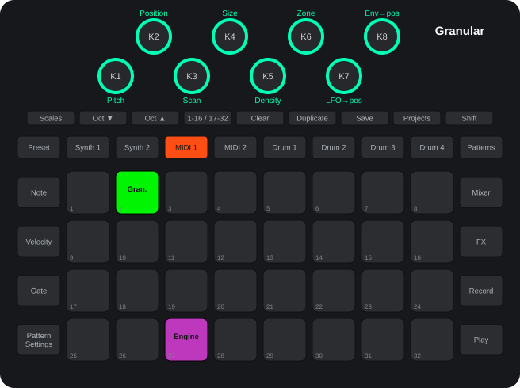

*Granular page (pad 2, magenta engine).*

**Magenta** state of pad 27; **pad 2** of the page row = granular page.

| Knob | Alone | With Shift |
|---|---|---|
| K1 | Pitch, ±24 semitones | Fine, ±1 semitone |
| K2 | Position in the sample | Position spray |
| K3 | Scan: centre = frozen, right moves forward, left backwards | Since RC4: bipolar, left = probability of a reversed grain, right = pitch spray (±24 st). Before RC4: probability of a reversed grain |
| K4 | Grain size, 5-500 ms | Since RC4: stereo spread (each grain to one side; the track's pan sets the proportion). Before RC4: pitch spray (±12 st) |
| K5 | Density, 1-16 overlapping grains | Window: rectangular → triangular → percussive |
| K6 | Length of the scan zone | Note mode: pitch / slicer / stretch (stretch since RC2) |
| K7 | LFO → position | LFO → size |
| K8 | Envelope → position | **Source**: pack sample 1-64, to the left the capture. **since RC2:** a long travel over five zones: the capture (red) and the sample Drum 1 (orange), 2 (yellow), 3 (violet) and 4 (teal) has now; it stays fixed even if the drum changes its sample; dim white = no drum has that sample any more |

- **Pitch mode:** the note changes the pitch of the grains; with two notes they are shared between both.
- **Slicer mode:** the note picks one of 16 slices of the sample.
- **Stretch mode (since RC2):** the stretch from K2 to the end of the sample lasts **K3** steps (1, 2, 3, 4, 6, 8, 12, 16, 24, 32, 48 or 64; K3’s LED shows it) at any tempo, without changing the pitch, and starts again in step with the start of the transport; the notes change the pitch as in pitch mode. With the transport stopped it stands still. K7 / K8 do little in this mode.
- It goes through the VCA-VCF of page 1. It shares its saved values with the oscillator page.

### 3.4 Mod matrix

*How to get there:* *(since RC2.02)* MIDI 1 / 2 with the engine on: Preset view, **pad 6**. The 8 knobs become 8 modulation sources.

**Features in this view:** [C21 Mod matrix of the own synth (since RC2.02)](#f-matriz-mod)

*Also used here:* [LFO synced to the tempo (since RC4)](#f-lfo-sync)

| Knob | Source | With Shift |
|---|---|---|
| K1 | The note's velocity | — |
| K2 | The note (C3 = 0; one octave = a quarter of the travel) | — |
| K3 | Random: a new value at each note | — |
| K4 | LFO 2 | Shape × rate: triangle (green, the initial one), saw (magenta), square (red), sample & hold (white: steps), slewed sample & hold (violet: gliding); the engine LFO's colours; in each shape, 0.05 to 20 Hz ; *(since RC4)*: in each shape, the left half of its stretch synced and the right half free (0.2) |
| K5 | Envelope 2: attack and decay from each note | Attack × decay: attack 0 (white), short (light blue), medium (teal), long (blue); in each, the decay from 20 ms to 4 s |
| K6 | A drum hit: a decay from each hit | Drum 1-4 (orange, yellow, violet, teal) × its decay |
| K7 | The pattern position: from 0 on the first step to full on the last | — |
| K8 | Stepped random: a new value every N sequencer steps | N = 1, 2, 4, 8 or 16 steps |

- **The knob's position is the destination and the amount.** Fully left = off. Turning right goes through **every parameter of the knob pages** (33: page 1's, then page 2's, page 3's and the page 5 ones not seen before), one stretch each: inside a stretch the amount grows from 1/16 to full (*(since RC4)*: from 0 to full: the stretch's first step is the destination with no amount, its LED dim); into the next stretch the destination changes and the amount starts again.
- **Slow knobs:** two clicks a step, 16 steps a destination.
- **The LED's colour is the destination page's** (the colours of pads 1-5: amber VCA-VCF, green OSC 1, teal OSC 2), its **brightness** the amount; dark = no destination.
- **While you turn a source** (and 1.5 s after), the pads show where its destination lives: its page pad lights up and pads 9-16 / 17-24 are that page's K1-K8 / Shift + K1-K8 (dim the ones with a parameter, bright the destination). While they show, pads 9-24 do not load patches.
- **Full amount** = the whole source sweeps the parameter's whole range. The bipolar sources (note, random, LFO 2, stepped random) go up and down; the others only up. The parameter's stored value does not change: the matrix is added when it is sent.
- Several sources can share a destination (they add up). TUNE moves in semitones and FINE in fractions; with the granular engine, its ranges; in sample mode the sample parameter picks the sample (from the capture to 64) and only TUNE changes the pitch.
- **Clear + knob** = that source off; **Clear + Shift + knob** = its parameter back to the default; **Clear + pad 6** = all off.
- **Saved with the own-synth patches** (pads 9-24: Clear + pad twice, also when swapping them or copying them between packs); a patch saved before loads it off. *(since RC4)* also **saved with the project** (with the rest of the own synth); before, it was not saved with the project nor across a power-down. No CC / NRPN.
- The modulations reach the engine some 100-250 times a second, shared by everything that moves on the track: several fast sources at once update more slowly.

#### C21 Mod matrix of the own synth (since RC2.02)

- **Since RC2.02.** With the MIDI 1 / 2 engine on, **pad 6** of its Preset view is a new knob page: **K1-K8 = eight sources** (velocity, note, random per note, LFO 2, envelope 2, a drum hit, the pattern position, stepped random).
- Each knob's **position** is the **destination** (every parameter of the knob pages, 33, one stretch each, in its page's colour) and, inside the stretch, the **amount**. Slow knobs: two clicks a step, 16 steps a destination.

- **Sources:** K1 velocity, K2 the note (C3 = 0), K3 a random value at each note, K4 LFO 2, K5 envelope 2 (attack / decay from each note), K6 a decay from each hit of a drum, K7 the pattern position (first to last step), K8 a random value every N steps.
- **With Shift:** K4 = shape (triangle, saw, square, sample & hold, slewed sample & hold) × rate (0.05-20 Hz); K5 = attack (0 / short / medium / long) × decay (20 ms-4 s); K6 = drum 1-4 × decay; K8 = N (1, 2, 4, 8, 16). Their LED in the zone's colour.
- **LEDs:** the knob in the colour of the destination's page and the brightness of the amount. While you turn (and 1.5 s after) the pads show the destination: its page (pads 1-5) and its knob on that page (pads 9-16 = K1-K8, 17-24 = Shift + K1-K8).
- **Full amount** = the source sweeps the parameter's whole range; it is added to the stored value when sent (the stored value does not change). Several sources on one destination add up.
- **Clear + knob** = source off; **Clear + Shift + knob** = its parameter back to the default; **Clear + pad 6** = all off.
- **Saved with the own-synth patches** (A14); not with the project nor across a power-down. No CC / NRPN. Some 100-250 updates a second, shared by what moves on the track.


*Step by step: Send a mod matrix source to a destination · since RC2.02*

### 3.5 4-operator FM

*How to get there:* *(since RC4)* MIDI 1 / 2: Preset view, a tap on **pad 27** and **pad 24** of the engine row (violet). **Pad 7** opens its knob page (bright violet on it).

**Features in this view:** [C23 4-operator FM (since RC4)](#f-fm4)

| Knob | Alone | With Shift |
|---|---|---|
| K1-K4 | Ratio of operators 1-4: 0.5 … 16 (green = whole, light blue = and a half, teal = inharmonic: 0.71, 1.41, 4.24). Each ratio spans 5-6 clicks: the first is exact and each further one **detunes** +2.5 cents (up to about +12; LED half bright) | Centre = attack 0. **To the right:** the operator's attack (0 … about 3 s; light blue). **To the left:** the operator is **percussive** with its own decay, shorter the further left (3 ms … 8 s; red) |
| K5 | Level of operator 1 (blue) | Algorithm (16, 8 clicks each, *(Beta 5.65 only)*: 16; its family's colour) |
| K6 | Level of operator 2 | Feedback (magenta) |
| K7 | Level of operator 3 | Noise (white) |
| K8 | Level of operator 4 | Release (amber) |

- **Choosing the algorithm with the pads:** on the FM page, **hold pad 7**: pads 9-24 show the 16 algorithms (their family's colour; the current one bright). **Press one**: it is chosen and the tonic sounds while you hold it (**Shift + pad**: no sound). Letting go of pad 7 brings the patches back.
- **Starter sounds** *(since RC4)*: with FM on, **a tap on pad 8** opens the FM page (like pad 7) and **holding pad 8** shows **16 ready-to-play instruments** on pads 9-24, in their family's colour: **row 2** piano, electric piano, organ (keys, white), pluck, harp, marimba (plucked, violet), bass (amber), bell (teal); **row 3** strings, pad (green), flute, clarinet, brass (winds, light blue), kick, snare, hi-hat (drums, orange). **Press one**: it loads whole (algorithm, ratios, levels, envelopes, feedback, noise and release) and the tonic sounds while you hold it (**Shift + pad**: no sound); the one matching what plays shows bright. They are starting points: tweak them with the knobs and save them like any patch. Pad 8 shows dim white with FM on and bright while held.
- **While a ratio turns** (K1-K4) pads 9-32 show the 24 ratios for 1.5 s (the current one bright, white when detuned); while the algorithm turns (Shift + K5), pads 9-24 show the algorithms. Meanwhile those pads load no patch.
- **It is a variant of the oscillator:** the note, TUNE / FINE, the pitch envelope and the vibrato of page 2 still apply; after it, the filter, the effect and the matrix as with the oscillator. One note at a time (the last one wins); with the retrigger off (Shift + pad 29) a legato note does not restart the attacks.
- **The loudness comes from the operators' envelopes**: the engine's VCA stays open (velocity still sets the level) and page 1's ADSR moves the filter, the pitch and the brightness.
- **Brightness:** SHAPE (K2 of the OSC 1 page; *(Beta 5.65 only)* K4), Env → shape (K4; *(Beta 5.65 only)* Shift + K4) and LFO → shape (K6; *(Beta 5.65 only)* Shift + K7) change how much the modulators modulate (× 0.27 … × 3.7; SHAPE 50 = no change), and the feedback too. So the engine's ADSR, its LFO, the matrix, the page 4 lanes and the step-drummer move the FM's timbre.
- **Velocity** also sets the brightness (how much, by algorithm) and how far the kick drops. **High notes** modulate less and decay sooner (by algorithm, as on a DX7). At very high notes and ratios the engine limits the modulation so it does not alias (except in the percussive ones, where it is part of the sound).
- **The level** of a carrier is its loudness; of a modulator, how much it modulates.
- **A/R envelopes with a fixed sustain:** while the note is held, a **sustained** operator stays up after its attack; a **percussive** one (the algorithm says so, or its Shift + knob to the left) falls even while the note is held. On release, all fall with the release (one made percussive by its knob, with the shorter of its decay and the release). **The release is one for all and longer the harder the note**; the algorithm shortens or lengthens it per operator.
- **The feedback** is the DX7's (the average of the last two outputs): a clean saw over more of the range; the knob is finer at the bottom.
- The percussive and bell algorithms start every hit with the phases at zero: every hit sounds the same.
- **Noise:** white, with the envelope of the operator the algorithm names (1, except the snare's), added after the FM, in any algorithm.
- **Clear + pad 7** = a **playable voice of the chosen algorithm** (the table's «Voice» column); **Clear + knob** = its value in that voice (Clear + Shift + K5: the stack). **Clear + MIDI 1 / 2** = the whole engine to its defaults (the FM to the stack).
- **Saved with the own-synth patches** (with the engine on FM). A patch from Beta 3.22 or before is adapted when it loads (the attacks to the right half of their knob, the same feedback, the ratios exact); an earlier beta loads a new one with FM off. No CC / NRPN. Another engine of the row (or Shift + pad 27) turns it off.

| # | Algorithm | Family | Voice (Clear + pad 7) |
|---|---|---|---|
| 1 | 4 → 3 → 2 → 1 (stack) | classic (white) | the initial one |
| 2 | 3 and 4 → 2 → 1 | | brass |
| 3 | 4 → 1 and 3 → 2 → 1 | | electric piano |
| 4 | 4 → 3 → 1 and 2 → 1 | | bass |
| 5 | two stacks: 4 → 3 and 2 → 1 (carriers 1 and 3) | | electric piano 2 |
| 6 | 4 → 1, 2 and 3 (three carriers) | | pad |
| 7 | 4 → 3; 2 and 1 alone (three carriers) | | harpsichord |
| 8 | organ: all four carriers | | organ (16', 8', 4', 2 2/3' stops) |
| 9 | kick: 2 → 1; operator 4 is the pitch drop (its level = how far, up to 3 octaves; its release = how long) | percussive (red) | kick (about 3 octaves of fast drop) |
| 10 | snare: 2 → 1 + noise with operator 3's envelope; pitch drop from 4 | | snare |
| 11 | metal / hi-hat: 2, 3 and 4 → 1 with inharmonic ratios (× 1.41, 2.71, 3.49) | | hi-hat |
| 12 | tom / zap: 3 → 2 → 1; pitch drop from 4 | | tom |
| 13 | bell: 2 → 1 and 4 → 3, inharmonic ratios (× 3.5, × 2.76) | bells (teal) | bell |
| 14 | tubular bell: 2 and 3 → 1 (× 2.76, × 5.4), 4 a carrier | | tubular bell |
| 15 | strings: two stacks (2 → 1, 4 → 3) detuned against each other | strings (green) | strings (slow attack) |
| 16 | ensemble: 4 → 1, 2 and 3, three detuned carriers | | ensemble |

*(Beta 5.65 only)* This 4-operator FM is replaced by the **8-operator FM** (next chapter); its patches load into it with the same sound.

#### C23 4-operator FM (since RC4)

- **Since RC4.** A variant of the oscillator of the MIDI 1 / 2 own synth: **pad 24** of the engine row (a tap on pad 27), violet; its knobs on **pad 7**.
- **K1-K4** = the ratio of operators 1-4 (with a **fine detune** on each ratio's clicks), **K5-K8** = their level; **Shift + K1-K4** = to the right its attack, to the left the operator **percussive** with its own decay; **Shift + K5** = the **algorithm** (16; also by **holding pad 7**: pads 9-24 are the algorithms, a press picks one and plays it), **Shift + K6** feedback, **Shift + K7** noise, **Shift + K8** release (longer with more velocity).

- **A/R envelopes with a fixed sustain:** the sustained operators stay up while the note is held; the percussive ones (by the algorithm, or their Shift + knob to the left) fall even while it is held. The loudness comes from the operators (the engine's VCA open).
- **16 algorithms:** 8 classic (stack, branches, two stacks, organ…), 4 percussive (kick and snare with a pitch drop, inharmonic metal / hi-hat, tom / zap), 2 bells (inharmonic ratios) and 2 strings (detuned carriers). The LED of Shift + K5 in the family's colour. **Clear + pad 7** = a playable voice of the chosen algorithm (electric piano, bass, brass, organ, kick, snare, hi-hat, bell…).
- **Brightness:** SHAPE, Env → shape and LFO → shape of the OSC 1 page (and with them the ADSR, the LFO, the matrix and the lanes) change how much the modulators modulate; velocity and the note's height too (by algorithm, as on a DX7).
- **Sound:** the DX7's feedback (a clean saw), near-sine operators, envelopes without steps, no aliasing at high notes and ratios, the phases at zero on every hit of the percussive and bell algorithms, legato with the retrigger off.
- **Polyphony (since RC4):** in the poly voice mode (pad 32 of the track's Preset view), up to 6 notes, each with its own four operators, envelopes and noise; a released note rings through its release. Each voice is turned down by how many are sounding (one or two notes, the same; four, at 0.71; six, at 0.58): chords do not clip. **6 FM voices between the two tracks**: a track alone has 6; with MIDI 1 and MIDI 2 both in FM poly, 3 each (**Beta 5.65 only:** 6 each, 12 in all, computed on the DSP's other core, taking no time from the rest; when that core cannot keep up, the limiter switches an FM voice off; FM sounds 1.3 ms later than the rest). When the DSP is about to run out of time (many voices with long releases), the quietest voice ringing out (or the oldest held note) is switched off before any rattle is heard, and every 2 s one more is tried; Synth 1 and Synth 2 do not lose voices to it.
- **Starter sounds (since RC4):** with FM on, **hold pad 8**: pads 9-24 are 16 instruments (piano, electric piano, organ, pluck, harp, marimba, bass, bell, strings, pad, flute, clarinet, brass, kick, snare, hi-hat) in their family's colour; pressing one loads that sound's whole FM and plays the tonic. A tap on pad 8 opens the FM page; pad 7 held is still the algorithms.
- **White noise** with one operator's envelope, in any algorithm. The note, TUNE / FINE, the pitch envelope and the vibrato of the oscillator, the filter, the effect and the matrix still apply.
- **Clear + knob** = its value in the algorithm's voice; **Clear + MIDI 1 / 2** = everything to the defaults. Saved with the own-synth patches (A14). No CC / NRPN. **Beta 5.65 only:** replaced by the 8-operator FM (C, next).


*Step by step: Pick an FM algorithm from the pads · since RC4*


*Step by step: Load an FM starter sound · since RC4*

*Step by step: Choose an engine on the engine row · since RC4*

### 3.6 8-operator FM

*How to get there:* *(Beta 5.65 only)* MIDI 1 / 2: Preset view, a tap on **pad 27** and **pad 24** of the engine row (violet); close the row (pad 27) and **pad 7** opens its page.

**Features in this view:** [C24 8-operator FM (Beta 5.65 only)](#f-fm8)

It replaces the 4-operator FM: **up to 8 operators**, each with a **DX7-style envelope** (4 rates and 4 levels). **56 algorithms**: the 4-operator FM's 16, the DX7's 32 and 8 with eight operators (two 4-stacks, four pairs, an 8-stack, seven modulators on one carrier, eight carriers, three stacks 3-3-2, two pairs and a 4-stack, the DX7's algorithm 1 plus a pair). The engine works out only the operators the algorithm uses: with 4, about 10 voices; with 6 (the DX7's), about 6-7; with 8, about 5.

**Pads of the FM page** (with the engine row closed):

| Pad | What it does |
|---|---|
| 9-16 | Picks **operator 1-8**: the ones the algorithm uses lit (carriers green, modulators light blue; the picked one bright), the others off |
| 3 | The **pitch envelope** (violet, FM's colour; bright while you edit it), like a ninth operator. From any knob page it opens the FM page with it picked |
| 17-24 | **The engine row**: no voice, VCA / VCF / FX only, oscillator, VA-drum, wavetable (sand), sample, granular and FM (bright); a tap changes the engine (no patches load) |
| 7 | *(Beta 5.65 only)* A tap: the **algorithm map** (below); held ½ s: the map while held |
| Shift + 7 held | (Bright only while held; *(Beta 5.65 only)* before, pad 7 held.) **The 56 algorithms** on pads 9-32, in three pages: **Octave ▼ / ▲** while you hold it (lit = there is another page). Page 1: the 16 four-operator ones (teal) and the 8 eight-operator ones (amber); page 2: the DX7's 1-24 (white); page 3: the DX7's 25-32. The current one bright; press one: chosen, and it sounds |
| 8 held | *(Beta 5.65 only)* Beta 5.58: **no instruments** (pad 8 opens the FM page, the operators); the same sounds are patches for the card: the app's **Demo patches**. Before: **24 instruments** on pads 9-32, in their type's colour: keys orange (E.Piano, Bright EP, Clav, Organ, Marimba, Vibes), basses blue (FM Bass, Synth Bass, Deep Bass), leads and brass red (Brass, Sync Lead, Flute), pads and strings green (Strings, Warm Pad, Choir, Glass Pad), plucks yellow (Harp, Koto, Nylon), percussion white (Kick, Snare, Hi-Hat), bells and fx violet (Tubular Bell, Space Sweep); the loaded one bright. Press one: loaded, and it sounds. *(Beta 5.65 only)* **Second page: Octave ▼ with pad 8 held** (Octave ▲ goes back; the Octave that leads to the other page is lit): pianos orange (Grand Piano, Mellow Piano, Honky-Tonk, Tine Piano, Toy Piano), strings green (Slow Strings, Ensemble, Cello, Violin, String Swell; Pizzicato yellow), **winds teal** (Clarinet, Oboe, Bassoon, Alto Sax, French Horn, Trumpet, Pan Flute, Recorder, Harmonica) and long sounds (Cathedral, Bowed Glass, Evolving Pad, Long Bell). Page 1's have longer releases (electric pianos, strings, pads, choir, flute, brass, harp, nylon, bell, basses). *(Beta 5.65 only)* **Loading one also sets page 4 (sequenceable knobs) and Shift + pad 4 to the knobs that suit its family** (keys: Filter, Resonance, Env > filter, FX, LFO > pitch, LFO speed, Tune, VCA gain; pads and winds: the LFO and the filter; percussion: Tune and Decay first…); the values do not change. |

With the FM page showing, pads 9-24 load no patches: load them from another knob page. With FM, **pad 28** (two oscillators) goes dark and does nothing (the setting stays for when FM is off), and **pad 3** leaves the OSC 2 page and becomes the pitch envelope. The pad 7 / 8 lists also show with the engine row open or a flip mode on.

**The algorithm map** *(Beta 5.65 only)*: on the FM page, **a tap on pad 7** pins the map (another tap removes it; pad 7 bright while it shows) and **holding it ½ s** shows it only while held; from another page, a tap opens the FM page. The map uses pads 9-32:

- **Each row reads left to right: the wave on the left modulates the one on its right**, and the last on the right is a **carrier** (the one you hear). **A dark gap = no interaction**. An operator that modulates several shows in each chain (copies). Longer chains come first.
- **The colour tells the ratio's harmonic relation**: **green** = integer (harmonic: 1, 2, 3…), **teal** = x.5 (half-way: 0.5, 1.5…), **orange** = anything else (inharmonic, bell-like), **red** = fixed frequency; the **feedback** operator, **violet**. **Bright** = output level half or more (the feedback, half or more); **dim** = less.
- **A tap on an operator picks it** (the knobs edit it, as pads 9-16): **all its copies pulse**.
- **Shift + operator** = silenced while you look at the map (dark; to hear what it adds). Not saved: closing the map brings it back.
- **Hold an operator**: it pulses, the ones it modulates show **white**, the ones modulating it normal and the rest dim. **Hold one and tap another** (any copy) = **the first modulates the second, or stops doing so**: a patch's **own algorithm** (the map redraws when you let go). An operator that modulates none becomes a carrier; a link that would close a loop is refused. The own algorithm is saved with the patch and the project; **Shift + K1** (or the list) goes back to one of the 56 (the own one is lost).

**Knobs with an operator picked:**

| Knob | Alone | With Shift |
|---|---|---|
| K1 | **Ratio**: 0.5, 1 … 31, then fixed 1 / 10 / 100 / 1000 Hz (red); 3 clicks a step | **Algorithm** (56, for the whole engine; 16 clicks a step). Turning it shows the algorithms on the pads for 1.5 s (the old 16 on pads 9-24, the DX7's 32 on all 32 pads, the 8 eight-operator ones on pads 1-8) |
| K2 | **Fine** (0-99) | **Feedback** (0-127, for the whole engine) |
| K3 | **Output level** (0-99) | **Rate scaling** (0-7: higher notes faster) |
| K4 | **Velocity sensitivity** (0-7, 4 clicks) | **Level scaling** (centre = none; right = higher notes softer, left = lower notes softer) |
| K5-K8 | **Rates R1-R4** of its envelope (0-99) | **Levels L1-L4** (0-99) |

**Knobs with the pitch envelope (pad 3):** K1 transpose (0-48, 24 = none), K3 noise (0-127), K4 the noise's operator (1-8, 16 clicks), K5-K8 R1-R4; with Shift K1 / K2 as above and K5-K8 L1-L4 (50 = no shift).

- **The envelope** rises at R1 to L1, R2 to L2, R3 to L3 and stays at L3 while the note is held; on release it goes at R4 to L4. As on the DX7: rate 99 = instant.
- **Clear + knob** = the initial value; **Clear + pad 7** = a playable voice of the chosen algorithm; **Clear + MIDI 1 / 2** = the whole engine to its defaults.
- **Patches from Beta 5.19 or earlier** (4-operator FM) load converted: same algorithms, ratios, levels and envelopes, the same sound.
- **Saved with the own-synth patches**: each patch's FM goes in an extra slot of the same bank on the card (`Patches/NN_PATCHBANK.cpb`), after the 8 stock patches; the bank grows up to 8 KB. Swapping patches (Duplicate + A + B) or copying them from another pack takes the FM along.
- **Saved with the project**: MIDI 1 / 2's FM goes in the settings of Synth 1 / 2's patterns (changing nothing of theirs); loading a project brings its sound back.
- **Example patches**: [81 ready-made own-synth patches](https://github.com/Ghillermo/CIRCUIT-HACKS-RC/tree/main/docs/patches) (33 classic sounds and the 48 FM instruments), each with page 4's and Shift + pad 4's destinations chosen for its sound; upload them with the card app (**Custom patches → Upload .ctm**) and load them here.
- **Components**: reading the pack and sending one patch leave the FM alone. **«Send patches» / «Send pack»** change the stock patches as always and **the device puts the own-synth patches and the FM back** in each bank (they used to be lost); if Components deletes a bank that holds own-synth patches, it stays with its 8 stock patches empty. Not on the internal pack. A copy saved by Components (its zip) has no own-synth patches: the card app's copy (Snapshot) has them.
- Polyphony, unison and glide as with the 4-operator FM (chapter «Voices»). No CC / NRPN.

#### C24 8-operator FM (Beta 5.65 only)

- **Beta 5.65 only.** It replaces the 4-operator FM on **pad 24** of the engine row: **up to 8 operators**, each with a **DX7-style envelope** (4 rates, 4 levels), and **56 algorithms** (the 4-operator FM's 16, the DX7's 32 and 8 with eight operators). 4-operator FM patches load converted, with the same sound.
- FM page = **pad 7** (with the engine row closed): **pads 9-16** = operator 1-8 (the ones the algorithm uses lit: carriers green, modulators light blue), **pad 3** = the pitch envelope (violet). **K1** ratio (0.5 … 31 or fixed in Hz), **K2** fine, **K3** level, **K4** velocity, **K5-K8** rates R1-R4; with Shift **K1** algorithm, **K2** feedback, **K3** rate scaling, **K4** level scaling, **K5-K8** levels L1-L4.

- **Only the algorithm's operators** take DSP time: with 4, about 10 voices; with 6 (the DX7's), about 6-7; with 8, about 5. Polyphony, unison and glide as before.
- **Pitch envelope** (pad 3): R1-R4 / L1-L4 (L = 50 no shift), transpose, noise and the operator that carries it.
- **Saved** with the own-synth patches (in an extra slot of the same bank on the card, after its 8 patches: the bank grows up to 8 KB) and with the project (in the settings of Synth 1 / 2's patterns). Swapping or copying patches between packs takes the FM along.
- **Components:** «Send patches» and «Send pack» no longer erase own-synth patches or the FM: the device puts them back in each bank (not on the internal pack). Reading the pack and sending one patch leave them alone.
- **Beta 5.65 only: the algorithm map.** A tap on **pad 7** on the FM page pins it (held ½ s: while held): on pads 9-32 each row is a chain read left (modulator) to right (carrier), a gap = no interaction; the colour tells the ratio's harmonic relation (green integer, teal x.5, orange inharmonic, red fixed; violet the feedback), the brightness the level. A tap picks the operator (all its copies pulse), **Shift + operator** silences it while the map shows, **holding one and tapping another** links or unlinks the two: an **own algorithm** saved with the patch and the project.
- **Shift + pad 7 held** (before, pad 7 held) = the 56 algorithms on pads 9-32, in three pages with Octave ▼ / ▲; **pad 8 held** = 24 instruments (**Beta 5.65 only:** no instruments; pad 8 opens the FM page; the sounds are the app's Demo patches) (keys orange, basses blue, leads and brass red, pads and strings green, plucks yellow, percussion white, bells and fx violet); **Beta 5.65 only:** Octave ▼ / ▲ with pad 8 held = a second page of 24 (pianos, strings, winds in teal, long sounds) and longer releases on the first. On the FM page pads 17-24 are the engine row and pad 28 (two oscillators) does nothing.
- **Beta 5.65 only:** loading an instrument from the pad 8 list sets page 4 (sequenceable knobs) and Shift + pad 4 (non-sequenceable) to its family's destinations (keys, basses, leads, pads, plucks, percussion, bells, winds): for the keys, Filter, Resonance, Env > filter, FX, LFO > pitch, LFO speed, Tune and VCA gain. The values do not change; Clear held + Shift + knob still brings back the factory one.
- No CC / NRPN. **DX7 voices:** the app (`hr_app.html`, Hacks view, **Custom patches** → **Import DX7…**) turns a 32-voice or single-voice `.syx` into custom patches with this FM.

### 3.7 CC editor of the MIDI macros (pad 25)

*How to get there:* MIDI 1 / 2 Preset view, **pad 25**: change on the device which CC / NRPN each macro knob of the template sends.

**In this view**

- **Control other gear** — pick the CC (or NRPN) number and the range of each knob of the template, and save it there.

**Features in this view:** [A10 CC editor of the MIDI macros](#f-editor-cc)

1. **Pad 25** (lights). 2. **Move a knob**: it is picked and its number is drawn on the pads.
3. **Octave ▼ / ▲**: next / previous field. 4. **Turn the knob** to change the value.
5. **Save:** pad 26, or Octave ▼ up to the save step (pad 26 and Save blink) and Octave ▼ again. Saving leaves the editor, back to the Preset view.
6. **Discard:** any view button, pad 25 or a template pad.

| Number in the first field | Type | Fields |
|---|---|---|
| any other | CC | number, start, end |
| 99, 98 or 6 | 7-bit NRPN | number, MSB, LSB, start, end |
| 38 | 14-bit NRPN | number, MSB, LSB, start (MSB, LSB), end (MSB, LSB) |

#### A10 CC editor of the MIDI macros

- MIDI 1 / 2 Preset view, **pad 25**: move a knob and change its CC / NRPN on the device; pad 26 = save.

1. MIDI 1 / 2 Preset view, **pad 25** (it lights).
2. **Move a knob**: it is selected and its CC number is drawn with the 32 pads.
3. **Octave ▼ / ▲**: next / previous field.
4. **Turn the knob** to change the value.
5. **Save:** pad **26** (Save), or step with Octave ▼ to the save step (pad 26 and the Save button blink) and press Octave ▼ again.
6. **Discard:** any view button, pad 25 or a template pad.

| Number of the first field | Type | Fields |
|---|---|---|
| Anything else | CC | number, start, end |
| 99, 98 or 6 | 7-bit NRPN | number, MSB, LSB, start, end |
| 38 | 14-bit NRPN | number, MSB, LSB, start (MSB, LSB), end (MSB, LSB) |


*Step by step: Change the CC a MIDI macro knob sends*

### 3.8 Step-drummer view

*How to get there:* MIDI 1 / 2: Preset view with the engine on, **pad 30** (*since RC4*: with the step-drummer on, **Note** goes Note → expanded Note → step-drummer). Synth 1 / 2: source view, **pad 30**. Sequencing by step pairs over the pattern.

**In this view**

- **Parameters by pairs of steps** — the 8 knobs are 8 pairs of steps of the pattern: each one moves a destination (pitch, shape, FM, filter…) on those steps only, for melodies, accents or timbre changes without drawing automation.
- **The LED tells how much** *(since RC2)* — dim with no modulation, brighter the further it goes.
- **A second page with its own destination** *(since RC2)* — the velocity page moves another destination at the same time.
- **Pitch-vel toggle** *(since RC2)* — page 1 transposes the notes in degrees of the scale and page 2 sets their velocity: a melody from a single pattern of notes.
- **In real time** — with Record, touching a step records it.
- **FX sequencer** — with that engine, each pair picks which Master FX slot sounds.

**Features in this view:** [C3 Step-drummer](#f-step-drummer) · [C4 FX sequencer](#f-fx-seq)

| Control | Function |
|---|---|
| Pads 1-16 | The 16 steps of the half shown: bright = has a note, white = playing. Touch = listen; **Shift + touch** = set / clear the note. |
| Pads 17-24 | Pitch page: destination of the pitch row (MIDI: pitch, OSC 2, WAVE, FM, MIX, env → filter, SHAPE, decay) / macro 1-8 (synths). Velocity page: **page 2's destination** *(since RC2)* (the same pad again = none). |
| Pad 32 | **Pitch-vel toggle** *(since RC2)* (bright green = on): on top of their destinations, the pitch page transposes the notes and the velocity page sets the velocity. |
| K1-K8 | The 8 step pairs (the playing one, white). |
| Octave ▲ / ▼ | Pitch / velocity page. |
| 1-16 / 17-32 | The other half of the pattern. |

- The pair's value offsets the destination from the centre (64 = no change): it adds to or takes from the value the parameter has on the engine's page. *(since RC2)* **The knob LED shows the amount**: dim at the centre, brighter the further it goes, up or down.
- Every step keeps the pitch of its first note.
- *(since RC2)* **Velocity page with a destination:** the knobs write their value into the pair (MIDI: from the centre, 64; synths: from 0), without touching the velocity while the toggle is off. With no destination and no toggle the velocity page does nothing. On MIDI, page 2 uses REL's automation lane: with the step-drummer on, REL is neither played nor recorded.
- *(since RC2)* **Pitch-vel toggle:** every note of the track moves up / down **one degree of the project's scale** (stock or custom) **every 8 knob steps**: MIDI from the centre (−8 … +8 degrees), synths from 0 (0 … +16), within notes 0-127; auditioning a step too. With the toggle, the pitch page's pitch destinations (pitch of both oscillators / of OSC 2) no longer move the own synth: the note does. The velocity follows the velocity page.
- *(since RC2)* On MIDI, pad 30 shows **dim** with the step-drummer off and **bright** when it is on (it was dark / dim).
- With **Record**, touching a step records it on the playing step (real time).
- With the engine on **FX sequencer** (blue), each knob picks a slot of Master FX's bottom row: 0 none, 1-5 pads 26-30, 6 pad 31, and at the end **random** *(since RC2)* (white LED: one at random among the slots with an effect). It moves slowly (one slot every ~48 steps of turning). A slot with no effect assigned does nothing; *since RC4*: it plays **the effect at the top of its column** (pad 26 = Master FX pad 1 … pad 30 = pad 5), with its knobs, and its LED shows that colour. *(Beta 5.65 only)* One more value, at the very end: **mute** (red LED): the whole master silent for the length of the step (a 2 ms fade in and out; the Master FX capture and the metronome click are not muted).

#### C3 Step-drummer

- Sequencing by **pairs of steps** on top of the pattern: pads 1-16 steps, 17-24 destination / macro, the 8 knobs = the 8 pairs (pitch or velocity).
- MIDI: Preset view, pad 30. Synths: source view, pad 30. While recording, the steps you play are recorded in real time.

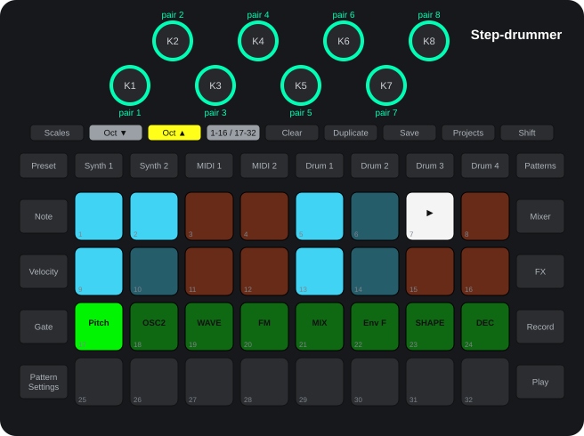

*Step-drummer view (MIDI 1).*

##### Opening and closing

| Track | How to open it |
|---|---|
| MIDI 1 / 2 | Preset view with the engine on, **pad 30** |
| Synth 1 / 2 | Source view (synth button twice), **pad 30** |

- Pad 30 bright = view open; dim = closed. On MIDI, **Shift + pad 30** disables the step-drummer. **since RC2:** on MIDI, dim = off, bright = on.

##### Controls

| Control | Function |
|---|---|
| Pads 1-16 | The 16 steps of the half shown; bright = has a note, white = playing. Touch = listen; **Shift + touch** = add / remove the note |
| Pads 17-24 | Destination of the pitch row (MIDI) / macro 1-8 (synths) |
| K1-K8 | The 8 pairs of steps (the playing one is white) |
| Octave ▲ / ▼ | Pitch / velocity page |
| 1-16 / 17-32 | The other half of the pattern |

- **Pitch on MIDI:** the pair value offsets the destination: pitch of both oscillators, OSC 2 pitch, WAVE, FM, MIX, env → filter, SHAPE, decay (64 = no change: it adds to or takes from the value on the engine's page; **since RC2**: the knob LED dim at the centre and brighter the further it goes).
- **Pitch on the synths:** the value is the macro position, written as automation.
- Each step keeps the pitch of its first note; a new note takes the pair’s or the previous one.
- **Real-time recording:** with Record on, playing a step also records it on the step that plays, with its microstep.

##### Page 2 and the pitch-vel toggle (since RC2)

- **Velocity page, pads 17-24** = page 2's own destination (the same pad again = none). With a destination the knobs write the pair's value (MIDI: from 64, in REL's lane, which is neither played nor recorded while the step-drummer is on; synths: that macro's automation, from 0). With no destination and no toggle, page 2 does nothing.
- **Pad 32** = the **pitch-vel** toggle (green): on top of their destinations, the pitch page transposes every note of the track by one degree of the project's scale (stock or custom) every 8 knob steps (MIDI −8 … +8 from the centre, synths 0 … +16 from 0) and the velocity page also sets the velocity, as before. With the toggle, the pitch page's pitch destinations do not move the own synth. Saved with the project.
- On the synths an empty pair starts at 0.


*Step by step: Sequence a destination with the step-drummer*

#### C4 FX sequencer

- **Blue** state of pad 27: the step-drummer of the track picks, for each pair of steps, **a slot of the Master FX bottom row** (0 = none); it plays on the steps with a note.
- The knob moves slowly (**one slot every ~48 steps of the turn**) and lights in the **colour of the chosen effect**. **A slot with no effect assigned** plays, **since RC4**, the effect at the top of its column (pad 26 = Master FX pad 1 … pad 30 = pad 5), with its knobs; before, it did nothing: assign the effects to the Master FX bottom row (see “Assignable bottom row”). **since RC2:** at the end of the travel there is the **random** value (white LED): on every step with a note one of the list plays at random (the slots with an effect assigned and the mechanical gesture of pad 31).

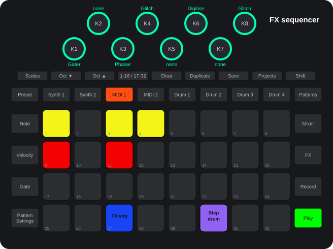

*FX sequencer: each knob = the Master FX bottom-row slot of its pair of steps.*

1. On MIDI 1 / 2, set **pad 27** to **blue**. The step-drummer of the track switches on.
2. Open its view with **pad 30**. Put notes on the steps with **Shift + pad**.
3. Each **knob** (a pair of steps) picks a slot of the Master FX bottom row:

| Value | Slot |
|---|---|
| 0 | none |
| 1 | pad 26 |
| 2 | pad 27 |
| 3 | pad 28 |
| 4 | pad 29 |
| 5 | pad 30 |
| 6 | pad 31 (the mechanical gesture; in RC0.9, the Glitch) |
| 7 | **random** (**since RC2**): one of the slots with an effect, on each step |
| 8 | **mute** (**only Beta 5.65**): the whole master silent for the length of the step (2 ms fades); red LED |

4. While the sequencer runs, every step with a note switches on what that slot holds: an effect (with its copy of the parameters) or the Glitch. The knob LED takes the colour of that effect; off = none.

- Assign the effects to the bottom row in Master FX first (C7).
- The track makes no sound in the DSP; its notes still go out over MIDI.
- Leaving the blue state switches the step-drummer of the track off.

### 3.9 Sample mode and sample picker

*How to get there:* *(since RC2)* MIDI 1 / 2 with the engine on **sample** (pad 27 teal, after the granular): **Note twice** (expanded Note view). The track plays a pack sample one-shot, at the pitch of each note.

**In this view**

- **Pitched drums on a MIDI track** — any pack sample plays at the pitch of each note, like a drum machine with tunable samples.
- **A different sample per step** — the sample flip changes sample step by step with no other track; it can be recorded live too.

**Features in this view:** [C20 Sample mode of the MIDI tracks (since RC2)](#f-modo-muestra)

| Control | Function |
|---|---|
| Pads 17-32 | 16 samples of the pack: touch = the track's sample (teal) and it sounds; the others dim. *(since RC4)* **Shift + sample** = pick it silently; **Shift + the one already chosen** = pick the second sample (stereo; see below). |
| Octave ▼ / ▲ | Next / previous page of samples (4 pages = the pack's 64; lit when there are more that way). |
| Pads 1-16 | The 16 steps of the half shown: peach = with a sample flip, dim teal (the background) = without, white = the one playing. **Hold a step + touch a sample** = its flip (the step green, its sample yellow); also **hold a sample + touch steps** (since RC2.04); **Clear + step** = remove it. *(since RC4)*: a flip on a step **without a note** adds **the last note you played** on the track there (60 if none yet; one step long, velocity 100), so it sounds; the steps show **peach** = a note with a flip, **teal** = a note without a flip, **violet** = a flip without a note, dim teal = nothing. *(since RC4)* In the **Note view** the added note shows at once and steps with a note and a flip show **peach** (a flip without a note only shows here). |
| 1-16 / 17-32 | The other half of the pattern. |

- **The pitch:** C3 (note 60) = the sample as recorded; an octave up = twice as fast. The notes come from the normal Note view, the step-drummer or incoming MIDI.
- **One-shot:** the VCA stays open and the sample plays to its end; every new note restarts it (one voice per track). The filter, effect and LFO of the engine pages still work.
- **Stereo** *(since RC4)*: **K7 of the OSC 1 page** (*(Beta 5.65 only)* K3; WAVE, which did nothing in this mode) = the **stereo width**. Fully left, mono as always; turned up, every note plays the chosen sample on the **left** and the **second** one on the **right** (at first the next one, N + 1; 64 is followed by 1): a stereo sample is two slots of the pack (the device's samples are mono). **The second is picked in the picker:** **Shift + the sample already chosen** switches to picking the second (it blinks teal; the first shows violet): touching a sample = the second, and it sounds; **Shift + the second** goes back to the first. The **distance** between them is kept: when the first changes (or with a step's flip) the second follows. With the width up, the second shows violet. The note lasts as long as the **longer** one: the shorter falls silent at its end. Both at the same pitch. The centre goes the track's way (filter, effect, level, pan, sends); the stereo part goes through the same filter and follows the track's VCA, level, pan, mute and sidechain, but not the effect or the sends. It is set at each note: turning K7 up from 0 during a note applies from the next one. The capture always plays in mono.
- **Live:** with **Record + Play**, touching a sample records a note 60 on the step playing, with its flip.
- **Erasing the note of a step with a flip** *(since RC4)* (in the Note view: Clear + step, or the step held + its note's key) erases the note and **keeps the flip**, which only shows here (violet); Clear + step in this picker removes the flip.
- The track's sample is the same source as the granular's (Shift + K8 on its page; the capture is picked there).
- The flips live in the track's level automation lane (Mixer): a flip replaces the level recorded on its step; recording the level over it erases those flips.

#### C20 Sample mode of the MIDI tracks (since RC2)

- **Since RC2.** A new state of pad 27 (teal, after the granular): the MIDI track plays **a pack sample one-shot**, at the note's pitch (**C3 = note 60 = as recorded**), through the engine's filter, effect and LFO; the VCA stays open and the sample plays to its end.
- The **expanded Note view** (Note twice) is the picker: rows 3-4 = 16 samples × 4 pages (Octave ▼ / ▲: all 64 of the pack), rows 1-2 = the steps; **a held step + a sample** = that step's sample flip, also live with Record.

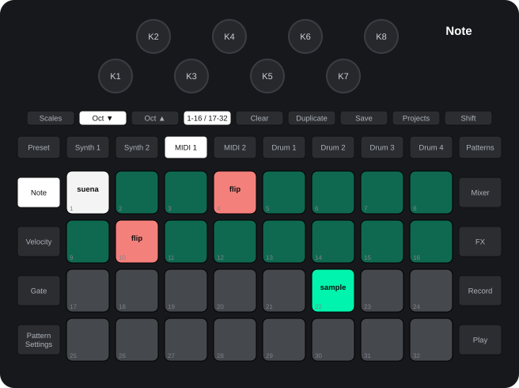

*Expanded Note view of MIDI 1 in the sample mode: steps on top, samples below.*

- **Picking the sample:** in the expanded Note view, rows 3-4 = 16 samples of the pack; **Octave ▼** = next page, **▲** = previous (4 pages, the 64 samples; the button lights when there are more pages that way). Touching a sample = the track's sample (teal), and it sounds (note 60). It is the same value as the granular's source (Shift + K8 on its page): changing one changes the other; the capture is picked there.
- **Sample flip:** rows 1-2 = the 16 steps of the half shown (**1-16 / 17-32** = the other half). **Hold a step and touch a sample** = that step plays that sample (peach; the held step green, its sample yellow); since RC2.04 also **hold a sample and touch steps**; **Clear + step** = no flip (dim teal, the background of rows 1-2). The step playing, white. A flip on a step with no note does nothing. **Since RC4:** a flip on a step with no note adds the last note played on the track there (60 if none), and the steps show peach = a note with a flip, teal = a note without a flip, violet = a flip without a note; erasing a step's note in the Note view (Clear + step, or the step held + its key) keeps the flip.
- **Live:** with **Record + Play**, touching a sample records a note 60 on the step playing, and its flip.
- **The pitch** comes from the track's notes (the normal Note view, the step-drummer, incoming MIDI): C3 = as recorded, an octave up = twice as fast. One voice per track, like a drum: every note restarts the sample; the note-off does not cut it, it plays to its end.
- **The VCA open:** in this mode the envelope does not close the VCA (gain, velocity and LFO → level still work); the other engines as before.
- **Stereo** (since RC4): **K7 of the OSC 1 page** (WAVE) = the width: the chosen sample on the left and the second on the right (at first the pack's next one; **Shift + the chosen sample** in the picker = pick the second, the distance is kept); the note lasts as long as the longer one; the stereo part goes through the engine's filter and follows the track's VCA, level, pan, mute and sidechain. **Shift + sample** = pick it silently.
- **Saved:** the track's sample with the engine values (device settings); the flips in the pattern: they travel with the pattern and the project. They live in the track's **level** automation lane (Mixer): a flip replaces the level automation of its step (the other steps' still plays) and recording the level over it erases the flips of those steps.
- Without the sample mode, the expanded Note view is the usual one.


*Step by step: Pick samples and flip them by step · since RC2*

## 4. Pattern Settings

### 4.1 Pattern Settings view

*How to get there:* The **Pattern Settings** button with a track selected: first / last step, sync rate and direction as always, plus pads 25-28 and the arpeggiator (Shift).

**In this view**

- **Nudge** — moves the content of the selected steps one step back or forward.
- **Fractal and deconstructed orders** — walk through the pattern another way without changing its notes.
- **Arpeggiator** *(since RC2)* — the pattern's chords (and the ones you play) sound note by note, in their order and resolution; on the drums, jumping from sample to sample.
- **Dynamics and random-mutate** (pad 25) — variations so that the pattern does not always sound the same.

**Features in this view:** [C13 Nudge and play orders](#f-nudge-ordenes) · [C14 Arpeggiator (since RC2)](#f-arpegiador)

*Also used here:* [Random-mutate per step](#f-random-mutate) · [Step frequency and dynamics](#f-frecuencia-dinamicas)

| Pad | Function |
|---|---|
| 1-16 | First / last step (stock). |
| 17-24 | Sync rate (stock). |
| 25 | Opens the probability view in **mode 2** (dynamics and random-mutate; on the drums too *(since RC2)*). **Clear + pad 25** (note tracks): clears the dynamics and the random-mutate of every step of the pattern; the frequency stays *(since RC2)*. |
| 26 | **Nudge** (blue): the chosen first step becomes step 1; what was in front goes to the end (steps and automation, over 16 or 32). *(since RC4)*: a tap = the range one step back, Shift + pad 26 forward, with the first and last steps. *(since RC4.05)* **A tap = the content of the selected range (first to last step) one step back**, **Shift + pad 26 = one step forward**: what leaves at one end of the range comes in at the other and **the first and last steps do not move**. |
| 27 | **Fractal** order: 1 · 1 2 · 1 2 3 · … up to the last step. |
| 28 | **Deconstructed** order: the grid's diagonals (1 6 11 16 · 2 7 12 13 · 3 8 9 14 · 4 5 10 15). |
| 29-32 | Stock direction; exclusive with 27 / 28. |

- Nudge and orders also on the drums. The order is saved with the pattern; Clear on the pattern removes it. *(since RC2)*

#### Arpeggiator (note tracks) *(since RC2)*
While **Shift** is held, the arpeggiator's pads keep their Pattern Settings colours and the chosen ones show green:

| Gesture | Function |
|---|---|
| **Shift + pad 25** | The arpeggiator of the pattern the track plays: on / off. Without Shift, pad 25 shows green while it is on (and still opens mode 2). |
| **Shift + pads 27-32** | The arpeggio's order, independent of the pattern's direction: fractal, deconstructed, up, down, ping-pong, random. |
| **Shift + pads 17-24** | The arpeggio's **resolution**, apart from the track's sync rate, in the same order as the sync rate pads (slower to the left): 1/4, 1/4T, 1/8, 1/8T, 1/16, 1/16T, 1/32, 1/32T. The same pad again = the track's (no pad green). |

- **Sequence:** when two or more notes start on a step, they play one at a time (at the arpeggio's resolution), in the chosen order over the notes sorted by pitch, for as long as the chord's longest note. Each note lasts **its own gate, at most one arpeggio step** (and what is left of the chord) and keeps its velocity: a chord recorded by holding its notes plays arpeggiated, one entered with short notes, staccato.
- **Input:** the first note sounds as always; holding another one with it starts the arpeggio of the held notes, one an arpeggio step (with the transport stopped, at the project's tempo; since RC2.10: stopped, it always ran at about 120 BPM before), until all are let go; each note lasts an arpeggio step. **With Record the chord is recorded**, not the single notes: the sequence plays the arpeggio afterwards.
- **Held step** *(since RC4)*: with the transport stopped, **holding a step** with several notes arpeggiates them, as if you held their pads (they sounded at once before), until you let it go; if you start the transport with the step held, the arpeggio stops when you let it go.
- **External keyboard** *(since RC4)*: with the **Note button of the Setup view** on, the notes coming in over MIDI on the channel of a note track whose arpeggiator is on are arpeggiated like the pads (the first sounds as always; with Record the chord is recorded). **Off by default**, so it does not clash with a keyboard that has its own arpeggiator.
- **Pressed order** *(since RC4)*: the notes are arpeggiated in the order they were pressed (a recorded chord, in the order of its notes in the step), not by pitch; up, down, ping-pong, random, fractal and deconstructed walk that order. A note let go leaves its place empty and skipped; the next note you press takes the first empty place before going to the end.
- **Random-mutate** *(since RC4)*: when the chord's step has a random-mutate level, each note of the arpeggio goes through it (another degree of the scale, an octave up or down) as normal notes do; nothing is written into the step. The live arpeggio (the notes held) uses the level of the step the track is on (playing, the one that plays; stopped, where it stopped).
- **Long notes when recording** (since RC2.04): the stock's recorder cuts notes at 16 steps; now a note or chord held longer goes on, tied, 16 steps later (in patterns longer than 16 steps), so the arpeggio of a held chord does not stop at step 16. For every note of Synth 1 / 2 and MIDI 1 / 2, with or without the arpeggiator.
- Saved with the project, per track and pattern.

##### Arpeggio modifiers *(since RC4)*
With the pattern's arpeggiator **on**, **Shift + pads 1-16** pick four modifiers (with the arpeggiator off, Shift + pad is still the stock's first step). Each group has its colour; the chosen option bright, the others dim:

| Pads | Group (colour) | Options |
|---|---|---|
| 1-4 | **Octaves** (sand) | no spread · +1 octave · +1 up and 1 down · +2 up and 1 down (with the down order, high to low; with the others, low to high) |
| 5-8 | **When the octave moves** (sky blue) | after each pass · every note · every 3 notes · every 4 notes |
| 9-12 | **Groove** (amber) | none · note / dotted note (1 and 1.5 steps) · swing (2:1) · every note twice |
| 13-16 | **Reset** (pink) | no reset · after a whole pass, 1 / 3 / 5 more notes and back to the start (then a whole pass again) |

- The octaves count what comes out of the groove and the reset (with "twice", each repeat counts as a note).
- They apply to a step's arpeggio, to the held notes and to the external keyboard, stopped or playing. Saved with the project, per track and pattern.

#### The drums' arpeggiator *(since RC2)*
The same gestures (**Shift + pad 25 / 27-32 / 17-24**) in a drum's Pattern Settings turn its arpeggiator on for the pattern it plays, with its order and resolution. In the **drum's Preset view** the first sample held is the usual one; **holding another one with it starts the arpeggio of the samples held**: the drum jumps from sample to sample (in the chosen order, over the samples sorted by number), with its pad's velocity. Playing, it follows the drum's grid; stopped, the project's tempo. It goes on while any is held; when all are let go, the drum goes back to its chosen sample. **With Record** (playing) every hit is recorded into the pattern: its micro step, its sample as the step's sample flip (one a step: the last one stays) and, on an empty step, its velocity.

#### C13 Nudge and play orders

- **Since RC2.** In the Pattern Settings view: **pad 26 = Nudge** (moves the content of the selected steps), **pad 27 = fractal order**, **pad 28 = deconstructed order**. On every track, drums included.

- **Nudge (pad 26, blue), since RC4.05:** the content of the selected range (first to last step) moves one step back; **Shift + pad 26**, one step forward. What leaves at one end of the range comes in at the other and **the first and last steps do not move**. It moves whole steps with their automation, and on the drums their own values. The view shows it at once. On the RCs it also moves the first and last steps, and the view did not show the moved content until the next Play.
- **Fractal (pad 27):** 1 · 1 2 · 1 2 3 · 1 2 3 4 … up to the last step, then again.
- **Deconstructed (pad 28):** the diagonals of the grid: 1 6 11 16 · 2 7 12 13 · 3 8 9 14 · 4 5 10 15 (and the same with 17-32). Steps outside the pattern are skipped: with 8 steps, 1 6 2 7 3 8 4 5.
- Pads 27 / 28 and the four direction pads (29-32) exclude each other and share colours.
- The pattern “ends” (for chains, scenes and the frequency) when the whole run ends.
- The order is saved with the pattern. Clearing the pattern removes it.


*Step by step: Nudge the steps of a pattern · since RC4.05*

#### C14 Arpeggiator (since RC2)

- **Since RC2.** In the Pattern Settings view of a note track: **Shift + pad 25** = the pattern's arpeggiator on / off, **Shift + pads 27-32** = its order (fractal, deconstructed, up, down, ping-pong, random), independent of the pattern's direction.

- With Shift, pad 25 and pads 27-32 show yellow and the chosen ones green; without Shift, pad 25 shows green while the arpeggiator is on.
- **Sequence:** when two or more notes start on a step, they play one a step (at the pattern's sync rate) in the chosen order, over the notes sorted by pitch, for as long as the chord's longest note. Each note lasts a step and keeps its velocity. The step's random-mutate and dynamics do not apply to them.
- **Input:** the first note sounds as always; holding another one with it starts the arpeggio of the held notes, one a step (stopped: at the project's tempo and the track's sync rate; **since RC2.10**: stopped, it always ran at about 120 BPM before), until all are let go. **With Record the chord is recorded**: the sequence plays the arpeggio afterwards.
- **since RC4 — held step and external keyboard:** with the transport stopped, holding a step with several notes arpeggiates them (they sounded at once before); with the **Note button of the Setup view** on (off by default), the notes coming in over MIDI on the track's channel too. **Shift + a key** in the Note view = latch: the note goes on until the next press of that note, and with the arpeggiator it keeps being arpeggiated.
- **since RC4 — pressed order:** the notes go in the order they were pressed, not by pitch (the orders walk that order); a note let go leaves its place empty (skipped) and the next one takes the first free place. **Random-mutate:** the level of the chord's step applies to each note of the arpeggio; live, that of the step the track is on.
- **Since RC2.04:** a note or chord held longer than 16 steps while recording goes on, tied, 16 steps later (the stock cut it at step 16).
- Saved with the project, per track and pattern.
- **Shift + pads 17-24** = the arpeggio's own resolution (1/4 … 1/32T, in the sync rate's order; the same pad again = the track's). Each note of the chord lasts its own gate.
- **Drums** (since RC2): the same gestures in a drum's Pattern Settings; in its Preset view, holding several samples = the arpeggio of the samples (the drum jumps from one to another), on the drum's grid while playing and at the tempo when stopped; with Record it is recorded (micro step and sample flip).
- **Gate by holding** (Micro Step view = Gate twice, pad 32, per track): when entering notes by hand, how long you hold the pad is the gate. **Pad 31** = fixed length (with both off it opens the selector; picking a length turns it on). A toggle that is on turns off when pressed again; pressing the other one switches.

*Step by step: Switch the arpeggiator on · since RC2*


*Step by step: Shape the arpeggio with its modifiers · since RC4*

*Step by step: Latch notes and write them into a step · since RC4*


*Step by step: Arpeggiate a drum's samples · since RC2*


*Step by step: Set the gate by holding, or a fixed length · since RC2*

### 4.2 Micro Step view (note tracks)

*How to get there:* Press **Gate twice** with a note track selected (Synth 1 / 2, MIDI 1 / 2).

**In this view**

- **Micro steps and Tie (stock)** — place each note off the grid and tie it to the next step.
- **Gate by holding** *(since RC2)* — when entering notes by hand, how long you hold is how long the note lasts.
- **Fixed length** *(since RC2)* — every note you enter by hand gets the same length.

- **The stock part:** pads 17-22 = the 6 micro steps of the chosen step; **pad 24 = Tie** (a toggle: ties the chosen notes to the next step); pads 25-30 = the step's notes: touching one chooses it (the micro step and the Tie apply to it) and plays it.
- **One micro step per note (stock):** each note stores a single position, so touching another micro step moves the chosen note; two cannot be lit at once. For several in the same step, enter several notes. Drums can light several micro steps (repeats).
- **Gate once** is the Gate view (pads 17-32 = the length): there pads 31 / 32 are the stock's.
- **Pad 32 = gate by holding** *(since RC2)* for the track (green = on, dim = off; saved with the project): when **entering notes by hand** (a step held + a note pad, or a note held + a step pad), **how long you hold the pad is the note's gate**, at the project's tempo and the track's sync rate (1 micro step to 16 steps). It ends when the first of the two pads is let go. Off: the stock's gate.
- **Pad 31 = fixed length** *(since RC2)* for the track (blue = on): with both off, it opens the **selector** (pads 17-32 = 1 … 16 steps, like the Gate view) and **picking a length turns it on** (and closes the selector). With it, every note entered by hand (not one recorded live) gets that gate, all of a chord's notes too, whichever pad you let go first (since RC2.08: before, only when the note pad was let go first).
- **The two toggles** *(since RC2)*: with one on, **pressing it again turns it off** (nothing opens); **pressing the other one** turns the first off and the new one on (pad 31 by opening its selector).
- The arpeggiator uses those gates too: each note of the chord lasts its own.

*Step by step: Set the gate by holding, or a fixed length · since RC2*

### 4.3 Probability view (note tracks and drums)

*How to get there:* **Pattern Settings twice** or **Shift + Pattern Settings** (mode 1), or **pad 25** of Pattern Settings (mode 2). Hold a step with notes and touch a pad of rows 3-4.

**In this view**

- **Probability (stock)** — a step that only plays sometimes.
- **Frequency** *(since RC2)* — a step that plays once every n passes: variations that come back every 2, 4 or 8 passes.
- **Dynamics** *(since RC2)* — small changes of velocity and position: a more human pattern.
- **Random-mutate** *(since RC2)* — notes that jump an octave or to another note of the scale; on the drums, to another sample.

**Features in this view:** [C9 Random-mutate per step](#f-random-mutate) · [C10 Step frequency and dynamics](#f-frecuencia-dinamicas)

*Also used here:* [Jump sequencer of MIDI 1 / 2 (Beta 5.65 only)](#f-saltos)

| Mode | Row 3 | Row 4 |
|---|---|---|
| Mode 1 | Step probability | **Frequency**: the step plays on the last of every n passes (1-8), yellow *(since RC2)* |
| Mode 2 (pad 25) | Random **dynamics** *(since RC2)* | Random-mutate *(since RC2)* |

#### Mode 2 *(Beta 5.65 only)*
The two rows are one set of pads, per step:

| Pad | What it does |
|---|---|
| 17 | No note or octave changes (white) |
| 18 / 19 / 20 | **Another note of the scale**, in the same octave: chance ×1 / ×2 / ×4 (peach) |
| 21 / 22 | **An octave up**: low / high chance, ×1 / ×2 (sand) |
| 23 / 24 | **An octave up or down**, at random: low / high chance, ×1 / ×2 (sand) |
| 25 | **No dynamics** (white) |
| 26 | **Dynamics lo (ghost)**: velocity −32 to 0; the length is kept *(Beta 5.65 only)* |
| 27 | **Dynamics hi + length (accent staccato)**: velocity 0 to +64 and the note shorter in proportion (+64 = a half) *(Beta 5.65 only)* |
| 28 | **Length**: the gate a half to double, at random; the velocity is kept *(Beta 5.65 only)* |
| 29-31 | No function (dark) |
| 32 | **Micro steps** on / off (teal): the note moves 0, 1 or 2 micro steps earlier or later, staying inside its step |

- **Octave ▼ / ▲ with this view open = the track's factor**: ×0, ×1, ×2, ×4 or ×8 (×1 from the factory; Octave doubles or halves it) *(Beta 5.65 only)*, which multiplies all its chances. The pads show the number for 0.6 s; the Octave that cannot move any further goes dark. Saved with the project.
- **Chances at factor ×1:** note and octave, 6 % for each ×1 of the pad; dynamics and micro steps, 25 %. At ×4: 25 % and 100 %. At ×0 nothing changes.
- **At ×8, pad 24 changes every note:** the step's own note never sounds and only an octave up and an octave down are left. The draw is half and half, but without the original note as a reference the ear takes the lower one as the base and it seems that nearly all go up. With pad 22 all of them go up.
- Note, dynamics and micro steps are drawn apart, each note of a chord apart; the micro steps once a step. A note on the first micro step cannot go earlier, nor one on the last later. Without Record it changes only that time; with Record and this view on screen it is written into that track's pattern (the sequence drifts). Tied notes keep their note, length and micro step.
- A project from an earlier version keeps the values of its steps, which now mean what this table says; a saved factor of ×3 plays as ×2, and ×5-×7 as ×4.

#### Mode 2 on the drums *(Beta 5.65 only)*
The same pads on the chosen step (pads 1-16) and the same Octave (the drum's factor):

- **Pads 18-20:** another sample of its row of 8 (±1). **Pads 21 / 22:** the next row (+8), low / high chance. **Pads 23 / 24:** a row up or down (±8), low / high chance. It starts from the step's sample flip, or the chosen sample; it is not recorded.
- **Pads 25-27:** *(Beta 5.65 only)* one of the three at a time on each step (the same again removes it), at a chance of 25 % × the factor. **Pad 25 = no dynamics.** **Pad 26 = dynamics lo**: the hit lowers its velocity by 0 to 32 and repeats with a roller, one of the two at random: on micro step 4, or on 3 and 6. **Pad 27 = dynamics hi**: the velocity goes up by 0 to 64, no roller. The repeats carry the hit's velocity and sample, and only the ones that fit in the step sound. Pad 28 is dark.
- **Pad 32:** micro steps for the **whole drum**, not the step (the step has no free bits): *(Beta 5.65 only)* at the same chance, the whole step moves 1 or 2 micro steps earlier or later without leaving it (a hit on the first micro step only moves later, one on the last only earlier; a step with hits on both the first and the last does not move). It also works on a step with nothing chosen.

#### Random-mutate in the RCs (row 4)
| Pad | 25 | 26 | 27 | 28 | 29 | 30 | 31 | 32 |
|---|---|---|---|---|---|---|---|---|
| Octave | — | 6 % | — | 6 % | — | 12 % | — | 25 % |
| Scale | — | — | 6 % | 6 % | 12 % | — | 25 % | 50 % |

- Scale = another note of the scale in the same octave; octave = one up or down. Each note of a chord is drawn separately. Without Record it changes only that time; with Record it is written (the sequence drifts). Tied notes do not change.

#### Dynamics in the RCs (row 3, mode 2)
| Pad | 1 | 2 | 3 | 4 | 5 | 6 | 7 | 8 |
|---|---|---|---|---|---|---|---|---|
| Micro steps | — | ±2 | ±2 | — | −1 to +3 | −1 to +3 | — | — |
| Velocity | — | — | 0 to +32 | 0 to +32 | 0 to +32 | — | ±32 | −32 to +64 |

- With Record and mode 2 on screen, what plays (mutated note, dynamics) is written into that track's pattern *(since RC4.05)* *(before, into the other note tracks too)*. Everything is saved with the step.

#### On the drums *(since RC2)*
The same view for a drum: **Pattern Settings twice** (mode 1) or **pad 25** of its Pattern Settings (mode 2, peach; green when its arpeggiator is on). Pick a step with a hit (pads 1-16) and touch a pad of rows 3-4.

| Mode | Row 3 | Row 4 |
|---|---|---|
| Mode 1 | Step probability (stock) | **Frequency** (1-8), yellow |
| Mode 2, in the RCs | **Dynamics** (the same 8 levels) | Pads 25-28: **random-mutate of the sample** |

| Pad | 25 | 26 | 27 | 28 |
|---|---|---|---|---|
| Random-mutate in the RCs | — | 25 % ±1 (the next sample in its row of 8) | 25 % ±8 (the same column in another row) | 12 % of each |

- The dynamics only delay the hit inside its step (a drum cannot play earlier). The mutate starts from the step's sample flip, or the chosen sample; it is not recorded.
- The values live in bytes of the pattern the stock does not use (they travel when it is duplicated and with Nudge); the first one set clears those bytes in the project's 32 drum patterns (a factory pack keeps garbage there).

#### C9 Random-mutate per step

- **Since RC2.** In the probability view, in mode 2 (**pad 25** of Pattern Settings), row 4 gives each step a chance of its notes jumping an octave or moving to another note of the scale when they play.

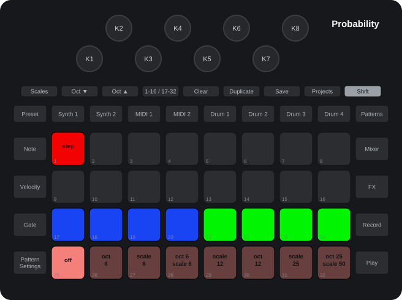

*Probability view: row 3 = the step’s probability (original), row 4 = random-mutate.*

1. On Synth 1 / 2 or MIDI 1 / 2, open Pattern Settings and touch **pad 25**: the probability view in mode 2.
2. Hold a step that has notes and touch a pad of **row 4** (peach):

| Pad | Octave | Scale |
|---|---|---|
| 25 | — (off) | — |
| 26 | 6 % | — |
| 27 | — | 6 % |
| 28 | 6 % | 6 % |
| 29 | — | 12 % |
| 30 | 12 % | — |
| 31 | — | 25 % |
| 32 | 25 % | 50 % |

- **Scale:** the note changes to another note of the project’s scale, within the same octave. **Octave:** it goes one octave up or down (at random). Every note of a chord is drawn separately, each time the step plays.
- **Without Record** the changed note plays that once and the step does not change. **With Record** the changed note is written into the step (the sequence drifts).
- Tied notes are not changed.
- The value is stored in the step, with the pattern and the project. The drums have their own (see «Frequency and dynamics per step»).
- **Beta 5.65 only — rows 3-4 redesigned (on the drums too):** pad 17 off; pads 18-20 another note of the scale (chance ×1, ×2, ×4); pads 21 / 22 octave up, low / high chance (×1, ×2); pads 23 / 24 octave up or down, low / high (×1, ×2); pad 25 no dynamics; pad 26 dynamics lo (ghost: velocity −32 to 0); pad 27 dynamics hi + length (accent staccato: velocity 0 to +64 and the note shorter in proportion, down to a half); pad 28 length (the gate a half to double); pad 32 micro steps on / off (−2 to +2, inside the step). **Octave ▼ / ▲ in that view = the track's factor** (×0, ×1, ×2, ×4 or ×8, ×1 from the factory; saved with the project), which multiplies all the chances: at ×1, note and octave 6 % for each ×1 of the pad; dynamics and micro steps 25 %. On a drum: the sample instead of the note (±1 inside its row, ±8 to another row), pad 25 no dynamics, pad 26 dynamics lo (velocity −32 to 0 and a roller at random: on micro step 4, or on 3 and 6), pad 27 dynamics hi (velocity 0 to +64, no roller), pad 28 dark, and pad 32 works for the whole drum and moves the whole step earlier or later.


*Step by step: Let a step's notes mutate · since RC2*

#### C10 Step frequency and dynamics

- **Since RC2.** In the probability view of the note tracks: **row 4 = every how many plays of the pattern the step sounds** (1-8). With **pad 25 of Pattern Settings**: row 3 = random **dynamics** (velocity, position and length), row 4 = random-mutate.

- **Mode 1** (press **Pattern Settings** twice): row 3 = the usual probability; **row 4 = frequency**, in yellow: with n the step sounds on the last of every n plays of the pattern. Each pattern counts its plays from Play.
- **Mode 2** (**pad 25** of the Pattern Settings view): row 3 = dynamics, row 4 = random-mutate.
- **Clear + pad 25** (since RC2): clears the dynamics and the random-mutate of every step of the pattern; the frequency stays.

| Pad (row 3) | Micro steps (position and length) | Velocity | |
|---|---|---|---|
| 1 | — | — | no change |
| 2 | −2 to +2 | — | drunk |
| 3 | −2 to +2 | 0 to +32 | drunk and accents |
| 4 | — | 0 to +32 | accents |
| 5 | −1 to +3 | 0 to +32 | dragging and accents |
| 6 | −1 to +3 | — | dragging |
| 7 | — | −32 to +32 | balanced dynamics |
| 8 | — | −32 to +64 | accent dynamics |

- Everything is saved with the step. With **Record** and mode 2 on the screen, what sounds (the mutated note, the dynamics) is written into that track's pattern (since RC4.05; before, into the other note tracks too).

##### On the drums (since RC2)

- The same view for a drum (Pattern Settings twice = mode 1; pad 25 of its Pattern Settings = mode 2): mode 1 row 4 = frequency; mode 2: row 3 = dynamics (they only delay the hit inside its step), pads 25-28 = **random-mutate of the sample**: none, 25 % of ±1 (the next one in its row of 8), 25 % of ±8 (another row), 12 % of each.
- They live in bytes of the pattern the stock does not use: they travel when duplicated and with Nudge; the first time they are cleared in the project's 32 drum patterns.


*Step by step: Play a step every n passes · since RC2*

## 5. Drums

### 5.1 Drum track view (knobs)

*How to get there:* Press **Drum 1-4**. Every knob does what its label says, with a second layer on Shift.

**In this view**

- **Shape each drum** — exact pitch, ring mod, attack and decay, sample start and cut, a filter with several modes, LFO and several kinds of distortion: many sounds from one sample.
- **All neutral = the original** — with the new knobs at their neutral point, the sample sounds as on the original Circuit.
- **Start over** *(since RC2)* — Clear + the drum's button puts all its knobs back to their defaults.
- **Stereo pair** *(since RC4)* — Drum 1 + Drum 2 (or 3 + 4) play a stereo sample: the left one drives both, the right one only fine-tunes.

**Features in this view:** [B1 Drum knobs as printed on the panel](#f-knobs-drums) · [C18 Stereo drum pairs (since RC4)](#f-pareja-estereo) · [C19 The drums' extra lane (Beta 5.65 only)](#f-carril-extra) · [D7 Drum DSP](#f-drums-dsp)

*Also used here:* [Clear + knob = default value](#f-clear-knob) · [Chromatic and scale view of the drums](#f-cromatica) · [LFO synced to the tempo (since RC4)](#f-lfo-sync) · [MIDI for everything new](#f-midi-io) · [Drums micro-step rollers (since RC2)](#f-rollers)

| Knob | Alone | With Shift |
|---|---|---|
| K1 Oscillator | Pitch (*(since RC2)*: the stock one, continuous as on the original; the chromatic view's pads transpose on top) | Pitch envelope amount |
| K2 Osc mod | Ring mod frequency | Ring mod amount |
| K3 Amp envelope | **Left: decay** (the stock one). Past its maximum, **right: attack** (fade-in, up to 1 s). Neutral in the middle. *(since RC2)* | **Left: sample start**; **right: cut** from the end (up to 120/128 each; *since RC2.10* the start covers the whole sample: before, it reached the end at a quarter of the travel and beyond that the hit was silent). Middle = the whole sample. *(since RC2)* |
| K4 Filter envelope | Envelope → cutoff | Envelope shape |
| K5 Filter frequency | Filter / EQ (by default the stock tilt EQ) | **Filter mode**: stock tilt EQ, band-pass, notch, comb (not in Beta 5.65: the tilt EQ plays instead), DJ |
| K6 Resonance | Resonance | — |
| K7 Modulation | LFO amount: right = tremolo; left = vibrato (*(since RC4)*: left = **start scan**: each hit starts where the LFO is, from the Shift + K3 start up to a 64th of the sample further for every step of the knob (fully left, the whole sample), never past the cut; the LFO no longer restarts with each hit) | LFO speed (bipolar *(since RC4)*: right free, left synced; 0.2; synced, the scan is at the start on the first beat) |
| K8 FX | Distortion; left of 0, **bitcrush** | **Distortion type**: stock, soft, hard, fold |

- **Shift + K5, the LED's colour = the filter mode:** **green** = stock EQ tilt, **yellow** = band pass, **magenta** = notch, **teal** = comb, **white** = DJ. *(Beta 5.65 only)* The comb is gone: Shift + K5 skips it.
- **K3:** turning left, the attack goes back to 0 before the decay goes down; with Shift, one of the two (start or cut) goes back to 0 before the other moves. LED: attack in white; with Shift, start in the drum's colour, cut in white.
- **Clear + K3 to the right** puts attack, start and cut to 0; **Clear + K8 to the right** removes the bitcrush too *(since RC2)*. Clear + knob resets both layers on the others.
- **Clear + the drum's button** *(since RC2)* (with one of its views on screen): the drum's eight knobs, with their Shift layer, back to their defaults.
- **Snapshot of the knobs into a step** *(Beta 5.65 only)*: in the drum's track view (Note), **Record held + a step pad** (pads 1-16; with 17-32, steps 17-32) writes into that step the **pitch, decay, distortion and EQ** that are not at their default (the one of Clear + knob to the right), each into its lane. The mod's new knobs have no lane and are left out. The step's hit stays and Record stays as it was. *(Beta 5.65 only)* Also the **extra lane**'s value when it is not at its default. *(Beta 5.65 only)* While you hold the step, it lights **yellow**.
- **Extra lane** *(Beta 5.65 only)*: each drum has **one more automation lane**, kept in the pattern itself (it travels with Duplicate, Nudge and Shift + Play). From the factory it carries the **chromatic pitch**: the chromatic view's pads record there and the pitch lane stays K1's. **Record held + a knob** assigns that parameter to it: K2 (ring mod frequency), K4 (filter envelope), K6 (resonance), K7 (LFO amount), Shift + K1 (pitch envelope), Shift + K2 (ring mod amount), Shift + K4 (envelope shape) or Shift + K7 (LFO speed); **Record held + a chromatic view pad** = the chromatic pitch again. Record stays as it was. While Record is held, the assigned knob lights **white** (with the chromatic pitch, **Preset blinks** white). While recording, turning that knob writes the step that plays (one value per step); **Clear + that knob to the left** erases the lane in the pattern that plays (the chromatic pitch: Clear + K1). The assignment is saved with the project; the values, with the pattern.
- **State locks** *(Beta 5.65 only)*: **Record held + 1-16/17-32** in any of a drum's views switches its extra lane between the **lane** (above) and **state locks**; switching erases the lane in the drum's 8 patterns (back to the lane, it carries the chromatic pitch). In state locks, each step can hold a **state**, the drum's **14 new knob values** at once (the eight the lane can carry, the filter mode, the bitcrush, the distortion type and K3's attack, start and cut) at 16 levels each (0, 64 and 127 exact), or sit **inside a ramp**: the values move little by little from the state before to the state after, micro step by micro step (the filter mode and the distortion type switch on arrival). While recording, turning one of those knobs stores a state in the step that plays; when three in a row lie on a straight line, the middle one and the steps between them become a ramp: a sweep keeps its start, its stops and its turns. **Record held + a step** = a state of the values now; **Clear + a lane knob to the left** erases the lane of the pattern that plays. While Record is held, the **8 knobs light white**. Up to 80 states per project (saved with it; the ones no step uses any more are reused).
- **Automation view** *(Beta 5.65 only)*: a **drum's Velocity view with Shift** held, or latched by pressing **Velocity again** there (again = off; leaving the view too). Steps with **automation** light **yellow**: something in the pitch, decay, distortion or EQ lanes, or in the extra lane; in state locks, ramp steps **dim yellow**; the **marked ones red**; the others keep their colour. On the drums, fixed velocity stays on **Shift + Velocity** (Velocity twice latches this view).
  - **Shift + a yellow step** = its values on the knobs and in the sound (the stock lanes through the same route as playback; the chromatic pitch; the extra lane's parameter; a state, the 14 values), and **the knobs it moves yellow**, until Shift is let go: then everything goes back exactly as it was. Pressing another yellow step meanwhile previews that one.
  - **Shift + a step without automation** = **marks** it (red; again = unmarks): when that step plays, the **pitch, decay, distortion, EQ** and the extra lane's parameter (if it carries a knob) **go back to the values saved in the project**. The mark sits in the step's extra lane (its values now go up to 124 of 126).
  - **Clear + a step** (with the view latched, or Clear before Shift, since Shift + Clear is the metronome) = **erases its automation** (the four lanes and the extra one, the mark too) and **keeps the hit**.
  - In **state locks**: **holding a step** previews it (with Shift or the view latched) and **tapping another** meanwhile = a **ramp** between them (the preview is put back first, so an end without a state takes the knobs' values); Shift + a step without a state marks it and stays held.
- All neutral, a sample sounds as on the original. Everything is saved with the project and has an NRPN.
- **Sidechain between drums:** Shift + FX and Octave ▼ (8.1).

#### Stereo pair *(since RC4)*
**Hold Drum 1 and press Drum 2** (or the other way round; Drum 3 + Drum 4 the same): the two drums become a **stereo pair**; the same gesture undoes it. Not with Shift, Clear or Duplicate held, nor in Setup.
- **Drum 1 / 3** sounds on the left and **Drum 2 / 4** on the right with the pack's **next sample** (a stereo sample = two slots in a row; after 64, 1).
- **Everything of Drum 1 / 3 drives both:** its knobs (the Shift layer too), its pattern (steps, sample flips, micro steps, automation, arpeggio, rollers), its level, sends and side-chain. Its pan is the centre of the pair.
- **Drum 2 / 4's pattern does not play** while the pair lasts (it stays saved). Its pads and MIDI notes play it alone, on the right.
- **Picking another sample on Drum 2 / 4** (its Preset view) sets the distance between the two; then it follows Drum 1 / 3's sample changes.
- **Drum 2 / 4's knobs** are deviations from Drum 1 / 3 (its own values do not change and come back when the pair is undone):

| Knob | Alone | With Shift |
|---|---|---|
| K1 | Detune (± 100 cents) | Pitch envelope amount |
| K2 | **Stereo width** (by default fully: left / right; fully left, both centred) | Ring mod amount |
| K3 | Decay | Sample start |
| K4 | Envelope → cutoff | Envelope shape |
| K5 | Filter / EQ | — (Drum 1 / 3's mode) |
| K6 | Resonance | Ring mod frequency |
| K7 | LFO amount | — (Drum 1 / 3's speed) |
| K8 | — (Drum 1 / 3's distortion) | — |

- LEDs: the deviations in Drum 1 / 3's colour (brighter = more deviation), the width in white. **Clear + knob** = no deviation (the width, full).
- Drum 2 / 4's button pulses in Drum 1 / 3's colour while the pair lasts.
- **Saved with the project** (on, distance, width and deviations).

#### B1 Drum knobs as printed on the panel

- Every knob does what its label says, with a second layer on Shift: ring mod, envelopes, filters (DJ, BP, notch, comb (not in Beta 5.65), tilt), LFO, start point, bitcrush and distortion.

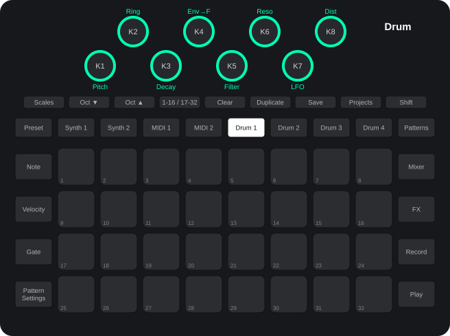

*Knobs of a drum.*

| Knob | Alone | With Shift |
|---|---|---|
| K1 Oscillator | Pitch (exact semitones; **since RC2**: the stock one, continuous, with the chromatic view on top) | Pitch envelope amount |
| K2 Osc mod | Ring mod frequency | Ring mod amount |
| K3 Amp envelope | Left: decay; past its maximum, **attack** (centre neutral) | Left: sample **start**; right: **cut** (centre = whole) |
| K4 Filter envelope | Envelope → cutoff | Envelope shape |
| K5 Filter frequency | Filter / EQ (by default the stock EQ tilt) | **Filter mode**: stock EQ tilt (default), band pass, notch, comb (not in Beta 5.65: the EQ tilt plays instead), DJ |
| K6 Resonance | Resonance | — |
| K7 Modulation | LFO amount (right tremolo; left vibrato; since RC4: left = start scan) | LFO speed |
| K8 FX | Distortion; left of 0, **bitcrush** | **Distortion type**: stock, soft, hard, folded |

- **Shift + K5, the LED's colour = the filter mode:** green = stock EQ tilt, yellow = band pass, magenta = notch, teal = comb, white = DJ. **Beta 5.65 only:** the comb is gone; Shift + K5 skips it.
- The LED brightness shows the value; Clear + knob resets both layers.
- Everything is saved with the project and has NRPN (E4).

#### C18 Stereo drum pairs (since RC4)

- **Since RC4.** **Hold Drum 1 and press Drum 2** (or Drum 3 + Drum 4): Drum 1 / 3 sounds on the left and Drum 2 / 4 on the right with the next sample, both driven by Drum 1 / 3's controls and pattern; Drum 2 / 4's knobs = stereo width (K2), detune (K1) and deviations. Saved with the project.

- The same gesture undoes the pair; not with Shift, Clear or Duplicate held, nor in Setup.
- Drum 2 / 4's pattern does not play while the pair lasts; its pads and MIDI notes play it alone, on the right. Picking another sample on Drum 2 / 4 sets the distance between the two.
- The knob table is in the guide by views («Drum track view»).

*Step by step: Make a stereo drum pair · since RC4*

#### C19 The drums' extra lane (Beta 5.65 only)

- **Beta 5.65 only.** Each drum has **one more automation lane**, kept in the spare bits of each step of its pattern (it travels with Duplicate, Nudge and Shift + Play). From the factory it carries the **chromatic pitch** (the chromatic view's pads record there; the pitch lane stays K1's); **Record held + a knob** assigns another parameter and **Record held + a chromatic pad** brings back the chromatic pitch.

- Assignable knobs: K2, K4, K6, K7 and Shift + K1, K2, K4, K7 (the mod's new knobs without a lane of their own). While Record is held, the assigned knob lights white (the chromatic pitch: Preset blinks).
- While recording, turning the assigned knob writes the step that plays (one value per step); Clear + that knob to the left erases the lane; Record held + a step (the snapshot) includes its value.
- The assignment is saved with the project; the values, with the pattern.
- **State locks:** Record held + 1-16/17-32 in a drum's views switches between the lane and state locks (the lane is erased in the 8 patterns). Each step holds a state with the drum's 14 new knob values (16 levels each) or sits inside a ramp between two states (micro step by micro step). While recording, states that lie on a straight line become a ramp. Up to 80 states per project.
- **Automation view:** the drum's Velocity view with Shift, or latched by pressing Velocity again (on the drums, fixed velocity stays on Shift + Velocity): steps with automation (pitch, decay, distortion, EQ, extra lane, state) yellow, ramps dim yellow, marked ones red; Shift + a yellow step = its values on the knobs and in the sound until Shift is let go (the knobs it moves, yellow); Shift + another step = a mark (the project's values come back there); Clear + a step = its automation erased, the hit kept; in state locks, hold a step to preview it and tap another = a ramp.
- **Since RC4.02 — recording with the chromatic pads:** with Record + Play, each pad records a hit with its pitch on its own step (its micro step and velocity); Shift + Play moves the pitch with its hit.

#### D7 Drum DSP

- Ring mod, pitch and filter envelopes, LFO, DJ / band pass / notch / comb (not in Beta 5.65) / tilt filters, bitcrush, start point, distortions and sidechain between drums.

- State-variable filter per drum (DJ, band pass, notch), comb with feedback (not in Beta 5.65) and the stock EQ tilt.
- Ring mod with its own oscillator, tremolo / vibrato LFO, soft / hard / folded distortion, bitcrush.
- **Sidechain between drums:** Shift + FX and Octave ▼: ducking pages per drum (rows 3-4) and which drum triggers it (row 1, pads 5-8). **since RC2:** row 1 pads 1-4 = Synth 1, Synth 2, MIDI 1, MIDI 2 as the trigger (every note of their pattern).

*Step by step: Duck a track with another track's pattern · since RC2*

### 5.2 Drum Preset view

*How to get there:* Press **Preset** with a drum selected. The pads pick the sample as always (Shift + pad = pick without sound).

**In this view**

- **The capture as a drum** — record what is playing (Master FX) and use it as a drum's sample; saving the project puts it in the pack.
- **Swap and copy samples** — reorder the samples or bring one from another pack.
- **Sample arpeggio** *(since RC2)* — holding several samples makes the drum jump from one to the next.

**Features in this view:** [A8 Pack management on the device](#f-pack) · [A9 Replace a drum with the capture](#f-sustituir)

*Also used here:* [Chromatic and scale view of the drums](#f-cromatica) · [Captured sample](#f-sample) · [Arpeggiator (since RC2)](#f-arpegiador)

| Gesture | What it does |
|---|---|
| **Clear + pad**, **Clear + the same pad** | **Replaces** that sample with Master FX's capture. Volatile until you save: then it is written into the pack if it fits in the sample memory. |
| **Duplicate + pad A + pad B** (same pack) | Swaps the two samples (files and table); sounds at once. |
| **Preset again** *(since RC2)* | The drum's chromatic / scale view on / off (the same as Shift + Preset). |
| **Several pads held** *(since RC2)* | With the drum's arpeggiator on (Pattern Settings, Shift + pad 25): the arpeggio of the samples held (Pattern Settings chapter). |
| **Duplicate + pad A**, load another pack, **Duplicate + pad B** | Copies sample A over B (B may be empty). It goes into B's place if it fits; otherwise into the free import memory. It never overwrites a sample that plays. |
| **Shift + Preset** | Chromatic / scale view (5.3). |

- Duplicate lights in this view. Writes to the card: not in the «S» versions nor in the internal memory's pack.

*Step by step: Arpeggiate a drum's samples · since RC2*

#### A8 Pack management on the device

- **Save** also writes the samples replaced by captures to the card.
- **Duplicate + pad A + pad B** (Drum Preset) swaps two samples; between packs it **copies** samples and synth patches; **Clear**, the pack, **Clear** (packs view) deletes a pack.

*Drum Preset view: Duplicate + A + B swaps the samples.*

*Synth 1 Preset view: Duplicate + A copies the patch (blue); in another pack A’s pad blinks yellow and Duplicate + B copies it there.*

Not in the safer builds (RC0.3S, RC0.2S, RC0.1S, RC0S). New: RC0.1, Duplicate lights and works in the drum and synth Preset views, copying samples and patches between packs and deleting packs by presses; RC0.2, the Clear LED during a delete; RC0.3, copies go into the replaced sample’s place when they fit, the import memory never overwrites a sample that plays and the delete is easier to follow (Clear steady white, the packs get their colours back); RC0.4, copies to empty slots and Clear steady white as soon as the packs view opens.

##### Saving the captures into the pack
When the project is saved, every drum sample replaced by a capture (A9) is written into the pack as `PCM/NN_PCM.wav`, if it fits in the sample memory.

##### Swapping two samples
Drum Preset view: hold **Duplicate** (it lights in this view), touch pad **A** (it blinks blue), then pad **B**. Both files and the sample table are swapped: you hear it at once.

##### Copying samples between packs
1. In the sample’s pack: Drum Preset view, **Duplicate + pad A**. It stays copied (blinks blue while Duplicate is held), even after you release Duplicate.
2. Load the other pack. While Duplicate is held, the pad with A’s number blinks yellow.
3. **Duplicate + pad B**: sample A is copied over B in this pack and sounds at once. **A’s pack is left untouched.**
4. Duplicate + A again (in its pack) cancels.
5. Inside one pack, Duplicate + A + B still **swaps** the two samples.
6. **Where the copy goes** (from RC0.3): if the sample fits in B’s place it goes there and uses no memory. Otherwise it goes into the free import memory (≈ 44 s), which starts again once no sample uses it (for instance after loading the pack again). If there is no room, nothing changes: a copy never overwrites a sample that plays.
7. **Empty B** (from RC0.4): a pad without a sample can be the target; its file is created in the pack.

##### Copying synth patches between packs
1. Synth 1 or 2 Preset view, in the patch’s pack: **Duplicate + pad A** (Duplicate lights in this view). It stays copied (blue while Duplicate is held).
2. Load the other pack: while Duplicate is held, A’s pad (on its page) blinks yellow.
3. **Duplicate + pad B**: patch A is copied over B in this pack and B is chosen again, so it sounds at once. A’s pack is left untouched. Inside one pack the two patches are **swapped**; Duplicate + A again cancels.
4. The 128 patches of a pack are shared by both synths. Not in the source or step-drummer views (from RC0.3, not even with Duplicate held before they open).
5. **Empty slot** (from RC0.4): B can be an unlit pad. If it lies past the last patch of its bank, the empty slots in between stay empty, as when the original saves a patch.

##### Deleting a pack
1. Packs view (**Shift + Projects**): tap **Clear** (no Shift). For ~5 s the packs that can be deleted blink (never the loaded one).
2. Touch the pack: only that one blinks; it is not loaded.
3. Tap **Clear** again within 5 s: the pack is deleted. The slot can be reused after a restart.
4. This is how it works from RC0.1; in RC0 (Clear held + pack) it did not work on the device. Clear shows **steady white** as soon as the packs view opens (from RC0.4; dim before) and while the delete waits for confirmation; when it ends or is cancelled the packs get their colours back (from RC0.3; in RC0.2 Clear blinked and the packs could stay dark; in RC0.1 Clear did not light).

*Step by step: Swap two drum samples*

*Step by step: Copy a drum sample to another pack*

*Step by step: Swap two Synth 1 / 2 patches*

*Step by step: Copy a Synth 1 / 2 patch to another pack*

*Step by step: Delete a pack*

#### A9 Replace a drum with the capture

- Drum Preset view: **Clear + pad twice** = that sample becomes the capture (until you save or reload).

- **Clear + pad**: asks (the pad blinks). **Clear + the same pad** again: confirmed; the sample plays the Master FX capture (C5).
- Any pad without Clear cancels the question; Clear + another pad moves it to that pad.
- It is volatile until you save the project: then it is written into the pack (A8). In the safer builds it lasts until the pack is loaded again.
- Up to RC0.2 it was **Shift + pad**; from RC0.3 Shift + pad is the original’s silent selection again (picking a sample without playing it).

*Step by step: Capture a sample and replace a drum with it*

### 5.3 Chromatic and scale view of the drums

*How to get there:* **Shift + Preset** with a drum selected. The pads play the sample transposed along the scale.

**In this view**

- **A drum as a keyboard** — the sample transposed in the project's scale.
- **Rollers** *(since RC2)* — repeat the drum on the micro steps you hold: rolls and ratchets live, stopped too, and recorded with Record.

**Features in this view:** [A7 Chromatic and scale view of the drums](#f-cromatica) · [C15 Drums micro-step rollers (since RC2)](#f-rollers)

*Also used here:* [The drums' extra lane (Beta 5.65 only)](#f-carril-extra)

- Three rows of notes in the scale and root of the Scales view.
- **K1** = pitch offset in semitones; **Shift + K1** = fine tuning in cents.
- While recording, each pitch is recorded on its own step only. *(since RC2)*: the pads transpose in semitones on top of K1's pitch and, while recording, stay on their step inside the drum's pitch lane (a step holds a K1 turn or a chromatic note); Clear + K1 to the left (held) deletes both. *(Beta 5.65 only)* With the **extra lane** on the chromatic pitch (factory), the recorded steps go to that lane and the pitch lane stays K1's ([drum track view](#drum-pista)). *(since RC4.02)* While recording (Record + Play), **each pad records a hit with its pitch** on its own step, as a pad of the Note view does: the press's micro step and velocity (on an empty step, probability 7); on a step that already has a hit, the micro step is added and the pitch becomes this one. Steps without a recorded pitch play K1's pitch. **Shift + Play** (quantize) moves the pitch with its hit. (Before, only the pitch was stored, at the step that played: it landed on another step's hit or on a step without one.)
- **The drums' Note view:** pads 25-28 repeat the boxes of drums 4 … 1.
- **Micro-step rollers** *(since RC2)* on rows 1-3 of the drums' Note view: each column is the drum of its box below (columns 1-4 = drums 4-1, columns 5-8 = drums 1-4), dim in its colour. A drum's left column is its micro steps 1-3 (rows 1-3) and the right one 4-6: drum 1 = pads 4, 12, 20 and 5, 13, 21. **While held** (one or several, of one or several drums), the drum plays on **every step** at those micro steps (with the step's velocity, or 100 on an empty step); they light up while held. **With the transport stopped** *(since RC2)* too: at the project's tempo, starting when the first one is pressed (velocity 100). **With Record** their hits are recorded into the pattern too (the micro step, and velocity 100 on an empty step).

#### A7 Chromatic and scale view of the drums

- **Shift + Preset** with a drum: the pads play the sample in the scale; K1 = pitch offset, Shift + K1 = cents; Note view: pads 25-28 = drums 4-1.

- **Shift + Preset** with a drum selected: the pads play the sample transposed by the scale and root of the Scales view (three rows).
- **K1** = pitch offset in semitones; **Shift + K1** = fine tuning in cents.
- While recording, each pitch is recorded on its own step only.
- **Note** view of the drums: pads 25-28 repeat the tiles of drums 4 … 1.
- **since RC2:** in a drum's Preset view, **Preset again** turns the chromatic view on / off (as Shift + Preset).

#### C15 Drums micro-step rollers (since RC2)

- **Since RC2.** Rows 1-3 of the drums' Note view: holding a roller plays its drum on every step at that micro step (two columns per drum, micro steps 1-3 and 4-6), live; with the transport stopped, at the project's tempo.

- Each column is the drum of its box below (with the mirrored copy: columns 1-4 = drums 4-1, 5-8 = drums 1-4); dim in the drum's colour, lit while held.
- Several at once combine; with the step's velocity (100 on an empty step); with Record they are recorded into the pattern.

## 6. Master FX

### 6.1 Master FX

*How to get there:* **Mixer**, then **Mixer** again. Effects on the master output, the song pointer, the captured sample and the row of assignable effects. Any other view button leaves.

**In this view**

- **Live effects on the whole master** — Gater, Auto-Filter, Digitise, Phaser, Glitch and the mechanical gesture *(since RC2)*: while held or latched.
- **Song pointer** — repeats or loops parts of the pattern live.
- **Capture** — records up to 3.5 s of what is playing, to play it, put it in a slot or use it as a drum.
- **Slots** — an effect with its settings one touch away; the FX sequencer triggers them.
- **Per project** *(since RC2)* — each project remembers its Master FX settings.

**Features in this view:** [A2 Master FX on the Mixer button](#f-master-fx-acceso) · [A5 Switch off latched effects (Master FX pad 8)](#f-pad8) · [C5 Song pointer (Master FX)](#f-song-pointer) · [C6 Captured sample](#f-sample) · [C7 Glitch (pad 6) and its assignment](#f-glitch-pad) · [C8 Assignable bottom row (Master FX / FX)](#f-fila-inferior) · [C26 Master FX since RC2: mechanical gesture, Glitch, Digitise and saving per session](#f-master-fx-beta) · [D1 Master FX effects](#f-efectos-master-fx) · [D6 Glitch engine](#f-glitch-dsp)

*Also used here:* [Keys of the FX view](#f-vista-fx) · [Clear + knob = default value](#f-clear-knob) · [Replace a drum with the capture](#f-sustituir) · [LFO synced to the tempo (since RC4)](#f-lfo-sync) · [MIDI for everything new](#f-midi-io) · [FX sequencer](#f-fx-seq)

#### Pads
| Pad | Function | K1-K4 when pressed |
|---|---|---|
| 1 | Gater | division, depth, width, smoothing |
| 2 / 3 | Auto-Filter low / high pass | speed (bipolar *(since RC4)*: right free, left synced), depth, resonance, centre |
| 4 | Digitise | sample rate, bits; **K3 = momentary delay throw** while you hold the pad, **K4 = envelope of the amount** *(since RC2)* (*since RC4.02* fixed: in RC4 and before it never started) |
| 5 | Phaser | speed (bipolar *(since RC4)*: right free, left synced), depth, feedback, mix |
| 6 | **Glitch** *(since RC2)* (in RC0.9, the Vinyl) | Glitch: speed, repeat, delay, chaos / overload |
| 7 | **Captured sample**: play | pitch, mode (one-shot / gate / loop), start, end |
| 8 | Release everything latched (effects, song pointer, sample) and bypass | — |
| 9-24 | **Song pointer**: steps 1-16 | — |
| 25 | (stock) | — |
| 26-30 | **Assignable slots** | the assigned effect's |
| 31 | **Mechanical gesture** *(since RC2)* (in RC0.9, the Glitch) | gesture: moves, kind, stop time, start time |
| 32 | **Record** the capture | — |

#### Effects (pads 1-6)
- **Hold** = on; **Shift + pad** = latched; touching it again releases it. The knob LEDs show the value with their brightness.
- **Clear + knob to the right** = default; while Clear is held the knobs at their default show lavender (Master FX has no automation: no red).
- **Per session** *(since RC2)*: the effects' 20 knobs, the slot assignments and the compressor are saved with each project.

#### Song pointer (pads 9-24)
- **One step held** = retrigger; **two** = momentary phrase between them.
- **Phrase mode** (a latched phrase; pad 9 white): Shift + step = start (end 16); a touch = the end, so the phrase loops between the two; Shift + another = new start; Shift + the start or pad 9 = leave.

#### Captured sample (pads 7 and 32)
- **Pad 32:** hold = records while held (up to 3.46 s); short tap = until the next; **Shift + pad 32** = armed (records the next bar; stopped, from Play). The capture records the output without Master FX's effects; the playing sample goes through them. **Since RC2.01** the capture and the sample sit before the master filter: the filter acts on the sample as it plays and the capture does not hold it.
- **Pad 7:** play; **Shift + pad 7** = latched loop until pressed again. Loop mode (K2 blue) sounds only while held.
- **The loop goes on through a project or pack change** *(Beta 5.65 only)*: with the latched loop playing, load another project or pack (with the transport stopped, as always): the loop keeps playing, with its pitch and points. **Play** does not start at once: it blinks green and the new project starts right when the loop comes round, in time with it; **the loop keeps playing** (with its knobs) and stops as always (pad 7, pad 8). **Play again** while it blinks = start now. The captured sample is not erased. Without a latched loop, loading works as always. The captured samples a pack saved (drums replaced by a capture) load as drums and do not touch the loop.
- It can be assigned to a slot (pad 7 + a pad below) and replace a drum (drum Preset view). When the project is saved it goes into the pack if it fits.

#### Bottom row (pads 26-31)
- **Assign:** hold an effect on top (1-6), pad 7 or pad 31 and touch a slot: it stores the effect with a copy of its parameters.
- **Touch the slot** = on while held; **Shift + slot** = latched. The FX sequencer triggers these slots.

#### Glitch and mechanical gesture
- **Glitch:** the output becomes a tape head over the recent audio: K1 speed (top normal, middle stopped, bottom backwards), K2 repeat, K3 delay (up to 2.6 s), K4 chaos (lower half) or overload (upper half).
- **Mechanical gesture** *(since RC2)*: pressing it slows the audio to a stop; releasing restarts it. K1 moves (1-8), K2 continuous kind in colours (tape stop → baby scratch → tear → back spin → rattle), K3 stop time, K4 start time. It uses the Glitch's engine: while it plays, the Glitch waits.

#### A2 Master FX on the Mixer button

- From the Mixer, **Mixer again** opens Master FX; any other view button leaves it.

*Master FX: pads 1-6 effects, 7 sample, 8 all off, 9-24 song pointer, assignable bottom row, 31 mechanical gesture, 32 record.*

Master FX is a performance view with effects on the master output, a song pointer and a row of assignable effects (sections C4, C5, C6, C7 and D1).

1. Press **Mixer**.
2. Press **Mixer** again: Master FX opens.
3. Any other view button goes back to the normal view.

#### A5 Switch off latched effects (Master FX pad 8)

- **Pad 8** switches off everything latched with Shift (effects and song pointer) and bypasses the FX; touching a latched effect releases it.

- **Shift + effect pad** latches the effect. Touching it again (without Shift) releases it.
- **Pad 8** (white) releases every latched effect, also those of the bottom row, switches the song pointer off and stops the sample.

#### C5 Song pointer (Master FX)

- Pads 9-24 = steps 1-16: one held step = retrigger; two steps = momentary phrase.
- **Phrase mode** (a latched phrase): Shift + step = start (end 16); a touch = the end; Shift + another step = new start; Shift + the start or the white pad 9 = exit.

*Song pointer: phrase between steps 3 and 10.*

- **One held step:** retrigger, the step repeats while you hold it.
- **Two held steps:** the pattern loops between them while you hold them.
- **Phrase mode** (a latched phrase): Shift + a step enters the mode with that step as start and 16 as end; pad 9 turns white. In the mode, touching a step moves the end, so the phrase loops between the two (no retrigger); Shift + another step moves the start; Shift + the start or the white pad 9 exits.
- The playhead is white while the sequencer runs. When a project loads it starts off.

*Step by step: Repeat steps live with the song pointer*

*Step by step: Loop a phrase with phrase mode*

#### C6 Captured sample

- **Pad 32** (red) records the output; **pad 7** (yellow) plays it: K1 pitch, K2 mode (one-shot / gate / loop by colour), K3 start, K4 end.
- The sample can be assigned to the bottom row (pad 7 + a bottom pad) and can replace a drum (A8).

*Captured sample.*

##### Recording (pad 32, Master FX and FX view)
- **Hold:** records while held (up to 3.46 s).
- **Short press:** records until the next press.
- **Master FX effects (from RC0.5):** the sample that plays goes through the Master FX effects; the capture records the output without them (in RC0-RC0.4 it was the other way round: the capture held the effects and the sample played without them).
- **Master filter (since RC2.01):** the capture and the sample that plays sit before the master filter: the filter acts on the sample as it plays and the capture records the mix without the filter (up to RC2 the other way round: the capture held the filter and the sample played without it).
- **Shift + pad 32:** armed: with the transport running it records the next bar; stopped, it starts when you press **Play**, from the first beat, and records that bar (from RC0.4; it used to start a bar late).

##### Playing (pad 7)
- Press **pad 7**: it plays and its knobs move to K1-K4: **K1** pitch (±24 semitones), **K2** mode (yellow one-shot, green gate, blue loop), **K3** start, **K4** end (end < start = reversed).
- **Shift + pad 7:** a **latched** loop, in any mode, until you press pad 7 again (or pad 8); the same with Shift + a slot of the sample (from RC0.4; in RC0-RC0.3 it only played while held).
- **Beta 5.65 only — the loop goes on through a project or pack change:** with the latched loop playing, loading another project or pack does not stop it. Play blinks green and the new project starts when the loop comes round, in time with it; the loop keeps playing with its knobs and the captured sample is not erased. Play again = start now.
- The **loop** mode (K2 blue) is a different thing: it only plays while you hold the pad and stops when you release it.

##### Assigning
Hold pad 7 and touch a pad of the bottom row: that slot plays the sample with a copy of its knobs.

*Step by step: Capture a sample and replace a drum with it*

#### C7 Glitch (pad 6) and its assignment

- **Hold pad 6** of Master FX: the output breaks up and lags like a tape. K1 speed, K2 repeat, K3 delay, K4 chaos (lower half) or overload (upper half).
- **Pad 6 held + a bottom-row pad** = that slot is a Glitch too, with its copy of K1-K4.

*Glitch: pad 6; also assigned to pad 28.*

- **Holding pad 6:** the master output is replaced by a tape head reading the recent audio (D6). On release the normal audio comes back.
- When pressed in Master FX, K1-K4 are its parameters:

| Knob | Function |
|---|---|
| K1 | Speed: fully up = normal; lower brakes like a tape; centre, stopped; below, backwards |
| K2 | Repeat size; at maximum, no repeat (continuous delay) |
| K3 | Delay, up to about 2.6 s |
| K4 | Lower half: **chaos** (random jumps back, cuts and reversals). Upper half: **overload** — late blocks (32 samples played again, then caught up: clicks at the normal pitch); from ~3/4 of the travel it also brakes: everything lower and slower, like an overloaded DSP (from RC0.2) |

- **Assign:** hold pad 6 and touch a bottom-row pad (without Shift): that slot stores a Glitch with the current copy of K1-K4 and lights turquoise. Touching that slot plays it with its values.
- **Two Glitch slots at once:** the last one you press plays; release it and the other one comes back with its values. Neither copies the other’s values (in RC0, pressing one while another played copied its knobs).
- Pad 6 lights while the Glitch plays.

#### C8 Assignable bottom row (Master FX / FX)

- Hold an effect of the top rows (or pad 7, or pad 31) and touch a bottom pad: that slot stores the effect with a copy of its parameters. Saved with the project.

- **Pads 26-30**: assignable slots (31 is the mechanical gesture). An unassigned slot is the stock performance effect of the FX view.
- **Assign:** hold the effect on top (pads 1-6), pad 7 (sample) or pad 31 (mechanical gesture) and touch the slot.
- **Touching the slot:** loads its copy of the parameters and enables the effect while held. **Shift + slot** latches it.
- The assignments travel with the project and come back at power-on; when switching sessions the ones in RAM stay.
- The FX sequencer (C3) triggers these slots.

*Step by step: Put an effect on a slot of Master FX*

#### C26 Master FX since RC2: mechanical gesture, Glitch, Digitise and saving per session

- **Since RC2.** Pad 6 of Master FX is the **Glitch** and pad 31 a **mechanical gesture** (tape stop, scratch…); Digitise gains **K3 = momentary send to the delay** and **K4 = envelope**; the Master FX knobs and slots **are saved with every project**.

- **Pad 6 = Glitch** (it replaces the Vinyl): held, latched, assignable to the slots and to the FX sequencer like the other effects; its K1-K4 are the Glitch’s.
- **Pad 31 = mechanical gesture:** on press the audio slows down to a stop; on release it starts again. **K1** = moves per gesture (1-8), **K2** = type, blended continuously and shown in colours (tape stop → baby scratch → tear → back spin → rattle), **K3** = stop time, **K4** = start time.
- **Digitise:** K1 sample rate, K2 bits, **K3 = send to the delay while pad 4 is held** (every track; on release their sends return), **K4 = envelope of the amount** (right: from full to clean; left: it grows).
- **Per session:** the 20 knobs of the top row, the assignment of the bottom-row slots and the attack / release of the master compressor are saved when the project is saved and return when it is loaded. A project without them (an old or a new one) leaves the device as it is. Latched effects are not saved.

#### D1 Master FX effects

- Gater, Auto-Filter LP / HP, Digitise, Phaser and Glitch on the master output, with 4 parameters each.

| Pad | Effect | K1-K4 |
|---|---|---|
| 1 | Gater | division, depth, width, smoothing |
| 2 / 3 | Auto-Filter low / high pass | speed, depth, resonance, centre frequency |
| 4 | Digitise | sample-rate reduction, bit reduction, send to the delay (K3), amount envelope (K4; since RC4.02: fixed, in RC4 it never started) |
| 5 | Phaser | speed, depth, feedback, mix |
| 6 | Glitch (in RC0.9, the Vinyl) | speed, repeat, delay, chaos / overload |

- Hold = active; Shift = latched. The brightness of the knob LEDs shows the value.

#### D6 Glitch engine

- A tape head over a stereo circular buffer of the master (2.7 s): variable speed, repeats with fades, chaos.

- The master is recorded all the time into a 2.7 s stereo ring.
- On press, the head starts at “now − delay” with a short fade-in.
- Negative speed = backwards; near 0 = tape stop.
- Repeat: at the end of each segment it goes back to its start; at maximum, continuous delay without fades.
- Chaos: random jumps back, silences and reversals.
- Overload (K4 in the upper half, from RC0.2): imitates what was heard when the DSP sample memory was really overloaded (SC35DB): in every 32-sample block, with a probability that grows with K4, the block “comes late” (the head goes 32 samples back and catches up at the next late block); from K4 ≈ 96 the head also brakes down to 0.43 ×. It is a simulation: the DSP is not loaded, so the sequencer, the MIDI clock and the rest of the audio are not affected.

## 7. FX

### 7.1 FX view

*How to get there:* The **FX** button: reverb and delay sends per track, as always, plus:

**In this view**

- **The reverb and delay from the unit** — type, decay, time, feedback…, saved with the project.
- **Quick reset** — Duplicate puts the sends and the effects back to zero.
- **Master filter resonance** — on Shift + Octave ▲ / ▼, in steps of 16 *(since RC4; before, 1-16 / 17-32)*.
- **Master filter off / on** — Shift + pad 25, keeping its position *(since RC4)*.

**Features in this view:** [A3 Keys of the FX view](#f-vista-fx) · [B2 Reverb and delay parameters](#f-rev-delay)

*Also used here:* [Captured sample](#f-sample) · [Assignable bottom row (Master FX / FX)](#f-fila-inferior) · [Audio inputs and returns](#f-entradas)

| Gesture | What it does |
|---|---|
| **Octave ▲ / ▼** | The knobs = delay / reverb sends. |
| **Shift + knob** | Global parameters: reverb K1 type, K2 decay, K3 damping; delay K1 time, K2 sync, K3 feedback, K4 width, K5 ratio, K6 slew. Saved with the project. |
| **Duplicate** | Reset: sends to 0, master filter centred, Master FX off. |
| **Shift + Octave ▲ / ▼** *(since RC4)* | Master filter resonance +16 / −16; stops at 127 / 0 (with Shift, Octave lights yellow). *(Beta 5.65 only)* With Shift, Octave shows the value the way the original shows octaves: Octave ▼ bright in the upper half, dim in the lower and off at 0; Octave ▲ the other way round, off at 127. Before RC4: **1-16 / 17-32** (green LED). |
| **Shift + pad 25** *(since RC4)* | Master filter off / on: while off, it sounds as with the filter at the centre even if you move its knob (the knob still changes its position); again, the filter comes back at the knob's current position. While off, the filter knob's LED is red; with Shift, pad 25 lights yellow (red while off). Without Shift, pad 25 is the stock one. |
| Bottom row | The same as in Master FX: slots (26-30), mechanical gesture (31), record (32). |

- If Setup routes the returns through strips 3 / 4, their sends are capped at half.

#### A3 Keys of the FX view

- **Octave ▲ / ▼** = delay / reverb sends; **Shift + knob** = reverb and delay parameters.
- **Duplicate** = reset (sends to 0, master filter centred, Master FX off); **Shift + Octave ▲ / ▼** = master filter resonance ±16 (since RC4; before, **1-16 / 17-32**); **Shift + pad 25** = master filter off / on (since RC4).

*FX view: Octave picks delay / reverb; the bottom row is the Master FX one.*

| Control | Function |
|---|---|
| **Octave ▲** | The knobs control the **delay sends** (colour of pad 1) |
| **Octave ▼** | The knobs control the **reverb sends** (colour of pad 17) |
| **Shift + knob** | **Effect parameters**. Reverb: type, decay, damping. Delay: time, sync, feedback, width, ratio, slew. Saved with the project |
| **Duplicate** | Reset: sends to 0, master filter centred (resonance untouched), Master FX off |
| **Shift + Octave ▲ / ▼** | **Since RC4.** Master filter resonance +16 / −16; stops at 127 / 0 (with Shift, Octave lights yellow). **Beta 5.65 only:** the brightness of Octave shows the value, as the original's octaves |
| **Shift + pad 25** | **Since RC4.** Master filter off (it sounds centred even if the knob moves) / on (at the knob's current position). While off: the filter knob's LED red; with Shift, pad 25 yellow / red |
| **1-16 / 17-32** | Since RC4 it does what it always did (before, it raised the master filter resonance, with the green LED) |

- The bottom row (pads 25-32) is the same as in Master FX: assignable slots, the mechanical gesture (31) and record (32).
- If Setup routes the reverb / delay return to strip 3 / 4, the sends of those strips stop at half range and move at half speed.

#### B2 Reverb and delay parameters

- FX view, **Shift + knob**: reverb (type, decay, damping) and delay (time, sync, feedback, width, ratio, slew); saved with the project.

- In the FX view, with Octave ▲ (delay) or Octave ▼ (reverb), **Shift + knob** sets the global effect.
- Reverb: K1 type, K2 decay, K3 damping. Delay: K1 time, K2 sync, K3 feedback, K4 width, K5 ratio, K6 slew.
- The LED shows the value with its brightness.

## 8. Sidechain

### 8.1 Sidechain view

*How to get there:* **Shift + FX**. Each track's sidechain presets as always, plus the knobs:

**In this view**

- **Sidechain with knobs** *(since RC2)* — attack, hold, decay and depth of each track's ducking, beyond the presets.
- **Master compressor** *(since RC2)* — its attack and release.
- **Sidechain between drums** — one drum ducks another (the kick ducking the bass, for example).
- **Triggered by patterns** *(since RC2)* — Synth 1 / 2 or MIDI 1 / 2 as the source: their pattern notes duck another track, not only the drums.

**Features in this view:** [B3 Side-chain and master compressor on the knobs](#f-sidechain-comp)

*Also used here:* [Drum DSP](#f-drums-dsp)

| Control | What it does |
|---|---|
| **K1-K4** *(since RC2)* | Attack, hold, decay and depth of the sidechain of the track of the last preset touched (Synth 1 if none); LEDs in the track's colour. Since RC4.07 their brightness rises in a curve, so the presets can be told apart by eye. |
| **K7 / K8** *(since RC2)* | Attack / release of the master compressor (switched on in Advanced Setup), white. Saved with the project. |
| **Row 1 pads 1-4** *(since RC2)* | **Synth 1, Synth 2, MIDI 1, MIDI 2 as the source** of the chosen track's side-chain (the last preset touched), next to drums 1-4 on pads 5-8: every **pattern** note of that track fires the envelope, as a drum hit does (notes played live do not). The chosen one in the track's colour, the others dim. A pad 5-8 goes back to a drum. Saved with the project. |
| **Octave ▼** with the drums | **Sidechain between drums**: ducking pages per drum (rows 3-4) and which drum triggers (row 1, pads 5-8). |
| **Row 1 pads 1-4** on a drum page *(since RC2)* | **Synth 1, Synth 2, MIDI 1, MIDI 2 as the trigger** of the drum whose preset was touched last: every **pattern** note of that track opens its envelope (notes played live do not). The chosen one in the drum's colour; the others dim. A pad 5-8 goes back to a drum. Like the presets of the side-chain between drums, it is not saved. |
| **K1-K4** on a drum page *(since RC2)* | Attack, hold, decay and depth of the sidechain of the drum of the last preset touched (starting from its preset's; touching a preset brings them back to it); LEDs in the drum's colour. Saved with the project. |

#### B3 Side-chain and master compressor on the knobs

- **Since RC2.** In the Sidechain view (**Shift + FX**): **K1-K4** = attack, hold, decay and depth of the side-chain of the chosen track; **K7 / K8** = attack and release of the master compressor.

- **K1-K4** act on the track of the last side-chain preset you touched (Synth 1 until you touch one); their LEDs take that track’s colour. A preset pad still writes its four values.
- **K7** = attack and **K8** = release of the master compressor (the one switched on in Advanced Setup), white with their value. Threshold and ratio are fixed.
- The compressor’s attack and release are saved with the project (see “Master FX since RC2”).
- **since RC2:** on the drum pages (Octave ▼), **K1-K4** = attack, hold, decay and depth of the side-chain of the drum of the last preset touched, in the drum's colour; saved with the project, and a preset brings them back to its own.

*Step by step: Duck a track with another track's pattern · since RC2*

## 9. Scenes and patterns

### 9.1 Patterns view and pattern chains

*How to get there:* The **Patterns** button. Columns = tracks, rows = patterns. With the **chain mode** *(since RC2)*, each pattern can carry a rule «play n times, jump to B; next time, to C».

**In this view**

- **Pattern chains** *(since RC2)* — a pattern plays n times and jumps to another, and the next time to a third: A A A B structures without chaining by hand.
- **Pattern mutate** *(Beta 5.65 only)* — Shift + Duplicate: each track plays its patterns in another order, and the scene brings the same list back.

**Features in this view:** [C11 Pattern chains and scenes](#f-cadenas) · [C12 Pattern mutate (Beta 5.65 only)](#f-mutate-patrones)

| Gesture | What it does |
|---|---|
| **Shift + Octave ▲** | Turns the whole project's chain mode on (Octave ▲ green). With Shift, the useful Octave lights yellow. |
| **Shift + Octave ▼** | Turns it off (the rules stay saved but are not applied). |
| In the mode: **a pattern** | **A** (yellow); A again = one more repeat (up to 8, the knob LEDs count them). |
| In the mode: **another pattern of the track** | **B** (green); the next one = **C** (red). |
| **Clear + pattern** | In the mode: removes the rule (without a rule, clears the pattern). Outside: clears the pattern, its rule and its order. |
| **Shift + tap Duplicate** *(Beta 5.65 only)* | **Pattern mutate** (from [mefisme's Rhythm Plus](https://github.com/mefisme/rhythm-plus)): each selected track loops a short list of patterns from its chain in another order; the patterns themselves don't change. In its column, the patterns not in the list go dark (the playing one keeps its colour). Another tap = another list. Also in the Mixer. With Shift, Duplicate lights yellow. |
| **Shift + Duplicate held** *(Beta 5.65 only)* | **Mutate settings** (peach: the chosen value bright): column 1 Length 1-4, 2 Length 5-8, 3 length type (as the chain / exact / random up to Length), 4 and 5 Amount in eight steps (column 4 top to bottom all, 7/8, 6/8, 5/8; column 5 half, 3/8, 2/8, 1/8 of the chain's slots change), 6 Repeats (on / off: two neighbours never the same), 7 Keep slot 1 (off / on). Track buttons: bright = selected. Duplicate closes. A new setting is heard at once; going back to a value brings the same list back. |
| **Clear + Duplicate** *(Beta 5.65 only)* | In any view but a track's (there it puts the pattern back as the card has it: [buttons](#botones)): the lists end and the tracks go back to their chains. A pattern pad also ends its track's list. |

- Examples: n = 3 → A A A B A A A C; no C → A A A B; n = 1 → A B A C. B and C play once and the track goes back to A (unless they have a rule).
- Rules travel with the pattern (when duplicated); the mode, with the project and with each scene (9.2).
- **Chains of pattern groups** *(Beta 5.65 only)*: in Beta 5.59 the per-pattern rules (A n times, B, C) give way to **groups**: each track plays **A × i → B × j → C × k** and back to A, where A, B and C are runs of consecutive patterns (for example A = 1-4, B = 3-5, C = 5-8) and i, j, k go from 1 to 16. No B = A × i only; no C = A × i, B × j. With the **chain mode** on (Shift + Octave ▲): **Shift + a start pad + an end pad** of a track = its next group (A, then B, then C; the start in yellow, green, red; a start waiting for its end, white); **a start pad** = **K1** sets that group's repeats (the knob LEDs count them: from 9 to 16 all eight lit and the first n − 8 blue); **Clear + the yellow pad** = the track's chain gone (Clear + green / red = that group only; copies stay); **Duplicate + a start pad**, then a pad of another track = the chain copied there. A scene ends when its longest chain ends (after the last group's last pass), as before. **Scenes:** saving a scene (Shift + a scene pad in the Mixer) saves each track's chain; when the scene starts (or is picked stopped) they come back, and a track with no chain in the scene plays its stock chain. Older projects' per-pattern rules are not used. Everything is kept in the project's file, after the extra lanes; a Components backup does not carry it.
- **Mutate and scenes** *(Beta 5.65 only)*: saving a scene saves which tracks mutate, the seed and the settings; going back to the scene (playing, or stopped from the Mixer) brings the same list back. A mutating track doesn't follow the chain rules; the others do. Changing a track's chain while playing remakes its list with the same seed. **For a mutating track the chain ends with the last pattern of its list**: with chained scenes, the scene moves on when the whole list is over.

#### C11 Pattern chains and scenes

- **Since RC2.** Every pattern can carry a rule “play n times, then jump to B; the next time, to C”. **Shift + Octave ▲ / ▼** in the Patterns view switches the **chain mode** of the whole project on / off; every scene remembers the mode it was saved in.

- **Chain mode:** in the Patterns view, **Shift + Octave ▲** switches it on (Octave ▲ green) and **Shift + Octave ▼** off. While Shift is held, the Octave button that does something is yellow. The mode stays on when you leave the view.
- **Editing a rule** (with the mode on): press a pattern = **A** (yellow; it is selected as usual). **A again** = one more play (up to 8; the knob LEDs count them). **Another pattern of the track** = **B** (green) and the next one = **C** (red). Examples: n = 3 → A A A B A A A C; no C → A A A B; n = 1 → A B A C.
- B and C play once and the track returns to A (unless they carry a rule of their own).
- **Clear + pattern** in the mode: removes the rule; with no rule it clears the pattern as usual. Out of the mode, Clear clears the pattern, its rule and its play order.
- **With the mode off** the rules stay stored but are not followed: patterns play as on the original device.
- **Scenes** (Mixer view): a scene saved with the chain mode on remembers it and shows in **peach**; loading it brings the mode back, and loading a normal scene switches it off. That is how chained and normal scenes mix. Tracks that are following a rule **blink** in the Mixer.
- A scene ends when its longest chain ends (on the return from C, or from B when there is no C).
- **Scene repeats:** in the Mixer, **Shift + pads 9-16** set 1-8 repeats of the current scene (with Shift the row is yellow and the chosen one green). **Since RC4:** while playing, with Shift, the repeat now playing is white (pad 9 = the first time; on the last one the green pad blinks white / green). During the repeats the mutes are the ones you left and the chains go on where they were.
- The rules are saved with the pattern (they travel when it is duplicated); the mode and the scene data, with the project.
- **Beta 5.65 only — chains of pattern groups:** instead of the per-pattern rules, each track plays A × i → B × j → C × k (runs of consecutive patterns, repeats 1-16). In the chain mode: Shift + a start pad + an end pad = the next group (yellow, green, red on the start); a start pad = K1 sets its repeats (9-16: all eight LEDs, the first n − 8 blue); Clear + yellow = the chain gone; Duplicate + a start, then another track = a copy. Each scene keeps each track's chain (none = the stock one). In the project's file, after the extra lanes.
- **Beta 5.65 only — back to the saved pattern:** in any view of a track (Preset, Note, Velocity, Gate, Micro Step, Pattern Settings, Probability, the drums' chromatic view), **Clear + Duplicate** asks (Duplicate blinks white for about 5 s) and **Clear + Duplicate again** puts the pattern it shows back as it is saved on the card: steps, automation and pattern settings (on MIDI 1 / 2, its extra lanes too). Save red = not done (a new project not saved, a save pending, no file). In the other views, Clear + Duplicate still ends the pattern mutate.

*Step by step: Chain patterns: A A A B A A A C · since RC2*

*Step by step: Repeat a scene · since RC2*

#### C12 Pattern mutate (Beta 5.65 only)

- **Beta 5.65 only.** Ported from the Pattern Mutate in [mefisme's Rhythm Plus](https://github.com/mefisme/rhythm-plus) (MIT licence). In the Patterns view or the Mixer, **Shift + a tap on Duplicate** gives each selected track a short list of patterns from its chain, in another order, that loops in place of the chain. The patterns themselves don't change.

- **The list** comes from the seed, the track, the settings and the track's chain: a new setting is heard at once and going back to a value brings the same list back; changing the chain while playing remakes the list with the same seed. **Another tap = another seed.**
- **Settings:** **Shift + Duplicate held** in the Patterns view opens the page (peach; the chosen value bright, the others dim): column 1 **Length** 1-4 and column 2 Length 5-8; column 3 **length type** (as the chain / exact / random between 1 and Length); columns 4 and 5 **Amount** in eight steps (how many of the chain's slots change: column 4 top to bottom all, 7/8, 6/8, 5/8; column 5 half, 3/8, 2/8, 1/8); column 6 **Repeats** (on / off: two neighbours never the same); column 7 **Keep slot 1** (off / on: the first slot is the chain's). Bright **track buttons** = the selected tracks; with lists playing, switching one on gives it its list and switching it off sends it back to its chain. **Duplicate** (or another view button) closes the page.
- **Ending it:** **Clear + Duplicate**, in any view, ends every list; a pattern pad ends its track's list (and does its usual job). In the track views, Shift + Duplicate is still the original's.
- **The Patterns view** darkens, in the column of each mutating track, the patterns that are not in its list; the playing one keeps its colour. With Shift, Duplicate lights yellow (Patterns and Mixer).
- **With pattern chains:** a mutating track plays its list; the others follow their rules. For a mutating track **the chain ends with the last pattern of its list** (not the chain's last): with chained scenes, the scene moves on when the lists are over.
- **Saved:** with the project, and **in each scene** (which tracks mutate, the seed and the settings): going back to a scene, playing or stopped from the Mixer, brings the same list back; a scene saved without lists ends them.

### 9.2 Mixer view and scenes

*How to get there:* The **Mixer** button: levels (Octave ▲) and pan (Octave ▼) as always; **Mixer again** = Master FX.

**In this view**

- **Level to 100 or 0** — Shift + knob puts a track at its nominal level or silent in one move.
- **Scenes with chains and repeats** *(since RC2)* — a scene can repeat n times and remember chain mode.
- **Drop-ins on the bar** *(since RC2)* — Shift + a track pad mutes or unmutes the track right as the next bar starts.
- **Cue mode** *(since RC2)* — the mix in mono on the left and, on the right, the tracks you want to hear before bringing them in.

**Features in this view:** [A11 Mixer: Shift + knob = level to 100 / 0](#f-mixer-shift) · [A12 Cue mode, mutes on the bar and quantize (since RC2)](#f-mixer-cue)

*Also used here:* [Master FX on the Mixer button](#f-master-fx-acceso) · [Pattern chains and scenes](#f-cadenas) · [Pattern mutate (Beta 5.65 only)](#f-mutate-patrones)

| Gesture | What it does |
|---|---|
| **Shift + knob to the right / left** | That track's level to 100 / to 0 (levels page; on the pan page, *(since RC2)*: the cue mode). Goes out over MIDI and is recorded like a turn. |
| **Pan page: Shift + knob to the right / left** *(since RC2)* | **Cue mode** on / off (Octave ▼ pink / white; stored in the unit). |
| **Cue mode: a pan knob** *(since RC2)* | That track's send to the **cue** (right output), from the centre to the right (to the left nothing); Clear + knob = no cue. The knobs pink, brighter with more send. |
| **Scene pads** | As always; a scene saved in **chain mode** shows **peach** and loading it brings the mode back; a normal one turns it off. *(since RC2)* *(Beta 5.65 only)* **Clear + a scene pad** (the usual scene clear) clears its group chains too. |
| **Pad 16 held + pads 1-8** *(Beta 5.65 only)* | **Solo**: the Mixer's mutes are saved, the tracks you press go on sounding and all the others are muted. Pad 16 stays **white** while the solo is on; holding it again with other tracks puts those in solo. **A tap on pad 16** alone (no tracks) brings back the mutes from before the solo. |
| **A tap on pad 16 with no solo** *(Beta 5.65 only)* | **Solo flip**: pad 16 **orange**. While you hold one or more tracks (muted or not), only they sound; when you let go, the Mixer goes back to how it was. Pad 16 held + tracks = solo (flip off); another tap on pad 16 leaves. Loading another project turns solo and flip off without touching its mutes. |
| **Shift + pads 1-8** *(since RC2)* | **Mute / unmute that track on the next bar**: the pad blinks while it waits; again cancels it. Stopped, at once. |
| **Shift + pads 9-16** | **Repeats** of the current scene (1-8; with Shift the row is yellow, the chosen one green). *(since RC2)* While playing, with Shift, **the repeat now playing is white** (pad 9 = the first time; on the last one the green pad blinks white / green). *(since RC4)* |
| Blinking tracks | They are following a chain rule. *(since RC2)* |
| **Mixer** again | Master FX. *(Beta 5.65 only)* Held for ½ s or more: Master FX only while you hold it, the Mixer back when you let go (and the other way round from Master FX). |

- A scene ends when its longest chain ends. Saving a scene again does not change its repeats.
- **Cue mode** *(since RC2)*: the **left output** carries the mix in mono as always and the **right** one only the cued tracks, each at its send. A muted track in the cue plays only on the right, at the step its pattern is on; its pad stays dim and its pad (or Shift + pad, on the next bar) takes it into or out of the mix. The pans are not touched and come back when the mode goes off; saving the project saves the mix's mutes. Reverb, delay and Master FX are the mix's: the cue hears them too.
- **Cue preview** *(since RC4)*: with the cue mode on, choosing a Synth 1 / 2 patch in its Preset view (a normal or a Shift press) and **Shift + sample** in a drum's Preset view (on the original, the silent selection) are heard **only in the cue** (right): while you hold the pad and 0.8 s after, that track goes to the cue only (its pattern too, for that moment). A normal drum press still sounds in the mix, and any live hit of that drum (its pads, MIDI, the pattern) brings it back to the mix before it sounds.
- **Metronome in the cue** *(since RC4)*: with the cue mode on, the metronome's click (Shift + Clear) and the count-in's sound **only in the cue** (right output): the mix on the left goes out without the click. Without the cue mode, on both outputs as always.

*Step by step: Repeat a scene · since RC2*

#### A11 Mixer: Shift + knob = level to 100 / 0

- Mixer view: **Shift + a knob turned right** sets that track’s level to **100**; **turned left**, to **0**.

*Mixer: Shift + knob right = level 100, left = 0.*

- On the levels page of the Mixer (the normal one, Octave ▲). On the pan page (Octave ▼), Shift + knob moves the pan as always (**since RC2**: it turns the cue mode on / off, see the guide by views).
- The jump works like a turn of the knob: it goes out over MIDI and, while recording, it is written into the automation.
- On the original, Shift + knob did the same as the plain knob: no function is lost. Clear + knob (delete the automation) and Master FX (Mixer twice) do not change.
- From RC0.3 (also in RC0.3S).

#### A12 Cue mode, mutes on the bar and quantize (since RC2)

- **Since RC2.** Mixer, pan page: **Shift + knob** = cue mode (the right output listens to the tracks you choose). **Shift + pads 1-8** of the Mixer = mute / unmute on the next bar. **Shift + Play** = quantize the pattern of the selected track.

- **Cue mode:** on the pan page (Octave ▼), Shift + knob to the right turns it on and to the left off (Octave ▼ pink). With the mode, the pan knobs are each track's send to the cue: the left output carries the mix in mono and the right one only the tracks in cue. Saved in the device; the pans come back when it is turned off.
- **Solo and solo flip (Beta 5.65 only):** pad 16 of the Mixer held + pads 1-8 = solo of those tracks (pad 16 white); a tap on pad 16 brings back the mutes from before. With no solo, a tap on pad 16 = flip (orange): while you hold tracks only they sound, and when you let go the Mixer goes back to how it was.
- **Mutes on the bar:** Shift + a track pad (row 1 of the Mixer) = that track mutes or unmutes when the next bar starts; the pad blinks while it waits, again cancels it; stopped, at once.
- **Quantize:** Shift + Play moves the notes and hits recorded off the grid to the nearest step (micro steps 1-2 → their step, 3-5 → the next one), in the playing pattern of the selected track. It replaces the original's Shift + Play.
- Details in the guide by views (Mixer and buttons of every view).

*Step by step: Mute a track on the next bar · since RC2*

*Step by step: Prepare tracks in the cue · since RC2*

*Step by step: Quantize a pattern · since RC2*

## 10. Projects and packs

### 10.1 Projects view

*How to get there:* The **Projects** button: loading and saving projects as always, plus copying.

**In this view**

- **Copy projects** *(since RC2)* — duplicates a project into another slot or another pack.

**Features in this view:** [A19 Copying projects to another slot or another pack](#f-copiar-proyectos)

- **Duplicate + pad A** (a project) = the source (yellow, blinks); Duplicate + A again forgets it.
- **Duplicate + pad B** = copy. B empty: written at once; B in use: it blinks white and Duplicate + B must be repeated within ~5 s. Never the loaded project. *(since RC2)*
- **To another pack:** pick the source, load the other pack, go back to Projects and Duplicate + B.
- The project saved on the card is copied; while copying the device does not respond for a moment. In another pack it plays with that pack's patches and samples *(writes to the card)*.

#### A19 Copying projects to another slot or another pack

- **Since RC2.** In the Projects view: **Duplicate + pad A** picks the project (it blinks yellow) and **Duplicate + pad B** copies it into that slot, of the same pack or of another one.

*Projects view: Duplicate + A = the source (yellow, blinking), Duplicate + B = the copy.*

- **Duplicate + pad A** (a slot with a project) = the source. Duplicate + A again forgets it.
- **Duplicate + pad B** = the copy. An empty B is written at once and turns yellow; a B that holds a project blinks white and **Duplicate + B** must be repeated within ~5 s to replace it. The slot of the loaded project is never written.
- **To another pack:** pick the source, load the other pack, open Projects and Duplicate + pad B. The source serves several copies; it is lost at power-off or when Master FX is opened.
- What is copied is the project as saved on the card (save first if you changed it). While it copies (a few moments) the device does not respond.
- A project stores patch and sample numbers, not the sounds: in another pack it plays with that pack’s patches and samples.
- In the safer build (RC2S) it does not write to the SD card: the Save LED turns red.

*Step by step: Copy a project · since RC2*

### 10.2 Packs view

*How to get there:* **Shift + Projects**. Loading packs as always, plus deleting.

**In this view**

- **Delete packs** — frees pack slots from the unit.
- **Protected internal memory** — the mod never writes to the internal pack.

**Features in this view:** [E2 The internal memory pack: read only](#f-pack-interno)

*Also used here:* [Pack management on the device](#f-pack) · [Own-synth patches to another pack](#f-patches-entre-packs)

1. Touch **Clear** (no Shift): for ~5 s the packs that can be deleted blink (never the loaded one). Clear lights steady white in this view.
2. Touch the pack: only that one blinks; it is not loaded.
3. **Clear** again within 5 s: deleted. The slot can be reused after a restart.

- **The internal memory's pack** (the first one) is read-only for the mod: it cannot be deleted and nothing of the mod is written into it (copies, patches, captures); the Save LED turns red for 1.5 s. It can be read and copied from to a pack on the card *(writes to the card)*.

#### E2 The internal memory pack: read only

- Nothing of the mod writes or deletes in the pack of the Circuit’s internal memory (the first one of the Packs view). You can read it and copy from it to a pack of the card, not the other way round.

- **Refused** (the Save LED lights red for 1.5 s): saving the captured sample with the project, exchanging or copying samples and patches into the internal pack, saving synth or own-synth patches in it, copying projects into it and deleting it from the Packs view.
- **Works:** playing and loading what the internal pack holds, and copying from it to a pack of the card (Duplicate + A in the internal pack, load the other pack, Duplicate + B).
- **Unchanged:** the device’s own saves (Save of a project). What the mod keeps inside the project (chains, Master FX per session…) goes inside that normal save, in the internal memory too. Still, with the builds that do not end in “S” it is better not to use the internal memory for projects: the installer asks for that.
- The “S” builds write nothing of their own to any memory.

*Step by step: Delete a pack*

## 11. Data: saving, MIDI and modulation

### 11.1 What a pattern holds and how to make sure it is saved

*How to get there:* Every track has 8 patterns per project. What is in a pattern travels with it (Duplicate, chains, scenes) and reaches the card when you **save the project**.

*Also used here:* [Automation of the MIDI engine](#f-automatizacion) · [Drums micro-step rollers (since RC2)](#f-rollers) · [The drums' extra lane (Beta 5.65 only)](#f-carril-extra) · [What is saved and where](#f-guardado)

#### What each pattern carries
| What | Tracks | How it gets there |
|---|---|---|
| Notes, velocity, gate, micro steps and probability of every step | all | As on the original |
| Knob automation: the macros of Synth 1 / 2, the MIDI template knobs, the drums' stock knobs, Mixer level and pan, reverb / delay sends | all | As on the original: **Record** and turn, or hold a step and turn |
| Sample flips | drums | As on the original |
| First and last step, sync rate and direction | all | Pattern Settings, as on the original |
| **Random-mutate, frequency and dynamics** of every step *(since RC2)* | all | [Probability view](#probabilidad) |
| **Fractal / deconstructed order** and **chain rule** (n passes, jump to B / C) *(since RC2)* | all | [Pattern Settings](#pattern-settings), [Patterns](#patterns) |
| **Step that releases the automation** *(since RC4)* | Synth 1 / 2, MIDI 1 / 2 | Velocity view, Shift + step pad ([track view](#synth-nota)) |
| **Own-synth lanes** (the 8 sequenceable knobs) *(since RC2)*; *(since RC4)* the **snapshot** of Record + step | MIDI 1 / 2 | Record and turn ([knob pages](#midi-knobs)) |
| **Step-drummer notes**: in automation lanes (MIDI 1 / 2: the pitch one and, for its page 2, the Release one; Synth 1 / 2: its macro's) | Synth, MIDI | [Step-drummer](#step-drummer) |
| **FX sequencer values** | MIDI 1 / 2 | [Step-drummer](#step-drummer) |
| **Sample-mode sample flips** (in the track's level lane) *(since RC2)* | MIDI 1 / 2 | [Sample picker](#midi-muestra) |
| **Drum chromatic steps** (in the drum's pitch lane) *(since RC2)* | drums | [Chromatic view](#drum-cromatica) with Record |
| *(Beta 5.65 only)* **The drums' extra lane** (the chromatic pitch or the assigned knob; in each step's spare bits; code 126 = the automation view's **mark**) | drums | [Drum track view](#drum-pista) with Record; the automation view |
| *(Beta 5.65 only)* **The own synth's extra lanes** (up to 25 a pattern, two values a step; in the project's file, after its 160 780 bytes) | MIDI 1 / 2 | Record and turn a knob that is not a sequenceable one; the Record + step snapshot |
| *(Beta 5.65 only)* **The drums' states and ramps** (state locks: in the same bits, the state's number or «ramp»; the states, in the project) | drums | [Drum track view](#drum-pista) with Record; the automation view |
| Hits of the **rollers** and of the **drum arpeggio** | drums | With Record, as normal hits |
| *(since RC4)* The **copy of the own synth** of MIDI 1 / 2 (in the settings of patterns 1-5, without changing what they play) | MIDI 1 / 2 | On its own, when the project is saved |

- **Not in the pattern**, although chosen with it on screen: the **arpeggiator** (on, order and resolution; *(since RC4)* its **modifiers**) and the **gate by holding** are saved in the **project** per track (the arpeggiator per track and pattern number: **duplicating the pattern does not copy it**).
- **Duplicating a pattern** copies everything in the table. **Clear + pattern** in the Patterns view (outside chain mode) deletes it with its rule and its order.

#### How to make sure it is saved
1. **A knob turned without Record** changes the sound of the whole project (the patch, the drum knobs, the Mixer…), not the pattern. To make it change **at a step or along the pattern**, record it: **Record** with the sequencer running, or **hold a step and turn** (as on the original).
2. **Save the project: Save twice** (the first press flashes white; the second, fast green). It goes to the last slot used; for another slot, in the Projects view: **Save + the slot's pad** (as on the original). Everything marked «project» or «pattern» in this guide only reaches the card this way.
3. **Loading another project or switching off without saving** loses the changes since the last Save (as on the original). At power-up the last project used is loaded, as it was saved.
4. **Save always off** = **Save Lock** is on (Shift + Save at power-up, an original feature): repeat the gesture to remove it.
5. **The MIDI 1 / 2 own synth** keeps its values **in the device settings** (the same for every project): *(since RC4)* also **with the project** when it is saved. To keep a sound across projects or packs, **save it as a patch** ([MIDI 1 / 2 Preset view](#midi-preset), Clear + pad twice). To make it change inside the pattern, use page 4 (the lanes) or the step-drummer.
6. **A Synth 1 / 2 patch** as it sounds (knobs, edited macro destinations, MIDI received) goes with the project; to have it in the pack and use it in other projects, **save it** in the [Preset view](#synth-preset) (Clear + pad twice) *(since RC2)*.
7. **Before switching off:** stop the sequencer and wait **2 s** without touching the MIDI 1 / 2 engine (its settings are written to the card only with the transport stopped, so as not to break up the audio), and switch off with the **power button**.
8. **Without a card (the internal memory's pack)** and with the **S** versions, the mod writes nothing of its own: patches, samples and copies are not saved (the Save LED turns red). Projects are, as on the original.
9. *(Beta 5.65 only)* **Back to the saved pattern:** Clear + Duplicate twice in a view of the track puts the pattern it shows back as the card has it (as of the last Save); see [buttons](#botones).
9. *(since RC4.05)* **Saving while it plays:** by default the project saves at once, as on the original, though the clock can stumble for a moment. With the **delayed save** ([Advanced Setup](#advanced-setup), pad 22) on, Save twice with the sequencer running leaves the save **pending** (Save blinks yellow) and writes it **when you stop**; if you ask the project for something else first (loading one, saving into another slot) or turn pad 22 off, it is saved right then. If you change pack before stopping, that save is dropped. With a save pending, stop the transport before switching off.

### 11.2 What comes back after a restart and where it is saved

*How to get there:* Five places: the **pattern**, the **project** (both when the project is saved), the **pack** (at once, on the card), the **device settings** (on their own, for every project) and none (lost at power-off).

**Features in this view:** [E1 What is saved and where](#f-guardado)

*Also used here:* [Pack management on the device](#f-pack) · [Patches of the own synth (MIDI 1 / 2)](#f-patches-midi) · [The drums' extra lane (Beta 5.65 only)](#f-carril-extra) · [Master FX since RC2: mechanical gesture, Glitch, Digitise and saving per session](#f-master-fx-beta) · [The internal memory pack: read only](#f-pack-interno)

#### The project (Save twice)
| What | Where it is used |
|---|---|
| As on the original: the Synth 1 / 2 patches as they sound, the drums' chosen samples and knobs, Mixer, sends and reverb / delay parameters, side-chain, scenes and chains, tempo, swing, scale and root | — |
| **New drum knobs**: envelope, ring mod, LFO, filter and its mode, start, cut, attack, bitcrush, distortion type; the chromatic view's semitone | [Drums](#drum-pista) |
| **Noise source** of Synth 1 / 2 (audio inputs) | [Source view](#synth-fuente) |
| **Master FX**: the 20 knobs, the effects assigned to the slots, compressor attack / release | [Master FX](#master-fx), [Side-chain](#sidechain) |
| **Side-chain**: Synth 1 / 2 and MIDI 1 / 2 as a source; K1-K4 of the drum pages | [Side-chain](#sidechain) |
| **Chain mode** (and in each scene), **scene repeats**, the **cue mode** sends | [Patterns](#patterns), [Mixer](#mixer) |
| *(Beta 5.65 only)* **Pattern mutate**: which tracks mutate, the seed and the settings (and in each scene) | [Patterns](#patterns) |
| *(Beta 5.65 only)* **Chains of groups**: each track's and each scene's (in the project's file, after the extra lanes) | [Patterns](#patterns) |
| **Count-in** (the click, as on the original, is not saved) | [Buttons](#botones) |
| **Arpeggiator** of notes and of drums (per track and pattern; *(since RC4)* with its modifiers), **gate by holding**, **fixed length** | [Pattern Settings](#pattern-settings), [Micro Step](#micropasos) |
| **Custom scale** and *(since RC4)* **Jankó** | [Scales](#escalas) |
| MIDI 1 / 2 own synth: **gate retrigger**, **LFO shape**, the step-drummer's pitch-vel toggle and page 2 destination | [Knob pages](#midi-knobs), [Step-drummer](#step-drummer) |
| *(since RC4)* **Stereo drum pairs**: on, distance, width and deviations | [Drums](#drum-pista) |
| *(Beta 5.65 only)* **The random-mutate factor** of each track and each drum's **micro steps** (mode 2) | [Probability view](#probabilidad) |
| *(Beta 5.65 only)* **Jump sequencer** of MIDI 1 / 2: which track each one points at | [MIDI Preset view](#midi-preset) |
| *(Beta 5.65 only)* **What each drum's extra lane carries** (lane or state locks) | [Drums](#drum-pista) |
| *(Beta 5.65 only)* **The drums' states** (up to 80, with their 14 values; saved with the project and its scenes) | [Drums](#drum-pista) |
| *(since RC4)* **The whole own synth** of MIDI 1 / 2: engine, values, matrix, destinations of the sequenceable and *(since RC4)* non-sequenceable knobs, FM, voice mode, stereo (loading a project that carries it, the project's wins; an older one leaves the sound as it was); *(Beta 5.65 only)* the 8-operator FM, in the settings of Synth 1 / 2's patterns | [MIDI Preset view](#midi-preset), [8-operator FM](#midi-fm8) |

#### The pack (written to the card when you do the gesture)
| What | Where it is used |
|---|---|
| **Saved Synth 1 / 2 patches** *(since RC2)* (Clear + pad twice); swaps and copies between packs | [Synth Preset view](#synth-preset) |
| **Own-synth patches** of MIDI 1 / 2 (64 per pack, *(since RC4)* 128; shared by both tracks: engine, values, step-drummer, *(since RC2.02)* matrix, *(since RC4)* FM, destinations of the sequenceable and *(since RC4)* non-sequenceable knobs, voice mode; *(Beta 5.65 only)* the one-oscillator mode's sub-oscillator and noise; the 8-operator FM in an extra slot of the same bank, after its 8 patches; Components' «Send patches» no longer erases them) | [MIDI Preset view](#midi-preset), [8-operator FM](#midi-fm8) |
| **Samples**: swaps, copies between packs and the **capture** replacing a drum (this one when the project is saved, if it fits) | [Drum Preset view](#drum-preset) |
| **Projects copied** to another slot or pack; **deleted packs** | [Projects](#projects), [Packs](#packs) |

#### The device settings (on their own, for every project)
| What | Where it is used |
|---|---|
| As on the original: channels, CC / note / Program Change filters, clock, master compressor on, brightness, Save Lock | [Setup](#setup), [Advanced Setup](#advanced-setup) |
| **MIDI 1 / 2 engine**: the engine chosen, all its values, oscillators and order (pads 28 / 29), step-drummer on and its destination, FX sequencer, patch flip | [MIDI Preset view](#midi-preset) |
| **MIDI Thru jack mode** (Thru, Out 2, Merge, Filter), the project's **Program Change channels**, **cue mode** | [Advanced Setup](#advanced-setup), [Setup](#setup), [Mixer](#mixer) |
| *(since RC4)* The drums' **General MIDI mode** and its notes; **USB merge**; **external keyboard to the arpeggiator**; the pads' **velocity curve**; *(Beta 5.65 only)* **velocity → amplitude / filter** (Setup K1 / K2), **input gain** (Advanced Setup K3) | [Setup](#setup), [Advanced Setup](#advanced-setup) |
| *(since RC4.05)* **Delayed save** | [Advanced Setup](#advanced-setup) |
| *(Beta 5.65 only)* **Knob hold** | [Setup](#setup) |

#### E1 What is saved and where

- Pattern, project, pack and device settings: what goes where, how to make sure it is saved and what is lost at power-off, in the «Data» chapter of the guide by views.

| What | Where |
|---|---|
| New drum knobs, Master FX slots, synth source, reverb / delay | The project |
| MIDI track engine (pad 27, granular, sequencer), values of pages 1-2, step-drummer enabled | Device settings |
| Notes and pitch row of the step-drummer, FX sequencer values | The pattern |
| Captures used as drums | The pack, on save (A8) |
| OSC 2, MIX, FM, RING, Shift parameters of the granular, latched effects, song pointer | Not saved |

### 11.3 What is lost at a restart

*How to get there:* Whatever is in none of the tables above lives only in memory and is gone at power-off (or when another version is installed).

*Also used here:* [What is saved and where](#f-guardado)

| What | At power-up |
|---|---|
| **Everything changed since the project's last Save** (as on the original) | The project comes back as it was saved |
| **Master filter** and its **resonance** (as on the original); *(since RC4)* the master filter switched off with Shift + pad 25 | At their initial values; the filter, on |
| **Click** on / off and **View Lock** (as on the original) | Off |
| **Latched effects**, **song pointer** and latched sample of Master FX | Off; the song pointer at 0 |
| **Record in the Setup view** (record the internal routings) | Off |
| *(Beta 5.65 only)* **Knob hold** (Setup's Preset) | Off |
| In the Side-chain view, the **triggers of a drum** by another drum or by a pattern (pads of the drum pages) | Those of the drum's preset |
| Pending **mutes on the next bar** (Mixer, Shift + pad) | — |
| **Latched notes and chords** (Shift + key, Shift + root), the **chord screen** (type and modifiers) and the half-step of **Octave with Jankó** *(since RC4)* | No latch; the defaults; Octave at 0 |
| **Split keyboard** and open views (step-drummer, macro editor, picker, *(Beta 5.65 only)* the flip view); *(Beta 5.65 only)* the step flip's **last target** | Closed; the target, Synth 1 |
| A **sample or patch waiting** to be copied into another pack (Duplicate + A) | Nothing waiting |
| The Master FX **capture** unused, or used in a drum without saving the project | Empty; the drum with its pack sample |
| The own synth's **mod matrix** not saved in a patch *(since RC2.02)* (*(since RC4)*: also saved with the project) | Off |
| The pass counters of **frequency** and of the **fractal** order (they restart when stopped) | From the first pass |

- **Installing another version** restarts the device: what was not saved is lost; the project, the pack and the settings stay.
- *(Beta 5.65 only)* **The own synth's extra lanes:** they live in the project's file; a Components backup does not carry them (sending the same project back to its slot keeps them).
- *(Beta 5.65 only)* **Chains of groups:** also in the project's file; Components does not carry them (sent back, the tracks go back to their stock chains).
- **Going back to the official firmware:** projects and packs saved with the mod open on the original; the mod's own data sits in parts of the files the original does not use, and the original does not read it.

### 11.4 MIDI: own behaviours, new CCs and NRPNs

*How to get there:* Everything new goes out and comes in over CC / NRPN, following the Setup's CC Tx / CC Rx filters. The original device's parameters keep the numbers of Novation's guide (see the next section).

**Features in this view:** [B5 MIDI for everything new](#f-midi-io) · [E5 MIDI tables](#f-tablas-midi)

*Also used here:* [Drum knobs as printed on the panel](#f-knobs-drums) · [Recording the internal MIDI routes](#f-grabar-interno) · [Setup and device MIDI](#f-setup) · [Patch flip on MIDI 1 / 2](#f-patch-flip)

#### Channels (as on the original, changeable in Setup)
Synth 1 = channel 1, Synth 2 = channel 2, drums = channel 10, project and Master FX = channel 16 (those of Novation's guide); MIDI 1 / 2 = the channels chosen for them in Setup.

#### Own behaviours
| What | How |
|---|---|
| **External keyboard on MIDI 1 / 2** *(since RC2)* | Notes coming in on the channel of MIDI 1 / 2 (USB or DIN) play its own synth and are recorded; they are not sent on to the output. |
| **External keyboard to the arpeggiator** *(since RC4)* | Setup, Note button: notes coming in on the channel of Synth 1 / 2 or MIDI 1 / 2 go through its arpeggiator. |
| **Patch flip** | MIDI 1 / 2 Preset view, pad 26: every note of the track goes out as a Program Change on the track's channel. |
| **Jump sequencer** *(Beta 5.65 only)* | MIDI 1 / 2 Preset view, pads 9-16 of the engine row: while pointing at another track, the MIDI track sends no notes; its notes make that track jump. Pad 27 blinks. Pointing turns the engine off and turning an engine on stops pointing. |
| **The project's Program Change** *(since RC2)* | Setup, pads 29 / 30: listen channel and output channel (16 by default); what arrives on the listen one is sent again on the output one. |
| **MIDI Thru: Merge and Filter** | Advanced Setup, Duplicate: Thru (hardware), Out 2, Merge (DIN In + the device's MIDI), Filter (DIN In without the device's channels). No SysEx. |
| **USB merge** *(since RC4)* | Advanced Setup, pad 23: what comes in on the DIN In also goes out over USB (without the clock with Clock Tx, without SysEx). |
| **Delayed save** *(since RC4.05)* | Advanced Setup, pad 22: saving the project while it plays waits until you stop (Save blinks yellow). Off by default: as the original. |
| **General MIDI mode of the drums** *(since RC4)* | Setup, K4 / K5-K8: the hits of Drum 1-4 go out as the GM note chosen instead of 60 / 62 / 64 / 65. Inside, the sound is the same. |
| **Stereo drum pair** *(since RC4)* | Drum 2 / 4's notes play it alone, on the right; its pattern neither sounds nor goes out over MIDI while the pair lasts. |
| **Record the internal routings** *(since RC2)* | Setup, Record: what a MIDI track sends to a synth on the same channel is also recorded in the synth; *(since RC4)* nothing is recorded in a track muted in the Mixer. |
| **New knobs** | Turning them (also with Clear) sends their CC / NRPN; receiving it moves the knob. The Mixer's level to 100 / 0 (Shift + knob) goes out as a turn. |
| **No MIDI** | The own synth's mod matrix, the FM, the voice mode and the destinations of the sequenceable and *(since RC4)* non-sequenceable knobs have no CC / NRPN: they are saved in the own patches. |
| **Selecting an NRPN** | CC 99 (MSB), CC 98 (LSB), CC 6 (value), in that order; the device remembers the chosen NRPN until the next CC 99 / 98. |

#### MIDI track engine (MIDI 1 / 2)

The MIDI track's channel. Values 0-127; bipolar ones, 64 = centre. Sent when the knob turns (also with Clear) and received on the same number. «Page / knob» = where it is in the Preset view with the engine on (pads 1-5 = pages). In the granular engine page 2 uses the same numbers with another meaning (in brackets).

| Code | Parameter | Message | Page / knob |
|---|---|---|---|
| 1 | Filter | CC 74 | 1 / K5 |
| 2 | Resonance | CC 71 | 1 / K6 |
| 3 | Envelope → filter | CC 79 | 1 / K4 |
| 4 | LFO → filter | NRPN 4:4 | 1 / Shift + K4 |
| 5 | Attack | CC 73 | 1 / K1 |
| 6 | Decay | CC 75 | 1 / Shift + K2 |
| 7 | Sustain | CC 70 | 1 / Shift + K1 |
| 8 | Release | CC 72 | 1 / K2 |
| 9 | Effect amount | CC 91 | 1 / K8 |
| 10 | VCA gain | CC 59 | 1 / Shift + K6 |
| 11 | LFO speed | NRPN 0:76 | 1 / K7 |
| 12 | LFO → level | NRPN 4:12 | 1 / Shift + K3 |
| 13 | Effect type | NRPN 4:13 | 1 / Shift + K8 |
| 15 | Envelope → level | NRPN 4:15 | 1 / K3 |
| 16 | Filter type | NRPN 4:16 | 1 / Shift + K5 |
| 17 | TUNE (granular: pitch) | CC 26 | 2 / K1 (Beta 5.65: 2 / K1) |
| 18 | FINE (granular: size) | CC 27 | 2 / Shift + K1 (Beta 5.65: 2 / K2) |
| 19 | WAVE (granular: position) | CC 20 | 2 / K7 (Beta 5.65: 2 / K3) |
| 20 | SHAPE (granular: density) | CC 21 | 2 / K2 (Beta 5.65: 2 / K4) |
| 21 | LFO → pitch (granular: scan) | NRPN 4:21 | 2 / K5 (Beta 5.65: 2 / Shift + K2) |
| 22 | Envelope → pitch (granular: env → position) | NRPN 4:22 | 2 / K3 (Beta 5.65: 2 / Shift + K1) |
| 23 | Envelope → shape (granular: zone) | NRPN 4:23 | 2 / K4 (Beta 5.65: 2 / Shift + K4) |
| 24 | LFO → shape (granular: LFO → position) | NRPN 4:24 | 2 / K6 (Beta 5.65: 2 / Shift + K7) |
| 25 | Envelope → morph (granular: source) | NRPN 4:25 | 2 / Shift + K8 (Beta 5.65: 2 / Shift + K3) |
| 26 | LFO → morph (granular: note mode) | NRPN 4:26 | 2 / K8 (Beta 5.65: 2 / K7) |
| 27 | TUNE 2 (granular: LFO → size; Beta 5.65: OSC 2's ratio, ¼ … 31) | CC 37 | 3 / K1 (Beta 5.65: 3 / K1) |
| 28 | FINE 2 (granular: fine) | CC 39 | 3 / K5 (RC2) · 3 / Shift + K1 (RC0.9) (Beta 5.65: 3 / K2) |
| 29 | WAVE 2 (granular: pitch spread; RC4: stereo) | CC 30 | 3 / K7 (Beta 5.65: 3 / K3) |
| 30 | SHAPE 2 (granular: window) | CC 31 | 3 / K2 (Beta 5.65: 3 / K4) |
| 31 | MIX OSC 1 ↔ OSC 2 | CC 52 | 2 / Shift + K2 · 3 / K3 (RC2) (Beta 5.65: 3 / K8) |
| 32 | BITSYNC | NRPN 4:32 | 2 / Shift + K3 · 3 / K6 (RC2) (Beta 5.65: 3 / K7) |
| 33 | FM (granular: position spread) | NRPN 4:33 | 3 / K4 (RC2) · 3 / Shift + K2 (RC0.9) (Beta 5.65: 3 / K5) |
| 34 | RING (granular: reverse; RC4: bipolar, reverse / pitch spread) | CC 54 | 3 / K8 (RC2) · 3 / Shift + K3 (RC0.9) (Beta 5.65: 3 / K6) |

**Sequenceable knobs** (page 4: recorded into the pattern with Record): TUNE, Release, Envelope → level, Envelope → filter, Filter, Resonance, LFO speed, Effect. *RC4 only:* the eight destinations are chosen with Shift + knob.

#### Drums

The drums channel (Setup). **CC 99 = 5, 6, 7, 8** (Drum 1-4), **CC 98 = LSB**, **CC 6 = value**. The stock knobs (pitch, decay, distortion, EQ) keep their original CCs. *RC4 only:* with the **General MIDI mode** (Setup view, K4) the notes of Drum 1-4 go out as each one's GM note (K5-K8, 35-81; by default 36 / 38 / 42 / 46) instead of 60 / 62 / 64 / 65.

| LSB | Parameter | Values |
|---|---|---|
| 1 | Envelope → pitch | 0-127, 64 = 0 |
| 2 | Ring mod: frequency | 0-127 |
| 3 | LFO: amount (> 64 tremolo; < 64 vibrato, RC4 only: start scan) | 0-127, 64 = 0 |
| 4 | LFO: speed | 0-127, 64 = centre |
| 5 | Envelope → cutoff | 0-127, 64 = 0 |
| 6 | Resonance | 0-127 |
| 7 | Envelope shape | 0-127, 64 = centre |
| 8 | Ring mod: amount | 0-127 |
| 9 | Filter mode | 0 stock tilt EQ, 1 band-pass, 2 notch, 3 comb, 4 DJ |
| 10 | Sample start | 0-120 (/128; since RC2.09 the whole sample, before it reached the end at 32); RC0.9: 0-15 (/64) |
| 11 | Bitcrush | 0-15 |
| 12 | Distortion type | 0 stock, 1 soft, 2 hard, 3 fold |
| 13 | Cut from the end (since RC2) | 0-120 (/128) |
| 14 | Attack (since RC2) | 0-127 |

#### Master FX

Channel 16. **CC 99 = 9**, **CC 98 = 4 × effect + knob** (knob 0-3 = K1-K4), **CC 6 = value**.

| LSB | Effect | K1-K4 |
|---|---|---|
| 0-3 | Gater | division, depth, width, smoothing |
| 4-7 | Auto-Filter (pads 2 / 3) | speed, depth, resonance, centre |
| 8-11 | Digitise | sample rate, bits, delay throw (RC2), envelope (RC2) |
| 12-15 | Phaser | speed, depth, feedback, mix |
| 16-19 | Glitch (RC0.9: Vinyl) | speed, repeat, delay, chaos / overload (RC0.9: crackle, hiss, tone, wear) |

#### B5 MIDI for everything new

- The new values go out and come in over MIDI: CC / NRPN of the MIDI track engine, NRPN of the drums (MSB 5-8) and of Master FX (MSB 9, channel 16).

- MIDI track engine: stock CCs where the function matches and NRPN 4:code for the rest, on the track channel.
- Drums: NRPN MSB 5-8 = Drum 1-4, LSB 1-14, on the drum channel.
- Master FX: NRPN MSB 9, LSB = 4 × set + knob, channel 16.
- They follow the CC Tx / Rx filters of Setup. Full tables in E4.

#### E5 MIDI tables

- MIDI engine: CC 74/71/79/73/75/70/72/91/59/26/27/20/21/37/39/30/31/52/54 + NRPN 0:76 and 4:x; drums NRPN 5-8:1-14; Master FX NRPN 9:0-19 (channel 16).

##### MIDI track engine — track channel

| Value | Message | Value | Message |
|---|---|---|---|
| Filter | CC 74 | TUNE | CC 26 |
| Resonance | CC 71 | FINE | CC 27 |
| Env → filter | CC 79 | WAVE | CC 20 |
| Attack | CC 73 | SHAPE | CC 21 |
| Decay | CC 75 | TUNE 2 | CC 37 |
| Sustain | CC 70 | FINE 2 | CC 39 |
| Release | CC 72 | WAVE 2 | CC 30 |
| Effect | CC 91 | SHAPE 2 | CC 31 |
| Gain | CC 59 | MIX | CC 52 |
| LFO speed | NRPN 0:76 | RING | CC 54 |

The rest, NRPN MSB 4 with LSB = code (4, 12, 13, 15, 16, 21-26, 32, 33).

##### Drums — NRPN MSB 5 / 6 / 7 / 8 = Drum 1-4
LSB 1 pitch env., 2 ring (frequency), 3 LFO, 4 LFO speed, 5 env → cutoff, 6 resonance, 7 envelope shape, 8 ring (amount), 9 filter mode, 10 start (0-120; before 0-15), 11 bitcrush, 12 distortion type, 13 cut (0-120), 14 attack.

##### Master FX — channel 16, NRPN MSB 9
LSB = 4 × set + knob: Gater 0-3, Auto-Filter 4-7, Digitise 8-11, Phaser 12-15, Glitch 16-19 (in RC0.9, Vinyl).

### 11.5 Mod matrix and macro destinations

*How to get there:* The stock synths (Synth 1 / 2) have Novation's matrix and macros; the MIDI 1 / 2 own synth has its matrix and its lanes.

*Also used here:* [Macro knob destinations](#f-destinos-macro) · [Mod matrix of the own synth (since RC2.02)](#f-matriz-mod) · [MIDI tables](#f-tablas-midi)

The official reference is Novation's **Programmer's Reference Guide**, version 3 ([PDF](https://fael-downloads-prod.focusrite.com/customer/prod/downloads/circuit_tracks_programmer_s_reference_guide_v3.pdf), on the [Circuit Tracks downloads page](https://downloads.novationmusic.com/novation/circuit/circuit-tracks)). For every macro slot it gives: «macro knob 1 destination A NRPN 3:0 0 – 70 0» (Novation, *Circuit Tracks Programmer's Reference Guide* v3, «Macro Knobs»).

#### Synth 1 / 2 mod matrix (stock, unchanged)
- Edited from Components or over MIDI (the synth's channel); the device has no view for it. Every slot: source 1, source 2, depth (−64..63) and destination. The official guide lists 12 slots from **NRPN 1:83** (source 1, source 2, —, depth, destination: 5 numbers per slot); the firmware has 20, with the same pattern.
- **Sources (0-12):** 0 direct, 4 velocity, 5 keyboard (note), 6 / 7 LFO 1 (unipolar / bipolar), 8 / 9 LFO 2 (unipolar / bipolar), 10 amp envelope, 11 filter envelope, 12 envelope 3.
- **Destinations (0-17):** 0 pitch of both oscillators, 1 / 2 pitch of oscillator 1 / 2, 3 / 4 v-sync 1 / 2, 5 / 6 pulse width / index 1 / 2, 7 / 8 level of oscillator 1 / 2, 9 noise level, 10 ring mod level, 11 filter drive, 12 filter frequency, 13 resonance, 14 / 15 LFO 1 / 2 rate, 16 amp envelope decay, 17 filter envelope decay.

#### Synth 1 / 2 macros (stock) and their editor *(since RC2)*
- 8 macros per patch, position = **CC 80-87**; every macro, 4 slots A-D. Slot r (0-3) of macro k (1-8): **NRPN 3:(16 (k − 1) + 4 r)** = destination, + 1 start, + 2 end (the stretch of the knob's travel, 0 / 127 by default), + 3 depth (64 = 0).
- The official guide gives the destination as «0 – 70» without naming them: the list below names each one (70 destinations, 0-69).
- **On the device:** [source view](#synth-fuente), pad 32 = editor (slot, start, end, destination, depth). The edits go into the project's patch; Clear + pad twice in the [Preset view](#synth-preset) saves it to the pack.
- The editor's knob walks the destinations with a CC first (by CC number), then the NRPN-only ones; on the pads, white = CC, light blue / magenta / violet = NRPN of banks 0 / 1 / 2.

#### The MIDI 1 / 2 own synth's matrix (own) *(since RC2.02)*
- [MIDI Preset view](#midi-preset) with the engine on, **pad 6**: the 8 knobs are 8 **sources**: K1 velocity, K2 note, K3 random per note, K4 LFO 2, K5 envelope 2, K6 a drum's hit, K7 position in the pattern, K8 stepped random (*(since RC4)* LFO 2 also synced to tempo).
- **The knob's position is the destination and the amount:** left = off; turning right walks every parameter of the knob pages (page 1's, then page 2, page 3 and those of page 5 not met before), 16 steps per destination, the amount growing inside each stretch. LED = the colour of the destination's page; brightness = amount.
- Several sources on the same destination add up; the parameter's stored value does not change. Details: [Mod matrix](#midi-matriz).

#### The own synth's sequenceable (page 4) and non-sequenceable knob destinations *(since RC4)*
- The 8 sequenceable knobs (page 4) are the automation lanes (by default: TUNE, Release, Env → level, Env → filter, Filter, Resonance, LFO speed, Effect). **Shift + knob** = its destination, among the same parameters and colours as the matrix; **Clear held, then Shift + knob** = the default one. Saved with the own patch and with the project. Details: [Knob pages](#midi-knobs).
- **Non-sequenceable knobs** (Shift + pad 4): the same choice of destination, on 8 knobs that are not lanes; by default Attack, Decay, Sustain, SHAPE, LFO → filter, Env → pitch, MIX OSC 1 / 2, VCA gain; saved with the own patches.

#### Step-drummer destinations
- MIDI 1 / 2: pads 17-24 of its view = the engine parameter every step moves; Synth 1 / 2: macros 1-8. Details: [Step-drummer](#step-drummer).

#### The 70 macro destinations

| Destination | Parameter | CC / NRPN |
|---|---|---|
| 0 | Portamento rate | CC 5 |
| 1 | Post FX level | CC 59 |
| 2 | Osc 1 wave interpolate | CC 20 |
| 3 | Osc 1 pulse width index | CC 21 |
| 4 | Osc 1 virtual sync depth | CC 22 |
| 5 | Osc 1 density | CC 24 |
| 6 | Osc 1 density detune | CC 25 |
| 7 | Osc 1 semitones | CC 26 |
| 8 | Osc 1 cents | CC 27 |
| 9 | Osc 2 wave interpolate | CC 30 |
| 10 | Osc 2 pulse width index | CC 31 |
| 11 | Osc 2 virtual sync depth | CC 33 |
| 12 | Osc 2 density | CC 35 |
| 13 | Osc 2 density detune | CC 36 |
| 14 | Osc 2 semitones | CC 37 |
| 15 | Osc 2 cents | CC 39 |
| 16 | Osc 1 level | CC 51 |
| 17 | Osc 2 level | CC 52 |
| 18 | Ring mod level | CC 54 |
| 19 | Noise level | CC 56 |
| 20 | Filter frequency | CC 74 |
| 21 | Filter resonance | CC 71 |
| 22 | Filter drive | CC 63 |
| 23 | Filter tracking | CC 69 |
| 24 | Env 2 to filter frequency | CC 79 |
| 25 | Env 1 attack | CC 73 |
| 26 | Env 1 decay | CC 75 |
| 27 | Env 1 sustain | CC 70 |
| 28 | Env 1 release | CC 72 |
| 29 | Env 2 attack | NRPN 0:1 |
| 30 | Env 2 decay | NRPN 0:2 |
| 31 | Env 2 sustain | NRPN 0:3 |
| 32 | Env 2 release | NRPN 0:4 |
| 33 | Env 3 delay | NRPN 0:14 |
| 34 | Env 3 attack | NRPN 0:15 |
| 35 | Env 3 decay | NRPN 0:16 |
| 36 | Env 3 sustain | NRPN 0:17 |
| 37 | Env 3 release | NRPN 0:18 |
| 38 | LFO 1 rate | NRPN 0:76 |
| 39 | LFO 1 rate sync | NRPN 0:77 |
| 40 | LFO 1 slew rate | NRPN 0:72 |
| 41 | LFO 2 rate | NRPN 0:85 |
| 42 | LFO 2 rate sync | NRPN 0:86 |
| 43 | LFO 2 slew rate | NRPN 0:81 |
| 44 | Distortion level | CC 91 |
| 45 | Chorus level | CC 93 |
| 46 | Chorus rate | NRPN 1:25 |
| 47 | Chorus feedback | NRPN 1:27 |
| 48 | Chorus mod depth | NRPN 1:28 |
| 49 | Chorus delay | NRPN 1:29 |
| 50 | Mod matrix 1 depth | NRPN 1:86 |
| 51 | Mod matrix 2 depth | NRPN 1:91 |
| 52 | Mod matrix 3 depth | NRPN 1:96 |
| 53 | Mod matrix 4 depth | NRPN 1:101 |
| 54 | Mod matrix 5 depth | NRPN 1:106 |
| 55 | Mod matrix 6 depth | NRPN 1:111 |
| 56 | Mod matrix 7 depth | NRPN 1:116 |
| 57 | Mod matrix 8 depth | NRPN 1:121 |
| 58 | Mod matrix 9 depth | NRPN 1:126 |
| 59 | Mod matrix 10 depth | NRPN 2:3 |
| 60 | Mod matrix 11 depth | NRPN 2:8 |
| 61 | Mod matrix 12 depth | NRPN 2:13 |
| 62 | Mod matrix 13 depth | NRPN 2:18 |
| 63 | Mod matrix 14 depth | NRPN 2:23 |
| 64 | Mod matrix 15 depth | NRPN 2:28 |
| 65 | Mod matrix 16 depth | NRPN 2:33 |
| 66 | Mod matrix 17 depth | NRPN 2:38 |
| 67 | Mod matrix 18 depth | NRPN 2:43 |
| 68 | Mod matrix 19 depth | NRPN 2:48 |
| 69 | Mod matrix 20 depth | NRPN 2:53 |

## A. Appendix

### A.1 Installing and going back

*How to get there:* `tools/rc_uploader.html` patches the official firmware in the browser and sends it over Web MIDI.

**Features in this view:** [E3 Installing and going back](#f-instalar) · [E4 Development and diagnostic tools](#f-herramientas)

1. Download Novation's official firmware 1.2.1, open `tools/rc_uploader.html` in Chrome and connect the Circuit Tracks over USB.
2. Pick the version (RC4, the safer RC4S, or an earlier one) and send. Novation's bootloader is not touched.
3. **Back up the card first.** With the versions that do not end in «S», do not use the internal memory for projects.
- **Going back:** send another version or the official firmware. If it does not boot: **Scales + Preset + Note** at power-up.
- **New builds:** in step 2, **Check for new builds** looks up the published ones (it needs the internet) and adds to the list those your installer does not carry; you pick and send them like the others.

#### E3 Installing and going back

- `rc_uploader.html` patches Novation's official firmware in the browser and sends it over Web MIDI; it only accepts the official firmware 1.2.1. Recovery: Scales + Preset + Note at power-on.

0. **Without building:** `tools/rc_uploader.html` patches the official firmware ([Novation download](https://components.novationmusic.com/api/v2/firmwares/168/file)) in the browser and sends it. Pick RC4, RC4S (or the earlier RC2.11 / RC2.11S, RC2.10 / RC2.10S, RC2.09 / RC2.09S, RC2.08 / RC2.08S, RC2.06 / RC2.06S, RC2.05 / RC2.05S, RC2.04 / RC2.04S, RC2.02 / RC2.02S, RC2.01 / RC2.01S, RC2 / RC2S, RC0.9 / RC0.9S) or “Official”.
1. Open `tools/ct_uploader.html` in Chrome and connect the Circuit Tracks over USB.
2. Pick the `.syx` from `firmware/<version>/`: the uploader checks its SHA-256.
3. Send. Novation’s bootloader is not modified.
- **Going back:** send another version or the official firmware. If the device does not start: hold **Scales + Preset + Note** at power-on (bootloader recovery mode).
- **Card and device app** ([in the browser](https://ghillermo.github.io/CIRCUIT-HACKS-RC/app.html) or [`hr_app.zip`](https://ghillermo.github.io/CIRCUIT-HACKS-RC/hr_app.zip), the **Hacks · Circuit Tracks** view): packs, synths, samples, custom patches, patterns and CC presets, on the microSD card or over USB; a preview of the eight tracks, export to the computer, and a snapshot and restore of the device. Use: guide, appendix.
- **Hacks + Remix app** ([in the browser](https://ghillermo.github.io/CIRCUIT-HACKS-RC/app.html) or [`hr_app.zip`](https://ghillermo.github.io/CIRCUIT-HACKS-RC/hr_app.zip)): samples, patterns (Tracks to Rhythm, each step's lowest note) and 8-operator FM patches between Circuit Tracks and Circuit Rhythm cards, folders and snapshots.
- The RC branch does not publish `.syx` files: they are generated with `tools/patch_official.py` from the official firmware.
- **RC4** (release candidate 4, marker `RC4`) = SC48.6 = RC2.11 + everything this manual marks **since RC4**: what betas 3.1-3.43 had (master filter resonance on Shift + Octave and the filter off on Shift + pad 25, stereo granular, LFOs synced to tempo, page 4 destinations and the Record snapshot, engines on pad 27, supersaw, 4-operator FM, the own synth saved with the project, General MIDI drum mode, Jankó, the chord screen, USB merge, polyphony and voice modes with their limiter, stereo sample mode, PolyBLEP, stereo drum pairs, velocity curve, metronome on the cue, 128 own patches, non-sequenceable knobs, arpeggio modifiers, latch…) and their fixes (Synth 1 / 2 no longer go silent under a poly chord of the own synth). Much of it has not been tried on the device: use it with a copy of the SD card.
- **RC2.11** (files and marker `R211`) = RC2.10 + a fix: the MIDI tracks' **CC editor** no longer leaves dead knobs when a change is discarded; saving goes back to the Preset view.
- **RC2.10** (files and marker `R210`) = RC2.09 + a fix: the **arpeggiator with the transport stopped** (the held notes) always ran at about 120 BPM; it now follows the project's tempo.
- **RC2.09** (files and marker `R209`) = RC2.08 + a fix: the drums' **sample start** (Shift + K3 to the left) now covers the whole sample; before, it reached the end at a quarter of the knob's travel and beyond that the hit was silent. Projects that already used the start have it 4 times closer to the beginning.
- **RC2.08** (files and marker `R208`) = RC2.06 + two fixes (RC2.07 was not published on its own): with the Micro Step view's **fixed length**, the selector no longer leaves its lights when a length is picked, and the length goes to every note entered by hand (chords too, and whichever of the step or the note is let go first); an **external keyboard** on the channel of MIDI 1 / 2 plays its own synth (before, it was only recorded).
- **RC2.06** (files and marker `R206`) = RC2.05 + a fix: two pads of the same note held together (pads 17 and 32, the same C) left the note sounding until touched again; now the second one strikes it again and it stops when let go.
- **RC2.05** (files and marker `R205`) = RC2.04 + a fix: changing the custom scale with the transport running could hang the device (a note not on the keyboard wrote its pad's light out of place); now those notes light no pad.
- **RC2.04** (files and marker `R204`) = RC2.02 + three fixes: the count-in follows the project's tempo (RC2.03, not published on its own); recorded notes of 16 steps or more are no longer cut to 16 steps (they stay tied until released, the arpeggiator's too); in the sample mode's sample picker, holding a sample and tapping steps = those steps' flip.
- **RC2.02** (files and marker `R202`) = RC2.01 + everything marked **since RC2.02**: the mod matrix of the own synth, the split keyboard with any pair of note tracks and the LFO with a triangle by default and slewed sample & hold (what Beta 3.0 had).
- **RC2.01** (files and marker `R201`) = RC2 + the captured sample before the master filter (the filter acts on it as it plays; the capture records the mix without the filter).
- **RC2** (release candidate 2, marker `RC2`) = SC44 = RC0.9 + everything this manual marks **since RC2**: what betas 1.0-1.30 had (mechanical gesture and Glitch on pad 6, Digitise K3 / K4, Master FX per session, side-chain and compressor knobs, step frequency, dynamics and random-mutate, pattern chains and scenes, Nudge and play orders, own-synth patches, arpeggiators, rollers, custom scale, count-in, cue mode, side-chain from the note tracks, quantize, LFO shapes, sample mode…) and their fixes. Much of it is untested on the device: use it with a backup of the SD card.
- **RC0.9** (tenth release candidate) = RC0.8 + the internal memory pack, read only for the mod; RC0.8 = RC0.7 + one fix (the pitch knobs of the step-drummer keep their value: since RC0 every turn wrote only its own delta); RC0.7 = RC0.6 + two fixes (the step-drummer, the FX sequencer and the stretch follow the pattern of their own track, not another one’s; the selector knob of the FX sequencer is slower); RC0.6 = RC0.5 + two fixes (the LFO of the Auto-Filter and of the Phaser starts when the effect comes on; the dim white of Clear no longer pulses); RC0.5 = RC0.4 + the captured sample in front of the Master FX effects; RC0.4 = RC0.3 + the fixes of SC38.2-SC38.6; RC0.3 = SC38, RC0.2 = SC37.5, RC0.1 = SC37.4, RC0 = SC36.2.
- **Safer build:** RC4S (files and marker `RC4S`; before, RC2.11S, RC2.10S, RC2.09S, RC2.08S, RC2.06S, RC2.05S, RC2.04S, RC2.02S, RC2.01S, RC2S) = RC4, but everything the mod would ask to write or delete on the card or in the internal memory is refused (the Save LED turns red): saving the capture with the project (A8), exchanges and copies of samples and patches between packs, the own-synth patches, saving the synth patch, copying projects and deleting packs do nothing; the original's saves (projects, patches, settings) work. The earlier ones: RC0.9S = RC0.9 without those features. **Back up the SD card before installing** any version.
- New features and fixes of every version: [`docs/CHANGELOG.md`](https://github.com/Ghillermo/CIRCUIT-HACKS-RC/blob/main/docs/CHANGELOG.md#changelog).

#### E4 Development and diagnostic tools

- Reproducible builders, ARM / DSP emulators with tests through the real routes, `verify_builds.py`, remote diagnostics over USB (`ctremote.py`).

- `tools/build_scNN.py`: every version is built from the official firmware; `verify_builds.py` checks they all give the same SHA-256.
- `tools/emu_*.py`: emulation tests (Unicorn for the ARM, dsp56300 for the DSP).
- `tools/ctremote.py` + `rdiag`: the PC reads memory, card items and the device’s capture over SysEx. Only in the diagnostic builds and in SC35 / SC36: **SC36.1, SC36.2, the RCs (RC0 … RC2 and their safer builds) and the betas do not include it**, to leave the USB protocol alone.
- `docs/NOTAS.md`: technical map of everything found (in Spanish).

### A.2 Card and device app

*How to get there:* [Open it in the browser](https://ghillermo.github.io/CIRCUIT-HACKS-RC/app.html) (Chrome or Edge, nothing to install) or [download `hr_app.zip`](https://ghillermo.github.io/CIRCUIT-HACKS-RC/hr_app.zip), unzip it and open `hr_app.html` in Chrome or Edge. It needs no installation and no server. It is the one app: at the top, the **Hacks · Circuit Tracks** view is the card and device app described here, whole; **Between the two** moves samples, patterns and FM patches between a Circuit Tracks and a Circuit Rhythm; **Remix · Circuit Rhythm**, the Rhythm's; **Patch editor** and **Firmware** (the installers). The separate apps of each device are no longer maintained.

*Also used here:* [Development and diagnostic tools](#f-herramientas)

It organises, from the computer, what is on the microSD card or on the device connected by USB. It also works with the official firmware; only the custom patches belong to the mod.

#### Opening
- **Open folder…**: choose the `Tracks` folder of the card or of a copy on the computer.
- **Device…**: the Circuit Tracks over USB. Close Components and accept the MIDI permission. Save the project first. The transport stops and the panel stays locked until **Disconnect device**; closing the page without disconnecting releases it too.
- **↻** reads what is open again. **Backups:** choose the folder on the computer where the app keeps what it replaces or deletes.
- **Firmware** (top) *(Beta 5.65 only)*: **automatic** = with the device connected, the app asks it which firmware it runs. Beta 5.47 and later answer with their name (shown in the notice at the top) and the app offers everything. With no answer (the official firmware or an older build), only what the official firmware understands is left: no **Custom patches** (nor **Import DX7…**), no own synth in **Project sounds…** and, when editing a pattern, no order, random-mutate, frequency, dynamics or automation-release mark. With a folder (no device) everything is there. **Stock only** / **Hacks** set it by hand: choose **Hacks** if the device runs a Hacks build older than Beta 5.47. The **Patch editor** of the Hacks + Remix app asks the same question: with no answer it sends nothing to the device (button **Es Hacks: enviar igualmente**).
- **Old version** *(Beta 5.65 only)*: with an internet connection, the app looks at the published versions. If the device does not answer, or runs a Beta or an RC older than the newest published one of its series, the notice at the top links the **installer**; the Patch editor shows the same link next to its status.
- **Black box…** *(Beta 5.65 only)*: if the panel hangs while playing (the music goes on, but no pad or button answers and the lights do not change), after 15 s the device records what happened last and restarts by itself; when it comes back, **Save blinks violet** for 30 s. Then connect the device, press **Black box…**, **Save…** and send the `.json` file (it holds the last presses, the view and where the stuck program was). Then **Clear**: while it holds a record it records nothing more. **Capture now** saves the present moment without a restart. No session is opened: the panel is not locked. With the music stopped it never restarts. Beta 5.51 and later. **From Beta 5.53 it also records restarts**: a **processor fault** (where the program was and what failed), a **lock-up** (the main loop not running for more than 1.5 s, until the device restarts by itself) and a **watchdog** restart (the last presses before it); when it comes back, Save violet. What it records stays while you keep using the device: **it is only lost if the power goes** before you read it.

#### The two columns
Each column opens a folder, a card or the device, with its own pack. A click chooses a row; Ctrl adds and Shift chooses a range.
- **Copy** and **Move** send the selection to the other column: to the slot chosen there or, with none chosen, to the first free one. If it is in use, the app asks: overwrite or, when moving, swap.
- **Delete** removes the selection, after asking. **Edit** opens the selection in **Custom patches**, **Patterns** and **CC presets**; so does a double click.
- **Rename / order…** changes the name or the number of one chosen row in **Packs**, **Nova synths**, **Drums** and **Custom patches** (in **CC presets**, the name only: the projects of every pack choose presets by their number). **An occupied number = the two swap.** A new name changes only the name. **A new number for a sample or a Nova synth that projects of the pack use asks what to do with them: «Move their references»** rewrites those projects so each one still sounds the same; **«Leave them»** keeps them on the old number, which now holds something else. What gets rewritten: each drum's sample and its sample flips, the MIDI 1 / 2 own synth's sample and its flips, and the Synth 1 / 2 patch (the log says which projects were updated). Custom patches are found by their sound and no project names a pack: they just move. The app only takes names the device and the card accept: ASCII letters, digits, spaces and signs (no accents); for packs and samples, no `\ / : * ? " < > |` and no space or dot at the end, and at most 27 characters for a pack and 23 for a sample (30 with the number and the extension); patches 16; CC presets 32. Over USB the pack the device has loaded is not renamed or moved (it would reload the project); in the loaded pack the app warns before rewriting its projects.
- **Starter sounds…** (the master app, «Between the two» view, Patches tab, with a card open): the app's demo patches (the 48 FM instruments the firmware no longer carries since Beta 5.58; the 33 classics; or all 81) into the custom-patch slots of **one or several packs at once**, from the slot you choose. **To several packs…** (next to Copy, in Patches and Samples): the chosen rows into the same slots of several packs of the other side's card.

#### The tabs
| Tab | What is there | What you do |
|---|---|---|
| **Packs** | The packs of the card or the device | Copy, move, delete and export whole packs. The internal pack is not shown |
| **Nova synths** | The Synth 1 / 2 patches of each pack, each in its category's colour (the colour key on top) | Copy, move, delete, export |
| **Drums** | The pack's samples and the sample memory they take | Listen with ▶ or a double click, copy, move, delete, export |
| **Custom patches** | The patches of the MIDI 1 / 2 own synth | Edit the engine, its parameters and the name; copy, move, delete, export; **Import DX7…** |
| **Patterns** | The 64 patterns of a session: 8 per track | See, copy, move, clear, export; edit the note tracks |
| **CC presets** | The MIDI tracks' 8 CC templates | **Read from device**, change, **Send to device**; **Open…** and **Save…** as `.ctcc`; **Factory** |

#### Which projects use what
In **Nova synths**, **Drums** and **Custom patches**, before the name: **● n** = n projects of the pack use it; **○** = none. Hovering, or choosing a single row, shows the list: project and track. Deleting something in use, the app warns.
- **Nova synths:** the patch Synth 1 / 2 points at in each project. The project carries its own copy, which is what a load plays; when it is no longer named like the slot, the list gives its name.
- **Drums:** each drum's sample, the sample flips of its steps and, with the MIDI 1 / 2 own synth, the sample of the granular or sample engine and its flips.
- **Custom patches:** a project keeps no patch number. It counts when the own synth saved with the project sounds the same: same engine and same values, even with another name.
- With the device connected the list is not read by itself: press **See which projects use them** (it reads every session of the pack over USB).

#### Importing DX7 voices
In **Custom patches**, **Import DX7…** opens a DX7 `.syx`: a 32-voice bank (4104 bytes), a single voice (163 bytes), several messages in one file or a 4096-byte bank without a header. The list shows each voice with the slot it goes to: **From slot** picks the first (by default the chosen row or the first free slot), **Skip the slots in use** overwrites no patch (unticked, the ones replaced carry ⚠), **All** / **None** and the boxes choose the voices.
- Each voice becomes a custom patch: the oscillator with the **8-operator FM** on (the DX7's 6 operators; 7 and 8 silent), poly voice mode and the voice's name. Envelopes, levels, ratios, scaling, velocity, algorithm, feedback and transpose, in the DX7's units. The DX7's LFO is kept in the patch but does not play yet.
- It needs Beta 5.20 or later on the device: the 8-operator FM is stored in an own record at the end of the patch bank. Copy, move, delete and export carry that record with the patch; in the **Editor**, such a patch shows its algorithm and its operators are edited on the device.
- A wrong check byte does not stop the import: the app says so.

#### Patterns
- At the top you choose the pack and the session. The third selector filters: **With content**, **All** or one track.
- Each row gives the track and pattern (`Synth 1·3`), what it holds and its steps, with a grid of its notes. With the device connected, also the track's **channel**; the channel is kept on the device, not in the session.
- Choosing a row shows the pattern large below: a piano roll for note tracks, velocity bars for drums, with sample flips in amber and rollers split.
- A double click edits a note track: first and last step, sync rate, direction, order, notes and automation lanes. **Drum patterns can be seen, copied and exported, but not edited yet.**
- **Project sounds…** (at the top, with the chosen session): what that project loads. **Synth 1 / 2** = the Nova slot it points at and the copy a load plays (its initial state: **Take the slot's** replaces it with that slot's patch); **MIDI 1 / 2** = the project's own synth (from a custom patch, with its 8-operator FM and its wavetable; **Edit its initial state…** opens the patch editor on the project's copy); **Drum 1-4** = each one's sample. **Save to the project** writes that session only; the pack's slots do not change.
- A drum pattern only goes to another drum track. A copy leaves in the destination the chain rules and the project data kept in the pattern's settings; on drums, also the per-step frequency and random-mutate.

#### Export
**Export…** saves the selection on the computer, with no card folder and no full dump. With nothing chosen, it exports everything in the list (in **Packs** you have to choose). One item asks for a file name; several, for a folder.

| Tab | File |
|---|---|
| **Nova synths** | A 350 B `.syx`, the format of a patch in Components' packs |
| **Custom patches** | `.ctm` (172 bytes; 396 with the 8-operator FM) |
| **Drums** | `.wav` |
| **Patterns** | `.mid` and `.ctpat` (the exact data); with just one, you choose which |
| **CC presets** | One `.ctcc` with all 8; with the device connected, read from it first |
| **Packs** | One folder per pack, with all its files |

- The `.mid` is one loop of the pattern, forward from its first step to its last, on the track's channel. It has no direction, sample flips or automation, and a long note stops at the end.
- Exported files cannot be loaded back from the app yet, except `.ctcc`.

#### Snapshot and Restore
With the device connected:
- **Snapshot…** makes a `Circuit_<date>` folder with all the packs, the internal pack and the CC presets. That folder also opens with **Open folder…**, like a card.
- **Restore…** asks for that folder, compares each file by size and CRC and shows a plan: what it writes, what it deletes and what is already equal. It only changes what differs, and what it replaces goes to your backups folder first.
- The internal pack is not written back, and packs that are not in the snapshot stay.
- **Left out:** the device's settings, which cannot be written, and whatever is unsaved in the project.

The bar at the bottom shows the progress: percentage, MB, speed, time left and file. With patches and patterns it moves by items.

#### Precautions
- **Take a snapshot or a copy of the card first.** Writing over USB has been tested on a real device, but there may be bugs still undiscovered.
- **Over USB, each write deletes the old file first.** That is why the backups folder is compulsory with the device.
- **Never leave copies inside a pack:** the device finds files by their `NN_` prefix and a copy can take the original's place. If the app warns about files that can hide the pack's own, remove them from the computer.
- **The loaded pack:** if you write to it, it reloads on disconnect and unsaved edits are lost.
- Connecting overwrites about 1.7 s of an unsaved captured sample. Do not use Components at the same time.

## Glossary

Every feature of the mod under the groups of the former feature list (A-E). Each title leads to its section; next to it, its view chapter.

### A. Shortcuts and usability

- **[A1 Shortcut map](#f-atajos)** — Every shortcut of the mod on a drawing of the device: double presses, Shift + button, Clear + knob and the special pads of each view. *View:* [0.2 Buttons that work in every view](#botones)
- **[A2 Master FX on the Mixer button](#f-master-fx-acceso)** — From the Mixer, **Mixer again** opens Master FX; any other view button leaves it. *View:* [6.1 Master FX](#master-fx)
- **[A3 Keys of the FX view](#f-vista-fx)** — **Octave ▲ / ▼** = delay / reverb sends; **Shift + knob** = reverb and delay parameters. **Duplicate** = reset (sends to 0, master filter centred, Master FX off); **Shift + Octave ▲ / ▼** = master filter resonance ±16 (since RC4; before, **1-16 / 17-32**); **Shift + pad 25** = master filter off / on (since RC4). *View:* [7.1 FX view](#vista-fx)
- **[A4 Clear + knob = default value](#f-clear-knob)** — Hold **Clear** and turn a knob right: it goes back to its default. The LED turns **lavender** (the original's blue). On the drums, turned left it deletes the automation of the stock knobs (red LED), as on the original. Also on the MIDI track engine and in **Master FX**. *View:* [0.2 Buttons that work in every view](#botones)
- **[A5 Switch off latched effects (Master FX pad 8)](#f-pad8)** — **Pad 8** switches off everything latched with Shift (effects and song pointer) and bypasses the FX; touching a latched effect releases it. *View:* [6.1 Master FX](#master-fx)
- **[A6 Synth source view](#f-fuente-sinte)** — With Synth 1 / 2 on screen, **press its button again**: pads 25-29 pick the source (noise, inputs, inverted inputs), pad 30 = step-drummer. *View:* [2.3 Synth source view](#synth-fuente)
- **[A7 Chromatic and scale view of the drums](#f-cromatica)** — **Shift + Preset** with a drum: the pads play the sample in the scale; K1 = pitch offset, Shift + K1 = cents; Note view: pads 25-28 = drums 4-1. *View:* [5.3 Chromatic and scale view of the drums](#drum-cromatica)
- **[A8 Pack management on the device](#f-pack)** — **Save** also writes the samples replaced by captures to the card. **Duplicate + pad A + pad B** (Drum Preset) swaps two samples; between packs it **copies** samples and synth patches; **Clear**, the pack, **Clear** (packs view) deletes a pack. *View:* [5.2 Drum Preset view](#drum-preset)
- **[A9 Replace a drum with the capture](#f-sustituir)** — Drum Preset view: **Clear + pad twice** = that sample becomes the capture (until you save or reload). *View:* [5.2 Drum Preset view](#drum-preset)
- **[A10 CC editor of the MIDI macros](#f-editor-cc)** — MIDI 1 / 2 Preset view, **pad 25**: move a knob and change its CC / NRPN on the device; pad 26 = save. *View:* [3.7 CC editor of the MIDI macros (pad 25)](#midi-cc)
- **[A11 Mixer: Shift + knob = level to 100 / 0](#f-mixer-shift)** — Mixer view: **Shift + a knob turned right** sets that track’s level to **100**; **turned left**, to **0**. *View:* [9.2 Mixer view and scenes](#mixer)
- **[A12 Cue mode, mutes on the bar and quantize (since RC2)](#f-mixer-cue)** — **Since RC2.** Mixer, pan page: **Shift + knob** = cue mode (the right output listens to the tracks you choose). **Shift + pads 1-8** of the Mixer = mute / unmute on the next bar. **Shift + Play** = quantize the pattern of the selected track. *View:* [9.2 Mixer view and scenes](#mixer)
- **[A13 LFO synced to the tempo (since RC4)](#f-lfo-sync)** — **Since RC4.** The LFO rate knobs are bipolar: right = a free LFO, left = synced to the tempo with the cycle on the bar's first beat. *View:* [0.2 Buttons that work in every view](#botones)
- **[A14 Split keyboard Synth 1 + Synth 2](#f-teclado-partido)** — **Since RC2.** Hold **Synth 1** and press **Synth 2** (or the other way round): the two top rows play the synth you held first and the two bottom rows the other one; **since RC2.02**, any pair of Synth 1, Synth 2, MIDI 1 and MIDI 2. *View:* [2.1 Synth 1 / 2 track view (Note, Velocity, Gate)](#synth-nota)
- **[A15 Synth patch colours](#f-colores-patch)** — **From RC2 to RC4.08** every patch of the Synth 1 / 2 Preset view was drawn by its voice mode. **Since RC4.10** the colours are the original's: those card reads sometimes loaded the initial patch. **Beta 5.65 only:** each patch in the colour of its **Components category**. *View:* [2.4 Synth 1 / 2 Preset view](#synth-preset)
- **[A16 Patches of the own synth (MIDI 1 / 2)](#f-patches-midi)** — **Since RC2.** In the Preset view of MIDI 1 / 2, rows 2 and 3 are 16 patch slots of the track engine: touch = load (the root note sounds), **Clear + pad** twice = save, **Duplicate + A + B** = exchange; **Octave ▼ / ▲** = the pages (**since RC4**: 8 pages, 128 slots per pack; before, 4 pages, 64 slots). *View:* [3.1 MIDI 1 / 2 Preset view](#midi-preset)
- **[A17 Saving the synth’s patch into the pack](#f-guardar-patch)** — **Since RC2.** In the Preset view of Synth 1 / 2: **Clear + pad** asks (it blinks white) and **Clear + the same pad again** saves the patch as it sounds into that slot. *View:* [2.4 Synth 1 / 2 Preset view](#synth-preset)
- **[A18 Macro knob destinations](#f-destinos-macro)** — **Since RC2.** In the synth source view (A6), **pad 32** opens the editor: a knob picks its macro, **Octave ▼ / ▲** steps the field and the pads draw the number. *View:* [2.3 Synth source view](#synth-fuente)
- **[A19 Copying projects to another slot or another pack](#f-copiar-proyectos)** — **Since RC2.** In the Projects view: **Duplicate + pad A** picks the project (it blinks yellow) and **Duplicate + pad B** copies it into that slot, of the same pack or of another one. *View:* [10.1 Projects view](#projects)
- **[A20 Own-synth patches to another pack](#f-patches-entre-packs)** — **Since RC2.** In the Preset view of MIDI 1 / 2: **Duplicate + slot A**, load another pack and **Duplicate + slot B** copies the patch (engine, parameters and name). *View:* [3.1 MIDI 1 / 2 Preset view](#midi-preset)
- **[A21 Shift = a flash on every note (Beta 5.65 only)](#f-luces-disparo)** — With Shift held, each track's button flashes white on every note it plays. *View:* [0.2 Buttons that work in every view](#botones)
- **[A22 Shift + Preset = the project's sound (Beta 5.65 only)](#f-proyecto-init)** — Shift + Preset brings the track's sound back to the one saved in the project. *View:* [0.2 Buttons that work in every view](#botones)

### B. Exposed controls

- **[B1 Drum knobs as printed on the panel](#f-knobs-drums)** — Every knob does what its label says, with a second layer on Shift: ring mod, envelopes, filters (DJ, BP, notch, comb (not in Beta 5.65), tilt), LFO, start point, bitcrush and distortion. *View:* [5.1 Drum track view (knobs)](#drum-pista)
- **[B2 Reverb and delay parameters](#f-rev-delay)** — FX view, **Shift + knob**: reverb (type, decay, damping) and delay (time, sync, feedback, width, ratio, slew); saved with the project. *View:* [7.1 FX view](#vista-fx)
- **[B3 Side-chain and master compressor on the knobs](#f-sidechain-comp)** — **Since RC2.** In the Sidechain view (**Shift + FX**): **K1-K4** = attack, hold, decay and depth of the side-chain of the chosen track; **K7 / K8** = attack and release of the master compressor. *View:* [8.1 Sidechain view](#sidechain)
- **[B4 Recording the internal MIDI routes](#f-grabar-interno)** — **Since RC2.** In the Setup view, **Record** decides whether what a MIDI track sends to an internal synth over a shared channel is also recorded into that synth: **yellow = yes**, dark = no (the default). *View:* [1.1 Setup view](#setup)
- **[B5 MIDI for everything new](#f-midi-io)** — The new values go out and come in over MIDI: CC / NRPN of the MIDI track engine, NRPN of the drums (MSB 5-8) and of Master FX (MSB 9, channel 16). *View:* [11.4 MIDI: own behaviours, new CCs and NRPNs](#midi)
- **[B6 Automation of the MIDI engine](#f-automatizacion)** — With Record + Play, the 8 values of page 4 of the MIDI engine are recorded into the macro lanes of the pattern. *View:* [3.3 Knob pages of the MIDI 1 / 2 engine](#midi-knobs)
- **[B7 Setup and device MIDI](#f-setup)** — Channel 16 Rx / Tx (pad 16), shared channels, **internal loopback** without a cable and **reverb / delay returns through strips 3 / 4** (pads 22 / 23, cream / peach like the reverb and delay of the FX view). **since RC2:** MIDI Thru with four modes (Duplicate in Advanced Setup): Thru, Out 2, **Merge** (DIN In + the device’s MIDI) and **Filter** (DIN In without the channels the device listens to). **since RC2:** own **Program Change** channels: pads 29 / 30 show and pick the listen / output channel (16 by default); what is received is forwarded on the output one. **since RC2:** **metronome with count-in**: Shift + Clear walks no metronome, metronome, count-in only and both; the count-in is one bar before recording. **since RC4:** **General MIDI mode of the drums**: in Setup, K4 turns it on; K5-K8 = the GM note of Drum 1-4 (35-81), sent on the drums' channel instead of 60 / 62 / 64 / 65. *View:* [1.1 Setup view](#setup)
- **[B8 Patch flip on MIDI 1 / 2](#f-patch-flip)** — Pad 26 of the MIDI Preset view: every note is sent as a Program Change (exclusive with the track engine). *View:* [3.1 MIDI 1 / 2 Preset view](#midi-preset)

### C. New control modes

- **[C1 Patch morph (Beta 5.65 only)](#f-morph)** — **Beta 5.65 only.** In the Preset view of Synth 1 / 2 or MIDI 1 / 2 (own synth, with its 8-operator FM): **hold two to four patches** for 0.4 s and a knob moves from one to the next, with LFOs, an envelope and a slow morph. *View:* [2.4 Synth 1 / 2 Preset view](#synth-preset)
- **[C2 Engine of the MIDI tracks (pad 27)](#f-motor-midi)** — **Since RC2.08:** an external keyboard on the channel of MIDI 1 / 2 (USB or DIN) plays its own synth; its notes are not sent again to the MIDI out. Pad 27 of the MIDI 1 / 2 Preset view picks the engine: off, **line**, **oscillator**, **VA-drum**, **granular**, **sample** (since RC2), **FX sequencer** and, **since RC4**, **FM**. **Since RC4** a tap opens them as a row on pads 17-24 (tap one to pick it; before, each tap stepped to the next) and Shift + pad 27 steps to the next. Pads 1-5 pick the knob page; 28 = two oscillators, 29 = chain order, 30 = step-drummer, 31 = velocity (VA-drum). **since RC2:** Clear + a page pad = the values of that page back to their initial values; rows 2-3 hold patches (A14). *View:* [3.1 MIDI 1 / 2 Preset view](#midi-preset)
- **[C3 Step-drummer](#f-step-drummer)** — Sequencing by **pairs of steps** on top of the pattern: pads 1-16 steps, 17-24 destination / macro, the 8 knobs = the 8 pairs (pitch or velocity). MIDI: Preset view, pad 30. Synths: source view, pad 30. While recording, the steps you play are recorded in real time. *View:* [3.8 Step-drummer view](#step-drummer)
- **[C4 FX sequencer](#f-fx-seq)** — **Blue** state of pad 27: the step-drummer of the track picks, for each pair of steps, **a slot of the Master FX bottom row** (0 = none); it plays on the steps with a note. The knob moves slowly (**one slot every ~48 steps of the turn**) and lights in the **colour of the chosen effect**. **A slot with no effect assigned** plays, **since RC4**, the effect at the top of its column (pad 26 = Master FX pad 1 … pad 30 = pad 5), with its knobs; before, it did nothing: assign the effects to the Master FX bottom row (see “Assignable bottom row”). **since RC2:** at the end of the travel there is the **random** value (white LED): on every step with a note one of the list plays at random (the slots with an effect assigned and the mechanical gesture of pad 31). *View:* [3.8 Step-drummer view](#step-drummer)
- **[C5 Song pointer (Master FX)](#f-song-pointer)** — Pads 9-24 = steps 1-16: one held step = retrigger; two steps = momentary phrase. **Phrase mode** (a latched phrase): Shift + step = start (end 16); a touch = the end; Shift + another step = new start; Shift + the start or the white pad 9 = exit. *View:* [6.1 Master FX](#master-fx)
- **[C6 Captured sample](#f-sample)** — **Pad 32** (red) records the output; **pad 7** (yellow) plays it: K1 pitch, K2 mode (one-shot / gate / loop by colour), K3 start, K4 end. The sample can be assigned to the bottom row (pad 7 + a bottom pad) and can replace a drum (A8). *View:* [6.1 Master FX](#master-fx)
- **[C7 Glitch (pad 6) and its assignment](#f-glitch-pad)** — **Hold pad 6** of Master FX: the output breaks up and lags like a tape. K1 speed, K2 repeat, K3 delay, K4 chaos (lower half) or overload (upper half). **Pad 6 held + a bottom-row pad** = that slot is a Glitch too, with its copy of K1-K4. *View:* [6.1 Master FX](#master-fx)
- **[C8 Assignable bottom row (Master FX / FX)](#f-fila-inferior)** — Hold an effect of the top rows (or pad 7, or pad 31) and touch a bottom pad: that slot stores the effect with a copy of its parameters. Saved with the project. *View:* [6.1 Master FX](#master-fx)
- **[C9 Random-mutate per step](#f-random-mutate)** — **Since RC2.** In the probability view, in mode 2 (**pad 25** of Pattern Settings), row 4 gives each step a chance of its notes jumping an octave or moving to another note of the scale when they play. *View:* [4.3 Probability view (note tracks and drums)](#probabilidad)
- **[C10 Step frequency and dynamics](#f-frecuencia-dinamicas)** — **Since RC2.** In the probability view of the note tracks: **row 4 = every how many plays of the pattern the step sounds** (1-8). With **pad 25 of Pattern Settings**: row 3 = random **dynamics** (velocity, position and length), row 4 = random-mutate. *View:* [4.3 Probability view (note tracks and drums)](#probabilidad)
- **[C11 Pattern chains and scenes](#f-cadenas)** — **Since RC2.** Every pattern can carry a rule “play n times, then jump to B; the next time, to C”. **Shift + Octave ▲ / ▼** in the Patterns view switches the **chain mode** of the whole project on / off; every scene remembers the mode it was saved in. *View:* [9.1 Patterns view and pattern chains](#patterns)
- **[C12 Pattern mutate (Beta 5.65 only)](#f-mutate-patrones)** — **Beta 5.65 only.** Ported from the Pattern Mutate in [mefisme's Rhythm Plus](https://github.com/mefisme/rhythm-plus) (MIT licence). In the Patterns view or the Mixer, **Shift + a tap on Duplicate** gives each selected track a short list of patterns from its chain, in another order, that loops in place of the chain. The patterns themselves don't change. *View:* [9.1 Patterns view and pattern chains](#patterns)
- **[C13 Nudge and play orders](#f-nudge-ordenes)** — **Since RC2.** In the Pattern Settings view: **pad 26 = Nudge** (moves the content of the selected steps), **pad 27 = fractal order**, **pad 28 = deconstructed order**. On every track, drums included. *View:* [4.1 Pattern Settings view](#pattern-settings)
- **[C14 Arpeggiator (since RC2)](#f-arpegiador)** — **Since RC2.** In the Pattern Settings view of a note track: **Shift + pad 25** = the pattern's arpeggiator on / off, **Shift + pads 27-32** = its order (fractal, deconstructed, up, down, ping-pong, random), independent of the pattern's direction. *View:* [4.1 Pattern Settings view](#pattern-settings)
- **[C15 Drums micro-step rollers (since RC2)](#f-rollers)** — **Since RC2.** Rows 1-3 of the drums' Note view: holding a roller plays its drum on every step at that micro step (two columns per drum, micro steps 1-3 and 4-6), live; with the transport stopped, at the project's tempo. *View:* [5.3 Chromatic and scale view of the drums](#drum-cromatica)
- **[C16 Custom scale (since RC2)](#f-escala-propia)** — **Since RC2.** **Shift + Scales** = an editor of a custom scale for the note tracks: up to 7 notes over the root and any **period** (up to 24 semitones) that is the root of the next iteration; every row of pads is one iteration (two with 4 notes or fewer). Saved with the project. *View:* [2.2 Scales view and custom scale](#escalas)
- **[C17 Chord screen (since RC4)](#f-acordes)** — **Since RC4.** In the **expanded Note view** of Synth 1 / 2 and MIDI 1 / 2, **Shift + pad 8** opens the chord screen: row 1 the type, row 2 the inversion and the modifiers, rows 3-4 the roots; each root plays its chord while it is held. *View:* [2.1 Synth 1 / 2 track view (Note, Velocity, Gate)](#synth-nota)
- **[C18 Stereo drum pairs (since RC4)](#f-pareja-estereo)** — **Since RC4.** **Hold Drum 1 and press Drum 2** (or Drum 3 + Drum 4): Drum 1 / 3 sounds on the left and Drum 2 / 4 on the right with the next sample, both driven by Drum 1 / 3's controls and pattern; Drum 2 / 4's knobs = stereo width (K2), detune (K1) and deviations. Saved with the project. *View:* [5.1 Drum track view (knobs)](#drum-pista)
- **[C19 The drums' extra lane (Beta 5.65 only)](#f-carril-extra)** — **Beta 5.65 only.** Each drum has **one more automation lane**, kept in the spare bits of each step of its pattern (it travels with Duplicate, Nudge and Shift + Play). From the factory it carries the **chromatic pitch** (the chromatic view's pads record there; the pitch lane stays K1's); **Record held + a knob** assigns another parameter and **Record held + a chromatic pad** brings back the chromatic pitch. *View:* [5.1 Drum track view (knobs)](#drum-pista)
- **[C20 Sample mode of the MIDI tracks (since RC2)](#f-modo-muestra)** — **Since RC2.** A new state of pad 27 (teal, after the granular): the MIDI track plays **a pack sample one-shot**, at the note's pitch (**C3 = note 60 = as recorded**), through the engine's filter, effect and LFO; the VCA stays open and the sample plays to its end. The **expanded Note view** (Note twice) is the picker: rows 3-4 = 16 samples × 4 pages (Octave ▼ / ▲: all 64 of the pack), rows 1-2 = the steps; **a held step + a sample** = that step's sample flip, also live with Record. *View:* [3.9 Sample mode and sample picker](#midi-muestra)
- **[C21 Mod matrix of the own synth (since RC2.02)](#f-matriz-mod)** — **Since RC2.02.** With the MIDI 1 / 2 engine on, **pad 6** of its Preset view is a new knob page: **K1-K8 = eight sources** (velocity, note, random per note, LFO 2, envelope 2, a drum hit, the pattern position, stepped random). Each knob's **position** is the **destination** (every parameter of the knob pages, 33, one stretch each, in its page's colour) and, inside the stretch, the **amount**. Slow knobs: two clicks a step, 16 steps a destination. *View:* [3.4 Mod matrix](#midi-matriz)
- **[C22 Jump sequencer of MIDI 1 / 2 (Beta 5.65 only)](#f-saltos)** — The notes of a MIDI track make another track's pattern jump to the step they indicate. *View:* [3.1 MIDI 1 / 2 Preset view](#midi-preset)
- **[C23 4-operator FM (since RC4)](#f-fm4)** — **Since RC4.** A variant of the oscillator of the MIDI 1 / 2 own synth: **pad 24** of the engine row (a tap on pad 27), violet; its knobs on **pad 7**. **K1-K4** = the ratio of operators 1-4 (with a **fine detune** on each ratio's clicks), **K5-K8** = their level; **Shift + K1-K4** = to the right its attack, to the left the operator **percussive** with its own decay; **Shift + K5** = the **algorithm** (16; also by **holding pad 7**: pads 9-24 are the algorithms, a press picks one and plays it), **Shift + K6** feedback, **Shift + K7** noise, **Shift + K8** release (longer with more velocity). *View:* [3.5 4-operator FM](#midi-fm)
- **[C24 8-operator FM (Beta 5.65 only)](#f-fm8)** — **Beta 5.65 only.** It replaces the 4-operator FM on **pad 24** of the engine row: **up to 8 operators**, each with a **DX7-style envelope** (4 rates, 4 levels), and **56 algorithms** (the 4-operator FM's 16, the DX7's 32 and 8 with eight operators). 4-operator FM patches load converted, with the same sound. FM page = **pad 7** (with the engine row closed): **pads 9-16** = operator 1-8 (the ones the algorithm uses lit: carriers green, modulators light blue), **pad 3** = the pitch envelope (violet). **K1** ratio (0.5 … 31 or fixed in Hz), **K2** fine, **K3** level, **K4** velocity, **K5-K8** rates R1-R4; with Shift **K1** algorithm, **K2** feedback, **K3** rate scaling, **K4** level scaling, **K5-K8** levels L1-L4. *View:* [3.6 8-operator FM](#midi-fm8)
- **[C25 Wavetable (Beta 5.65 only)](#f-wavetable)** — **Beta 5.65 only.** **Pad 21** of the engine row (sand) = the oscillator reading a **wavetable**: both oscillators, the FM / ring / sync between them, the filter, the VCA, polyphony and the voice modes stay as they are. **One table per patch, up to 9 frames**, for both oscillators; each its own **position**: **K3** of the OSC 1 / OSC 2 page (WAVE; in Beta 5.24-5.26, K7), K7 = LFO → position, Shift + K3 = envelope → position. **SHAPE** (K2) and envelope / LFO → shape (K4 / K6) = **warp**, a bend of the phase. *View:* [3.1 MIDI 1 / 2 Preset view](#midi-preset)
- **[C26 Master FX since RC2: mechanical gesture, Glitch, Digitise and saving per session](#f-master-fx-beta)** — **Since RC2.** Pad 6 of Master FX is the **Glitch** and pad 31 a **mechanical gesture** (tape stop, scratch…); Digitise gains **K3 = momentary send to the delay** and **K4 = envelope**; the Master FX knobs and slots **are saved with every project**. *View:* [6.1 Master FX](#master-fx)

### D. DSP

- **[D1 Master FX effects](#f-efectos-master-fx)** — Gater, Auto-Filter LP / HP, Digitise, Phaser and Glitch on the master output, with 4 parameters each. *View:* [6.1 Master FX](#master-fx)
- **[D2 VCA-VCF of the MIDI tracks](#f-vca-vcf)** — DJ / LP / HP 12 and 24 dB / band pass / notch filters, effects (saturation, folding, wavefold, ring, comb, chorus), VCA with ADSR and LFO. *View:* [3.3 Knob pages of the MIDI 1 / 2 engine](#midi-knobs)
- **[D3 Oscillators and paraphony](#f-osciladores)** — Continuous morph sine → triangle → saw → square, wavefold / slope / width, second oscillator with FM, ring, soft sync and bitwise modes; two paraphonic notes. *View:* [3.3 Knob pages of the MIDI 1 / 2 engine](#midi-knobs)
- **[D4 VA-drum engine](#f-va-drum)** — Oscillator made for percussion: one-shot VCA, dedicated decay envelopes for pitch (Sustain knob) and filter (Release knob), white noise and random values instead of the LFO. *View:* [3.3 Knob pages of the MIDI 1 / 2 engine](#midi-knobs)
- **[D5 Granular synth](#f-granular)** — Up to **16 grains per track** from any sample of the pack or the capture, with interpolation and window. K1 pitch, K2 position, K3 scan / freeze, K4 size, K5 density, K6 zone, K7 LFO → position, K8 envelope → position; Shift: fine, sprays, reverse, window, slicer (or stretch, since RC2), LFO → size, source. *View:* [3.3 Knob pages of the MIDI 1 / 2 engine](#midi-knobs)
- **[D6 Glitch engine](#f-glitch-dsp)** — A tape head over a stereo circular buffer of the master (2.7 s): variable speed, repeats with fades, chaos. *View:* [6.1 Master FX](#master-fx)
- **[D7 Drum DSP](#f-drums-dsp)** — Ring mod, pitch and filter envelopes, LFO, DJ / band pass / notch / comb (not in Beta 5.65) / tilt filters, bitcrush, start point, distortions and sidechain between drums. *View:* [5.1 Drum track view (knobs)](#drum-pista)
- **[D8 Audio inputs and returns](#f-entradas)** — Line input (normal or inverted) as a synth source; reverb / delay returns through strips 3 / 4 with feedback. *View:* [2.3 Synth source view](#synth-fuente)

### E. Miscellaneous

- **[E1 What is saved and where](#f-guardado)** — Pattern, project, pack and device settings: what goes where, how to make sure it is saved and what is lost at power-off, in the «Data» chapter of the guide by views. *View:* [11.2 What comes back after a restart and where it is saved](#guardado)
- **[E2 The internal memory pack: read only](#f-pack-interno)** — Nothing of the mod writes or deletes in the pack of the Circuit’s internal memory (the first one of the Packs view). You can read it and copy from it to a pack of the card, not the other way round. *View:* [10.2 Packs view](#packs)
- **[E3 Installing and going back](#f-instalar)** — `rc_uploader.html` patches Novation's official firmware in the browser and sends it over Web MIDI; it only accepts the official firmware 1.2.1. Recovery: Scales + Preset + Note at power-on. *View:* [A.1 Installing and going back](#instalar)
- **[E4 Development and diagnostic tools](#f-herramientas)** — Reproducible builders, ARM / DSP emulators with tests through the real routes, `verify_builds.py`, remote diagnostics over USB (`ctremote.py`). *View:* [A.1 Installing and going back](#instalar)
- **[E5 MIDI tables](#f-tablas-midi)** — MIDI engine: CC 74/71/79/73/75/70/72/91/59/26/27/20/21/37/39/30/31/52/54 + NRPN 0:76 and 4:x; drums NRPN 5-8:1-14; Master FX NRPN 9:0-19 (channel 16). *View:* [11.4 MIDI: own behaviours, new CCs and NRPNs](#midi)
