# DSP

*[English version](https://github.com/Ghillermo/CIRCUIT-HACKS-RC/wiki/DSP) · [Inicio](https://github.com/Ghillermo/CIRCUIT-HACKS-RC/wiki/Home#en-español) · [Guía por vistas](https://ghillermo.github.io/CIRCUIT-HACKS-RC/beta/guia.html)*

La parte de sonido del mod: los motores del sinte de las pistas MIDI, los controles nuevos de los drums y los efectos.

Las pistas **MIDI 1 / 2** tienen un sinte propio dentro del aparato, con varios motores en la fila de motores de su vista Preset: un
**oscilador** que pasa del seno al triángulo, la sierra (hasta una **supersaw** de siete sierras) y el pulso, con wavefold; **dos osciladores** con FM,
sync, ring y mezcla; un **VA-drum** para sonidos percusivos; un motor **granular** que toca granos de un sample o de la captura en directo; un motor
**FM de 4 operadores** con 16 algoritmos; y un **modo muestra** que toca los samples del pack a lo largo del teclado, en estéreo si quieres. Tiene un
filtro de varios tipos, envolventes, un LFO con siete formas (a tempo si quieres), una **matriz de modulación**, **polifonía** con ocho modos de voz y
ocho carriles de automatización. Los **drums** ganan envolventes, ring mod, LFO, modos de filtro, inicio y final del sample, ataque, bitcrush y tipos
de distorsión. **Master FX** añade efectos de directo a toda la mezcla, y las vistas **FX** y **Sidechain** dan acceso a la reverb, el delay, el
sidechain y el compresor master. Los mapas de todas las vistas están en la página [Vistas](https://github.com/Ghillermo/CIRCUIT-HACKS-RC/wiki/Views-ES).

## Vista Preset de MIDI 1 / 2

*Cómo se llega:* Pulsa **MIDI 1** o **MIDI 2** y luego **Preset** (*desde RC4*: o **MIDI 1 / MIDI 2 otra vez** con su vista Note en pantalla, o **Shift + MIDI 1 / 2**). Además de las plantillas de stock, aquí vive el sinte propio de la pista.

- **Un sinte en cada pista MIDI** — MIDI 1 y 2 suenan en el propio aparato con su motor (entrada de línea procesada, oscilador, dos osciladores, VA-drum, granular, modo muestra; *(desde RC4)* FM) y siguen mandando MIDI.
- **Secuenciador de efectos** — un motor que no suena: dispara efectos de Master FX en los pasos que elijas.
- **Patches del sinte propio** *(desde RC2)* — 64 sonidos por pack para esos motores, a un toque.
- **Matriz de modulación** *(desde RC2.02)* — ocho fuentes (velocity, nota, azar, LFO 2, envolvente 2, golpe de un drum, posición del patrón, azar por pasos) que mueven cualquier parámetro del motor.
- **Patch flip** — cada nota manda un cambio de programa: el aparato externo cambia de sonido paso a paso.
- **Secuenciador de saltos** *(solo Beta 5.64)* — las notas de la pista hacen saltar el patrón de otra pista al paso que indican.
- **Editor de CC** — cambia qué CC manda cada knob de la plantilla sin Components.

→ [Todo el detalle en la guía](https://ghillermo.github.io/CIRCUIT-HACKS-RC/beta/guia.html#midi-preset)

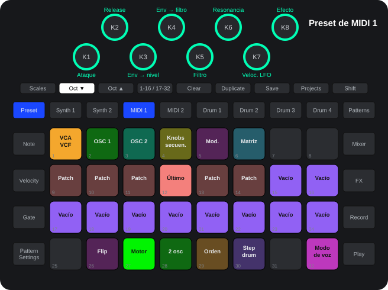

*Vista Preset de MIDI 1 con el motor oscilador, en las RC: pads 1-5 = las páginas de knobs del motor (1 VCA-VCF, 2 OSC 1, 3 OSC 2, 4 knobs secuenciables — Shift + 4 no secuenciables —, 5 modulación; mantenido ½ s = solo mientras lo mantienes), 6 = la matriz de modulación; 9-24 = patches del sinte propio (melocotón tenue = guardado, brillante = el último usado, violeta = vacío; Octave = 8 páginas; un toque carga, Clear + pad dos veces guarda); 26 = patch flip; 27 = el motor (un toque abre la fila de motores); 28 = uno / dos osciladores; 29 = orden de la cadena; 30 = step-drummer; 32 = modo de voz. El pad 31 se enciende con el VA-drum (velocity → sus envolventes).*

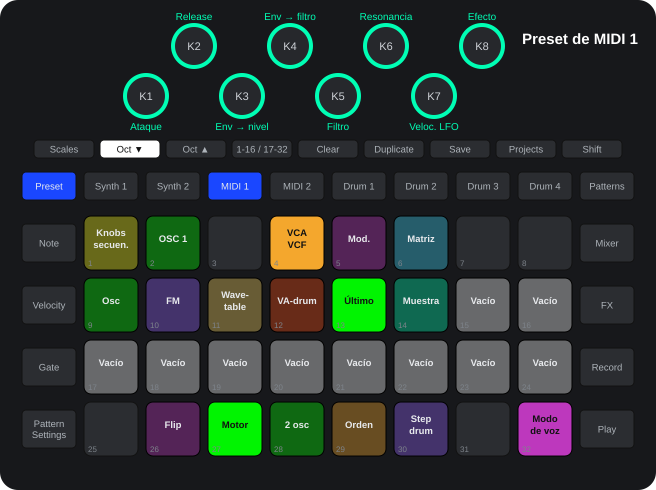

*Solo Beta 5.56, la misma vista: el pad 1 = knobs secuenciables (Shift + 1 = no secuenciables) y el pad 4 = filtro / VCA cambian de sitio; los patches en el color de su motor (vacío = blanco tenue; Duplicate + un hueco vacío guarda ahí); el pad 3 se enciende con dos osciladores; el pad 26 abre la vista de flip; con «sin voz» el pad 31 = el secuenciador de efectos; el orden de fábrica es filtro → VCA → FX (pad 29).*

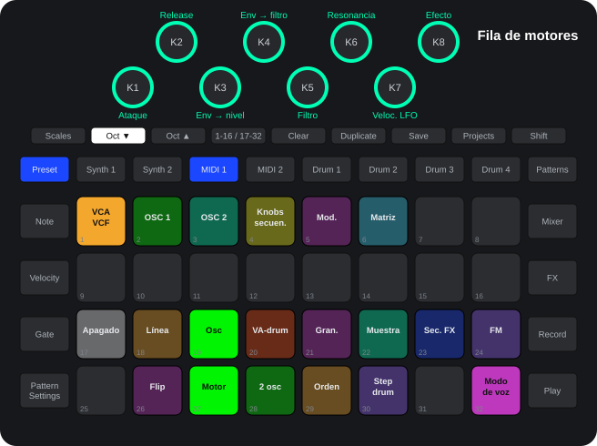

*La fila de motores en las RC (desde RC4; un toque al pad 27): pads 17-24 = apagado, entrada de línea, oscilador, VA-drum, granular, muestra, secuenciador de efectos y FM, el actual brillante; un toque elige uno, el pad 27 otra vez cierra la fila (mientras, los pads 9-24 no cargan patches). Shift + pad 27 pasa al motor siguiente.*

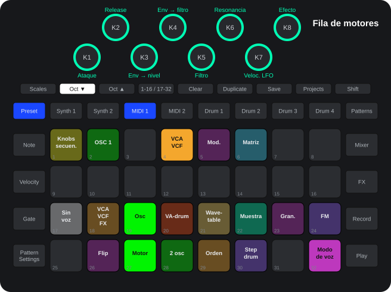

*Solo Beta 5.56, la fila de motores: sin voz, solo VCA / VCF / FX (la entrada de línea), oscilador, VA-drum, wavetable (arena), muestra, granular y FM; el secuenciador de efectos es el pad 31 cuando se elige «sin voz» (azul tenue; un toque lo enciende).*

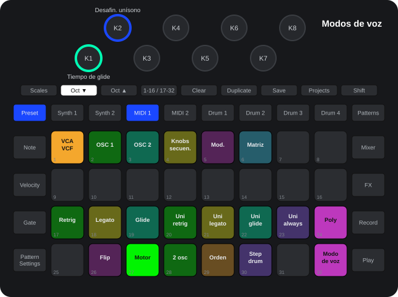

*Modos de voz (desde RC4; un toque al pad 32 con el motor encendido): pads 17-24 = retrigger, legato, glide, uni retrig, uni legato, uni glide, uni always-glide y poly (los que se llaman igual, del mismo color; el actual brillante); K1 = el tiempo del glide (verde azulado), K2 = la desafinación del unísono (azul). Se guardan con el patch y con el proyecto.*

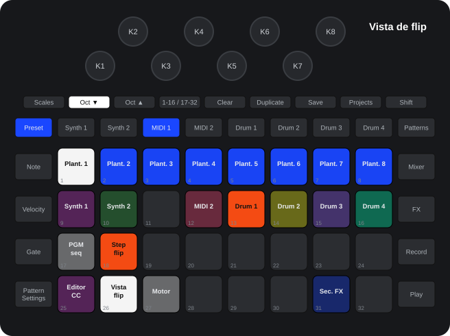

*Solo Beta 5.56: la vista de flip (pad 26, blanco mientras está abierta), MIDI 1 apuntando a Drum 1: fila 3 = el modo, pad 17 patch flip (PGM seq) o pad 18 step flip (en el color del destino; el encendido brillante, un toque lo apaga); fila 2 = las ocho pistas en sus colores, el destino brillante, la propia apagada. Mientras apunta, cada nota de la pista hace saltar a Drum 1 al paso de la nota, y el motor está apagado (pad 27 gris; pads 1-8 = las plantillas de stock).*

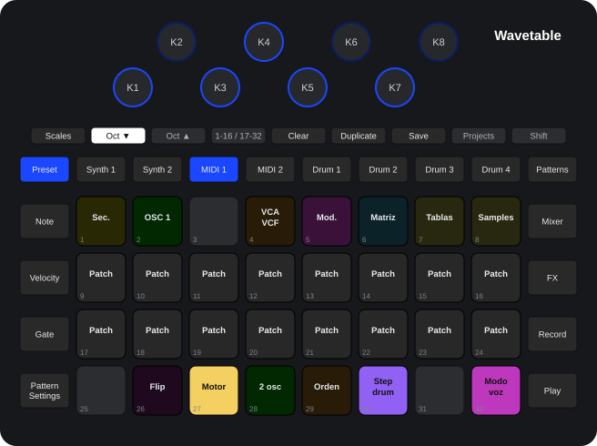

*Solo Beta 5.56: Wavetable (pad 21 de la fila de motores): el pad 27 en arena; los pads 7 y 8, las dos listas.*

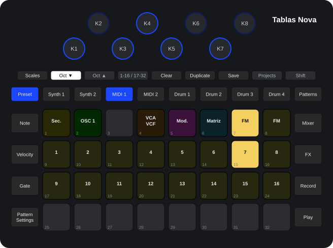

*Solo Beta 5.56: Pad 7 mantenido: las 16 wavetables de stock (pads 9-24, la cargada brillante). Un toque = la tabla entera; Shift + toque = solo el cuadro que señala K3 de OSC 1.*

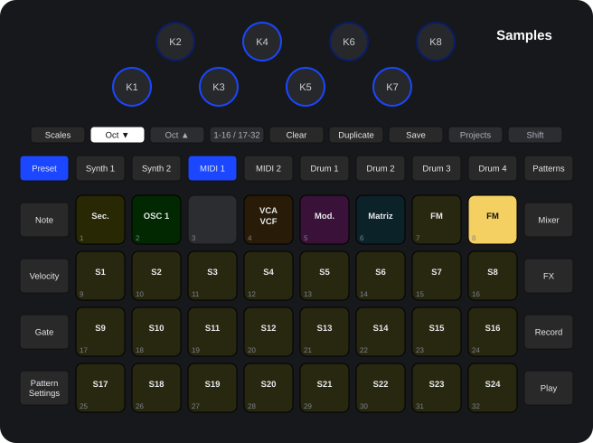

*Solo Beta 5.56: Pad 8 mantenido: los samples del pack (pads 9-32; Octave ▼ / ▲ = página). Un toque pone un ciclo de ese sample en el cuadro que señala K3 de OSC 1.*

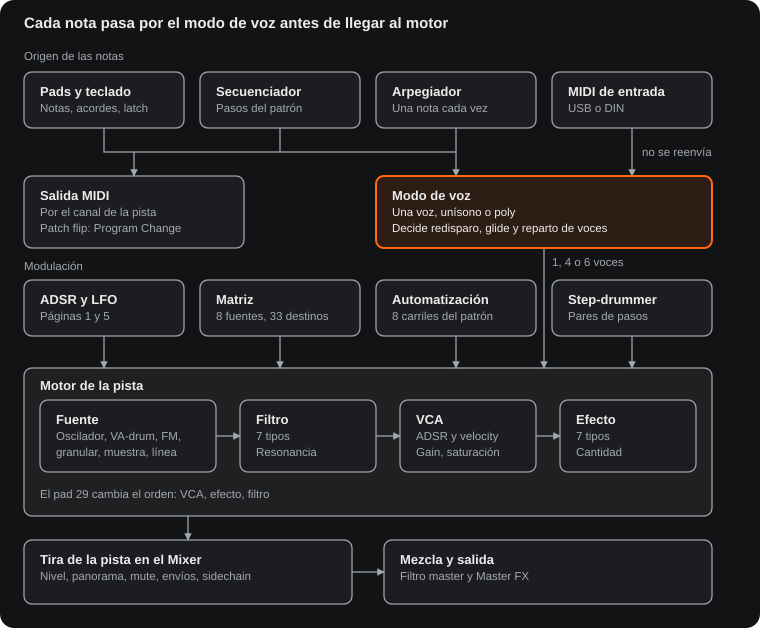

*Cada nota pasa por el modo de voz antes de llegar al motor*

## Páginas de knobs del motor de MIDI 1 / 2

*Cómo se llega:* Con el motor encendido, los pads 1-5 de la vista Preset eligen qué hacen los 8 knobs; Shift da una segunda capa.

- **VCA-VCF** — volumen y filtro con su envolvente y su LFO; con Shift, el tipo de filtro y el tipo de efecto.
- **Osciladores** — una forma de onda continua de seno a cuadrada y un segundo oscilador con FM, ring y sync.
- **Granular** — convierte un sample en texturas: granos que lo leen en otra posición, velocidad o dirección para congelarlo, estirarlo o trocearlo.
- **Página 4, knobs secuenciables** — los 8 parámetros que se graban como automatización (*(desde RC4)*: con Shift + knob, cualquiera de los 33; Record + paso = foto de los valores).
- *(desde RC4)* **Shift + pad 4, knobs no secuenciables** — 8 knobs de destino asignable que no se graban.

→ [Todo el detalle en la guía](https://ghillermo.github.io/CIRCUIT-HACKS-RC/beta/guia.html#midi-knobs)

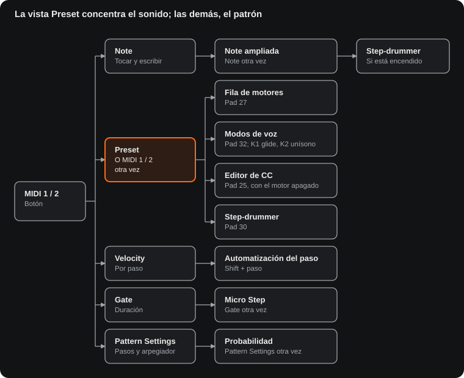

*La vista Preset concentra el sonido; las demás, el patrón*

## FM de 4 operadores

*Cómo se llega:* *(desde RC4)* MIDI 1 / 2: vista Preset, un toque al **pad 27** y el **pad 24** de la fila de motores (violeta). El **pad 7** abre su página de knobs (violeta brillante en ella).

| Knob | Solo | Con Shift |
|---|---|---|
| K1-K4 | Ratio de los operadores 1-4: 0,5 … 16 (verde = entero, azul claro = y medio, verde azulado = inarmónico: 0,71, 1,41, 4,24). Cada ratio ocupa 5-6 clics: el primero es exacto y cada uno de los siguientes **desafina** +2,5 cents (hasta unos +12; LED a media luz) | Centro = ataque 0. **A la derecha:** el ataque del operador (0 … unos 3 s; azul claro). **A la izquierda:** el operador es **percusivo** con su propio decay, más corto cuanto más a la izquierda (3 ms … 8 s; rojo) |
| K5 | Nivel del operador 1 (azul) | Algoritmo (16, 8 clics cada uno, *(solo Beta 5.64)*: 16; el color de su familia) |
| K6 | Nivel del operador 2 | Feedback (magenta) |
| K7 | Nivel del operador 3 | Ruido (blanco) |
| K8 | Nivel del operador 4 | Release (ámbar) |

- **Elegir el algoritmo con los pads:** en la página FM, **mantén el pad 7**: los pads 9-24 enseñan los 16 algoritmos (el color de su familia; el actual brillante). **Pulsa uno**: queda elegido y suena la tónica mientras lo mantienes (**Shift + pad**: sin sonar). Al soltar el pad 7 vuelven los patches.
- **Sonidos de partida** *(desde RC4)*: con el FM encendido, **un toque al pad 8** abre la página FM (como el pad 7) y **mantener el pad 8** enseña en los pads 9-24 **16 instrumentos** listos para tocar, en el color de su familia: **fila 2** piano, piano eléctrico, órgano (teclados, blanco), pluck, arpa, marimba (pulsados, violeta), bajo (ámbar), campana (verde azulado); **fila 3** cuerdas, pad (verde), flauta, clarinete, metales (vientos, azul claro), bombo, caja, hi-hat (percusión, naranja). **Pulsa uno**: se carga entero (algoritmo, ratios, niveles, envolventes, feedback, ruido y release) y suena la tónica mientras lo mantienes (**Shift + pad**: sin sonar); el que coincide con lo que suena se ve brillante. Son puntos de partida: luego se retocan con los knobs y se guardan como cualquier patch. El pad 8 se ve blanco tenue con el FM encendido y brillante mientras lo mantienes.
- **Al girar un ratio** (K1-K4) los pads 9-32 enseñan los 24 ratios durante 1,5 s (el actual brillante, en blanco si está desafinado); al girar el algoritmo (Shift + K5), los pads 9-24 enseñan los algoritmos. Mientras se ven, esos pads no cargan patches.
- **Es una variante del oscilador:** la nota, TUNE / FINE, la envolvente de pitch y el vibrato de la página 2 siguen valiendo; detrás, el filtro, el efecto y la matriz como con el oscilador. Una nota a la vez (la última manda); con el retrigger apagado (Shift + pad 29) una nota ligada no vuelve a disparar los ataques.
- **El volumen lo dan las envolventes de los operadores**: el VCA del motor se queda abierto (la velocity sigue dando el volumen) y la ADSR de la página 1 mueve el filtro, el tono y el brillo.
- **El brillo:** SHAPE (K2 de la página OSC 1; *(solo Beta 5.64)* K4), Env → forma (K4; *(solo Beta 5.64)* Shift + K4) y LFO → forma (K6; *(solo Beta 5.64)* Shift + K7) cambian cuánto modulan los moduladores (× 0,27 … × 3,7; SHAPE 50 = sin cambio), y también el feedback. Así la ADSR del motor, su LFO, la matriz, los carriles de la página 4 y el step-drummer mueven el timbre del FM.
- **La velocity** da también el brillo (cuánto, según el algoritmo) y cuánto cae el bombo. **Las notas agudas** modulan menos y caen antes (según el algoritmo, como en un DX7). En notas y ratios muy altos el motor limita la modulación para que no haya aliasing (salvo en los percusivos, donde forma parte del sonido).
- **El nivel** de un portador es su volumen; el de un modulador, cuánto modula.
- **Envolventes A/R con sustain fijo:** con la nota pulsada, un operador **sostenido** se queda arriba después de su ataque; uno **percusivo** (lo dice el algoritmo, o su Shift + knob a la izquierda) cae aunque la nota siga. Al soltar, todos caen con el release (uno percusivo por su knob, con lo más corto de su decay y el release). **El release es uno para todos y más largo cuanto más fuerte la nota**; el algoritmo lo acorta o alarga en cada operador.
- **El feedback** es como el del DX7 (la media de las dos últimas salidas): una sierra limpia en más recorrido; el knob es más fino abajo.
- Los algoritmos percusivos y de campana empiezan cada golpe con las fases a cero: todos los golpes suenan igual.
- **Ruido:** blanco, con la envolvente del operador que diga el algoritmo (el 1, salvo la caja), sumado después del FM, en cualquier algoritmo.
- **Clear + pad 7** = una **voz tocable del algoritmo elegido** (la columna «Voz» de la tabla); **Clear + knob** = su valor en esa voz (Clear + Shift + K5: la pila). **Clear + MIDI 1 / 2** = todo el motor a los valores iniciales (el FM, a la pila).
- **Se guarda con los patches del sinte propio** (con el motor en FM). Un patch de la Beta 3.22 o anterior se adapta al cargarlo (los ataques a la mitad derecha de su knob, el mismo feedback, los ratios exactos); una beta anterior carga uno nuevo con el FM apagado. No tiene CC / NRPN. Otro motor de la fila (o Shift + pad 27) lo apaga.

| # | Algoritmo | Familia | Voz (Clear + pad 7) |
|---|---|---|---|
| 1 | 4 → 3 → 2 → 1 (pila) | clásicos (blanco) | la inicial |
| 2 | 3 y 4 → 2 → 1 | | metales |
| 3 | 4 → 1 y 3 → 2 → 1 | | piano eléctrico |
| 4 | 4 → 3 → 1 y 2 → 1 | | bajo |
| 5 | dos pilas: 4 → 3 y 2 → 1 (portadores 1 y 3) | | piano eléctrico 2 |
| 6 | 4 → 1, 2 y 3 (tres portadores) | | pad |
| 7 | 4 → 3; 2 y 1 solos (tres portadores) | | clave |
| 8 | órgano: los cuatro portadores | | órgano (registros 16', 8', 4', 2 2/3') |
| 9 | bombo: 2 → 1; el 4 es la caída de pitch (su nivel = cuánto cae, hasta 3 octavas; su release = cuánto tarda) | percusivos (rojo) | bombo (unas 3 octavas de caída, rápida) |
| 10 | caja: 2 → 1 + ruido con la envolvente del 3; caída de pitch del 4 | | caja |
| 11 | metal / hi-hat: 2, 3 y 4 → 1 con ratios inarmónicos (× 1,41, 2,71, 3,49) | | hi-hat |
| 12 | tom / zap: 3 → 2 → 1; caída de pitch del 4 | | tom |
| 13 | campana: 2 → 1 y 4 → 3, ratios inarmónicos (× 3,5, × 2,76) | campanas (verde azulado) | campana |
| 14 | campana tubular: 2 y 3 → 1 (× 2,76, × 5,4), el 4 portador | | campana tubular |
| 15 | cuerdas: dos pilas (2 → 1, 4 → 3) desafinadas entre sí | cuerdas (verde) | cuerdas (ataque lento) |
| 16 | ensemble: 4 → 1, 2 y 3, tres portadores desafinados | | ensemble |

*(solo Beta 5.64)* Este FM de 4 operadores se sustituye por el **FM de 8 operadores** (capítulo siguiente); sus patches se cargan en él con el mismo sonido.

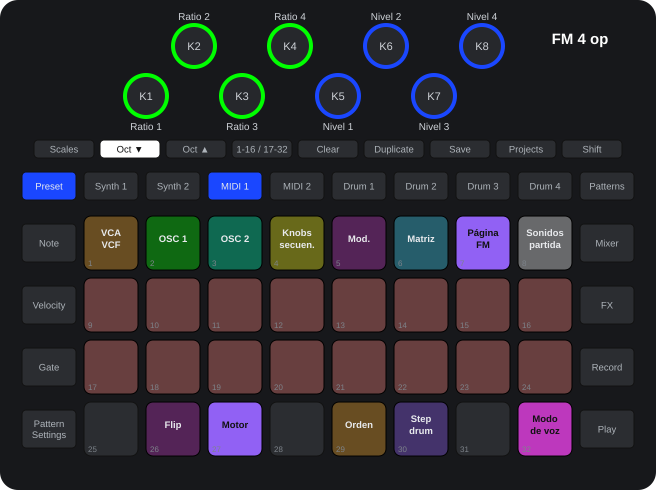

*FM de 4 operadores (desde RC4, en las RC; pad 24 de la fila de motores, violeta; pad 7 = su página): K1-K4 = los ratios de los operadores 1-4 (verde entero, azul claro y medio, verde azulado inarmónico; los clics tras cada ratio exacto lo desafinan), K5-K8 = sus niveles (el volumen de un portador, cuánto modula un modulador). Pad 7 mantenido = los 16 algoritmos, pad 8 mantenido = 16 sonidos de partida; Clear + pad 7 = una voz tocable del algoritmo.*

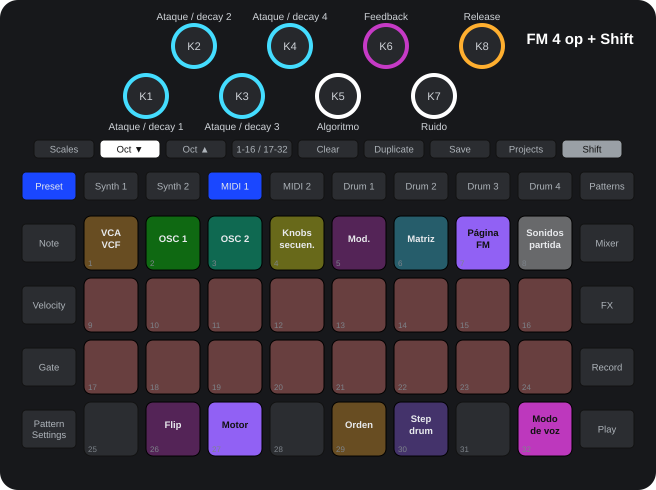

*FM de 4 operadores con Shift: K1-K4 = la envolvente de cada operador: centro = ataque 0, derecha = su ataque (azul claro), izquierda = percusivo con su propio decay (rojo); K5 = el algoritmo (16, en el color de su familia), K6 = feedback (magenta), K7 = ruido (blanco), K8 = release (ámbar; más largo cuanto más fuerte la nota).*

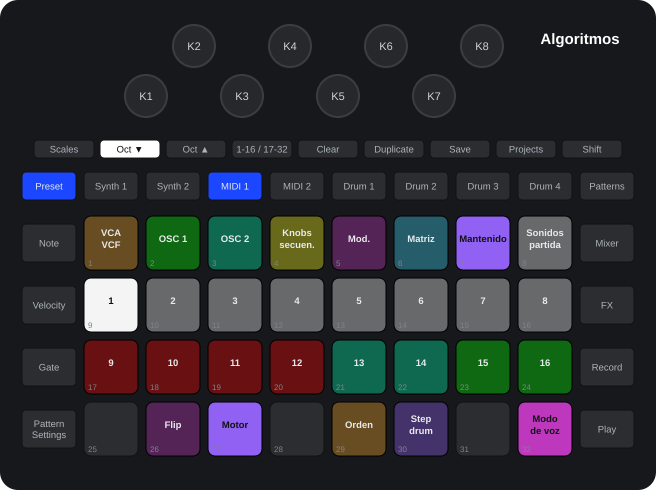

*Pad 7 mantenido: los 16 algoritmos en los pads 9-24, en el color de su familia (clásicos blanco, percusivos rojo, campanas verde azulado, cuerdas verde), el actual brillante; pulsa uno = elegido, y suena la tónica mientras lo mantienes (Shift + pad: sin sonar). Al soltar el pad 7 vuelven los patches.*

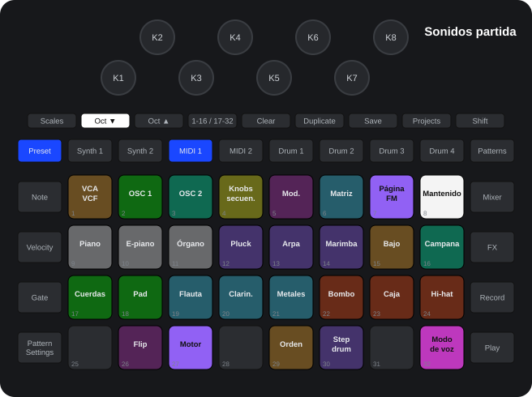

*Pad 8 mantenido (desde RC4): 16 instrumentos de partida en el color de su familia — teclados blanco, pulsados violeta, bajo ámbar, campana verde azulado, cuerdas y pad verde, vientos azul claro, percusión naranja; pulsa uno = se carga entero (algoritmo, ratios, niveles, envolventes) y suena la tónica; el que coincide con la pista, brillante.*

## FM de 8 operadores

*Cómo se llega:* *(solo Beta 5.64)* MIDI 1 / 2: vista Preset, un toque al **pad 27** y el **pad 24** de la fila de motores (violeta); cierra la fila (pad 27) y el **pad 7** abre su página.

Sustituye al FM de 4 operadores: **hasta 8 operadores** con **envolventes como las del DX7** (4 rates y 4 niveles) en cada uno. **56 algoritmos**: los 16 del FM de 4 operadores, los 32 del DX7 y 8 de 8 operadores (dos pilas de 4, cuatro parejas, una pila de 8, siete moduladores sobre un portador, ocho portadores, tres pilas 3-3-2, dos parejas y una pila de 4, el algoritmo 1 del DX7 más una pareja). El motor calcula solo los operadores que usa el algoritmo: con 4, unas 10 voces; con 6 (los del DX7), unas 6-7; con 8, unas 5.

**Pads de la página FM** (con la fila de motores cerrada):

| Pad | Qué hace |
|---|---|
| 9-16 | Elige el **operador 1-8**: los que usa el algoritmo encendidos (portadores verdes, moduladores azul claro; el elegido brillante), los demás apagados |
| 3 | La **envolvente de pitch** (violeta, el color del FM; brillante mientras la editas), como un noveno operador. Desde cualquier página de knobs abre la página FM con ella elegida |
| 17-24 | **La fila de motores**: sin voz, solo VCA / VCF / FX, oscilador, VA-drum, wavetable (arena), muestra, granular y FM (brillante); un toque cambia de motor (no cargan patches) |
| 7 | *(solo Beta 5.64)* Un toque: el **mapa del algoritmo** (abajo); mantenido ½ s: el mapa mientras lo mantienes |
| Shift + 7 mantenido | (Brillante solo mientras lo mantienes; *(solo Beta 5.64)* antes, el pad 7 mantenido.) **Los 56 algoritmos** en los pads 9-32, en tres páginas: **Octave ▼ / ▲** mientras lo mantienes (encendido = hay otra página). Página 1: los 16 de 4 operadores (verde azulado) y los 8 de 8 (ámbar); página 2: los del DX7 1-24 (blanco); página 3: los del DX7 25-32. El actual brillante; pulsa uno: elegido y suena |
| 8 mantenido | *(solo Beta 5.64)* Beta 5.58: **sin instrumentos** (el pad 8 abre la página FM, la de los operadores); los mismos sonidos son patches para la tarjeta: los **Parches demo** de la app. Antes: **24 instrumentos** en los pads 9-32, en el color de su tipo: teclados naranja (E.Piano, Bright EP, Clav, Organ, Marimba, Vibes), bajos azul (FM Bass, Synth Bass, Deep Bass), leads y metales rojo (Brass, Sync Lead, Flute), pads y cuerdas verde (Strings, Warm Pad, Choir, Glass Pad), punteados amarillo (Harp, Koto, Nylon), percusión blanco (Kick, Snare, Hi-Hat), campanas y efectos violeta (Tubular Bell, Space Sweep); el cargado brillante. Pulsa uno: se carga y suena. *(solo Beta 5.64)* **Segunda página: Octave ▼ con el pad 8 mantenido** (Octave ▲ vuelve; el Octave que lleva a la otra página se enciende): pianos naranja (Grand Piano, Mellow Piano, Honky-Tonk, Tine Piano, Toy Piano), cuerdas verde (Slow Strings, Ensemble, Cello, Violin, String Swell; Pizzicato amarillo), **vientos verde azulado** (Clarinet, Oboe, Bassoon, Alto Sax, French Horn, Trumpet, Pan Flute, Recorder, Harmonica) y sonidos largos (Cathedral, Bowed Glass, Evolving Pad, Long Bell). Los de la página 1 tienen el release más largo (pianos eléctricos, cuerdas, pads, coro, flauta, metales, arpa, nylon, campana, bajos). *(solo Beta 5.64)* **Al cargar uno, la página 4 (knobs secuenciables) y Shift + pad 4 pasan a los knobs que convienen a su familia** (teclados: Filtro, Resonancia, Env > filtro, Efecto, LFO > tono, Velocidad LFO, Tono, Ganancia; pads y vientos: el LFO y el filtro; percusión: Tono y Decay primero…); los valores no cambian. |

Con la página FM en pantalla, los pads 9-24 no cargan patches: cárgalos desde la página de otro knob. Con el FM, el **pad 28** (dos osciladores) se apaga y no hace nada (el ajuste se queda para cuando el FM se apaga), y el **pad 3** deja la página OSC 2 y es la envolvente de pitch. Las listas del pad 7 / 8 se ven también con la fila de motores abierta o un modo flip encendido.

**El mapa del algoritmo** *(solo Beta 5.64)*: en la página FM, **un toque al pad 7** fija el mapa (otro toque lo quita; el pad 7 brillante mientras se ve) y **mantenerlo ½ s** lo enseña solo mientras lo mantienes; desde otra página, un toque abre la página FM. El mapa usa los pads 9-32:

- **Cada fila se lee de izquierda a derecha: la onda de la izquierda modula a la de su derecha**, y la última de la derecha es una **portadora** (la que se oye). **Un hueco oscuro = no interactúan**. Un operador que modula a varios aparece en cada cadena (copias). Las cadenas largas van primero.
- **El color dice la relación armónica del ratio**: **verde** = entero (armónico: 1, 2, 3…), **verde azulado** = x,5 (media octava de los enteros: 0,5, 1,5…), **naranja** = cualquier otro (inarmónico, de campana), **rojo** = frecuencia fija; el operador con **feedback**, **violeta**. **Brillante** = nivel de salida de la mitad o más (el feedback, de la mitad o más); **tenue** = menos.
- **Un toque a un operador lo elige** (los knobs lo editan, como los pads 9-16): **todas sus copias laten**.
- **Shift + operador** = callado mientras ves el mapa (apagado; para oír qué aporta). No se guarda: al cerrar el mapa vuelve a sonar.
- **Mantén un operador**: late, a los que modula se ven en **blanco**, los que le modulan normales y el resto tenue. **Mantén uno y toca otro** (cualquier copia) = **el primero modula al segundo, o deja de hacerlo**: un **algoritmo propio** del patch (el mapa se redibuja al soltar). Un operador que no modula a ninguno pasa a ser portadora; un enlace que cerraría un bucle no se hace. El algoritmo propio se guarda con el patch y con el proyecto; **Shift + K1** (o la lista) vuelve a uno de los 56 (el propio se pierde).

**Knobs con un operador elegido:**

| Knob | Solo | Con Shift |
|---|---|---|
| K1 | **Ratio**: 0,5, 1 … 31, después fijo 1 / 10 / 100 / 1000 Hz (rojo); 3 clics por paso | **Algoritmo** (56, de todo el motor; 16 clics por paso). Al girarlo los pads enseñan los algoritmos 1,5 s (los 16 antiguos en los pads 9-24, los 32 del DX7 en los 32 pads, los 8 de 8 operadores en los pads 1-8) |
| K2 | **Fino** (0-99) | **Feedback** (0-127, de todo el motor) |
| K3 | **Nivel de salida** (0-99) | **Rate scaling** (0-7: las notas agudas más rápidas) |
| K4 | **Sensibilidad a la velocity** (0-7, 4 clics) | **Level scaling** (centro = ninguno; derecha = las notas agudas más bajas, izquierda = las graves) |
| K5-K8 | **Rates R1-R4** de su envolvente (0-99) | **Niveles L1-L4** (0-99) |

**Knobs con la envolvente de pitch (pad 3):** K1 transposición (0-48, 24 = ninguna), K3 ruido (0-127), K4 el operador del ruido (1-8, 16 clics), K5-K8 R1-R4; con Shift K1 / K2 como arriba y K5-K8 L1-L4 (50 = sin desplazamiento).

- **La envolvente** sube por R1 a L1, R2 a L2, R3 a L3 y se queda en L3 mientras la nota sigue; al soltar va por R4 a L4. Como en el DX7: rate 99 = inmediato.
- **Clear + knob** = el valor inicial; **Clear + pad 7** = una voz tocable del algoritmo elegido; **Clear + MIDI 1 / 2** = todo el motor a los valores iniciales.
- **Los patches de la Beta 5.19 o anterior** (FM de 4 operadores) se cargan convertidos: mismos algoritmos, ratios, niveles y envolventes, el mismo sonido.
- **Se guarda con los patches del sinte propio**: el FM de cada patch va en una ranura extra del mismo banco de la tarjeta (`Patches/NN_PATCHBANK.cpb`), después de los 8 patches de stock; el banco crece hasta 8 KB. Intercambiar patches (Duplicate + A + B) o copiarlos de otro pack lleva el FM con ellos.
- **Se guarda con el proyecto**: el FM de MIDI 1 / 2 va en los ajustes de los patrones de Synth 1 / 2 (sin cambiar nada de ellos); al cargar un proyecto vuelve su sonido.
- **Patches de ejemplo**: [81 patches del sinte propio listos](https://github.com/Ghillermo/CIRCUIT-HACKS-RC/tree/main/docs/patches) (33 sonidos clásicos y los 48 instrumentos FM), cada uno con los destinos de la página 4 y de Shift + pad 4 elegidos para su sonido; súbelos con la app de la tarjeta (**Parches custom → Subir .ctm**) y cárgalos aquí.
- **Components**: leer el pack y mandar un patch no tocan el FM. **«Send patches» / «Send pack»** cambian los patches de stock como siempre y **el aparato devuelve los patches propios y el FM** a cada banco (antes se perdían); si Components borra un banco que tiene patches propios, queda con los 8 patches de stock vacíos. No en el pack interno. Una copia guardada por Components (su zip) no lleva los patches propios: la copia de la app de la tarjeta (Snapshot) sí.
- Polifonía, unísono y glide como el FM de 4 operadores (capítulo «Voces»). No tiene CC / NRPN.

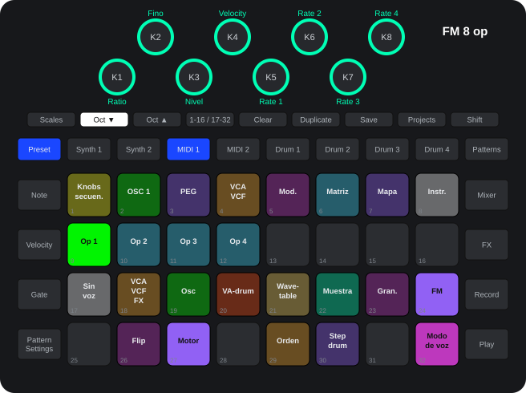

*Solo Beta 5.56: la página del FM de 8 operadores (pad 7 con la fila de motores cerrada): pads 9-16 = los operadores 1-8 (portadores verdes, moduladores azul claro, el elegido brillante; aquí la pila de cuatro), pad 3 = la envolvente de pitch, pads 17-24 = la fila de motores; K1 ratio, K2 fino, K3 nivel de salida, K4 sensibilidad a la velocity, K5-K8 los rates R1-R4 de la envolvente. Pad 7 = el mapa del algoritmo, Shift + pad 7 mantenido = los 56 algoritmos, pad 8 mantenido = los instrumentos.*

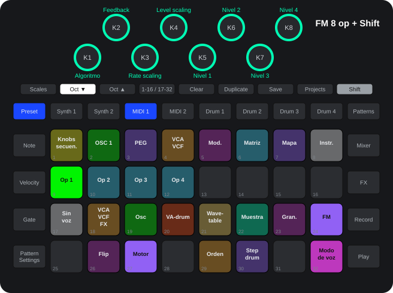

*Solo Beta 5.56, la página FM con Shift: K1 = el algoritmo (56, de todo el motor; los pads los enseñan 1,5 s), K2 = feedback, K3 = rate scaling (las notas agudas más rápidas), K4 = level scaling (centro = ninguno), K5-K8 = los niveles L1-L4 de la envolvente. La envolvente sube por R1 a L1, R2 a L2, R3 a L3, se queda en L3 mientras la nota sigue y al soltar va por R4 a L4.*

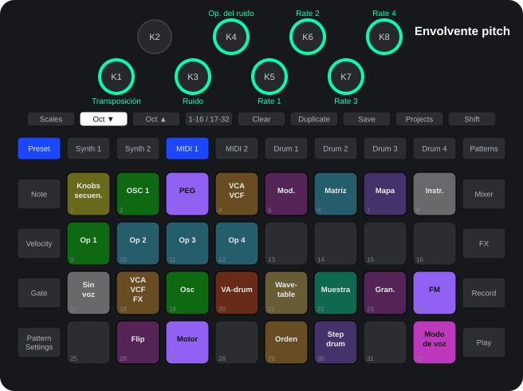

*Solo Beta 5.56, la envolvente de pitch (pad 3, violeta, brillante mientras la editas — como un noveno operador): K1 transposición (24 = ninguna), K3 ruido, K4 el operador del ruido, K5-K8 rates R1-R4; con Shift K1 / K2 = algoritmo / feedback y K5-K8 = niveles L1-L4 (50 = sin desplazamiento).*

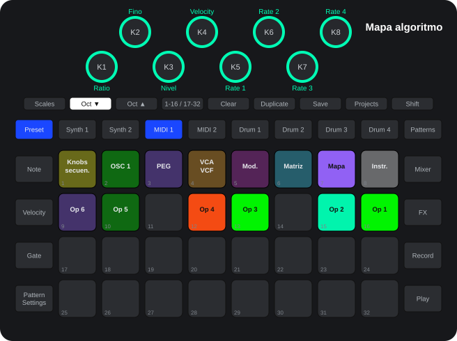

*Solo Beta 5.56: el mapa del algoritmo (un toque al pad 7), aquí del instrumento Tubular Bell (el algoritmo 5 del DX7): cada fila se lee de izquierda a derecha — una onda modula a la de su derecha y la última de la derecha es una portadora, la que se oye; un hueco oscuro = no interactúan. Color = el ratio (verde entero, verde azulado x,5, naranja otro, rojo fijo), violeta = el operador con feedback; tenue = nivel por debajo de la mitad. Un toque elige un operador, Shift + operador lo calla, uno mantenido + un toque a otro = enlazarlos o desenlazarlos (un algoritmo propio).*

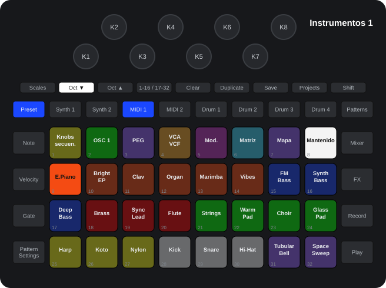

*Solo Beta 5.56, pad 8 mantenido: 24 instrumentos en el color de su tipo (teclados naranja, bajos azul, leads y metales rojo, pads y cuerdas verde, punteados amarillo, percusión blanco, campanas y efectos violeta), el cargado brillante; pulsa uno = se carga y suena. Al cargar uno, la página 4 y Shift + pad 4 pasan a los knobs que convienen a su familia.*

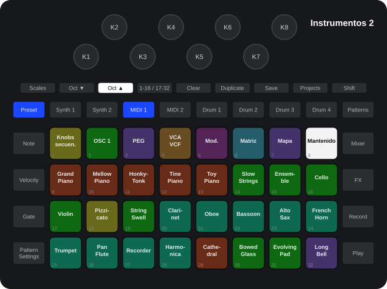

*Solo Beta 5.56, pad 8 mantenido + Octave ▼ = la segunda página: pianos naranja, cuerdas verde (Pizzicato amarillo), vientos verde azulado y cuatro sonidos largos; Octave ▲ vuelve.*

## Modo muestra y selector de samples

*Cómo se llega:* *(desde RC2)* MIDI 1 / 2 con el motor en **muestra** (pad 27 verde azulado, tras el granular): **Note dos veces** (vista Note ampliada). La pista toca un sample del pack de un golpe, a la altura de cada nota.

- **Drums con altura en una pista MIDI** — cualquier sample del pack suena a la altura de cada nota, como en una caja de ritmos con samples afinables.
- **Un sample distinto por paso** — el sample flip cambia de sample paso a paso sin otra pista; se graba también en vivo.

→ [Todo el detalle en la guía](https://ghillermo.github.io/CIRCUIT-HACKS-RC/beta/guia.html#midi-muestra)

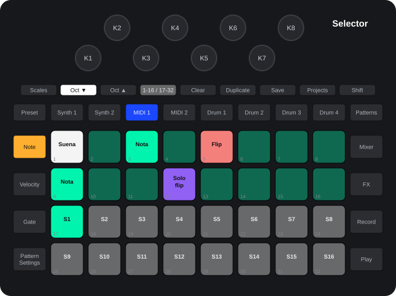

*Selector de samples (desde RC2; MIDI 1 / 2 con el motor muestra, Note dos veces): pads 17-32 = 16 de los 64 samples del pack (Octave = la página; verde azulado = el sample de la pista, un toque lo elige y suena; desde RC4 Shift + sample = sin sonar, Shift + el elegido = elegir el segundo, sample estéreo); pads 1-16 = los pasos: verde azulado = una nota, melocotón = una nota con sample flip, violeta = un flip sin nota (desde RC4), blanco = el que suena. Mantén un paso + toca un sample = su flip; Clear + paso = quitarlo; 1-16 / 17-32 = la otra mitad.*

## Matriz de modulación

*Cómo se llega:* *(desde RC2.02)* MIDI 1 / 2 con el motor encendido: vista Preset, **pad 6**. Los 8 knobs pasan a ser 8 fuentes de modulación.

| Knob | Fuente | Con Shift |
|---|---|---|
| K1 | Velocity de la nota | — |
| K2 | Nota (C3 = 0; una octava = un cuarto del recorrido) | — |
| K3 | Azar: un valor nuevo en cada nota | — |
| K4 | LFO 2 | Forma × velocidad: triángulo (verde, la inicial), diente de sierra (magenta), cuadrada (rojo), sample & hold (blanco: escalones), sample & hold suavizado (violeta: deslizándose); los colores del LFO del motor; en cada forma, de 0,05 a 20 Hz ; *(desde RC4)*: en cada forma, la mitad izquierda de su tramo a tempo y la derecha libre (0.2) |
| K5 | Envolvente 2: ataque y caída desde cada nota | Ataque × caída: ataque 0 (blanco), corto (azul claro), medio (verde azulado), largo (azul); en cada uno, la caída de 20 ms a 4 s |
| K6 | Golpe de un drum: una caída desde cada golpe | Drum 1-4 (naranja, amarillo, violeta, verde azulado) × su caída |
| K7 | Posición en el patrón: de 0 en el primer paso al máximo en el último | — |
| K8 | Azar por pasos: un valor nuevo cada N pasos del secuenciador | N = 1, 2, 4, 8 o 16 pasos |

- **La posición del knob es el destino y la cantidad.** Del todo a la izquierda = apagado. Al girar a la derecha se pasa por **todos los parámetros de las páginas de knobs** (33: los de la página 1, luego los de la 2, la 3 y los de la 5 que no salen antes), cada uno con un tramo: dentro del tramo la cantidad crece de 1/16 a entera (*(desde RC4)*: de 0 a entera: el primer paso del tramo es el destino sin cantidad, con el LED tenue); al pasar al tramo siguiente cambia el destino y la cantidad vuelve a empezar.
- **Knobs lentos:** dos clics por paso, 16 pasos por destino.
- **El color del LED es el de la página del destino** (los colores de los pads 1-5: ámbar VCA-VCF, verde OSC 1, verde azulado OSC 2), el **brillo** la cantidad; apagado = sin destino.
- **Mientras giras una fuente** (y 1,5 s después), los pads enseñan dónde vive su destino: el pad de su página brilla y los pads 9-16 / 17-24 son los K1-K8 / Shift + K1-K8 de esa página (tenues los que tienen un parámetro, brillante el destino). Mientras se ven, los pads 9-24 no cargan patches.
- **Cantidad entera** = la fuente entera recorre todo el rango del parámetro. Las fuentes bipolares (nota, azar, LFO 2, azar por pasos) suben y bajan; las demás solo suben. El valor guardado del parámetro no cambia: la matriz se suma al enviarlo.
- Varias fuentes pueden ir al mismo destino (se suman). TUNE se mueve en semitonos y FINE en fracciones; con el motor granular, sus rangos; en el modo muestra el parámetro del sample elige sample (de la captura al 64) y solo TUNE cambia la altura.
- **Clear + knob** = esa fuente apagada; **Clear + Shift + knob** = su parámetro al valor inicial; **Clear + pad 6** = todas apagadas.
- **Se guarda con los patches del sinte propio** (pads 9-24: Clear + pad dos veces, también al intercambiarlos o copiarlos entre packs); un patch guardado antes la carga apagada. *(desde RC4)* también **se guarda con el proyecto** (con el resto del sinte propio); antes no se guardaba con el proyecto ni al apagar el aparato. No tiene CC / NRPN.
- Las modulaciones llegan al motor unas 100-250 veces por segundo, repartidas entre todo lo que se mueve en la pista: varias fuentes rápidas a la vez se actualizan más despacio.

## Vista de la fuente del sinte

*Cómo se llega:* Con la vista de Synth 1 / 2 en pantalla, **pulsa su botón otra vez** (*desde RC4*: o **Shift + Synth 1 / 2** desde cualquier vista). Cualquier botón la cierra.

- **Fuente del ruido** — cambia el ruido del patch por la entrada de audio 1 o 2 (normal o invertida): el filtro, las envolventes y los efectos del sinte procesan tu señal externa al ritmo de las notas.
- **Destinos de los macros** *(desde RC2)* — decide qué mueve cada macro knob (hasta 4 destinos por macro, con su tramo y su profundidad) sin pasar por Components.
- **Step-drummer del sinte** — secuencia los macros por pares de pasos: cada knob fija la posición de un macro en dos pasos del patrón.

→ [Todo el detalle en la guía](https://ghillermo.github.io/CIRCUIT-HACKS-RC/beta/guia.html#synth-fuente)

## Vista de pista de un drum (knobs)

*Cómo se llega:* Pulsa **Drum 1-4**. Cada knob hace lo que dice su etiqueta, con una segunda capa en Shift.

- **Moldear cada drum** — tono exacto, ring mod, ataque y decay, inicio y corte del sample, filtro con varios modos, LFO y distorsión de varios tipos: de un sample salen muchos sonidos.
- **Todo neutro = el original** — con los knobs nuevos en su punto neutro, el sample suena como en el Circuit original.
- **Volver a empezar** *(desde RC2)* — Clear + el botón del drum deja todos sus knobs por defecto.
- **Pareja estéreo** *(desde RC4)* — Drum 1 + Drum 2 (o 3 + 4) tocan un sample estéreo: el de la izquierda manda en los dos y el de la derecha solo matiza.

→ [Todo el detalle en la guía](https://ghillermo.github.io/CIRCUIT-HACKS-RC/beta/guia.html#drum-pista)

## Vista cromática y de escala de los drums

*Cómo se llega:* **Shift + Preset** con un drum elegido. Los pads tocan el sample transpuesto según la escala.

- **Un drum como teclado** — el sample transpuesto en la escala del proyecto.
- **Rollers** *(desde RC2)* — repite el drum en los micropasos que mantengas: redobles y ratchets en directo, también parado, y grabados con Record.

→ [Todo el detalle en la guía](https://ghillermo.github.io/CIRCUIT-HACKS-RC/beta/guia.html#drum-cromatica)

## Master FX

*Cómo se llega:* **Mixer** y **Mixer** otra vez. Efectos sobre la salida master, el song pointer, el sample capturado y la fila de efectos asignables. Cualquier otro botón de vista sale.

- **Efectos en directo sobre todo el master** — Gater, Auto-Filter, Digitise, Phaser, Glitch y gesto mecánico *(desde RC2)*: mientras mantienes o fijados.
- **Song pointer** — repite o hace bucle de partes del patrón en directo.
- **Captura** — graba hasta 3,5 s de lo que suena para tocarlo, ponerlo en un hueco o usarlo como drum.
- **Huecos** — un efecto con sus ajustes a un toque; el secuenciador de efectos los dispara.
- **Por proyecto** *(desde RC2)* — cada proyecto recuerda sus ajustes de Master FX.

→ [Todo el detalle en la guía](https://ghillermo.github.io/CIRCUIT-HACKS-RC/beta/guia.html#master-fx)

## Vista FX

*Cómo se llega:* Botón **FX**: envíos a reverb y delay por pista, como siempre, más:

- **La reverb y el delay desde el aparato** — tipo, decay, tiempo, feedback…, guardados con el proyecto.
- **Reset rápido** — Duplicate deja los envíos y los efectos a cero.
- **Resonancia del filtro master** — en Shift + Octave ▲ / ▼, de 16 en 16 *(desde RC4; antes, 1-16 / 17-32)*.
- **Filtro master apagado / encendido** — Shift + pad 25, sin perder su posición *(desde RC4)*.

→ [Todo el detalle en la guía](https://ghillermo.github.io/CIRCUIT-HACKS-RC/beta/guia.html#vista-fx)

## Vista Sidechain

*Cómo se llega:* **Shift + FX**. Los presets de sidechain de cada pista como siempre, más los knobs:

- **El sidechain con knobs** *(desde RC2)* — ataque, hold, decay y profundidad del ducking de cada pista, más allá de los presets.
- **Compresor master** *(desde RC2)* — su ataque y su release.
- **Sidechain entre drums** — que un drum baje el volumen de otro (el bombo al bajo, por ejemplo).
- **Disparado por patrones** *(desde RC2)* — Synth 1 / 2 o MIDI 1 / 2 como fuente: las notas de su patrón agachan otra pista, no solo los drums.

→ [Todo el detalle en la guía](https://ghillermo.github.io/CIRCUIT-HACKS-RC/beta/guia.html#sidechain)
