# DSP

*[Versión en español](https://github.com/Ghillermo/CIRCUIT-HACKS-RC/wiki/DSP-ES) · [Home](https://github.com/Ghillermo/CIRCUIT-HACKS-RC/wiki/Home) · [Guide by views](https://ghillermo.github.io/CIRCUIT-HACKS-RC/beta/guide.html)*

The sound side of the mod: the synth engines of the MIDI tracks, the new drum controls and the effects.

The **MIDI 1 / 2** tracks get their own synth inside the device, with several engines on the engine row of their Preset view: an
**oscillator** that morphs between sine, triangle, saw (up to a seven-saw **supersaw**) and pulse, with wavefolding; **two oscillators** with FM, sync,
ring and mix; a **VA-drum** for percussive sounds; a **granular** engine that plays grains of a sample or of the live capture; a **4-operator FM**
engine with 16 algorithms; and a **sample mode** that plays the pack's samples across the keyboard, in stereo if you like. It has a filter with
several types, envelopes, an LFO with seven shapes (synced to the tempo if you want), a **mod matrix**, **polyphony** with eight voice modes, and
eight automation lanes. The **drums** gain envelopes, a ring modulator, an LFO, filter modes, sample start and end, attack, bitcrush and distortion
types. **Master FX** adds performance effects to the whole mix, and the **FX** and **Sidechain** views expose the reverb, delay, side-chain and
master compressor settings. The maps of every view are on the [Views](https://github.com/Ghillermo/CIRCUIT-HACKS-RC/wiki/Views) page.

## MIDI 1 / 2 Preset view

*How to get there:* Press **MIDI 1** or **MIDI 2**, then **Preset** (*since RC4*: or **MIDI 1 / MIDI 2 again** with its Note view on the screen, or **Shift + MIDI 1 / 2**). Besides the stock templates, the track's own synth lives here.

- **A synth on each MIDI track** — MIDI 1 and 2 sound on the unit itself with their engine (processed line input, oscillator, two oscillators, VA-drum, granular, sample mode; *(since RC4)* FM) and still send MIDI.
- **FX sequencer** — an engine with no sound: it triggers Master FX effects on the steps you choose.
- **Own-synth patches** *(since RC2)* — 64 sounds a pack for those engines, one touch away.
- **Mod matrix** *(since RC2.02)* — eight sources (velocity, note, random, LFO 2, envelope 2, a drum hit, the pattern position, stepped random) that move any parameter of the engine.
- **Patch flip** — every note sends a program change: the outside gear changes sound step by step.
- **Jump sequencer** *(Beta 5.64 only)* — the track's notes make another track's pattern jump to the step they indicate.
- **CC editor** — changes which CC each knob of the template sends, without Components.

→ [Full details in the guide](https://ghillermo.github.io/CIRCUIT-HACKS-RC/beta/guide.html#midi-preset)

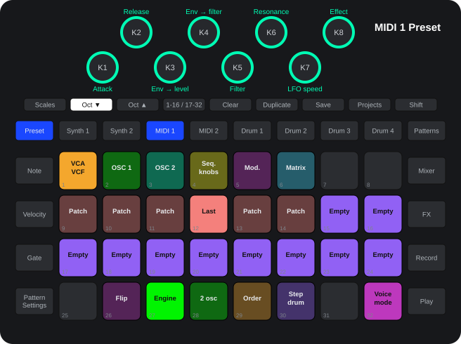

*MIDI 1's Preset view with the oscillator engine, in the RCs: pads 1-5 = the engine's knob pages (1 VCA-VCF, 2 OSC 1, 3 OSC 2, 4 sequenceable knobs — Shift + 4 non-sequenceable —, 5 modulation; held ½ s = only while held), 6 = the mod matrix; 9-24 = own-synth patches (dim peach = saved, bright = the last used, violet = empty; Octave = 8 pages; a tap loads, Clear + pad twice saves); 26 = patch flip; 27 = the engine (a tap opens the engine row); 28 = one / two oscillators; 29 = chain order; 30 = step-drummer; 32 = voice mode. Pad 31 lights with the VA-drum (velocity → its envelopes).*

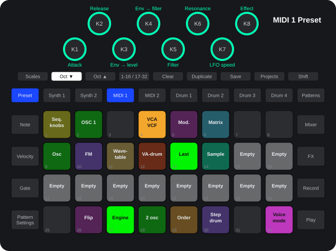

*Beta 5.56 only, the same view: pad 1 = sequenceable knobs (Shift + 1 = non-sequenceable) and pad 4 = filter / VCA swap places; the patches show their engine's colour (empty = dim white; Duplicate + an empty slot saves there); pad 3 lights with two oscillators; pad 26 opens the flip view; with «no voice» pad 31 = the FX sequencer; filter → VCA → FX is the default order (pad 29).*

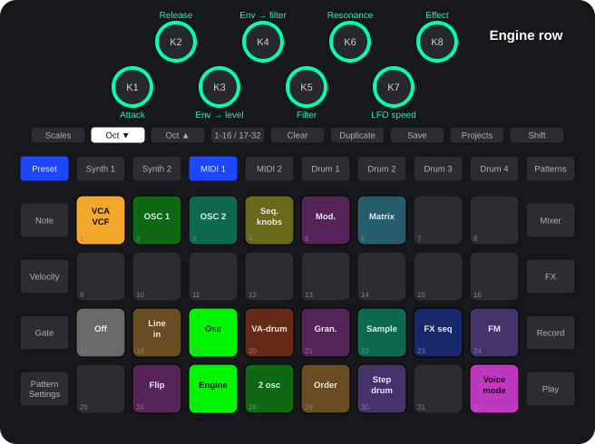

*The engine row in the RCs (since RC4; a tap on pad 27): pads 17-24 = off, line input, oscillator, VA-drum, granular, sample, FX sequencer and FM, the current one bright; a tap picks one, pad 27 again closes the row (meanwhile pads 9-24 load no patches). Shift + pad 27 steps to the next engine.*

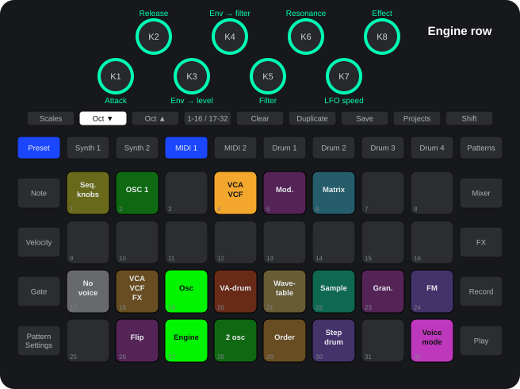

*Beta 5.56 only, the engine row: no voice, VCA / VCF / FX only (the line input), oscillator, VA-drum, wavetable (sand), sample, granular and FM; the FX sequencer is pad 31 once «no voice» is chosen (dim blue; a tap turns it on).*

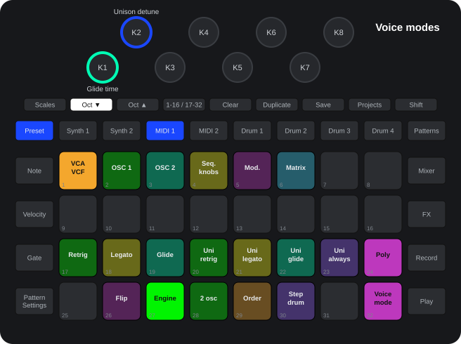

*Voice modes (since RC4; a tap on pad 32 with the engine on): pads 17-24 = retrigger, legato, glide, uni retrig, uni legato, uni glide, uni always-glide and poly (modes with the same name share a colour; the current one bright); K1 = the glide's time (teal), K2 = the unison's detune (blue). Saved with the patch and the project.*

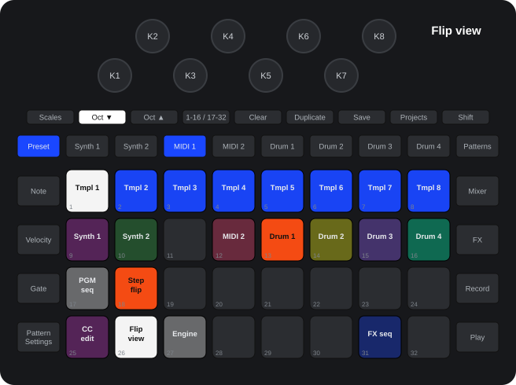

*Beta 5.56 only: the flip view (pad 26, white while open), MIDI 1 pointing at Drum 1: row 3 = the mode, pad 17 patch flip (PGM seq) or pad 18 step flip (in the target's colour; the one on bright, a tap on it turns it off); row 2 = the eight tracks in their colours, the target bright, the track itself dark. While pointing, each note of the track makes Drum 1 jump to the note's step, and the engine is off (pad 27 grey; pads 1-8 = the stock templates).*

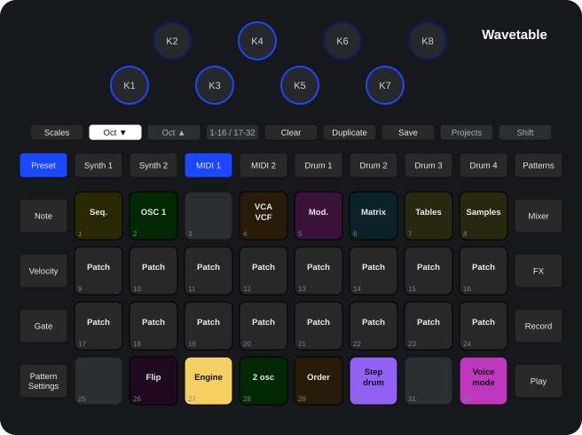

*Beta 5.56 only: Wavetable (pad 21 of the engine row): pad 27 in sand; pads 7 and 8, the two lists.*

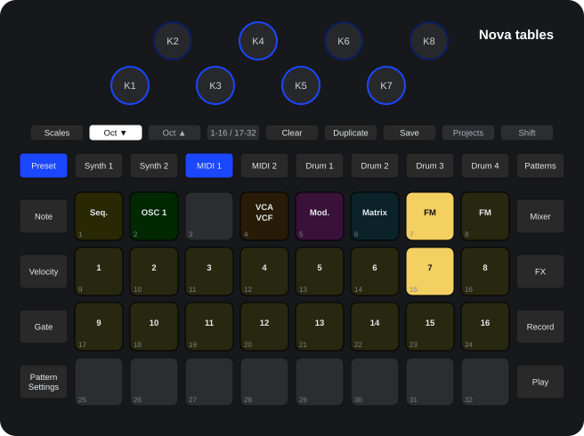

*Beta 5.56 only: Pad 7 held: the stock's 16 wavetables (pads 9-24, the loaded one bright). A tap = the whole table; Shift + tap = only the frame OSC 1's K3 points at.*

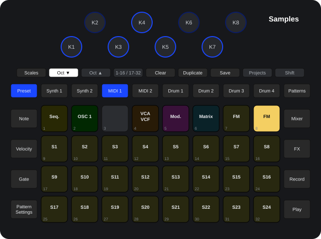

*Beta 5.56 only: Pad 8 held: the pack's samples (pads 9-32; Octave ▼ / ▲ = page). A tap puts a cycle of that sample in the frame OSC 1's K3 points at.*

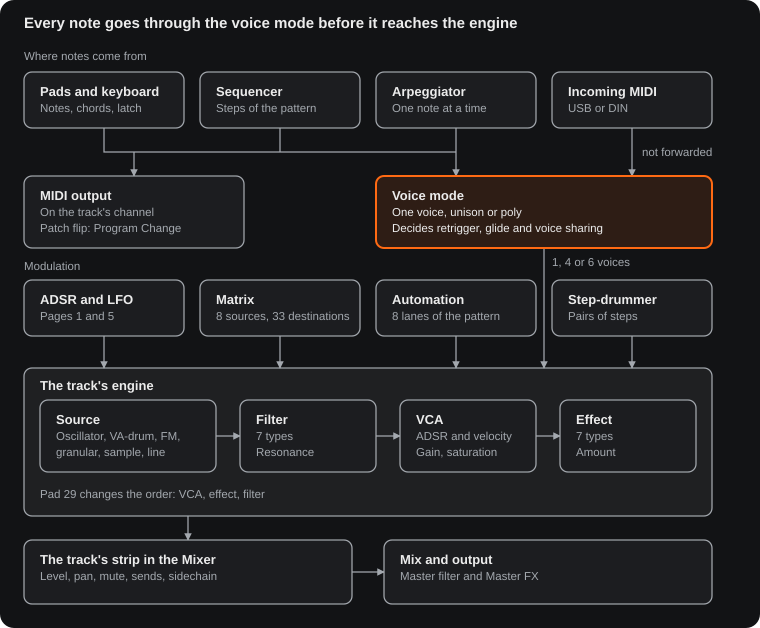

*Every note goes through the voice mode before it reaches the engine*

## Knob pages of the MIDI 1 / 2 engine

*How to get there:* With the engine on, pads 1-5 of the Preset view pick what the 8 knobs do; Shift gives a second layer.

- **VCA-VCF** — level and filter with their envelope and LFO; with Shift, the filter type and the effect type.
- **Oscillators** — a waveform that morphs from sine to square, and a second oscillator with FM, ring and sync.
- **Granular** — turns a sample into textures: grains that read it at another place, speed or direction, to freeze, stretch or slice it.
- **Page 4, sequenceable knobs** — the 8 parameters that can be recorded as automation (*(since RC4)*: with Shift + knob, any of the 33; Record + step = a snapshot of the values).
- *(since RC4)* **Shift + pad 4, non-sequenceable knobs** — 8 knobs with an assignable destination that are not recorded.

→ [Full details in the guide](https://ghillermo.github.io/CIRCUIT-HACKS-RC/beta/guide.html#midi-knobs)

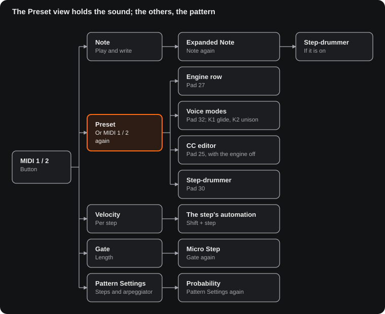

*The Preset view holds the sound; the others, the pattern*

## 4-operator FM

*How to get there:* *(since RC4)* MIDI 1 / 2: Preset view, a tap on **pad 27** and **pad 24** of the engine row (violet). **Pad 7** opens its knob page (bright violet on it).

| Knob | Alone | With Shift |
|---|---|---|
| K1-K4 | Ratio of operators 1-4: 0.5 … 16 (green = whole, light blue = and a half, teal = inharmonic: 0.71, 1.41, 4.24). Each ratio spans 5-6 clicks: the first is exact and each further one **detunes** +2.5 cents (up to about +12; LED half bright) | Centre = attack 0. **To the right:** the operator's attack (0 … about 3 s; light blue). **To the left:** the operator is **percussive** with its own decay, shorter the further left (3 ms … 8 s; red) |
| K5 | Level of operator 1 (blue) | Algorithm (16, 8 clicks each, *(Beta 5.64 only)*: 16; its family's colour) |
| K6 | Level of operator 2 | Feedback (magenta) |
| K7 | Level of operator 3 | Noise (white) |
| K8 | Level of operator 4 | Release (amber) |

- **Choosing the algorithm with the pads:** on the FM page, **hold pad 7**: pads 9-24 show the 16 algorithms (their family's colour; the current one bright). **Press one**: it is chosen and the tonic sounds while you hold it (**Shift + pad**: no sound). Letting go of pad 7 brings the patches back.
- **Starter sounds** *(since RC4)*: with FM on, **a tap on pad 8** opens the FM page (like pad 7) and **holding pad 8** shows **16 ready-to-play instruments** on pads 9-24, in their family's colour: **row 2** piano, electric piano, organ (keys, white), pluck, harp, marimba (plucked, violet), bass (amber), bell (teal); **row 3** strings, pad (green), flute, clarinet, brass (winds, light blue), kick, snare, hi-hat (drums, orange). **Press one**: it loads whole (algorithm, ratios, levels, envelopes, feedback, noise and release) and the tonic sounds while you hold it (**Shift + pad**: no sound); the one matching what plays shows bright. They are starting points: tweak them with the knobs and save them like any patch. Pad 8 shows dim white with FM on and bright while held.
- **While a ratio turns** (K1-K4) pads 9-32 show the 24 ratios for 1.5 s (the current one bright, white when detuned); while the algorithm turns (Shift + K5), pads 9-24 show the algorithms. Meanwhile those pads load no patch.
- **It is a variant of the oscillator:** the note, TUNE / FINE, the pitch envelope and the vibrato of page 2 still apply; after it, the filter, the effect and the matrix as with the oscillator. One note at a time (the last one wins); with the retrigger off (Shift + pad 29) a legato note does not restart the attacks.
- **The loudness comes from the operators' envelopes**: the engine's VCA stays open (velocity still sets the level) and page 1's ADSR moves the filter, the pitch and the brightness.
- **Brightness:** SHAPE (K2 of the OSC 1 page; *(Beta 5.64 only)* K4), Env → shape (K4; *(Beta 5.64 only)* Shift + K4) and LFO → shape (K6; *(Beta 5.64 only)* Shift + K7) change how much the modulators modulate (× 0.27 … × 3.7; SHAPE 50 = no change), and the feedback too. So the engine's ADSR, its LFO, the matrix, the page 4 lanes and the step-drummer move the FM's timbre.
- **Velocity** also sets the brightness (how much, by algorithm) and how far the kick drops. **High notes** modulate less and decay sooner (by algorithm, as on a DX7). At very high notes and ratios the engine limits the modulation so it does not alias (except in the percussive ones, where it is part of the sound).
- **The level** of a carrier is its loudness; of a modulator, how much it modulates.
- **A/R envelopes with a fixed sustain:** while the note is held, a **sustained** operator stays up after its attack; a **percussive** one (the algorithm says so, or its Shift + knob to the left) falls even while the note is held. On release, all fall with the release (one made percussive by its knob, with the shorter of its decay and the release). **The release is one for all and longer the harder the note**; the algorithm shortens or lengthens it per operator.
- **The feedback** is the DX7's (the average of the last two outputs): a clean saw over more of the range; the knob is finer at the bottom.
- The percussive and bell algorithms start every hit with the phases at zero: every hit sounds the same.
- **Noise:** white, with the envelope of the operator the algorithm names (1, except the snare's), added after the FM, in any algorithm.
- **Clear + pad 7** = a **playable voice of the chosen algorithm** (the table's «Voice» column); **Clear + knob** = its value in that voice (Clear + Shift + K5: the stack). **Clear + MIDI 1 / 2** = the whole engine to its defaults (the FM to the stack).
- **Saved with the own-synth patches** (with the engine on FM). A patch from Beta 3.22 or before is adapted when it loads (the attacks to the right half of their knob, the same feedback, the ratios exact); an earlier beta loads a new one with FM off. No CC / NRPN. Another engine of the row (or Shift + pad 27) turns it off.

| # | Algorithm | Family | Voice (Clear + pad 7) |
|---|---|---|---|
| 1 | 4 → 3 → 2 → 1 (stack) | classic (white) | the initial one |
| 2 | 3 and 4 → 2 → 1 | | brass |
| 3 | 4 → 1 and 3 → 2 → 1 | | electric piano |
| 4 | 4 → 3 → 1 and 2 → 1 | | bass |
| 5 | two stacks: 4 → 3 and 2 → 1 (carriers 1 and 3) | | electric piano 2 |
| 6 | 4 → 1, 2 and 3 (three carriers) | | pad |
| 7 | 4 → 3; 2 and 1 alone (three carriers) | | harpsichord |
| 8 | organ: all four carriers | | organ (16', 8', 4', 2 2/3' stops) |
| 9 | kick: 2 → 1; operator 4 is the pitch drop (its level = how far, up to 3 octaves; its release = how long) | percussive (red) | kick (about 3 octaves of fast drop) |
| 10 | snare: 2 → 1 + noise with operator 3's envelope; pitch drop from 4 | | snare |
| 11 | metal / hi-hat: 2, 3 and 4 → 1 with inharmonic ratios (× 1.41, 2.71, 3.49) | | hi-hat |
| 12 | tom / zap: 3 → 2 → 1; pitch drop from 4 | | tom |
| 13 | bell: 2 → 1 and 4 → 3, inharmonic ratios (× 3.5, × 2.76) | bells (teal) | bell |
| 14 | tubular bell: 2 and 3 → 1 (× 2.76, × 5.4), 4 a carrier | | tubular bell |
| 15 | strings: two stacks (2 → 1, 4 → 3) detuned against each other | strings (green) | strings (slow attack) |
| 16 | ensemble: 4 → 1, 2 and 3, three detuned carriers | | ensemble |

*(Beta 5.64 only)* This 4-operator FM is replaced by the **8-operator FM** (next chapter); its patches load into it with the same sound.

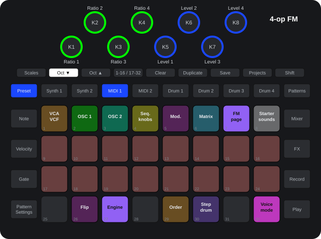

*4-operator FM (since RC4, in the RCs; pad 24 of the engine row, violet; pad 7 = its page): K1-K4 = the ratios of operators 1-4 (green whole, light blue and a half, teal inharmonic; the clicks after each exact ratio detune it), K5-K8 = their levels (a carrier's loudness, how much a modulator modulates). Pad 7 held = the 16 algorithms, pad 8 held = 16 starter sounds; Clear + pad 7 = a playable voice of the algorithm.*

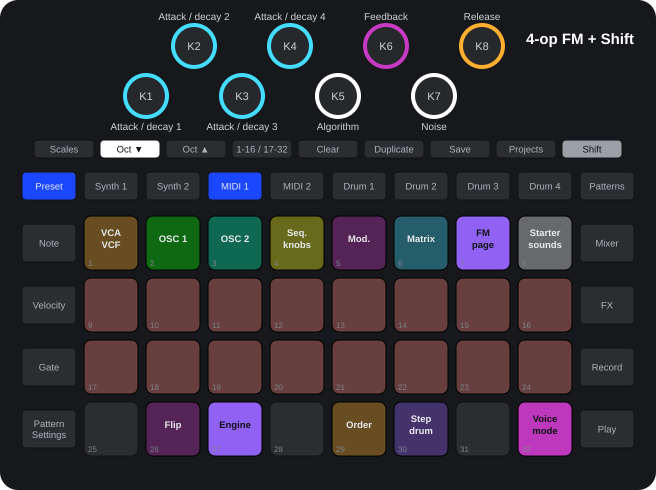

*4-operator FM with Shift: K1-K4 = each operator's envelope: centre = attack 0, right = its attack (light blue), left = percussive with its own decay (red); K5 = the algorithm (16, in its family's colour), K6 = feedback (magenta), K7 = noise (white), K8 = release (amber; longer the harder the note).*

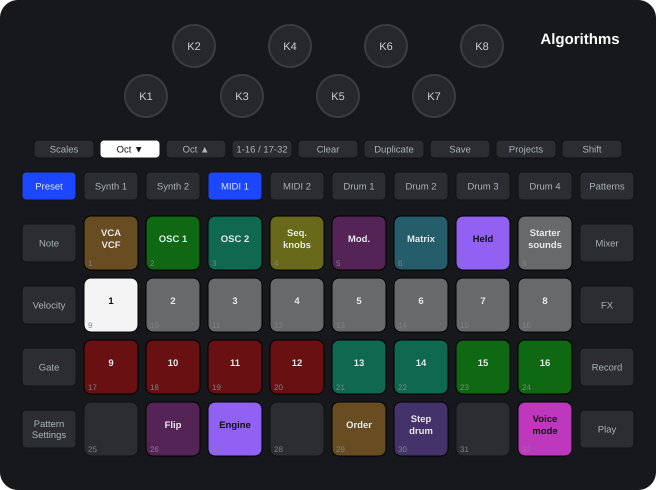

*Pad 7 held: the 16 algorithms on pads 9-24, in their family's colour (classic white, percussive red, bells teal, strings green), the current one bright; press one = chosen, and the tonic sounds while held (Shift + pad: silent). Letting go of pad 7 brings the patches back.*

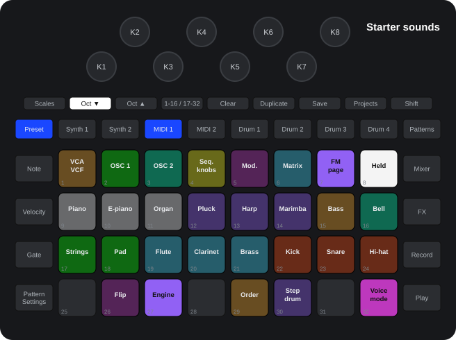

*Pad 8 held (since RC4): 16 starter instruments in their family's colour — keys white, plucked violet, bass amber, bell teal, strings and pad green, winds light blue, drums orange; press one = it loads whole (algorithm, ratios, levels, envelopes) and the tonic sounds; the one matching the track bright.*

## 8-operator FM

*How to get there:* *(Beta 5.64 only)* MIDI 1 / 2: Preset view, a tap on **pad 27** and **pad 24** of the engine row (violet); close the row (pad 27) and **pad 7** opens its page.

It replaces the 4-operator FM: **up to 8 operators**, each with a **DX7-style envelope** (4 rates and 4 levels). **56 algorithms**: the 4-operator FM's 16, the DX7's 32 and 8 with eight operators (two 4-stacks, four pairs, an 8-stack, seven modulators on one carrier, eight carriers, three stacks 3-3-2, two pairs and a 4-stack, the DX7's algorithm 1 plus a pair). The engine works out only the operators the algorithm uses: with 4, about 10 voices; with 6 (the DX7's), about 6-7; with 8, about 5.

**Pads of the FM page** (with the engine row closed):

| Pad | What it does |
|---|---|
| 9-16 | Picks **operator 1-8**: the ones the algorithm uses lit (carriers green, modulators light blue; the picked one bright), the others off |
| 3 | The **pitch envelope** (violet, FM's colour; bright while you edit it), like a ninth operator. From any knob page it opens the FM page with it picked |
| 17-24 | **The engine row**: no voice, VCA / VCF / FX only, oscillator, VA-drum, wavetable (sand), sample, granular and FM (bright); a tap changes the engine (no patches load) |
| 7 | *(Beta 5.64 only)* A tap: the **algorithm map** (below); held ½ s: the map while held |
| Shift + 7 held | (Bright only while held; *(Beta 5.64 only)* before, pad 7 held.) **The 56 algorithms** on pads 9-32, in three pages: **Octave ▼ / ▲** while you hold it (lit = there is another page). Page 1: the 16 four-operator ones (teal) and the 8 eight-operator ones (amber); page 2: the DX7's 1-24 (white); page 3: the DX7's 25-32. The current one bright; press one: chosen, and it sounds |
| 8 held | *(Beta 5.64 only)* Beta 5.58: **no instruments** (pad 8 opens the FM page, the operators); the same sounds are patches for the card: the app's **Demo patches**. Before: **24 instruments** on pads 9-32, in their type's colour: keys orange (E.Piano, Bright EP, Clav, Organ, Marimba, Vibes), basses blue (FM Bass, Synth Bass, Deep Bass), leads and brass red (Brass, Sync Lead, Flute), pads and strings green (Strings, Warm Pad, Choir, Glass Pad), plucks yellow (Harp, Koto, Nylon), percussion white (Kick, Snare, Hi-Hat), bells and fx violet (Tubular Bell, Space Sweep); the loaded one bright. Press one: loaded, and it sounds. *(Beta 5.64 only)* **Second page: Octave ▼ with pad 8 held** (Octave ▲ goes back; the Octave that leads to the other page is lit): pianos orange (Grand Piano, Mellow Piano, Honky-Tonk, Tine Piano, Toy Piano), strings green (Slow Strings, Ensemble, Cello, Violin, String Swell; Pizzicato yellow), **winds teal** (Clarinet, Oboe, Bassoon, Alto Sax, French Horn, Trumpet, Pan Flute, Recorder, Harmonica) and long sounds (Cathedral, Bowed Glass, Evolving Pad, Long Bell). Page 1's have longer releases (electric pianos, strings, pads, choir, flute, brass, harp, nylon, bell, basses). *(Beta 5.64 only)* **Loading one also sets page 4 (sequenceable knobs) and Shift + pad 4 to the knobs that suit its family** (keys: Filter, Resonance, Env > filter, FX, LFO > pitch, LFO speed, Tune, VCA gain; pads and winds: the LFO and the filter; percussion: Tune and Decay first…); the values do not change. |

With the FM page showing, pads 9-24 load no patches: load them from another knob page. With FM, **pad 28** (two oscillators) goes dark and does nothing (the setting stays for when FM is off), and **pad 3** leaves the OSC 2 page and becomes the pitch envelope. The pad 7 / 8 lists also show with the engine row open or a flip mode on.

**The algorithm map** *(Beta 5.64 only)*: on the FM page, **a tap on pad 7** pins the map (another tap removes it; pad 7 bright while it shows) and **holding it ½ s** shows it only while held; from another page, a tap opens the FM page. The map uses pads 9-32:

- **Each row reads left to right: the wave on the left modulates the one on its right**, and the last on the right is a **carrier** (the one you hear). **A dark gap = no interaction**. An operator that modulates several shows in each chain (copies). Longer chains come first.
- **The colour tells the ratio's harmonic relation**: **green** = integer (harmonic: 1, 2, 3…), **teal** = x.5 (half-way: 0.5, 1.5…), **orange** = anything else (inharmonic, bell-like), **red** = fixed frequency; the **feedback** operator, **violet**. **Bright** = output level half or more (the feedback, half or more); **dim** = less.
- **A tap on an operator picks it** (the knobs edit it, as pads 9-16): **all its copies pulse**.
- **Shift + operator** = silenced while you look at the map (dark; to hear what it adds). Not saved: closing the map brings it back.
- **Hold an operator**: it pulses, the ones it modulates show **white**, the ones modulating it normal and the rest dim. **Hold one and tap another** (any copy) = **the first modulates the second, or stops doing so**: a patch's **own algorithm** (the map redraws when you let go). An operator that modulates none becomes a carrier; a link that would close a loop is refused. The own algorithm is saved with the patch and the project; **Shift + K1** (or the list) goes back to one of the 56 (the own one is lost).

**Knobs with an operator picked:**

| Knob | Alone | With Shift |
|---|---|---|
| K1 | **Ratio**: 0.5, 1 … 31, then fixed 1 / 10 / 100 / 1000 Hz (red); 3 clicks a step | **Algorithm** (56, for the whole engine; 16 clicks a step). Turning it shows the algorithms on the pads for 1.5 s (the old 16 on pads 9-24, the DX7's 32 on all 32 pads, the 8 eight-operator ones on pads 1-8) |
| K2 | **Fine** (0-99) | **Feedback** (0-127, for the whole engine) |
| K3 | **Output level** (0-99) | **Rate scaling** (0-7: higher notes faster) |
| K4 | **Velocity sensitivity** (0-7, 4 clicks) | **Level scaling** (centre = none; right = higher notes softer, left = lower notes softer) |
| K5-K8 | **Rates R1-R4** of its envelope (0-99) | **Levels L1-L4** (0-99) |

**Knobs with the pitch envelope (pad 3):** K1 transpose (0-48, 24 = none), K3 noise (0-127), K4 the noise's operator (1-8, 16 clicks), K5-K8 R1-R4; with Shift K1 / K2 as above and K5-K8 L1-L4 (50 = no shift).

- **The envelope** rises at R1 to L1, R2 to L2, R3 to L3 and stays at L3 while the note is held; on release it goes at R4 to L4. As on the DX7: rate 99 = instant.
- **Clear + knob** = the initial value; **Clear + pad 7** = a playable voice of the chosen algorithm; **Clear + MIDI 1 / 2** = the whole engine to its defaults.
- **Patches from Beta 5.19 or earlier** (4-operator FM) load converted: same algorithms, ratios, levels and envelopes, the same sound.
- **Saved with the own-synth patches**: each patch's FM goes in an extra slot of the same bank on the card (`Patches/NN_PATCHBANK.cpb`), after the 8 stock patches; the bank grows up to 8 KB. Swapping patches (Duplicate + A + B) or copying them from another pack takes the FM along.
- **Saved with the project**: MIDI 1 / 2's FM goes in the settings of Synth 1 / 2's patterns (changing nothing of theirs); loading a project brings its sound back.
- **Example patches**: [81 ready-made own-synth patches](https://github.com/Ghillermo/CIRCUIT-HACKS-RC/tree/main/docs/patches) (33 classic sounds and the 48 FM instruments), each with page 4's and Shift + pad 4's destinations chosen for its sound; upload them with the card app (**Custom patches → Upload .ctm**) and load them here.
- **Components**: reading the pack and sending one patch leave the FM alone. **«Send patches» / «Send pack»** change the stock patches as always and **the device puts the own-synth patches and the FM back** in each bank (they used to be lost); if Components deletes a bank that holds own-synth patches, it stays with its 8 stock patches empty. Not on the internal pack. A copy saved by Components (its zip) has no own-synth patches: the card app's copy (Snapshot) has them.
- Polyphony, unison and glide as with the 4-operator FM (chapter «Voices»). No CC / NRPN.

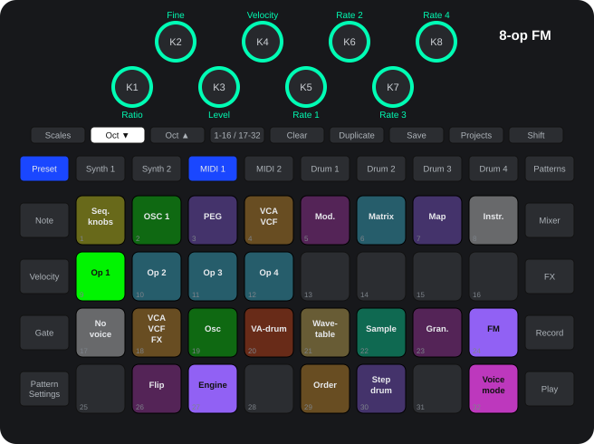

*Beta 5.56 only: the 8-operator FM page (pad 7 with the engine row closed): pads 9-16 = operators 1-8 (carriers green, modulators light blue, the picked one bright; here the four-operator stack), pad 3 = the pitch envelope, pads 17-24 = the engine row; K1 ratio, K2 fine, K3 output level, K4 velocity sensitivity, K5-K8 the envelope's rates R1-R4. Pad 7 = the algorithm map, Shift + pad 7 held = the 56 algorithms, pad 8 held = the instruments.*

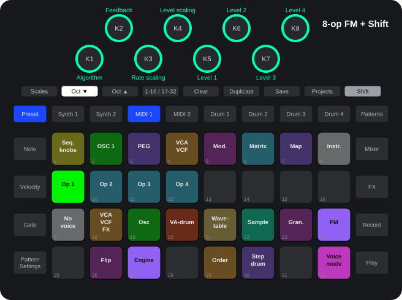

*Beta 5.56 only, the FM page with Shift: K1 = the algorithm (56, for the whole engine; the pads show them for 1.5 s), K2 = feedback, K3 = rate scaling (higher notes faster), K4 = level scaling (centre = none), K5-K8 = the envelope's levels L1-L4. The envelope rises at R1 to L1, R2 to L2, R3 to L3, stays at L3 while the note is held and on release goes at R4 to L4.*

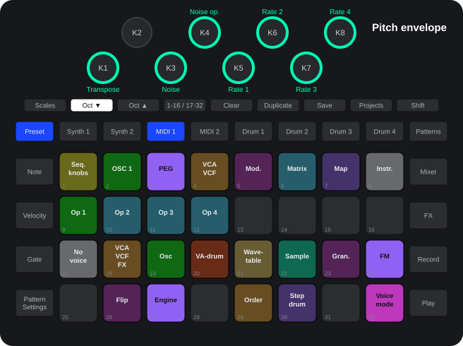

*Beta 5.56 only, the pitch envelope (pad 3, violet, bright while edited — like a ninth operator): K1 transpose (24 = none), K3 noise, K4 the noise's operator, K5-K8 rates R1-R4; with Shift K1 / K2 = algorithm / feedback and K5-K8 = levels L1-L4 (50 = no shift).*

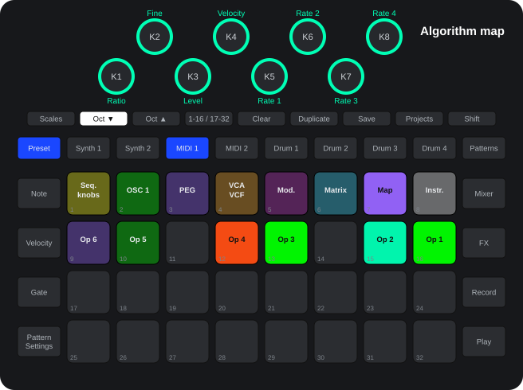

*Beta 5.56 only: the algorithm map (a tap on pad 7), here of the Tubular Bell instrument (the DX7's algorithm 5): each row reads left to right — a wave modulates the one on its right and the last on the right is a carrier, the one you hear; a dark gap = no interaction. Colour = the ratio (green whole, teal x.5, orange other, red fixed), violet = the feedback operator; dim = level under half. A tap picks an operator, Shift + operator mutes it, one held + a tap on another = link or unlink them (an own algorithm).*

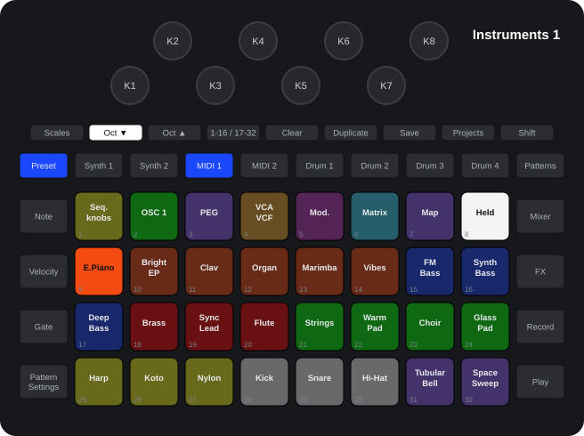

*Beta 5.56 only, pad 8 held: 24 instruments in their type's colour (keys orange, basses blue, leads and brass red, pads and strings green, plucks yellow, percussion white, bells and fx violet), the loaded one bright; press one = loaded, and it sounds. Loading one also sets page 4 and Shift + pad 4 to the knobs that suit its family.*

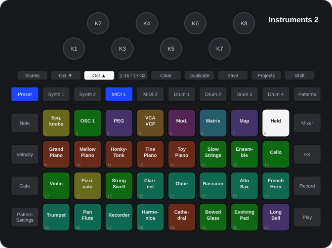

*Beta 5.56 only, pad 8 held + Octave ▼ = the second page: pianos orange, strings green (Pizzicato yellow), winds teal and four long sounds; Octave ▲ goes back.*

## Sample mode and sample picker

*How to get there:* *(since RC2)* MIDI 1 / 2 with the engine on **sample** (pad 27 teal, after the granular): **Note twice** (expanded Note view). The track plays a pack sample one-shot, at the pitch of each note.

- **Pitched drums on a MIDI track** — any pack sample plays at the pitch of each note, like a drum machine with tunable samples.
- **A different sample per step** — the sample flip changes sample step by step with no other track; it can be recorded live too.

→ [Full details in the guide](https://ghillermo.github.io/CIRCUIT-HACKS-RC/beta/guide.html#midi-muestra)

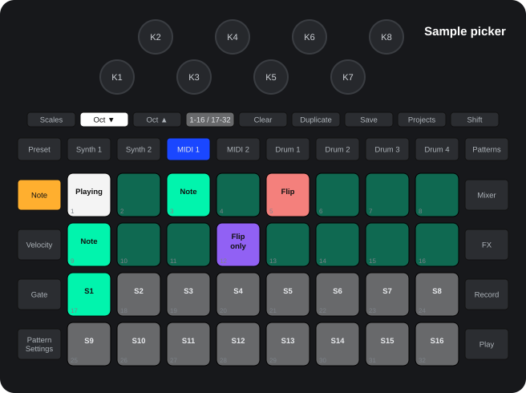

*Sample picker (since RC2; MIDI 1 / 2 with the sample engine, Note twice): pads 17-32 = 16 of the pack's 64 samples (Octave = the page; teal = the track's sample, a touch picks it and it sounds; since RC4 Shift + sample = silently, Shift + the chosen one = pick the second, stereo sample); pads 1-16 = the steps: teal = a note, peach = a note with a sample flip, violet = a flip without a note (since RC4), white = playing. Hold a step + touch a sample = its flip; Clear + step = remove it; 1-16 / 17-32 = the other half.*

## Mod matrix

*How to get there:* *(since RC2.02)* MIDI 1 / 2 with the engine on: Preset view, **pad 6**. The 8 knobs become 8 modulation sources.

| Knob | Source | With Shift |
|---|---|---|
| K1 | The note's velocity | — |
| K2 | The note (C3 = 0; one octave = a quarter of the travel) | — |
| K3 | Random: a new value at each note | — |
| K4 | LFO 2 | Shape × rate: triangle (green, the initial one), saw (magenta), square (red), sample & hold (white: steps), slewed sample & hold (violet: gliding); the engine LFO's colours; in each shape, 0.05 to 20 Hz ; *(since RC4)*: in each shape, the left half of its stretch synced and the right half free (0.2) |
| K5 | Envelope 2: attack and decay from each note | Attack × decay: attack 0 (white), short (light blue), medium (teal), long (blue); in each, the decay from 20 ms to 4 s |
| K6 | A drum hit: a decay from each hit | Drum 1-4 (orange, yellow, violet, teal) × its decay |
| K7 | The pattern position: from 0 on the first step to full on the last | — |
| K8 | Stepped random: a new value every N sequencer steps | N = 1, 2, 4, 8 or 16 steps |

- **The knob's position is the destination and the amount.** Fully left = off. Turning right goes through **every parameter of the knob pages** (33: page 1's, then page 2's, page 3's and the page 5 ones not seen before), one stretch each: inside a stretch the amount grows from 1/16 to full (*(since RC4)*: from 0 to full: the stretch's first step is the destination with no amount, its LED dim); into the next stretch the destination changes and the amount starts again.
- **Slow knobs:** two clicks a step, 16 steps a destination.
- **The LED's colour is the destination page's** (the colours of pads 1-5: amber VCA-VCF, green OSC 1, teal OSC 2), its **brightness** the amount; dark = no destination.
- **While you turn a source** (and 1.5 s after), the pads show where its destination lives: its page pad lights up and pads 9-16 / 17-24 are that page's K1-K8 / Shift + K1-K8 (dim the ones with a parameter, bright the destination). While they show, pads 9-24 do not load patches.
- **Full amount** = the whole source sweeps the parameter's whole range. The bipolar sources (note, random, LFO 2, stepped random) go up and down; the others only up. The parameter's stored value does not change: the matrix is added when it is sent.
- Several sources can share a destination (they add up). TUNE moves in semitones and FINE in fractions; with the granular engine, its ranges; in sample mode the sample parameter picks the sample (from the capture to 64) and only TUNE changes the pitch.
- **Clear + knob** = that source off; **Clear + Shift + knob** = its parameter back to the default; **Clear + pad 6** = all off.
- **Saved with the own-synth patches** (pads 9-24: Clear + pad twice, also when swapping them or copying them between packs); a patch saved before loads it off. *(since RC4)* also **saved with the project** (with the rest of the own synth); before, it was not saved with the project nor across a power-down. No CC / NRPN.
- The modulations reach the engine some 100-250 times a second, shared by everything that moves on the track: several fast sources at once update more slowly.

## Synth source view

*How to get there:* With the Synth 1 / 2 view on screen, **press its button again** (*since RC4*: or **Shift + Synth 1 / 2** from any view). Any button closes it.

- **Noise source** — replaces the patch's noise with audio input 1 or 2 (normal or inverted): the synth's filter, envelopes and effects process your outside signal in time with the notes.
- **Macro destinations** *(since RC2)* — decide what each macro knob moves (up to 4 destinations a macro, with their range and depth) without Components.
- **The synth's step-drummer** — sequences the macros by pairs of steps: each knob sets a macro's position on two steps of the pattern.

→ [Full details in the guide](https://ghillermo.github.io/CIRCUIT-HACKS-RC/beta/guide.html#synth-fuente)

## Drum track view (knobs)

*How to get there:* Press **Drum 1-4**. Every knob does what its label says, with a second layer on Shift.

- **Shape each drum** — exact pitch, ring mod, attack and decay, sample start and cut, a filter with several modes, LFO and several kinds of distortion: many sounds from one sample.
- **All neutral = the original** — with the new knobs at their neutral point, the sample sounds as on the original Circuit.
- **Start over** *(since RC2)* — Clear + the drum's button puts all its knobs back to their defaults.
- **Stereo pair** *(since RC4)* — Drum 1 + Drum 2 (or 3 + 4) play a stereo sample: the left one drives both, the right one only fine-tunes.

→ [Full details in the guide](https://ghillermo.github.io/CIRCUIT-HACKS-RC/beta/guide.html#drum-pista)

## Chromatic and scale view of the drums

*How to get there:* **Shift + Preset** with a drum selected. The pads play the sample transposed along the scale.

- **A drum as a keyboard** — the sample transposed in the project's scale.
- **Rollers** *(since RC2)* — repeat the drum on the micro steps you hold: rolls and ratchets live, stopped too, and recorded with Record.

→ [Full details in the guide](https://ghillermo.github.io/CIRCUIT-HACKS-RC/beta/guide.html#drum-cromatica)

## Master FX

*How to get there:* **Mixer**, then **Mixer** again. Effects on the master output, the song pointer, the captured sample and the row of assignable effects. Any other view button leaves.

- **Live effects on the whole master** — Gater, Auto-Filter, Digitise, Phaser, Glitch and the mechanical gesture *(since RC2)*: while held or latched.
- **Song pointer** — repeats or loops parts of the pattern live.
- **Capture** — records up to 3.5 s of what is playing, to play it, put it in a slot or use it as a drum.
- **Slots** — an effect with its settings one touch away; the FX sequencer triggers them.
- **Per project** *(since RC2)* — each project remembers its Master FX settings.

→ [Full details in the guide](https://ghillermo.github.io/CIRCUIT-HACKS-RC/beta/guide.html#master-fx)

## FX view

*How to get there:* The **FX** button: reverb and delay sends per track, as always, plus:

- **The reverb and delay from the unit** — type, decay, time, feedback…, saved with the project.
- **Quick reset** — Duplicate puts the sends and the effects back to zero.
- **Master filter resonance** — on Shift + Octave ▲ / ▼, in steps of 16 *(since RC4; before, 1-16 / 17-32)*.
- **Master filter off / on** — Shift + pad 25, keeping its position *(since RC4)*.

→ [Full details in the guide](https://ghillermo.github.io/CIRCUIT-HACKS-RC/beta/guide.html#vista-fx)

## Sidechain view

*How to get there:* **Shift + FX**. Each track's sidechain presets as always, plus the knobs:

- **Sidechain with knobs** *(since RC2)* — attack, hold, decay and depth of each track's ducking, beyond the presets.
- **Master compressor** *(since RC2)* — its attack and release.
- **Sidechain between drums** — one drum ducks another (the kick ducking the bass, for example).
- **Triggered by patterns** *(since RC2)* — Synth 1 / 2 or MIDI 1 / 2 as the source: their pattern notes duck another track, not only the drums.

→ [Full details in the guide](https://ghillermo.github.io/CIRCUIT-HACKS-RC/beta/guide.html#sidechain)
