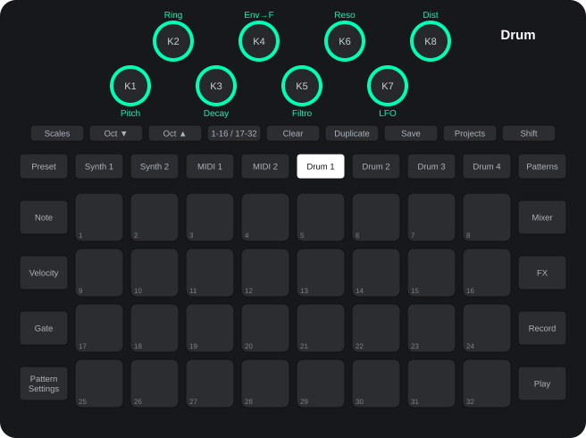
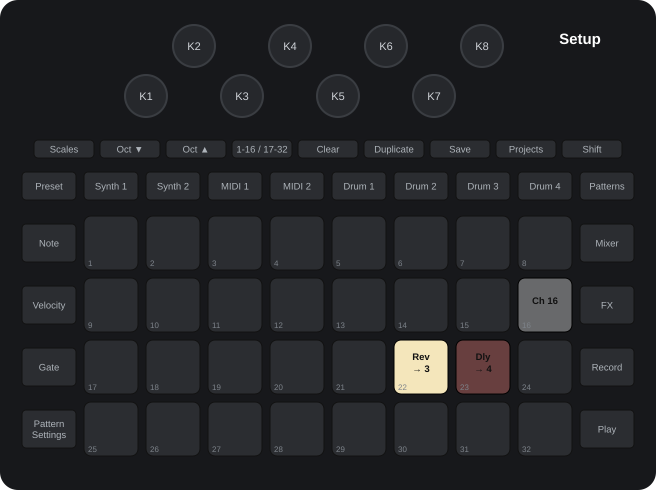

# Controles expuestos

*[English version](https://github.com/Ghillermo/CIRCUIT-HACKS-RC/wiki/Features-Controls) · [Inicio](https://github.com/Ghillermo/CIRCUIT-HACKS-RC/wiki/Home#en-español) · [Funciones](https://github.com/Ghillermo/CIRCUIT-HACKS-RC/wiki/Features-ES) · [Guía por vistas](https://ghillermo.github.io/CIRCUIT-HACKS-RC/beta/guia.html)*

Una de las cinco páginas de [Funciones](https://github.com/Ghillermo/CIRCUIT-HACKS-RC/wiki/Features-ES): cada función explicada, con sus imágenes y las animaciones de sus procesos. Cada título enlaza con su apartado de la [guía por vistas](https://ghillermo.github.io/CIRCUIT-HACKS-RC/beta/guia.html), el manual, donde cada función está en el capítulo de su vista.

**Contenido**

- **[Controles expuestos](https://github.com/Ghillermo/CIRCUIT-HACKS-RC/wiki/Features-Controls-ES)** — [Knobs de los drums según el panel](https://github.com/Ghillermo/CIRCUIT-HACKS-RC/wiki/Features-Controls-ES#knobs-de-los-drums-según-el-panel) · [Parámetros de reverb y delay](https://github.com/Ghillermo/CIRCUIT-HACKS-RC/wiki/Features-Controls-ES#parámetros-de-reverb-y-delay) · [Sidechain y compresor master con los knobs](https://github.com/Ghillermo/CIRCUIT-HACKS-RC/wiki/Features-Controls-ES#sidechain-y-compresor-master-con-los-knobs) · [Grabar los ruteos internos de MIDI](https://github.com/Ghillermo/CIRCUIT-HACKS-RC/wiki/Features-Controls-ES#grabar-los-ruteos-internos-de-midi) · [MIDI para todo lo nuevo](https://github.com/Ghillermo/CIRCUIT-HACKS-RC/wiki/Features-Controls-ES#midi-para-todo-lo-nuevo) · [Automatización del motor MIDI](https://github.com/Ghillermo/CIRCUIT-HACKS-RC/wiki/Features-Controls-ES#automatización-del-motor-midi) · [Setup y MIDI del aparato](https://github.com/Ghillermo/CIRCUIT-HACKS-RC/wiki/Features-Controls-ES#setup-y-midi-del-aparato) · [Patch flip en MIDI 1 / 2](https://github.com/Ghillermo/CIRCUIT-HACKS-RC/wiki/Features-Controls-ES#patch-flip-en-midi-1--2)

## [Knobs de los drums según el panel](https://ghillermo.github.io/CIRCUIT-HACKS-RC/beta/guia.html#f-knobs-drums)

Cada knob hace lo que dice su etiqueta, con una segunda capa en Shift: ring mod, envolventes, filtros (DJ, BP, notch, comb (no en la Beta 5.64), tilt), LFO, start point, bitcrush y distorsión.

**Para qué sirve:** Los ocho knobs de cada drum hacen lo que dice la serigrafía del panel (Oscillator, Osc mod, Amp envelope, Filter envelope, Filter frequency, Resonance, Modulation y FX), y con **Shift** cada uno tiene una segunda función. De un solo sample salen muchos sonidos: afinarlo, pasarlo por un ring mod, darle ataque o recortar su inicio y su final, filtrarlo en varios modos, moverlo con un LFO, triturarlo o distorsionarlo.

**Cómo:**

1. Pulsa **Drum 1-4**: los knobs actúan sobre ese drum.
2. **K1** pitch (*(desde RC2)* el de stock, continuo; los pads de la vista cromática transponen encima) · **Shift + K1** cuánto dobla la envolvente de tono cada golpe.
3. **K2** frecuencia del ring mod · **Shift + K2** cantidad del ring mod.
4. **K3** a la izquierda del centro = decay (el de stock, en su máximo en el centro); a la derecha = **ataque**, un fundido de entrada de hasta 1 s; el centro es neutro · **Shift + K3** a la izquierda = **inicio** del sample, a la derecha = **corte** desde el final; centro = el sample entero.
5. **K4** envolvente → corte · **Shift + K4** forma de la envolvente.
6. **K5** filtro / EQ (de fábrica, el EQ tilt de stock) · **Shift + K5** el **modo de filtro**, con el color del LED: verde = EQ tilt de stock, amarillo = paso banda, magenta = notch, verde azulado = comb, blanco = DJ.
7. **K6** resonancia.
8. **K7** cantidad del LFO: derecha = trémolo, izquierda = vibrato (*(desde RC4)* izquierda = **scan del inicio**: cada golpe empieza donde está el LFO, dentro de un tramo que crece cuanto más a la izquierda, sin pasar el corte) · **Shift + K7** velocidad del LFO (*(desde RC4)* bipolar: derecha libre, izquierda a tempo).
9. **K8** distorsión; a la izquierda de 0, **bitcrush** · **Shift + K8** tipo de distorsión: stock, suave, dura, plegada.
10. **Clear + knob** a la derecha = su valor por defecto (las dos capas); **Clear + K3** a la derecha pone a 0 ataque, inicio y corte; **Clear + el botón del drum** *(desde RC2)* = borra la automatización de sus knobs en el patrón que suena y pone los ocho knobs a sus valores por defecto.

**A tener en cuenta:**

- Con todos los knobs nuevos en su punto neutro, el sample suena como en el Circuit original; el brillo del LED enseña el valor.
- **Clear + knob a la izquierda** borra la automatización de ese knob en el patrón que suena (los knobs de stock: pitch, decay, distorsión y EQ), como en el original.
- Todo se guarda con el proyecto, y cada knob nuevo tiene su NRPN (ver «Tablas MIDI»).
- *(solo Beta 5.56)* El modo comb ya no está (Shift + K5 se lo salta), y cada drum gana un carril extra de automatización y bloqueos de estado: [Vista de pista de un drum](https://ghillermo.github.io/CIRCUIT-HACKS-RC/beta/guia.html#drum-pista).

*Knobs de un drum.*

## [Parámetros de reverb y delay](https://ghillermo.github.io/CIRCUIT-HACKS-RC/beta/guia.html#f-rev-delay)

Vista FX, **Shift + knob**: reverb (tipo, decay, damping) y delay (time, sync, feedback, width, ratio, slew); se guardan con el proyecto.

**Para qué sirve:** La reverb y el delay del proyecto, los efectos globales que alimentan los envíos de la vista FX, tienen sus ajustes en el aparato: **Shift + knob** en la vista FX cambia el tipo, el decay y el damping de la reverb y el time, el sync, el feedback, el width, el ratio y el slew del delay. Sirve para dar a cada proyecto su espacio y sus ecos sin ordenador.

**Cómo:**

1. Pulsa **FX**.
2. **Octave ▼** = la página de reverb (los knobs = envíos de reverb); **Octave ▲** = la página de delay (los knobs = envíos de delay).
3. Mantén **Shift** y gira: reverb **K1** tipo, **K2** decay, **K3** damping; delay **K1** time, **K2** sync, **K3** feedback, **K4** width, **K5** ratio, **K6** slew.
4. Suelta Shift: los knobs vuelven a ser los envíos de las pistas.

**A tener en cuenta:**

- Se guardan con el proyecto, como en el original.
- El LED del knob enseña el valor con su brillo.
- Si en Setup los retornos van por las tiras 3 / 4, los envíos de esas tiras tienen tope a la mitad.
- [Vista FX](https://ghillermo.github.io/CIRCUIT-HACKS-RC/beta/guia.html#vista-fx)

## [Sidechain y compresor master con los knobs](https://ghillermo.github.io/CIRCUIT-HACKS-RC/beta/guia.html#f-sidechain-comp)

**Desde RC2.** En la vista Sidechain (**Shift + FX**): **K1-K4** = ataque, hold, decay y profundidad del sidechain de la pista elegida; **K7 / K8** = ataque y release del compresor master.

**Para qué sirve:** *(desde RC2)* La vista Sidechain es algo más que sus presets: cuatro knobs ajustan a mano el ducking de la pista elegida (ataque, hold, decay y profundidad) y otros dos el ataque y el release del compresor master. Sirve para afinar cómo respira un pad o un bajo con el bombo, o lo rápido que agarra y suelta el compresor master.

**Cómo:**

1. Abre la vista Sidechain: **Shift + FX**.
2. Toca un preset de sidechain de la pista que quieras, como siempre: **K1-K4** pasan a actuar sobre esa pista (Synth 1 si no has tocado ninguno), con sus LEDs en el color de la pista.
3. **K1** ataque, **K2** hold, **K3** decay, **K4** profundidad de su ducking.
4. **K7 / K8** = ataque / release del compresor master (en blanco); el compresor se activa en Advanced Setup.
5. Con **Octave ▼** (las páginas de drums), **K1-K4** = ataque, hold, decay y profundidad del sidechain del drum del último preset tocado, en el color del drum.

**A tener en cuenta:**

- Tocar un preset vuelve a escribir sus cuatro valores: los knobs parten del preset y lo afinan.
- Se guardan con el proyecto: K1-K4 de las pistas y de los drums y el ataque / release del compresor. El umbral y la ratio son fijos.
- *(desde RC4.07)* El brillo de K1-K4 sube en curva, para distinguir los presets a la vista.
- Los pads 1-4 de la fila 1 *(desde RC2)* hacen de Synth 1 / 2 o MIDI 1 / 2 la fuente (las notas de su patrón): [Vista Sidechain](https://ghillermo.github.io/CIRCUIT-HACKS-RC/beta/guia.html#sidechain).

*[Paso a paso: Sidechain de una pista con el patrón de otra (desde RC2)](https://github.com/Ghillermo/CIRCUIT-HACKS-RC/wiki/Step-by-step-ES#sidechain-de-una-pista-con-el-patrón-de-otra-desde-rc2)*

## [Grabar los ruteos internos de MIDI](https://ghillermo.github.io/CIRCUIT-HACKS-RC/beta/guia.html#f-grabar-interno)

**Desde RC2.** En la vista Setup, **Record** decide si lo que una pista MIDI manda a un sinte interno por el canal compartido se graba también en ese sinte: **amarillo = sí**, apagado = no (por defecto).

**Para qué sirve:** Cuando MIDI 1 / 2 comparte canal con Synth 1 / 2, lo que tocas o giras en la pista MIDI suena en ese sinte sin cable (loopback interno), pero por defecto solo se graba en el patrón de la pista MIDI. *(desde RC2)* El **Record** de la vista Setup hace que se grabe también en el patrón del sinte, como si llegara de un teclado externo: sirve para grabar cambios de escala u octava hechos en directo desde la pista MIDI.

**Cómo:**

1. En la vista Setup, da a MIDI 1 / 2 el canal de Synth 1 o Synth 2 (botón de pista + pad de canal).
2. En la misma vista Setup (no en Advanced Setup), pulsa **Record**: **amarillo** = activado, apagado = desactivado (por defecto).
3. Graba como siempre en la pista MIDI: lo que manda al sinte queda también en el patrón del sinte.
4. *(desde RC4)* **Banco de acordes:** silencia la pista de notas en el Mixer (su pad de pista apagado): con Record en amarillo no se escribe nada en ella; los pasos que tocas en ella suenan, salen por su canal y se graban solo en el sinte que comparte el canal.

**A tener en cuenta:**

- No se guarda: apagado por defecto y otra vez apagado tras cada reinicio.
- Activado, también se graban las escuchas del step-drummer de Synth 1 / 2.
- [Vista Setup](https://ghillermo.github.io/CIRCUIT-HACKS-RC/beta/guia.html#setup)

## [MIDI para todo lo nuevo](https://ghillermo.github.io/CIRCUIT-HACKS-RC/beta/guia.html#f-midi-io)

Los valores nuevos salen y entran por MIDI: CC / NRPN del motor de las pistas MIDI, NRPN de los drums (MSB 5-8) y de Master FX (MSB 9, canal 16).

**Para qué sirve:** Todo lo que añade el mod se puede grabar, reproducir y controlar por MIDI: al girar un knob nuevo sale un CC o un NRPN, y al recibirlo el knob se mueve. Sirve para mapear un controlador externo al motor de las pistas MIDI, a los knobs nuevos de los drums o a Master FX, o para grabar sus movimientos en un DAW.

**Cómo:**

1. Deja pasar los mensajes: el mod respeta los filtros **CC Tx / CC Rx** del Setup.
2. **Motor de MIDI 1 / 2**, por el canal de la pista: el CC de stock donde la función coincide (filtro CC 74, resonancia CC 71, ataque CC 73…), el resto como NRPN con MSB 4 y el código del parámetro como LSB, salvo la velocidad del LFO (NRPN 0:76).
3. **Drums**, por el canal de drums (el 10 de fábrica): NRPN MSB 5, 6, 7, 8 = Drum 1-4, LSB 1-14 = los knobs nuevos; los knobs de stock siguen con sus CC originales.
4. **Master FX**, por el canal 16: NRPN MSB 9, LSB = 4 × efecto + knob (Gater 0-3, Auto-Filter 4-7, Digitise 8-11, Phaser 12-15, Glitch 16-19).
5. Para mandar un NRPN: **CC 99** (MSB), **CC 98** (LSB) y después **CC 6** (valor); el aparato recuerda el NRPN elegido hasta el siguiente CC 99 / 98.

**A tener en cuenta:**

- Valores 0-127; en los parámetros bipolares, 64 = centro. Clear + knob también manda el valor nuevo, y el nivel a 100 / 0 del Mixer (Shift + knob) sale como un giro.
- Con el motor encendido, los knobs de MIDI 1 / 2 mandan este mapa, nunca la plantilla de CC; con el motor apagado mandan la plantilla (editor de CC, pad 25).
- Los CC / NRPN que entran mueven el motor pero no se graban en el patrón ni se reenvían: solo los knobs del aparato escriben automatización.
- Sin MIDI: la matriz de modulación del sinte propio, el FM, el modo de voz y los destinos de los knobs; van en los patches propios. Tablas completas: [MIDI: comportamientos propios, CC y NRPN nuevos](https://ghillermo.github.io/CIRCUIT-HACKS-RC/beta/guia.html#midi).

## [Automatización del motor MIDI](https://ghillermo.github.io/CIRCUIT-HACKS-RC/beta/guia.html#f-automatizacion)

Con Record + Play, los 8 valores de la página 4 del motor MIDI se graban en los carriles de macros del patrón.

**Para qué sirve:** El sinte propio de MIDI 1 / 2 graba movimientos de knobs en el patrón, como los macros de Synth 1 / 2: una página de knobs tiene los ocho **knobs secuenciables**, cada uno con su carril de automatización, para que barridos de filtro, cambios de tono o subidas del efecto suenen con el patrón. *(desde RC4)* Además eliges qué mueve cada carril, haces una foto del sonido en un paso y marcas pasos donde la automatización se suelta.

**Cómo:**

1. Con el motor encendido, abre los **knobs secuenciables**: **pad 4** de la vista Preset de MIDI 1 / 2 (*(solo Beta 5.56)* **pad 1**). De fábrica: TUNE, Release, Env → nivel, Env → filtro, Filtro, Resonancia, Velocidad del LFO, Efecto.
2. Pulsa **Record** y **Play** y gíralos: los movimientos quedan en los carriles del patrón y se reproducen desde ahí.
3. *(desde RC4)* **Shift + knob** = el destino de ese carril: cualquiera de los 33 parámetros del motor, en el orden y los colores de la matriz de modulación (4 clics cada uno), mientras los pads 9-24 enseñan dónde vive; **Clear mantenido, luego Shift + knob** = el de fábrica.
4. *(desde RC4)* **Foto:** en la vista de pista (Note), **Record mantenido + un pad de paso** escribe en ese paso los parámetros que no están en su valor inicial (uno sin carril toma un carril cuyo parámetro está en el inicial, borrado antes); Record queda como estaba.
5. *(desde RC4)* **Soltar la automatización:** en la vista **Velocity**, **Shift + un pad de paso** lo marca (rojo): ahí no suena ningún carril y lo que movió la automatización vuelve a los valores del proyecto; otra vez = quitar la marca.
6. *(desde RC4)* **Knobs no secuenciables:** **Shift + pad 4** (el pad 4 se ve entonces en rosa; *(solo Beta 5.56)* Shift + pad 1) = 8 knobs más con destino asignable (Shift + knob) que mueven su parámetro sin grabarlo (salvo que ese parámetro esté también en un knob secuenciable).
7. *(solo Beta 5.56)* En la vista Velocity con Shift solo se ven en amarillo los pasos con automatización: **Shift + un paso amarillo** = oír sus valores hasta soltar Shift (los knobs que mueve, en amarillo); **mantener un paso amarillo + pulsar otro** = un sweep en línea recta entre los dos; **Clear + un paso** = borrar la automatización de sus knobs sin tocar sus notas.

**A tener en cuenta:**

- Con el step-drummer activado, su fila de pitch usa el carril de TUNE (y su página 2 el de Release): esos dos ni se reproducen ni se graban como automatización.
- **Clear + knob a la izquierda** borra la automatización de ese knob en el patrón que suena (sus dos carriles, con y sin Shift).
- Los carriles y las marcas van en el patrón; los destinos se guardan con los patches del sinte propio y *(desde RC4)* con el proyecto.
- *(solo Beta 5.56)* Grabando, girar un knob del motor que no está en los 8 toma el primer carril vacío; la foto vale también en Synth 1 / 2 (sus macros) y en los drums (pitch, decay, distorsión, EQ). [Páginas de knobs del motor de MIDI 1 / 2](https://ghillermo.github.io/CIRCUIT-HACKS-RC/beta/guia.html#midi-knobs)

*[Paso a paso: Hacer que un paso suelte la automatización (desde RC4)](https://github.com/Ghillermo/CIRCUIT-HACKS-RC/wiki/Step-by-step-ES#hacer-que-un-paso-suelte-la-automatización-desde-rc4)*

*[Paso a paso: Hacer una foto del sonido en un paso (desde RC4)](https://github.com/Ghillermo/CIRCUIT-HACKS-RC/wiki/Step-by-step-ES#hacer-una-foto-del-sonido-en-un-paso-desde-rc4)*

## [Setup y MIDI del aparato](https://ghillermo.github.io/CIRCUIT-HACKS-RC/beta/guia.html#f-setup)

Canal 16 Rx / Tx (pad 16), canales compartidos, **loopback interno** sin cable y **retornos de reverb / delay por las tiras 3 / 4** (pads 22 / 23, en crema / melocotón como la reverb y el delay de la vista FX). **Desde RC2:** MIDI Thru con cuatro modos (Duplicate en Advanced Setup): Thru, Out 2, **Merge** (DIN In + el MIDI del aparato) y **Filter** (DIN In sin los canales en escucha). **Desde RC2:** canales de **Program Change** propios: pad 29 / 30 enseñan y eligen el canal de escucha / salida (16 por defecto); lo recibido se reenvía por el de salida. **Desde RC2:** **metrónomo con cuenta atrás**: Shift + Clear recorre sin metrónomo, metrónomo, solo cuenta atrás y las dos; la cuenta atrás es un compás antes de grabar. **Desde RC4:** **modo General MIDI de los drums**: en Setup, K4 lo enciende; K5-K8 = la nota GM de Drum 1-4 (35-81), que sale por el canal de drums en lugar de 60 / 62 / 64 / 65.

**Para qué sirve:** Las vistas Setup y Advanced Setup ganan opciones de MIDI y de ruteo: MIDI 1 / 2 pueden compartir canal con un sinte o los drums y tocarlos por dentro (loopback interno), los retornos de reverb y delay pueden pasar por las tiras 3 / 4 del mixer, los Program Change tienen canales propios, el jack Thru puede mezclar o filtrar y Shift + Clear da un metrónomo con cuenta atrás. *(desde RC4)* Además: modo General MIDI de los drums, fusión USB, curva de velocity de los pads y teclado externo al arpegiador.

**Cómo:**

1. **Canales compartidos:** en Setup, elige una pista con su botón y su canal en los pads 1-15; MIDI 1 / 2 pueden tomar el canal de Synth 1 / 2 o de los drums, y lo que mandan les llega por dentro, sin cable.
2. **Pad 16** = canal 16 (proyecto y FX): recepción y envío de todo lo que no es Program Change. **Pads 22 / 23** = el retorno de reverb por la tira 3 (crema) / el de delay por la tira 4 (melocotón); tenue = apagado.
3. **Pads 29 / 30** *(desde RC2)*: un primer toque enseña en los pads 1-16 el canal de escucha / salida de los Program Change del proyecto (blanco); un pad lo elige; el mismo pad otra vez = PGM Rx / Tx encendido / apagado (los dos, el 16 de fábrica).
4. **Shift + Clear** *(desde RC2)*, en cualquier vista: sin metrónomo (rojo) → metrónomo (verde) → solo cuenta atrás (magenta) → las dos (verde azulado). Con la cuenta atrás, **Record** armado + **Play** desde parado = un compás de clics y después arranca la grabación.
5. **Advanced Setup, Duplicate** *(desde RC2)*: modo del jack Thru, Thru (rojo tenue) → Out 2 (verde) → Merge (amarillo) → Filter (azul).
6. **K4 de Setup** *(desde RC4)*: drums General MIDI, a la derecha encendido (verde), a la izquierda apagado; **K5-K8** = la nota GM de Drum 1-4 (35-81; de fábrica 36 / 38 / 42 / 46), que suena una vez y se dibuja en los pads; Shift o salir de Setup la confirma. Cada golpe sale entonces por el canal de drums con esa nota en lugar de 60 / 62 / 64 / 65; el sonido interno no cambia.
7. **Setup, Note** *(desde RC4)* = teclado externo al arpegiador (verde encendido / rojo tenue apagado). **Advanced Setup:** **pad 23** *(desde RC4)* = fusión USB; **K1** *(desde RC4)* = curva de velocity de los pads (−8 … +8); **pad 22** *(desde RC4.05)* = guardado diferido.

**A tener en cuenta:**

- **Merge** copia el DIN In y le suma el MIDI del aparato; **Filter** deja pasar el DIN In salvo los canales en los que escucha el aparato; ninguno copia SysEx. En Merge, si el aparato sigue el reloj del DIN In con Clock Tx encendido, el jack Thru lleva dos relojes: apaga Clock Tx.
- **Program Change:** uno en el canal de escucha elige el proyecto (con un canal de escucha que no es el 16, el 16 ya no elige proyectos); en el canal de Synth 1 / 2 o de los drums va a esa pista; con PGM Tx se reenvía por el canal de salida, por el que también sale el de un proyecto elegido en el panel.
- **Cuenta atrás:** 4 clics al tempo del proyecto (*(desde RC4.07)* como esclavo, al del reloj externo), con Record parpadeando en rojo; Play la cancela; se guarda con el proyecto. Volumen del clic: Tempo/Swing + K5. *(desde RC4)* Con el modo cue del Mixer, el clic suena solo en el cue.
- El modo Thru, los canales de Program Change, el modo GM, la fusión USB, la curva de velocity y el guardado diferido se guardan en los ajustes del aparato. *(solo Beta 5.56)* Sin curva de velocity (K1 / K2 de Setup = velocity → amplitud / filtro), **Preset** de Setup = retener knob, **K3** de Advanced Setup = ganancia de las entradas. [Vista Setup](https://ghillermo.github.io/CIRCUIT-HACKS-RC/beta/guia.html#setup) · [Vista Advanced Setup](https://ghillermo.github.io/CIRCUIT-HACKS-RC/beta/guia.html#advanced-setup)

*Setup: pad 22 = retorno de reverb por la tira 3 (crema), pad 23 = retorno de delay por la tira 4 (melocotón).*

*[Paso a paso: Grabar con la cuenta atrás (desde RC2)](https://github.com/Ghillermo/CIRCUIT-HACKS-RC/wiki/Step-by-step-ES#grabar-con-la-cuenta-atrás-desde-rc2)*

*[Paso a paso: Mandar los drums como notas General MIDI (desde RC4)](https://github.com/Ghillermo/CIRCUIT-HACKS-RC/wiki/Step-by-step-ES#mandar-los-drums-como-notas-general-midi-desde-rc4)*

*[Paso a paso: Elegir los canales de Program Change (desde RC2)](https://github.com/Ghillermo/CIRCUIT-HACKS-RC/wiki/Step-by-step-ES#elegir-los-canales-de-program-change-desde-rc2)*

*[Paso a paso: Elegir el modo del jack MIDI Thru (desde RC2)](https://github.com/Ghillermo/CIRCUIT-HACKS-RC/wiki/Step-by-step-ES#elegir-el-modo-del-jack-midi-thru-desde-rc2)*

*[Paso a paso: Guardar mientras suena sin tropiezos (desde RC4.05)](https://github.com/Ghillermo/CIRCUIT-HACKS-RC/wiki/Step-by-step-ES#guardar-mientras-suena-sin-tropiezos-desde-rc405)*

## [Patch flip en MIDI 1 / 2](https://ghillermo.github.io/CIRCUIT-HACKS-RC/beta/guia.html#f-patch-flip)

Pad 26 de la vista Preset de MIDI: cada nota se envía como Program Change (excluyente con el motor de la pista).

**Para qué sirve:** Convierte una pista MIDI en un cambiador de sonidos para el equipo externo: cada nota que toca la pista, del patrón o de los pads, sale como Program Change por el canal de la pista en lugar de como nota (el número de la nota es el número de programa), y el sinte o el efecto externo cambia de sonido paso a paso con el patrón.

**Cómo:**

1. Abre la **vista Preset de MIDI 1 / 2**.
2. Toca el **pad 26** para encender o apagar el patch flip.
3. Toca o secuencia notas en la pista: cada una manda su Program Change por el canal de la pista.
4. *(solo Beta 5.56)* El pad 26 abre en su lugar la **vista de flip** (pad 26 blanco mientras está abierta): en la fila 3, **pad 17** = patch flip (PGM seq), **pad 18** = step flip (el secuenciador de saltos), uno u otro; tocar el encendido lo apaga; el pad 26 otra vez cierra la vista.

**A tener en cuenta:**

- Excluyente con el motor: encender el motor (pad 27) apaga el patch flip, y al revés.
- Sale siempre por el canal de su pista MIDI, nunca por el canal de salida de Program Change del proyecto; si ese canal es el de un sinte o el de los drums, actúa también dentro del aparato.
- Se guarda en los ajustes del aparato.
- [Vista Preset de MIDI 1 / 2](https://ghillermo.github.io/CIRCUIT-HACKS-RC/beta/guia.html#midi-preset)
