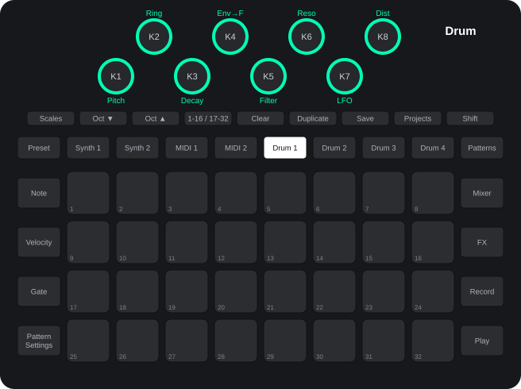
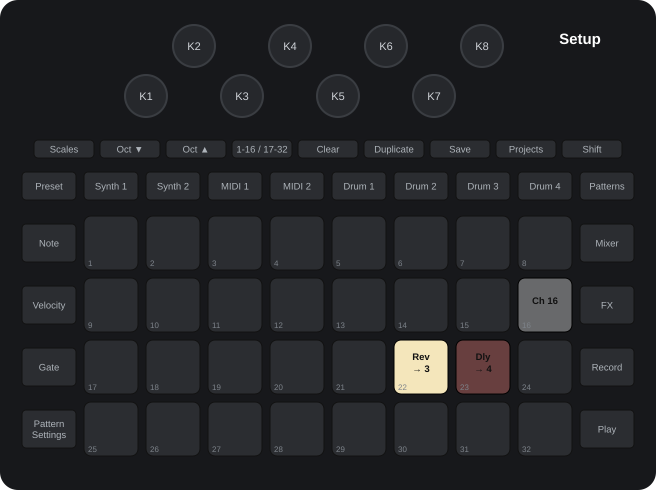

# Exposed controls

*[Versión en español](https://github.com/Ghillermo/CIRCUIT-HACKS-RC/wiki/Features-Controls-ES) · [Home](https://github.com/Ghillermo/CIRCUIT-HACKS-RC/wiki/Home) · [Features](https://github.com/Ghillermo/CIRCUIT-HACKS-RC/wiki/Features) · [Guide by views](https://ghillermo.github.io/CIRCUIT-HACKS-RC/beta/guide.html)*

One of the five pages of [Features](https://github.com/Ghillermo/CIRCUIT-HACKS-RC/wiki/Features): each feature explained, with its pictures and the animations of its processes. Each title links to its section in the [guide by views](https://ghillermo.github.io/CIRCUIT-HACKS-RC/beta/guide.html), the manual, where every feature is in the chapter of its view.

**Contents**

- **[Exposed controls](https://github.com/Ghillermo/CIRCUIT-HACKS-RC/wiki/Features-Controls)** — [Drum knobs as printed on the panel](https://github.com/Ghillermo/CIRCUIT-HACKS-RC/wiki/Features-Controls#drum-knobs-as-printed-on-the-panel) · [Reverb and delay parameters](https://github.com/Ghillermo/CIRCUIT-HACKS-RC/wiki/Features-Controls#reverb-and-delay-parameters) · [Side-chain and master compressor on the knobs](https://github.com/Ghillermo/CIRCUIT-HACKS-RC/wiki/Features-Controls#side-chain-and-master-compressor-on-the-knobs) · [Recording the internal MIDI routes](https://github.com/Ghillermo/CIRCUIT-HACKS-RC/wiki/Features-Controls#recording-the-internal-midi-routes) · [MIDI for everything new](https://github.com/Ghillermo/CIRCUIT-HACKS-RC/wiki/Features-Controls#midi-for-everything-new) · [Automation of the MIDI engine](https://github.com/Ghillermo/CIRCUIT-HACKS-RC/wiki/Features-Controls#automation-of-the-midi-engine) · [Setup and device MIDI](https://github.com/Ghillermo/CIRCUIT-HACKS-RC/wiki/Features-Controls#setup-and-device-midi) · [Patch flip on MIDI 1 / 2](https://github.com/Ghillermo/CIRCUIT-HACKS-RC/wiki/Features-Controls#patch-flip-on-midi-1--2)

## [Drum knobs as printed on the panel](https://ghillermo.github.io/CIRCUIT-HACKS-RC/beta/guide.html#f-knobs-drums)

Every knob does what its label says, with a second layer on Shift: ring mod, envelopes, filters (DJ, BP, notch, comb (not in Beta 5.64), tilt), LFO, start point, bitcrush and distortion.

**What it is for:** Each drum's eight knobs do what the panel prints under them (Oscillator, Osc mod, Amp envelope, Filter envelope, Filter frequency, Resonance, Modulation and FX), and holding **Shift** gives each one a second job. From a single sample you get many sounds: tune it, ring-modulate it, give it an attack or trim its start and end, filter it in several modes, move it with an LFO, crush it or distort it.

**How:**

1. Press **Drum 1-4**: the knobs work on that drum.
2. **K1** pitch (*(since RC2)* the stock one, continuous; the chromatic view's pads transpose on top) · **Shift + K1** how much the pitch envelope bends each hit.
3. **K2** ring mod frequency · **Shift + K2** ring mod amount.
4. **K3** left of the centre = decay (the stock one, at its maximum in the centre); right of the centre = **attack**, a fade-in of up to 1 s; the centre is neutral · **Shift + K3** left = sample **start**, right = **cut** from the end; centre = the whole sample.
5. **K4** filter envelope → cutoff · **Shift + K4** the envelope's shape.
6. **K5** filter / EQ (the stock EQ tilt by default) · **Shift + K5** the **filter mode**, shown by the LED's colour: green = stock EQ tilt, yellow = band pass, magenta = notch, teal = comb, white = DJ.
7. **K6** resonance.
8. **K7** LFO amount: right = tremolo, left = vibrato (*(since RC4)* left = **start scan**: each hit starts where the LFO is, inside a range that grows the further left you turn, never past the cut) · **Shift + K7** LFO speed (*(since RC4)* bipolar: right free, left synced to the tempo).
9. **K8** distortion; left of 0 = **bitcrush** · **Shift + K8** distortion type: stock, soft, hard, fold.
10. **Clear + knob** to the right = its default (both layers); **Clear + K3** to the right zeroes attack, start and cut; **Clear + the drum's button** *(since RC2)* = its knobs' automation in the playing pattern erased and all eight knobs back to their defaults.

**Keep in mind:**

- With every new knob at its neutral point the sample sounds as on the original Circuit; the LED's brightness shows the value.
- **Clear + knob to the left** erases that knob's automation in the playing pattern (the stock knobs: pitch, decay, distortion and EQ), as on the original.
- Everything is saved with the project, and every new knob has its own NRPN (see «MIDI tables»).
- *(Beta 5.56 only)* The comb mode is gone (Shift + K5 skips it), and each drum gains an extra automation lane and state locks: [Drum track view](https://ghillermo.github.io/CIRCUIT-HACKS-RC/beta/guide.html#drum-pista).

*Knobs of a drum.*

## [Reverb and delay parameters](https://ghillermo.github.io/CIRCUIT-HACKS-RC/beta/guide.html#f-rev-delay)

FX view, **Shift + knob**: reverb (type, decay, damping) and delay (time, sync, feedback, width, ratio, slew); saved with the project.

**What it is for:** The project's reverb and delay, the global effects that the FX view's sends feed, get their settings on the device: **Shift + knob** in the FX view sets the reverb's type, decay and damping and the delay's time, sync, feedback, width, ratio and slew. Use it to give each project its own room and echoes without a computer.

**How:**

1. Press **FX**.
2. **Octave ▼** = the reverb page (the knobs = reverb sends); **Octave ▲** = the delay page (the knobs = delay sends).
3. Hold **Shift** and turn: reverb **K1** type, **K2** decay, **K3** damping; delay **K1** time, **K2** sync, **K3** feedback, **K4** width, **K5** ratio, **K6** slew.
4. Let go of Shift: the knobs are the tracks' sends again.

**Keep in mind:**

- Saved with the project, as on the original.
- The knob's LED shows the value with its brightness.
- If Setup routes the returns through strips 3 / 4, those strips' sends are capped at half.
- [FX view](https://ghillermo.github.io/CIRCUIT-HACKS-RC/beta/guide.html#vista-fx)

## [Side-chain and master compressor on the knobs](https://ghillermo.github.io/CIRCUIT-HACKS-RC/beta/guide.html#f-sidechain-comp)

**Since RC2.** In the Sidechain view (**Shift + FX**): **K1-K4** = attack, hold, decay and depth of the side-chain of the chosen track; **K7 / K8** = attack and release of the master compressor.

**What it is for:** *(since RC2)* The Sidechain view is more than its presets: four knobs set the ducking of the chosen track by hand (attack, hold, decay and depth) and two more set the master compressor's attack and release. Fine-tune how a pad or a bass breathes with the kick, or how fast the master compressor grabs and lets go.

**How:**

1. Open the Sidechain view: **Shift + FX**.
2. Touch one of a track's sidechain presets as always: **K1-K4** now work on that track (Synth 1 until you touch one), with their LEDs in its colour.
3. **K1** attack, **K2** hold, **K3** decay, **K4** depth of its ducking.
4. **K7 / K8** = attack / release of the master compressor (white); the compressor is switched on in Advanced Setup.
5. With **Octave ▼** (the drum pages), **K1-K4** = attack, hold, decay and depth of the side-chain of the drum whose preset you touched last, in the drum's colour.

**Keep in mind:**

- Touching a preset writes its four values again: the knobs start from the preset and refine it.
- Saved with the project: the tracks' and the drums' K1-K4 and the compressor's attack / release. Threshold and ratio are fixed.
- *(since RC4.07)* The brightness of K1-K4 rises in a curve, so the presets can be told apart by eye.
- Row 1 pads 1-4 *(since RC2)* make Synth 1 / 2 or MIDI 1 / 2 the source (the notes of their pattern): [Sidechain view](https://ghillermo.github.io/CIRCUIT-HACKS-RC/beta/guide.html#sidechain).

*[Step by step: Duck a track with another track's pattern (since RC2)](https://github.com/Ghillermo/CIRCUIT-HACKS-RC/wiki/Step-by-step#duck-a-track-with-another-tracks-pattern-since-rc2)*

## [Recording the internal MIDI routes](https://ghillermo.github.io/CIRCUIT-HACKS-RC/beta/guide.html#f-grabar-interno)

**Since RC2.** In the Setup view, **Record** decides whether what a MIDI track sends to an internal synth over a shared channel is also recorded into that synth: **yellow = yes**, dark = no (the default).

**What it is for:** When MIDI 1 / 2 shares its channel with Synth 1 / 2, what you play or turn on the MIDI track sounds on that synth without a cable (internal loopback), but by default it is recorded only into the MIDI track's pattern. *(since RC2)* The Setup view's **Record** switch also records it into the synth's pattern, as if it came from an external keyboard: useful for recording scale or octave changes made live from the MIDI track.

**How:**

1. In the Setup view, give MIDI 1 / 2 the channel of Synth 1 or Synth 2 (track button + channel pad).
2. Still in the Setup view (not Advanced Setup), press **Record**: **yellow** = on, dark = off (the default).
3. Record on the MIDI track as usual: what it sends to the synth also lands in the synth's pattern.
4. *(since RC4)* **Chord bank:** mute the note track in the Mixer (its track pad off): with Record yellow nothing is written into it; the steps you play on it sound, go out on its channel and are recorded only into the synth that shares the channel.

**Keep in mind:**

- Not saved: off by default and off again after every restart.
- With it on, the auditions of Synth 1 / 2's step-drummer are recorded too.
- [Setup view](https://ghillermo.github.io/CIRCUIT-HACKS-RC/beta/guide.html#setup)

## [MIDI for everything new](https://ghillermo.github.io/CIRCUIT-HACKS-RC/beta/guide.html#f-midi-io)

The new values go out and come in over MIDI: CC / NRPN of the MIDI track engine, NRPN of the drums (MSB 5-8) and of Master FX (MSB 9, channel 16).

**What it is for:** Everything the mod adds can be recorded, played back and controlled over MIDI: turning a new knob sends a CC or an NRPN, and receiving it moves the knob. Map an external controller to the MIDI tracks' engine, the drums' new knobs or Master FX, or record their moves in a DAW.

**How:**

1. Let the messages through: the mod follows the Setup's **CC Tx / CC Rx** filters.
2. **MIDI 1 / 2 engine**, on the track's channel: the stock CC where the function matches (filter CC 74, resonance CC 71, attack CC 73…), the rest as NRPN with MSB 4 and the parameter's code as LSB, except the LFO speed (NRPN 0:76).
3. **Drums**, on the drums' channel (10 by default): NRPN MSB 5, 6, 7, 8 = Drum 1-4, LSB 1-14 = the new knobs; the stock knobs keep their original CCs.
4. **Master FX**, on channel 16: NRPN MSB 9, LSB = 4 × effect + knob (Gater 0-3, Auto-Filter 4-7, Digitise 8-11, Phaser 12-15, Glitch 16-19).
5. To send an NRPN: **CC 99** (MSB), **CC 98** (LSB), then **CC 6** (value); the device remembers the chosen NRPN until the next CC 99 / 98.

**Keep in mind:**

- Values 0-127; on bipolar parameters 64 is the centre. Clear + knob also sends the new value, and the Mixer's level to 100 / 0 (Shift + knob) goes out as a turn.
- With the engine on, MIDI 1 / 2's knobs send this map, never the CC template; with the engine off they send the template (CC editor, pad 25).
- Incoming CC / NRPN move the engine but are not recorded into the pattern nor sent on: only the device's knobs write automation.
- No MIDI for the own synth's mod matrix, FM, voice mode and knob destinations: they live in the own patches. Full tables: [MIDI: own behaviours, new CCs and NRPNs](https://ghillermo.github.io/CIRCUIT-HACKS-RC/beta/guide.html#midi).

## [Automation of the MIDI engine](https://ghillermo.github.io/CIRCUIT-HACKS-RC/beta/guide.html#f-automatizacion)

With Record + Play, the 8 values of page 4 of the MIDI engine are recorded into the macro lanes of the pattern.

**What it is for:** The MIDI 1 / 2 own synth records knob moves into the pattern, like the macros of Synth 1 / 2: one knob page holds the eight **sequenceable knobs**, each tied to an automation lane, so filter sweeps, pitch moves or effect swells play back with the pattern. *(since RC4)* You also choose what each lane moves, take a snapshot of the sound into a step and mark steps where the automation lets go.

**How:**

1. With the engine on, open the **sequenceable knobs**: **pad 4** of the MIDI 1 / 2 Preset view (*(Beta 5.56 only)* **pad 1**). By default: TUNE, Release, Env → level, Env → filter, Filter, Resonance, LFO speed, Effect.
2. Press **Record** and **Play** and turn them: the moves go into the pattern's lanes and play back from there.
3. *(since RC4)* **Shift + knob** = that lane's destination: any of the engine's 33 parameters, in the mod matrix's order and colours (4 clicks each), while pads 9-24 show where it lives; **Clear held, then Shift + knob** = the factory one.
4. *(since RC4)* **Snapshot:** in the track view (Note), **Record held + a step pad** writes into that step the parameters that are not at their initial value (one without a lane takes a lane whose parameter is at its initial value, cleared first); Record stays as it was.
5. *(since RC4)* **Let go of the automation:** in the **Velocity** view, **Shift + a step pad** marks it (red): no lane plays there and what the automation moved goes back to the project's values; again = unmark.
6. *(since RC4)* **Non-sequenceable knobs:** **Shift + pad 4** (pad 4 then lights pink; *(Beta 5.56 only)* Shift + pad 1) = 8 more knobs with an assignable destination (Shift + knob) that move their parameter without recording it (unless that parameter is also on a sequenceable knob).
7. *(Beta 5.56 only)* In the Velocity view with Shift only the steps with automation are yellow: **Shift + a yellow step** = hear its values until you let go of Shift (the knobs it moves light yellow); **hold a yellow step + press another** = a straight sweep between them; **Clear + a step** = erase its knob automation and keep its notes.

**Keep in mind:**

- With the step-drummer on, its pitch row uses the TUNE lane (and its page 2 the Release lane): those two are neither played nor recorded as automation.
- **Clear + knob to the left** erases that knob's automation in the playing pattern (both its lanes, with and without Shift).
- The lanes and the marks live in the pattern; the destinations are saved with the own-synth patches and *(since RC4)* with the project.
- *(Beta 5.56 only)* While recording, turning an engine knob that is not one of the 8 takes the first empty lane; the snapshot also works on Synth 1 / 2 (their macros) and the drums (pitch, decay, distortion, EQ). [Knob pages of the MIDI 1 / 2 engine](https://ghillermo.github.io/CIRCUIT-HACKS-RC/beta/guide.html#midi-knobs)

*[Step by step: Make a step let go of the automation (since RC4)](https://github.com/Ghillermo/CIRCUIT-HACKS-RC/wiki/Step-by-step#make-a-step-let-go-of-the-automation-since-rc4)*

*[Step by step: Snapshot the sound into a step (since RC4)](https://github.com/Ghillermo/CIRCUIT-HACKS-RC/wiki/Step-by-step#snapshot-the-sound-into-a-step-since-rc4)*

## [Setup and device MIDI](https://ghillermo.github.io/CIRCUIT-HACKS-RC/beta/guide.html#f-setup)

Channel 16 Rx / Tx (pad 16), shared channels, **internal loopback** without a cable and **reverb / delay returns through strips 3 / 4** (pads 22 / 23, cream / peach like the reverb and delay of the FX view). **since RC2:** MIDI Thru with four modes (Duplicate in Advanced Setup): Thru, Out 2, **Merge** (DIN In + the device’s MIDI) and **Filter** (DIN In without the channels the device listens to). **since RC2:** own **Program Change** channels: pads 29 / 30 show and pick the listen / output channel (16 by default); what is received is forwarded on the output one. **since RC2:** **metronome with count-in**: Shift + Clear walks no metronome, metronome, count-in only and both; the count-in is one bar before recording. **since RC4:** **General MIDI mode of the drums**: in Setup, K4 turns it on; K5-K8 = the GM note of Drum 1-4 (35-81), sent on the drums' channel instead of 60 / 62 / 64 / 65.

**What it is for:** The Setup and Advanced Setup views gain MIDI and routing options: MIDI 1 / 2 can share a channel with a synth or the drums and play them from inside (internal loopback), the reverb and delay returns can go through mixer strips 3 / 4, Program Changes get channels of their own, the Thru jack can merge or filter, and Shift + Clear gives a metronome with count-in. *(since RC4)* Also: a General MIDI mode for the drums, USB merge, a velocity curve for the pads and an external keyboard to the arpeggiator.

**How:**

1. **Shared channels:** in Setup, pick a track with its button and its channel on pads 1-15; MIDI 1 / 2 may take the channel of Synth 1 / 2 or the drums, and what they send reaches it internally, without a cable.
2. **Pad 16** = channel 16 (project and FX), receiving and sending everything but Program Changes. **Pads 22 / 23** = the reverb return through strip 3 (cream) / the delay return through strip 4 (peach); dim = off.
3. **Pads 29 / 30** *(since RC2)*: a first touch shows on pads 1-16 the listen / output channel of the project's Program Changes (white); a pad picks it; the same pad again = PGM Rx / Tx on / off (both 16 by default).
4. **Shift + Clear** *(since RC2)*, in any view: no metronome (red) → metronome (green) → count-in only (magenta) → both (teal). With the count-in, **Record** armed + **Play** from stopped = one bar of clicks, then recording starts.
5. **Advanced Setup, Duplicate** *(since RC2)*: the Thru jack's mode, Thru (dim red) → Out 2 (green) → Merge (yellow) → Filter (blue).
6. **Setup K4** *(since RC4)*: General MIDI drums, right = on (green), left = off; **K5-K8** = the GM note of Drum 1-4 (35-81; 36 / 38 / 42 / 46 by default), heard once and drawn on the pads; Shift or leaving Setup confirms. Every hit then goes out on the drums' channel with that note instead of 60 / 62 / 64 / 65; the internal sound does not change.
7. **Setup, Note** *(since RC4)* = external keyboard to the arpeggiator (green on / dim red off). **Advanced Setup:** **pad 23** *(since RC4)* = USB merge; **K1** *(since RC4)* = the pads' velocity curve (−8 … +8); **pad 22** *(since RC4.05)* = delayed save.

**Keep in mind:**

- **Merge** copies the DIN In and adds the device's MIDI; **Filter** passes the DIN In except the channels the device listens to; neither copies SysEx. In Merge, if the device follows the DIN In clock with Clock Tx on, the Thru jack carries two clocks: switch Clock Tx off.
- **Program Changes:** one on the listen channel picks the project (with a listen channel other than 16, channel 16 no longer does); on the channel of Synth 1 / 2 or the drums it goes to that track; with PGM Tx it is forwarded on the output channel, where a project picked on the panel also sends its own.
- **Count-in:** 4 clicks at the project's tempo (*(since RC4.07)* as a slave, the external clock's), with Record blinking red; Play cancels it; saved with the project. Click volume: Tempo/Swing + K5. *(since RC4)* With the Mixer's cue mode, the click is in the cue only.
- Thru mode, Program Change channels, GM mode, USB merge, velocity curve and delayed save are saved in the device settings. *(Beta 5.56 only)* No velocity curve (Setup K1 / K2 = velocity → amplitude / filter), Setup **Preset** = knob hold, Advanced Setup **K3** = input gain. [Setup view](https://ghillermo.github.io/CIRCUIT-HACKS-RC/beta/guide.html#setup) · [Advanced Setup view](https://ghillermo.github.io/CIRCUIT-HACKS-RC/beta/guide.html#advanced-setup)

*Setup: pad 22 = reverb return through strip 3 (cream), pad 23 = delay return through strip 4 (peach).*

*[Step by step: Record with the count-in (since RC2)](https://github.com/Ghillermo/CIRCUIT-HACKS-RC/wiki/Step-by-step#record-with-the-count-in-since-rc2)*

*[Step by step: Send the drums as General MIDI notes (since RC4)](https://github.com/Ghillermo/CIRCUIT-HACKS-RC/wiki/Step-by-step#send-the-drums-as-general-midi-notes-since-rc4)*

*[Step by step: Choose the Program Change channels (since RC2)](https://github.com/Ghillermo/CIRCUIT-HACKS-RC/wiki/Step-by-step#choose-the-program-change-channels-since-rc2)*

*[Step by step: Choose the MIDI Thru jack's mode (since RC2)](https://github.com/Ghillermo/CIRCUIT-HACKS-RC/wiki/Step-by-step#choose-the-midi-thru-jacks-mode-since-rc2)*

*[Step by step: Save while playing without a stumble (since RC4.05)](https://github.com/Ghillermo/CIRCUIT-HACKS-RC/wiki/Step-by-step#save-while-playing-without-a-stumble-since-rc405)*

## [Patch flip on MIDI 1 / 2](https://ghillermo.github.io/CIRCUIT-HACKS-RC/beta/guide.html#f-patch-flip)

Pad 26 of the MIDI Preset view: every note is sent as a Program Change (exclusive with the track engine).

**What it is for:** Turns a MIDI track into a sound changer for outside gear: every note the track plays, from the pattern or the pads, goes out as a Program Change on the track's channel instead of a note (the note number is the program number), so an external synth or effect changes its sound step by step with the pattern.

**How:**

1. Open the **MIDI 1 / 2 Preset view**.
2. Tap **pad 26** to switch patch flip on or off.
3. Play or sequence notes on the track: each one sends its Program Change on the track's channel.
4. *(Beta 5.56 only)* Pad 26 opens the **flip view** instead (pad 26 white while it is open): on row 3, **pad 17** = patch flip (PGM seq), **pad 18** = step flip (the jump sequencer), one or the other; tapping the one that is on turns it off; pad 26 again closes the view.

**Keep in mind:**

- Exclusive with the engine: turning the engine on (pad 27) switches patch flip off, and the other way round.
- Always on the MIDI track's own channel, never on the project's Program Change output channel; if that channel is a synth's or the drums', it also acts inside the device.
- Saved in the device settings.
- [MIDI 1 / 2 Preset view](https://ghillermo.github.io/CIRCUIT-HACKS-RC/beta/guide.html#midi-preset)
