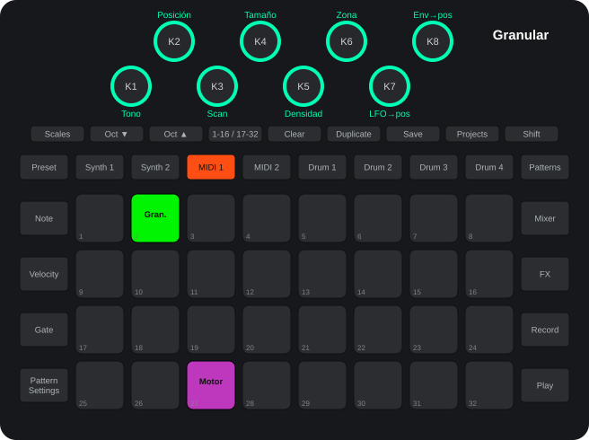

# DSP

*[English version](https://github.com/Ghillermo/CIRCUIT-HACKS-RC/wiki/Features-DSP) · [Inicio](https://github.com/Ghillermo/CIRCUIT-HACKS-RC/wiki/Home#en-español) · [Funciones](https://github.com/Ghillermo/CIRCUIT-HACKS-RC/wiki/Features-ES) · [Guía por vistas](https://ghillermo.github.io/CIRCUIT-HACKS-RC/beta/guia.html)*

Una de las cinco páginas de [Funciones](https://github.com/Ghillermo/CIRCUIT-HACKS-RC/wiki/Features-ES): cada función explicada, con sus imágenes y las animaciones de sus procesos. Cada título enlaza con su apartado de la [guía por vistas](https://ghillermo.github.io/CIRCUIT-HACKS-RC/beta/guia.html), el manual, donde cada función está en el capítulo de su vista.

**Contenido**

- **[DSP](https://github.com/Ghillermo/CIRCUIT-HACKS-RC/wiki/Features-DSP-ES)** — [Efectos de Master FX](https://github.com/Ghillermo/CIRCUIT-HACKS-RC/wiki/Features-DSP-ES#efectos-de-master-fx) · [VCA-VCF de las pistas MIDI](https://github.com/Ghillermo/CIRCUIT-HACKS-RC/wiki/Features-DSP-ES#vca-vcf-de-las-pistas-midi) · [Osciladores y parafonía](https://github.com/Ghillermo/CIRCUIT-HACKS-RC/wiki/Features-DSP-ES#osciladores-y-parafonía) · [Motor VA-drum](https://github.com/Ghillermo/CIRCUIT-HACKS-RC/wiki/Features-DSP-ES#motor-va-drum) · [Sinte granular](https://github.com/Ghillermo/CIRCUIT-HACKS-RC/wiki/Features-DSP-ES#sinte-granular) · [Motor del Glitch](https://github.com/Ghillermo/CIRCUIT-HACKS-RC/wiki/Features-DSP-ES#motor-del-glitch) · [DSP de los drums](https://github.com/Ghillermo/CIRCUIT-HACKS-RC/wiki/Features-DSP-ES#dsp-de-los-drums) · [Entradas de audio y retornos](https://github.com/Ghillermo/CIRCUIT-HACKS-RC/wiki/Features-DSP-ES#entradas-de-audio-y-retornos)

## [Efectos de Master FX](https://ghillermo.github.io/CIRCUIT-HACKS-RC/beta/guia.html#f-efectos-master-fx)

Gater, Auto-Filter LP / HP, Digitise, Phaser y Glitch sobre la salida master, con 4 parámetros cada uno.

**Para qué sirve:** Efectos de directo sobre toda la salida master, en los pads 1-6 de Master FX: el **Gater** trocea la mezcla a ritmo, el **Auto-Filter** barre un filtro paso bajo o paso alto, **Digitise** baja el muestreo y los bits para un sonido lo-fi, el **Phaser** añade un remolino que se mueve y el **Glitch** convierte la salida en una cabeza de cinta sobre los últimos segundos de audio. Mantén un pad para un momento de efecto o fíjalo, y moldea cada uno con cuatro knobs.

**Cómo:**

1. Abre Master FX: **Mixer** y **Mixer** otra vez.
2. **Mantener** un pad de efecto = activo mientras lo mantienes; **Shift + pad** = fijado, tocarlo otra vez lo suelta; el **pad 8** suelta todo lo fijado.
3. Gira **K1-K4** para el efecto cuyo pad pulsas: pad 1 Gater: división, profundidad, ancho, suavizado; pads 2 / 3 Auto-Filter paso bajo / alto: velocidad, profundidad, resonancia, centro.
4. Pad 4 Digitise: muestreo, bits, **K3** = envío momentáneo al delay mientras mantienes el pad, **K4** = envolvente de la cantidad; pad 5 Phaser: velocidad, profundidad, realimentación, mezcla; pad 6 Glitch: velocidad, repetición, retraso, caos / sobrecarga.
5. **Clear + knob a la derecha** = su valor por defecto (en lavanda con Clear pulsado).

**A tener en cuenta:**

- El brillo de los LEDs de los knobs enseña el valor. Master FX no tiene automatización (no hay rojo con Clear).
- *(desde RC4)* La velocidad (K1) del Auto-Filter y del Phaser es bipolar: derecha libre, izquierda a tempo, con cada ciclo empezando en el primer tiempo del compás. *(desde RC4.02)* La envolvente de K4 de Digitise funciona (en RC4 no arrancaba).
- *(desde RC2)* Los 20 knobs de los efectos y la asignación de los huecos se guardan con cada proyecto; los efectos fijados se apagan al encender.
- Un efecto también se puede guardar en un hueco de la fila inferior (mantenlo + toca un hueco) y dispararlo con el secuenciador de efectos. [Master FX](https://ghillermo.github.io/CIRCUIT-HACKS-RC/beta/guia.html#master-fx)

## [VCA-VCF de las pistas MIDI](https://ghillermo.github.io/CIRCUIT-HACKS-RC/beta/guia.html#f-vca-vcf)

Filtros DJ / LP / HP 12 y 24 dB / paso banda / notch, efectos (saturación, plegado, wavefold, ring, comb, chorus), VCA con ADSR y LFO.

**Para qué sirve:** Todos los motores del sinte propio de MIDI 1 / 2 pasan por la misma sección: un amplificador (VCA) con envolvente ADSR y velocity, un filtro (VCF) de siete tipos y una etapa de efecto de siete tipos, movidos por la envolvente y un LFO. Con el motor **entrada de línea** procesa un instrumento externo conectado a la entrada de audio de la pista, abierto por las notas de la pista.

**Cómo:**

1. Enciende el motor (vista Preset de MIDI 1 / 2, **pad 27**) y abre la página 1, **VCA-VCF** (**pad 1**; *(solo Beta 5.56)* **pad 4**, Filtro / VCA).
2. **K1** ataque · **K2** release · **Shift + K1** sustain · **Shift + K2** decay.
3. **K3 / K4** envolvente → nivel / → filtro · **Shift + K3 / K4** LFO → nivel / → filtro.
4. **K5** filtro · **Shift + K5** tipo de filtro: DJ, LP 12, HP 12, paso banda, notch, LP 24, HP 24.
5. **K6** resonancia · **Shift + K6** gain del VCA, hasta +18 dB con saturación suave.
6. **K7** velocidad del LFO (*(desde RC4)* derecha libre, izquierda a tempo); su forma en la página 5, **Shift + K8**, con el color del LED: diente de sierra inverso (azul), diente de sierra (magenta), triángulo (verde), cuadrada (rojo), seno (verde azulado), sample & hold (blanco), sample & hold suavizado (violeta).
7. **K8** cantidad de efecto · **Shift + K8** tipo de efecto: suave, dura, plegado, wavefold, ring, comb, chorus.
8. **Pad 29** = orden de la cadena: VCA → efecto → filtro o filtro → VCA → efecto.

**A tener en cuenta:**

- Los valores por defecto dejan pasar la entrada limpia; el filtro sigue la nota y los tipos de 24 dB son dos etapas seguidas.
- Knobs de tipo: color = el tipo, brillo = la posición dentro de él. **Clear + el pad de la página** *(desde RC2)* = la página a sus valores iniciales.
- *(solo Beta 5.56)* El orden de fábrica es filtro → VCA → efecto (pad 29 encendido = VCA → efecto → filtro); un proyecto o patch guardado antes conserva el pad, así que su orden se invierte.
- *(desde RC2.02)* Sin forma guardada, el LFO es un triángulo; el LFO también mueve tono, forma y morph desde la página 2. [Páginas de knobs del motor de MIDI 1 / 2](https://ghillermo.github.io/CIRCUIT-HACKS-RC/beta/guia.html#midi-knobs)

## [Osciladores y parafonía](https://ghillermo.github.io/CIRCUIT-HACKS-RC/beta/guia.html#f-osciladores)

Morph continuo seno → triángulo → sierra → cuadrada, wavefold / pendiente / ancho, segundo oscilador con FM, ring, sync suave y modos bit a bit; dos notas parafónicas.

**Para qué sirve:** El motor oscilador del sinte propio de MIDI 1 / 2: una forma de onda que pasa sin saltos del seno al triángulo, la sierra y la cuadrada, un control SHAPE que la pliega, la curva o la estrecha (y *(desde RC4)* convierte la sierra en una supersaw de siete sierras), y un segundo oscilador opcional que modula al primero con FM, ring, sync o modos bit a bit. Con dos osciladores, dos notas a la vez van una a cada oscilador (parafonía).

**Cómo:**

1. Vista Preset de MIDI 1 / 2: toca el **pad 27** y elige el **oscilador** (verde) en la fila de motores; la página 2 (**pad 2**) = OSC 1.
2. **K7 WAVE** = el morph: 0 seno, 42 triángulo, 84 sierra, 126 cuadrada (*(solo Beta 5.56)* K3). **K1 TUNE**, **Shift + K1** FINE.
3. **K2 SHAPE** (*(solo Beta 5.56)* K4): en el seno y el triángulo, a la derecha del centro = **wavefold** (más armónicos); en el triángulo, a la izquierda = rampas exponenciales *(desde RC4)*; en la sierra, de una sierra normal a la izquierda del todo a una **supersaw** de 7 sierras a la derecha del todo *(desde RC4)*; en la cuadrada, el ancho del pulso, del 3 % al 97 %.
4. La envolvente y el LFO mueven tono, forma y morph: **K3** env → tono, **K4** env → forma, **K5** LFO → tono, **K6** LFO → forma, **K8** LFO → morph, **Shift + K8** env → morph.
5. **Pad 28** = dos osciladores; página 3 (**pad 3**) = OSC 2: K1 TUNE 2, K2 SHAPE 2, K3 MIX, K4 FM, K5 FINE 2, K6 BITSYNC, K7 WAVE 2, K8 RING.
6. **FM** = OSC 2 modula la fase de OSC 1; **BITSYNC** recorre un sync suave (cada N ciclos) y los modos bit a bit xor, or, nor, and, nand.
7. En los modos de voz mono (retrigger, legato, glide): una nota = los dos osciladores en ella; dos notas = una en cada uno (parafonía).

**A tener en cuenta:**

- *(desde RC4)* Menos aliasing: la sierra, la supersaw y el pulso se generan con PolyBLEP (unos 40 dB menos de tonos ajenos a la nota en las notas agudas), y el wavefold limita su amplificación en las notas agudas.
- *(desde RC2)* Con un oscilador la última nota manda; al soltarla vuelve la anterior. *(desde RC4)* El oscilador también toca en poly (hasta 4 voces; el modo de un proyecto que nunca eligió otro) y en los modos unísono: modo de voz, pad 32.
- *(solo Beta 5.56)* La página 2 cambia (K1 TUNE, K2 FINE, K3 WAVE, K4 SHAPE; K5 / K6 / K8 = LFO / envolvente → FM, ring, mix); la página 3 da K1 = ratio de OSC 2 (¼ … 31), K2 detune, K5 FM con centro (derecha OSC 2 → OSC 1, izquierda al revés), K7 sync clásico + bitwise; con un oscilador, sub-oscilador y ruido; BLEP de 4 muestras.
- [Páginas de knobs del motor de MIDI 1 / 2](https://ghillermo.github.io/CIRCUIT-HACKS-RC/beta/guia.html#midi-knobs)

## [Motor VA-drum](https://ghillermo.github.io/CIRCUIT-HACKS-RC/beta/guia.html#f-va-drum)

Oscilador pensado para percusión: VCA de un disparo, envolventes de decay propias para pitch (knob Sustain) y filtro (knob Release), ruido blanco y valores aleatorios en lugar del LFO.

**Para qué sirve:** Una variante del oscilador pensada para percusión sintética (bombos, toms, cajas, blips): cada nota dispara un golpe de un solo disparo con sus propias envolventes de tono y de filtro que caen y una dosis de ruido blanco, en lugar de un sonido sostenido. Los knobs de la página 1 siguen en su sitio, pero algunos pasan a tener una función percusiva.

**Cómo:**

1. Vista Preset de MIDI 1 / 2: toca el **pad 27** y elige **VA-drum** (naranja) en la fila de motores.
2. En la página VCA-VCF (pad 1; *(solo Beta 5.56)* pad 4): **Ataque** (K1) y **Decay** (Shift + K2) = ataque y decay del VCA de un disparo; **Sustain** (Shift + K1) = el decay de la envolvente de **tono**; **Release** (K2) = el decay de la envolvente de **filtro**.
3. **Velocidad del LFO** (K7) = el nivel de **ruido blanco**; cada knob **LFO → …** manda un valor aleatorio a su destino en lugar del LFO.
4. Da forma al timbre en la página 2 como en el oscilador (WAVE, SHAPE, env → tono para la caída) y con el **pad 28** para dos osciladores.
5. **Pad 31** encendido = la velocity también fija el nivel de las envolventes de tono y de filtro.

**A tener en cuenta:**

- *Bombo:* seno, Decay unos 70, Sustain unos 30, Env → tono a la derecha. *Caja:* más ruido, Decay corto, paso banda.
- *(desde RC4)* En poly cada golpe lleva su propia envolvente de tono y de volumen y su ruido: un golpe nuevo no reinicia los anteriores, y soltar la nota no corta el golpe (el filtro sigue siendo el de la pista).
- Con el VA-drum el LFO sigue siendo su ruido: la forma del LFO de la página 5 no lo cambia.
- [Vista Preset de MIDI 1 / 2](https://ghillermo.github.io/CIRCUIT-HACKS-RC/beta/guia.html#midi-preset)

## [Sinte granular](https://ghillermo.github.io/CIRCUIT-HACKS-RC/beta/guia.html#f-granular)

Hasta **16 granos por pista** desde cualquier sample del pack o la captura, con interpolación y ventana. K1 tono, K2 posición, K3 scan / freeze, K4 tamaño, K5 densidad, K6 zona, K7 LFO → posición, K8 envolvente → posición; Shift: fino, dispersiones, reverso, ventana, slicer (o stretch, desde RC2), LFO → tamaño, fuente.

**Para qué sirve:** Un motor que toca un sample como una nube de hasta 16 granos cortos y solapados por pista: eliges dónde leen, cuánto duran y cuántos hay, y si la lectura avanza, se congela o va hacia atrás. Convierte el sample de un drum o la captura de Master FX en pads, texturas, drones congelados, bucles estirados o ritmos troceados, tocados con las notas de la pista.

**Cómo:**

1. Vista Preset de MIDI 1 / 2: toca el **pad 27** y elige **granular** (magenta); el **pad 2** = su página.
2. **Shift + K8** = la fuente: la captura (rojo) o el sample que tiene ahora Drum 1, 2, 3 o 4 (naranja, amarillo, violeta, verde azulado).
3. **K2** posición en el sample · **K3** scan: centro congelado, derecha avanza, izquierda retrocede · **K6** longitud de la zona del scan.
4. **K4** tamaño del grano, 5-500 ms · **K5** densidad, 1-16 granos · **K1** tono ±24 semitonos (**Shift + K1** fino ±1).
5. **K7** LFO → posición · **K8** envolvente → posición · **Shift + K7** LFO → tamaño.
6. **Shift + K2** dispersión de la posición · **Shift + K3** *(desde RC4)* izquierda = probabilidad de granos al revés, derecha = dispersión del tono · **Shift + K4** *(desde RC4)* dispersión estéreo · **Shift + K5** ventana: rectangular → triangular → percusiva.
7. **Shift + K6** = qué hacen las notas: **tono** (cambian la altura de los granos), **slicer** (16 trozos, la nota 36 toca el primero) o **stretch** *(desde RC2)*.

**A tener en cuenta:**

- **Stretch:** el tramo desde la posición (K2) hasta el final dura **K3** pasos (1-64) a cualquier tempo sin cambiar la altura, alineado con el inicio del transporte; parado, se queda quieto; K7 / K8 casi no actúan.
- **Estéreo** *(desde RC4)*: cada grano sale a un lado al azar y el panorama de la pista (Mixer) decide la proporción; la parte estéreo sigue el VCA, el nivel, el panorama, el mute y el sidechain de la pista.
- Pasa por el VCA-VCF de la página 1 y toca una sola voz. Comparte sus valores guardados (y sus CC) con la página del oscilador.
- La fuente queda fijada aunque el drum cambie después de sample; blanco tenue = ningún drum tiene ya ese sample. [Páginas de knobs del motor de MIDI 1 / 2](https://ghillermo.github.io/CIRCUIT-HACKS-RC/beta/guia.html#midi-knobs)

*Página del granular (pad 2, motor magenta).*

## [Motor del Glitch](https://ghillermo.github.io/CIRCUIT-HACKS-RC/beta/guia.html#f-glitch-dsp)

Una cabeza de cinta sobre un búfer circular estéreo del master (2,7 s): velocidad variable, repeticiones con fundidos, caos.

**Para qué sirve:** Cómo funciona el Glitch (pad 6 de Master FX): el mod graba sin parar los últimos 2,7 segundos del master, y al pulsar el Glitch la salida pasa a una cabeza de cinta que toca esa grabación: más rápido, más lento, parada, hacia atrás, repitiendo o saltando. Frenadas de cinta, tartamudeos, rebobinados y caos controlado para el final de una frase.

**Cómo:**

1. En Master FX **mantén el pad 6** (**Shift + pad 6** = fijado): la cabeza empieza un poco en el pasado, ahora menos el retraso (K3), con una entrada gradual corta.
2. **K1** velocidad: arriba normal, en el centro parada, abajo hacia atrás; cerca de 0 = frenada de cinta.
3. **K2** repetición: al acabar cada segmento la cabeza vuelve a su inicio; al máximo, retraso continuo sin fundidos.
4. **K3** retraso: cuánto atrás empieza la cabeza, hasta 2,6 s.
5. **K4** mitad de abajo = **caos** (saltos atrás al azar, silencios y cambios de sentido); mitad de arriba = **sobrecarga**.

**A tener en cuenta:**

- La **sobrecarga** imita una máquina sobrecargada: con una probabilidad que sube con K4, bloques cortos de sonido llegan tarde (la cabeza vuelve atrás y luego recupera), y desde K4 ≈ 96 la cabeza además frena hasta 0,43 ×. Es una simulación: el secuenciador, el reloj MIDI y el resto del audio no se ven afectados.
- El gesto mecánico (pad 31) usa el mismo motor: mientras suena, el Glitch espera.
- El Glitch se puede poner en un hueco de la fila inferior (mantén el pad 6 + toca un hueco); *(desde RC2)* sus knobs se guardan con el proyecto; por MIDI es el NRPN 9:16-19 por el canal 16.
- [Master FX](https://ghillermo.github.io/CIRCUIT-HACKS-RC/beta/guia.html#master-fx)

## [DSP de los drums](https://ghillermo.github.io/CIRCUIT-HACKS-RC/beta/guia.html#f-drums-dsp)

Ring mod, envolventes de tono y filtro, LFO, filtros DJ / paso banda / notch / comb (no en la Beta 5.64) / tilt, bitcrush, start point, distorsiones y sidechain entre drums.

**Para qué sirve:** El proceso de sonido que hay detrás de los knobs nuevos de cada drum: cada drum tiene su propio filtro con varios modos, un ring mod con oscilador propio, un LFO de trémolo / vibrato, envolventes de tono y de filtro, inicio, corte y ataque del sample, bitcrush y tipos de distorsión. Además, un drum puede agachar a otro con el sidechain y, *(desde RC2)*, también el patrón de una pista de notas.

**Cómo:**

1. Moldea cada drum con sus knobs (**Drum 1-4**; ver «Knobs de los drums según el panel»): **Shift + K5** modo de filtro, **K2 / Shift + K2** ring mod, **K7 / Shift + K7** LFO, **K8 / Shift + K8** distorsión, bitcrush y tipo.
2. **Sidechain entre drums:** **Shift + FX** y luego **Octave ▼**: en las páginas de drums, las filas 3-4 = el ducking de cada drum, los pads 5-8 de la fila 1 = qué drum lo dispara.
3. *(desde RC2)* En una página de drums, los **pads 1-4 de la fila 1** = Synth 1, Synth 2, MIDI 1, MIDI 2 como disparo: cada nota de su patrón abre el ducking del drum (las notas tocadas en directo no).
4. *(desde RC2)* **K1-K4** en una página de drums = ataque, hold, decay y profundidad del sidechain de ese drum, en el color del drum.

**A tener en cuenta:**

- Modos de filtro: el EQ tilt de stock (de fábrica), paso banda, notch, comb con realimentación (no en la Beta 5.56) y DJ. Tipos de distorsión: stock, suave, dura, plegada; a la izquierda de 0 en K8 = bitcrush.
- Con todos los knobs en neutro, el drum suena como en el original.
- Los disparos de las páginas de drums (otro drum o un patrón) no se guardan: al encender son los del preset del drum. K1-K4 de las páginas de drums se guardan con el proyecto.
- [Vista de pista de un drum](https://ghillermo.github.io/CIRCUIT-HACKS-RC/beta/guia.html#drum-pista) · [Vista Sidechain](https://ghillermo.github.io/CIRCUIT-HACKS-RC/beta/guia.html#sidechain)

*[Paso a paso: Sidechain de una pista con el patrón de otra (desde RC2)](https://github.com/Ghillermo/CIRCUIT-HACKS-RC/wiki/Step-by-step-ES#sidechain-de-una-pista-con-el-patrón-de-otra-desde-rc2)*

## [Entradas de audio y retornos](https://ghillermo.github.io/CIRCUIT-HACKS-RC/beta/guia.html#f-entradas)

Entrada de línea (normal o invertida) como fuente de los sintes; retornos de reverb / delay por las tiras 3 / 4 con realimentación.

**Para qué sirve:** Dos formas de meter audio externo o de los efectos en el sonido del mod. Synth 1 / 2 pueden usar la entrada de audio 1 o 2 (normal o con la fase invertida) en lugar de su ruido, y así el filtro, las envolventes y los efectos del patch procesan tu señal externa al ritmo de las notas. Y los retornos de reverb y delay pueden pasar por las tiras 3 / 4 del mixer, donde la pista los procesa y sus envíos pueden devolverlos a los efectos.

**Cómo:**

1. **Fuente del sinte:** con la vista de Synth 1 / 2 en pantalla, pulsa su botón otra vez (*(desde RC4)* o **Shift + Synth 1 / 2**); **pads 25-29** = ruido (normal), entrada 1, entrada 2, entrada 1 invertida, entrada 2 invertida.
2. Da al patch algo de **nivel de ruido** (CC 56): la entrada sustituye al ruido, así que sin ruido no se oye nada.
3. **Retornos:** en Setup, **pad 22** = el retorno de reverb por la tira 3 del mixer (crema), **pad 23** = el de delay por la tira 4 (melocotón); tenue = apagado.
4. Con un retorno en la tira 3 / 4, los envíos de reverb / delay de esa tira (vista FX) vuelven a mandar el retorno, ya procesado por el VCF / FX de la pista: un bucle de realimentación.

**A tener en cuenta:**

- Con los retornos en las tiras 3 / 4, los envíos de esas tiras tienen tope a la mitad; y el retorno es lo que llega a un sinte cuya fuente es esa entrada.
- El motor **entrada de línea** de las pistas MIDI (pad 27, ámbar) pasa la entrada de audio de la pista (línea 1 en MIDI 1, línea 2 en MIDI 2) por el VCA-VCF, abierto por las notas de la pista.
- La fuente del ruido de los sintes se guarda con el proyecto. *(solo Beta 5.56)* **K3** de Advanced Setup sube la ganancia de las entradas externas hasta +24 dB (también lo que llega al sinte propio y al granular).
- [Vista de la fuente del sinte](https://ghillermo.github.io/CIRCUIT-HACKS-RC/beta/guia.html#synth-fuente) · [Vista Setup](https://ghillermo.github.io/CIRCUIT-HACKS-RC/beta/guia.html#setup)
