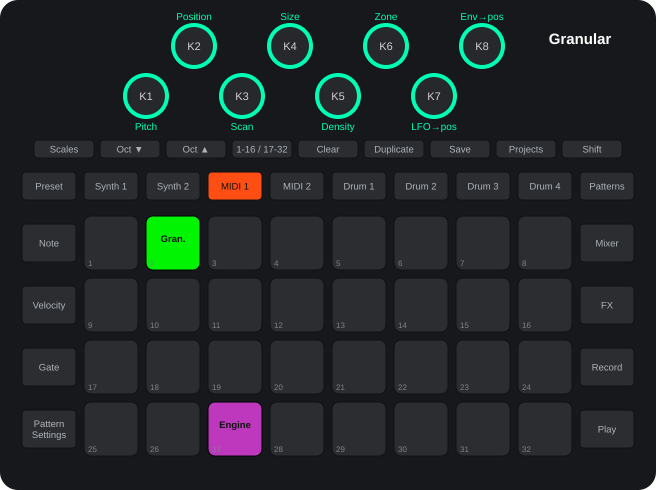

# DSP

*[Versión en español](https://github.com/Ghillermo/CIRCUIT-HACKS-RC/wiki/Features-DSP-ES) · [Home](https://github.com/Ghillermo/CIRCUIT-HACKS-RC/wiki/Home) · [Features](https://github.com/Ghillermo/CIRCUIT-HACKS-RC/wiki/Features) · [Guide by views](https://ghillermo.github.io/CIRCUIT-HACKS-RC/beta/guide.html)*

One of the five pages of [Features](https://github.com/Ghillermo/CIRCUIT-HACKS-RC/wiki/Features): each feature explained, with its pictures and the animations of its processes. Each title links to its section in the [guide by views](https://ghillermo.github.io/CIRCUIT-HACKS-RC/beta/guide.html), the manual, where every feature is in the chapter of its view.

**Contents**

- **[DSP](https://github.com/Ghillermo/CIRCUIT-HACKS-RC/wiki/Features-DSP)** — [Master FX effects](https://github.com/Ghillermo/CIRCUIT-HACKS-RC/wiki/Features-DSP#master-fx-effects) · [VCA-VCF of the MIDI tracks](https://github.com/Ghillermo/CIRCUIT-HACKS-RC/wiki/Features-DSP#vca-vcf-of-the-midi-tracks) · [Oscillators and paraphony](https://github.com/Ghillermo/CIRCUIT-HACKS-RC/wiki/Features-DSP#oscillators-and-paraphony) · [VA-drum engine](https://github.com/Ghillermo/CIRCUIT-HACKS-RC/wiki/Features-DSP#va-drum-engine) · [Granular synth](https://github.com/Ghillermo/CIRCUIT-HACKS-RC/wiki/Features-DSP#granular-synth) · [Glitch engine](https://github.com/Ghillermo/CIRCUIT-HACKS-RC/wiki/Features-DSP#glitch-engine) · [Drum DSP](https://github.com/Ghillermo/CIRCUIT-HACKS-RC/wiki/Features-DSP#drum-dsp) · [Audio inputs and returns](https://github.com/Ghillermo/CIRCUIT-HACKS-RC/wiki/Features-DSP#audio-inputs-and-returns)

## [Master FX effects](https://ghillermo.github.io/CIRCUIT-HACKS-RC/beta/guide.html#f-efectos-master-fx)

Gater, Auto-Filter LP / HP, Digitise, Phaser and Glitch on the master output, with 4 parameters each.

**What it is for:** Live effects on the whole master output, on pads 1-6 of Master FX: the **Gater** chops the mix in rhythm, the **Auto-Filter** sweeps a low-pass or high-pass filter, **Digitise** lowers the sample rate and the bits for a lo-fi crunch, the **Phaser** adds a moving swirl and the **Glitch** turns the output into a tape head over the last seconds of audio. Hold a pad for a moment of effect or latch it, and shape each one with four knobs.

**How:**

1. Open Master FX: **Mixer**, then **Mixer** again.
2. **Hold** an effect pad = on while held; **Shift + pad** = latched, touch it again to release it; **pad 8** releases everything latched.
3. Turn **K1-K4** for the effect whose pad you press: pad 1 Gater: division, depth, width, smoothing; pads 2 / 3 Auto-Filter low / high pass: speed, depth, resonance, centre.
4. Pad 4 Digitise: sample rate, bits, **K3** = a momentary throw to the delay while you hold the pad, **K4** = an envelope on the amount; pad 5 Phaser: speed, depth, feedback, mix; pad 6 Glitch: speed, repeat, delay, chaos / overload.
5. **Clear + knob to the right** = the knob's default (lavender while Clear is held).

**Keep in mind:**

- The knob LEDs show the value with their brightness. Master FX has no automation (no red with Clear).
- *(since RC4)* The Auto-Filter's and the Phaser's speed (K1) is bipolar: right free, left synced to the tempo, each cycle starting on the bar's first beat. *(since RC4.02)* Digitise's K4 envelope works (in RC4 it never started).
- *(since RC2)* The effects' 20 knobs and the slot assignments are saved with each project; latched effects are off at power-up.
- An effect can also be stored in a slot of the bottom row (hold it + touch a slot) and triggered by the FX sequencer. [Master FX](https://ghillermo.github.io/CIRCUIT-HACKS-RC/beta/guide.html#master-fx)

## [VCA-VCF of the MIDI tracks](https://ghillermo.github.io/CIRCUIT-HACKS-RC/beta/guide.html#f-vca-vcf)

DJ / LP / HP 12 and 24 dB / band pass / notch filters, effects (saturation, folding, wavefold, ring, comb, chorus), VCA with ADSR and LFO.

**What it is for:** Every engine of the MIDI 1 / 2 own synth goes through the same shaping section: an amplifier (VCA) with an ADSR envelope and velocity, a filter (VCF) with seven types and an effect stage with seven types, all moved by the envelope and an LFO. With the **line input** engine it shapes an outside instrument plugged into the track's audio input, opened by the track's notes.

**How:**

1. Turn the engine on (MIDI 1 / 2 Preset view, **pad 27**) and open page 1, **VCA-VCF** (**pad 1**; *(Beta 5.56 only)* **pad 4**, Filter / VCA).
2. **K1** attack · **K2** release · **Shift + K1** sustain · **Shift + K2** decay.
3. **K3 / K4** envelope → level / → filter · **Shift + K3 / K4** LFO → level / → filter.
4. **K5** filter · **Shift + K5** filter type: DJ, LP 12, HP 12, band pass, notch, LP 24, HP 24.
5. **K6** resonance · **Shift + K6** VCA gain, up to +18 dB with soft saturation.
6. **K7** LFO speed (*(since RC4)* right free, left synced to the tempo); its shape on page 5, **Shift + K8**, shown by the LED's colour: reverse saw (blue), saw (magenta), triangle (green), square (red), sine (teal), sample & hold (white), slewed sample & hold (violet).
7. **K8** effect amount · **Shift + K8** effect type: soft, hard, fold, wavefold, ring, comb, chorus.
8. **Pad 29** = the chain's order: VCA → effect → filter or filter → VCA → effect.

**Keep in mind:**

- The defaults let the input through clean; the filter follows the note (key tracking) and the 24 dB types are two stages in a row.
- Type knobs: colour = the type, brightness = the position inside it. **Clear + the page's pad** *(since RC2)* = the page back to its initial values.
- *(Beta 5.56 only)* The factory order is filter → VCA → effect (pad 29 on = VCA → effect → filter); a project or patch saved before keeps its pad, so its order swaps.
- *(since RC2.02)* With no shape saved, the LFO is a triangle; the LFO also moves pitch, shape and morph from page 2. [Knob pages of the MIDI 1 / 2 engine](https://ghillermo.github.io/CIRCUIT-HACKS-RC/beta/guide.html#midi-knobs)

## [Oscillators and paraphony](https://ghillermo.github.io/CIRCUIT-HACKS-RC/beta/guide.html#f-osciladores)

Continuous morph sine → triangle → saw → square, wavefold / slope / width, second oscillator with FM, ring, soft sync and bitwise modes; two paraphonic notes.

**What it is for:** The oscillator engine of the MIDI 1 / 2 own synth: one waveform that morphs smoothly from sine to triangle, saw and square, a SHAPE control that folds, bends or narrows it (and *(since RC4)* turns the saw into a seven-saw supersaw), and an optional second oscillator that modulates the first with FM, ring, sync or bitwise modes. With two oscillators, two notes at once go one to each oscillator (paraphony).

**How:**

1. MIDI 1 / 2 Preset view: tap **pad 27** and pick the **oscillator** (green) on the engine row; page 2 (**pad 2**) = OSC 1.
2. **K7 WAVE** = the morph: 0 sine, 42 triangle, 84 saw, 126 square (*(Beta 5.56 only)* K3). **K1 TUNE**, **Shift + K1** FINE.
3. **K2 SHAPE** (*(Beta 5.56 only)* K4): on the sine and the triangle, right of the centre = **wavefold** (more harmonics); on the triangle, left = exponential ramps *(since RC4)*; on the saw, from a plain saw fully left to a 7-saw **supersaw** fully right *(since RC4)*; on the square, the pulse width, 3 % to 97 %.
4. Envelope and LFO move pitch, shape and morph: **K3** env → pitch, **K4** env → shape, **K5** LFO → pitch, **K6** LFO → shape, **K8** LFO → morph, **Shift + K8** env → morph.
5. **Pad 28** = two oscillators; page 3 (**pad 3**) = OSC 2: K1 TUNE 2, K2 SHAPE 2, K3 MIX, K4 FM, K5 FINE 2, K6 BITSYNC, K7 WAVE 2, K8 RING.
6. **FM** = OSC 2 modulates OSC 1's phase; **BITSYNC** walks a soft sync (every N cycles) and the bitwise modes xor, or, nor, and, nand.
7. In the mono voice modes (retrigger, legato, glide): one note = both oscillators on it; two notes = one each (paraphony).

**Keep in mind:**

- *(since RC4)* Less aliasing: the saw, the supersaw and the pulse are made with PolyBLEP (about 40 dB fewer tones foreign to the note on high notes), and the wavefold limits its gain on high notes.
- *(since RC2)* With one oscillator the last note has priority; releasing it brings the previous one back. *(since RC4)* The oscillator also plays in poly (up to 4 voices; the mode of a project that never chose another) and in the unison modes: voice mode, pad 32.
- *(Beta 5.56 only)* Page 2 is rearranged (K1 TUNE, K2 FINE, K3 WAVE, K4 SHAPE; K5 / K6 / K8 = LFO / envelope → FM, ring, mix); page 3 gives K1 = OSC 2's ratio (¼ … 31), K2 detune, K5 FM with a centre (right OSC 2 → OSC 1, left the other way), K7 classic sync + bitwise; with one oscillator, a sub-oscillator and noise; a 4-sample BLEP.
- [Knob pages of the MIDI 1 / 2 engine](https://ghillermo.github.io/CIRCUIT-HACKS-RC/beta/guide.html#midi-knobs)

## [VA-drum engine](https://ghillermo.github.io/CIRCUIT-HACKS-RC/beta/guide.html#f-va-drum)

Oscillator made for percussion: one-shot VCA, dedicated decay envelopes for pitch (Sustain knob) and filter (Release knob), white noise and random values instead of the LFO.

**What it is for:** A variant of the oscillator made for synthetic percussion (kicks, toms, snares, blips): every note fires a one-shot hit with its own decaying pitch and filter envelopes and a dose of white noise, instead of a held sound. The page-1 knobs keep their places, but some take a percussive job.

**How:**

1. MIDI 1 / 2 Preset view: tap **pad 27** and pick **VA-drum** (orange) on the engine row.
2. On the VCA-VCF page (pad 1; *(Beta 5.56 only)* pad 4): **Attack** (K1) and **Decay** (Shift + K2) = the one-shot VCA's attack and decay; **Sustain** (Shift + K1) = the decay of the **pitch** envelope; **Release** (K2) = the decay of the **filter** envelope.
3. **LFO speed** (K7) = the **white noise** level; each **LFO → …** knob sends a random value to its destination instead of the LFO.
4. Shape the tone on page 2 as on the oscillator (WAVE, SHAPE, env → pitch for the drop) and with **pad 28** for two oscillators.
5. **Pad 31** on = velocity also sets the level of the pitch and filter envelopes.

**Keep in mind:**

- *Kick:* sine, Decay about 70, Sustain about 30, Env → pitch to the right. *Snare:* more noise, a short Decay, band pass.
- *(since RC4)* In poly every hit has its own pitch and level envelopes and its own noise: a new hit does not restart the earlier ones, and letting go of the note does not cut the hit (the filter is still the track's).
- With the VA-drum the LFO stays its noise: page 5's LFO shape does not change it.
- [MIDI 1 / 2 Preset view](https://ghillermo.github.io/CIRCUIT-HACKS-RC/beta/guide.html#midi-preset)

## [Granular synth](https://ghillermo.github.io/CIRCUIT-HACKS-RC/beta/guide.html#f-granular)

Up to **16 grains per track** from any sample of the pack or the capture, with interpolation and window. K1 pitch, K2 position, K3 scan / freeze, K4 size, K5 density, K6 zone, K7 LFO → position, K8 envelope → position; Shift: fine, sprays, reverse, window, slicer (or stretch, since RC2), LFO → size, source.

**What it is for:** An engine that plays a sample as a cloud of up to 16 short overlapping grains per track: you choose where they read, how long and how dense they are, and whether the reading moves forward, freezes or runs backwards. It turns a drum's sample or the Master FX capture into pads, textures, frozen drones, time-stretched loops or sliced beats, played from the track's notes.

**How:**

1. MIDI 1 / 2 Preset view: tap **pad 27** and pick **granular** (magenta); **pad 2** = its page.
2. **Shift + K8** = the source: the capture (red) or the sample that Drum 1, 2, 3 or 4 has now (orange, yellow, violet, teal).
3. **K2** position in the sample · **K3** scan: centre frozen, right forward, left backwards · **K6** length of the scan zone.
4. **K4** grain size, 5-500 ms · **K5** density, 1-16 grains · **K1** pitch ±24 semitones (**Shift + K1** fine ±1).
5. **K7** LFO → position · **K8** envelope → position · **Shift + K7** LFO → size.
6. **Shift + K2** position spray · **Shift + K3** *(since RC4)* left = chance of reversed grains, right = pitch spray · **Shift + K4** *(since RC4)* stereo spread · **Shift + K5** window: rectangular → triangular → percussive.
7. **Shift + K6** = what the notes do: **pitch** (they change the grains' pitch), **slicer** (16 slices, note 36 plays the first) or **stretch** *(since RC2)*.

**Keep in mind:**

- **Stretch:** the stretch from the position (K2) to the end lasts **K3** steps (1-64) at any tempo without changing the pitch, starting in step with the transport; stopped, it stands still; K7 / K8 do little here.
- **Stereo** *(since RC4)*: each grain goes to one side at random and the track's pan (Mixer) sets the proportion; the stereo part follows the track's VCA, level, pan, mute and side-chain.
- It goes through the VCA-VCF of page 1 and plays one voice. It shares its saved values (and their CCs) with the oscillator page.
- The source stays fixed even if the drum later changes sample; dim white = no drum has that sample any more. [Knob pages of the MIDI 1 / 2 engine](https://ghillermo.github.io/CIRCUIT-HACKS-RC/beta/guide.html#midi-knobs)

*Granular page (pad 2, magenta engine).*

## [Glitch engine](https://ghillermo.github.io/CIRCUIT-HACKS-RC/beta/guide.html#f-glitch-dsp)

A tape head over a stereo circular buffer of the master (2.7 s): variable speed, repeats with fades, chaos.

**What it is for:** How the Glitch (Master FX pad 6) works: the mod records the last 2.7 seconds of the master all the time, and pressing the Glitch replaces the output with a tape head playing that recording: faster, slower, stopped, backwards, stuttering or jumping around. Tape stops, stutters, rewinds and controlled chaos for the end of a phrase.

**How:**

1. In Master FX **hold pad 6** (**Shift + pad 6** = latched): the head starts a little in the past, now minus the delay (K3), with a short fade-in.
2. **K1** speed: at the top normal, in the middle stopped, at the bottom backwards; near 0 = a tape stop.
3. **K2** repeat: at the end of each segment the head goes back to its start; at the maximum, a continuous delay without fades.
4. **K3** delay: how far back the head starts, up to 2.6 s.
5. **K4** lower half = **chaos** (random jumps back, silences and reversals); upper half = **overload**.

**Keep in mind:**

- **Overload** imitates an overloaded machine: with a chance that grows with K4, short blocks of sound arrive late (the head jumps back and catches up), and from K4 ≈ 96 the head also slows down to 0.43 ×. It is a simulation: the sequencer, the MIDI clock and the rest of the audio are not affected.
- The mechanical gesture (pad 31) uses the same engine: while it plays, the Glitch waits.
- The Glitch can go into a bottom-row slot (hold pad 6 + touch a slot); *(since RC2)* its knobs are saved with the project; over MIDI it is NRPN 9:16-19 on channel 16.
- [Master FX](https://ghillermo.github.io/CIRCUIT-HACKS-RC/beta/guide.html#master-fx)

## [Drum DSP](https://ghillermo.github.io/CIRCUIT-HACKS-RC/beta/guide.html#f-drums-dsp)

Ring mod, pitch and filter envelopes, LFO, DJ / band pass / notch / comb (not in Beta 5.64) / tilt filters, bitcrush, start point, distortions and sidechain between drums.

**What it is for:** The sound processing behind each drum's new knobs: every drum gets its own filter with several modes, a ring modulator with its own oscillator, a tremolo / vibrato LFO, pitch and filter envelopes, sample start, cut and attack, bitcrush and distortion types. Drums can also duck each other through the side-chain, and *(since RC2)* so can a note track's pattern.

**How:**

1. Shape each drum with its knobs (**Drum 1-4**; see «Drum knobs as printed on the panel»): **Shift + K5** filter mode, **K2 / Shift + K2** ring mod, **K7 / Shift + K7** LFO, **K8 / Shift + K8** distortion, bitcrush and type.
2. **Side-chain between drums:** **Shift + FX**, then **Octave ▼**: on the drum pages, rows 3-4 = the ducking of each drum, row 1 pads 5-8 = which drum triggers it.
3. *(since RC2)* On a drum page, **row 1 pads 1-4** = Synth 1, Synth 2, MIDI 1, MIDI 2 as the trigger: every note of their pattern opens the drum's ducking (notes played live do not).
4. *(since RC2)* **K1-K4** on a drum page = attack, hold, decay and depth of that drum's side-chain, in the drum's colour.

**Keep in mind:**

- Filter modes: the stock EQ tilt (the default), band pass, notch, comb with feedback (not in Beta 5.56) and DJ. Distortion types: stock, soft, hard, fold; left of 0 on K8 = bitcrush.
- With every knob neutral the drum sounds as on the original.
- The drum pages' triggers (another drum or a pattern) are not saved: at power-up they are those of the drum's preset. The drum pages' K1-K4 are saved with the project.
- [Drum track view](https://ghillermo.github.io/CIRCUIT-HACKS-RC/beta/guide.html#drum-pista) · [Sidechain view](https://ghillermo.github.io/CIRCUIT-HACKS-RC/beta/guide.html#sidechain)

*[Step by step: Duck a track with another track's pattern (since RC2)](https://github.com/Ghillermo/CIRCUIT-HACKS-RC/wiki/Step-by-step#duck-a-track-with-another-tracks-pattern-since-rc2)*

## [Audio inputs and returns](https://ghillermo.github.io/CIRCUIT-HACKS-RC/beta/guide.html#f-entradas)

Line input (normal or inverted) as a synth source; reverb / delay returns through strips 3 / 4 with feedback.

**What it is for:** Two ways to bring outside or effect audio into the mod's sound. Synth 1 / 2 can take audio input 1 or 2 (normal or phase-inverted) in place of their noise, so the patch's filter, envelopes and effects shape your outside signal in time with the notes. And the reverb and delay returns can go through mixer strips 3 / 4, where the track processes them and its sends can feed them back into the effects.

**How:**

1. **Synth source:** with Synth 1 / 2's view on screen, press its button again (*(since RC4)* or **Shift + Synth 1 / 2**); **pads 25-29** = noise (normal), input 1, input 2, input 1 inverted, input 2 inverted.
2. Give the patch some **noise level** (CC 56): the input replaces the noise, so with no noise nothing is heard.
3. **Returns:** in Setup, **pad 22** = the reverb return through mixer strip 3 (cream), **pad 23** = the delay return through strip 4 (peach); dim = off.
4. With a return on strip 3 / 4, that strip's reverb / delay sends (FX view) send the return again, already processed by the track's VCF / FX: a feedback loop.

**Keep in mind:**

- With the returns on strips 3 / 4, those strips' sends are capped at half; and the return is what reaches a synth whose source is that input.
- The MIDI tracks' **line input** engine (pad 27, amber) runs the track's audio input (line 1 on MIDI 1, line 2 on MIDI 2) through the VCA-VCF, opened by the track's notes.
- The synths' noise source is saved with the project. *(Beta 5.56 only)* Advanced Setup **K3** raises the external inputs' gain up to +24 dB (also what reaches the own synth and the granular).
- [Synth source view](https://ghillermo.github.io/CIRCUIT-HACKS-RC/beta/guide.html#synth-fuente) · [Setup view](https://ghillermo.github.io/CIRCUIT-HACKS-RC/beta/guide.html#setup)
