# Miscelánea

*[English version](https://github.com/Ghillermo/CIRCUIT-HACKS-RC/wiki/Features-Misc) · [Inicio](https://github.com/Ghillermo/CIRCUIT-HACKS-RC/wiki/Home#en-español) · [Funciones](https://github.com/Ghillermo/CIRCUIT-HACKS-RC/wiki/Features-ES) · [Guía por vistas](https://ghillermo.github.io/CIRCUIT-HACKS-RC/beta/guia.html)*

Una de las cinco páginas de [Funciones](https://github.com/Ghillermo/CIRCUIT-HACKS-RC/wiki/Features-ES): cada función explicada, con sus imágenes y las animaciones de sus procesos. Cada título enlaza con su apartado de la [guía por vistas](https://ghillermo.github.io/CIRCUIT-HACKS-RC/beta/guia.html), el manual, donde cada función está en el capítulo de su vista.

**Contenido**

- **[Miscelánea](https://github.com/Ghillermo/CIRCUIT-HACKS-RC/wiki/Features-Misc-ES)** — [Qué se guarda y dónde](https://github.com/Ghillermo/CIRCUIT-HACKS-RC/wiki/Features-Misc-ES#qué-se-guarda-y-dónde) · [El pack de la memoria interna: solo lectura](https://github.com/Ghillermo/CIRCUIT-HACKS-RC/wiki/Features-Misc-ES#el-pack-de-la-memoria-interna-solo-lectura) · [Instalar y volver atrás](https://github.com/Ghillermo/CIRCUIT-HACKS-RC/wiki/Features-Misc-ES#instalar-y-volver-atrás) · [Tablas MIDI](https://github.com/Ghillermo/CIRCUIT-HACKS-RC/wiki/Features-Misc-ES#tablas-midi)

## [Qué se guarda y dónde](https://ghillermo.github.io/CIRCUIT-HACKS-RC/beta/guia.html#f-guardado)

Patrón, proyecto, pack y ajustes del aparato: qué va en cada sitio, cómo asegurarte de que se guarda y qué se pierde al apagar, en el capítulo «Datos» de la guía por vistas.

**Para qué sirve:** El mod guarda sus datos en cinco sitios: el **patrón** y el **proyecto** (los dos llegan a la tarjeta al guardar el proyecto), el **pack** (se escribe en la tarjeta al momento, al hacer el gesto), los **ajustes del aparato** (solos, iguales para todos los proyectos) y ninguno (se pierde al apagar). Saber qué va en cada sitio te dice qué guardar antes de apagar y qué te acompaña a otro proyecto.

**Cómo:**

1. Para que el cambio de un knob forme parte de un patrón, grábalo: **Record** con el secuenciador en marcha, o mantén un paso y gira. Un knob girado sin Record cambia el sonido del proyecto, no el patrón.
2. Guarda el proyecto: **Save dos veces** (el primer toque parpadea en blanco; el segundo, verde rápido); para otro hueco, **Save + el pad del hueco** en la vista Projects. Todo lo marcado «proyecto» o «patrón» solo llega a la tarjeta así.
3. Para conservar un sonido en otros proyectos o packs, guárdalo como patch: Synth 1 / 2 en su vista Preset, el sinte propio de MIDI 1 / 2 en la suya (**Clear + pad** dos veces) *(escribe en la tarjeta)*.
4. Antes de apagar, para el secuenciador, espera **2 s** sin tocar el motor de MIDI 1 / 2 y apaga con el botón de encendido.
5. Si Save no se enciende nunca, está activado el **Save Lock** (Shift + Save al encender, función del original): repite el gesto para quitarlo.
6. *(desde RC4.05)* Con el **guardado diferido** encendido (Advanced Setup, pad 22), Save mientras suena queda pendiente (Save parpadea en amarillo) y se escribe al parar; para el transporte antes de apagar.

**A tener en cuenta:**

- **Patrón:** notas y automatización (carriles del sinte propio, pares del step-drummer, marcas de soltar la automatización), sample flips, random-mutate, frecuencia, dinámicas, órdenes de reproducción y reglas de cadena. **Proyecto:** los knobs nuevos de los drums, la fuente del ruido de los sintes, Master FX (knobs, huecos, compresor), las fuentes del sidechain, cadenas y repeticiones de escena, cuenta atrás, arpegiadores, escala propia, parejas estéreo de drums y *(desde RC4)* el sinte propio entero.
- **Pack (tarjeta):** los patches de Synth 1 / 2 guardados, los patches del sinte propio, los samples y las capturas, los proyectos copiados. **Ajustes del aparato:** el motor de MIDI 1 / 2 y el patch flip, modo Thru, canales de Program Change, modo cue, drums GM, fusión USB, teclado al arpegiador, curva de velocity, guardado diferido.
- **Se pierde al apagar:** los efectos fijados y el song pointer, el Record de Setup, las notas y acordes en latch, la pantalla de acordes, el teclado partido y las vistas abiertas, el filtro master y su apagado, una captura sin usar.
- Sin tarjeta (el pack interno) y con las versiones «S» el mod no escribe nada propio: patches, samples y copias no se guardan (Save se pone rojo); los proyectos, sí. [Qué vuelve tras reiniciar y dónde se guarda](https://ghillermo.github.io/CIRCUIT-HACKS-RC/beta/guia.html#guardado)

## [El pack de la memoria interna: solo lectura](https://ghillermo.github.io/CIRCUIT-HACKS-RC/beta/guia.html#f-pack-interno)

Nada del mod escribe ni borra en el pack de la memoria interna del Circuit (el primero de la vista de packs). Se puede leer de él y copiar desde él a un pack de la tarjeta, pero no al revés.

**Para qué sirve:** El pack de la memoria interna del Circuit (el primero de la vista de packs) está protegido: nada del mod escribe en él ni lo borra. Se puede tocar, cargar y copiar desde él a un pack de la microSD, así que un gesto del mod hecho por error no puede estropearlo.

**Cómo:**

1. Carga y toca el pack interno como siempre.
2. Para sacar algo de él: en el pack interno, **Duplicate + pad A** (un sample, un patch o un proyecto, en su vista), carga un pack de la tarjeta y luego **Duplicate + pad B** *(escribe en la tarjeta)*.
3. Todo lo que el mod escribiría en él se rechaza: el LED de **Save** se pone rojo 1,5 s y no cambia nada.

**A tener en cuenta:**

- Se rechaza: guardar el sample capturado con el proyecto, intercambiar o copiar samples y patches hacia él, guardar en él patches de Synth 1 / 2 o del sinte propio, copiar proyectos a él y borrarlo desde la vista de packs.
- Los guardados del propio aparato siguen funcionando ahí (Save de un proyecto), y lo que el mod guarda dentro del proyecto va en ese guardado normal. Aun así, con las versiones que no acaban en «S», no uses la memoria interna para proyectos: es lo que pide el instalador.
- Las versiones «S» no escriben nada por su cuenta en ninguna memoria.
- [Vista de packs](https://ghillermo.github.io/CIRCUIT-HACKS-RC/beta/guia.html#packs)

*[Paso a paso: Borrar un pack](https://github.com/Ghillermo/CIRCUIT-HACKS-RC/wiki/Step-by-step-ES#borrar-un-pack)*

## [Instalar y volver atrás](https://ghillermo.github.io/CIRCUIT-HACKS-RC/beta/guia.html#f-instalar)

`rc_uploader.html` parchea en el navegador el firmware oficial de Novation y lo envía por Web MIDI; solo acepta el firmware oficial 1.2.1. Recuperación: Scales + Preset + Note al encender.

**Para qué sirve:** El mod se instala desde una página web: el instalador toma el firmware oficial 1.2.1 de Novation para el Circuit Tracks, le aplica los cambios del mod en el navegador y envía el resultado al aparato por USB (Web MIDI). El bootloader de Novation no se toca nunca, así que siempre se puede volver al firmware oficial.

**Cómo:**

1. **Haz antes una copia de la microSD.** Con las versiones que no acaban en «S», no uses la memoria interna para proyectos.
2. Descarga el firmware oficial 1.2.1 de Novation para el Circuit Tracks (el instalador solo acepta ese).
3. Descarga el instalador, [`rc_uploader.zip`](https://ghillermo.github.io/CIRCUIT-HACKS-RC/rc_uploader.zip), descomprímelo, abre `rc_uploader.html` en Chrome o Edge y conecta el Circuit Tracks por USB.
4. Elige el fichero oficial y la versión: la versión candidata (RC), su gemela más segura «S», una beta, u «Oficial» para volver. **Buscar versiones nuevas** añade las publicadas que tu copia no lleva (hace falta internet).
5. Envía.
6. **Volver atrás:** envía otra versión o el firmware oficial. Si el aparato no arranca, mantén **Scales + Preset + Note** al encenderlo (el modo de recuperación del bootloader) y vuelve a enviar.

**A tener en cuenta:**

- La versión **«S»** es la RC con todo lo que el mod escribiría o borraría en la tarjeta o en la memoria interna rechazado (Save se pone rojo): guardar la captura con el proyecto, intercambios y copias entre packs, los patches del sinte propio, guardar el patch del sinte, copiar proyectos y borrar packs. Los guardados del original funcionan.
- La **RC** tiene todo lo marcado «desde RCx» en la documentación; la **beta** añade lo marcado «solo Beta 5.56».
- Instalar reinicia el aparato: lo que no se guardó se pierde; proyectos, packs y ajustes se quedan. Los proyectos y packs guardados con el mod también se abren en el firmware oficial, que no lee los datos del mod.
- La **app de la tarjeta y del aparato** organiza la tarjeta y el aparato desde el ordenador: ábrela [en línea](https://ghillermo.github.io/CIRCUIT-HACKS-RC/app.html) en Chrome o Edge, o descarga [`hr_app.zip`](https://ghillermo.github.io/CIRCUIT-HACKS-RC/hr_app.zip) (también pasa samples, patrones y parches FM a un Circuit Rhythm). [App de la tarjeta y del aparato](https://ghillermo.github.io/CIRCUIT-HACKS-RC/beta/guia.html#app-sd) · [Instalar y volver atrás](https://ghillermo.github.io/CIRCUIT-HACKS-RC/beta/guia.html#instalar)

## [Tablas MIDI](https://ghillermo.github.io/CIRCUIT-HACKS-RC/beta/guia.html#f-tablas-midi)

Motor MIDI: CC 74/71/79/73/75/70/72/91/59/26/27/20/21/37/39/30/31/52/54 + NRPN 0:76 y 4:x; drums NRPN 5-8:1-14; Master FX NRPN 9:0-19 (canal 16).

**Para qué sirve:** La referencia de los números MIDI que añade el mod, para mapear un controlador externo o un DAW a los parámetros nuevos: el motor de las pistas MIDI por el canal de la pista (los CC de stock donde encajan, NRPN MSB 4 para el resto), los knobs nuevos de los drums como NRPN MSB 5-8 por el canal de drums, y Master FX como NRPN MSB 9 por el canal 16.

**Cómo:**

1. **Motor de MIDI 1 / 2** (canal de la pista): Filtro CC 74, Resonancia CC 71, Env → filtro CC 79, Ataque CC 73, Decay CC 75, Sustain CC 70, Release CC 72, Efecto CC 91, Gain CC 59, Velocidad del LFO NRPN 0:76.
2. TUNE CC 26, FINE CC 27, WAVE CC 20, SHAPE CC 21, TUNE 2 CC 37, FINE 2 CC 39, WAVE 2 CC 30, SHAPE 2 CC 31, MIX CC 52, RING CC 54; el resto NRPN MSB 4 con el código como LSB: 4 LFO → filtro, 12 LFO → nivel, 13 tipo de efecto, 15 env → nivel, 16 tipo de filtro, 21-26 LFO / envolvente → tono, forma y morph, 32 BITSYNC, 33 FM.
3. **Drums** (canal de drums): CC 99 = 5 / 6 / 7 / 8 para Drum 1-4, CC 98 = el LSB, CC 6 = el valor: 1 env → tono, 2 frecuencia del ring, 3 cantidad del LFO, 4 velocidad del LFO, 5 env → corte, 6 resonancia, 7 forma de la envolvente, 8 cantidad del ring, 9 modo de filtro, 10 inicio, 11 bitcrush, 12 tipo de distorsión, 13 corte, 14 ataque.
4. **Master FX** (canal 16): CC 99 = 9, CC 98 = 4 × efecto + knob (K1-K4 = 0-3), CC 6 = el valor: Gater 0-3, Auto-Filter 4-7, Digitise 8-11, Phaser 12-15, Glitch 16-19.
5. Manda un NRPN como CC 99, CC 98, CC 6, en ese orden; el aparato recuerda el NRPN elegido hasta el siguiente CC 99 / 98.

**A tener en cuenta:**

- Valores 0-127; los parámetros bipolares tienen el 64 en el centro. Modo de filtro: 0 EQ tilt de stock, 1 paso banda, 2 notch, 3 comb, 4 DJ; tipo de distorsión: 0 stock, 1 suave, 2 dura, 3 plegada; bitcrush 0-15; inicio y corte 0-120.
- En el motor granular, los números de la página 2 significan otras cosas (TUNE = tono, FINE = tamaño, WAVE = posición…). Los knobs de stock de los drums y los parámetros propios del aparato siguen con los números de la Programmer's Reference Guide de Novation.
- *(solo Beta 5.56)* Cambian la página y el knob de varios números del motor, y TUNE 2 (CC 37) pasa a ser el ratio de OSC 2, ¼ … 31.
- La tabla completa, con la página y el knob de cada número: [MIDI: comportamientos propios, CC y NRPN nuevos](https://ghillermo.github.io/CIRCUIT-HACKS-RC/beta/guia.html#midi).
