# Miscellaneous

*[Versión en español](https://github.com/Ghillermo/CIRCUIT-HACKS-RC/wiki/Features-Misc-ES) · [Home](https://github.com/Ghillermo/CIRCUIT-HACKS-RC/wiki/Home) · [Features](https://github.com/Ghillermo/CIRCUIT-HACKS-RC/wiki/Features) · [Guide by views](https://ghillermo.github.io/CIRCUIT-HACKS-RC/beta/guide.html)*

One of the five pages of [Features](https://github.com/Ghillermo/CIRCUIT-HACKS-RC/wiki/Features): each feature explained, with its pictures and the animations of its processes. Each title links to its section in the [guide by views](https://ghillermo.github.io/CIRCUIT-HACKS-RC/beta/guide.html), the manual, where every feature is in the chapter of its view.

**Contents**

- **[Miscellaneous](https://github.com/Ghillermo/CIRCUIT-HACKS-RC/wiki/Features-Misc)** — [What is saved and where](https://github.com/Ghillermo/CIRCUIT-HACKS-RC/wiki/Features-Misc#what-is-saved-and-where) · [The internal memory pack: read only](https://github.com/Ghillermo/CIRCUIT-HACKS-RC/wiki/Features-Misc#the-internal-memory-pack-read-only) · [Installing and going back](https://github.com/Ghillermo/CIRCUIT-HACKS-RC/wiki/Features-Misc#installing-and-going-back) · [MIDI tables](https://github.com/Ghillermo/CIRCUIT-HACKS-RC/wiki/Features-Misc#midi-tables)

## [What is saved and where](https://ghillermo.github.io/CIRCUIT-HACKS-RC/beta/guide.html#f-guardado)

Pattern, project, pack and device settings: what goes where, how to make sure it is saved and what is lost at power-off, in the «Data» chapter of the guide by views.

**What it is for:** The mod keeps its data in five places: the **pattern** and the **project** (both reach the card when you save the project), the **pack** (written to the card at once, when you do the gesture), the **device settings** (on their own, the same for every project) and nowhere (lost at power-off). Knowing which is which tells you what to save before switching off and what follows you to another project.

**How:**

1. To make a knob change part of a pattern, record it: **Record** with the sequencer running, or hold a step and turn. A knob turned without Record changes the project's sound, not the pattern.
2. Save the project: **Save twice** (white flash, then fast green); for another slot, **Save + the slot's pad** in the Projects view. Everything marked «project» or «pattern» only reaches the card this way.
3. To keep a sound for other projects or packs, save it as a patch: Synth 1 / 2 in their Preset view, the MIDI 1 / 2 own synth in its Preset view (**Clear + pad** twice) *(writes to the card)*.
4. Before switching off, stop the sequencer, wait **2 s** without touching the MIDI 1 / 2 engine and switch off with the power button.
5. If Save never lights, **Save Lock** is on (Shift + Save at power-up, an original feature): repeat the gesture to remove it.
6. *(since RC4.05)* With the **delayed save** on (Advanced Setup, pad 22), Save while playing stays pending (Save blinks yellow) and is written when you stop; stop the transport before switching off.

**Keep in mind:**

- **Pattern:** notes and automation (own-synth lanes, step-drummer pairs, automation-release marks), sample flips, random-mutate, frequency, dynamics, play orders and chain rules. **Project:** the drums' new knobs, the synths' noise source, Master FX (knobs, slots, compressor), side-chain sources, chains and scene repeats, count-in, arpeggiators, custom scale, stereo drum pairs and *(since RC4)* the whole own synth.
- **Pack (card):** saved Synth 1 / 2 patches, own-synth patches, samples and captures, copied projects. **Device settings:** the MIDI 1 / 2 engine and patch flip, Thru mode, Program Change channels, cue mode, GM drums, USB merge, keyboard to the arpeggiator, velocity curve, delayed save.
- **Lost at power-off:** latched effects and the song pointer, Setup's Record, latched notes and chords, the chord screen, the split keyboard and open views, the master filter and its off switch, an unused capture.
- Without a card (the internal pack) and in the «S» builds the mod writes nothing of its own: patches, samples and copies are not saved (Save turns red); projects are. [What comes back after a restart and where it is saved](https://ghillermo.github.io/CIRCUIT-HACKS-RC/beta/guide.html#guardado)

## [The internal memory pack: read only](https://ghillermo.github.io/CIRCUIT-HACKS-RC/beta/guide.html#f-pack-interno)

Nothing of the mod writes or deletes in the pack of the Circuit’s internal memory (the first one of the Packs view). You can read it and copy from it to a pack of the card, not the other way round.

**What it is for:** The pack in the Circuit's internal memory (the first one in the Packs view) is protected: nothing of the mod writes to it or deletes it. You can still play it, load from it and copy things out of it to a pack on the microSD card, so a mod gesture made by mistake cannot spoil it.

**How:**

1. Load and play the internal pack as always.
2. To take something out of it: in the internal pack, **Duplicate + pad A** (a sample, a patch or a project, in its view), load a pack on the card, then **Duplicate + pad B** *(writes to the card)*.
3. Anything the mod would write into it is refused: the **Save** LED turns red for 1.5 s and nothing changes.

**Keep in mind:**

- Refused: saving the captured sample with the project, swapping or copying samples and patches into it, saving Synth 1 / 2 or own-synth patches in it, copying projects into it and deleting it from the Packs view.
- The device's own saves still work there (Save of a project), and what the mod keeps inside a project goes with that normal save. Even so, with the builds that do not end in «S», do not use the internal memory for projects: the installer asks for that.
- The «S» builds write nothing of their own to any memory.
- [Packs view](https://ghillermo.github.io/CIRCUIT-HACKS-RC/beta/guide.html#packs)

*[Step by step: Delete a pack](https://github.com/Ghillermo/CIRCUIT-HACKS-RC/wiki/Step-by-step#delete-a-pack)*

## [Installing and going back](https://ghillermo.github.io/CIRCUIT-HACKS-RC/beta/guide.html#f-instalar)

`rc_uploader.html` patches Novation's official firmware in the browser and sends it over Web MIDI; it only accepts the official firmware 1.2.1. Recovery: Scales + Preset + Note at power-on.

**What it is for:** The mod is installed from a web page: the installer takes Novation's official Circuit Tracks firmware 1.2.1, applies the mod's changes in the browser and sends the result to the device over USB (Web MIDI). Novation's bootloader is never touched, so you can always go back to the official firmware.

**How:**

1. **Back up the microSD card first.** With the builds that do not end in «S», do not use the internal memory for projects.
2. Download Novation's official firmware 1.2.1 for the Circuit Tracks (the installer only accepts that one).
3. Download the installer, [`rc_uploader.zip`](https://ghillermo.github.io/CIRCUIT-HACKS-RC/rc_uploader.zip), unzip it, open `rc_uploader.html` in Chrome or Edge and connect the Circuit Tracks over USB.
4. Pick the official file and the version: the release candidate (RC), its safer «S» twin, a beta, or «Official» to go back. **Check for new builds** adds published versions your copy does not carry (it needs the internet).
5. Send.
6. **Going back:** send another version or the official firmware. If the device does not start, hold **Scales + Preset + Note** while you power it on (the bootloader's recovery mode) and send again.

**Keep in mind:**

- The **«S»** build is the RC with everything the mod would write or delete on the card or in the internal memory refused (Save turns red): saving the capture with the project, swaps and copies between packs, own-synth patches, saving the synth patch, copying projects and deleting packs. The original's saves work.
- The **RC** has everything marked «since RCx» in the docs; the **beta** adds what is marked «Beta 5.56 only».
- Installing restarts the device: what was not saved is lost; projects, packs and settings stay. Projects and packs saved with the mod also open on the official firmware, which ignores the mod's data.
- The **card and device app** organises the card and the device from a computer: open it [online](https://ghillermo.github.io/CIRCUIT-HACKS-RC/app.html) in Chrome or Edge, or download [`hr_app.zip`](https://ghillermo.github.io/CIRCUIT-HACKS-RC/hr_app.zip) (it also moves samples, patterns and FM patches to a Circuit Rhythm). [Card and device app](https://ghillermo.github.io/CIRCUIT-HACKS-RC/beta/guide.html#app-sd) · [Installing and going back](https://ghillermo.github.io/CIRCUIT-HACKS-RC/beta/guide.html#instalar)

## [MIDI tables](https://ghillermo.github.io/CIRCUIT-HACKS-RC/beta/guide.html#f-tablas-midi)

MIDI engine: CC 74/71/79/73/75/70/72/91/59/26/27/20/21/37/39/30/31/52/54 + NRPN 0:76 and 4:x; drums NRPN 5-8:1-14; Master FX NRPN 9:0-19 (channel 16).

**What it is for:** The reference of the MIDI numbers the mod adds, for mapping an external controller or a DAW to the new parameters: the MIDI tracks' engine on the track's channel (stock CCs where they fit, NRPN MSB 4 for the rest), the drums' new knobs as NRPN MSB 5-8 on the drums' channel, and Master FX as NRPN MSB 9 on channel 16.

**How:**

1. **MIDI 1 / 2 engine** (the track's channel): Filter CC 74, Resonance CC 71, Env → filter CC 79, Attack CC 73, Decay CC 75, Sustain CC 70, Release CC 72, Effect CC 91, Gain CC 59, LFO speed NRPN 0:76.
2. TUNE CC 26, FINE CC 27, WAVE CC 20, SHAPE CC 21, TUNE 2 CC 37, FINE 2 CC 39, WAVE 2 CC 30, SHAPE 2 CC 31, MIX CC 52, RING CC 54; the rest NRPN MSB 4 with the code as LSB: 4 LFO → filter, 12 LFO → level, 13 effect type, 15 env → level, 16 filter type, 21-26 LFO / envelope → pitch, shape and morph, 32 BITSYNC, 33 FM.
3. **Drums** (the drums' channel): CC 99 = 5 / 6 / 7 / 8 for Drum 1-4, CC 98 = the LSB, CC 6 = the value: 1 env → pitch, 2 ring frequency, 3 LFO amount, 4 LFO speed, 5 env → cutoff, 6 resonance, 7 envelope shape, 8 ring amount, 9 filter mode, 10 start, 11 bitcrush, 12 distortion type, 13 cut, 14 attack.
4. **Master FX** (channel 16): CC 99 = 9, CC 98 = 4 × effect + knob (K1-K4 = 0-3), CC 6 = the value: Gater 0-3, Auto-Filter 4-7, Digitise 8-11, Phaser 12-15, Glitch 16-19.
5. Send an NRPN as CC 99, CC 98, CC 6, in that order; the device keeps the chosen NRPN until the next CC 99 / 98.

**Keep in mind:**

- Values 0-127; bipolar parameters have 64 at the centre. Filter mode: 0 stock EQ tilt, 1 band pass, 2 notch, 3 comb, 4 DJ; distortion type: 0 stock, 1 soft, 2 hard, 3 fold; bitcrush 0-15; start and cut 0-120.
- In the granular engine, page 2's numbers mean other things (TUNE = pitch, FINE = size, WAVE = position…). The drums' stock knobs and the device's own parameters keep the numbers of Novation's Programmer's Reference Guide.
- *(Beta 5.56 only)* The page and knob of several engine numbers change, and TUNE 2 (CC 37) becomes OSC 2's ratio, ¼ … 31.
- The full table, with the page and knob of every number: [MIDI: own behaviours, new CCs and NRPNs](https://ghillermo.github.io/CIRCUIT-HACKS-RC/beta/guide.html#midi).
