# Nuevos modos de control

*[English version](https://github.com/Ghillermo/CIRCUIT-HACKS-RC/wiki/Features-Modes) · [Inicio](https://github.com/Ghillermo/CIRCUIT-HACKS-RC/wiki/Home#en-español) · [Funciones](https://github.com/Ghillermo/CIRCUIT-HACKS-RC/wiki/Features-ES) · [Guía por vistas](https://ghillermo.github.io/CIRCUIT-HACKS-RC/beta/guia.html)*

Una de las cinco páginas de [Funciones](https://github.com/Ghillermo/CIRCUIT-HACKS-RC/wiki/Features-ES): cada función explicada, con sus imágenes y las animaciones de sus procesos. Cada título enlaza con su apartado de la [guía por vistas](https://ghillermo.github.io/CIRCUIT-HACKS-RC/beta/guia.html), el manual, donde cada función está en el capítulo de su vista.

**Contenido**

- **[Nuevos modos de control](https://github.com/Ghillermo/CIRCUIT-HACKS-RC/wiki/Features-Modes-ES)** — [Morph de patches (solo Beta 5.64)](https://github.com/Ghillermo/CIRCUIT-HACKS-RC/wiki/Features-Modes-ES#morph-de-patches-solo-beta-564) · [Motor de las pistas MIDI (pad 27)](https://github.com/Ghillermo/CIRCUIT-HACKS-RC/wiki/Features-Modes-ES#motor-de-las-pistas-midi-pad-27) · [Step-drummer](https://github.com/Ghillermo/CIRCUIT-HACKS-RC/wiki/Features-Modes-ES#step-drummer) · [Secuenciador de efectos](https://github.com/Ghillermo/CIRCUIT-HACKS-RC/wiki/Features-Modes-ES#secuenciador-de-efectos) · [Song pointer (Master FX)](https://github.com/Ghillermo/CIRCUIT-HACKS-RC/wiki/Features-Modes-ES#song-pointer-master-fx) · [Sample capturado](https://github.com/Ghillermo/CIRCUIT-HACKS-RC/wiki/Features-Modes-ES#sample-capturado) · [Glitch (pad 6) y su asignación](https://github.com/Ghillermo/CIRCUIT-HACKS-RC/wiki/Features-Modes-ES#glitch-pad-6-y-su-asignación) · [Fila inferior asignable (Master FX / FX)](https://github.com/Ghillermo/CIRCUIT-HACKS-RC/wiki/Features-Modes-ES#fila-inferior-asignable-master-fx--fx) · [Random-mutate por paso](https://github.com/Ghillermo/CIRCUIT-HACKS-RC/wiki/Features-Modes-ES#random-mutate-por-paso) · [Frecuencia y dinámicas por paso](https://github.com/Ghillermo/CIRCUIT-HACKS-RC/wiki/Features-Modes-ES#frecuencia-y-dinámicas-por-paso) · [Cadenas de patrones y escenas](https://github.com/Ghillermo/CIRCUIT-HACKS-RC/wiki/Features-Modes-ES#cadenas-de-patrones-y-escenas) · [Mutate de patrones (solo Beta 5.64)](https://github.com/Ghillermo/CIRCUIT-HACKS-RC/wiki/Features-Modes-ES#mutate-de-patrones-solo-beta-564) · [Nudge y órdenes de reproducción](https://github.com/Ghillermo/CIRCUIT-HACKS-RC/wiki/Features-Modes-ES#nudge-y-órdenes-de-reproducción) · [Arpegiador (desde RC2)](https://github.com/Ghillermo/CIRCUIT-HACKS-RC/wiki/Features-Modes-ES#arpegiador-desde-rc2) · [Rollers de micropasos de los drums (desde RC2)](https://github.com/Ghillermo/CIRCUIT-HACKS-RC/wiki/Features-Modes-ES#rollers-de-micropasos-de-los-drums-desde-rc2) · [Escala propia (desde RC2)](https://github.com/Ghillermo/CIRCUIT-HACKS-RC/wiki/Features-Modes-ES#escala-propia-desde-rc2) · [Pantalla de acordes (desde RC4)](https://github.com/Ghillermo/CIRCUIT-HACKS-RC/wiki/Features-Modes-ES#pantalla-de-acordes-desde-rc4) · [Parejas estéreo de drums (desde RC4)](https://github.com/Ghillermo/CIRCUIT-HACKS-RC/wiki/Features-Modes-ES#parejas-estéreo-de-drums-desde-rc4) · [Carril extra de los drums (solo Beta 5.64)](https://github.com/Ghillermo/CIRCUIT-HACKS-RC/wiki/Features-Modes-ES#carril-extra-de-los-drums-solo-beta-564) · [Modo muestra de las pistas MIDI (desde RC2)](https://github.com/Ghillermo/CIRCUIT-HACKS-RC/wiki/Features-Modes-ES#modo-muestra-de-las-pistas-midi-desde-rc2) · [Matriz de modulación del sinte propio (desde RC2.02)](https://github.com/Ghillermo/CIRCUIT-HACKS-RC/wiki/Features-Modes-ES#matriz-de-modulación-del-sinte-propio-desde-rc202) · [Secuenciador de saltos de MIDI 1 / 2 (solo Beta 5.64)](https://github.com/Ghillermo/CIRCUIT-HACKS-RC/wiki/Features-Modes-ES#secuenciador-de-saltos-de-midi-1--2-solo-beta-564) · [FM de 4 operadores (desde RC4)](https://github.com/Ghillermo/CIRCUIT-HACKS-RC/wiki/Features-Modes-ES#fm-de-4-operadores-desde-rc4) · [FM de 8 operadores (solo Beta 5.64)](https://github.com/Ghillermo/CIRCUIT-HACKS-RC/wiki/Features-Modes-ES#fm-de-8-operadores-solo-beta-564) · [Wavetable (solo Beta 5.64)](https://github.com/Ghillermo/CIRCUIT-HACKS-RC/wiki/Features-Modes-ES#wavetable-solo-beta-564) · [Master FX desde RC2: gesto mecánico, Glitch, Digitise y guardado por sesión](https://github.com/Ghillermo/CIRCUIT-HACKS-RC/wiki/Features-Modes-ES#master-fx-desde-rc2-gesto-mecánico-glitch-digitise-y-guardado-por-sesión)

## [Morph de patches (solo Beta 5.64)](https://ghillermo.github.io/CIRCUIT-HACKS-RC/beta/guia.html#f-morph)

**Solo Beta 5.64.** En la vista Preset de Synth 1 / 2 o de MIDI 1 / 2 (sinte propio, con su FM de 8 operadores): **mantén de dos a cuatro patches** 0,4 s y un knob pasa de uno a otro, con LFO, envolvente y un morph lento.

**Para qué sirve:** Mantén de dos a cuatro patches de la misma pista y un knob pasa de uno a otro; dos LFO, una envolvente y un morph lento medido en compases también pueden recorrer esa cadena por ti. Convierte unos pocos sonidos guardados en un solo sonido que evoluciona, para tocar en directo, en Synth 1 / 2 y en el sinte propio de MIDI 1 / 2.

**Cómo:**

1. En la vista **Preset** de Synth 1 / 2, o de MIDI 1 / 2 con el sinte propio encendido, **mantén de dos a cuatro patches** 0,4 s (o mantenlos y pulsa **Duplicate**): se abre la vista del morph, con la cadena en el orden de los pads.
2. **K1** = la posición en la cadena, en color: patch 1 rojo, 2 amarillo, 3 verde, 4 azul, con tonos intermedios. **K2** = cantidad del LFO cuadrado, **K3** = velocidad de los dos LFO, **K4** = cantidad del LFO de pasos al azar (un valor nuevo en cada medio ciclo); las cantidades a la derecha van hacia el final de la cadena.
3. **Morph lento:** gira **K5** hasta un destino (en los mismos colores) y déjalo quieto medio segundo: el sonido va de K1 a K5 en el tiempo de **K6** (a la izquierda del todo, al momento; luego de ¼ a 32 compases); al llegar, K1 toma el valor de K5. Girar K5 otra vez cambia el destino desde donde está el sonido; girar K1 lo para.
4. **K7 / K8** = cantidad / tiempo de la envolvente (K8 también suaviza los dos LFO); los **pads 1 / 8** disparan la envolvente desde arriba y la sostienen mientras los mantienes.
5. **Clear + knob** = 0; **Clear + el botón de la pista** = todos los knobs a 0; **pad 32** (rojo) = salir.
6. **Preset** enseña los patches, los de la cadena en blanco: un toque carga ese patch y sale, mantener 0,4 s hace una cadena nueva. En MIDI 1 / 2, Preset cambia entre el morph y los huecos. El botón de la pista vuelve a la vista del morph.

**A tener en cuenta:**

- *(solo Beta 5.56)* No se guarda nada: el morph es para tocar en directo.
- Los parámetros continuos se mezclan; los de tipo (onda, algoritmo, modo…) toman el del patch más cercano. En MIDI 1 / 2 también se mezcla el FM de 8 operadores.
- Un morph a la vez: mantener patches 0,4 s en la vista Preset de otra pista abre el morph de esa pista y para el anterior (su sonido se queda donde está); un toque allí solo carga ese patch.
- El morph sigue sonando en las otras vistas. Todo el detalle: [Vista Preset de Synth 1 / 2](https://ghillermo.github.io/CIRCUIT-HACKS-RC/beta/guia.html#synth-preset).


*[Paso a paso: Hacer morph entre patches (solo Beta 5.56)](https://github.com/Ghillermo/CIRCUIT-HACKS-RC/wiki/Step-by-step-ES#hacer-morph-entre-patches-solo-beta-556)*

## [Motor de las pistas MIDI (pad 27)](https://ghillermo.github.io/CIRCUIT-HACKS-RC/beta/guia.html#f-motor-midi)

**Desde RC2.08:** un teclado externo por el canal de MIDI 1 / 2 (USB o DIN) toca su sinte propio; sus notas no se reenvían a la salida MIDI. El pad 27 de la vista Preset de MIDI 1 / 2 elige el motor: apagado, **línea**, **oscilador**, **VA-drum**, **granular**, **muestra** (desde RC2), **secuenciador de efectos** y, **desde RC4**, **FM**. **Desde RC4** un toque los abre como una fila en los pads 17-24 (toca uno para elegirlo; antes, cada toque pasaba al siguiente) y Shift + pad 27 pasa al siguiente. Los pads 1-5 eligen la página de knobs; 28 = dos osciladores, 29 = orden de la cadena, 30 = step-drummer, 31 = velocity (VA-drum). **Desde RC2:** Clear + un pad de página = los valores de esa página a los iniciales; las filas 2-3 guardan patches.

**Para qué sirve:** MIDI 1 y MIDI 2 tienen un sinte propio dentro del aparato: sus notas tocan un motor interno (o la entrada de audio de la pista) a través de un VCA, un filtro y un efecto con envolvente y LFO, antes de la tira 3 / 4 del mixer. Las pistas siguen mandando su MIDI, así que pueden tocar un aparato externo y sonar en el propio aparato a la vez.

**Cómo:**

1. Pulsa **MIDI 1** o **MIDI 2** y luego **Preset**. *(desde RC4)* También: el botón de la pista otra vez con su vista Note en pantalla, o **Shift + MIDI 1 / 2**.
2. *(desde RC4)* Un toque al **pad 27** abre la fila de motores en los pads 17-24, el motor actual brillante: apagado (blanco), entrada de línea (ámbar), oscilador (verde), VA-drum (naranja), granular (magenta), muestra (verde azulado), secuenciador de efectos (azul) y FM (violeta). Toca uno para elegirlo; el **pad 27** otra vez vuelve a los huecos de patches; **Shift + pad 27** pasa al motor siguiente.
3. *(solo Beta 5.56)* La fila es: sin voz (blanco), solo VCA / VCF / FX (la entrada de línea), oscilador, VA-drum, wavetable (arena), muestra, granular y FM; el secuenciador de efectos es el **pad 31** con «sin voz» (azul tenue; un toque lo enciende).
4. Los **pads 1-5** eligen la página de knobs: 1 VCA-VCF, 2 OSC 1 (la del granular en ese motor), 3 OSC 2, 4 knobs secuenciables (*(desde RC4)* **Shift + pad 4** = no secuenciables), 5 modulación; el **pad 6** = la matriz de modulación *(desde RC2.02)*. **Shift** da a cada página una segunda capa. *(solo Beta 5.56)* Los pads 1 y 4 cambian de sitio: pad 1 = knobs secuenciables, pad 4 = filtro / VCA.
5. **Pad 28** = uno / dos osciladores (oscilador y VA-drum); **pad 29** = el orden de la cadena, VCA → FX → filtro o filtro → VCA → FX (*(solo Beta 5.56)* de fábrica, el filtro primero); **pad 30** = step-drummer; **pad 31** = velocity → envolventes (VA-drum); **pad 32** = modo de voz *(desde RC4)*.
6. *(desde RC4)* Mantener un pad de página ½ s la enseña solo mientras lo mantienes. **Clear + un pad de página** = esa página a sus valores iniciales *(desde RC2)*; **Clear + el botón de la pista** = todos los valores del motor por defecto (el motor elegido se queda).

**A tener en cuenta:**

- Se guarda: el motor y sus valores en los ajustes del aparato (los mismos para todos los proyectos) y, *(desde RC4)*, también con el proyecto (cargar un proyecto que lo lleva devuelve su sonido). Para usar un sonido en todo el pack, guárdalo como patch del sinte propio en los pads 9-24 (escribe en la tarjeta: no en las versiones «S» ni en el pack interno).
- *(desde RC2.08)* Un teclado por el canal MIDI de la pista (USB o DIN) toca su sinte propio; esas notas no se reenvían a la salida MIDI.
- La pista sigue mandando su MIDI con cualquier motor; el patch flip (pad 26) excluye el motor.
- Cuántas voces da cada motor en cada modo de voz: [Voces del sinte propio](https://ghillermo.github.io/CIRCUIT-HACKS-RC/beta/guia.html#midi-voces); todos los pads: [Vista Preset de MIDI 1 / 2](https://ghillermo.github.io/CIRCUIT-HACKS-RC/beta/guia.html#midi-preset).

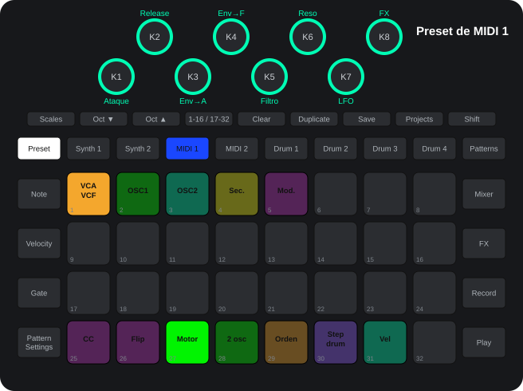

*Vista Preset de MIDI 1 con el oscilador (pad 27 verde): fila de páginas y pads del motor; el pad 28 solo se ve con oscilador o VA-drum.*


*[Paso a paso: Elegir un motor en la fila de motores (desde RC4)](https://github.com/Ghillermo/CIRCUIT-HACKS-RC/wiki/Step-by-step-ES#elegir-un-motor-en-la-fila-de-motores-desde-rc4)*


*[Paso a paso: Elegir el modo de voz del sinte propio (desde RC4)](https://github.com/Ghillermo/CIRCUIT-HACKS-RC/wiki/Step-by-step-ES#elegir-el-modo-de-voz-del-sinte-propio-desde-rc4)*

## [Step-drummer](https://ghillermo.github.io/CIRCUIT-HACKS-RC/beta/guia.html#f-step-drummer)

Secuenciación por **pares de pasos** sobre el patrón: pads 1-16 pasos, 17-24 destino / macro, los 8 knobs = los 8 pares (pitch u velocity). MIDI: vista Preset, pad 30. Sintes: vista de la fuente, pad 30. Grabando, los pasos tocados se graban en tiempo real.

**Para qué sirve:** Una segunda capa de secuenciación sobre el patrón de una pista: los ocho knobs son los ocho pares de pasos de la pantalla, y cada par mueve un destino (un desplazamiento de tono, la onda, el FM, el filtro… en MIDI 1 / 2; un macro en Synth 1 / 2) solo en esos dos pasos. Melodías rápidas, acentos y cambios de timbre sobre las notas, sin dibujar automatización.

**Cómo:**

1. MIDI 1 / 2: la vista Preset con el motor encendido, **pad 30** (*(desde RC4)* con el step-drummer encendido, **Note** pasa por Note → Note ampliada → step-drummer). Synth 1 / 2: la vista de la fuente (el botón del sinte dos veces), **pad 30**.
2. **Pads 1-16** = los 16 pasos de la mitad mostrada (brillante = con nota, blanco = el que suena): un toque lo escucha, **Shift + toque** pone o quita una nota; **1-16 / 17-32** enseña la otra mitad.
3. **Pads 17-24** = el destino: en MIDI el tono de los dos osciladores, el tono del OSC 2, WAVE, FM, MIX, env → filtro, SHAPE o decay; en los sintes, el macro 1-8.
4. **K1-K8** = los 8 pares de pasos (el que suena, blanco). En MIDI el valor desplaza el destino desde el centro (64 = sin cambio); en los sintes es la posición del macro, desde 0. *(desde RC2)* El LED se ve tenue sin modulación y más brillante cuanto más se aleja.
5. **Octave ▲ / ▼** = página pitch / velocity. *(desde RC2)* En la página velocity, los pads 17-24 eligen el destino propio de la página 2 (el mismo pad otra vez = ninguno); el **pad 32** = toggle pitch-vel (verde): la página pitch transpone cada nota un grado de la escala cada 8 pasos del knob y la página velocity marca la velocity.
6. Con **Record**, tocar un paso lo graba en el paso que suena, con su micropaso.

**A tener en cuenta:**

- Los valores de los pares se guardan en el patrón como automatización: en MIDI en el carril de tono y, para la página 2, en el de Release (con el step-drummer activado, esos dos carriles ya no reproducen ni graban sus knobs); en los sintes, en el carril del macro.
- En MIDI, **Shift + pad 30** desactiva el step-drummer (pad 30 tenue = desactivado, brillante = activado). Su estado y su destino se guardan en los ajustes del aparato y en el patch del sinte propio, *(desde RC4)* también en el proyecto; el toggle pitch-vel y el destino de la página 2, con el proyecto.
- *(desde RC2)* En Synth 1 / 2, Play y Record ya no lo cierran, y pulsar Synth 1 / 2 lo vuelve a abrir hasta que lo cierras con el pad 30. Cada paso conserva la altura de su primera nota.
- Con el motor secuenciador de efectos, la misma vista elige huecos de Master FX. Detalle: [Vista del step-drummer](https://ghillermo.github.io/CIRCUIT-HACKS-RC/beta/guia.html#step-drummer).

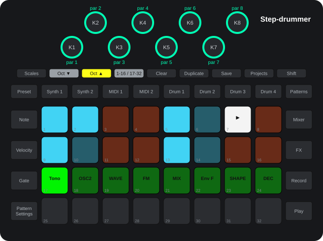

*Vista del step-drummer (MIDI 1).*


*[Paso a paso: Secuenciar un destino con el step-drummer](https://github.com/Ghillermo/CIRCUIT-HACKS-RC/wiki/Step-by-step-ES#secuenciar-un-destino-con-el-step-drummer)*

## [Secuenciador de efectos](https://ghillermo.github.io/CIRCUIT-HACKS-RC/beta/guia.html#f-fx-seq)

Estado **azul** del pad 27: el step-drummer de la pista elige, en cada par de pasos, **un hueco de la fila inferior de Master FX** (0 = nada); suena en los pasos con nota. El knob avanza despacio (**un hueco cada ~48 pasos de giro**) y se ilumina con el **color del efecto** elegido. **Un hueco sin efecto asignado** toca, **desde RC4**, el efecto de arriba de su columna (pad 26 = pad 1 de Master FX … pad 30 = pad 5), con sus knobs; antes no hacía nada: asigna los efectos a la fila inferior de Master FX (ver «Fila inferior asignable»). **Desde RC2:** al final del recorrido está el valor **random** (LED blanco): en cada paso con nota suena uno de la lista al azar (los huecos con efecto asignado y el gesto mecánico del pad 31).

**Para qué sirve:** Un motor de MIDI 1 / 2 que no suena: el step-drummer de la pista elige, en cada par de pasos, uno de los huecos de la fila inferior de Master FX, y cada paso con nota enciende el efecto de ese hueco. Secuencia efectos de directo (stutters, barridos de filtro, el gesto de parada de cinta…) a tiempo con el patrón.

**Cómo:**

1. Primero llena la fila inferior de Master FX: en Master FX, mantén un efecto de la fila de arriba y toca un hueco (pads 26-30).
2. En la vista Preset de MIDI 1 / 2 elige el secuenciador de efectos: un toque al **pad 27** y el motor azul de la fila. *(solo Beta 5.56)* Elige «sin voz» en la fila y toca el **pad 31** (azul tenue → brillante). Se activa el step-drummer de la pista.
3. Abre el step-drummer con el **pad 30** y pon notas en los pasos con **Shift + pad**.
4. Gira cada knob (un par de pasos) para elegir su hueco: 0 nada, 1-5 = pads 26-30, 6 = pad 31 (el gesto mecánico) y, al final, **random** *(desde RC2)* (LED blanco: uno de los huecos con efecto, al azar en cada nota). El knob avanza despacio (un hueco cada unos 48 pasos de giro) y se ilumina con el color del efecto elegido.
5. Pulsa **Play**: en cada paso con nota se enciende el hueco del par, con su copia de parámetros.

**A tener en cuenta:**

- *(desde RC4)* Un hueco sin efecto asignado toca el efecto de arriba de su columna (pad 26 = pad 1 de Master FX … pad 30 = pad 5), con sus knobs, y el LED del knob se ve en ese color.
- La pista no suena por sí misma; sus notas siguen saliendo por MIDI.
- Al salir del secuenciador de efectos se apaga el step-drummer de la pista. Los valores de los knobs van en el patrón; la asignación de los huecos, con el proyecto.
- Detalle: [Vista del step-drummer](https://ghillermo.github.io/CIRCUIT-HACKS-RC/beta/guia.html#step-drummer) y [Master FX](https://ghillermo.github.io/CIRCUIT-HACKS-RC/beta/guia.html#master-fx).

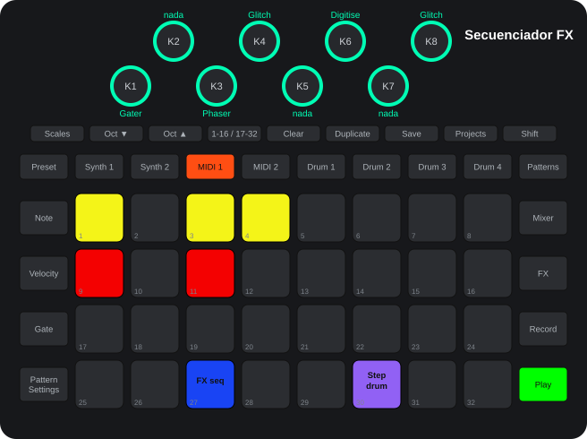

*Secuenciador de efectos: cada knob = el hueco de la fila inferior de Master FX para su par de pasos.*

## [Song pointer (Master FX)](https://ghillermo.github.io/CIRCUIT-HACKS-RC/beta/guia.html#f-song-pointer)

Pads 9-24 = pasos 1-16: un paso mantenido = retrigger; dos pasos = frase momentánea. **Modo frase** (una frase fijada): Shift + paso = inicio (fin 16); un toque = el fin; Shift + otro paso = nuevo inicio; Shift + el inicio o el pad 9 blanco = salir.

**Para qué sirve:** Los pads 9-24 de Master FX son los 16 pasos del patrón, así que puedes agarrar el cabezal en directo: repetir un paso, hacer bucle entre dos pasos mientras los mantienes o fijar un bucle. Stutters, redobles y breaks sin tocar los patrones.

**Cómo:**

1. Abre Master FX (**Mixer** dos veces): los pads 9-24 = pasos 1-16, el cabezal en blanco mientras el secuenciador corre.
2. **Mantén un paso:** se repite mientras lo mantienes (retrigger).
3. **Mantén dos pasos:** el patrón hace bucle entre ellos mientras los mantienes (frase momentánea).
4. **Modo frase (una frase fijada):** **Shift + un paso** entra en él con ese paso como inicio y el 16 como fin, y el pad 9 se ve blanco; luego tocar otro paso (sin Shift) fija el fin, así que la frase hace bucle entre los dos (un paso anterior al inicio los intercambia; sin retrigger); **Shift + otro paso** cambia el inicio (un fin anterior a él vuelve al 16).
5. **Shift + el inicio** o el **pad 9** blanco sale del modo frase.

**A tener en cuenta:**

- El **pad 8** de Master FX apaga todo lo fijado, también el song pointer.
- No se guarda nada: al cargar un proyecto y al encender, el song pointer empieza apagado.
- Detalle: [Master FX](https://ghillermo.github.io/CIRCUIT-HACKS-RC/beta/guia.html#master-fx).

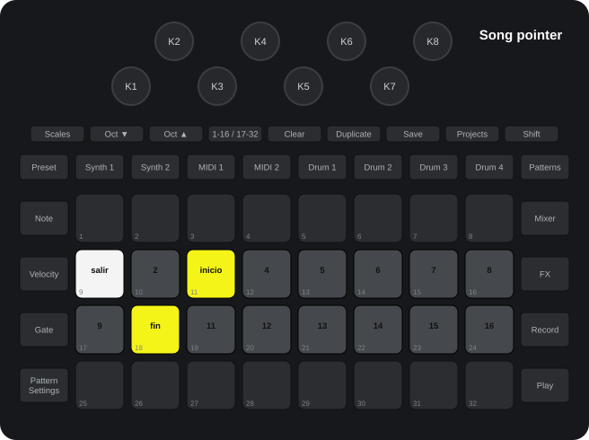

*Song pointer: frase entre los pasos 3 y 10.*


*[Paso a paso: Repetir pasos en directo con el song pointer](https://github.com/Ghillermo/CIRCUIT-HACKS-RC/wiki/Step-by-step-ES#repetir-pasos-en-directo-con-el-song-pointer)*


*[Paso a paso: Repetir una frase con el modo frase](https://github.com/Ghillermo/CIRCUIT-HACKS-RC/wiki/Step-by-step-ES#repetir-una-frase-con-el-modo-frase)*

## [Sample capturado](https://ghillermo.github.io/CIRCUIT-HACKS-RC/beta/guia.html#f-sample)

**Pad 32** (rojo) graba la salida; **pad 7** (amarillo) la toca: K1 pitch, K2 modo (one-shot / gate / loop por color), K3 start, K4 end. El sample se asigna a la fila inferior (pad 7 + pad de abajo) y puede sustituir a un drum.

**Para qué sirve:** El pad 32 de Master FX graba hasta 3,46 s de lo que suena en el aparato y el pad 7 lo toca, con su propio pitch, modo (one-shot, gate o loop), inicio y final. Un sampler de directo: vuelve a tocar o haz bucle de una frase, ponla en un hueco, conviértela en un drum o úsala como fuente del granular.

**Cómo:**

1. Abre Master FX (la fila inferior de la vista FX también graba) y pulsa el **pad 32** (rojo): mantenlo para grabar mientras lo mantienes, o un toque corto para grabar hasta el siguiente toque.
2. **Shift + pad 32** = armado: en marcha, graba el compás siguiente; parado, empieza al pulsar **Play**, desde el primer pulso, y graba ese compás.
3. Pulsa el **pad 7** (amarillo) para tocarlo; K1-K4 pasan a ser **K1** pitch (±24 semitonos), **K2** modo (amarillo one-shot, verde gate, azul loop), **K3** start, **K4** end (end antes que start = al revés).
4. **Shift + pad 7** = bucle enganchado, en cualquier modo, hasta que vuelvas a pulsar el pad 7 (o el pad 8). El modo loop (K2 azul) solo suena mientras mantienes el pad.
5. Mantén el **pad 7** y toca un hueco de la fila inferior: ese hueco toca el sample con una copia de sus knobs. Para usarlo como drum: vista Preset de drums, **Clear + pad** y luego **Clear + el mismo pad**.

**A tener en cuenta:**

- El sample que suena pasa por los efectos de Master FX; la captura graba la salida sin ellos. *(desde RC2.01)* Los dos van antes del filtro master: el filtro actúa sobre el sample al sonar y la captura no lo lleva.
- Vive en la memoria: se pierde al apagar, salvo que haya sustituido a un drum y hayas guardado el proyecto; entonces se escribe en el pack si cabe (escribe en la tarjeta: no en las versiones «S» ni en el pack interno).
- *(solo Beta 5.56)* Con el bucle enganchado sonando, cargar otro proyecto u otro pack (parado) no lo para: **Play** parpadea en verde y el proyecto nuevo empieza cuando el bucle da la vuelta; Play otra vez = empezar ya.
- También puede ser la fuente del granular y del modo muestra de las pistas MIDI (Shift + K8 en la página del granular). Detalle: [Master FX](https://ghillermo.github.io/CIRCUIT-HACKS-RC/beta/guia.html#master-fx).

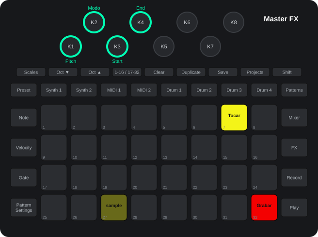

*Sample capturado.*


*[Paso a paso: Capturar un sample y sustituir un drum por él](https://github.com/Ghillermo/CIRCUIT-HACKS-RC/wiki/Step-by-step-ES#capturar-un-sample-y-sustituir-un-drum-por-él)*

## [Glitch (pad 6) y su asignación](https://ghillermo.github.io/CIRCUIT-HACKS-RC/beta/guia.html#f-glitch-pad)

**Mantén el pad 6** de Master FX: la salida se rompe y se retrasa como una cinta. K1 velocidad, K2 repetición, K3 retraso, K4 caos (mitad de abajo) o sobrecarga (mitad de arriba). **Pad 6 mantenido + un pad de la fila inferior** = ese hueco también es un Glitch, con su copia de K1-K4.

**Para qué sirve:** Mantener el pad 6 en Master FX pasa toda la salida a una cabeza de cinta que lee los últimos segundos de audio: puede frenar, parar, ir hacia atrás, repetir y romper la mezcla. Un efecto de directo para paradas de cinta, stutters y redobles glitch, que también se guarda en los huecos de la fila inferior con sus ajustes.

**Cómo:**

1. Abre Master FX y **mantén el pad 6** *(desde RC2)*: el Glitch suena mientras lo mantienes y el pad 6 se ilumina; **Shift + pad 6** lo fija (tócalo otra vez para soltarlo).
2. Sus knobs al pulsarlo: **K1** velocidad (arriba del todo = normal, al bajar frena como una cinta, en el centro parada, por debajo hacia atrás), **K2** tamaño de la repetición (al máximo, sin repetición: un retraso continuo), **K3** retraso (hasta unos 2,6 s).
3. **K4**: mitad de abajo = **caos** (saltos atrás, cortes y cambios de sentido al azar); mitad de arriba = **sobrecarga** (bloques que llegan tarde, con chasquidos al tono normal; desde unos ¾ del recorrido además todo frena y baja de tono).
4. **Asignar:** mantén el pad 6 y toca un pad de la fila inferior (26-30, sin Shift): ese hueco guarda un Glitch con los K1-K4 actuales, y tocarlo hace sonar el Glitch con esos valores.
5. Dos huecos con Glitch a la vez: suena el último que pulsas; al soltarlo vuelve el otro con sus valores.

**A tener en cuenta:**

- El gesto mecánico (pad 31) usa el mismo motor: mientras suena, el Glitch espera.
- El secuenciador de efectos puede disparar un hueco con Glitch. *(desde RC2)* Los knobs del Glitch se guardan con el proyecto, junto a los demás de Master FX.
- Detalle: [Master FX](https://ghillermo.github.io/CIRCUIT-HACKS-RC/beta/guia.html#master-fx).

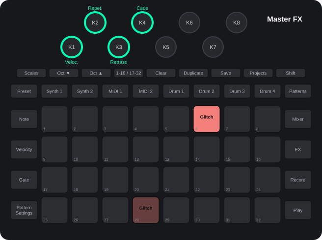

*Glitch: pad 6; asignado también al pad 28.*


*[Paso a paso: Poner un efecto en un hueco de Master FX](https://github.com/Ghillermo/CIRCUIT-HACKS-RC/wiki/Step-by-step-ES#poner-un-efecto-en-un-hueco-de-master-fx)*

## [Fila inferior asignable (Master FX / FX)](https://ghillermo.github.io/CIRCUIT-HACKS-RC/beta/guia.html#f-fila-inferior)

Mantén un efecto de arriba (o el pad 7, o el pad 31) y toca un pad de abajo: ese hueco guarda el efecto con una copia de sus parámetros. Se guarda con el proyecto.

**Para qué sirve:** Los pads 26-30 de Master FX (y de la vista FX) son cinco huecos que llenas tú: cada uno guarda un efecto con una copia de sus knobs, así que un efecto ya ajustado queda a un toque. El secuenciador de efectos de las pistas MIDI puede dispararlos a tiempo.

**Cómo:**

1. Abre Master FX (**Mixer** dos veces).
2. Mantén un efecto de la fila de arriba (pads 1-6), el **pad 7** (el sample capturado) o el **pad 31** (el gesto mecánico) y toca un hueco (pads 26-30): guarda ese efecto con una copia de sus parámetros.
3. Toca el hueco: carga sus parámetros y el efecto suena mientras lo mantienes; **Shift + hueco** lo fija (el pad 8 apaga todo lo fijado).
4. En la vista FX la fila inferior es la misma: huecos 26-30, el gesto mecánico en el 31 y grabar la captura en el 32.

**A tener en cuenta:**

- Un hueco sin nada asignado sigue siendo el efecto de actuación de la vista FX del original.
- *(desde RC2)* Las asignaciones se guardan con cada proyecto, junto a los 20 knobs de los efectos, y vuelven al cargarlo; un proyecto guardado sin ellas deja el aparato como esté. Los efectos fijados no se guardan.
- *(desde RC4)* En el secuenciador de efectos, un hueco vacío toca el efecto de arriba de su columna.
- Detalle: [Master FX](https://ghillermo.github.io/CIRCUIT-HACKS-RC/beta/guia.html#master-fx).

→ [Paso a paso: Poner un efecto en un hueco de Master FX](https://github.com/Ghillermo/CIRCUIT-HACKS-RC/wiki/Step-by-step-ES#poner-un-efecto-en-un-hueco-de-master-fx) — más arriba, en [Glitch (pad 6) y su asignación](https://github.com/Ghillermo/CIRCUIT-HACKS-RC/wiki/Features-Modes-ES#glitch-pad-6-y-su-asignación)

## [Random-mutate por paso](https://ghillermo.github.io/CIRCUIT-HACKS-RC/beta/guia.html#f-random-mutate)

**Desde RC2.** En la vista de probabilidad, en modo 2 (**pad 25** de Pattern Settings), la fila 4 da a cada paso una probabilidad de que sus notas salten de octava o cambien a otra nota de la escala al sonar.

**Para qué sirve:** Cada paso de una pista de notas puede llevar una probabilidad de que sus notas cambien al sonar: un salto de octava u otra nota de la escala (en la beta también notas fantasma, acentos, longitud y desplazamiento). Mantiene vivo un patrón con pequeñas sorpresas; con Record los cambios se escriben y la secuencia va derivando.

**Cómo:**

1. En Synth 1 / 2 o MIDI 1 / 2 abre **Pattern Settings** y toca el **pad 25**: la vista de probabilidad en modo 2.
2. Mantén un paso con notas (pads 1-16) y toca un pad de la **fila 4** (melocotón): 25 apagado; 26 octava 6 %; 27 escala 6 %; 28 las dos 6 %; 29 escala 12 %; 30 octava 12 %; 31 escala 25 %; 32 octava 25 % y escala 50 %.
3. *(solo Beta 5.56)* Las filas 3-4 son una sola botonera por paso: 17 sin cambios; 18-20 otra nota de la escala (×1, ×2, ×4); 21 / 22 una octava arriba (baja / alta); 23 / 24 una octava arriba o abajo (baja / alta); 25 sin dinámicas; 26 ghost (velocity de −32 a 0); 27 accent staccato (velocity hasta +64, la nota más corta); 28 longitud (de la mitad al doble); 32 micropasos sí / no.
4. *(solo Beta 5.56)* **Octave ▼ / ▲** con esta vista abierta = el factor de la pista (×0, ×1, ×2, ×4, ×8; de fábrica ×1), que multiplica todas las probabilidades: con ×1, nota y octava 6 % por cada ×1 del pad, dinámicas y micropasos 25 %.
5. Al sonar, cada nota de un acorde se sortea aparte, cada vez que suena el paso. Sin **Record** el cambio suena esa vez; con Record (y esta vista en pantalla) se escribe en el paso.

**A tener en cuenta:**

- *(desde RC2)* Se guarda en el paso, con el patrón y el proyecto; las notas ligadas no cambian. «Otra nota de la escala» sigue la escala del proyecto, también la propia y Jankó.
- **Clear + pad 25** en Pattern Settings borra las dinámicas y el random-mutate de todos los pasos del patrón (la frecuencia se queda).
- En los drums la misma vista cambia el sample en lugar de la nota (ver «Frecuencia y dinámicas por paso»). *(solo Beta 5.56)* El factor se guarda con el proyecto; con ×8, el pad 24 cambia todas las notas.
- Detalle: [Vista de probabilidad](https://ghillermo.github.io/CIRCUIT-HACKS-RC/beta/guia.html#probabilidad).

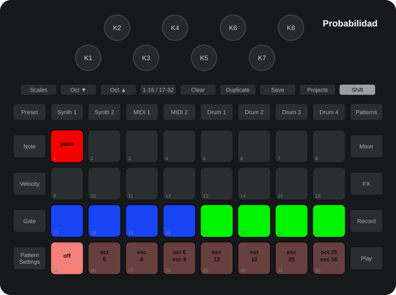

*Vista de probabilidad: fila 3 = probabilidad del paso (original), fila 4 = random-mutate.*


*[Paso a paso: Hacer que las notas de un paso muten (desde RC2)](https://github.com/Ghillermo/CIRCUIT-HACKS-RC/wiki/Step-by-step-ES#hacer-que-las-notas-de-un-paso-muten-desde-rc2)*

## [Frecuencia y dinámicas por paso](https://ghillermo.github.io/CIRCUIT-HACKS-RC/beta/guia.html#f-frecuencia-dinamicas)

**Desde RC2.** En la vista de probabilidad de las pistas de notas: **fila 4 = cada cuántas vueltas del patrón suena el paso** (1-8). Con el **pad 25 de Pattern Settings**: fila 3 = **dinámicas** aleatorias (velocity, posición y duración), fila 4 = random-mutate.

**Para qué sirve:** Dos variaciones más por paso para todas las pistas: la **frecuencia** hace que un paso suene solo en la última de cada n vueltas de su patrón (1-8), y las **dinámicas** añaden cambios al azar de velocity, posición y duración. Variaciones que vuelven cada 2, 4 u 8 vueltas, y un toque más humano.

**Cómo:**

1. **Frecuencia:** pulsa **Pattern Settings** dos veces (modo 1); mantén un paso con notas y toca un pad de la **fila 4** (amarillo): n de 1 a 8, el paso suena en la última de cada n vueltas.
2. **Dinámicas:** en Pattern Settings toca el **pad 25** (modo 2); mantén un paso y toca un pad de la **fila 3**, de izquierda a derecha: sin cambios; drunk (±2 micropasos); drunk y acentos; acentos (velocity de 0 a +32); arrastre y acentos (de −1 a +3 micropasos); arrastre; dinámica equilibrada (±32); dinámica de acentos (de −32 a +64).
3. *(solo Beta 5.56)* En el modo 2 las dinámicas son los pads 25-28 de la botonera común (sin dinámicas, ghost, accent staccato, longitud) y el pad 32 los micropasos (ver «Random-mutate por paso»).
4. **Drums** *(desde RC2)*: la misma vista para un drum (Pattern Settings dos veces = modo 1, la frecuencia en la fila 4; **pad 25** de su Pattern Settings = modo 2); elige un paso con golpe. En las RC, la fila 3 del modo 2 = dinámicas (solo retrasan el golpe dentro de su paso) y los pads 25-28 = random-mutate del sample (nada, 25 % ±1 en su fila de 8, 25 % ±8 a otra fila, 12 % de cada uno).
5. **Clear + pad 25** en el Pattern Settings de una pista de notas borra las dinámicas y el random-mutate de todos los pasos del patrón; la frecuencia se queda.

**A tener en cuenta:**

- *(desde RC2)* Todo se guarda con el paso (patrón y proyecto) y viaja al duplicar el patrón y con Nudge.
- Cada patrón cuenta sus vueltas desde Play; los contadores vuelven a empezar al parar.
- Con **Record** y el modo 2 en pantalla, lo que suena (la nota mutada, la dinámica) se escribe en el patrón de esa pista *(desde RC4.05)*.
- *(solo Beta 5.56)* El modo 2 de un drum usa la botonera común: los pads 18-20 otro sample de su fila (±1), los 21-24 otra fila (+8 o ±8), el pad 26 baja la velocity y añade un roller al azar, el 27 la sube y el pad 32 mueve el paso entero hasta 2 micropasos. Detalle: [Vista de probabilidad](https://ghillermo.github.io/CIRCUIT-HACKS-RC/beta/guia.html#probabilidad).

→ [Paso a paso: Hacer que las notas de un paso muten (desde RC2)](https://github.com/Ghillermo/CIRCUIT-HACKS-RC/wiki/Step-by-step-ES#hacer-que-las-notas-de-un-paso-muten-desde-rc2) — más arriba, en [Random-mutate por paso](https://github.com/Ghillermo/CIRCUIT-HACKS-RC/wiki/Features-Modes-ES#random-mutate-por-paso)


*[Paso a paso: Hacer que un paso suene cada n vueltas (desde RC2)](https://github.com/Ghillermo/CIRCUIT-HACKS-RC/wiki/Step-by-step-ES#hacer-que-un-paso-suene-cada-n-vueltas-desde-rc2)*

## [Cadenas de patrones y escenas](https://ghillermo.github.io/CIRCUIT-HACKS-RC/beta/guia.html#f-cadenas)

**Desde RC2.** Cada patrón puede llevar una regla «suena n veces, luego salta a B; la vez siguiente, a C». **Shift + Octave ▲ / ▼** en la vista Patterns activa / desactiva el **modo cadena** de todo el proyecto; cada escena recuerda el modo con que se guardó.

**Para qué sirve:** Cada patrón puede llevar una regla «suena n veces, luego salta a B; la vez siguiente, a C», y cada escena puede repetirse de 1 a 8 veces, así que las pistas tocan solas estructuras A A A B A A A C. Estructura de canción sin encadenar patrones a mano, activada o desactivada para todo el proyecto.

**Cómo:**

1. En la vista **Patterns**, **Shift + Octave ▲** activa el modo cadena de todo el proyecto (Octave ▲ en verde) y **Shift + Octave ▼** lo desactiva; con Shift, el Octave que hace algo se ve en amarillo.
2. En el modo, pulsa un patrón = **A** (amarillo; se selecciona como siempre); **A otra vez** = una repetición más (hasta 8; los LEDs de los knobs las cuentan).
3. Pulsa **otro patrón de la pista** = **B** (verde), y el siguiente = **C** (rojo). Ejemplos: n = 3 → A A A B A A A C; sin C → A A A B; n = 1 → A B A C.
4. **Clear + patrón** en el modo quita su regla (si no tiene regla, borra el patrón como siempre).
5. En el **Mixer**, **Shift + pads 9-16** = de 1 a 8 repeticiones de la escena actual (la fila en amarillo con Shift, la elegida en verde); *(desde RC4)* sonando, con Shift, la repetición que suena se ve en blanco.
6. Guarda una escena (como siempre) con el modo activo: lo recuerda y se ve en **melocotón**; al cargarla vuelve el modo, y al cargar una escena normal se desactiva.

**A tener en cuenta:**

- *(desde RC2)* B y C suenan una vez y la pista vuelve a A, salvo que tengan su propia regla; las pistas que siguen una regla parpadean en el Mixer. Una escena termina cuando termina su cadena más larga.
- Las reglas se guardan con el patrón (viajan al duplicarlo); el modo y lo de las escenas, con el proyecto. Con el modo desactivado las reglas siguen guardadas pero no se aplican.
- Fuera del modo, **Clear + patrón** borra el patrón, su regla y su orden de reproducción. El modo sigue activo al salir de la vista Patterns.
- Detalle: [Vista Patterns y cadenas de patrones](https://ghillermo.github.io/CIRCUIT-HACKS-RC/beta/guia.html#patterns), [Vista Mixer y escenas](https://ghillermo.github.io/CIRCUIT-HACKS-RC/beta/guia.html#mixer).


*[Paso a paso: Encadenar patrones: A A A B A A A C (desde RC2)](https://github.com/Ghillermo/CIRCUIT-HACKS-RC/wiki/Step-by-step-ES#encadenar-patrones-a-a-a-b-a-a-a-c-desde-rc2)*


*[Paso a paso: Repetir una escena (desde RC2)](https://github.com/Ghillermo/CIRCUIT-HACKS-RC/wiki/Step-by-step-ES#repetir-una-escena-desde-rc2)*

## [Mutate de patrones (solo Beta 5.64)](https://ghillermo.github.io/CIRCUIT-HACKS-RC/beta/guia.html#f-mutate-patrones)

**Solo Beta 5.64.** Portado del Pattern Mutate de [Rhythm Plus de mefisme](https://github.com/mefisme/rhythm-plus) (licencia MIT). En la vista Patterns o en el Mixer, **Shift + un toque a Duplicate** da a cada pista elegida una lista corta de patrones de su cadena, en otro orden, que suena en bucle en lugar de la cadena. Los patrones no cambian.

**Para qué sirve:** Cada pista elegida recibe una lista corta de patrones sacados de su cadena, en otro orden, que suena en bucle en lugar de la cadena; los patrones no cambian. Variaciones del arreglo al momento que vuelven con las escenas; está portado del Pattern Mutate de Rhythm Plus de mefisme (licencia MIT).

**Cómo:**

1. En la vista **Patterns** o en el **Mixer**, **Shift + un toque a Duplicate** (amarillo con Shift): cada pista elegida toca su lista en bucle. Otro toque = otra semilla, otra lista.
2. **Shift + Duplicate mantenido** en la vista Patterns abre los ajustes (melocotón, el valor elegido brillante): columna 1 **Length** 1-4, columna 2 Length 5-8, columna 3 el tipo de longitud (como la cadena / exacta / al azar hasta Length).
3. Columnas 4-5 = **Amount** en ocho pasos, cuántos huecos de la cadena cambian (columna 4 de arriba abajo: todo, 7/8, 6/8, 5/8; columna 5: la mitad, 3/8, 2/8, 1/8); columna 6 **Repeats** (sí / no: dos vecinos nunca iguales); columna 7 **Keep slot 1** (no / sí).
4. En esa página los **botones de pista** eligen las pistas (brillante = elegida); con listas sonando, encender una le da su lista y apagarla la devuelve a su cadena. **Duplicate** (u otro botón de vista) cierra la página.
5. **Clear + Duplicate**, en cualquier vista, termina todas las listas; un pad de patrón termina la lista de su pista (y hace lo de siempre).

**A tener en cuenta:**

- *(solo Beta 5.56)* En la vista Patterns se apagan los patrones que no están en la lista de una pista que muta (el que suena conserva su color). Un ajuste nuevo se oye al momento, y volver a un valor devuelve la misma lista.
- Con las cadenas de patrones, una pista que muta toca su lista y las demás siguen sus reglas; para una pista que muta la cadena termina con el último patrón de su lista, así que las escenas encadenadas cambian cuando las listas terminan.
- Se guarda con el proyecto y en cada escena (qué pistas mutan, la semilla, los ajustes): al volver a una escena vuelve la misma lista; una escena guardada sin listas las termina.
- En las vistas de pista, Shift + Duplicate sigue siendo lo del original. Detalle: [Vista Patterns y cadenas de patrones](https://ghillermo.github.io/CIRCUIT-HACKS-RC/beta/guia.html#patterns).

## [Nudge y órdenes de reproducción](https://ghillermo.github.io/CIRCUIT-HACKS-RC/beta/guia.html#f-nudge-ordenes)

**Desde RC2.** En la vista Pattern Settings: **pad 26 = Nudge** (mueve el contenido de los pasos elegidos), **pad 27 = orden fractal**, **pad 28 = orden deconstruido**. En todas las pistas, drums incluidos.

**Para qué sirve:** Tres herramientas más de la vista Pattern Settings, en todas las pistas y en los drums: **Nudge** mueve el contenido de los pasos elegidos un paso atrás o adelante, y los órdenes **fractal** y **deconstruido** recorren el patrón en otro orden sin cambiar sus pasos. Variaciones rítmicas rápidas de un patrón que ya tienes.

**Cómo:**

1. Abre **Pattern Settings** y fija el tramo con los pads de primer / último paso (1-16), como siempre.
2. **Pad 26** (azul) = **Nudge**: un toque mueve el contenido del tramo un paso atrás, **Shift + pad 26** un paso adelante; lo que sale por un extremo entra por el otro, y el primer y el último paso no se mueven *(desde RC4.05)*.
3. **Pad 27** = orden **fractal**: 1 · 1 2 · 1 2 3 · 1 2 3 4 … hasta el último paso, y vuelve a empezar.
4. **Pad 28** = orden **deconstruido**: las diagonales de la rejilla, 1 6 11 16 · 2 7 12 13 · 3 8 9 14 · 4 5 10 15 (y lo mismo con 17-32); los pasos de fuera del patrón se saltan (con 8 pasos: 1 6 2 7 3 8 4 5).
5. Los pads 27 / 28 y los cuatro de dirección (29-32) se excluyen entre sí: un pad de dirección vuelve a una dirección normal.

**A tener en cuenta:**

- *(desde RC2)* Nudge mueve los pasos completos con su automatización (en los drums también sus valores propios), y la vista lo enseña al momento.
- El orden se guarda con el patrón; borrar el patrón lo quita.
- Para las cadenas, las escenas y la frecuencia, el patrón termina al acabar el recorrido entero de su orden.
- Detalle: [Vista Pattern Settings](https://ghillermo.github.io/CIRCUIT-HACKS-RC/beta/guia.html#pattern-settings).


*[Paso a paso: Mover los pasos de un patrón (Nudge) (desde RC4.05)](https://github.com/Ghillermo/CIRCUIT-HACKS-RC/wiki/Step-by-step-ES#mover-los-pasos-de-un-patrón-nudge-desde-rc405)*

## [Arpegiador (desde RC2)](https://ghillermo.github.io/CIRCUIT-HACKS-RC/beta/guia.html#f-arpegiador)

**Desde RC2.** En la vista Pattern Settings de una pista de notas: **Shift + pad 25** = arpegiador del patrón encendido / apagado, **Shift + pads 27-32** = su orden (fractal, deconstruido, arriba, abajo, ping-pong, aleatorio), independiente de la dirección del patrón.

**Para qué sirve:** Cada patrón de una pista de notas puede tener su propio arpegiador: los acordes del patrón y las notas que mantienes (*(desde RC4)* también un paso mantenido o un teclado externo) suenan de una en una, con el orden y la resolución que elijas. En los drums salta entre los samples que mantienes.

**Cómo:**

1. En el **Pattern Settings** de una pista de notas, **Shift + pad 25** = el arpegiador del patrón que suena, encendido / apagado (sin Shift, el pad 25 se ve verde mientras está encendido).
2. **Shift + pads 27-32** = su orden: fractal, deconstruido, arriba, abajo, ping-pong, aleatorio (aparte de la dirección del patrón); **Shift + pads 17-24** = su resolución, 1/4, 1/4T, 1/8, 1/8T, 1/16, 1/16T, 1/32, 1/32T (el mismo pad otra vez = el sync rate de la pista).
3. *(desde RC4)* Encendido, **Shift + pads 1-16** = modificadores: 1-4 octavas (arena), 5-8 cuándo cambia la octava (azul cielo), 9-12 groove (ámbar), 13-16 reinicio (rosa).
4. Al tocar: la primera nota suena como siempre; mantén otra a la vez y las notas mantenidas se arpegian hasta que las sueltas. Con **Record** se graba el acorde y la secuencia lo arpegia después.
5. *(desde RC4)* Parado, mantener un paso con varias notas las arpegia; **Shift + tecla** (vista Note) fija una nota en el arpegio; pulsar esa tecla otra vez la suelta, y **Clear + el botón de la pista** las suelta todas (además reinicia la pista: los macros de Synth 1 / 2 a los del patch cargado, el sinte propio de MIDI 1 / 2 a sus valores iniciales).
6. **Drums:** los mismos gestos en el Pattern Settings de un drum; en su vista **Preset** mantén varios samples y el drum salta de uno a otro (con Record, cada golpe se graba con su sample como sample flip del paso).

**A tener en cuenta:**

- *(desde RC2)* Se guarda con el proyecto, por pista y número de patrón: duplicar un patrón no lo copia.
- *(desde RC4)* Con el botón **Note** de la vista Setup encendido (apagado de fábrica), también se arpegian las notas que llegan por MIDI al canal de la pista. Las notas van en el orden en que se pulsaron, y el random-mutate del paso se les aplica.
- Cada nota dura su propio gate, como mucho un paso de arpegio. La vista **Micro Step** (Gate dos veces) añade el gate por pulsación (pad 32) y la longitud fija (pad 31) para las notas introducidas a mano; el arpegio usa esos gates.
- *(desde RC2.04)* Una nota o un acorde mantenido más de 16 pasos al grabar sigue, ligado, 16 pasos después. Detalle: [Vista Pattern Settings](https://ghillermo.github.io/CIRCUIT-HACKS-RC/beta/guia.html#pattern-settings).


*[Paso a paso: Fijar notas (latch) y escribirlas en un paso (desde RC4)](https://github.com/Ghillermo/CIRCUIT-HACKS-RC/wiki/Step-by-step-ES#fijar-notas-latch-y-escribirlas-en-un-paso-desde-rc4)*


*[Paso a paso: Encender el arpegiador (desde RC2)](https://github.com/Ghillermo/CIRCUIT-HACKS-RC/wiki/Step-by-step-ES#encender-el-arpegiador-desde-rc2)*


*[Paso a paso: Dar forma al arpegio con sus modificadores (desde RC4)](https://github.com/Ghillermo/CIRCUIT-HACKS-RC/wiki/Step-by-step-ES#dar-forma-al-arpegio-con-sus-modificadores-desde-rc4)*


*[Paso a paso: Arpegiar los samples de un drum (desde RC2)](https://github.com/Ghillermo/CIRCUIT-HACKS-RC/wiki/Step-by-step-ES#arpegiar-los-samples-de-un-drum-desde-rc2)*


*[Paso a paso: Gate por pulsación o longitud fija (desde RC2)](https://github.com/Ghillermo/CIRCUIT-HACKS-RC/wiki/Step-by-step-ES#gate-por-pulsación-o-longitud-fija-desde-rc2)*

## [Rollers de micropasos de los drums (desde RC2)](https://ghillermo.github.io/CIRCUIT-HACKS-RC/beta/guia.html#f-rollers)

**Desde RC2.** Filas 1-3 de la vista Note de los drums: mantener un roller hace sonar su drum en cada paso en ese micropaso (dos columnas por drum, micropasos 1-3 y 4-6), en directo; con el transporte parado, al tempo del proyecto.

**Para qué sirve:** Las filas 1-3 de la vista Note de los drums pasan a ser rollers: mientras mantienes uno, su drum suena en cada paso en ese micropaso. Redobles y ratchets en directo (también parado) y grabados con Record.

**Cómo:**

1. Elige un drum y abre la vista **Note** de los drums (pulsa **Note** hasta que las filas 1-3 se vean tenues): las filas 1-3 son los rollers y la fila 4 los cuadros de los drums.
2. Cada columna es del drum del cuadro de debajo (columnas 1-4 = drums 4-1, columnas 5-8 = drums 1-4): la columna izquierda de un drum son sus micropasos 1-3 (filas 1-3) y la derecha los 4-6; el drum 1 = pads 4, 12, 20 y 5, 13, 21.
3. Mantén uno o varios rollers (de uno o varios drums): el drum suena en cada paso en esos micropasos, con la velocity del paso (100 en un paso vacío); se encienden mientras los mantienes.
4. Parado, suenan al tempo del proyecto, empezando al pulsar el primero.
5. Con **Record** (en marcha), sus golpes se graban en el patrón (el micropaso; velocity 100 en un paso vacío).

**A tener en cuenta:**

- *(desde RC2)* Varios rollers a la vez se combinan.
- Los pads 25-28 de la misma vista repiten los cuadros de los drums 4 … 1 (una copia en espejo).
- En una pareja estéreo, los rollers de Drum 1 / 3 mueven los dos drums. Detalle: [Vista cromática y de escala de los drums](https://ghillermo.github.io/CIRCUIT-HACKS-RC/beta/guia.html#drum-cromatica).

## [Escala propia (desde RC2)](https://ghillermo.github.io/CIRCUIT-HACKS-RC/beta/guia.html#f-escala-propia)

**Desde RC2.** **Shift + Scales** = editor de una escala propia para las pistas de notas: hasta 7 notas sobre la tónica y un **periodo** cualquiera (hasta 24 semitonos) que es la tónica de la siguiente iteración; cada fila de pads es una iteración (dos con 4 notas o menos). Se guarda con el proyecto.

**Para qué sirve:** Crea tu propia escala para las pistas de notas: hasta 7 notas sobre la tónica y un periodo libre, el intervalo tras el que la escala se repite (no tiene por qué ser la octava), dibujadas en un teclado de piano. *(desde RC4)* El mismo editor enciende la disposición isomórfica Jankó, en la que cada acorde tiene la misma forma en cualquier tono.

**Cómo:**

1. Pulsa **Shift + Scales** (amarillo con Shift; *(desde RC4)* también **Scales** dos veces): el editor se abre con dos octavas de piano desde la tónica (fila 4 las blancas de la primera octava, fila 3 sus negras, filas 2 / 1 la segunda octava).
2. Pulsa teclas para ponerlas o quitarlas (hasta 7): la más alta pulsada es el **periodo** (azul), las demás las notas (verdes), la tónica blanca.
3. Toca las pistas de notas (Synth 1 / 2, MIDI 1 / 2): cada fila de pads es una iteración, sus notas y el periodo al final (dos iteraciones por fila con 4 notas o menos); **Octave ▼ / ▲** mueven una fila.
4. Scales otra vez, Shift + Scales u otra vista cierran el editor; elegir una escala de stock apaga la propia (sus teclas se guardan) y el editor la vuelve a encender.
5. *(desde RC4)* **Jankó:** en el editor, **Shift + pad 8** (verde azulado mientras está encendida): cada columna sube un tono, las filas por parejas (la de encima medio tono más grave); Octave = medio tono por toque, una octava mantenido casi medio segundo. En las RC, **Shift + pad 24** = la disposición anterior (cada fila medio tono más aguda que la de abajo).

**A tener en cuenta:**

- *(desde RC2)* Se guarda con el proyecto; un proyecto nuevo empieza sin escala propia. La tónica es la de la vista Scales, que se elige como siempre.
- Vale para tocar, para las notas que se iluminan en la secuencia, el cuantizado y el random-mutate (otra nota de la misma iteración).
- *(solo Beta 5.56)* Una sola disposición Jankó: en la Note ampliada la pareja de arriba repite la de abajo, y con una tecla mantenida Octave mueve solo la otra pareja (no se guarda: al apagar vuelve a 0).
- Detalle: [Vista Scales y escala propia](https://ghillermo.github.io/CIRCUIT-HACKS-RC/beta/guia.html#escalas).


*[Paso a paso: Hacer una escala propia (desde RC2)](https://github.com/Ghillermo/CIRCUIT-HACKS-RC/wiki/Step-by-step-ES#hacer-una-escala-propia-desde-rc2)*


*[Paso a paso: Encender la disposición Jankó (desde RC4)](https://github.com/Ghillermo/CIRCUIT-HACKS-RC/wiki/Step-by-step-ES#encender-la-disposición-jankó-desde-rc4)*

## [Pantalla de acordes (desde RC4)](https://ghillermo.github.io/CIRCUIT-HACKS-RC/beta/guia.html#f-acordes)

**Desde RC4.** En la **Note ampliada** de Synth 1 / 2 y MIDI 1 / 2, **Shift + pad 8** abre la pantalla de acordes: fila 1 el tipo, fila 2 la inversión y los modificadores, filas 3-4 las fundamentales; cada fundamental toca su acorde mientras se mantiene.

**Para qué sirve:** En la Note ampliada de Synth 1 / 2 y MIDI 1 / 2, la pantalla de acordes convierte cada pad de las filas 3-4 en un acorde entero: elige su tipo, su inversión y su voicing en las filas 1-2 y toca acordes con un dedo. Lo que tocas se graba como notas normales, y el arpegiador puede arpegiarlo.

**Cómo:**

1. Abre la Note ampliada (**Note** dos veces) y pulsa **Shift + pad 8** (amarillo con Shift, verde mientras está encendida); el mismo gesto la apaga.
2. **Fila 1** = el tipo: mayor, menor, 7, m7, maj7, sus4, dim, aum; **Shift + pads 1-7**: sus2, 6, m6, add9, 9, 7sus4, quinta (amarillos con Shift, el elegido blanco).
3. **Fila 2:** pads 9-12 la inversión (fundamental, 1.ª, 2.ª, 3.ª; azul), pad 13 voicing abierto, pad 14 la fundamental una octava abajo, pad 15 diatónico (las terceras de la escala del proyecto), pad 16 el latch del acorde (*(solo Beta 5.56)* el acorde inverso, reflejado hacia abajo desde la fundamental); los pads 13-16 en verde encendidos.
4. **Filas 3-4** = las fundamentales, las mismas notas que el teclado de la vista Note: mantén una y suena su acorde (hasta 6 notas, con la velocity del pad).
5. **Shift + fundamental** = latch del acorde: sigue sonando hasta que vuelves a pulsar esa fundamental, **Clear + el botón de la pista** (que además reinicia la pista: los macros de Synth 1 / 2 a los del patch cargado, el sinte propio de MIDI 1 / 2 a sus valores iniciales) o se apaga la pantalla (con Shift, su fundamental en verde azulado brillante).

**A tener en cuenta:**

- *(desde RC4)* Cambiar el tipo, la inversión o un modificador con un acorde sonando lo cambia al momento; dos acordes a la vez comparten sus notas comunes.
- Se graba con Record como notas normales del patrón: se reproduce igual sin la pantalla. Con el arpegiador encendido, un dedo toca un acorde arpegiado.
- El tipo y los modificadores no se guardan (se pierden al apagar). En MIDI 1 / 2 con el modo muestra, la Note ampliada sigue siendo el selector de samples.
- Detalle: [Vista de pista de Synth 1 / 2](https://ghillermo.github.io/CIRCUIT-HACKS-RC/beta/guia.html#synth-nota).


*[Paso a paso: Tocar acordes con un pad (desde RC4)](https://github.com/Ghillermo/CIRCUIT-HACKS-RC/wiki/Step-by-step-ES#tocar-acordes-con-un-pad-desde-rc4)*

## [Parejas estéreo de drums (desde RC4)](https://ghillermo.github.io/CIRCUIT-HACKS-RC/beta/guia.html#f-pareja-estereo)

**Desde RC4.** **Mantén Drum 1 y pulsa Drum 2** (o Drum 3 + Drum 4): Drum 1 / 3 suena a la izquierda y Drum 2 / 4 a la derecha con el sample siguiente, los dos con los controles y el patrón de Drum 1 / 3; los knobs de Drum 2 / 4 = apertura estéreo (K2), desafinación (K1) y desviaciones. Se guarda con el proyecto.

**Para qué sirve:** Dos drums pueden tocar un sample estéreo: Drum 1 / 3 suena a la izquierda y Drum 2 / 4 a la derecha con el sample siguiente del pack, los dos con los knobs y el patrón de Drum 1 / 3. Los samples del aparato son mono, así que un loop o un golpe estéreo guardado en dos huecos seguidos del pack suena como uno solo.

**Cómo:**

1. **Mantén Drum 1 y pulsa Drum 2** (o al revés; **Drum 3 + Drum 4** igual): se forma la pareja; el mismo gesto la deshace.
2. Programa **Drum 1 / 3** como siempre: sus knobs (también con Shift), su patrón, su nivel, sus envíos y su sidechain valen para los dos; su panorama es el centro de la pareja.
3. **Los knobs de Drum 2 / 4** son desviaciones sobre Drum 1 / 3: **K1** desafinación (±100 cents), **K2** apertura estéreo (de fábrica, del todo; a la izquierda del todo, los dos al centro), los demás desvían el decay, el inicio del sample, el filtro, la resonancia, la cantidad del LFO… de Drum 1 / 3; **Clear + knob** = sin desviación.
4. Para otro segundo sample, elígelo en la **vista Preset de Drum 2 / 4**: fija la distancia entre los dos, y después sigue los cambios de sample de Drum 1 / 3.

**A tener en cuenta:**

- *(desde RC4)* No con Shift, Clear o Duplicate pulsados, ni en Setup. El botón de Drum 2 / 4 late en el color de Drum 1 / 3 mientras dura la pareja.
- El patrón propio de Drum 2 / 4 no suena mientras dura la pareja (se queda guardado); sus pads y sus notas MIDI lo tocan solo, a la derecha. Sus propios valores de knobs vuelven al deshacer la pareja.
- Se guarda con el proyecto (encendida, distancia, apertura y desviaciones).
- Todos los knobs de la pareja: [Vista de pista de un drum](https://ghillermo.github.io/CIRCUIT-HACKS-RC/beta/guia.html#drum-pista).


*[Paso a paso: Hacer una pareja estéreo de drums (desde RC4)](https://github.com/Ghillermo/CIRCUIT-HACKS-RC/wiki/Step-by-step-ES#hacer-una-pareja-estéreo-de-drums-desde-rc4)*

## [Carril extra de los drums (solo Beta 5.64)](https://ghillermo.github.io/CIRCUIT-HACKS-RC/beta/guia.html#f-carril-extra)

**Solo Beta 5.64.** Cada drum tiene **un carril de automatización más**, guardado en los bits libres de cada paso de su patrón (viaja con Duplicate, Nudge y Shift + Play). De fábrica lleva el **pitch cromático** (los pads de la vista cromática graban ahí; el carril de pitch queda para K1); **Record mantenido + un knob** le asigna otro parámetro y **Record mantenido + un pad cromático** lo devuelve al pitch cromático.

**Para qué sirve:** Cada drum tiene un carril de automatización más, guardado en su propio patrón: de fábrica lleva el pitch cromático de los pads de la vista cromática, y puede llevar en su lugar uno de los knobs nuevos del drum o pasar a bloqueos de estado (los 14 valores de los knobs nuevos por paso, con rampas entre ellos). Una vista de automatización lo enseña, lo escucha y lo edita todo.

**Cómo:**

1. **Record mantenido + un knob** le asigna ese parámetro: K2, K4, K6, K7, Shift + K1, Shift + K2, Shift + K4 o Shift + K7; **Record mantenido + un pad de la vista cromática** = otra vez el pitch cromático. Mientras mantienes Record, el knob asignado se ve blanco (con el pitch cromático, Preset parpadea en blanco).
2. Grabando, girar el knob asignado escribe el paso que suena (un valor por paso); **Clear + ese knob a la izquierda** borra el carril en el patrón que suena (el pitch cromático: Clear + K1).
3. **Bloqueos de estado:** **Record mantenido + 1-16/17-32** en cualquier vista del drum cambia entre el carril y los bloqueos de estado (el carril se borra en los 8 patrones del drum). Grabando, girar uno de los 14 knobs guarda un estado en el paso que suena; tres en línea recta se vuelven rampa. **Record mantenido + un paso** = un estado con los valores de ahora.
4. **Vista de automatización:** la vista **Velocity** del drum con **Shift** mantenido, o fijada pulsando **Velocity** otra vez: pasos con automatización en amarillo, rampas en amarillo tenue, marcados en rojo.
5. Ahí, **Shift + un paso amarillo** = sus valores en los knobs (en amarillo) y en el sonido hasta soltar Shift; **Shift + un paso sin automatización** = una marca (rojo: ahí vuelven los valores del proyecto); **Clear + un paso** = borra su automatización y deja el golpe; en bloqueos de estado, mantén un paso y toca otro = una rampa.

**A tener en cuenta:**

- *(solo Beta 5.56)* La asignación (carril o bloqueos de estado) se guarda con el proyecto, los valores con el patrón; hasta 80 estados por proyecto. El carril viaja con Duplicate, Nudge y Shift + Play.
- En los drums la velocity fija queda en Shift + Velocity (Velocity dos veces fija la vista de automatización).
- *(desde RC4.02)* Con Record + Play, cada pad de la vista cromática graba un golpe con su tono en su propio paso (su micropaso y su velocity); Shift + Play mueve el tono con su golpe.
- Detalle: [Vista de pista de un drum](https://ghillermo.github.io/CIRCUIT-HACKS-RC/beta/guia.html#drum-pista), [Vista cromática y de escala de los drums](https://ghillermo.github.io/CIRCUIT-HACKS-RC/beta/guia.html#drum-cromatica).

## [Modo muestra de las pistas MIDI (desde RC2)](https://ghillermo.github.io/CIRCUIT-HACKS-RC/beta/guia.html#f-modo-muestra)

**Desde RC2.** Un estado nuevo del pad 27 (verde azulado, tras el granular): la pista MIDI toca **un sample del pack de un golpe**, a la altura de la nota (**C3 = nota 60 = como se grabó**), por el filtro, el efecto y el LFO del motor; el VCA se queda abierto y el sample suena entero. La **vista Note ampliada** (Note dos veces) es el selector: filas 3-4 = 16 samples × 4 páginas (Octave ▼ / ▲: los 64 del pack), filas 1-2 = los pasos; **paso mantenido + sample** = sample flip de ese paso, también en vivo con Record.

**Para qué sirve:** Una pista MIDI toca cualquier sample del pack de un golpe, a la altura de cada nota (C3 = como se grabó), por el filtro, el efecto y el LFO del motor: drums con altura o un sampler sencillo en una pista MIDI. Cada paso puede tocar un sample distinto (sample flip), y *(desde RC4)* dos samples pueden sonar como una pareja estéreo.

**Cómo:**

1. En la vista Preset de MIDI 1 / 2, un toque al **pad 27** y elige el motor **muestra** (verde azulado).
2. Pulsa **Note** dos veces: la Note ampliada es el selector. **Pads 17-32** = 16 samples del pack (**Octave ▼ / ▲** = las 4 páginas, los 64): un toque elige el sample de la pista y suena; *(desde RC4)* **Shift + sample** lo elige sin que suene.
3. **Pads 1-16** = los pasos de la mitad mostrada (**1-16 / 17-32** = la otra mitad): **mantén un paso y toca un sample** = el sample flip de ese paso (melocotón); también puedes mantener un sample y tocar pasos; **Clear + paso** = sin flip.
4. Toca notas desde la vista Note, el step-drummer o el MIDI de entrada: C3 (nota 60) = como se grabó, una octava arriba = el doble de rápido; cada nota vuelve a empezar el sample, que suena hasta el final.
5. Con **Record + Play**, tocar un sample graba una nota 60 en el paso que suena, con su flip.
6. *(desde RC4)* **Estéreo:** el K7 de la página OSC 1 (WAVE; *(solo Beta 5.56)* K3) = la anchura: el sample elegido a la izquierda y el segundo a la derecha (de entrada, el siguiente); **Shift + el sample elegido** en el selector pasa a elegir el segundo.

**A tener en cuenta:**

- El VCA se queda abierto (la envolvente no lo cierra; la ganancia, la velocity y el LFO → nivel siguen). *(desde RC4)* Con el modo de voz poly suenan hasta 4 notas a la vez.
- Los flips van en el carril de automatización de nivel de la pista (Mixer): un flip sustituye el nivel grabado en su paso, y grabar el nivel encima borra esos flips. *(desde RC4)* Un flip en un paso sin nota añade allí la última nota tocada (melocotón = nota y flip, verde azulado = solo nota, violeta = solo flip).
- El sample de la pista es también la fuente del granular (Shift + K8 en su página): cambiar uno cambia el otro, y la captura se elige allí. El sample se guarda con los valores del motor; los flips, con el patrón.
- Detalle: [Modo muestra y selector de samples](https://ghillermo.github.io/CIRCUIT-HACKS-RC/beta/guia.html#midi-muestra).

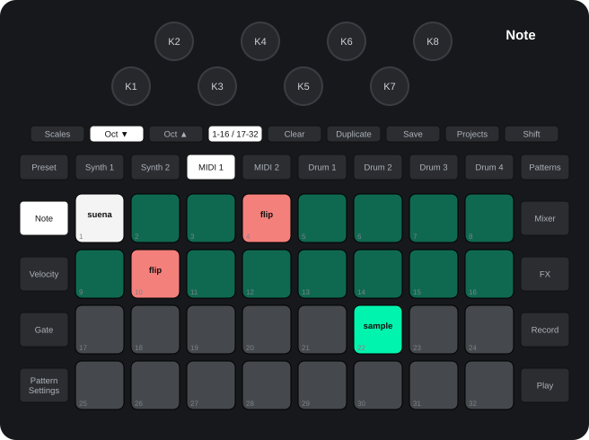

*Vista Note ampliada de MIDI 1 en modo muestra: pasos arriba, samples abajo.*


*[Paso a paso: Elegir samples y cambiarlos por paso (sample flip) (desde RC2)](https://github.com/Ghillermo/CIRCUIT-HACKS-RC/wiki/Step-by-step-ES#elegir-samples-y-cambiarlos-por-paso-sample-flip-desde-rc2)*

## [Matriz de modulación del sinte propio (desde RC2.02)](https://ghillermo.github.io/CIRCUIT-HACKS-RC/beta/guia.html#f-matriz-mod)

**Desde RC2.02.** Con el motor de MIDI 1 / 2 encendido, el **pad 6** de su vista Preset es una página de knobs nueva: **K1-K8 = ocho fuentes** (velocity, nota, azar por nota, LFO 2, envolvente 2, golpe de un drum, posición del patrón, azar por pasos). La **posición** de cada knob es el **destino** (todos los parámetros de las páginas de knobs, 33, un tramo cada uno, en el color de su página) y, dentro del tramo, la **cantidad**. Knobs lentos: dos clics por paso, 16 pasos por destino.

**Para qué sirve:** Ocho fuentes de modulación para el sinte propio de MIDI 1 / 2 (velocity, nota, un valor al azar por nota, un segundo LFO, una segunda envolvente, un golpe de drum, la posición en el patrón y azar por pasos), cada una llevada con un solo knob a cualquiera de los 33 parámetros del motor. Movimiento y expresión sin automatizar a mano.

**Cómo:**

1. Con el motor encendido, pulsa el **pad 6** de la vista Preset de MIDI 1 / 2 (azul claro): **K1-K8** son las fuentes: K1 velocity, K2 nota, K3 azar en cada nota, K4 LFO 2, K5 envolvente 2, K6 golpe de un drum, K7 posición en el patrón, K8 azar por pasos.
2. Gira un knob a la derecha: su posición elige el **destino** (33 parámetros, un tramo cada uno: 16 pasos de dos clics) y, dentro del tramo, la **cantidad**; a la izquierda del todo = apagado.
3. El LED toma el color de la página del destino (ámbar VCA-VCF, verde OSC 1, verde azulado OSC 2) y su brillo es la cantidad; mientras giras (y 1,5 s después), los pads enseñan dónde vive el destino (el pad de su página, y los pads 9-16 / 17-24 = los K1-K8 / Shift + K1-K8 de esa página).
4. **Con Shift:** K4 = forma × velocidad del LFO 2 (*(desde RC4)* la mitad izquierda de cada forma a tempo), K5 = ataque × caída, K6 = qué drum (1-4) × caída, K8 = N pasos (1, 2, 4, 8, 16).
5. **Clear + knob** = esa fuente apagada; **Clear + Shift + knob** = su parámetro al valor inicial; **Clear + pad 6** = todo apagado.

**A tener en cuenta:**

- La cantidad entera recorre todo el rango del parámetro; se suma al enviar el valor (el valor guardado no cambia), y varias fuentes en un destino se suman. Nota, azar, LFO 2 y azar por pasos suben y bajan; las demás solo suben.
- *(desde RC2.02)* Se guarda con los patches del sinte propio (pads 9-24) y, *(desde RC4)*, con el proyecto. No tiene CC / NRPN.
- Las modulaciones llegan al motor unas 100-250 veces por segundo, repartidas entre todo lo que se mueve en la pista.
- Detalle: [Matriz de modulación](https://ghillermo.github.io/CIRCUIT-HACKS-RC/beta/guia.html#midi-matriz).


*[Paso a paso: Llevar una fuente de la matriz a un destino (desde RC2.02)](https://github.com/Ghillermo/CIRCUIT-HACKS-RC/wiki/Step-by-step-ES#llevar-una-fuente-de-la-matriz-a-un-destino-desde-rc202)*

## [Secuenciador de saltos de MIDI 1 / 2 (solo Beta 5.64)](https://ghillermo.github.io/CIRCUIT-HACKS-RC/beta/guia.html#f-saltos)

Las notas de una pista MIDI hacen saltar el patrón de otra pista al paso que indican.

**Para qué sirve:** Una pista MIDI puede dejar de sonar y mover el patrón de otra pista: cada una de sus notas hace saltar esa pista al paso que indica, en ese mismo paso. Una forma de reordenar o hacer stutter de un loop de drums o de una frase con una secuencia de notas.

**Cómo:**

1. En la vista Preset de MIDI 1 / 2, el **pad 26** abre la vista de flip (pad 26 blanco mientras está abierta).
2. En la fila 3, **pad 18** = step flip (**pad 17** = patch flip; tocar el encendido lo apaga).
3. En la fila 2, toca el **destino** entre las ocho pistas (en sus colores, el destino brillante); sin elegir, el último usado (de fábrica, Synth 1). Con la vista cerrada, el pad 26 parpadea en el color del destino.
4. Escribe o toca las notas de la pista: en su vista Note **pads 17-32 = pasos 1-16** y **Octave ▲** = pasos 17-32; en la Note ampliada los 32 pads = pasos 1-32. Cada nota hace saltar al destino a ese paso.
5. Parado, un pad hace sonar ese paso del destino mientras lo mantienes, sin saltar.

**A tener en cuenta:**

- *(solo Beta 5.56)* Mientras apunta, la pista no toca notas (ni motor ni MIDI); apuntar apaga el motor, y encender un motor deja de apuntar.
- Valen la probabilidad, el 1 de cada N y el random-mutate del paso; una pista silenciada en el Mixer no hace saltar. MIDI 1 y MIDI 2 pueden apuntar a la vez.
- Con la misma longitud en las dos pistas, un salto solo se nota la primera vez: usa longitudes distintas, o dos saltos (uno que la mueva y otro que la devuelva).
- Se guarda con el proyecto. Detalle: [Vista Preset de MIDI 1 / 2](https://ghillermo.github.io/CIRCUIT-HACKS-RC/beta/guia.html#midi-preset).

## [FM de 4 operadores (desde RC4)](https://ghillermo.github.io/CIRCUIT-HACKS-RC/beta/guia.html#f-fm4)

**Desde RC4.** Una variante del oscilador del sinte propio de MIDI 1 / 2: **pad 24** de la fila de motores (un toque al pad 27), violeta; sus knobs en el **pad 7**. **K1-K4** = ratio de los operadores 1-4 (con **desafinación fina** en los clics de cada ratio), **K5-K8** = su nivel; **Shift + K1-K4** = a la derecha su ataque, a la izquierda el operador **percusivo** con su propio decay; **Shift + K5** = el **algoritmo** (16; también **manteniendo el pad 7**: los pads 9-24 son los algoritmos, pulsar uno lo elige y suena), **Shift + K6** feedback, **Shift + K7** ruido, **Shift + K8** release (más largo con más velocity).

**Para qué sirve:** Un sinte FM de 4 operadores como variante del oscilador del sinte propio, con 16 algoritmos (clásicos, percusivos, campanas y cuerdas) para pianos eléctricos, bajos, campanas, golpes metálicos y percusión. Cada operador tiene una envolvente de ataque / release con sustain fijo, y 16 sonidos de partida están a un toque.

**Cómo:**

1. En la vista Preset de MIDI 1 / 2, un toque al **pad 27** y elige el **pad 24** de la fila de motores (violeta); el **pad 7** abre su página de knobs.
2. **K1-K4** = el ratio de los operadores 1-4 (los clics de más de cada ratio lo desafinan un poco); **K5-K8** = su nivel.
3. **Shift + K1-K4** = a la derecha el ataque del operador, a la izquierda pasa a ser percusivo con su propio decay; **Shift + K5** = algoritmo (16); **Shift + K6** feedback; **Shift + K7** ruido; **Shift + K8** release (más largo cuanto más fuerte la nota).
4. **Mantén el pad 7:** los pads 9-24 = los 16 algoritmos en el color de su familia; pulsa uno para elegirlo y oírlo (**Shift + pad** = sin sonar).
5. **Mantén el pad 8:** los pads 9-24 = 16 instrumentos de partida (piano, piano eléctrico, órgano, pluck, arpa, marimba, bajo, campana, cuerdas, pad, flauta, clarinete, metales, bombo, caja, hi-hat); pulsa uno para cargar todo su FM.
6. **Clear + pad 7** = una voz tocable del algoritmo elegido; **Clear + knob** = su valor en esa voz; **Clear + MIDI 1 / 2** = todo a los valores iniciales.

**A tener en cuenta:**

- El volumen lo dan los operadores (el VCA del motor se queda abierto); SHAPE, envolvente → forma y LFO → forma de la página OSC 1 marcan el brillo, así que la ADSR, el LFO, la matriz y los carriles mueven el timbre. La velocity y las notas agudas también lo cambian.
- *(desde RC4)* Con el modo de voz poly, hasta 6 voces FM repartidas entre MIDI 1 y MIDI 2 (3 cada una con las dos en FM poly); *(solo Beta 5.56)* 6 cada una, calculadas aparte del resto del sonido. Ver [Voces del sinte propio](https://ghillermo.github.io/CIRCUIT-HACKS-RC/beta/guia.html#midi-voces).
- Se guarda con los patches del sinte propio y con el proyecto; no tiene CC / NRPN.
- *(solo Beta 5.56)* Lo sustituye el FM de 8 operadores: los patches de 4 operadores se cargan en él con el mismo sonido. Detalle: [FM de 4 operadores](https://ghillermo.github.io/CIRCUIT-HACKS-RC/beta/guia.html#midi-fm).

→ [Paso a paso: Elegir un motor en la fila de motores (desde RC4)](https://github.com/Ghillermo/CIRCUIT-HACKS-RC/wiki/Step-by-step-ES#elegir-un-motor-en-la-fila-de-motores-desde-rc4) — más arriba, en [Motor de las pistas MIDI (pad 27)](https://github.com/Ghillermo/CIRCUIT-HACKS-RC/wiki/Features-Modes-ES#motor-de-las-pistas-midi-pad-27)


*[Paso a paso: Elegir un algoritmo FM con los pads (desde RC4)](https://github.com/Ghillermo/CIRCUIT-HACKS-RC/wiki/Step-by-step-ES#elegir-un-algoritmo-fm-con-los-pads-desde-rc4)*


*[Paso a paso: Cargar un sonido de partida del FM (desde RC4)](https://github.com/Ghillermo/CIRCUIT-HACKS-RC/wiki/Step-by-step-ES#cargar-un-sonido-de-partida-del-fm-desde-rc4)*

## [FM de 8 operadores (solo Beta 5.64)](https://ghillermo.github.io/CIRCUIT-HACKS-RC/beta/guia.html#f-fm8)

**Solo Beta 5.64.** Sustituye al FM de 4 operadores en el **pad 24** de la fila de motores: **hasta 8 operadores**, cada uno con una **envolvente como la del DX7** (4 rates, 4 niveles), y **56 algoritmos** (los 16 del FM de 4 operadores, los 32 del DX7 y 8 de 8 operadores). Los patches del FM de 4 operadores se cargan convertidos, con el mismo sonido. Página FM = **pad 7** (con la fila de motores cerrada): **pads 9-16** = el operador 1-8 (los que usa el algoritmo encendidos: portadores verdes, moduladores azul claro), **pad 3** = la envolvente de pitch (violeta). **K1** ratio (0,5 … 31 o fijo en Hz), **K2** fino, **K3** nivel, **K4** velocity, **K5-K8** rates R1-R4; con Shift **K1** algoritmo, **K2** feedback, **K3** rate scaling, **K4** level scaling, **K5-K8** niveles L1-L4.

**Para qué sirve:** En la beta el motor FM pasa a tener hasta 8 operadores, cada uno con una envolvente como la del DX7 (4 rates y 4 niveles), y 56 algoritmos: los 16 del FM de 4 operadores, los 32 del DX7 y 8 de 8 operadores. Los patches de 4 operadores se cargan con el mismo sonido, las voces del DX7 se importan con la app de la tarjeta y un mapa del algoritmo enseña y edita el enrutado en los pads.

**Cómo:**

1. Vista Preset de MIDI 1 / 2: un toque al **pad 27**, elige el **pad 24** (violeta), cierra la fila con el **pad 27** y pulsa el **pad 7**: la página FM.
2. Los **pads 9-16** eligen el operador 1-8 (encendidos los que usa el algoritmo: portadores verdes, moduladores azul claro); el **pad 3** = la envolvente de pitch (violeta).
3. Con un operador elegido: **K1** ratio (0,5 … 31, o fijo 1 / 10 / 100 / 1000 Hz en rojo), **K2** fino, **K3** nivel de salida, **K4** sensibilidad a la velocity, **K5-K8** rates R1-R4; con **Shift**: K1 algoritmo (56), K2 feedback, K3 rate scaling, K4 level scaling, K5-K8 niveles L1-L4.
4. **Shift + pad 7 mantenido** = los 56 algoritmos en los pads 9-32, en tres páginas (**Octave ▼ / ▲**); **pad 8 mantenido** = 24 instrumentos en el color de su tipo (**Octave ▼** = una segunda página de 24); pulsa uno para cargarlo y oírlo.
5. Un toque al **pad 7** = el **mapa del algoritmo** (mantenido ½ s: solo mientras lo mantienes): cada fila se lee de izquierda (moduladora) a derecha (portadora), un hueco oscuro = no interactúan; el color dice el ratio (verde entero, verde azulado x,5, naranja inarmónico, rojo fijo; violeta el feedback). Toque = elegir, **Shift + operador** = callarlo mientras ves el mapa, **mantén uno y toca otro** = enlazarlos o desenlazarlos (un algoritmo propio).

**A tener en cuenta:**

- *(solo Beta 5.56)* Solo los operadores del algoritmo gastan tiempo del DSP: unas 10 voces con 4 operadores, 6-7 con 6, 5 con 8.
- Se guarda con los patches del sinte propio (una ranura extra del mismo banco de la tarjeta, que crece hasta 8 KB) y con el proyecto; intercambiar o copiar patches entre packs lleva el FM. «Send patches» / «Send pack» de Components ya no los borran (no en el pack interno).
- Cargar un instrumento de la lista del pad 8 también pone la página 4 y Shift + pad 4 en los knobs que convienen a su familia; los valores no cambian.
- No tiene CC / NRPN. Voces del DX7: la app de la tarjeta convierte un .syx de 32 voces o de una en parches custom con este FM ([App de la tarjeta y del aparato](https://ghillermo.github.io/CIRCUIT-HACKS-RC/beta/guia.html#app-sd)). Detalle: [FM de 8 operadores](https://ghillermo.github.io/CIRCUIT-HACKS-RC/beta/guia.html#midi-fm8).

## [Wavetable (solo Beta 5.64)](https://ghillermo.github.io/CIRCUIT-HACKS-RC/beta/guia.html#f-wavetable)

**Solo Beta 5.64.** El **pad 21** de la fila de motores (arena) = el oscilador leyendo una **wavetable**: los dos osciladores, el FM / ring / sync entre ellos, el filtro, el VCA, la polifonía y los modos de voz siguen igual. **Una tabla por patch, de hasta 9 cuadros**, para los dos osciladores; cada uno con su **posición**: **K3** de la página OSC 1 / OSC 2 (WAVE; en la Beta 5.24-5.26, K7), K7 = LFO → posición, Shift + K3 = envolvente → posición. **SHAPE** (K4) y envolvente / LFO → shape (Shift + K4 / Shift + K7) = **warp**, una doblez de la fase.

**Para qué sirve:** Un motor wavetable para el sinte propio: el oscilador lee una tabla de hasta 9 cuadros por patch y la recorre con un knob de posición, un LFO o la envolvente, mientras los dos osciladores, el FM / ring / sync, el filtro, el VCA y la polifonía funcionan como siempre. Llena la tabla con las 16 wavetables del sinte de stock o con ciclos sueltos cortados de los samples del pack.

**Cómo:**

1. En la vista Preset de MIDI 1 / 2, un toque al **pad 27** y elige el **pad 21** de la fila de motores (arena); el pad 27 se ve entonces en arena.
2. En la página OSC 1 / OSC 2, **K3** = la posición (el cuadro); el **K7** de OSC 1 = LFO → posición y **Shift + K3** = envolvente → posición; **SHAPE (K4)** = warp, una doblez de la fase.
3. **Mantén el pad 7:** los pads 9-24 = las 16 wavetables del sinte de stock (arena, brillante la cargada): un toque llena la tabla con sus 9 cuadros; **Shift + una tabla** cambia solo el cuadro que señala la posición (K3).
4. **Mantén el pad 8:** los samples del pack en los pads 9-32 (**Octave ▼ / ▲** = página): un toque pone un ciclo de ese sample en el cuadro que señala la posición (tarda un momento).
5. **Clear + pad 7** = ese cuadro vuelve al de su tabla. Cada toque en una lista suena la tónica hasta soltar el pad.

**A tener en cuenta:**

- *(solo Beta 5.56)* Una tabla por patch, para los dos osciladores: se guarda con los patches del sinte propio y con el proyecto; los patches de wavetable se ven en arena en la lista de patches.
- Cada cuadro tiene 18 versiones de banda limitada, así que los agudos no hacen aliasing; con el warp lejos del centro, los extremos suenan algo más apagados.
- La primera vez la tabla viene llena con la 7.ª (digital saw-square). Al cambiar de tabla, los cuadros nuevos entran uno a uno (un momento de mezcla mientras tanto).
- Detalle: [Vista Preset de MIDI 1 / 2](https://ghillermo.github.io/CIRCUIT-HACKS-RC/beta/guia.html#midi-preset), [Páginas de knobs del motor de MIDI 1 / 2](https://ghillermo.github.io/CIRCUIT-HACKS-RC/beta/guia.html#midi-knobs).

## [Master FX desde RC2: gesto mecánico, Glitch, Digitise y guardado por sesión](https://ghillermo.github.io/CIRCUIT-HACKS-RC/beta/guia.html#f-master-fx-beta)

**Desde RC2.** El pad 6 de Master FX es el **Glitch** y el pad 31 un **gesto mecánico** (parada de cinta, scratch…); Digitise gana **K3 = envío momentáneo al delay** y **K4 = envolvente**; los knobs y los huecos de Master FX **se guardan con cada proyecto**.

**Para qué sirve:** Desde RC2, Master FX tiene el Glitch en el pad 6 y un gesto mecánico en el pad 31 (parada de cinta, scratches, back spin…), Digitise gana un envío momentáneo al delay y una envolvente, y los ajustes de Master FX se guardan con cada proyecto. Cada proyecto conserva su propia preparación para el directo.

**Cómo:**

1. **Pad 31 = gesto mecánico:** al pulsarlo el audio se frena hasta parar; al soltarlo arranca otra vez. **K1** = movimientos por gesto (1-8), **K2** = el tipo, mezclado de forma continua y en colores (parada de cinta → baby scratch → tear → back spin → rattle), **K3** = tiempo de parada, **K4** = tiempo de arranque.
2. **Pad 6 = Glitch:** mantenido, fijado (Shift + pad 6), asignable a los huecos y al secuenciador de efectos como los demás efectos; sus K1-K4 son los del Glitch.
3. **Digitise (pad 4):** K1 muestreo, K2 bits, **K3** = manda todas las pistas al delay mientras mantienes el pad 4 (al soltar vuelven sus envíos), **K4** = envolvente de la cantidad (a la derecha va de entero a limpio, a la izquierda crece).
4. Guarda el proyecto (**Save** dos veces): los 20 knobs de la fila de arriba, la asignación de los huecos y el ataque / release del compresor master quedan guardados y vuelven al cargarlo.

**A tener en cuenta:**

- Un proyecto que no los tiene (antiguo o nuevo) deja el aparato como esté. Los efectos fijados no se guardan.
- El gesto usa el motor del Glitch: mientras suena, el Glitch espera. El pad 31 también se puede guardar en un hueco (pad 31 mantenido + un hueco).
- *(desde RC4.02)* La envolvente de K4 de Digitise arranca bien (en RC4 y antes no arrancaba).
- Detalle: [Master FX](https://ghillermo.github.io/CIRCUIT-HACKS-RC/beta/guia.html#master-fx).
