# New control modes

*[Versión en español](https://github.com/Ghillermo/CIRCUIT-HACKS-RC/wiki/Features-Modes-ES) · [Home](https://github.com/Ghillermo/CIRCUIT-HACKS-RC/wiki/Home) · [Features](https://github.com/Ghillermo/CIRCUIT-HACKS-RC/wiki/Features) · [Guide by views](https://ghillermo.github.io/CIRCUIT-HACKS-RC/beta/guide.html)*

One of the five pages of [Features](https://github.com/Ghillermo/CIRCUIT-HACKS-RC/wiki/Features): each feature explained, with its pictures and the animations of its processes. Each title links to its section in the [guide by views](https://ghillermo.github.io/CIRCUIT-HACKS-RC/beta/guide.html), the manual, where every feature is in the chapter of its view.

**Contents**

- **[New control modes](https://github.com/Ghillermo/CIRCUIT-HACKS-RC/wiki/Features-Modes)** — [Patch morph (Beta 5.64 only)](https://github.com/Ghillermo/CIRCUIT-HACKS-RC/wiki/Features-Modes#patch-morph-beta-564-only) · [Engine of the MIDI tracks (pad 27)](https://github.com/Ghillermo/CIRCUIT-HACKS-RC/wiki/Features-Modes#engine-of-the-midi-tracks-pad-27) · [Step-drummer](https://github.com/Ghillermo/CIRCUIT-HACKS-RC/wiki/Features-Modes#step-drummer) · [FX sequencer](https://github.com/Ghillermo/CIRCUIT-HACKS-RC/wiki/Features-Modes#fx-sequencer) · [Song pointer (Master FX)](https://github.com/Ghillermo/CIRCUIT-HACKS-RC/wiki/Features-Modes#song-pointer-master-fx) · [Captured sample](https://github.com/Ghillermo/CIRCUIT-HACKS-RC/wiki/Features-Modes#captured-sample) · [Glitch (pad 6) and its assignment](https://github.com/Ghillermo/CIRCUIT-HACKS-RC/wiki/Features-Modes#glitch-pad-6-and-its-assignment) · [Assignable bottom row (Master FX / FX)](https://github.com/Ghillermo/CIRCUIT-HACKS-RC/wiki/Features-Modes#assignable-bottom-row-master-fx--fx) · [Random-mutate per step](https://github.com/Ghillermo/CIRCUIT-HACKS-RC/wiki/Features-Modes#random-mutate-per-step) · [Step frequency and dynamics](https://github.com/Ghillermo/CIRCUIT-HACKS-RC/wiki/Features-Modes#step-frequency-and-dynamics) · [Pattern chains and scenes](https://github.com/Ghillermo/CIRCUIT-HACKS-RC/wiki/Features-Modes#pattern-chains-and-scenes) · [Pattern mutate (Beta 5.64 only)](https://github.com/Ghillermo/CIRCUIT-HACKS-RC/wiki/Features-Modes#pattern-mutate-beta-564-only) · [Nudge and play orders](https://github.com/Ghillermo/CIRCUIT-HACKS-RC/wiki/Features-Modes#nudge-and-play-orders) · [Arpeggiator (since RC2)](https://github.com/Ghillermo/CIRCUIT-HACKS-RC/wiki/Features-Modes#arpeggiator-since-rc2) · [Drums micro-step rollers (since RC2)](https://github.com/Ghillermo/CIRCUIT-HACKS-RC/wiki/Features-Modes#drums-micro-step-rollers-since-rc2) · [Custom scale (since RC2)](https://github.com/Ghillermo/CIRCUIT-HACKS-RC/wiki/Features-Modes#custom-scale-since-rc2) · [Chord screen (since RC4)](https://github.com/Ghillermo/CIRCUIT-HACKS-RC/wiki/Features-Modes#chord-screen-since-rc4) · [Stereo drum pairs (since RC4)](https://github.com/Ghillermo/CIRCUIT-HACKS-RC/wiki/Features-Modes#stereo-drum-pairs-since-rc4) · [The drums' extra lane (Beta 5.64 only)](https://github.com/Ghillermo/CIRCUIT-HACKS-RC/wiki/Features-Modes#the-drums-extra-lane-beta-564-only) · [Sample mode of the MIDI tracks (since RC2)](https://github.com/Ghillermo/CIRCUIT-HACKS-RC/wiki/Features-Modes#sample-mode-of-the-midi-tracks-since-rc2) · [Mod matrix of the own synth (since RC2.02)](https://github.com/Ghillermo/CIRCUIT-HACKS-RC/wiki/Features-Modes#mod-matrix-of-the-own-synth-since-rc202) · [Jump sequencer of MIDI 1 / 2 (Beta 5.64 only)](https://github.com/Ghillermo/CIRCUIT-HACKS-RC/wiki/Features-Modes#jump-sequencer-of-midi-1--2-beta-564-only) · [4-operator FM (since RC4)](https://github.com/Ghillermo/CIRCUIT-HACKS-RC/wiki/Features-Modes#4-operator-fm-since-rc4) · [8-operator FM (Beta 5.64 only)](https://github.com/Ghillermo/CIRCUIT-HACKS-RC/wiki/Features-Modes#8-operator-fm-beta-564-only) · [Wavetable (Beta 5.64 only)](https://github.com/Ghillermo/CIRCUIT-HACKS-RC/wiki/Features-Modes#wavetable-beta-564-only) · [Master FX since RC2: mechanical gesture, Glitch, Digitise and saving per session](https://github.com/Ghillermo/CIRCUIT-HACKS-RC/wiki/Features-Modes#master-fx-since-rc2-mechanical-gesture-glitch-digitise-and-saving-per-session)

## [Patch morph (Beta 5.64 only)](https://ghillermo.github.io/CIRCUIT-HACKS-RC/beta/guide.html#f-morph)

**Beta 5.64 only.** In the Preset view of Synth 1 / 2 or MIDI 1 / 2 (own synth, with its 8-operator FM): **hold two to four patches** for 0.4 s and a knob moves from one to the next, with LFOs, an envelope and a slow morph.

**What it is for:** Hold two to four patches of the same track and one knob blends from one to the next; two LFOs, an envelope and a slow, timed morph can also move along that chain for you. It turns a few saved sounds into one evolving sound to play live, on Synth 1 / 2 and on the MIDI 1 / 2 own synth.

**How:**

1. In the **Preset** view of Synth 1 / 2, or of MIDI 1 / 2 with the own synth on, **hold two to four patches** for 0.4 s (or hold them and press **Duplicate**): the morph view opens, with the chain in pad order.
2. **K1** = the position along the chain, in colour: patch 1 red, 2 yellow, 3 green, 4 blue, with shades in between. **K2** = square LFO depth, **K3** = the rate of both LFOs, **K4** = random-step LFO depth (a new value every half cycle); depths to the right go towards the chain's end.
3. **Slow morph:** turn **K5** to a destination (in the same colours) and leave it for half a second: the sound travels from K1 to K5 over **K6**'s time (fully left at once, then ¼ to 32 bars); once there, K1 takes K5's value. Turning K5 again re-aims from where the sound is; turning K1 stops it.
4. **K7 / K8** = envelope depth / time (K8 also smooths both LFOs); **pads 1 / 8** fire the envelope from the top and hold it while you hold them.
5. **Clear + knob** = 0; **Clear + the track button** = every knob to 0; **pad 32** (red) = out.
6. **Preset** shows the patches, the chain's in white: a tap loads that patch and leaves, holding 0.4 s makes a new chain. On MIDI 1 / 2, Preset switches between the morph and the slots. The track button brings the morph view back.

**Keep in mind:**

- *(Beta 5.56 only)* Nothing is saved: the morph is a performance tool.
- Continuous parameters blend; type parameters (wave, algorithm, mode…) take the nearest patch's. On MIDI 1 / 2 the 8-operator FM blends too.
- One morph at a time: holding patches for 0.4 s in another track's Preset view opens that track's morph and stops the previous one (its sound stays where it is); a tap there only loads that patch.
- The morph keeps going in the other views. Full detail: [Synth 1 / 2 Preset view](https://ghillermo.github.io/CIRCUIT-HACKS-RC/beta/guide.html#synth-preset).


*[Step by step: Morph between patches (Beta 5.56 only)](https://github.com/Ghillermo/CIRCUIT-HACKS-RC/wiki/Step-by-step#morph-between-patches-beta-556-only)*

## [Engine of the MIDI tracks (pad 27)](https://ghillermo.github.io/CIRCUIT-HACKS-RC/beta/guide.html#f-motor-midi)

**Since RC2.08:** an external keyboard on the channel of MIDI 1 / 2 (USB or DIN) plays its own synth; its notes are not sent again to the MIDI out. Pad 27 of the MIDI 1 / 2 Preset view picks the engine: off, **line**, **oscillator**, **VA-drum**, **granular**, **sample** (since RC2), **FX sequencer** and, **since RC4**, **FM**. **Since RC4** a tap opens them as a row on pads 17-24 (tap one to pick it; before, each tap stepped to the next) and Shift + pad 27 steps to the next. Pads 1-5 pick the knob page; 28 = two oscillators, 29 = chain order, 30 = step-drummer, 31 = velocity (VA-drum). **since RC2:** Clear + a page pad = the values of that page back to their initial values; rows 2-3 hold patches.

**What it is for:** MIDI 1 and MIDI 2 get a synth of their own inside the device: their notes play an internal engine (or the track's audio input) through a VCA, a filter and an effect with envelope and LFO, before mixer strip 3 / 4. The tracks keep sending their MIDI, so they can play outside gear and sound on the unit at the same time.

**How:**

1. Press **MIDI 1** or **MIDI 2**, then **Preset**. *(since RC4)* Also: the track button again with its Note view on screen, or **Shift + MIDI 1 / 2**.
2. *(since RC4)* A tap on **pad 27** opens the engine row on pads 17-24, the current engine bright: off (white), line input (amber), oscillator (green), VA-drum (orange), granular (magenta), sample (teal), FX sequencer (blue) and FM (violet). Tap one to pick it; **pad 27** again brings the patch slots back; **Shift + pad 27** steps to the next engine.
3. *(Beta 5.56 only)* The row is: no voice (white), VCA / VCF / FX only (the line input), oscillator, VA-drum, wavetable (sand), sample, granular and FM; the FX sequencer is **pad 31** with «no voice» (dim blue; a tap turns it on).
4. **Pads 1-5** pick the knob page: 1 VCA-VCF, 2 OSC 1 (the granular's page with that engine), 3 OSC 2, 4 sequenceable knobs (*(since RC4)* **Shift + pad 4** = non-sequenceable), 5 modulation; **pad 6** = the mod matrix *(since RC2.02)*. **Shift** gives each page a second layer. *(Beta 5.56 only)* Pads 1 and 4 swap: pad 1 = sequenceable knobs, pad 4 = filter / VCA.
5. **Pad 28** = one / two oscillators (oscillator and VA-drum); **pad 29** = the chain's order, VCA → FX → filter or filter → VCA → FX (*(Beta 5.56 only)* the filter first by default); **pad 30** = step-drummer; **pad 31** = velocity → envelopes (VA-drum); **pad 32** = voice mode *(since RC4)*.
6. *(since RC4)* Holding a page pad for ½ s shows that page only while held. **Clear + a page pad** = that page back to its initial values *(since RC2)*; **Clear + the track button** = every engine value to its default (the engine stays).

**Keep in mind:**

- Saved: the engine and its values in the device settings (the same for every project) and, *(since RC4)*, with the project too (loading a project that carries it brings its sound back). To reuse a sound anywhere in the pack, save it as an own-synth patch on pads 9-24 (writes to the card: not in the «S» versions nor in the internal pack).
- *(since RC2.08)* A keyboard on the track's MIDI channel (USB or DIN) plays its own synth; those notes are not sent again to the MIDI out.
- The track keeps sending its MIDI with any engine; patch flip (pad 26) excludes the engine.
- How many voices each engine gives in each voice mode: [Own-synth voices](https://ghillermo.github.io/CIRCUIT-HACKS-RC/beta/guide.html#midi-voces); every pad: [MIDI 1 / 2 Preset view](https://ghillermo.github.io/CIRCUIT-HACKS-RC/beta/guide.html#midi-preset).

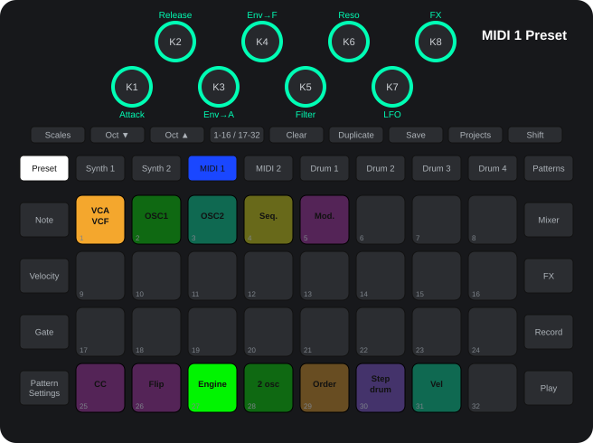

*MIDI 1 Preset view with the oscillator (pad 27 green): page row and engine pads; pad 28 shows only with the oscillator or VA-drum.*


*[Step by step: Choose an engine on the engine row (since RC4)](https://github.com/Ghillermo/CIRCUIT-HACKS-RC/wiki/Step-by-step#choose-an-engine-on-the-engine-row-since-rc4)*


*[Step by step: Choose the own synth's voice mode (since RC4)](https://github.com/Ghillermo/CIRCUIT-HACKS-RC/wiki/Step-by-step#choose-the-own-synths-voice-mode-since-rc4)*

## [Step-drummer](https://ghillermo.github.io/CIRCUIT-HACKS-RC/beta/guide.html#f-step-drummer)

Sequencing by **pairs of steps** on top of the pattern: pads 1-16 steps, 17-24 destination / macro, the 8 knobs = the 8 pairs (pitch or velocity). MIDI: Preset view, pad 30. Synths: source view, pad 30. While recording, the steps you play are recorded in real time.

**What it is for:** A second layer of sequencing over a track's pattern: the eight knobs are the eight pairs of steps on screen, and each pair moves one destination (a pitch offset, the wave, FM, the filter… on MIDI 1 / 2; a macro on Synth 1 / 2) on just those two steps. Quick melodies, accents and timbre changes on top of the notes, without drawing automation.

**How:**

1. MIDI 1 / 2: the Preset view with the engine on, **pad 30** (*(since RC4)* with the step-drummer on, **Note** goes Note → expanded Note → step-drummer). Synth 1 / 2: the source view (the synth's button twice), **pad 30**.
2. **Pads 1-16** = the 16 steps of the half shown (bright = a note, white = playing): a touch listens, **Shift + touch** adds or removes a note; **1-16 / 17-32** shows the other half.
3. **Pads 17-24** = the destination: on MIDI the pitch of both oscillators, OSC 2's pitch, WAVE, FM, MIX, env → filter, SHAPE or decay; on the synths macro 1-8.
4. **K1-K8** = the 8 pairs of steps (the playing one white). On MIDI the value offsets the destination from the centre (64 = no change); on the synths it is the macro's position, from 0. *(since RC2)* The LED is dim with no modulation and brighter the further it goes.
5. **Octave ▲ / ▼** = pitch / velocity page. *(since RC2)* On the velocity page, pads 17-24 pick page 2's own destination (the same pad again = none); **pad 32** = the pitch-vel toggle (green): the pitch page transposes every note one degree of the scale every 8 knob steps and the velocity page sets the velocity.
6. With **Record**, touching a step records it on the step that is playing, with its micro step.

**Keep in mind:**

- The pair values are stored in the pattern as automation: on MIDI in the pitch lane and, for page 2, the Release lane (with the step-drummer on, those two lanes no longer play or record their knobs); on the synths in the macro's lane.
- On MIDI, **Shift + pad 30** turns the step-drummer off (pad 30 dim = off, bright = on). Its on / off and destination are kept in the device settings and the own-synth patch, *(since RC4)* also in the project; the pitch-vel toggle and page 2's destination, with the project.
- *(since RC2)* On Synth 1 / 2, Play and Record no longer close it, and pressing Synth 1 / 2 reopens it until pad 30 closes it. Each step keeps the pitch of its first note.
- With the FX sequencer engine the same view picks Master FX slots instead. Detail: [Step-drummer view](https://ghillermo.github.io/CIRCUIT-HACKS-RC/beta/guide.html#step-drummer).

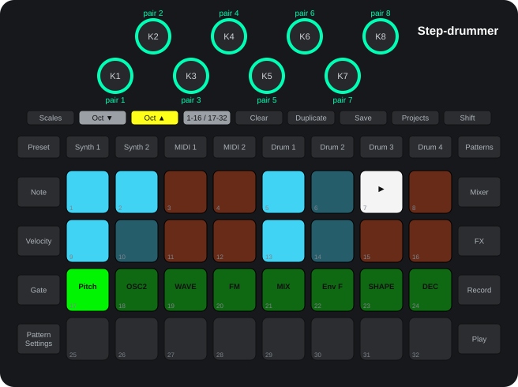

*Step-drummer view (MIDI 1).*


*[Step by step: Sequence a destination with the step-drummer](https://github.com/Ghillermo/CIRCUIT-HACKS-RC/wiki/Step-by-step#sequence-a-destination-with-the-step-drummer)*

## [FX sequencer](https://ghillermo.github.io/CIRCUIT-HACKS-RC/beta/guide.html#f-fx-seq)

**Blue** state of pad 27: the step-drummer of the track picks, for each pair of steps, **a slot of the Master FX bottom row** (0 = none); it plays on the steps with a note. The knob moves slowly (**one slot every ~48 steps of the turn**) and lights in the **colour of the chosen effect**. **A slot with no effect assigned** plays, **since RC4**, the effect at the top of its column (pad 26 = Master FX pad 1 … pad 30 = pad 5), with its knobs; before, it did nothing: assign the effects to the Master FX bottom row (see “Assignable bottom row”). **since RC2:** at the end of the travel there is the **random** value (white LED): on every step with a note one of the list plays at random (the slots with an effect assigned and the mechanical gesture of pad 31).

**What it is for:** An engine for MIDI 1 / 2 that makes no sound: the track's step-drummer picks, for each pair of steps, one of the Master FX bottom-row slots, and every step with a note switches that slot's effect on. It sequences performance effects (stutters, filter sweeps, the tape-stop gesture…) in time with the pattern.

**How:**

1. First fill the Master FX bottom row: in Master FX, hold an effect of the top row and touch a slot (pads 26-30).
2. In the MIDI 1 / 2 Preset view pick the FX sequencer: a tap on **pad 27** and the blue engine of the row. *(Beta 5.56 only)* Pick «no voice» on the row and tap **pad 31** (dim blue → bright). The track's step-drummer switches on.
3. Open the step-drummer with **pad 30** and put notes on the steps with **Shift + pad**.
4. Turn each knob (a pair of steps) to pick its slot: 0 none, 1-5 = pads 26-30, 6 = pad 31 (the mechanical gesture) and, at the end, **random** *(since RC2)* (white LED: one of the slots with an effect, at random on each note). The knob moves slowly (about one slot every 48 steps of turning) and lights in the colour of the chosen effect.
5. Press **Play**: on every step with a note, the pair's slot switches on with its copy of the parameters.

**Keep in mind:**

- *(since RC4)* A slot with no effect assigned plays the effect at the top of its column (pad 26 = Master FX pad 1 … pad 30 = pad 5), with its knobs, and the knob LED shows that colour.
- The track makes no sound of its own; its notes still go out over MIDI.
- Leaving the FX sequencer switches the track's step-drummer off. The knob values live in the pattern; the slot assignments, with the project.
- Detail: [Step-drummer view](https://ghillermo.github.io/CIRCUIT-HACKS-RC/beta/guide.html#step-drummer) and [Master FX](https://ghillermo.github.io/CIRCUIT-HACKS-RC/beta/guide.html#master-fx).

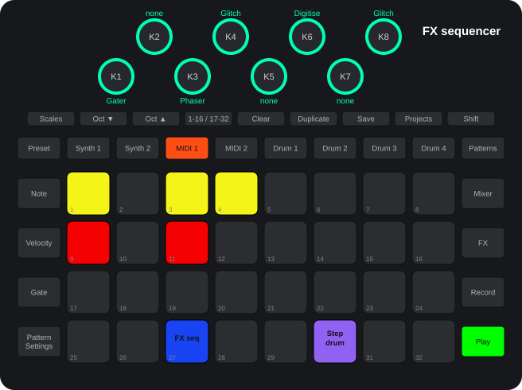

*FX sequencer: each knob = the Master FX bottom-row slot of its pair of steps.*

## [Song pointer (Master FX)](https://ghillermo.github.io/CIRCUIT-HACKS-RC/beta/guide.html#f-song-pointer)

Pads 9-24 = steps 1-16: one held step = retrigger; two steps = momentary phrase. **Phrase mode** (a latched phrase): Shift + step = start (end 16); a touch = the end; Shift + another step = new start; Shift + the start or the white pad 9 = exit.

**What it is for:** Pads 9-24 of Master FX are the 16 steps of the pattern, so you can grab the playhead live: repeat one step, loop the stretch between two steps while you hold them, or latch a loop. Stutters, fills and breakdowns without touching the patterns.

**How:**

1. Open Master FX (**Mixer** twice): pads 9-24 = steps 1-16, the playhead white while the sequencer runs.
2. **Hold one step:** it repeats while you hold it (retrigger).
3. **Hold two steps:** the pattern loops between them while you hold them (a momentary phrase).
4. **Phrase mode (a latched phrase):** **Shift + a step** enters it with that step as the start and 16 as the end, and pad 9 turns white; then a touch on another step (without Shift) sets the end, so the phrase loops between the two (a step before the start swaps them; no retrigger); **Shift + another step** moves the start (an end before it goes back to 16).
5. **Shift + the start** or the white **pad 9** leaves phrase mode.

**Keep in mind:**

- **Pad 8** of Master FX releases everything latched, the song pointer included.
- Nothing is saved: the song pointer is off when a project loads and at power-up.
- Detail: [Master FX](https://ghillermo.github.io/CIRCUIT-HACKS-RC/beta/guide.html#master-fx).

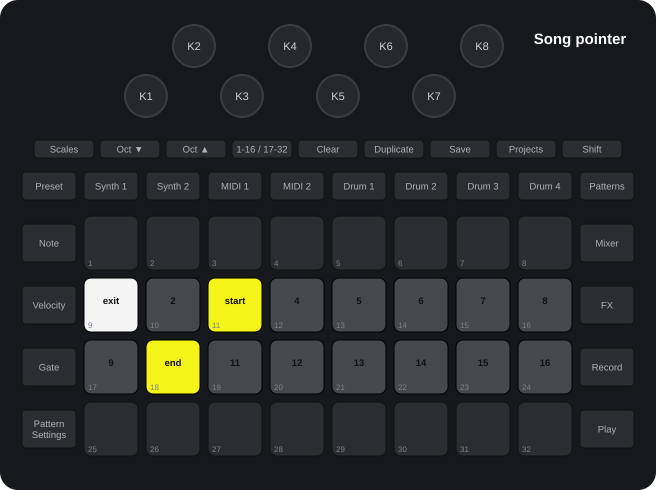

*Song pointer: phrase between steps 3 and 10.*


*[Step by step: Repeat steps live with the song pointer](https://github.com/Ghillermo/CIRCUIT-HACKS-RC/wiki/Step-by-step#repeat-steps-live-with-the-song-pointer)*


*[Step by step: Loop a phrase with phrase mode](https://github.com/Ghillermo/CIRCUIT-HACKS-RC/wiki/Step-by-step#loop-a-phrase-with-phrase-mode)*

## [Captured sample](https://ghillermo.github.io/CIRCUIT-HACKS-RC/beta/guide.html#f-sample)

**Pad 32** (red) records the output; **pad 7** (yellow) plays it: K1 pitch, K2 mode (one-shot / gate / loop by colour), K3 start, K4 end. The sample can be assigned to the bottom row (pad 7 + a bottom pad) and can replace a drum.

**What it is for:** Pad 32 of Master FX records up to 3.46 s of what the device is playing and pad 7 plays it back, with its own pitch, mode (one-shot, gate or loop), start and end. A live sampler: replay or loop a phrase, put it on a slot, turn it into a drum or use it as a granular source.

**How:**

1. Open Master FX (the FX view's bottom row records too) and press **pad 32** (red): hold it to record while held, or a short tap to record until the next tap.
2. **Shift + pad 32** = armed: playing, it records the next bar; stopped, it starts when you press **Play**, from the first beat, and records that bar.
3. Press **pad 7** (yellow) to play it; K1-K4 become **K1** pitch (±24 semitones), **K2** mode (yellow one-shot, green gate, blue loop), **K3** start, **K4** end (end before start = reversed).
4. **Shift + pad 7** = a latched loop, in any mode, until you press pad 7 (or pad 8) again. The loop mode (K2 blue) only plays while you hold the pad.
5. Hold **pad 7** and touch a bottom-row slot: that slot plays the sample with a copy of its knobs. To use it as a drum: drum Preset view, **Clear + pad**, then **Clear + the same pad**.

**Keep in mind:**

- The sample that plays goes through the Master FX effects; the capture records the output without them. *(since RC2.01)* Both sit before the master filter: the filter acts on the sample as it plays and the capture does not hold it.
- It lives in memory: it is lost at power-off, unless it replaced a drum and you saved the project; then it is written into the pack if it fits (writes to the card: not in the «S» versions nor in the internal pack).
- *(Beta 5.56 only)* With the latched loop playing, loading another project or pack (stopped) does not stop it: **Play** blinks green and the new project starts when the loop comes round; Play again = start now.
- It can also be the source of the MIDI tracks' granular and sample mode (Shift + K8 on the granular's page). Detail: [Master FX](https://ghillermo.github.io/CIRCUIT-HACKS-RC/beta/guide.html#master-fx).

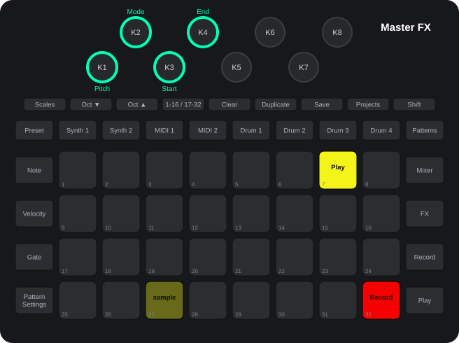

*Captured sample.*


*[Step by step: Capture a sample and replace a drum with it](https://github.com/Ghillermo/CIRCUIT-HACKS-RC/wiki/Step-by-step#capture-a-sample-and-replace-a-drum-with-it)*

## [Glitch (pad 6) and its assignment](https://ghillermo.github.io/CIRCUIT-HACKS-RC/beta/guide.html#f-glitch-pad)

**Hold pad 6** of Master FX: the output breaks up and lags like a tape. K1 speed, K2 repeat, K3 delay, K4 chaos (lower half) or overload (upper half). **Pad 6 held + a bottom-row pad** = that slot is a Glitch too, with its copy of K1-K4.

**What it is for:** Holding pad 6 in Master FX hands the whole output to a tape head that reads the last seconds of audio: it can brake, stop, run backwards, repeat and break up the mix. A performance effect for tape stops, stutters and glitchy fills, which can also be stored on the bottom-row slots with its settings.

**How:**

1. Open Master FX and **hold pad 6** *(since RC2)*: the Glitch plays while held and pad 6 lights; **Shift + pad 6** latches it (touch it again to release it).
2. Its knobs while pressed: **K1** speed (fully up = normal, lower brakes like a tape, centre = stopped, below = backwards), **K2** repeat size (at maximum no repeat: a continuous delay), **K3** delay (up to about 2.6 s).
3. **K4**: lower half = **chaos** (random jumps back, cuts and reversals); upper half = **overload** (late blocks that click at the normal pitch; from about ¾ of the travel everything also slows down and drops in pitch).
4. **Assign:** hold pad 6 and touch a bottom-row pad (26-30, without Shift): that slot stores a Glitch with the current K1-K4, and touching it plays the Glitch with those values.
5. Two Glitch slots at once: the last one pressed plays; let it go and the other comes back with its own values.

**Keep in mind:**

- The mechanical gesture (pad 31) uses the same engine: while it plays, the Glitch waits.
- The FX sequencer can trigger a Glitch slot. *(since RC2)* The Glitch's knobs are saved with the project, with the other Master FX knobs.
- Detail: [Master FX](https://ghillermo.github.io/CIRCUIT-HACKS-RC/beta/guide.html#master-fx).

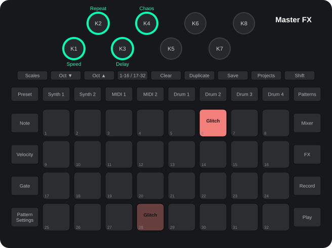

*Glitch: pad 6; also assigned to pad 28.*


*[Step by step: Put an effect on a slot of Master FX](https://github.com/Ghillermo/CIRCUIT-HACKS-RC/wiki/Step-by-step#put-an-effect-on-a-slot-of-master-fx)*

## [Assignable bottom row (Master FX / FX)](https://ghillermo.github.io/CIRCUIT-HACKS-RC/beta/guide.html#f-fila-inferior)

Hold an effect of the top rows (or pad 7, or pad 31) and touch a bottom pad: that slot stores the effect with a copy of its parameters. Saved with the project.

**What it is for:** Pads 26-30 of Master FX (and of the FX view) are five slots you fill yourself: each one keeps an effect together with a copy of its knob settings, so a ready-made effect is one touch away. The FX sequencer of the MIDI tracks can trigger them in time.

**How:**

1. Open Master FX (**Mixer** twice).
2. Hold an effect of the top row (pads 1-6), **pad 7** (the captured sample) or **pad 31** (the mechanical gesture) and touch a slot (pads 26-30): it stores that effect with a copy of its parameters.
3. Touch the slot: its parameters load and the effect plays while you hold it; **Shift + slot** latches it (pad 8 releases everything latched).
4. In the FX view the bottom row is the same: slots 26-30, the mechanical gesture on 31 and the capture's record on 32.

**Keep in mind:**

- A slot with nothing assigned keeps the original performance effect of the FX view.
- *(since RC2)* The assignments are saved with each project, with the 20 effect knobs, and come back when it loads; a project saved without them leaves the device as it is. Latched effects are not saved.
- *(since RC4)* In the FX sequencer, an empty slot plays the effect at the top of its column.
- Detail: [Master FX](https://ghillermo.github.io/CIRCUIT-HACKS-RC/beta/guide.html#master-fx).

→ [Step by step: Put an effect on a slot of Master FX](https://github.com/Ghillermo/CIRCUIT-HACKS-RC/wiki/Step-by-step#put-an-effect-on-a-slot-of-master-fx) — shown above, under [Glitch (pad 6) and its assignment](https://github.com/Ghillermo/CIRCUIT-HACKS-RC/wiki/Features-Modes#glitch-pad-6-and-its-assignment)

## [Random-mutate per step](https://ghillermo.github.io/CIRCUIT-HACKS-RC/beta/guide.html#f-random-mutate)

**Since RC2.** In the probability view, in mode 2 (**pad 25** of Pattern Settings), row 4 gives each step a chance of its notes jumping an octave or moving to another note of the scale when they play.

**What it is for:** Each step of a note track can carry a chance that its notes change when they play: an octave jump or another note of the scale (in the beta also ghost notes, accents, length and timing). It keeps a pattern alive with small surprises; with Record the changes are written in and the sequence drifts.

**How:**

1. On Synth 1 / 2 or MIDI 1 / 2 open **Pattern Settings** and touch **pad 25**: the probability view in mode 2.
2. Hold a step that has notes (pads 1-16) and touch a pad of **row 4** (peach): 25 off; 26 octave 6 %; 27 scale 6 %; 28 both 6 %; 29 scale 12 %; 30 octave 12 %; 31 scale 25 %; 32 octave 25 % and scale 50 %.
3. *(Beta 5.56 only)* Rows 3-4 are one set of pads per step: 17 no change; 18-20 another note of the scale (×1, ×2, ×4); 21 / 22 an octave up (low / high); 23 / 24 an octave up or down (low / high); 25 no dynamics; 26 ghost (velocity −32 to 0); 27 accent staccato (velocity up to +64, the note shorter); 28 length (a half to double); 32 micro steps on / off.
4. *(Beta 5.56 only)* **Octave ▼ / ▲** with this view open = the track's factor (×0, ×1, ×2, ×4, ×8; ×1 from the factory), which multiplies every chance: at ×1, note and octave 6 % for each ×1 of the pad, dynamics and micro steps 25 %.
5. Play: each note of a chord is drawn separately, every time the step plays. Without **Record** the change sounds once; with Record (and this view on screen) it is written into the step.

**Keep in mind:**

- *(since RC2)* Saved in the step, with the pattern and the project; tied notes do not change. «Another note of the scale» follows the project's scale, the custom one and Jankó too.
- **Clear + pad 25** in Pattern Settings clears the dynamics and the random-mutate of every step of the pattern (the frequency stays).
- On the drums the same view changes the sample instead of the note (see «Step frequency and dynamics»). *(Beta 5.56 only)* The factor is saved with the project; at ×8, pad 24 changes every note.
- Detail: [Probability view](https://ghillermo.github.io/CIRCUIT-HACKS-RC/beta/guide.html#probabilidad).

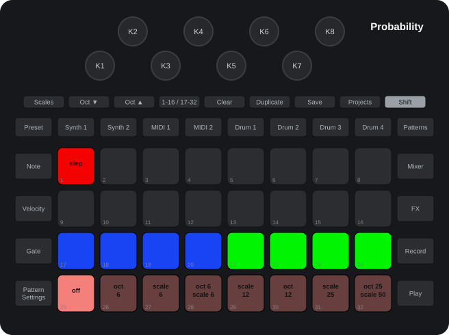

*Probability view: row 3 = the step’s probability (original), row 4 = random-mutate.*


*[Step by step: Let a step's notes mutate (since RC2)](https://github.com/Ghillermo/CIRCUIT-HACKS-RC/wiki/Step-by-step#let-a-steps-notes-mutate-since-rc2)*

## [Step frequency and dynamics](https://ghillermo.github.io/CIRCUIT-HACKS-RC/beta/guide.html#f-frecuencia-dinamicas)

**Since RC2.** In the probability view of the note tracks: **row 4 = every how many plays of the pattern the step sounds** (1-8). With **pad 25 of Pattern Settings**: row 3 = random **dynamics** (velocity, position and length), row 4 = random-mutate.

**What it is for:** Two more per-step variations for every track: **frequency** makes a step play only on the last of every n passes of its pattern (1-8), and **dynamics** add random changes of velocity, position and length. Variations that come back every 2, 4 or 8 passes, and a more human feel.

**How:**

1. **Frequency:** press **Pattern Settings** twice (mode 1); hold a step with notes and touch a pad of **row 4** (yellow): n from 1 to 8, the step plays on the last of every n passes.
2. **Dynamics:** in Pattern Settings touch **pad 25** (mode 2); hold a step and touch a pad of **row 3**, left to right: no change; drunk (±2 micro steps); drunk and accents; accents (velocity 0 to +32); dragging and accents (−1 to +3 micro steps); dragging; balanced dynamics (±32); accent dynamics (−32 to +64).
3. *(Beta 5.56 only)* In mode 2 the dynamics are pads 25-28 of the shared set (none, ghost, accent staccato, length) and pad 32 the micro steps (see «Random-mutate per step»).
4. **Drums** *(since RC2)*: the same view for a drum (Pattern Settings twice = mode 1, the frequency on row 4; **pad 25** of its Pattern Settings = mode 2); pick a step with a hit. On the RCs, mode 2's row 3 = dynamics (they only delay the hit inside its step) and pads 25-28 = random-mutate of the sample (none, 25 % ±1 in its row of 8, 25 % ±8 to another row, 12 % of each).
5. **Clear + pad 25** in a note track's Pattern Settings clears the dynamics and the random-mutate of every step of the pattern; the frequency stays.

**Keep in mind:**

- *(since RC2)* Everything is saved with the step (pattern and project) and travels when the pattern is duplicated and with Nudge.
- Each pattern counts its passes from Play; the counters start again when stopped.
- With **Record** and mode 2 on screen, what sounds (the mutated note, the dynamics) is written into that track's pattern *(since RC4.05)*.
- *(Beta 5.56 only)* A drum's mode 2 uses the shared set: pads 18-20 another sample of its row (±1), 21-24 another row (+8 or ±8), pad 26 lowers the velocity and adds a roller at random, pad 27 raises it, pad 32 moves the whole step up to 2 micro steps. Detail: [Probability view](https://ghillermo.github.io/CIRCUIT-HACKS-RC/beta/guide.html#probabilidad).

→ [Step by step: Let a step's notes mutate (since RC2)](https://github.com/Ghillermo/CIRCUIT-HACKS-RC/wiki/Step-by-step#let-a-steps-notes-mutate-since-rc2) — shown above, under [Random-mutate per step](https://github.com/Ghillermo/CIRCUIT-HACKS-RC/wiki/Features-Modes#random-mutate-per-step)


*[Step by step: Play a step every n passes (since RC2)](https://github.com/Ghillermo/CIRCUIT-HACKS-RC/wiki/Step-by-step#play-a-step-every-n-passes-since-rc2)*

## [Pattern chains and scenes](https://ghillermo.github.io/CIRCUIT-HACKS-RC/beta/guide.html#f-cadenas)

**Since RC2.** Every pattern can carry a rule “play n times, then jump to B; the next time, to C”. **Shift + Octave ▲ / ▼** in the Patterns view switches the **chain mode** of the whole project on / off; every scene remembers the mode it was saved in.

**What it is for:** Every pattern can carry a rule «play n times, then jump to B; the next time, to C», and every scene can repeat 1-8 times, so the tracks play A A A B A A A C structures on their own. Song structure without chaining patterns by hand, switched on and off for the whole project.

**How:**

1. In the **Patterns** view, **Shift + Octave ▲** switches the chain mode of the whole project on (Octave ▲ green) and **Shift + Octave ▼** off; with Shift, the Octave that does something lights yellow.
2. In the mode, press a pattern = **A** (yellow; it is selected as usual); **A again** = one more play (up to 8; the knob LEDs count them).
3. Press **another pattern of the track** = **B** (green), and the next one = **C** (red). Examples: n = 3 → A A A B A A A C; no C → A A A B; n = 1 → A B A C.
4. **Clear + pattern** in the mode removes its rule (with no rule, it clears the pattern as usual).
5. In the **Mixer**, **Shift + pads 9-16** = 1-8 repeats of the current scene (the row yellow with Shift, the chosen one green); *(since RC4)* while playing, with Shift, the repeat now playing is white.
6. Save a scene (as always) with the mode on: it remembers it and shows **peach**; loading it brings the mode back, and loading a normal scene switches it off.

**Keep in mind:**

- *(since RC2)* B and C play once and the track returns to A, unless they carry a rule of their own; tracks following a rule blink in the Mixer. A scene ends when its longest chain ends.
- The rules are saved with the pattern (they travel when it is duplicated); the mode and the scene data, with the project. With the mode off the rules stay stored but are not followed.
- Out of the mode, **Clear + pattern** clears the pattern, its rule and its play order. The mode stays on when you leave the Patterns view.
- Detail: [Patterns view and pattern chains](https://ghillermo.github.io/CIRCUIT-HACKS-RC/beta/guide.html#patterns), [Mixer view and scenes](https://ghillermo.github.io/CIRCUIT-HACKS-RC/beta/guide.html#mixer).


*[Step by step: Chain patterns: A A A B A A A C (since RC2)](https://github.com/Ghillermo/CIRCUIT-HACKS-RC/wiki/Step-by-step#chain-patterns-a-a-a-b-a-a-a-c-since-rc2)*


*[Step by step: Repeat a scene (since RC2)](https://github.com/Ghillermo/CIRCUIT-HACKS-RC/wiki/Step-by-step#repeat-a-scene-since-rc2)*

## [Pattern mutate (Beta 5.64 only)](https://ghillermo.github.io/CIRCUIT-HACKS-RC/beta/guide.html#f-mutate-patrones)

**Beta 5.64 only.** Ported from the Pattern Mutate in [mefisme's Rhythm Plus](https://github.com/mefisme/rhythm-plus) (MIT licence). In the Patterns view or the Mixer, **Shift + a tap on Duplicate** gives each selected track a short list of patterns from its chain, in another order, that loops in place of the chain. The patterns themselves don't change.

**What it is for:** Each selected track gets a short list of patterns taken from its chain, in another order, that loops instead of the chain; the patterns themselves do not change. Instant variations of an arrangement that come back with the scenes; it is ported from the Pattern Mutate of mefisme's Rhythm Plus (MIT licence).

**How:**

1. In the **Patterns** view or the **Mixer**, **Shift + a tap on Duplicate** (yellow with Shift): each selected track loops its list. Another tap = another seed, another list.
2. **Shift + Duplicate held** in the Patterns view opens the settings (peach, the chosen value bright): column 1 **Length** 1-4, column 2 Length 5-8, column 3 the length type (as the chain / exact / random up to Length).
3. Columns 4-5 = **Amount** in eight steps, how many of the chain's slots change (column 4 top to bottom: all, 7/8, 6/8, 5/8; column 5: half, 3/8, 2/8, 1/8); column 6 **Repeats** (on / off: two neighbours never the same); column 7 **Keep slot 1** (off / on).
4. On that page the **track buttons** pick the tracks (bright = selected); with lists playing, switching one on gives it its list and switching it off sends it back to its chain. **Duplicate** (or another view button) closes the page.
5. **Clear + Duplicate**, in any view, ends every list; a pattern pad ends its track's list (and does its usual job).

**Keep in mind:**

- *(Beta 5.56 only)* In the Patterns view, the patterns that are not in a mutating track's list go dark (the playing one keeps its colour). A new setting is heard at once, and going back to a value brings the same list back.
- With pattern chains, a mutating track plays its list and the others follow their rules; for a mutating track the chain ends with the last pattern of its list, so chained scenes move on when the lists are over.
- Saved with the project and in each scene (which tracks mutate, the seed, the settings): going back to a scene brings the same list back; a scene saved without lists ends them.
- In the track views Shift + Duplicate is still the original's. Detail: [Patterns view and pattern chains](https://ghillermo.github.io/CIRCUIT-HACKS-RC/beta/guide.html#patterns).

## [Nudge and play orders](https://ghillermo.github.io/CIRCUIT-HACKS-RC/beta/guide.html#f-nudge-ordenes)

**Since RC2.** In the Pattern Settings view: **pad 26 = Nudge** (moves the content of the selected steps), **pad 27 = fractal order**, **pad 28 = deconstructed order**. On every track, drums included.

**What it is for:** Three extra tools of the Pattern Settings view, on every track and the drums: **Nudge** shifts the content of the selected steps one step back or forward, and the **fractal** and **deconstructed** orders walk through the pattern in another order without changing its steps. Quick rhythmic variations of a pattern you already have.

**How:**

1. Open **Pattern Settings** and set the range with the first / last step pads (1-16), as always.
2. **Pad 26** (blue) = **Nudge**: a tap moves the content of the range one step back, **Shift + pad 26** one step forward; what leaves at one end comes in at the other, and the first and last steps do not move *(since RC4.05)*.
3. **Pad 27** = **fractal** order: 1 · 1 2 · 1 2 3 · 1 2 3 4 … up to the last step, then again.
4. **Pad 28** = **deconstructed** order: the grid's diagonals, 1 6 11 16 · 2 7 12 13 · 3 8 9 14 · 4 5 10 15 (the same with 17-32); steps outside the pattern are skipped (with 8 steps: 1 6 2 7 3 8 4 5).
5. Pads 27 / 28 and the four direction pads (29-32) exclude each other: a direction pad brings back a normal direction.

**Keep in mind:**

- *(since RC2)* Nudge moves whole steps with their automation (on the drums with their own values too), and the view shows it at once.
- The order is saved with the pattern; clearing the pattern removes it.
- For chains, scenes and the frequency, the pattern ends when the whole run of its order ends.
- Detail: [Pattern Settings view](https://ghillermo.github.io/CIRCUIT-HACKS-RC/beta/guide.html#pattern-settings).


*[Step by step: Nudge the steps of a pattern (since RC4.05)](https://github.com/Ghillermo/CIRCUIT-HACKS-RC/wiki/Step-by-step#nudge-the-steps-of-a-pattern-since-rc405)*

## [Arpeggiator (since RC2)](https://ghillermo.github.io/CIRCUIT-HACKS-RC/beta/guide.html#f-arpegiador)

**Since RC2.** In the Pattern Settings view of a note track: **Shift + pad 25** = the pattern's arpeggiator on / off, **Shift + pads 27-32** = its order (fractal, deconstructed, up, down, ping-pong, random), independent of the pattern's direction.

**What it is for:** Each pattern of a note track can have its own arpeggiator: the pattern's chords and the notes you hold (*(since RC4)* also a held step or an external keyboard) play one note at a time, in the order and resolution you choose. On the drums it jumps between the samples you hold.

**How:**

1. In a note track's **Pattern Settings**, **Shift + pad 25** = the arpeggiator of the pattern that plays, on / off (without Shift, pad 25 green while it is on).
2. **Shift + pads 27-32** = its order: fractal, deconstructed, up, down, ping-pong, random (apart from the pattern's direction); **Shift + pads 17-24** = its resolution, 1/4, 1/4T, 1/8, 1/8T, 1/16, 1/16T, 1/32, 1/32T (the same pad again = the track's sync rate).
3. *(since RC4)* With it on, **Shift + pads 1-16** = modifiers: 1-4 octaves (sand), 5-8 when the octave moves (sky blue), 9-12 groove (amber), 13-16 reset (pink).
4. Play: the first note sounds as always; hold another with it and the held notes are arpeggiated until you let go. With **Record** the chord is recorded and the sequence arpeggiates it.
5. *(since RC4)* Stopped, holding a step with several notes arpeggiates them; **Shift + a key** (Note view) latches a note into the arpeggio; pressing that key again lets it go, and **Clear + the track button** lets go of all (it also resets the track: Synth 1 / 2's macros to the loaded patch, the MIDI 1 / 2 own synth to its initial values).
6. **Drums:** the same gestures in a drum's Pattern Settings; in its **Preset** view hold several samples and the drum jumps from one to the next (with Record, each hit is recorded with its sample as the step's sample flip).

**Keep in mind:**

- *(since RC2)* Saved with the project, per track and pattern number: duplicating a pattern does not copy it.
- *(since RC4)* With the **Note** button of the Setup view on (off by default), notes coming in over MIDI on the track's channel are arpeggiated too. The notes go in the order they were pressed, and the step's random-mutate applies to them.
- Each note lasts its own gate, at most one arpeggio step. The **Micro Step** view (Gate twice) adds gate by holding (pad 32) and a fixed length (pad 31) for notes entered by hand; the arpeggio uses those gates.
- *(since RC2.04)* A note or chord held for more than 16 steps while recording goes on, tied, 16 steps later. Detail: [Pattern Settings view](https://ghillermo.github.io/CIRCUIT-HACKS-RC/beta/guide.html#pattern-settings).


*[Step by step: Latch notes and write them into a step (since RC4)](https://github.com/Ghillermo/CIRCUIT-HACKS-RC/wiki/Step-by-step#latch-notes-and-write-them-into-a-step-since-rc4)*

*[Step by step: Switch the arpeggiator on (since RC2)](https://github.com/Ghillermo/CIRCUIT-HACKS-RC/wiki/Step-by-step#switch-the-arpeggiator-on-since-rc2)*


*[Step by step: Shape the arpeggio with its modifiers (since RC4)](https://github.com/Ghillermo/CIRCUIT-HACKS-RC/wiki/Step-by-step#shape-the-arpeggio-with-its-modifiers-since-rc4)*


*[Step by step: Arpeggiate a drum's samples (since RC2)](https://github.com/Ghillermo/CIRCUIT-HACKS-RC/wiki/Step-by-step#arpeggiate-a-drums-samples-since-rc2)*


*[Step by step: Set the gate by holding, or a fixed length (since RC2)](https://github.com/Ghillermo/CIRCUIT-HACKS-RC/wiki/Step-by-step#set-the-gate-by-holding-or-a-fixed-length-since-rc2)*

## [Drums micro-step rollers (since RC2)](https://ghillermo.github.io/CIRCUIT-HACKS-RC/beta/guide.html#f-rollers)

**Since RC2.** Rows 1-3 of the drums' Note view: holding a roller plays its drum on every step at that micro step (two columns per drum, micro steps 1-3 and 4-6), live; with the transport stopped, at the project's tempo.

**What it is for:** Rows 1-3 of the drums' Note view become rollers: while you hold one, its drum plays on every step at that micro step. Rolls and ratchets played live (stopped too) and recorded with Record.

**How:**

1. Select a drum and open the drums' **Note** view (press **Note** until rows 1-3 show dim pads): rows 1-3 are the rollers, row 4 the drum boxes.
2. Each column belongs to the drum of the box below it (columns 1-4 = drums 4-1, columns 5-8 = drums 1-4): a drum's left column is its micro steps 1-3 (rows 1-3), the right one 4-6; drum 1 = pads 4, 12, 20 and 5, 13, 21.
3. Hold one or several rollers (of one or several drums): the drum plays on every step at those micro steps, with the step's velocity (100 on an empty step); they light while held.
4. Stopped, they play at the project's tempo, starting when you press the first one.
5. With **Record** (playing), their hits are recorded into the pattern (the micro step; velocity 100 on an empty step).

**Keep in mind:**

- *(since RC2)* Several rollers at once combine.
- Pads 25-28 of the same view repeat the boxes of drums 4 … 1 (a mirrored copy).
- In a stereo pair, Drum 1 / 3's rollers drive both drums. Detail: [Chromatic and scale view of the drums](https://ghillermo.github.io/CIRCUIT-HACKS-RC/beta/guide.html#drum-cromatica).

## [Custom scale (since RC2)](https://ghillermo.github.io/CIRCUIT-HACKS-RC/beta/guide.html#f-escala-propia)

**Since RC2.** **Shift + Scales** = an editor of a custom scale for the note tracks: up to 7 notes over the root and any **period** (up to 24 semitones) that is the root of the next iteration; every row of pads is one iteration (two with 4 notes or fewer). Saved with the project.

**What it is for:** Build your own scale for the note tracks: up to 7 notes over the root and a free period, the interval after which the scale repeats (not necessarily the octave), drawn on a piano keyboard. *(since RC4)* The same editor turns on the isomorphic Jankó layout, where every chord has the same shape in any key.

**How:**

1. Press **Shift + Scales** (yellow with Shift; *(since RC4)* also **Scales** twice): the editor opens on two octaves of a piano from the root (row 4 the first octave's white keys, row 3 its black keys, rows 2 / 1 the second octave).
2. Press keys to add or remove them (up to 7): the highest one pressed is the **period** (blue), the others the notes (green), the root white.
3. Play the note tracks (Synth 1 / 2, MIDI 1 / 2): each row of pads is one iteration, its notes and the period at the end (two iterations a row with 4 notes or fewer); **Octave ▼ / ▲** move one row.
4. Scales again, Shift + Scales or another view close the editor; picking a stock scale switches the custom one off (its keys are kept) and the editor switches it on again.
5. *(since RC4)* **Jankó:** in the editor, **Shift + pad 8** (teal while on): every column a whole tone up, the rows in pairs (the upper one a semitone lower); Octave = a semitone per tap, an octave when held about half a second. On the RCs, **Shift + pad 24** = the earlier layout (each row a semitone above the one below).

**Keep in mind:**

- *(since RC2)* Saved with the project; a new project starts without a custom scale. The root is the Scales view's, picked as always.
- It drives playing, the lit notes of the sequence, quantising and random-mutate (another note of the same iteration).
- *(Beta 5.56 only)* One Jankó layout: in the expanded Note view the upper pair repeats the lower one, and with a key held Octave moves only the other pair (not saved: back to 0 at power-off).
- Detail: [Scales view and custom scale](https://ghillermo.github.io/CIRCUIT-HACKS-RC/beta/guide.html#escalas).


*[Step by step: Make a custom scale (since RC2)](https://github.com/Ghillermo/CIRCUIT-HACKS-RC/wiki/Step-by-step#make-a-custom-scale-since-rc2)*


*[Step by step: Switch on the Jankó layout (since RC4)](https://github.com/Ghillermo/CIRCUIT-HACKS-RC/wiki/Step-by-step#switch-on-the-jankó-layout-since-rc4)*

## [Chord screen (since RC4)](https://ghillermo.github.io/CIRCUIT-HACKS-RC/beta/guide.html#f-acordes)

**Since RC4.** In the **expanded Note view** of Synth 1 / 2 and MIDI 1 / 2, **Shift + pad 8** opens the chord screen: row 1 the type, row 2 the inversion and the modifiers, rows 3-4 the roots; each root plays its chord while it is held.

**What it is for:** In the expanded Note view of Synth 1 / 2 and MIDI 1 / 2, the chord screen turns each pad of rows 3-4 into a whole chord: pick its type, inversion and voicing on rows 1-2 and play chords with one finger. What you play is recorded as plain notes, and the arpeggiator can arpeggiate it.

**How:**

1. Open the expanded Note view (**Note** twice) and press **Shift + pad 8** (yellow with Shift, green while on); the same gesture turns it off.
2. **Row 1** = the type: major, minor, 7, m7, maj7, sus4, dim, aug; **Shift + pads 1-7**: sus2, 6, m6, add9, 9, 7sus4, fifth (yellow with Shift, the chosen one white).
3. **Row 2:** pads 9-12 the inversion (root position, 1st, 2nd, 3rd; blue), pad 13 open voicing, pad 14 the root an octave down, pad 15 diatonic (the thirds of the project's scale), pad 16 the chord latch (*(Beta 5.56 only)* the inverse chord, mirrored downwards from the root); pads 13-16 green when on.
4. **Rows 3-4** = the roots, the same notes as the Note view's keyboard: hold one and its chord sounds (up to 6 notes, with the pad's velocity).
5. **Shift + a root** = chord latch: it keeps sounding until you press that root again, **Clear + the track button** (which also resets the track: Synth 1 / 2's macros to the loaded patch, the MIDI 1 / 2 own synth to its initial values) or the screen goes off (with Shift, its root bright teal).

**Keep in mind:**

- *(since RC4)* Changing the type, the inversion or a modifier while a chord sounds changes it at once; two chords at once share their common notes.
- Recorded with Record as plain notes of the pattern: it plays back the same without the screen. With the arpeggiator on, one finger plays an arpeggiated chord.
- The type and the modifiers are not saved (lost at power-off). On MIDI 1 / 2 in the sample mode, the expanded Note view stays the sample picker.
- Detail: [Synth 1 / 2 track view](https://ghillermo.github.io/CIRCUIT-HACKS-RC/beta/guide.html#synth-nota).


*[Step by step: Play chords from one pad (since RC4)](https://github.com/Ghillermo/CIRCUIT-HACKS-RC/wiki/Step-by-step#play-chords-from-one-pad-since-rc4)*

## [Stereo drum pairs (since RC4)](https://ghillermo.github.io/CIRCUIT-HACKS-RC/beta/guide.html#f-pareja-estereo)

**Since RC4.** **Hold Drum 1 and press Drum 2** (or Drum 3 + Drum 4): Drum 1 / 3 sounds on the left and Drum 2 / 4 on the right with the next sample, both driven by Drum 1 / 3's controls and pattern; Drum 2 / 4's knobs = stereo width (K2), detune (K1) and deviations. Saved with the project.

**What it is for:** Two drums can play one stereo sample: Drum 1 / 3 sounds on the left and Drum 2 / 4 on the right with the pack's next sample, both driven by Drum 1 / 3's knobs and pattern. The device's samples are mono, so a stereo loop or hit stored as two pack slots in a row plays as one.

**How:**

1. **Hold Drum 1 and press Drum 2** (or the other way round; **Drum 3 + Drum 4** the same): the pair is made; the same gesture undoes it.
2. Program **Drum 1 / 3** as usual: its knobs (with Shift too), its pattern, level, sends and side-chain drive both; its pan is the pair's centre.
3. **Drum 2 / 4's knobs** are deviations from Drum 1 / 3: **K1** detune (±100 cents), **K2** stereo width (full by default; fully left, both centred), the others offset Drum 1 / 3's decay, sample start, filter, resonance, LFO amount…; **Clear + knob** = no deviation.
4. For another second sample, pick it in **Drum 2 / 4's Preset view**: that sets the distance between the two, and it then follows Drum 1 / 3's sample changes.

**Keep in mind:**

- *(since RC4)* Not with Shift, Clear or Duplicate held, nor in Setup. Drum 2 / 4's button pulses in Drum 1 / 3's colour while the pair lasts.
- Drum 2 / 4's own pattern does not play during the pair (it stays saved); its pads and MIDI notes play it alone, on the right. Its own knob values come back when the pair is undone.
- Saved with the project (on, distance, width and deviations).
- Every knob of the pair: [Drum track view](https://ghillermo.github.io/CIRCUIT-HACKS-RC/beta/guide.html#drum-pista).


*[Step by step: Make a stereo drum pair (since RC4)](https://github.com/Ghillermo/CIRCUIT-HACKS-RC/wiki/Step-by-step#make-a-stereo-drum-pair-since-rc4)*

## [The drums' extra lane (Beta 5.64 only)](https://ghillermo.github.io/CIRCUIT-HACKS-RC/beta/guide.html#f-carril-extra)

**Beta 5.64 only.** Each drum has **one more automation lane**, kept in the spare bits of each step of its pattern (it travels with Duplicate, Nudge and Shift + Play). From the factory it carries the **chromatic pitch** (the chromatic view's pads record there; the pitch lane stays K1's); **Record held + a knob** assigns another parameter and **Record held + a chromatic pad** brings back the chromatic pitch.

**What it is for:** Each drum gets one more automation lane, stored inside its pattern: from the factory it holds the chromatic pitch of the chromatic view's pads, and it can carry one of the drum's new knobs instead or switch to state locks (all 14 new knob values per step, with ramps between them). An automation view shows, previews and edits it all.

**How:**

1. **Record held + a knob** assigns that parameter to the lane: K2, K4, K6, K7, Shift + K1, Shift + K2, Shift + K4 or Shift + K7; **Record held + a chromatic view pad** = the chromatic pitch again. While Record is held, the assigned knob lights white (with the chromatic pitch, Preset blinks white).
2. While recording, turning the assigned knob writes the step that plays (one value a step); **Clear + that knob to the left** erases the lane in the playing pattern (the chromatic pitch: Clear + K1).
3. **State locks:** **Record held + 1-16/17-32** in any of the drum's views switches between the lane and state locks (the lane is erased in the drum's 8 patterns). While recording, turning one of the 14 knobs stores a state in the step that plays; three in a straight line become a ramp. **Record held + a step** = a state of the values now.
4. **Automation view:** the drum's **Velocity** view with **Shift** held, or latched by pressing **Velocity** again: steps with automation yellow, ramps dim yellow, marked steps red.
5. There, **Shift + a yellow step** = its values on the knobs (yellow) and in the sound until you let go of Shift; **Shift + a step without automation** = a mark (red: the project's values come back on it); **Clear + a step** = its automation erased, the hit kept; in state locks, hold a step and tap another = a ramp.

**Keep in mind:**

- *(Beta 5.56 only)* The assignment (lane or state locks) is saved with the project, the values with the pattern; up to 80 states per project. The lane travels with Duplicate, Nudge and Shift + Play.
- On the drums fixed velocity stays on Shift + Velocity (Velocity twice latches the automation view).
- *(since RC4.02)* With Record + Play, each chromatic view pad records a hit with its pitch on its own step (its micro step and velocity); Shift + Play moves the pitch with its hit.
- Detail: [Drum track view](https://ghillermo.github.io/CIRCUIT-HACKS-RC/beta/guide.html#drum-pista), [Chromatic and scale view of the drums](https://ghillermo.github.io/CIRCUIT-HACKS-RC/beta/guide.html#drum-cromatica).

## [Sample mode of the MIDI tracks (since RC2)](https://ghillermo.github.io/CIRCUIT-HACKS-RC/beta/guide.html#f-modo-muestra)

**Since RC2.** A new state of pad 27 (teal, after the granular): the MIDI track plays **a pack sample one-shot**, at the note's pitch (**C3 = note 60 = as recorded**), through the engine's filter, effect and LFO; the VCA stays open and the sample plays to its end. The **expanded Note view** (Note twice) is the picker: rows 3-4 = 16 samples × 4 pages (Octave ▼ / ▲: all 64 of the pack), rows 1-2 = the steps; **a held step + a sample** = that step's sample flip, also live with Record.

**What it is for:** A MIDI track plays any sample of the pack one-shot at the pitch of each note (C3 = as recorded), through the engine's filter, effect and LFO: pitched drums or a simple sampler on a MIDI track. Each step can play a different sample (sample flip), and *(since RC4)* two samples can play as a stereo pair.

**How:**

1. In the MIDI 1 / 2 Preset view tap **pad 27** and pick the **sample** engine (teal).
2. Press **Note** twice: the expanded Note view is the picker. **Pads 17-32** = 16 of the pack's samples (**Octave ▼ / ▲** = the 4 pages, all 64): a touch picks the track's sample and plays it; *(since RC4)* **Shift + sample** picks it silently.
3. **Pads 1-16** = the steps of the half shown (**1-16 / 17-32** = the other half): **hold a step and touch a sample** = that step's sample flip (peach); you can also hold a sample and touch steps; **Clear + step** = no flip.
4. Play notes from the Note view, the step-drummer or incoming MIDI: C3 (note 60) = as recorded, an octave up = twice as fast; every note restarts the sample, which plays to its end.
5. With **Record + Play**, touching a sample records a note 60 on the playing step, with its flip.
6. *(since RC4)* **Stereo:** K7 of the OSC 1 page (WAVE; *(Beta 5.56 only)* K3) = the width: the chosen sample on the left, the second on the right (the next one at first); **Shift + the chosen sample** in the picker switches to picking the second.

**Keep in mind:**

- The VCA stays open (the envelope does not close it; gain, velocity and LFO → level still work). *(since RC4)* In the poly voice mode up to 4 notes sound at once.
- The flips live in the track's level automation lane (Mixer): a flip replaces the level recorded on its step, and recording the level over it erases those flips. *(since RC4)* A flip on a step without a note adds the last note played there (peach = note and flip, teal = note only, violet = flip only).
- The track's sample is the granular's source too (Shift + K8 on its page): changing one changes the other, and the capture is picked there. The sample is saved with the engine values; the flips, with the pattern.
- Detail: [Sample mode and sample picker](https://ghillermo.github.io/CIRCUIT-HACKS-RC/beta/guide.html#midi-muestra).

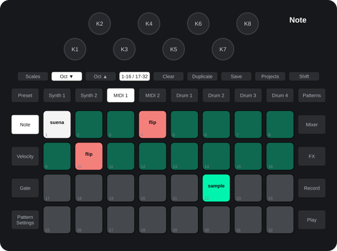

*Expanded Note view of MIDI 1 in the sample mode: steps on top, samples below.*


*[Step by step: Pick samples and flip them by step (since RC2)](https://github.com/Ghillermo/CIRCUIT-HACKS-RC/wiki/Step-by-step#pick-samples-and-flip-them-by-step-since-rc2)*

## [Mod matrix of the own synth (since RC2.02)](https://ghillermo.github.io/CIRCUIT-HACKS-RC/beta/guide.html#f-matriz-mod)

**Since RC2.02.** With the MIDI 1 / 2 engine on, **pad 6** of its Preset view is a new knob page: **K1-K8 = eight sources** (velocity, note, random per note, LFO 2, envelope 2, a drum hit, the pattern position, stepped random). Each knob's **position** is the **destination** (every parameter of the knob pages, 33, one stretch each, in its page's colour) and, inside the stretch, the **amount**. Slow knobs: two clicks a step, 16 steps a destination.

**What it is for:** Eight modulation sources for the MIDI 1 / 2 own synth (velocity, note, a random value per note, a second LFO, a second envelope, a drum hit, the pattern position and stepped random), each sent with a single knob to any of the engine's 33 parameters. Movement and expression without automating by hand.

**How:**

1. With the engine on, press **pad 6** of the MIDI 1 / 2 Preset view (light blue): **K1-K8** are the sources: K1 velocity, K2 note, K3 random on each note, K4 LFO 2, K5 envelope 2, K6 a drum hit, K7 pattern position, K8 stepped random.
2. Turn a knob to the right: its position picks the **destination** (33 parameters, one stretch each: 16 steps of two clicks) and, inside the stretch, the **amount**; fully left = off.
3. The LED takes the colour of the destination's page (amber VCA-VCF, green OSC 1, teal OSC 2) and its brightness is the amount; while you turn (and 1.5 s after), the pads show where the destination lives (its page pad, and pads 9-16 / 17-24 = that page's K1-K8 / Shift + K1-K8).
4. **With Shift:** K4 = LFO 2's shape × rate (*(since RC4)* the left half of each shape synced to the tempo), K5 = attack × decay, K6 = which drum (1-4) × decay, K8 = N steps (1, 2, 4, 8, 16).
5. **Clear + knob** = that source off; **Clear + Shift + knob** = its parameter back to its default; **Clear + pad 6** = all off.

**Keep in mind:**

- A full amount sweeps the parameter's whole range; it is added when the value is sent (the stored value does not change), and several sources on one destination add up. Note, random, LFO 2 and stepped random go up and down; the others only up.
- *(since RC2.02)* Saved with the own-synth patches (pads 9-24) and, *(since RC4)*, with the project. No CC / NRPN.
- The modulations reach the engine about 100-250 times a second, shared among everything that moves on the track.
- Detail: [Mod matrix](https://ghillermo.github.io/CIRCUIT-HACKS-RC/beta/guide.html#midi-matriz).


*[Step by step: Send a mod matrix source to a destination (since RC2.02)](https://github.com/Ghillermo/CIRCUIT-HACKS-RC/wiki/Step-by-step#send-a-mod-matrix-source-to-a-destination-since-rc202)*

## [Jump sequencer of MIDI 1 / 2 (Beta 5.64 only)](https://ghillermo.github.io/CIRCUIT-HACKS-RC/beta/guide.html#f-saltos)

The notes of a MIDI track make another track's pattern jump to the step they indicate.

**What it is for:** A MIDI track can stop sounding and move another track's pattern instead: each of its notes makes that track jump to the step the note stands for, on the very same step. A way to rearrange or stutter a drum loop or a phrase from a sequence of notes.

**How:**

1. In the MIDI 1 / 2 Preset view, **pad 26** opens the flip view (pad 26 white while it is open).
2. On row 3, **pad 18** = step flip (**pad 17** = patch flip; tapping the one that is on turns it off).
3. On row 2, tap the **target** among the eight tracks (in their colours, the target bright); with none picked, the last one used (Synth 1 from the factory). With the view closed, pad 26 blinks in the target's colour.
4. Write or play the track's notes: in its Note view **pads 17-32 = steps 1-16** and **Octave ▲** = steps 17-32; in the expanded Note view the 32 pads = steps 1-32. Each note makes the target jump to that step.
5. Stopped, a pad sounds that step of the target while you hold it, without jumping.

**Keep in mind:**

- *(Beta 5.56 only)* While pointing, the track plays no notes (no engine, no MIDI); pointing turns the engine off, and turning an engine on stops pointing.
- A step's probability, 1 in N and random-mutate still apply; a track muted in the Mixer makes no jump. MIDI 1 and MIDI 2 can point at the same time.
- With the same length on both tracks a jump is only noticeable the first time: use different lengths, or two jumps (one to move it, one to bring it back).
- Saved with the project. Detail: [MIDI 1 / 2 Preset view](https://ghillermo.github.io/CIRCUIT-HACKS-RC/beta/guide.html#midi-preset).

## [4-operator FM (since RC4)](https://ghillermo.github.io/CIRCUIT-HACKS-RC/beta/guide.html#f-fm4)

**Since RC4.** A variant of the oscillator of the MIDI 1 / 2 own synth: **pad 24** of the engine row (a tap on pad 27), violet; its knobs on **pad 7**. **K1-K4** = the ratio of operators 1-4 (with a **fine detune** on each ratio's clicks), **K5-K8** = their level; **Shift + K1-K4** = to the right its attack, to the left the operator **percussive** with its own decay; **Shift + K5** = the **algorithm** (16; also by **holding pad 7**: pads 9-24 are the algorithms, a press picks one and plays it), **Shift + K6** feedback, **Shift + K7** noise, **Shift + K8** release (longer with more velocity).

**What it is for:** A 4-operator FM synth as a variant of the own synth's oscillator, with 16 algorithms (classic, percussive, bells and strings) for electric pianos, basses, bells, metallic hits and drums. Each operator has an attack / release envelope with a fixed sustain, and 16 starter sounds are one press away.

**How:**

1. In the MIDI 1 / 2 Preset view tap **pad 27** and pick **pad 24** of the engine row (violet); **pad 7** opens its knob page.
2. **K1-K4** = the ratio of operators 1-4 (the extra clicks of each ratio detune it slightly); **K5-K8** = their level.
3. **Shift + K1-K4** = to the right the operator's attack, to the left it becomes percussive with its own decay; **Shift + K5** = algorithm (16); **Shift + K6** feedback; **Shift + K7** noise; **Shift + K8** release (longer the harder the note).
4. **Hold pad 7:** pads 9-24 = the 16 algorithms in their family's colour; press one to pick it and hear it (**Shift + pad** = silent).
5. **Hold pad 8:** pads 9-24 = 16 starter instruments (piano, electric piano, organ, pluck, harp, marimba, bass, bell, strings, pad, flute, clarinet, brass, kick, snare, hi-hat); press one to load its whole FM.
6. **Clear + pad 7** = a playable voice of the chosen algorithm; **Clear + knob** = its value in that voice; **Clear + MIDI 1 / 2** = everything to the defaults.

**Keep in mind:**

- The loudness comes from the operators (the engine's VCA stays open); SHAPE, envelope → shape and LFO → shape of the OSC 1 page set the brightness, so the ADSR, the LFO, the matrix and the lanes move the timbre. Velocity and higher notes change it too.
- *(since RC4)* In the poly voice mode up to 6 FM voices, shared by MIDI 1 and MIDI 2 (3 each with both in FM poly); *(Beta 5.56 only)* 6 each, computed apart from the rest of the sound. See [Own-synth voices](https://ghillermo.github.io/CIRCUIT-HACKS-RC/beta/guide.html#midi-voces).
- Saved with the own-synth patches and with the project; no CC / NRPN.
- *(Beta 5.56 only)* Replaced by the 8-operator FM: 4-operator patches load into it with the same sound. Detail: [4-operator FM](https://ghillermo.github.io/CIRCUIT-HACKS-RC/beta/guide.html#midi-fm).

→ [Step by step: Choose an engine on the engine row (since RC4)](https://github.com/Ghillermo/CIRCUIT-HACKS-RC/wiki/Step-by-step#choose-an-engine-on-the-engine-row-since-rc4) — shown above, under [Engine of the MIDI tracks (pad 27)](https://github.com/Ghillermo/CIRCUIT-HACKS-RC/wiki/Features-Modes#engine-of-the-midi-tracks-pad-27)


*[Step by step: Pick an FM algorithm from the pads (since RC4)](https://github.com/Ghillermo/CIRCUIT-HACKS-RC/wiki/Step-by-step#pick-an-fm-algorithm-from-the-pads-since-rc4)*


*[Step by step: Load an FM starter sound (since RC4)](https://github.com/Ghillermo/CIRCUIT-HACKS-RC/wiki/Step-by-step#load-an-fm-starter-sound-since-rc4)*

## [8-operator FM (Beta 5.64 only)](https://ghillermo.github.io/CIRCUIT-HACKS-RC/beta/guide.html#f-fm8)

**Beta 5.64 only.** It replaces the 4-operator FM on **pad 24** of the engine row: **up to 8 operators**, each with a **DX7-style envelope** (4 rates, 4 levels), and **56 algorithms** (the 4-operator FM's 16, the DX7's 32 and 8 with eight operators). 4-operator FM patches load converted, with the same sound. FM page = **pad 7** (with the engine row closed): **pads 9-16** = operator 1-8 (the ones the algorithm uses lit: carriers green, modulators light blue), **pad 3** = the pitch envelope (violet). **K1** ratio (0.5 … 31 or fixed in Hz), **K2** fine, **K3** level, **K4** velocity, **K5-K8** rates R1-R4; with Shift **K1** algorithm, **K2** feedback, **K3** rate scaling, **K4** level scaling, **K5-K8** levels L1-L4.

**What it is for:** In the beta the FM engine grows to up to 8 operators, each with a DX7-style envelope (4 rates and 4 levels), and 56 algorithms: the 4-operator FM's 16, the DX7's 32 and 8 with eight operators. 4-operator patches load with the same sound, DX7 voices can be imported with the card app, and an algorithm map shows and edits the routing on the pads.

**How:**

1. MIDI 1 / 2 Preset view: tap **pad 27**, pick **pad 24** (violet), close the row with **pad 27** and press **pad 7**: the FM page.
2. **Pads 9-16** pick operator 1-8 (the ones the algorithm uses lit: carriers green, modulators light blue); **pad 3** = the pitch envelope (violet).
3. With an operator picked: **K1** ratio (0.5 … 31, or fixed 1 / 10 / 100 / 1000 Hz in red), **K2** fine, **K3** output level, **K4** velocity sensitivity, **K5-K8** rates R1-R4; with **Shift**: K1 algorithm (56), K2 feedback, K3 rate scaling, K4 level scaling, K5-K8 levels L1-L4.
4. **Shift + pad 7 held** = the 56 algorithms on pads 9-32, in three pages (**Octave ▼ / ▲**); **pad 8 held** = 24 instruments in their type's colour (**Octave ▼** = a second page of 24); press one to load it and hear it.
5. A tap on **pad 7** = the **algorithm map** (held ½ s: only while held): each row reads left (modulator) to right (carrier), a dark gap = no interaction; the colour tells the ratio (green integer, teal x.5, orange inharmonic, red fixed; violet the feedback). Tap = pick, **Shift + operator** = silence it while the map shows, **hold one and tap another** = link or unlink them (an own algorithm).

**Keep in mind:**

- *(Beta 5.56 only)* Only the algorithm's operators take DSP time: about 10 voices with 4 operators, 6-7 with 6, 5 with 8.
- Saved with the own-synth patches (an extra slot of the same bank on the card, which grows up to 8 KB) and with the project; swapping or copying patches between packs takes the FM along. Components' «Send patches» / «Send pack» no longer erase them (not on the internal pack).
- Loading an instrument from the pad 8 list also sets page 4 and Shift + pad 4 to the knobs that suit its family; the values do not change.
- No CC / NRPN. DX7 voices: the card app turns a 32-voice or single-voice .syx into custom patches with this FM ([Card and device app](https://ghillermo.github.io/CIRCUIT-HACKS-RC/beta/guide.html#app-sd)). Detail: [8-operator FM](https://ghillermo.github.io/CIRCUIT-HACKS-RC/beta/guide.html#midi-fm8).

## [Wavetable (Beta 5.64 only)](https://ghillermo.github.io/CIRCUIT-HACKS-RC/beta/guide.html#f-wavetable)

**Beta 5.64 only.** **Pad 21** of the engine row (sand) = the oscillator reading a **wavetable**: both oscillators, the FM / ring / sync between them, the filter, the VCA, polyphony and the voice modes stay as they are. **One table per patch, up to 9 frames**, for both oscillators; each its own **position**: **K3** of the OSC 1 / OSC 2 page (WAVE; in Beta 5.24-5.26, K7), K7 = LFO → position, Shift + K3 = envelope → position. **SHAPE** (K2) and envelope / LFO → shape (K4 / K6) = **warp**, a bend of the phase.

**What it is for:** A wavetable engine for the own synth: the oscillator reads a table of up to 9 frames per patch and moves through it with a position knob, an LFO or the envelope, while both oscillators, FM / ring / sync, the filter, the VCA and polyphony work as usual. Fill the table with the stock synth's 16 wavetables or with single cycles cut from the pack's samples.

**How:**

1. In the MIDI 1 / 2 Preset view tap **pad 27** and pick **pad 21** of the engine row (sand); pad 27 then shows sand.
2. On the OSC 1 / OSC 2 page, **K3** = the position (the frame); OSC 1's **K7** = LFO → position and **Shift + K3** = envelope → position; **SHAPE (K4)** = warp, a bend of the phase.
3. **Hold pad 7:** pads 9-24 = the stock synth's 16 wavetables (sand, the loaded one bright): a tap fills the table with its 9 frames; **Shift + a table** changes only the frame the position (K3) points at.
4. **Hold pad 8:** the pack's samples on pads 9-32 (**Octave ▼ / ▲** = page): a tap puts one cycle of that sample into the frame the position points at (it takes a moment).
5. **Clear + pad 7** = that frame back to its table's. Every tap on a list sounds the tonic until you let go of the pad.

**Keep in mind:**

- *(Beta 5.56 only)* One table per patch, for both oscillators: saved with the own-synth patches and with the project; wavetable patches show sand in the patch list.
- Every frame has 18 band-limited versions, so high notes do not alias; with the warp away from the centre the ends sound a little duller.
- The first time, the table comes filled with the 7th (digital saw-square). On a table change the new frames come in one by one (a short blend meanwhile).
- Detail: [MIDI 1 / 2 Preset view](https://ghillermo.github.io/CIRCUIT-HACKS-RC/beta/guide.html#midi-preset), [Knob pages of the MIDI 1 / 2 engine](https://ghillermo.github.io/CIRCUIT-HACKS-RC/beta/guide.html#midi-knobs).

## [Master FX since RC2: mechanical gesture, Glitch, Digitise and saving per session](https://ghillermo.github.io/CIRCUIT-HACKS-RC/beta/guide.html#f-master-fx-beta)

**Since RC2.** Pad 6 of Master FX is the **Glitch** and pad 31 a **mechanical gesture** (tape stop, scratch…); Digitise gains **K3 = momentary send to the delay** and **K4 = envelope**; the Master FX knobs and slots **are saved with every project**.

**What it is for:** Since RC2 Master FX has the Glitch on pad 6 and a mechanical gesture on pad 31 (tape stop, scratches, back spin…), Digitise gains a momentary throw to the delay and an envelope, and the Master FX settings are saved with every project. Each project keeps its own performance setup.

**How:**

1. **Pad 31 = mechanical gesture:** press it and the audio slows down to a stop; release it and the audio starts again. **K1** = moves per gesture (1-8), **K2** = the kind, blended continuously and shown in colours (tape stop → baby scratch → tear → back spin → rattle), **K3** = stop time, **K4** = start time.
2. **Pad 6 = Glitch:** held, latched (Shift + pad 6), assignable to the slots and to the FX sequencer like the other effects; its K1-K4 are the Glitch's.
3. **Digitise (pad 4):** K1 sample rate, K2 bits, **K3** = sends every track to the delay while you hold pad 4 (on release their sends come back), **K4** = envelope of the amount (to the right it goes from full to clean, to the left it grows).
4. Save the project (**Save** twice): the 20 knobs of the top row, the slot assignments and the master compressor's attack / release are stored, and they come back when it loads.

**Keep in mind:**

- A project without them (an older or a new one) leaves the device as it is. Latched effects are not saved.
- The gesture uses the Glitch's engine: while it plays, the Glitch waits. Pad 31 can be stored on a slot too (hold pad 31 + a slot).
- *(since RC4.02)* Digitise's K4 envelope starts properly (in RC4 and before it never started).
- Detail: [Master FX](https://ghillermo.github.io/CIRCUIT-HACKS-RC/beta/guide.html#master-fx).
