# Accesos directos y usabilidad

*[English version](https://github.com/Ghillermo/CIRCUIT-HACKS-RC/wiki/Features-Shortcuts) · [Inicio](https://github.com/Ghillermo/CIRCUIT-HACKS-RC/wiki/Home#en-español) · [Funciones](https://github.com/Ghillermo/CIRCUIT-HACKS-RC/wiki/Features-ES) · [Guía por vistas](https://ghillermo.github.io/CIRCUIT-HACKS-RC/beta/guia.html)*

Una de las cinco páginas de [Funciones](https://github.com/Ghillermo/CIRCUIT-HACKS-RC/wiki/Features-ES): cada función explicada, con sus imágenes y las animaciones de sus procesos. Cada título enlaza con su apartado de la [guía por vistas](https://ghillermo.github.io/CIRCUIT-HACKS-RC/beta/guia.html), el manual, donde cada función está en el capítulo de su vista.

**Contenido**

- **[Accesos directos y usabilidad](https://github.com/Ghillermo/CIRCUIT-HACKS-RC/wiki/Features-Shortcuts-ES)** — [Mapa de atajos](https://github.com/Ghillermo/CIRCUIT-HACKS-RC/wiki/Features-Shortcuts-ES#mapa-de-atajos) · [Master FX en el botón Mixer](https://github.com/Ghillermo/CIRCUIT-HACKS-RC/wiki/Features-Shortcuts-ES#master-fx-en-el-botón-mixer) · [Teclas de la vista FX](https://github.com/Ghillermo/CIRCUIT-HACKS-RC/wiki/Features-Shortcuts-ES#teclas-de-la-vista-fx) · [Clear + knob = valor por defecto](https://github.com/Ghillermo/CIRCUIT-HACKS-RC/wiki/Features-Shortcuts-ES#clear--knob--valor-por-defecto) · [Apagar efectos fijados (pad 8 de Master FX)](https://github.com/Ghillermo/CIRCUIT-HACKS-RC/wiki/Features-Shortcuts-ES#apagar-efectos-fijados-pad-8-de-master-fx) · [Vista de la fuente del sinte](https://github.com/Ghillermo/CIRCUIT-HACKS-RC/wiki/Features-Shortcuts-ES#vista-de-la-fuente-del-sinte) · [Vista cromática y de escala de los drums](https://github.com/Ghillermo/CIRCUIT-HACKS-RC/wiki/Features-Shortcuts-ES#vista-cromática-y-de-escala-de-los-drums) · [Gestión del pack desde el aparato](https://github.com/Ghillermo/CIRCUIT-HACKS-RC/wiki/Features-Shortcuts-ES#gestión-del-pack-desde-el-aparato) · [Sustituir un drum por la captura](https://github.com/Ghillermo/CIRCUIT-HACKS-RC/wiki/Features-Shortcuts-ES#sustituir-un-drum-por-la-captura) · [Editor de CC de los macros MIDI](https://github.com/Ghillermo/CIRCUIT-HACKS-RC/wiki/Features-Shortcuts-ES#editor-de-cc-de-los-macros-midi) · [Mixer: Shift + knob = nivel a 100 / 0](https://github.com/Ghillermo/CIRCUIT-HACKS-RC/wiki/Features-Shortcuts-ES#mixer-shift--knob--nivel-a-100--0) · [Modo cue, mutes al compás y cuantizar (desde RC2)](https://github.com/Ghillermo/CIRCUIT-HACKS-RC/wiki/Features-Shortcuts-ES#modo-cue-mutes-al-compás-y-cuantizar-desde-rc2) · [LFO a tempo (desde RC4)](https://github.com/Ghillermo/CIRCUIT-HACKS-RC/wiki/Features-Shortcuts-ES#lfo-a-tempo-desde-rc4) · [Teclado partido Synth 1 + Synth 2](https://github.com/Ghillermo/CIRCUIT-HACKS-RC/wiki/Features-Shortcuts-ES#teclado-partido-synth-1--synth-2) · [Colores de los patches de sinte](https://github.com/Ghillermo/CIRCUIT-HACKS-RC/wiki/Features-Shortcuts-ES#colores-de-los-patches-de-sinte) · [Patches del sinte propio (MIDI 1 / 2)](https://github.com/Ghillermo/CIRCUIT-HACKS-RC/wiki/Features-Shortcuts-ES#patches-del-sinte-propio-midi-1--2) · [Guardar el patch del sinte en el pack](https://github.com/Ghillermo/CIRCUIT-HACKS-RC/wiki/Features-Shortcuts-ES#guardar-el-patch-del-sinte-en-el-pack) · [Destinos de los macro knobs](https://github.com/Ghillermo/CIRCUIT-HACKS-RC/wiki/Features-Shortcuts-ES#destinos-de-los-macro-knobs) · [Copiar proyectos a otro hueco o a otro pack](https://github.com/Ghillermo/CIRCUIT-HACKS-RC/wiki/Features-Shortcuts-ES#copiar-proyectos-a-otro-hueco-o-a-otro-pack) · [Patches del sinte propio a otro pack](https://github.com/Ghillermo/CIRCUIT-HACKS-RC/wiki/Features-Shortcuts-ES#patches-del-sinte-propio-a-otro-pack) · [Shift = destello de cada nota (solo Beta 5.64)](https://github.com/Ghillermo/CIRCUIT-HACKS-RC/wiki/Features-Shortcuts-ES#shift--destello-de-cada-nota-solo-beta-564) · [Shift + Preset = el sonido del proyecto (solo Beta 5.64)](https://github.com/Ghillermo/CIRCUIT-HACKS-RC/wiki/Features-Shortcuts-ES#shift--preset--el-sonido-del-proyecto-solo-beta-564)

## [Mapa de atajos](https://ghillermo.github.io/CIRCUIT-HACKS-RC/beta/guia.html#f-atajos)

Todos los atajos del mod en un dibujo del aparato: botones dobles, Shift + botón, Clear + knob y los pads especiales de cada vista.

**Para qué sirve:** Una chuleta de una página con todos los gestos que añade el mod, dibujados sobre el aparato: botones dobles, Shift + botón, Clear + knob y los pads especiales de cada vista, cada uno con lo que hace y desde qué versión. Tenla a mano mientras aprendes el mod: te dice qué botón mantener y cuál pulsar.

**Cómo:**

1. En el dibujo, cada número señala un control; en la tabla de la entrada ilustrada (el enlace del título), la fila con ese número da el gesto y lo que hace, y la tabla sigue con los atajos que no caben en el dibujo.
2. **Botones dobles:** **Mixer** dos veces = Master FX; **Synth 1 / 2** dos veces = la vista de la fuente del sinte; *(desde RC4)* **MIDI 1 / 2** otra vez con su vista Note en pantalla = su vista Preset, **Scales** dos veces = el editor de la escala propia, **Velocity** dos veces = velocity fija (en los drums, *solo Beta 5.56*, la vista de automatización).
3. **Shift + botón:** **Shift + Preset** con un drum = la vista cromática; *(desde RC2)* **Shift + Clear** = metrónomo y cuenta atrás, **Shift + Play** = cuantizar, **Shift + Scales** = escala propia; *(desde RC4)* **Shift + Synth 1 / 2** o **Shift + MIDI 1 / 2** = lo mismo que pulsarlos dos veces.
4. **Clear + knob:** a la derecha = el valor por defecto del knob; a la izquierda = borrar su automatización. *(desde RC2)* **Clear + Synth 1 / 2, MIDI 1 / 2 o el botón de un drum** = el sonido de esa pista vuelve a sus valores de partida (el botón de un drum además borra la automatización de sus knobs en el patrón que suena).
5. **Pads especiales:** en Master FX, el **pad 7** toca la captura, el **pad 8** lo apaga todo y el **pad 32** graba; en la vista Preset de MIDI 1 / 2, **pad 25** = editor de CC, **26** = patch flip, **27** = motor, **30** = step-drummer, **32** = modo de voz *(desde RC4)*.

**A tener en cuenta:**

- Con **Shift** pulsado, cada vista ilumina en **amarillo** los atajos que ofrece; la opción elegida, en otro color.
- *desde RC2 / RC2.02 / RC4 / RC4.05* = en las RC y en la beta a partir de esa versión; *solo Beta 5.56* = solo en la beta.
- **Scales + Preset + Note** al encender = modo de recuperación de Novation: permite volver a instalar cualquier firmware.
- Lo que no está en el mapa funciona como en el original. Los gestos que valen en todas las vistas: [Botones que funcionan en todas las vistas](https://ghillermo.github.io/CIRCUIT-HACKS-RC/beta/guia.html#botones).

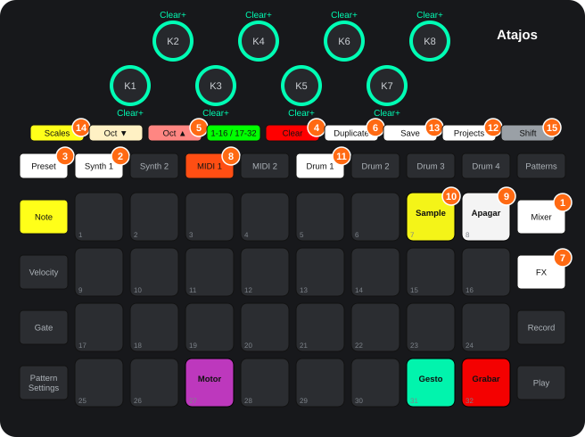

*Mapa de atajos: los números remiten a la tabla.*


*[Paso a paso: Fijar notas (latch) y escribirlas en un paso (desde RC4)](https://github.com/Ghillermo/CIRCUIT-HACKS-RC/wiki/Step-by-step-ES#fijar-notas-latch-y-escribirlas-en-un-paso-desde-rc4)*

## [Master FX en el botón Mixer](https://ghillermo.github.io/CIRCUIT-HACKS-RC/beta/guia.html#f-master-fx-acceso)

Desde el Mixer, **Mixer otra vez** abre Master FX; cualquier otro botón de vista sale.

**Para qué sirve:** Master FX es la página de directo del mod: efectos sobre toda la mezcla (Gater, Auto-Filter, Digitise, Phaser, Glitch y un gesto mecánico de parada de cinta), un song pointer, el sample capturado y una fila de efectos que asignas tú. Está detrás del botón Mixer, a dos pulsaciones, para llegar a ella en plena actuación.

**Cómo:**

1. Pulsa **Mixer**.
2. Pulsa **Mixer** otra vez: se abre Master FX.
3. Cualquier otro botón de vista vuelve a las vistas normales.
4. *(solo Beta 5.56)* En el Mixer, **mantén Mixer** ½ s o más: Master FX se ve solo mientras lo mantienes y al soltar vuelve el Mixer; en Master FX, mantenerlo enseña el Mixer hasta que lo sueltas. Un toque cambia como siempre.

**A tener en cuenta:**

- Pads: 1-6 efectos, 7 toca la captura, 8 apaga todo lo fijado, 9-24 song pointer, 26-30 huecos asignables, 31 gesto mecánico, 32 graba la captura. Cada pad en detalle: [Master FX](https://ghillermo.github.io/CIRCUIT-HACKS-RC/beta/guia.html#master-fx).
- *(desde RC2)* Los 20 knobs de los efectos, la asignación de los huecos y el ataque / release del compresor master se guardan con cada proyecto; los efectos fijados y el song pointer no (al encender, apagados).

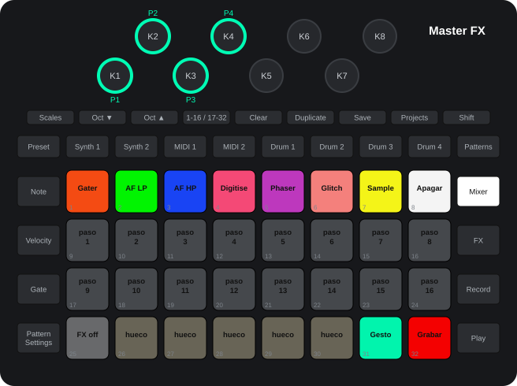

*Master FX: pads 1-6 efectos, 7 sample, 8 apagar todo, 9-24 song pointer, fila inferior asignable, 31 gesto mecánico, 32 grabar.*

## [Teclas de la vista FX](https://ghillermo.github.io/CIRCUIT-HACKS-RC/beta/guia.html#f-vista-fx)

**Octave ▲ / ▼** = envíos de delay / reverb; **Shift + knob** = parámetros de reverb y delay. **Duplicate** = reset (envíos a 0, filtro master al centro, Master FX apagado); **Shift + Octave ▲ / ▼** = resonancia del filtro master ±16 (desde RC4; antes, **1-16 / 17-32**); **Shift + pad 25** = filtro master apagado / encendido (desde RC4).

**Para qué sirve:** Convierte la vista FX en la página de control de la reverb y el delay del aparato: además de los envíos de cada pista, ajustas los propios efectos (tipo, decay, tiempo, feedback…), lo reinicias todo con un toque y tienes a mano la resonancia del filtro master y un interruptor que lo apaga.

**Cómo:**

1. Pulsa **FX**. **Octave ▲** = los knobs son los envíos de **delay** de cada pista; **Octave ▼** = los envíos de **reverb**.
2. **Shift + knob** = los ajustes del propio efecto: reverb K1 tipo, K2 decay, K3 damping; delay K1 time, K2 sync, K3 feedback, K4 width, K5 ratio, K6 slew. El LED enseña el valor con su brillo.
3. **Duplicate** = reset: envíos a 0, filtro master al centro (sin tocar la resonancia), Master FX apagado.
4. *(desde RC4)* **Shift + Octave ▲ / ▼** = resonancia del filtro master +16 / −16; se para en 127 / 0 (con Shift, Octave en amarillo).
5. *(desde RC4)* **Shift + pad 25** = filtro master apagado / encendido: apagado, suena como con el filtro al centro aunque muevas su knob, y el LED del knob del filtro se ve rojo (con Shift, el pad 25 amarillo, rojo si está apagado); otra vez, el filtro vuelve en la posición actual del knob.

**A tener en cuenta:**

- Los ajustes de reverb y delay se guardan con el proyecto. El filtro master, su resonancia y el apagado no: al encender vuelven a sus valores iniciales, con el filtro encendido.
- La fila inferior es la de Master FX: huecos 26-30, gesto mecánico (31) y grabar (32). Sin Shift, el pad 25 es el de stock.
- Si en Setup el retorno de reverb / delay va por las tiras 3 / 4, los envíos de esas tiras tienen tope a la mitad.
- *(solo Beta 5.56)* Con Shift, los Octave enseñan la resonancia como las octavas del original: Octave ▼ brillante en la mitad alta, tenue en la baja y apagado en 0; Octave ▲ al revés, apagado en 127. Antes de RC4 la resonancia estaba en **1-16 / 17-32**, que ahora hace lo de siempre.

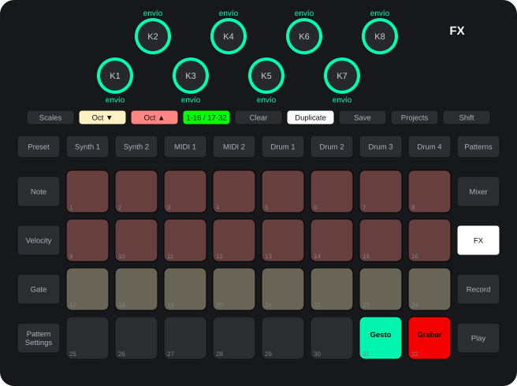

*Vista FX: Octave elige delay / reverb; la fila inferior es la de Master FX.*

## [Clear + knob = valor por defecto](https://ghillermo.github.io/CIRCUIT-HACKS-RC/beta/guia.html#f-clear-knob)

Mantén **Clear** y gira un knob a la derecha: vuelve a su valor por defecto. El LED se pone **lavanda** (el azul del original). En drums, a la izquierda borra la automatización de los knobs de stock (LED rojo), como en el original. También en el motor de las pistas MIDI y en **Master FX**.

**Para qué sirve:** Una vuelta rápida para cualquier knob del mod: mantén Clear y gira un knob a la derecha y salta a su valor por defecto, sin buscar a mano el punto neutro; gíralo a la izquierda y borra lo que ese knob grabó en el patrón que suena, como en el original.

**Cómo:**

1. Mantén **Clear** y gira un knob **a la derecha**: vuelve a su valor por defecto — en los drums (knobs de stock y nuevos), el motor de MIDI 1 / 2 y **Master FX** (los knobs del efecto elegido). LED **lavanda** = hecho.
2. Mantén **Clear** y gira un knob **a la izquierda**: se borra su automatización en el patrón que suena (LED **rojo**) — en los knobs de stock de los drums y, *(desde RC2)*, en el motor de MIDI 1 / 2 (los carriles del knob, con y sin Shift, que tengan automatización).
3. Suelta **Clear**.

**A tener en cuenta:**

- En los drums y en el motor MIDI restablece **las dos capas** del knob (con y sin Shift). En los drums, **Clear + K3** a la derecha pone a 0 ataque, inicio y corte; *(desde RC2)* **Clear + K8** a la derecha quita también el bitcrush.
- **Master FX** no tiene automatización: a la izquierda no hace nada. Con Clear pulsado, los knobs del efecto elegido que están en su valor por defecto se ven lavanda (pads 1-6, el Glitch y el sample).
- Una pista entera de una vez *(desde RC2)*: **Clear + el botón de un drum** borra la automatización de sus knobs en el patrón que suena y pone sus ocho knobs por defecto; **Clear + Synth 1 / 2** devuelve sus ocho macros a los valores del patch cargado; **Clear + MIDI 1 / 2** devuelve los valores del sinte propio a los iniciales.

## [Apagar efectos fijados (pad 8 de Master FX)](https://ghillermo.github.io/CIRCUIT-HACKS-RC/beta/guia.html#f-pad8)

**Pad 8** apaga todo lo fijado con Shift (efectos y song pointer) y hace bypass de los FX; tocar un efecto fijado lo suelta.

**Para qué sirve:** El botón de pánico de Master FX: un toque al pad 8 apaga todos los efectos que fijaste con Shift, el song pointer y el sample, y vuelves a la mezcla limpia de un solo gesto.

**Cómo:**

1. En Master FX, **mantén** un pad de efecto para que suene solo mientras lo mantienes, o pulsa **Shift + su pad** para fijarlo; tocar otra vez un pad fijado (sin Shift) suelta solo ese.
2. Pulsa el **pad 8** (blanco): se sueltan todos los efectos fijados (también los huecos de la fila inferior), se apaga el song pointer, se para el sample y se hace bypass de los FX.

**A tener en cuenta:**

- Los efectos fijados, el song pointer y el sample fijado no se guardan: al encender están apagados (el song pointer, a 0).
- *(solo Beta 5.56)* Un bucle del sample fijado que sigue sonando al cargar otro proyecto o pack se para como siempre: pad 7 o pad 8.

## [Vista de la fuente del sinte](https://ghillermo.github.io/CIRCUIT-HACKS-RC/beta/guia.html#f-fuente-sinte)

Con Synth 1 / 2 en pantalla, **pulsa su botón otra vez**: pads 25-29 eligen la fuente (ruido, entradas, invertidas), pad 30 = step-drummer.

**Para qué sirve:** Convierte Synth 1 / 2 en un procesador para un sonido de fuera: el ruido del patch se cambia por la entrada de audio 1 o 2, así que el filtro, las envolventes y los efectos del sinte moldean tu señal externa (una caja de ritmos, una voz, otro sinte) al ritmo de las notas que tocas. La misma vista abre el step-drummer del sinte y, desde RC2, el editor de los destinos de los macros.

**Cómo:**

1. Con la vista de **Synth 1** o **Synth 2** en pantalla, pulsa su botón otra vez (*(desde RC4)*: o **Shift + Synth 1 / 2** desde cualquier vista).
2. Elige la fuente del ruido del sinte: **pad 25** ruido (lo normal), **26** entrada de audio 1, **27** entrada de audio 2, **28** entrada 1 con la fase invertida, **29** entrada 2 con la fase invertida.
3. El **pad 30** abre el step-drummer del sinte; el **pad 32** *(desde RC2)*, el editor de los destinos de los macro knobs.
4. Cualquier botón cierra la vista.

**A tener en cuenta:**

- El patch debe tener nivel de ruido (CC 56) para oír la fuente. La fuente se guarda con el proyecto.
- Si en Setup los retornos de reverb / delay van por las tiras 3 / 4, esa señal es la que entra al sinte.
- *(desde RC2)* Play y Record ya no cierran el step-drummer del sinte: hasta que lo cierras con el pad 30, pulsar Synth 1 / 2 lo vuelve a abrir.
- *(solo Beta 5.56)* Con un morph de patches en marcha en ese sinte, su botón abre la vista del morph en su lugar (ver la [vista Preset de Synth 1 / 2](https://ghillermo.github.io/CIRCUIT-HACKS-RC/beta/guia.html#synth-preset)).

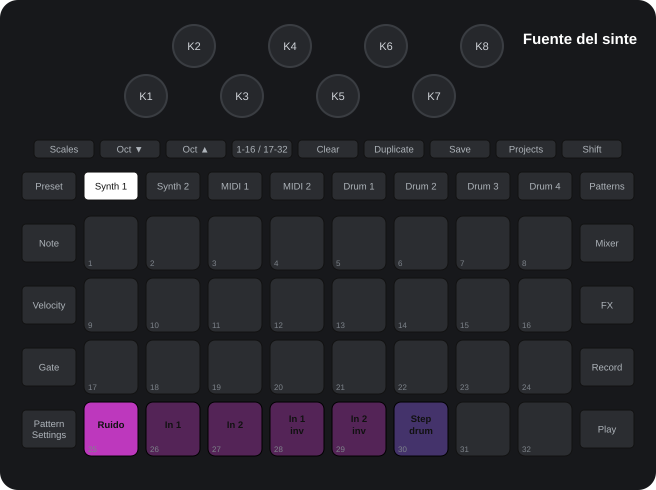

*Vista de la fuente del sinte (Synth 1 / 2 pulsado dos veces).*

## [Vista cromática y de escala de los drums](https://ghillermo.github.io/CIRCUIT-HACKS-RC/beta/guia.html#f-cromatica)

**Shift + Preset** con un drum: los pads tocan el sample en la escala; K1 = sesgo de tono, Shift + K1 = cents; vista Note: pads 25-28 = drums 4-1.

**Para qué sirve:** Toca un sample de drum como un teclado: los pads dan el sample transpuesto según la escala del proyecto, en tres filas, y un solo golpe (un tom, un golpe de bajo, un corte de voz) se convierte en una melodía o una línea de bajo. Con Record cada tono se graba en su paso.

**Cómo:**

1. Elige un drum (**Drum 1-4**) y pulsa **Shift + Preset** (*(desde RC2)*: o **Preset** otra vez en la vista Preset del drum).
2. Tres filas de pads tocan el sample en la escala y la tónica de la vista **Scales**.
3. **K1** = sesgo de tono en semitonos; **Shift + K1** = afinación fina en cents.
4. Para grabar, toca los pads con **Record + Play**: *(desde RC4.02)* cada pad graba un golpe con su tono en su paso (el micropaso y la velocity de la pulsación); **Shift + Play** (cuantizar) mueve el tono con su golpe.
5. *(desde RC2)* **Preset** otra vez apaga la vista.

**A tener en cuenta:**

- *(desde RC2)* Los pads transponen en semitonos sobre el pitch de K1; **Clear + K1** a la izquierda (sostenido) borra los tonos grabados, con la automatización de K1. *(solo Beta 5.56)* Se graban en el carril extra del drum (de fábrica) y el carril de pitch queda para K1.
- En la vista **Note** de los drums, los pads 25-28 repiten los cuadros de los drums 4 … 1; *(desde RC2)* las filas 1-3 son los rollers de micropasos.
- El semitono de la vista cromática se guarda con el proyecto.

## [Gestión del pack desde el aparato](https://ghillermo.github.io/CIRCUIT-HACKS-RC/beta/guia.html#f-pack)

**Save** también guarda en la tarjeta los samples sustituidos por capturas. **Duplicate + pad A + pad B** (Preset de drums) intercambia dos samples; entre packs **copia** samples y patches de sinte; **Clear**, el pack, **Clear** (vista de packs) borra un pack.

**Para qué sirve:** Ordena y mueve sonidos entre packs desde el propio aparato, sin ordenador: intercambia o copia samples de drums y patches de Synth 1 / 2 entre packs, conserva los samples que capturaste y borra los packs que ya no usas.

**Cómo:**

1. **Conservar las capturas:** guarda el proyecto como siempre (**Save** dos veces): cada sample de drum sustituido por una captura se escribe también en el pack, si cabe en la memoria de samples.
2. **Intercambiar dos samples:** vista **Preset** de drums, mantén **Duplicate** (se ilumina en esta vista), toca el pad **A** (parpadea en azul) y luego el pad **B**: se intercambian y suena al instante.
3. **Copiar un sample a otro pack:** **Duplicate + pad A** en su pack, carga el otro pack (con Duplicate mantenido, el número de A parpadea en amarillo) y **Duplicate + pad B**: A se copia sobre B, que puede estar vacío; el pack de A no cambia.
4. **Patches de sinte:** los mismos gestos en la vista **Preset** de **Synth 1 / 2**: Duplicate + A + B intercambia dentro de un pack y copia entre packs.
5. **Borrar un pack:** vista de packs (**Shift + Projects**), toca **Clear** (durante ~5 s parpadean los packs que se pueden borrar), toca el pack (solo ese parpadea; no se carga) y **Clear** otra vez antes de 5 s.

**A tener en cuenta:**

- Escribe en la tarjeta: no está en las versiones «S» ni en el pack de la memoria interna (el LED de Save se pone rojo).
- Un sample copiado va al sitio de B si cabe; si no, a la memoria libre de importación (unos 44 s); nunca pisa un sample que suena: si no hay sitio, no cambia nada.
- El pack cargado no se puede borrar nunca; el hueco de un pack borrado se reutiliza tras reiniciar. En la vista de packs, Clear se ve blanco fijo.
- **Duplicate + A** otra vez (en su pack) cancela una copia que espera; también se olvida al apagar.

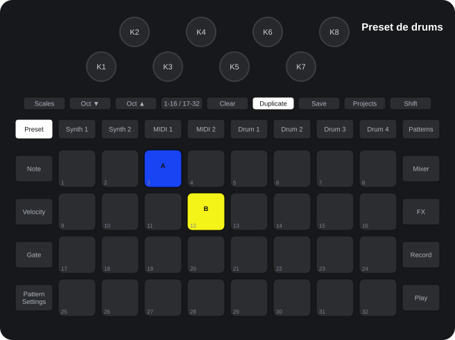

*Vista Preset de drums: Duplicate + A + B intercambia los samples.*

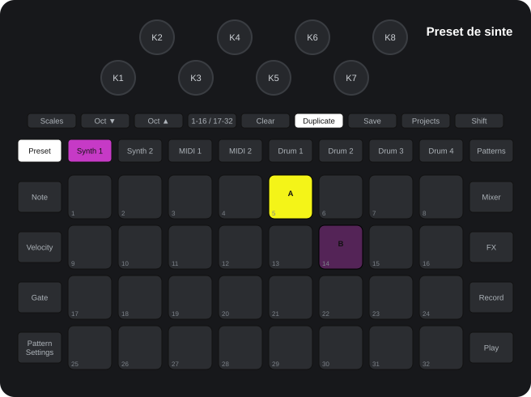

*Vista Preset de Synth 1: Duplicate + A copia el patch (azul); en otro pack, el de A parpadea en amarillo y Duplicate + B lo copia ahí.*


*[Paso a paso: Intercambiar dos patches de Synth 1 / 2](https://github.com/Ghillermo/CIRCUIT-HACKS-RC/wiki/Step-by-step-ES#intercambiar-dos-patches-de-synth-1--2)*


*[Paso a paso: Copiar un patch de Synth 1 / 2 a otro pack](https://github.com/Ghillermo/CIRCUIT-HACKS-RC/wiki/Step-by-step-ES#copiar-un-patch-de-synth-1--2-a-otro-pack)*


*[Paso a paso: Intercambiar dos samples de drum](https://github.com/Ghillermo/CIRCUIT-HACKS-RC/wiki/Step-by-step-ES#intercambiar-dos-samples-de-drum)*


*[Paso a paso: Copiar un sample de drum a otro pack](https://github.com/Ghillermo/CIRCUIT-HACKS-RC/wiki/Step-by-step-ES#copiar-un-sample-de-drum-a-otro-pack)*


*[Paso a paso: Borrar un pack](https://github.com/Ghillermo/CIRCUIT-HACKS-RC/wiki/Step-by-step-ES#borrar-un-pack)*

## [Sustituir un drum por la captura](https://ghillermo.github.io/CIRCUIT-HACKS-RC/beta/guia.html#f-sustituir)

Vista Preset de drums: **Clear + pad dos veces** = ese sample pasa a ser la captura (hasta guardar o recargar).

**Para qué sirve:** Pone en un drum el sonido que acabas de capturar en Master FX: el sample de un drum pasa a ser la captura, y un trozo de la mezcla (un acorde, una voz, un loop remuestreado) se toca y se secuencia como un golpe de drum. Al guardar el proyecto queda en el pack.

**Cómo:**

1. Graba una captura: en Master FX (**Mixer** dos veces), mantén el **pad 32** (rojo) mientras suena la música; graba mientras lo mantienes (hasta 3,46 s).
2. Elige el drum y pulsa **Preset** (vista Preset de drums).
3. **Clear + el pad** del sample que quieres sustituir: el pad parpadea (pregunta).
4. **Clear + el mismo pad** otra vez: confirmado; ese sample suena ahora con la captura.
5. Para conservarlo, guarda el proyecto (**Save** dos veces): la captura se escribe en el pack, si cabe en la memoria de samples.

**A tener en cuenta:**

- Cualquier pad sin Clear anula la pregunta; Clear + otro pad la mueve a ese pad.
- Hasta guardar es temporal: al apagar, el drum vuelve a su sample del pack. En las versiones «S» y en el pack de la memoria interna no se escribe nada: dura hasta que se vuelve a cargar el pack.
- **Shift + pad** sigue siendo la selección silenciosa del original (elegir un sample sin que suene).


*[Paso a paso: Capturar un sample y sustituir un drum por él](https://github.com/Ghillermo/CIRCUIT-HACKS-RC/wiki/Step-by-step-ES#capturar-un-sample-y-sustituir-un-drum-por-él)*

## [Editor de CC de los macros MIDI](https://ghillermo.github.io/CIRCUIT-HACKS-RC/beta/guia.html#f-editor-cc)

Vista Preset de MIDI 1 / 2, **pad 25**: mueve un knob y cambia su CC / NRPN desde el aparato; pad 26 = guardar.

**Para qué sirve:** Cambia desde el aparato qué CC o NRPN manda cada knob de la plantilla de una pista MIDI y con qué recorrido, sin Components. Sirve para llevar los knobs a los parámetros de tu sinte externo.

**Cómo:**

1. **MIDI 1 / 2**, **Preset**, **pad 25**: se enciende.
2. Mueve un knob: queda elegido y su número se dibuja con los pads.
3. **Octave ▼ / ▲** = campo siguiente / anterior; gira el knob para cambiar el valor. El número del primer campo marca el tipo: cualquier número = un CC (número, inicio, fin); 99, 98 o 6 = un NRPN de 7 bits (número, MSB, LSB, inicio, fin); 38 = un NRPN de 14 bits (inicio y fin en MSB y LSB).
4. **Guardar:** el **pad 26**, u **Octave ▼** hasta el paso de guardar (el pad 26 y Save parpadean) y Octave ▼ otra vez. Al guardar sales del editor a la vista Preset.
5. **Descartar:** cualquier botón de vista, el **pad 25** o un pad de plantilla.

**A tener en cuenta:**

- Edita la plantilla de la pista (lo que mandan los knobs con el sinte propio apagado) y guarda en ella, no en un patch del sinte propio.
- Con el sinte propio encendido, los knobs mandan los CC / NRPN propios del motor, nunca la plantilla; el pad 25 se apaga y no hace nada, y un editor abierto se cierra al encenderse el motor.
- En el ordenador, la pestaña **Presets CC** de la [app de la tarjeta y del aparato](https://ghillermo.github.io/CIRCUIT-HACKS-RC/beta/guia.html#app-sd) lee las 8 plantillas del aparato, las cambia y las vuelve a mandar.


*[Paso a paso: Cambiar el CC que manda un macro knob MIDI](https://github.com/Ghillermo/CIRCUIT-HACKS-RC/wiki/Step-by-step-ES#cambiar-el-cc-que-manda-un-macro-knob-midi)*

## [Mixer: Shift + knob = nivel a 100 / 0](https://ghillermo.github.io/CIRCUIT-HACKS-RC/beta/guia.html#f-mixer-shift)

Vista Mixer: **Shift + girar un knob a la derecha** pone el nivel de esa pista a **100**; **a la izquierda**, a **0**.

**Para qué sirve:** Un reset de fader de un solo gesto en el Mixer: Shift + un knob a la derecha deja esa pista a su nivel nominal (100) y a la izquierda a 0, sin buscar el valor exacto; útil para meter o sacar una pista en directo.

**Cómo:**

1. Abre el **Mixer** en su página de niveles (**Octave ▲**, la normal).
2. Mantén **Shift** y gira el knob de una pista **a la derecha**: su nivel salta a **100**.
3. **Shift** + el knob **a la izquierda**: el nivel salta a **0**.

**A tener en cuenta:**

- El salto es como un giro del knob: sale por MIDI y, grabando, queda en la automatización.
- En la página de panorama (**Octave ▼**), Shift + knob enciende / apaga el modo cue *(desde RC2)*.
- En el original, Shift + knob hacía lo mismo que el knob solo: no se pierde ninguna función. Clear + knob (borrar la automatización) no cambia.

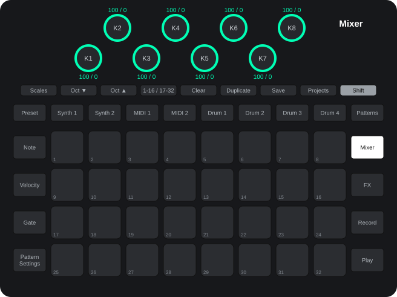

*Mixer: Shift + knob a la derecha = nivel 100, a la izquierda = 0.*

## [Modo cue, mutes al compás y cuantizar (desde RC2)](https://ghillermo.github.io/CIRCUIT-HACKS-RC/beta/guia.html#f-mixer-cue)

**Desde RC2.** Mixer, página de panorama: **Shift + knob** = modo cue (la salida derecha escucha las pistas que elijas). **Shift + pads 1-8** del Mixer = silenciar / activar al compás siguiente. **Shift + Play** = cuantizar el patrón de la pista elegida.

**Para qué sirve:** Tres herramientas para tocar en directo desde el Mixer: un cue por la salida derecha para escuchar pistas antes de meterlas, silencios y entradas que caen justo al empezar el compás siguiente, y cuantizar con un toque el patrón que suena.

**Cómo:**

1. **Modo cue:** en el **Mixer**, página de panorama (**Octave ▼**), **Shift + un knob a la derecha** lo enciende (Octave ▼ rosa); a la izquierda, lo apaga (blanco).
2. Con el modo encendido, cada knob de panorama es el envío de esa pista al cue, del centro a la derecha (a la izquierda, nada); **Clear + knob** = sin cue. Los knobs en rosa, más brillantes cuanto más envío.
3. La salida izquierda lleva la mezcla en mono y la derecha solo las pistas en cue. Una pista silenciada en el Mixer pero en cue suena solo por la derecha: actívala (su pad, o **Shift + pad** al compás siguiente) para meterla en la mezcla.
4. **Mutes al compás:** **Shift + pads 1-8** = esa pista se silencia o se activa al empezar el compás siguiente; el pad parpadea mientras espera, otra vez lo cancela; parado, al momento.
5. **Cuantizar:** **Shift + Play** lleva al paso más cercano las notas y golpes grabados fuera de la rejilla en el patrón que suena de la pista elegida (Play amarillo con Shift, verde después de cuantizar).
6. *(solo Beta 5.56)* **Solo:** **pad 16** mantenido + pads 1-8 = solo suenan esas pistas (pad 16 blanco); un toque al pad 16 devuelve los mutes de antes. Sin solo, un toque al pad 16 = **solo flip** (naranja): suenan solo las pistas que mantienes, hasta que las sueltas.

**A tener en cuenta:**

- El modo cue se guarda en el aparato; los envíos al cue, con el proyecto; los paneos vuelven al apagar el modo. La reverb, el delay y Master FX son los de la mezcla: el cue también los oye.
- *(desde RC4)* Con el modo cue encendido, elegir un patch de Synth 1 / 2 y **Shift + sample** en la vista Preset de un drum se oyen solo en el cue, y el clic del metrónomo y el de la cuenta atrás suenan solo ahí.
- Cuantizar: los micropasos 1-2 van al inicio de su paso y los 3-5 al del siguiente; en los drums, un paso con varios golpes (un redoble) se queda. Sustituye al Shift + Play del original (otra forma de arrancar).
- Los mutes al compás pendientes se pierden al apagar. *(solo Beta 5.56)* Cargar otro proyecto apaga el solo y el flip sin tocar sus mutes.


*[Paso a paso: Cuantizar un patrón (desde RC2)](https://github.com/Ghillermo/CIRCUIT-HACKS-RC/wiki/Step-by-step-ES#cuantizar-un-patrón-desde-rc2)*


*[Paso a paso: Silenciar una pista en el compás siguiente (desde RC2)](https://github.com/Ghillermo/CIRCUIT-HACKS-RC/wiki/Step-by-step-ES#silenciar-una-pista-en-el-compás-siguiente-desde-rc2)*


*[Paso a paso: Preparar pistas en el cue (desde RC2)](https://github.com/Ghillermo/CIRCUIT-HACKS-RC/wiki/Step-by-step-ES#preparar-pistas-en-el-cue-desde-rc2)*

## [LFO a tempo (desde RC4)](https://ghillermo.github.io/CIRCUIT-HACKS-RC/beta/guia.html#f-lfo-sync)

**Desde RC4.** Los knobs de velocidad de LFO son bipolares: derecha = LFO libre, izquierda = a tempo con el ciclo en el primer tiempo del compás.

**Para qué sirve:** Ata un LFO al tempo de la canción: con su knob de velocidad a la izquierda, un wobble, un trémolo o un barrido de filtro se repite desde cada 1/16 hasta cada 8 compases y empieza en el primer tiempo del compás; a la derecha sigue siendo un LFO libre, como antes.

**Cómo:**

1. Busca un knob de velocidad de LFO: **K7** de la página VCA-VCF del motor de MIDI 1 / 2, **Shift + K4** de la matriz de modulación (pad 6), **Shift + K7** de un drum, o **K1** del Auto-Filter (pads 2 / 3) y del Phaser (pad 5) en Master FX.
2. Al centro, su LED se ve tenue. Gíralo **a la derecha** para un LFO libre (más rápido cuanto más a la derecha).
3. Gíralo **a la izquierda** para una velocidad a tempo; del centro hacia fuera: 1/16T, 1/16, 1/8T, 1/8, 1/4T, 1/4, 1/2T, 1/2, 1 compás T, 1 compás, 2T, 2, 4T, 4, 8T y 8 compases, 4 clics cada una. El LED brilla más hacia los dos extremos.
4. En la matriz, cada forma del LFO 2 de Shift + K4 es un tramo propio: su mitad izquierda a tempo y la derecha libre.

**A tener en cuenta:**

- A tempo, cada ciclo empieza en el primer tiempo del compás (se recoloca en cada tick del secuenciador); parado, sigue al tempo.
- Lo guardado antes con otra velocidad puede sonar distinto.
- *(solo Beta 5.56)* Los knobs bipolares enseñan su lado izquierdo (el de tempo) en un tono más claro de su color, tenues en el centro.

## [Teclado partido Synth 1 + Synth 2](https://ghillermo.github.io/CIRCUIT-HACKS-RC/beta/guia.html#f-teclado-partido)

**Desde RC2.** Mantén **Synth 1** y pulsa **Synth 2** (o al revés): las dos filas de arriba tocan el sinte que mantuviste primero y las dos de abajo el otro; **desde RC2.02**, cualquier par de Synth 1, Synth 2, MIDI 1 y MIDI 2.

**Para qué sirve:** Pone dos pistas de notas a la vez en los pads, una encima de otra, para tocar por ejemplo un bajo con una mano y acordes o una melodía con la otra, cada parte con su escala, su octava y sus colores.

**Cómo:**

1. Mantén **Synth 1** y pulsa **Synth 2** (o al revés). *(desde RC2.02)* Vale cualquier par de **Synth 1, Synth 2, MIDI 1, MIDI 2**: mantén un botón y pulsa otro.
2. Las dos filas de arriba tocan la pista que mantuviste primero y las dos de abajo la otra, cada una con su escala, su octava, su velocity y sus colores.
3. Los knobs y **Octave** son los de la primera pista que pulsaste. *(desde RC4)* **Mantén un botón de pista** (Synth 1 / 2, MIDI 1 / 2, Drum 1-4) para tener sus 8 knobs y sus luces mientras lo mantienes; al soltarlo vuelven.
4. Para salir, pulsa cualquier botón de pista (*(desde RC4)* un toque corto, sin girar un knob) o de vista; las notas pulsadas se sueltan. Play, Record, Octave y Shift no lo cierran.

**A tener en cuenta:**

- Un botón de drum no abre el teclado partido; Synth 1 o Synth 2 solos funcionan como siempre (dos veces = la vista de la fuente).
- En RC2 arriba iba siempre Synth 1; desde RC2.02 va arriba la pista que mantuviste primero.
- No se guarda: al encender, el teclado partido está cerrado.

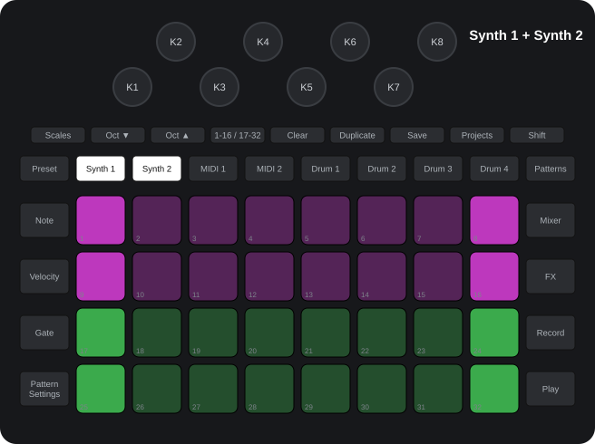

*Teclado partido: filas 1-2 = Synth 1, filas 3-4 = Synth 2.*


*[Paso a paso: Partir el teclado entre dos pistas (desde RC2)](https://github.com/Ghillermo/CIRCUIT-HACKS-RC/wiki/Step-by-step-ES#partir-el-teclado-entre-dos-pistas-desde-rc2)*

## [Colores de los patches de sinte](https://ghillermo.github.io/CIRCUIT-HACKS-RC/beta/guia.html#f-colores-patch)

**De RC2 a RC4.08** cada patch de la vista Preset de Synth 1 / 2 se veía según su modo de voz. **Desde RC4.10** los colores son los del original: esas lecturas de la tarjeta a veces cargaban el patch inicial. **Solo Beta 5.64:** cada patch en el color de su **categoría de Components**.

**Para qué sirve:** Enseña en los pads de la vista Preset de Synth 1 / 2 qué es cada patch, para encontrar un sonido de un vistazo. Las RC usan los colores del original; la Beta 5.56 colorea cada patch según su categoría de Components (Bass, Lead, Pad…).

**Cómo:**

1. Elige **Synth 1** o **Synth 2** y pulsa **Preset**: los pads son los patches del pack (4 páginas, 128 patches).
2. *(desde RC4.10)* Como en el original: los patches en el color de la pista y el elegido en blanco.
3. *(solo Beta 5.56)* Cada patch en el color de su categoría de Components: Arp verde azulado, Bass azul acero, Bell azul claro, Classic ámbar, Drum naranja, Keyboard lima claro, Lead amarillo, Movement violeta, Pad azul, Poly verde, SFX rojo, String melocotón, User arena, Voc lavanda; None = el color de la pista; hueco vacío blanco tenue; el elegido en blanco.
4. *(solo Beta 5.56)* Para darle categoría a un patch desde el aparato, guárdalo: **Clear + pad**, gira **K1** mientras el hueco pregunta (4 clics por categoría, empezando en la del patch; K1 y el hueco en su color) y **Clear + el mismo pad**.

**A tener en cuenta:**

- De RC2 a RC4.08 el color enseñaba el modo de voz (mono azul oscuro, mono con glide lavanda, poly el color de la pista); desde RC4.10 las RC usan los colores del original, porque las lecturas de la tarjeta que había detrás a veces cargaban el patch inicial.
- *(solo Beta 5.56)* La tarjeta se lee al entrar en la vista, al cambiar de página o de pack y tras guardar o copiar, nunca al tocar un patch.
- Las categorías son las que Components da a cada patch. En el ordenador, la pestaña **Sintes Nova** de la [app de la tarjeta y del aparato](https://ghillermo.github.io/CIRCUIT-HACKS-RC/beta/guia.html#app-sd) enseña los mismos colores, con la clave de colores arriba. La tabla con todas las categorías: [Colores de los patches](https://github.com/Ghillermo/CIRCUIT-HACKS-RC/wiki/Patch-Colours-ES).

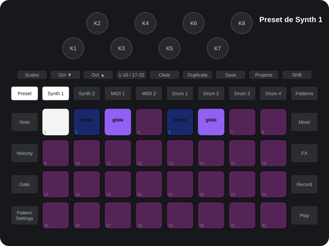

*Vista Preset de Synth 1 de RC2 a RC4.08: mono azul oscuro, glide lavanda, poly el color de la pista.*

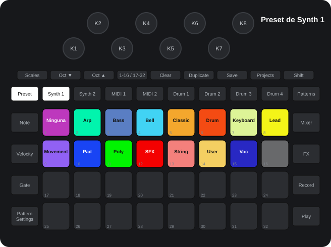

*Solo Beta 5.64: la vista Preset de Synth 1 con un patch de cada categoría de Components; pad 1 = Ninguna (el color de la pista), pad 16 = hueco vacío (blanco tenue).*

## [Patches del sinte propio (MIDI 1 / 2)](https://ghillermo.github.io/CIRCUIT-HACKS-RC/beta/guia.html#f-patches-midi)

**Desde RC2.** En la vista Preset de MIDI 1 / 2 las filas 2 y 3 son 16 huecos de patch del motor de la pista: tocar = cargar (suena la tónica), **Clear + pad** dos veces = guardar, **Duplicate + A + B** = intercambiar; **Octave ▼ / ▲** = las páginas (**desde RC4**: 8 páginas, 128 huecos por pack; antes, 4 páginas, 64 huecos).

**Para qué sirve:** Una biblioteca de sonidos para el sinte propio de las pistas MIDI: guarda el motor entero de MIDI 1 / 2 (motor, osciladores, todos los knobs) en huecos del pack y vuelve a cargarlo con un toque, en cualquiera de las dos pistas y en cualquier proyecto que use ese pack.

**Cómo:**

1. Abre la vista **Preset** de **MIDI 1 / 2** (*(desde RC4)* también MIDI 1 / 2 otra vez con su vista Note en pantalla, o **Shift + MIDI 1 / 2**): los pads 9-24 (filas 2-3) son 16 huecos de patch.
2. **Octave ▼ / ▲** = página siguiente / anterior (encendidos cuando hay página en ese sentido): 4 páginas, 64 huecos por pack; *(desde RC4)* 8 páginas, 128 huecos.
3. **Cargar:** toca un hueco; mientras mantienes el pad suena la tónica de la escala con el patch nuevo. *(desde RC4)* **Shift + hueco** = cargar sin que suene.
4. **Guardar:** **Clear + hueco** (parpadea en blanco: pregunta) y **Clear + el mismo hueco** antes de ~5 s: el sonido tal como está sustituye lo que hubiera. *(solo Beta 5.56)* **Duplicate + un hueco vacío** = guardar ahí al momento.
5. **Intercambiar:** mantén **Duplicate**, toca el hueco A (parpadea) y luego el B; sobre un hueco vacío, el patch se mueve. No hay gesto para vaciar un hueco: se sobrescribe o se mueve.
6. **Empezar de cero:** **Clear + MIDI 1 / 2** (con una vista de esa pista en pantalla y el editor de CC cerrado) devuelve todos los valores del motor a los iniciales; el motor elegido se queda.

**A tener en cuenta:**

- Un patch guarda el motor entero: el motor elegido, los osciladores, el orden de la cadena, todos los valores de todas las páginas y el ajuste del step-drummer (*(desde RC2.02)* la matriz de modulación; *(desde RC4)* el FM, el modo de voz y los destinos de los knobs). Los pasos del step-drummer y del secuenciador de efectos son del patrón.
- Los huecos son del pack y los comparten MIDI 1 y MIDI 2. Escribe en la tarjeta: no está en las versiones «S» ni en el pack de la memoria interna (el LED de Save se pone rojo). No se ven con el editor de CC o el step-drummer abiertos.
- Colores: melocotón tenue = con patch, melocotón brillante = el último cargado o guardado, violeta = vacío. *(solo Beta 5.56)* Cada patch en el color de su motor (FM violeta, wavetable arena) y los vacíos en blanco tenue.
- *(solo Beta 5.56)* «Send patches» / «Send pack» de Components ya no los borran (antes se perdían). Una copia guardada por Components no lleva los patches propios; la Snapshot de la [app de la tarjeta y del aparato](https://ghillermo.github.io/CIRCUIT-HACKS-RC/beta/guia.html#app-sd) sí, y su pestaña **Parches custom** los copia, exporta y sube (hay 81 patches de ejemplo publicados).

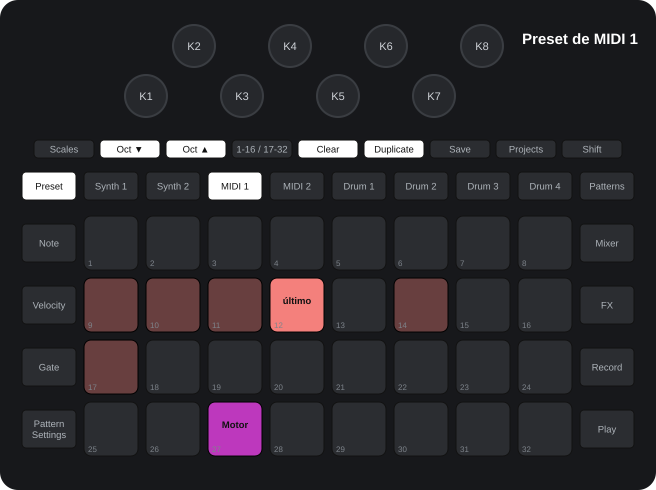

*Vista Preset de MIDI 1: filas 2-3 = patches del sinte propio.*


*[Paso a paso: Cargar, guardar e intercambiar patches del sinte propio (desde RC2)](https://github.com/Ghillermo/CIRCUIT-HACKS-RC/wiki/Step-by-step-ES#cargar-guardar-e-intercambiar-patches-del-sinte-propio-desde-rc2)*

## [Guardar el patch del sinte en el pack](https://ghillermo.github.io/CIRCUIT-HACKS-RC/beta/guia.html#f-guardar-patch)

**Desde RC2.** En la vista Preset de Synth 1 / 2: **Clear + pad** pregunta (parpadea en blanco) y **Clear + el mismo pad otra vez** guarda en ese hueco el patch tal como suena.

**Para qué sirve:** Guarda en uno de los 128 huecos de patch del pack el sonido de Synth 1 / 2 que has moldeado en el aparato, para usarlo en otros proyectos. En el original solo se podía desde Components, en el ordenador.

**Cómo:**

1. Elige **Synth 1** o **Synth 2** y pulsa **Preset**; ve a la página del hueco que quieras (4 páginas, 128 huecos).
2. **Clear + un hueco**: parpadea en blanco (pregunta; todavía no se escribe nada). *(solo Beta 5.56)* Mientras pregunta, **K1** elige la categoría que se guarda (4 clics cada una, empezando en la del patch; el hueco parpadea en su color).
3. **Clear + el mismo hueco** antes de ~5 s: el patch tal como suena se guarda ahí y queda elegido.
4. Clear + otro hueco mueve la pregunta; un toque sin Clear, o esperar, la anula.

**A tener en cuenta:**

- Qué se guarda: el patch en uso con todos sus cambios — sus knobs, el MIDI recibido y los destinos de macro editados. Conserva el nombre del patch que estaba cargado.
- Vale también un hueco más allá del final del banco; los huecos de en medio quedan vacíos. El patch del sinte propio que comparte el hueco no se toca.
- Escribe en la tarjeta: no está en las versiones «S» ni en el pack de la memoria interna (el LED de Save se pone rojo).
- **Duplicate + A + B** en esta vista sigue intercambiando dos patches, o copiando uno a otro pack.

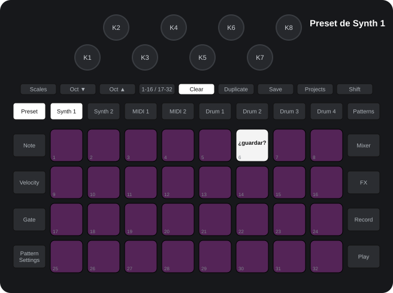

*Vista Preset de Synth 1: Clear + pad pregunta (parpadea), Clear + el mismo pad guarda.*


*[Paso a paso: Guardar un patch de Synth 1 / 2 (desde RC2)](https://github.com/Ghillermo/CIRCUIT-HACKS-RC/wiki/Step-by-step-ES#guardar-un-patch-de-synth-1--2-desde-rc2)*

## [Destinos de los macro knobs](https://ghillermo.github.io/CIRCUIT-HACKS-RC/beta/guia.html#f-destinos-macro)

**Desde RC2.** En la vista de la fuente del sinte el **pad 32** abre el editor: un knob elige su macro, **Octave ▼ / ▲** pasa de campo y los pads dibujan el número.

**Para qué sirve:** Decide desde el aparato qué mueve cada uno de los 8 macro knobs de un patch de Synth 1 / 2 — hasta 4 destinos por knob, cada uno en su propio tramo del recorrido y con su profundidad — sin Components. Por ejemplo, un knob puede abrir el filtro a la vez que sube el drive del filtro.

**Cómo:**

1. Abre la vista de la fuente del sinte: con **Synth 1 / 2** en pantalla, pulsa su botón otra vez (*(desde RC4)*: o **Shift + Synth 1 / 2**).
2. Toca el **pad 32** (verde azulado): el editor se enciende y los knobs dejan de mover los macros.
3. Gira un knob para elegir su macro (su LED en blanco); el primer giro no cambia nada.
4. Gíralo para cambiar el campo actual; **Octave ▼** = campo siguiente, **Octave ▲** = anterior: ranura 1-4 (amarillo) → inicio 0-127 (verde) → fin 0-127 (ámbar) → destino (blanco = un CC; azul claro, magenta, violeta = un NRPN de los bancos 0, 1, 2) → profundidad (verde azulado = positiva, rojo = negativa). Los pads dibujan el número.
5. Cualquier pad suelta el macro (vuelven los pads de la fuente); el **pad 32** apaga el editor; cualquier botón de vista lo cierra.
6. Para dejarlo en el pack, guarda el patch: **Clear + pad** dos veces en la vista Preset de Synth 1 / 2.

**A tener en cuenta:**

- El destino recorre primero los 31 parámetros que tienen CC, por número de CC (74 = corte del filtro, 71 = resonancia…), y después los 39 que solo tienen NRPN (envolventes 2 y 3, LFO, chorus, profundidades de la matriz de modulación). Los números son los de la Programmer's Reference Guide de Novation; la lista entera: [Matriz de modulación y destinos de los macros](https://ghillermo.github.io/CIRCUIT-HACKS-RC/beta/guia.html#destinos).
- Los cambios suenan al momento y van en el patch del proyecto: se guardan con el proyecto; guarda el patch para usarlos en otros proyectos.
- En el original estas ranuras solo se editan con Components.

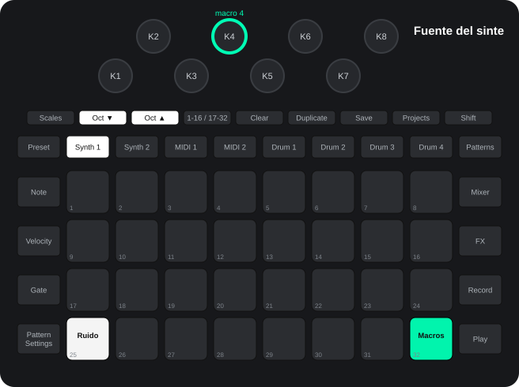

*Vista de la fuente con el editor de macros: pad 32 encendido, el knob elegido en blanco.*


*[Paso a paso: Editar los destinos de los macro knobs (desde RC2)](https://github.com/Ghillermo/CIRCUIT-HACKS-RC/wiki/Step-by-step-ES#editar-los-destinos-de-los-macro-knobs-desde-rc2)*

## [Copiar proyectos a otro hueco o a otro pack](https://ghillermo.github.io/CIRCUIT-HACKS-RC/beta/guia.html#f-copiar-proyectos)

**Desde RC2.** En la vista Projects: **Duplicate + pad A** elige el proyecto (parpadea en amarillo) y **Duplicate + pad B** lo copia a ese hueco, del mismo pack o de otro.

**Para qué sirve:** Duplica un proyecto entero en otro hueco del mismo pack o en otro pack, desde el aparato. Sirve para empezar una variación de una canción sin tocar la original, o para llevar un proyecto a un pack con otros sonidos.

**Cómo:**

1. Abre **Projects**. Si has cambiado el proyecto, guárdalo antes: se copia el proyecto tal como está guardado en la tarjeta.
2. **Duplicate + pad A** (un hueco con proyecto) = la fuente: parpadea en amarillo. Duplicate + A otra vez la olvida.
3. **Duplicate + pad B** = la copia. Si B está vacío se escribe al momento y queda en amarillo; si tiene un proyecto parpadea en blanco: repite **Duplicate + B** antes de ~5 s para sustituirlo.
4. **A otro pack:** elige la fuente, carga el otro pack, vuelve a **Projects** y haz **Duplicate + pad B** allí.

**A tener en cuenta:**

- El hueco del proyecto cargado nunca se escribe. Mientras copia (unos instantes) el aparato no responde.
- Un proyecto guarda números de patch y de sample, no los sonidos: en otro pack suena con los patches y samples de ese pack.
- La fuente sirve para varias copias; se olvida al apagar o al abrir Master FX.
- Escribe en la tarjeta: no está en las versiones «S». El pack de la memoria interna puede ser la fuente, nunca el destino (el LED de Save se pone rojo).

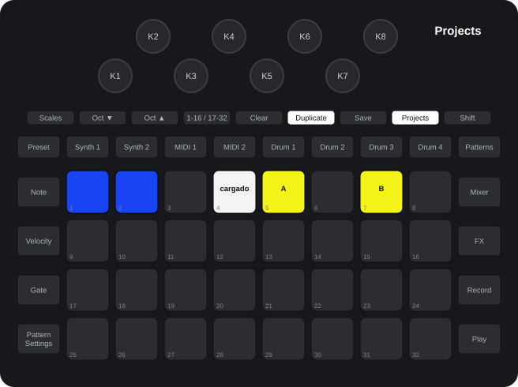

*Vista Projects: Duplicate + A = fuente (amarillo, parpadea), Duplicate + B = copia.*


*[Paso a paso: Copiar un proyecto (desde RC2)](https://github.com/Ghillermo/CIRCUIT-HACKS-RC/wiki/Step-by-step-ES#copiar-un-proyecto-desde-rc2)*

## [Patches del sinte propio a otro pack](https://ghillermo.github.io/CIRCUIT-HACKS-RC/beta/guia.html#f-patches-entre-packs)

**Desde RC2.** En la vista Preset de MIDI 1 / 2: **Duplicate + hueco A**, carga otro pack y **Duplicate + hueco B** copia el patch (motor, parámetros y nombre).

**Para qué sirve:** Lleva un sonido del sinte propio de las pistas MIDI de un pack a otro sin ordenador, para que un bajo o un lead favorito te acompañe a un pack nuevo.

**Cómo:**

1. Con el pack de origen cargado: **MIDI 1 / 2**, **Preset**, **Duplicate + hueco A**: el patch queda recordado.
2. Carga el otro pack y vuelve a la vista Preset de MIDI 1 / 2: **Duplicate** se enciende en amarillo (hay un patch esperando).
3. **Duplicate + hueco B** lo escribe ahí, con su motor, sus parámetros y su nombre. Sirve para varios huecos.

**A tener en cuenta:**

- Dentro del mismo pack, Duplicate + A + B intercambia los dos patches.
- No copia si A está vacío o si el pack de destino no tiene ese banco de patches.
- El patch que espera se olvida al apagar. Escribe en la tarjeta: no está en las versiones «S» ni en el pack de la memoria interna (el LED de Save se pone rojo).


*[Paso a paso: Copiar un patch del sinte propio a otro pack (desde RC2)](https://github.com/Ghillermo/CIRCUIT-HACKS-RC/wiki/Step-by-step-ES#copiar-un-patch-del-sinte-propio-a-otro-pack-desde-rc2)*

## [Shift = destello de cada nota (solo Beta 5.64)](https://ghillermo.github.io/CIRCUIT-HACKS-RC/beta/guia.html#f-luces-disparo)

Con Shift mantenido, el botón de cada pista destella en blanco con cada nota que toca.

**Para qué sirve:** Un monitor de actividad rápido: mientras mantienes Shift, el botón de cada pista destella en blanco cada vez que esa pista toca una nota, y ves de un vistazo qué pistas suenan; útil en un proyecto cargado o para comprobar qué tocan el MIDI o el arpegiador.

**Cómo:**

1. Mantén **Shift**, en cualquier vista.
2. Los ocho botones de pista (Synth 1 / 2, MIDI 1 / 2, Drum 1-4) destellan en **blanco** durante 100 ms con cada nota que toca su pista, venga del secuenciador, de los pads, del arpegiador o de MIDI.
3. Suelta Shift: los botones vuelven a lo normal.

**A tener en cuenta:**

- *Solo Beta 5.56.* En las RC, como en el original, los botones de pista se quedan apagados con Shift.
- Una nota ligada a la siguiente es una sola nota: un destello.

## [Shift + Preset = el sonido del proyecto (solo Beta 5.64)](https://ghillermo.github.io/CIRCUIT-HACKS-RC/beta/guia.html#f-proyecto-init)

Shift + Preset devuelve el sonido de la pista al guardado en el proyecto.

**Para qué sirve:** Un deshacer para los retoques de sonido: Shift + Preset tira los cambios de knobs hechos en una pista y devuelve su sonido al guardado en el proyecto — el patch entero en Synth 1 / 2, el sinte propio en MIDI 1 / 2.

**Cómo:**

1. Ve a una vista de **Synth 1 / 2**, o de **MIDI 1 / 2** con su sinte propio encendido, y mantén **Shift**: **Preset** se ilumina en amarillo donde funciona.
2. Pulsa **Shift + Preset**. Synth 1 / 2: el patch entero del sinte vuelve a como está guardado en el proyecto (o como se cargó). MIDI 1 / 2: el sinte propio vuelve al guardado con el proyecto.
3. Un proyecto sin sinte propio: MIDI 1 / 2 vuelven a sus valores por defecto, como con **Clear + MIDI 1 / 2**.

**A tener en cuenta:**

- Lo que se ha girado después se pierde: si quieres conservarlo, guarda antes el patch o el proyecto.
- *Solo Beta 5.56.* En las RC, como en el original, Shift + Preset no hace nada en estas pistas.
- Con un drum, **Shift + Preset** sigue abriendo la vista cromática.
