# Shortcuts and usability

*[Versión en español](https://github.com/Ghillermo/CIRCUIT-HACKS-RC/wiki/Features-Shortcuts-ES) · [Home](https://github.com/Ghillermo/CIRCUIT-HACKS-RC/wiki/Home) · [Features](https://github.com/Ghillermo/CIRCUIT-HACKS-RC/wiki/Features) · [Guide by views](https://ghillermo.github.io/CIRCUIT-HACKS-RC/beta/guide.html)*

One of the five pages of [Features](https://github.com/Ghillermo/CIRCUIT-HACKS-RC/wiki/Features): each feature explained, with its pictures and the animations of its processes. Each title links to its section in the [guide by views](https://ghillermo.github.io/CIRCUIT-HACKS-RC/beta/guide.html), the manual, where every feature is in the chapter of its view.

**Contents**

- **[Shortcuts and usability](https://github.com/Ghillermo/CIRCUIT-HACKS-RC/wiki/Features-Shortcuts)** — [Shortcut map](https://github.com/Ghillermo/CIRCUIT-HACKS-RC/wiki/Features-Shortcuts#shortcut-map) · [Master FX on the Mixer button](https://github.com/Ghillermo/CIRCUIT-HACKS-RC/wiki/Features-Shortcuts#master-fx-on-the-mixer-button) · [Keys of the FX view](https://github.com/Ghillermo/CIRCUIT-HACKS-RC/wiki/Features-Shortcuts#keys-of-the-fx-view) · [Clear + knob = default value](https://github.com/Ghillermo/CIRCUIT-HACKS-RC/wiki/Features-Shortcuts#clear--knob--default-value) · [Switch off latched effects (Master FX pad 8)](https://github.com/Ghillermo/CIRCUIT-HACKS-RC/wiki/Features-Shortcuts#switch-off-latched-effects-master-fx-pad-8) · [Synth source view](https://github.com/Ghillermo/CIRCUIT-HACKS-RC/wiki/Features-Shortcuts#synth-source-view) · [Chromatic and scale view of the drums](https://github.com/Ghillermo/CIRCUIT-HACKS-RC/wiki/Features-Shortcuts#chromatic-and-scale-view-of-the-drums) · [Pack management on the device](https://github.com/Ghillermo/CIRCUIT-HACKS-RC/wiki/Features-Shortcuts#pack-management-on-the-device) · [Replace a drum with the capture](https://github.com/Ghillermo/CIRCUIT-HACKS-RC/wiki/Features-Shortcuts#replace-a-drum-with-the-capture) · [CC editor of the MIDI macros](https://github.com/Ghillermo/CIRCUIT-HACKS-RC/wiki/Features-Shortcuts#cc-editor-of-the-midi-macros) · [Mixer: Shift + knob = level to 100 / 0](https://github.com/Ghillermo/CIRCUIT-HACKS-RC/wiki/Features-Shortcuts#mixer-shift--knob--level-to-100--0) · [Cue mode, mutes on the bar and quantize (since RC2)](https://github.com/Ghillermo/CIRCUIT-HACKS-RC/wiki/Features-Shortcuts#cue-mode-mutes-on-the-bar-and-quantize-since-rc2) · [LFO synced to the tempo (since RC4)](https://github.com/Ghillermo/CIRCUIT-HACKS-RC/wiki/Features-Shortcuts#lfo-synced-to-the-tempo-since-rc4) · [Split keyboard Synth 1 + Synth 2](https://github.com/Ghillermo/CIRCUIT-HACKS-RC/wiki/Features-Shortcuts#split-keyboard-synth-1--synth-2) · [Synth patch colours](https://github.com/Ghillermo/CIRCUIT-HACKS-RC/wiki/Features-Shortcuts#synth-patch-colours) · [Patches of the own synth (MIDI 1 / 2)](https://github.com/Ghillermo/CIRCUIT-HACKS-RC/wiki/Features-Shortcuts#patches-of-the-own-synth-midi-1--2) · [Saving the synth’s patch into the pack](https://github.com/Ghillermo/CIRCUIT-HACKS-RC/wiki/Features-Shortcuts#saving-the-synths-patch-into-the-pack) · [Macro knob destinations](https://github.com/Ghillermo/CIRCUIT-HACKS-RC/wiki/Features-Shortcuts#macro-knob-destinations) · [Copying projects to another slot or another pack](https://github.com/Ghillermo/CIRCUIT-HACKS-RC/wiki/Features-Shortcuts#copying-projects-to-another-slot-or-another-pack) · [Own-synth patches to another pack](https://github.com/Ghillermo/CIRCUIT-HACKS-RC/wiki/Features-Shortcuts#own-synth-patches-to-another-pack) · [Shift = a flash on every note (Beta 5.64 only)](https://github.com/Ghillermo/CIRCUIT-HACKS-RC/wiki/Features-Shortcuts#shift--a-flash-on-every-note-beta-564-only) · [Shift + Preset = the project's sound (Beta 5.64 only)](https://github.com/Ghillermo/CIRCUIT-HACKS-RC/wiki/Features-Shortcuts#shift--preset--the-projects-sound-beta-564-only)

## [Shortcut map](https://ghillermo.github.io/CIRCUIT-HACKS-RC/beta/guide.html#f-atajos)

Every shortcut of the mod on a drawing of the device: double presses, Shift + button, Clear + knob and the special pads of each view.

**What it is for:** A one-page cheat sheet of every gesture the mod adds, drawn on the device: double presses, Shift + button, Clear + knob and the special pads of each view, each with what it does and since which version. Keep it at hand while you learn the mod: it tells you which button to hold and which one to press.

**How:**

1. On the drawing, each numbered badge marks a control; in the table of the illustrated entry (the title's link), the row with that number gives the gesture and what it does, and the table goes on with the shortcuts that do not fit on the drawing.
2. **Double presses:** **Mixer** twice = Master FX; **Synth 1 / 2** twice = the synth's source view; *(since RC4)* **MIDI 1 / 2** again with its Note view on screen = its Preset view, **Scales** twice = the custom scale editor, **Velocity** twice = fixed velocity (on the drums, *Beta 5.56 only*, the automation view).
3. **Shift + button:** **Shift + Preset** with a drum = the chromatic view; *(since RC2)* **Shift + Clear** = metronome and count-in, **Shift + Play** = quantize, **Shift + Scales** = custom scale; *(since RC4)* **Shift + Synth 1 / 2** or **Shift + MIDI 1 / 2** = the same as pressing them twice.
4. **Clear + knob:** to the right = the knob's default value; to the left = erase its automation. *(since RC2)* **Clear + Synth 1 / 2, MIDI 1 / 2 or a drum's button** = that track's sound back to its starting values (a drum's button also erases its knobs' automation in the playing pattern).
5. **Special pads:** in Master FX, **pad 7** plays the capture, **pad 8** switches everything off and **pad 32** records; in the MIDI 1 / 2 Preset view, **pad 25** = CC editor, **26** = patch flip, **27** = engine, **30** = step-drummer, **32** = voice mode *(since RC4)*.

**Keep in mind:**

- While **Shift** is held, every view lights in **yellow** the shortcuts it offers; the option chosen shows in another colour.
- *since RC2 / RC2.02 / RC4 / RC4.05* = in the RCs and in the beta from that version on; *Beta 5.56 only* = only in the beta.
- **Scales + Preset + Note** at power-up = Novation's recovery mode: it lets you install any firmware again.
- Anything not on the map works as on the original. The gestures that work in every view: [Buttons that work in every view](https://ghillermo.github.io/CIRCUIT-HACKS-RC/beta/guide.html#botones).

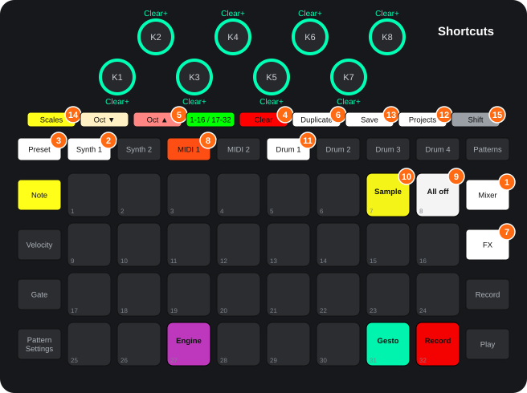

*Shortcut map: the numbers refer to the table.*


*[Step by step: Latch notes and write them into a step (since RC4)](https://github.com/Ghillermo/CIRCUIT-HACKS-RC/wiki/Step-by-step#latch-notes-and-write-them-into-a-step-since-rc4)*

## [Master FX on the Mixer button](https://ghillermo.github.io/CIRCUIT-HACKS-RC/beta/guide.html#f-master-fx-acceso)

From the Mixer, **Mixer again** opens Master FX; any other view button leaves it.

**What it is for:** Master FX is the mod's performance page: effects on the whole mix (Gater, Auto-Filter, Digitise, Phaser, Glitch and a mechanical tape-stop gesture), a song pointer, the captured sample and a row of effects you assign yourself. It sits behind the Mixer button, two presses away, so you can reach it in the middle of a performance.

**How:**

1. Press **Mixer**.
2. Press **Mixer** again: Master FX opens.
3. Any other view button takes you back to the normal views.
4. *(Beta 5.56 only)* In the Mixer, **hold Mixer** for ½ s or more: Master FX shows only while you hold it and the Mixer comes back when you let go; in Master FX, holding Mixer shows the Mixer until you let go. A tap switches as always.

**Keep in mind:**

- Pads: 1-6 effects, 7 plays the capture, 8 switches off everything latched, 9-24 song pointer, 26-30 assignable slots, 31 mechanical gesture, 32 records the capture. Every pad in detail: [Master FX](https://ghillermo.github.io/CIRCUIT-HACKS-RC/beta/guide.html#master-fx).
- *(since RC2)* The effects' 20 knobs, the slot assignments and the master compressor's attack / release are saved with each project; latched effects and the song pointer are not (they are off at power-up).

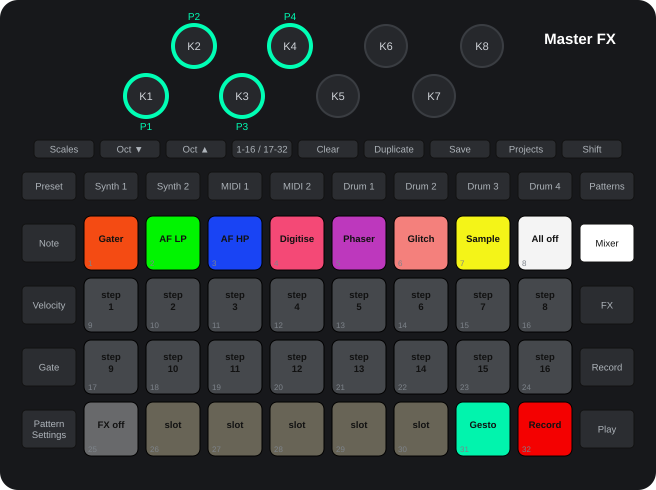

*Master FX: pads 1-6 effects, 7 sample, 8 all off, 9-24 song pointer, assignable bottom row, 31 mechanical gesture, 32 record.*

## [Keys of the FX view](https://ghillermo.github.io/CIRCUIT-HACKS-RC/beta/guide.html#f-vista-fx)

**Octave ▲ / ▼** = delay / reverb sends; **Shift + knob** = reverb and delay parameters. **Duplicate** = reset (sends to 0, master filter centred, Master FX off); **Shift + Octave ▲ / ▼** = master filter resonance ±16 (since RC4; before, **1-16 / 17-32**); **Shift + pad 25** = master filter off / on (since RC4).

**What it is for:** Turns the FX view into the control page of the device's reverb and delay: besides each track's sends you set the effects themselves (type, decay, time, feedback…), reset everything with one press, and reach the master filter's resonance and a switch that turns the master filter off.

**How:**

1. Press **FX**. **Octave ▲** = the knobs are each track's **delay** sends; **Octave ▼** = the **reverb** sends.
2. **Shift + knob** = the effect's own settings: reverb K1 type, K2 decay, K3 damping; delay K1 time, K2 sync, K3 feedback, K4 width, K5 ratio, K6 slew. The LED shows the value with its brightness.
3. **Duplicate** = reset: sends to 0, master filter centred (the resonance untouched), Master FX off.
4. *(since RC4)* **Shift + Octave ▲ / ▼** = master filter resonance +16 / −16, stopping at 127 / 0 (with Shift, Octave lights yellow).
5. *(since RC4)* **Shift + pad 25** = master filter off / on: while off it sounds as if centred even when you move its knob, and the filter knob's LED is red (with Shift, pad 25 yellow, red while off); on again, the filter comes back at the knob's current position.

**Keep in mind:**

- The reverb and delay settings are saved with the project. The master filter, its resonance and the off state are not: at power-up they are back at their initial values, with the filter on.
- The bottom row is Master FX's: slots 26-30, mechanical gesture (31), record (32). Without Shift, pad 25 is the stock one.
- If Setup routes the reverb / delay return through strips 3 / 4, the sends of those strips are capped at half.
- *(Beta 5.56 only)* With Shift, the Octave buttons show the resonance as the original shows octaves: Octave ▼ bright in the upper half, dim in the lower and off at 0; Octave ▲ the other way round, off at 127. Before RC4 the resonance was on **1-16 / 17-32**, which now does what it always did.

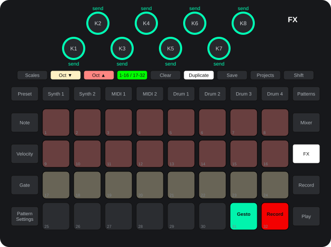

*FX view: Octave picks delay / reverb; the bottom row is the Master FX one.*

## [Clear + knob = default value](https://ghillermo.github.io/CIRCUIT-HACKS-RC/beta/guide.html#f-clear-knob)

Hold **Clear** and turn a knob right: it goes back to its default. The LED turns **lavender** (the original's blue). On the drums, turned left it deletes the automation of the stock knobs (red LED), as on the original. Also on the MIDI track engine and in **Master FX**.

**What it is for:** A quick way back for any of the mod's knobs: hold Clear and turn a knob right and it jumps to its default value, so you never hunt for the neutral position; turn it left and it erases what that knob recorded in the playing pattern, as on the original.

**How:**

1. Hold **Clear** and turn a knob **to the right**: it goes back to its default value — on the drums (stock and new knobs), the MIDI 1 / 2 engine and **Master FX** (the selected effect's knobs). A **lavender** LED = done.
2. Hold **Clear** and turn a knob **to the left**: its automation in the playing pattern is erased (**red** LED) — on the drums' stock knobs and, *(since RC2)*, on the MIDI 1 / 2 engine (whichever of the knob's two lanes, with and without Shift, hold automation).
3. Let go of **Clear**.

**Keep in mind:**

- On the drums and the MIDI engine it resets **both layers** of the knob (with and without Shift). On the drums, **Clear + K3** to the right zeroes attack, start and cut; *(since RC2)* **Clear + K8** to the right also removes the bitcrush.
- **Master FX** has no automation: to the left does nothing. While Clear is held, the knobs of the selected effect that are at their default show lavender (pads 1-6, the Glitch and the sample).
- A whole track at once *(since RC2)*: **Clear + a drum's button** erases its knobs' automation in the playing pattern and puts its eight knobs to their defaults; **Clear + Synth 1 / 2** puts its eight macros back to the loaded patch's values; **Clear + MIDI 1 / 2** puts the own synth's values back to their initial ones.

## [Switch off latched effects (Master FX pad 8)](https://ghillermo.github.io/CIRCUIT-HACKS-RC/beta/guide.html#f-pad8)

**Pad 8** switches off everything latched with Shift (effects and song pointer) and bypasses the FX; touching a latched effect releases it.

**What it is for:** The panic button of Master FX: one press on pad 8 switches off every effect you latched with Shift, the song pointer and the sample, so you are back to the plain mix in a single move.

**How:**

1. In Master FX, **hold** an effect pad to play it only while held, or press **Shift + its pad** to latch it; touching a latched pad again (without Shift) releases just that one.
2. Press **pad 8** (white): every latched effect is released (the bottom-row slots too), the song pointer switches off, the sample stops and the FX are bypassed.

**Keep in mind:**

- Latched effects, the song pointer and the latched sample are not saved: at power-up they are off (the song pointer at 0).
- *(Beta 5.56 only)* A latched sample loop that keeps playing through a project or pack load stops as always: pad 7 or pad 8.

## [Synth source view](https://ghillermo.github.io/CIRCUIT-HACKS-RC/beta/guide.html#f-fuente-sinte)

With Synth 1 / 2 on screen, **press its button again**: pads 25-29 pick the source (noise, inputs, inverted inputs), pad 30 = step-drummer.

**What it is for:** Turns Synth 1 / 2 into a processor for an outside sound: the patch's noise is replaced by audio input 1 or 2, so the synth's filter, envelopes and effects shape your external signal (a drum machine, a voice, another synth) in time with the notes you play. The same view opens the synth's step-drummer and, since RC2, the macro destination editor.

**How:**

1. With the **Synth 1** or **Synth 2** view on screen, press its button again (*(since RC4)*: or **Shift + Synth 1 / 2** from any view).
2. Pick the source of the synth's noise: **pad 25** noise (normal), **26** audio input 1, **27** audio input 2, **28** input 1 phase-inverted, **29** input 2 phase-inverted.
3. **Pad 30** opens the synth's step-drummer; **pad 32** *(since RC2)* the editor of the macro knob destinations.
4. Any button closes the view.

**Keep in mind:**

- The patch needs some noise level (CC 56) for the source to be heard. The source is saved with the project.
- If Setup routes the reverb / delay returns through strips 3 / 4, that signal is what reaches the synth.
- *(since RC2)* Play and Record no longer close the synth's step-drummer: until pad 30 closes it, pressing Synth 1 / 2 opens it again.
- *(Beta 5.56 only)* While a patch morph runs on that synth, its button opens the morph view instead (see the [Synth 1 / 2 Preset view](https://ghillermo.github.io/CIRCUIT-HACKS-RC/beta/guide.html#synth-preset)).

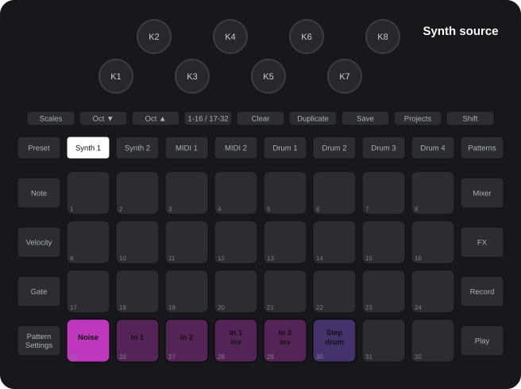

*Synth source view (Synth 1 / 2 pressed twice).*

## [Chromatic and scale view of the drums](https://ghillermo.github.io/CIRCUIT-HACKS-RC/beta/guide.html#f-cromatica)

**Shift + Preset** with a drum: the pads play the sample in the scale; K1 = pitch offset, Shift + K1 = cents; Note view: pads 25-28 = drums 4-1.

**What it is for:** Plays a drum sample like a keyboard: the pads give the sample transposed along the project's scale, on three rows, so one hit (a tom, a bass hit, a vocal chop) becomes a melody or a bass line. With Record each pitch is recorded on its step.

**How:**

1. Select a drum (**Drum 1-4**) and press **Shift + Preset** (*(since RC2)*: or **Preset** again in the drum's Preset view).
2. Three rows of pads play the sample in the scale and root of the **Scales** view.
3. **K1** = pitch offset in semitones; **Shift + K1** = fine tuning in cents.
4. To record, play the pads with **Record + Play**: *(since RC4.02)* each pad records a hit with its pitch on its own step (the micro step and velocity of the press); **Shift + Play** (quantize) moves the pitch with its hit.
5. *(since RC2)* **Preset** again turns the view off.

**Keep in mind:**

- *(since RC2)* The pads transpose in semitones on top of K1's pitch; **Clear + K1** to the left (held) erases the recorded pitches, with K1's automation. *(Beta 5.56 only)* They are recorded in the drum's extra lane (factory setting), leaving the pitch lane to K1.
- In the drums' **Note** view, pads 25-28 repeat the boxes of drums 4 … 1; *(since RC2)* rows 1-3 are the micro-step rollers.
- The chromatic view's semitone is saved with the project.

## [Pack management on the device](https://ghillermo.github.io/CIRCUIT-HACKS-RC/beta/guide.html#f-pack)

**Save** also writes the samples replaced by captures to the card. **Duplicate + pad A + pad B** (Drum Preset) swaps two samples; between packs it **copies** samples and synth patches; **Clear**, the pack, **Clear** (packs view) deletes a pack.

**What it is for:** Lets you tidy up and move sounds between packs on the device itself, without a computer: swap or copy drum samples and Synth 1 / 2 patches between packs, keep the samples you captured, and delete packs you no longer need.

**How:**

1. **Keep the captures:** save the project as usual (**Save** twice): every drum sample replaced by a capture is written into the pack too, if it fits in the sample memory.
2. **Swap two samples:** drum **Preset** view, hold **Duplicate** (it lights in this view), touch pad **A** (it blinks blue), then pad **B**: they swap and you hear it at once.
3. **Copy a sample to another pack:** **Duplicate + pad A** in its pack, load the other pack (with Duplicate held, A's number blinks yellow), then **Duplicate + pad B**: A is copied over B, which may be empty; A's pack does not change.
4. **Synth patches:** the same gestures in the **Preset** view of **Synth 1 / 2**: Duplicate + A + B swaps within a pack and copies between packs.
5. **Delete a pack:** packs view (**Shift + Projects**), touch **Clear** (for ~5 s the packs that can be deleted blink), touch the pack (only it blinks; it is not loaded), then **Clear** again within 5 s.

**Keep in mind:**

- Writes to the card: not in the S builds nor in the internal memory's pack (the Save LED turns red).
- A copied sample goes into B's place if it fits, otherwise into the free import memory (about 44 s); it never overwrites a sample that is playing — with no room, nothing changes.
- The loaded pack can never be deleted; a deleted pack's slot can be reused after a restart. Clear lights steady white in the packs view.
- **Duplicate + A** again (in its pack) cancels a waiting copy; it is also forgotten at power-off.

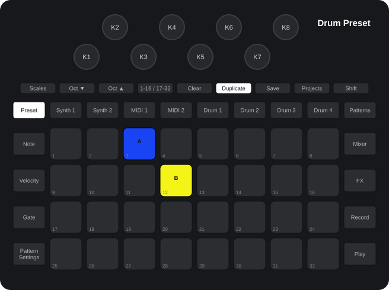

*Drum Preset view: Duplicate + A + B swaps the samples.*

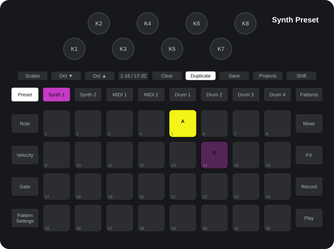

*Synth 1 Preset view: Duplicate + A copies the patch (blue); in another pack A’s pad blinks yellow and Duplicate + B copies it there.*


*[Step by step: Swap two Synth 1 / 2 patches](https://github.com/Ghillermo/CIRCUIT-HACKS-RC/wiki/Step-by-step#swap-two-synth-1--2-patches)*


*[Step by step: Copy a Synth 1 / 2 patch to another pack](https://github.com/Ghillermo/CIRCUIT-HACKS-RC/wiki/Step-by-step#copy-a-synth-1--2-patch-to-another-pack)*


*[Step by step: Swap two drum samples](https://github.com/Ghillermo/CIRCUIT-HACKS-RC/wiki/Step-by-step#swap-two-drum-samples)*


*[Step by step: Copy a drum sample to another pack](https://github.com/Ghillermo/CIRCUIT-HACKS-RC/wiki/Step-by-step#copy-a-drum-sample-to-another-pack)*


*[Step by step: Delete a pack](https://github.com/Ghillermo/CIRCUIT-HACKS-RC/wiki/Step-by-step#delete-a-pack)*

## [Replace a drum with the capture](https://ghillermo.github.io/CIRCUIT-HACKS-RC/beta/guide.html#f-sustituir)

Drum Preset view: **Clear + pad twice** = that sample becomes the capture (until you save or reload).

**What it is for:** Puts the sound you just captured in Master FX on a drum: one drum's sample becomes the capture, so a piece of the mix (a chord, a vocal, a resampled loop) can be played and sequenced like a drum hit. Saving the project keeps it in the pack.

**How:**

1. Record a capture: in Master FX (**Mixer** twice), hold **pad 32** (red) while the music plays; it records while held (up to 3.46 s).
2. Select the drum and press **Preset** (the drum Preset view).
3. **Clear + the pad** of the sample to replace: the pad blinks (a question).
4. **Clear + the same pad** again: confirmed; that sample now plays the capture.
5. To keep it, save the project (**Save** twice): the capture is written into the pack, if it fits in the sample memory.

**Keep in mind:**

- Any pad without Clear cancels the question; Clear + another pad moves it to that pad.
- Until you save, it is temporary: at power-off the drum gets its pack sample back. In the S builds and in the internal memory's pack nothing is written: it lasts until the pack is loaded again.
- **Shift + pad** is still the original's silent selection (picking a sample without hearing it).


*[Step by step: Capture a sample and replace a drum with it](https://github.com/Ghillermo/CIRCUIT-HACKS-RC/wiki/Step-by-step#capture-a-sample-and-replace-a-drum-with-it)*

## [CC editor of the MIDI macros](https://ghillermo.github.io/CIRCUIT-HACKS-RC/beta/guide.html#f-editor-cc)

MIDI 1 / 2 Preset view, **pad 25**: move a knob and change its CC / NRPN on the device; pad 26 = save.

**What it is for:** Changes, on the device, which CC or NRPN each knob of a MIDI track's template sends and over which range, without Components. Use it to map the knobs to the parameters of your external synth.

**How:**

1. **MIDI 1 / 2**, **Preset**, **pad 25**: it lights.
2. Move a knob: it is picked and its number is drawn on the pads.
3. **Octave ▼ / ▲** = next / previous field; turn the knob to change the value. The first field's number sets the type: any number = a CC (number, start, end); 99, 98 or 6 = a 7-bit NRPN (number, MSB, LSB, start, end); 38 = a 14-bit NRPN (start and end in MSB and LSB).
4. **Save:** **pad 26**, or **Octave ▼** up to the save step (pad 26 and Save blink) and Octave ▼ again. Saving leaves the editor, back to the Preset view.
5. **Discard:** any view button, **pad 25** or a template pad.

**Keep in mind:**

- It edits the track's template (what the knobs send with the own synth off) and saves into it, not into an own-synth patch.
- With the own synth on, the knobs send the engine's own CC / NRPN map, never the template; pad 25 is dark and does nothing, and an open editor closes when the engine turns on.
- On the computer, the **CC presets** tab of the [card and device app](https://ghillermo.github.io/CIRCUIT-HACKS-RC/beta/guide.html#app-sd) reads the 8 templates from the device, edits them and sends them back.


*[Step by step: Change the CC a MIDI macro knob sends](https://github.com/Ghillermo/CIRCUIT-HACKS-RC/wiki/Step-by-step#change-the-cc-a-midi-macro-knob-sends)*

## [Mixer: Shift + knob = level to 100 / 0](https://ghillermo.github.io/CIRCUIT-HACKS-RC/beta/guide.html#f-mixer-shift)

Mixer view: **Shift + a knob turned right** sets that track’s level to **100**; **turned left**, to **0**.

**What it is for:** A one-move fader reset in the Mixer: Shift + a knob to the right puts that track at its nominal level (100), to the left at 0, without hunting for the exact value — handy to bring a track back in, or out, during a performance.

**How:**

1. Open the **Mixer** on its levels page (**Octave ▲**, the normal one).
2. Hold **Shift** and turn a track's knob **to the right**: its level jumps to **100**.
3. **Shift** + the knob **to the left**: the level jumps to **0**.

**Keep in mind:**

- The jump works like a turn of the knob: it goes out over MIDI and, while recording, it is written into the automation.
- On the pan page (**Octave ▼**), Shift + knob turns the cue mode on / off instead *(since RC2)*.
- On the original, Shift + knob did the same as the knob alone: no function is lost. Clear + knob (erase the automation) is unchanged.

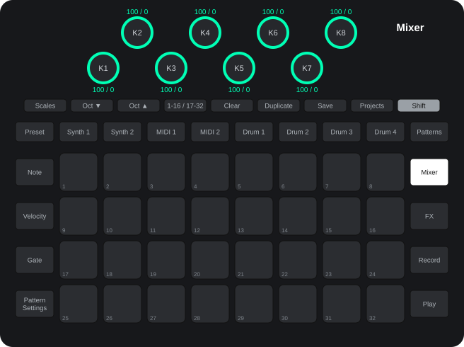

*Mixer: Shift + knob right = level 100, left = 0.*

## [Cue mode, mutes on the bar and quantize (since RC2)](https://ghillermo.github.io/CIRCUIT-HACKS-RC/beta/guide.html#f-mixer-cue)

**Since RC2.** Mixer, pan page: **Shift + knob** = cue mode (the right output listens to the tracks you choose). **Shift + pads 1-8** of the Mixer = mute / unmute on the next bar. **Shift + Play** = quantize the pattern of the selected track.

**What it is for:** Three tools for playing live from the Mixer: a cue on the right output to pre-listen to tracks before you bring them in, mutes and unmutes that land exactly on the next bar, and a one-press quantize of the playing pattern.

**How:**

1. **Cue mode:** in the **Mixer**, pan page (**Octave ▼**), **Shift + a knob to the right** turns it on (Octave ▼ pink); to the left, off (white).
2. With the mode on, each pan knob is that track's send to the cue, from the centre to the right (to the left, nothing); **Clear + knob** = no cue. The knobs light pink, brighter with more send.
3. The left output carries the mix in mono, the right one only the cued tracks. A track muted in the Mixer but cued plays only on the right: unmute it (its pad, or **Shift + pad** on the next bar) to drop it into the mix.
4. **Mutes on the bar:** **Shift + pads 1-8** = that track mutes or unmutes when the next bar starts; the pad blinks while it waits, again cancels it; stopped, at once.
5. **Quantize:** **Shift + Play** moves the notes and hits recorded off the grid in the selected track's playing pattern to the nearest step (Play yellow with Shift, green after quantizing).
6. *(Beta 5.56 only)* **Solo:** hold **pad 16** + pads 1-8 = only those tracks sound (pad 16 white); a tap on pad 16 brings the mutes back. With no solo, a tap on pad 16 = **solo flip** (orange): only the tracks you hold sound, until you let go.

**Keep in mind:**

- The cue mode is kept in the device; the cue sends are saved with the project; the pans come back when the mode goes off. Reverb, delay and Master FX belong to the mix: the cue hears them too.
- *(since RC4)* With the cue mode on, choosing a Synth 1 / 2 patch and **Shift + sample** in a drum's Preset view are heard only in the cue, and the metronome's and the count-in's click sound only there.
- Quantize: micro steps 1-2 go to the start of their step, 3-5 to the start of the next one; on the drums a step with several hits (a roll) stays. It replaces the original's Shift + Play (another way to start playback).
- Pending bar mutes are lost at power-off. *(Beta 5.56 only)* Loading another project turns solo and flip off without touching its mutes.


*[Step by step: Quantize a pattern (since RC2)](https://github.com/Ghillermo/CIRCUIT-HACKS-RC/wiki/Step-by-step#quantize-a-pattern-since-rc2)*


*[Step by step: Mute a track on the next bar (since RC2)](https://github.com/Ghillermo/CIRCUIT-HACKS-RC/wiki/Step-by-step#mute-a-track-on-the-next-bar-since-rc2)*


*[Step by step: Prepare tracks in the cue (since RC2)](https://github.com/Ghillermo/CIRCUIT-HACKS-RC/wiki/Step-by-step#prepare-tracks-in-the-cue-since-rc2)*

## [LFO synced to the tempo (since RC4)](https://ghillermo.github.io/CIRCUIT-HACKS-RC/beta/guide.html#f-lfo-sync)

**Since RC4.** The LFO rate knobs are bipolar: right = a free LFO, left = synced to the tempo with the cycle on the bar's first beat.

**What it is for:** Locks an LFO to the song's tempo: with its rate knob to the left, a wobble, tremolo or filter sweep repeats from every 1/16 up to every 8 bars and starts on the bar's first beat; to the right it stays a free LFO, as before.

**How:**

1. Find an LFO rate knob: **K7** of the VCA-VCF page of the MIDI 1 / 2 engine, **Shift + K4** of the mod matrix (pad 6), **Shift + K7** of a drum, or **K1** of the Auto-Filter (pads 2 / 3) and of the Phaser (pad 5) in Master FX.
2. At the centre its LED is dim. Turn it **to the right** for a free LFO (faster further right).
3. Turn it **to the left** for a rate synced to the tempo; from the centre outwards: 1/16T, 1/16, 1/8T, 1/8, 1/4T, 1/4, 1/2T, 1/2, 1 bar T, 1 bar, 2T, 2, 4T, 4, 8T and 8 bars, 4 clicks each. The LED gets brighter towards both ends.
4. In the matrix, each LFO 2 shape of Shift + K4 is a stretch of its own: its left half synced, its right half free.

**Keep in mind:**

- Synced, each cycle starts on the bar's first beat (it is put back in place on every sequencer tick); stopped, it keeps the tempo.
- What was saved before with another rate may sound different.
- *(Beta 5.56 only)* Bipolar knobs show their left side (the synced one) in a lighter shade of their colour, dim at the centre.

## [Split keyboard Synth 1 + Synth 2](https://ghillermo.github.io/CIRCUIT-HACKS-RC/beta/guide.html#f-teclado-partido)

**Since RC2.** Hold **Synth 1** and press **Synth 2** (or the other way round): the two top rows play the synth you held first and the two bottom rows the other one; **since RC2.02**, any pair of Synth 1, Synth 2, MIDI 1 and MIDI 2.

**What it is for:** Puts two note tracks on the pads at once, one above the other, so you can play, for instance, a bass with one hand and chords or a lead with the other, each part in its own scale, octave and colours.

**How:**

1. Hold **Synth 1** and press **Synth 2** (or the other way round). *(since RC2.02)* Any pair of **Synth 1, Synth 2, MIDI 1, MIDI 2** works: hold one button and press another.
2. The top two rows play the track you held first and the bottom two the other one, each with its scale, octave, velocity and colours.
3. The knobs and **Octave** belong to the track you pressed first. *(since RC4)* **Hold a track button** (Synth 1 / 2, MIDI 1 / 2, Drum 1-4) to have its 8 knobs and their lights while you hold it; let go and they go back.
4. To leave, press any track button (*(since RC4)* a short tap, no knob turned) or a view button; held notes are released. Play, Record, Octave and Shift do not close it.

**Keep in mind:**

- A drum button does not open the split keyboard; Synth 1 or Synth 2 alone work as always (pressed twice = the source view).
- In RC2 Synth 1 was always on top; since RC2.02 the track you held first goes on top.
- Not saved: the split keyboard is closed at power-up.

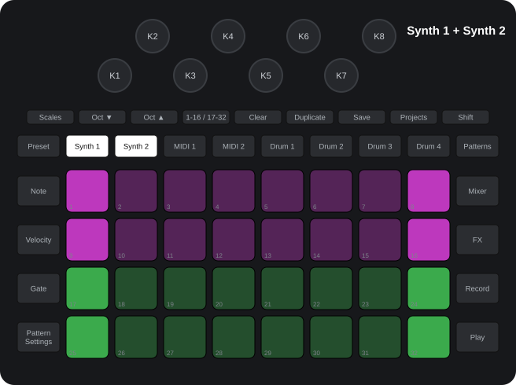

*Split keyboard: rows 1-2 = Synth 1, rows 3-4 = Synth 2.*


*[Step by step: Split the keyboard between two tracks (since RC2)](https://github.com/Ghillermo/CIRCUIT-HACKS-RC/wiki/Step-by-step#split-the-keyboard-between-two-tracks-since-rc2)*

## [Synth patch colours](https://ghillermo.github.io/CIRCUIT-HACKS-RC/beta/guide.html#f-colores-patch)

**From RC2 to RC4.08** every patch of the Synth 1 / 2 Preset view was drawn by its voice mode. **Since RC4.10** the colours are the original's: those card reads sometimes loaded the initial patch. **Beta 5.64 only:** each patch in the colour of its **Components category**.

**What it is for:** Shows on the pads of the Synth 1 / 2 Preset view what each patch is, so you can find a sound at a glance. The RCs use the original's colours; Beta 5.56 colours each patch by its Components category (Bass, Lead, Pad…).

**How:**

1. Select **Synth 1** or **Synth 2** and press **Preset**: the pads are the pack's patches (4 pages, 128 patches).
2. *(since RC4.10)* As on the original: the patches in the track's colour, the chosen one white.
3. *(Beta 5.56 only)* Each patch in its Components category's colour: Arp teal, Bass steel blue, Bell light blue, Classic amber, Drum orange, Keyboard pale lime, Lead yellow, Movement violet, Pad blue, Poly green, SFX red, String peach, User sand, Voc lavender; None = the track's colour; an empty slot dim white; the chosen one white.
4. *(Beta 5.56 only)* To give a patch a category on the device, save it: **Clear + pad**, turn **K1** while the slot asks (4 clicks a category, starting at the patch's own; K1 and the slot show its colour), then **Clear + the same pad**.

**Keep in mind:**

- From RC2 to RC4.08 the colour showed the voice mode (mono dark blue, mono with glide lavender, poly the track's colour); since RC4.10 the RCs use the original's colours, because the card reads behind them sometimes loaded the initial patch.
- *(Beta 5.56 only)* The card is read on entering the view, on a new page or pack and after a save or a copy, never when you tap a patch.
- The categories are the ones Components gives each patch. On the computer, the **Nova synths** tab of the [card and device app](https://ghillermo.github.io/CIRCUIT-HACKS-RC/beta/guide.html#app-sd) shows the same colours, with the colour key on top. The chart with every category: [Patch colours](https://github.com/Ghillermo/CIRCUIT-HACKS-RC/wiki/Patch-Colours).

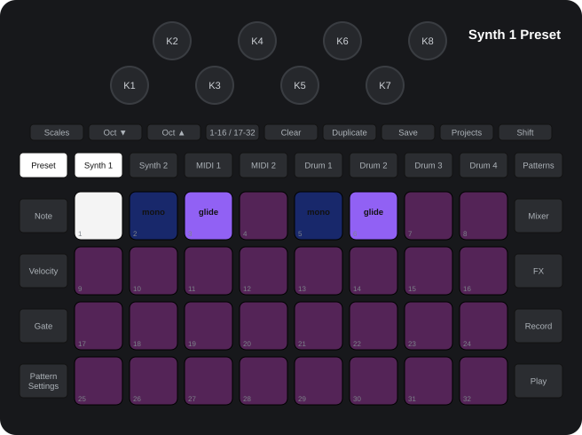

*Preset view of Synth 1 from RC2 to RC4.08: mono dark blue, glide lavender, poly the track colour.*

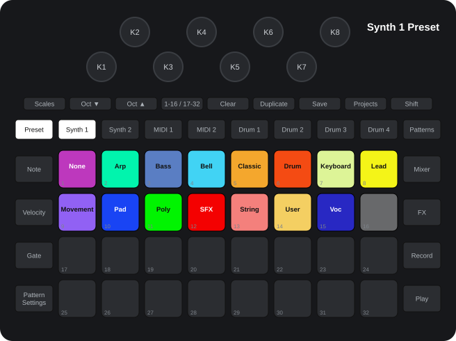

*Beta 5.64 only: Synth 1's Preset view with one patch of each Components category; pad 1 = None (the track's colour), pad 16 = an empty slot (dim white).*

## [Patches of the own synth (MIDI 1 / 2)](https://ghillermo.github.io/CIRCUIT-HACKS-RC/beta/guide.html#f-patches-midi)

**Since RC2.** In the Preset view of MIDI 1 / 2, rows 2 and 3 are 16 patch slots of the track engine: touch = load (the root note sounds), **Clear + pad** twice = save, **Duplicate + A + B** = exchange; **Octave ▼ / ▲** = the pages (**since RC4**: 8 pages, 128 slots per pack; before, 4 pages, 64 slots).

**What it is for:** A sound library for the MIDI tracks' own synth: store the whole MIDI 1 / 2 engine (engine, oscillators, every knob) in slots of the pack and load it again with one touch, on either track and in any project that uses that pack.

**How:**

1. Open the **Preset** view of **MIDI 1 / 2** (*(since RC4)* also MIDI 1 / 2 again with its Note view on screen, or **Shift + MIDI 1 / 2**): pads 9-24 (rows 2-3) are 16 patch slots.
2. **Octave ▼ / ▲** = next / previous page (lit when there is one that way): 4 pages, 64 slots per pack; *(since RC4)* 8 pages, 128 slots.
3. **Load:** touch a slot; while you hold it, the scale's root plays with the new patch. *(since RC4)* **Shift + slot** = load without the sound.
4. **Save:** **Clear + slot** (it blinks white: a question), then **Clear + the same slot** within ~5 s: the sound as it is now replaces what was there. *(Beta 5.56 only)* **Duplicate + an empty slot** = save there at once.
5. **Swap:** hold **Duplicate**, touch slot A (it blinks), then slot B; onto an empty slot the patch moves. No gesture empties a slot: overwrite it or move it.
6. **Start from scratch:** **Clear + MIDI 1 / 2** (a view of that track on screen, CC editor closed) puts every engine value back to its initial one; the engine chosen stays.

**Keep in mind:**

- A patch holds the whole engine: the engine chosen, the oscillators, the chain order, every value of every page and the step-drummer setting (*(since RC2.02)* the mod matrix; *(since RC4)* the FM, the voice mode and the knob destinations). The step-drummer's and the FX sequencer's steps belong to the pattern.
- The slots belong to the pack and are shared by MIDI 1 and MIDI 2. Writes to the card: not in the S builds nor in the internal memory's pack (the Save LED turns red). They are hidden while the CC editor or the step-drummer is open.
- Colours: dim peach = a patch, bright peach = the last one loaded or saved, violet = empty. *(Beta 5.56 only)* Each patch in its engine's colour (FM violet, wavetable sand), empty slots dim white.
- *(Beta 5.56 only)* Components' «Send patches» / «Send pack» no longer erase them (they used to be lost). A copy saved by Components has no own-synth patches; the Snapshot of the [card and device app](https://ghillermo.github.io/CIRCUIT-HACKS-RC/beta/guide.html#app-sd) has them, and its **Custom patches** tab copies, exports and uploads them (81 example patches are published).

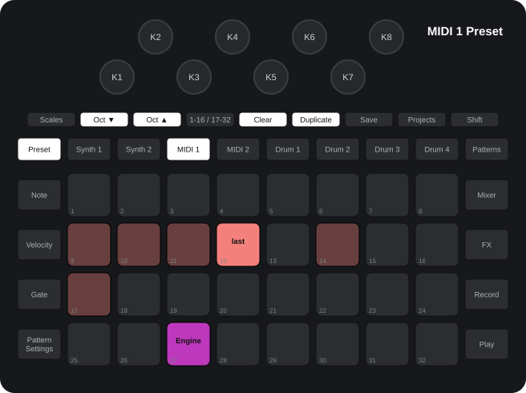

*Preset view of MIDI 1: rows 2-3 = patches of the own synth.*


*[Step by step: Load, save and swap own-synth patches (since RC2)](https://github.com/Ghillermo/CIRCUIT-HACKS-RC/wiki/Step-by-step#load-save-and-swap-own-synth-patches-since-rc2)*

## [Saving the synth’s patch into the pack](https://ghillermo.github.io/CIRCUIT-HACKS-RC/beta/guide.html#f-guardar-patch)

**Since RC2.** In the Preset view of Synth 1 / 2: **Clear + pad** asks (it blinks white) and **Clear + the same pad again** saves the patch as it sounds into that slot.

**What it is for:** Stores the Synth 1 / 2 sound you have shaped on the device into one of the pack's 128 patch slots, so you can reuse it in other projects. On the original this was only possible from Components on a computer.

**How:**

1. Select **Synth 1** or **Synth 2** and press **Preset**; go to the page of the slot you want (4 pages, 128 slots).
2. **Clear + a slot**: it blinks white (a question; nothing is written yet). *(Beta 5.56 only)* While it asks, **K1** picks the category to save (4 clicks each, starting at the patch's own; the slot blinks in its colour).
3. **Clear + the same slot** within ~5 s: the patch as it sounds now is saved there and becomes the chosen one.
4. Clear + another slot moves the question; a touch without Clear, or waiting, drops it.

**Keep in mind:**

- What is saved: the patch in use with every change — its knobs, the MIDI it received and its edited macro destinations. It keeps the name of the patch that was loaded.
- A slot past the end of the bank works too; the slots in between stay empty. The own-synth patch that shares the slot is not touched.
- Writes to the card: not in the S builds nor in the internal memory's pack (the Save LED turns red).
- **Duplicate + A + B** in this view still swaps two patches, or copies one to another pack.

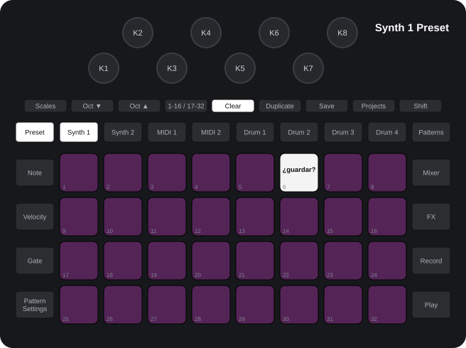

*Preset view of Synth 1: Clear + pad asks (it blinks), Clear + the same pad saves.*


*[Step by step: Save a Synth 1 / 2 patch (since RC2)](https://github.com/Ghillermo/CIRCUIT-HACKS-RC/wiki/Step-by-step#save-a-synth-1--2-patch-since-rc2)*

## [Macro knob destinations](https://ghillermo.github.io/CIRCUIT-HACKS-RC/beta/guide.html#f-destinos-macro)

**Since RC2.** In the synth source view, **pad 32** opens the editor: a knob picks its macro, **Octave ▼ / ▲** steps the field and the pads draw the number.

**What it is for:** Lets you decide on the device what each of the 8 macro knobs of a Synth 1 / 2 patch moves — up to 4 destinations per knob, each over its own stretch of the knob's travel and with its own depth — without Components. For example, one knob can open the filter while it raises the filter drive.

**How:**

1. Open the synth's source view: with **Synth 1 / 2** on screen, press its button again (*(since RC4)*: or **Shift + Synth 1 / 2**).
2. Touch **pad 32** (teal): the editor is on and the knobs stop moving the macros.
3. Turn a knob to pick its macro (its LED white); the first turn changes nothing.
4. Turn it to change the current field; **Octave ▼** = next field, **Octave ▲** = previous: slot 1-4 (yellow) → start 0-127 (green) → end 0-127 (amber) → destination (white = a CC; light blue, magenta, violet = an NRPN of banks 0, 1, 2) → depth (teal = positive, red = negative). The pads draw the number.
5. Any pad releases the macro (the source view's pads come back); **pad 32** turns the editor off; any view button closes it.
6. To keep the result in the pack, save the patch: **Clear + pad** twice in the Synth 1 / 2 Preset view.

**Keep in mind:**

- The destination walks first the 31 parameters that have a CC, by CC number (74 = filter cutoff, 71 = resonance…), then the 39 that only have an NRPN (envelopes 2 and 3, LFOs, chorus, mod matrix depths). The numbers are those of Novation's Programmer's Reference Guide; the full list: [Mod matrix and macro destinations](https://ghillermo.github.io/CIRCUIT-HACKS-RC/beta/guide.html#destinos).
- The changes sound at once and live in the project's patch: they are saved with the project; save the patch to use them in other projects.
- On the original these slots can only be edited with Components.

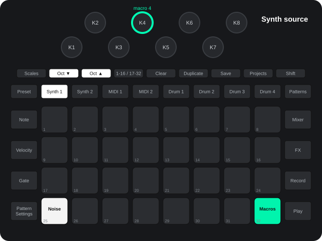

*Source view with the macro editor: pad 32 lit, the picked knob white.*


*[Step by step: Edit the macro knobs' destinations (since RC2)](https://github.com/Ghillermo/CIRCUIT-HACKS-RC/wiki/Step-by-step#edit-the-macro-knobs-destinations-since-rc2)*

## [Copying projects to another slot or another pack](https://ghillermo.github.io/CIRCUIT-HACKS-RC/beta/guide.html#f-copiar-proyectos)

**Since RC2.** In the Projects view: **Duplicate + pad A** picks the project (it blinks yellow) and **Duplicate + pad B** copies it into that slot, of the same pack or of another one.

**What it is for:** Duplicates a whole project into another slot of the same pack or into another pack, from the device. Useful to start a variation of a song without touching the original, or to take a project to a pack with other sounds.

**How:**

1. Open **Projects**. Save first if you have changed the project: what is copied is the project as saved on the card.
2. **Duplicate + pad A** (a slot with a project) = the source: it blinks yellow. Duplicate + A again forgets it.
3. **Duplicate + pad B** = the copy. An empty B is written at once and turns yellow; a B that holds a project blinks white: repeat **Duplicate + B** within ~5 s to replace it.
4. **To another pack:** pick the source, load the other pack, open **Projects** again and do **Duplicate + pad B** there.

**Keep in mind:**

- The loaded project's slot is never written. While it copies (a few moments) the device does not respond.
- A project stores patch and sample numbers, not the sounds: in another pack it plays with that pack's patches and samples.
- The source serves several copies; it is forgotten at power-off or when Master FX is opened.
- Writes to the card: not in the S builds. The internal memory's pack can be the source but never the target (the Save LED turns red).

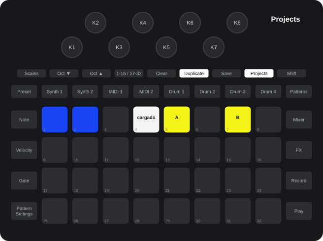

*Projects view: Duplicate + A = the source (yellow, blinking), Duplicate + B = the copy.*


*[Step by step: Copy a project (since RC2)](https://github.com/Ghillermo/CIRCUIT-HACKS-RC/wiki/Step-by-step#copy-a-project-since-rc2)*

## [Own-synth patches to another pack](https://ghillermo.github.io/CIRCUIT-HACKS-RC/beta/guide.html#f-patches-entre-packs)

**Since RC2.** In the Preset view of MIDI 1 / 2: **Duplicate + slot A**, load another pack and **Duplicate + slot B** copies the patch (engine, parameters and name).

**What it is for:** Takes a sound of the MIDI tracks' own synth from one pack to another without a computer, so a favourite bass or lead can travel with you to a new pack.

**How:**

1. With the source pack loaded: **MIDI 1 / 2**, **Preset**, **Duplicate + slot A**: the patch is remembered.
2. Load the other pack and go back to the Preset view of MIDI 1 / 2: **Duplicate** lights yellow (a patch is waiting).
3. **Duplicate + slot B** writes it there, with its engine, parameters and name. It can go into several slots.

**Keep in mind:**

- In the same pack, Duplicate + A + B swaps the two patches instead.
- Nothing is copied when A is empty or when the destination pack lacks that patch bank.
- The waiting patch is forgotten at power-off. Writes to the card: not in the S builds nor in the internal memory's pack (the Save LED turns red).


*[Step by step: Copy an own-synth patch to another pack (since RC2)](https://github.com/Ghillermo/CIRCUIT-HACKS-RC/wiki/Step-by-step#copy-an-own-synth-patch-to-another-pack-since-rc2)*

## [Shift = a flash on every note (Beta 5.64 only)](https://ghillermo.github.io/CIRCUIT-HACKS-RC/beta/guide.html#f-luces-disparo)

With Shift held, each track's button flashes white on every note it plays.

**What it is for:** A quick activity monitor: while you hold Shift, each track's button flashes white every time that track plays a note, so you can see at a glance which tracks are sounding — handy in a busy project, or to check what MIDI or the arpeggiator is playing.

**How:**

1. Hold **Shift**, in any view.
2. The eight track buttons (Synth 1 / 2, MIDI 1 / 2, Drum 1-4) flash **white** for 100 ms on every note their track plays, from the sequencer, the pads, the arpeggiator or MIDI.
3. Let go of Shift: the buttons go back to normal.

**Keep in mind:**

- *Beta 5.56 only.* In the RCs, as on the original, the track buttons stay dark while Shift is held.
- A note tied to the next one is one note: one flash.

## [Shift + Preset = the project's sound (Beta 5.64 only)](https://ghillermo.github.io/CIRCUIT-HACKS-RC/beta/guide.html#f-proyecto-init)

Shift + Preset brings the track's sound back to the one saved in the project.

**What it is for:** An undo for sound tweaks: Shift + Preset throws away the knob changes made to a track and brings its sound back to the one saved in the project — the whole patch for Synth 1 / 2, the own synth for MIDI 1 / 2.

**How:**

1. Go to a view of **Synth 1 / 2**, or of **MIDI 1 / 2** with its own synth on, and hold **Shift**: **Preset** lights yellow where it works.
2. Press **Shift + Preset**. Synth 1 / 2: the synth's whole patch goes back to how the project saved it (or how it was loaded). MIDI 1 / 2: the own synth goes back to the one saved with the project.
3. A project without an own synth: MIDI 1 / 2 go back to their defaults, as with **Clear + MIDI 1 / 2**.

**Keep in mind:**

- What was turned since is lost: if you want to keep it, save the patch or the project first.
- *Beta 5.56 only.* In the RCs, as on the original, Shift + Preset does nothing on these tracks.
- With a drum, **Shift + Preset** still opens the chromatic view.
