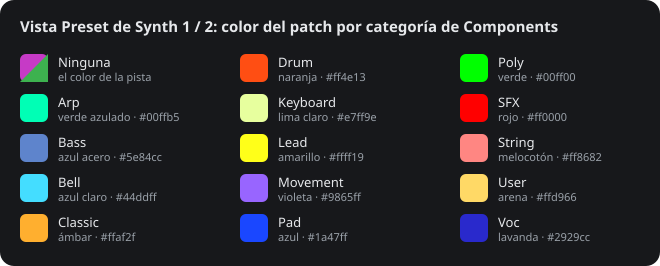

# Colores de los patches

*[English version](https://github.com/Ghillermo/CIRCUIT-HACKS-RC/wiki/Patch-Colours) · [Home](https://github.com/Ghillermo/CIRCUIT-HACKS-RC/wiki/Home#en-español) · [Guía por vistas](https://ghillermo.github.io/CIRCUIT-HACKS-RC/beta/guia.html#synth-preset)*

En la **vista Preset de Synth 1 / 2** cada patch Nova se enciende en el color de su **categoría de Components** (Beta 5.40 y posteriores). La categoría Ninguna lleva el color de la pista (Synth 1 magenta, Synth 2 verde); un hueco vacío, blanco tenue, y el patch elegido, blanco. Las versiones candidatas (desde RC4.10) usan los colores del original: todos los patches en el color de la pista.

| # | Categoría | Color | RGB |
|---|---|---|---|
| 0 | Ninguna | el color de la pista | `#c63ac6 / #3db24f` |
| 1 | Arp | verde azulado | `#00ffb5` |
| 2 | Bass | azul acero | `#5e84cc` |
| 3 | Bell | azul claro | `#44ddff` |
| 4 | Classic | ámbar | `#ffaf2f` |
| 5 | Drum | naranja | `#ff4e13` |
| 6 | Keyboard | lima claro | `#e7ff9e` |
| 7 | Lead | amarillo | `#ffff19` |
| 8 | Movement | violeta | `#9865ff` |
| 9 | Pad | azul | `#1a47ff` |
| 10 | Poly | verde | `#00ff00` |
| 11 | SFX | rojo | `#ff0000` |
| 12 | String | melocotón | `#ff8682` |
| 13 | User | arena | `#ffd966` |
| 14 | Voc | lavanda | `#2929cc` |

## Elegir la categoría de un patch

- **En el aparato:** guarda el patch en la vista Preset de Synth 1 / 2 (**Clear + pad**, luego **Clear + el mismo pad** para confirmar); mientras pregunta, **K1** elige la categoría.
- **En Novation Components:** la categoría de cada patch del pack.
- **En la app de la tarjeta** ([descarga](https://ghillermo.github.io/CIRCUIT-HACKS-RC/sd_app.zip)): la pestaña **Sintes Nova** enseña el color de cada patch y, arriba, esta tabla como clave de colores.
