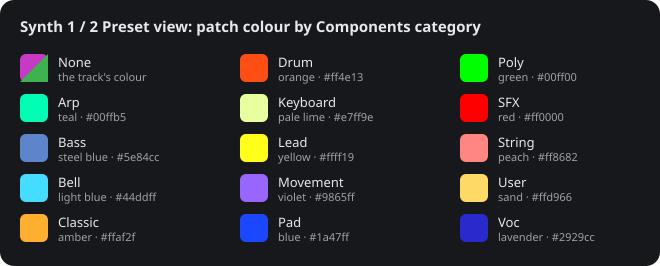

# Patch colours

*[Versión en español](https://github.com/Ghillermo/CIRCUIT-HACKS-RC/wiki/Patch-Colours-ES) · [Home](https://github.com/Ghillermo/CIRCUIT-HACKS-RC/wiki/Home) · [Guide by views](https://ghillermo.github.io/CIRCUIT-HACKS-RC/beta/guide.html#synth-preset)*

In the **Synth 1 / 2 Preset view** each Nova patch lights in the colour of its **Components category** (Beta 5.40 and later). Category None keeps the track's colour (Synth 1 magenta, Synth 2 green); an empty slot is dim white and the chosen patch is white. The release candidates (RC4.10 on) use the original's colours: every patch in the track's colour.

| # | Category | Colour | RGB |
|---|---|---|---|
| 0 | None | the track's colour | `#c63ac6 / #3db24f` |
| 1 | Arp | teal | `#00ffb5` |
| 2 | Bass | steel blue | `#5e84cc` |
| 3 | Bell | light blue | `#44ddff` |
| 4 | Classic | amber | `#ffaf2f` |
| 5 | Drum | orange | `#ff4e13` |
| 6 | Keyboard | pale lime | `#e7ff9e` |
| 7 | Lead | yellow | `#ffff19` |
| 8 | Movement | violet | `#9865ff` |
| 9 | Pad | blue | `#1a47ff` |
| 10 | Poly | green | `#00ff00` |
| 11 | SFX | red | `#ff0000` |
| 12 | String | peach | `#ff8682` |
| 13 | User | sand | `#ffd966` |
| 14 | Voc | lavender | `#2929cc` |

## Setting a patch's category

- **On the device:** save the patch in the Synth 1 / 2 Preset view (**Clear + pad**, then **Clear + the same pad** to confirm); while it asks, **K1** picks the category.
- **In Novation Components:** the category of each patch of the pack.
- **In the SD app** ([download](https://ghillermo.github.io/CIRCUIT-HACKS-RC/sd_app.zip)): the **Nova synths** tab shows each patch's colour and, on top, this chart as a colour key.
