# Paso a paso

*[English version](https://github.com/Ghillermo/CIRCUIT-HACKS-RC/wiki/Step-by-step) · [Inicio](https://github.com/Ghillermo/CIRCUIT-HACKS-RC/wiki/Home#en-español) · [Guía por vistas](https://ghillermo.github.io/CIRCUIT-HACKS-RC/beta/guia.html)*

Todo lo que lleva varios gestos seguidos, como una animación del panel con un texto para cada gesto, escrito también debajo. Por vistas, en el orden de la guía; cada uno enlaza con su vista de la [guía por vistas](https://ghillermo.github.io/CIRCUIT-HACKS-RC/beta/guia.html) y con su entrada de las páginas de [Funciones](https://github.com/Ghillermo/CIRCUIT-HACKS-RC/wiki/Features-ES).

**Cómo leerlas:** el número del círculo naranja bajo el panel cuenta los gestos. Un punto blanco con borde naranja marca el pad que hay que pulsar o mantener; un contorno naranja, el botón; un aro naranja, el knob que tocas; un arco naranja, el knob que hay que girar y hacia dónde. Un pad que parpadea en el dibujo parpadea en el aparato. Cada gesto se queda el tiempo de leer su texto, y la animación se repite; un visor que no reproduce animaciones enseña el primer gesto.

**Contenido**

- **[Botones que funcionan en todas las vistas](https://github.com/Ghillermo/CIRCUIT-HACKS-RC/wiki/Step-by-step-ES#botones-que-funcionan-en-todas-las-vistas)** — [Grabar con la cuenta atrás (desde RC2)](https://github.com/Ghillermo/CIRCUIT-HACKS-RC/wiki/Step-by-step-ES#grabar-con-la-cuenta-atrás-desde-rc2) · [Cuantizar un patrón (desde RC2)](https://github.com/Ghillermo/CIRCUIT-HACKS-RC/wiki/Step-by-step-ES#cuantizar-un-patrón-desde-rc2)
- **[Vista Setup](https://github.com/Ghillermo/CIRCUIT-HACKS-RC/wiki/Step-by-step-ES#vista-setup)** — [Mandar los drums como notas General MIDI (desde RC4)](https://github.com/Ghillermo/CIRCUIT-HACKS-RC/wiki/Step-by-step-ES#mandar-los-drums-como-notas-general-midi-desde-rc4) · [Elegir los canales de Program Change (desde RC2)](https://github.com/Ghillermo/CIRCUIT-HACKS-RC/wiki/Step-by-step-ES#elegir-los-canales-de-program-change-desde-rc2)
- **[Vista Advanced Setup](https://github.com/Ghillermo/CIRCUIT-HACKS-RC/wiki/Step-by-step-ES#vista-advanced-setup)** — [Elegir el modo del jack MIDI Thru (desde RC2)](https://github.com/Ghillermo/CIRCUIT-HACKS-RC/wiki/Step-by-step-ES#elegir-el-modo-del-jack-midi-thru-desde-rc2) · [Guardar mientras suena sin tropiezos (desde RC4.05)](https://github.com/Ghillermo/CIRCUIT-HACKS-RC/wiki/Step-by-step-ES#guardar-mientras-suena-sin-tropiezos-desde-rc405)
- **[Vista de pista de Synth 1 / 2 (Note, Velocity, Gate)](https://github.com/Ghillermo/CIRCUIT-HACKS-RC/wiki/Step-by-step-ES#vista-de-pista-de-synth-1--2-note-velocity-gate)** — [Partir el teclado entre dos pistas (desde RC2)](https://github.com/Ghillermo/CIRCUIT-HACKS-RC/wiki/Step-by-step-ES#partir-el-teclado-entre-dos-pistas-desde-rc2) · [Fijar notas (latch) y escribirlas en un paso (desde RC4)](https://github.com/Ghillermo/CIRCUIT-HACKS-RC/wiki/Step-by-step-ES#fijar-notas-latch-y-escribirlas-en-un-paso-desde-rc4) · [Tocar acordes con un pad (desde RC4)](https://github.com/Ghillermo/CIRCUIT-HACKS-RC/wiki/Step-by-step-ES#tocar-acordes-con-un-pad-desde-rc4) · [Hacer que un paso suelte la automatización (desde RC4)](https://github.com/Ghillermo/CIRCUIT-HACKS-RC/wiki/Step-by-step-ES#hacer-que-un-paso-suelte-la-automatización-desde-rc4)
- **[Vista Scales y escala propia](https://github.com/Ghillermo/CIRCUIT-HACKS-RC/wiki/Step-by-step-ES#vista-scales-y-escala-propia)** — [Hacer una escala propia (desde RC2)](https://github.com/Ghillermo/CIRCUIT-HACKS-RC/wiki/Step-by-step-ES#hacer-una-escala-propia-desde-rc2) · [Encender la disposición Jankó (desde RC4)](https://github.com/Ghillermo/CIRCUIT-HACKS-RC/wiki/Step-by-step-ES#encender-la-disposición-jankó-desde-rc4)
- **[Vista de la fuente del sinte](https://github.com/Ghillermo/CIRCUIT-HACKS-RC/wiki/Step-by-step-ES#vista-de-la-fuente-del-sinte)** — [Editar los destinos de los macro knobs (desde RC2)](https://github.com/Ghillermo/CIRCUIT-HACKS-RC/wiki/Step-by-step-ES#editar-los-destinos-de-los-macro-knobs-desde-rc2)
- **[Vista Preset de Synth 1 / 2](https://github.com/Ghillermo/CIRCUIT-HACKS-RC/wiki/Step-by-step-ES#vista-preset-de-synth-1--2)** — [Guardar un patch de Synth 1 / 2 (desde RC2)](https://github.com/Ghillermo/CIRCUIT-HACKS-RC/wiki/Step-by-step-ES#guardar-un-patch-de-synth-1--2-desde-rc2) · [Intercambiar dos patches de Synth 1 / 2](https://github.com/Ghillermo/CIRCUIT-HACKS-RC/wiki/Step-by-step-ES#intercambiar-dos-patches-de-synth-1--2) · [Copiar un patch de Synth 1 / 2 a otro pack](https://github.com/Ghillermo/CIRCUIT-HACKS-RC/wiki/Step-by-step-ES#copiar-un-patch-de-synth-1--2-a-otro-pack) · [Hacer morph entre patches (solo Beta 5.56)](https://github.com/Ghillermo/CIRCUIT-HACKS-RC/wiki/Step-by-step-ES#hacer-morph-entre-patches-solo-beta-556)
- **[Vista Preset de MIDI 1 / 2](https://github.com/Ghillermo/CIRCUIT-HACKS-RC/wiki/Step-by-step-ES#vista-preset-de-midi-1--2)** — [Cargar, guardar e intercambiar patches del sinte propio (desde RC2)](https://github.com/Ghillermo/CIRCUIT-HACKS-RC/wiki/Step-by-step-ES#cargar-guardar-e-intercambiar-patches-del-sinte-propio-desde-rc2) · [Copiar un patch del sinte propio a otro pack (desde RC2)](https://github.com/Ghillermo/CIRCUIT-HACKS-RC/wiki/Step-by-step-ES#copiar-un-patch-del-sinte-propio-a-otro-pack-desde-rc2) · [Elegir un motor en la fila de motores (desde RC4)](https://github.com/Ghillermo/CIRCUIT-HACKS-RC/wiki/Step-by-step-ES#elegir-un-motor-en-la-fila-de-motores-desde-rc4) · [Elegir el modo de voz del sinte propio (desde RC4)](https://github.com/Ghillermo/CIRCUIT-HACKS-RC/wiki/Step-by-step-ES#elegir-el-modo-de-voz-del-sinte-propio-desde-rc4)
- **[Páginas de knobs del motor de MIDI 1 / 2](https://github.com/Ghillermo/CIRCUIT-HACKS-RC/wiki/Step-by-step-ES#páginas-de-knobs-del-motor-de-midi-1--2)** — [Hacer una foto del sonido en un paso (desde RC4)](https://github.com/Ghillermo/CIRCUIT-HACKS-RC/wiki/Step-by-step-ES#hacer-una-foto-del-sonido-en-un-paso-desde-rc4)
- **[Matriz de modulación](https://github.com/Ghillermo/CIRCUIT-HACKS-RC/wiki/Step-by-step-ES#matriz-de-modulación)** — [Llevar una fuente de la matriz a un destino (desde RC2.02)](https://github.com/Ghillermo/CIRCUIT-HACKS-RC/wiki/Step-by-step-ES#llevar-una-fuente-de-la-matriz-a-un-destino-desde-rc202)
- **[FM de 4 operadores](https://github.com/Ghillermo/CIRCUIT-HACKS-RC/wiki/Step-by-step-ES#fm-de-4-operadores)** — [Elegir un algoritmo FM con los pads (desde RC4)](https://github.com/Ghillermo/CIRCUIT-HACKS-RC/wiki/Step-by-step-ES#elegir-un-algoritmo-fm-con-los-pads-desde-rc4) · [Cargar un sonido de partida del FM (desde RC4)](https://github.com/Ghillermo/CIRCUIT-HACKS-RC/wiki/Step-by-step-ES#cargar-un-sonido-de-partida-del-fm-desde-rc4)
- **[Editor de CC de los macros MIDI (pad 25)](https://github.com/Ghillermo/CIRCUIT-HACKS-RC/wiki/Step-by-step-ES#editor-de-cc-de-los-macros-midi-pad-25)** — [Cambiar el CC que manda un macro knob MIDI](https://github.com/Ghillermo/CIRCUIT-HACKS-RC/wiki/Step-by-step-ES#cambiar-el-cc-que-manda-un-macro-knob-midi)
- **[Vista del step-drummer](https://github.com/Ghillermo/CIRCUIT-HACKS-RC/wiki/Step-by-step-ES#vista-del-step-drummer)** — [Secuenciar un destino con el step-drummer](https://github.com/Ghillermo/CIRCUIT-HACKS-RC/wiki/Step-by-step-ES#secuenciar-un-destino-con-el-step-drummer)
- **[Modo muestra y selector de samples](https://github.com/Ghillermo/CIRCUIT-HACKS-RC/wiki/Step-by-step-ES#modo-muestra-y-selector-de-samples)** — [Elegir samples y cambiarlos por paso (sample flip) (desde RC2)](https://github.com/Ghillermo/CIRCUIT-HACKS-RC/wiki/Step-by-step-ES#elegir-samples-y-cambiarlos-por-paso-sample-flip-desde-rc2)
- **[Vista Pattern Settings](https://github.com/Ghillermo/CIRCUIT-HACKS-RC/wiki/Step-by-step-ES#vista-pattern-settings)** — [Encender el arpegiador (desde RC2)](https://github.com/Ghillermo/CIRCUIT-HACKS-RC/wiki/Step-by-step-ES#encender-el-arpegiador-desde-rc2) · [Dar forma al arpegio con sus modificadores (desde RC4)](https://github.com/Ghillermo/CIRCUIT-HACKS-RC/wiki/Step-by-step-ES#dar-forma-al-arpegio-con-sus-modificadores-desde-rc4) · [Mover los pasos de un patrón (Nudge) (desde RC4.05)](https://github.com/Ghillermo/CIRCUIT-HACKS-RC/wiki/Step-by-step-ES#mover-los-pasos-de-un-patrón-nudge-desde-rc405)
- **[Vista Micro Step (pistas de notas)](https://github.com/Ghillermo/CIRCUIT-HACKS-RC/wiki/Step-by-step-ES#vista-micro-step-pistas-de-notas)** — [Gate por pulsación o longitud fija (desde RC2)](https://github.com/Ghillermo/CIRCUIT-HACKS-RC/wiki/Step-by-step-ES#gate-por-pulsación-o-longitud-fija-desde-rc2)
- **[Vista de probabilidad (pistas de notas y drums)](https://github.com/Ghillermo/CIRCUIT-HACKS-RC/wiki/Step-by-step-ES#vista-de-probabilidad-pistas-de-notas-y-drums)** — [Hacer que las notas de un paso muten (desde RC2)](https://github.com/Ghillermo/CIRCUIT-HACKS-RC/wiki/Step-by-step-ES#hacer-que-las-notas-de-un-paso-muten-desde-rc2) · [Hacer que un paso suene cada n vueltas (desde RC2)](https://github.com/Ghillermo/CIRCUIT-HACKS-RC/wiki/Step-by-step-ES#hacer-que-un-paso-suene-cada-n-vueltas-desde-rc2)
- **[Vista de pista de un drum (knobs)](https://github.com/Ghillermo/CIRCUIT-HACKS-RC/wiki/Step-by-step-ES#vista-de-pista-de-un-drum-knobs)** — [Hacer una pareja estéreo de drums (desde RC4)](https://github.com/Ghillermo/CIRCUIT-HACKS-RC/wiki/Step-by-step-ES#hacer-una-pareja-estéreo-de-drums-desde-rc4)
- **[Vista Preset de drums](https://github.com/Ghillermo/CIRCUIT-HACKS-RC/wiki/Step-by-step-ES#vista-preset-de-drums)** — [Intercambiar dos samples de drum](https://github.com/Ghillermo/CIRCUIT-HACKS-RC/wiki/Step-by-step-ES#intercambiar-dos-samples-de-drum) · [Copiar un sample de drum a otro pack](https://github.com/Ghillermo/CIRCUIT-HACKS-RC/wiki/Step-by-step-ES#copiar-un-sample-de-drum-a-otro-pack) · [Capturar un sample y sustituir un drum por él](https://github.com/Ghillermo/CIRCUIT-HACKS-RC/wiki/Step-by-step-ES#capturar-un-sample-y-sustituir-un-drum-por-él) · [Arpegiar los samples de un drum (desde RC2)](https://github.com/Ghillermo/CIRCUIT-HACKS-RC/wiki/Step-by-step-ES#arpegiar-los-samples-de-un-drum-desde-rc2)
- **[Master FX](https://github.com/Ghillermo/CIRCUIT-HACKS-RC/wiki/Step-by-step-ES#master-fx)** — [Poner un efecto en un hueco de Master FX](https://github.com/Ghillermo/CIRCUIT-HACKS-RC/wiki/Step-by-step-ES#poner-un-efecto-en-un-hueco-de-master-fx) · [Repetir pasos en directo con el song pointer](https://github.com/Ghillermo/CIRCUIT-HACKS-RC/wiki/Step-by-step-ES#repetir-pasos-en-directo-con-el-song-pointer) · [Repetir una frase con el modo frase](https://github.com/Ghillermo/CIRCUIT-HACKS-RC/wiki/Step-by-step-ES#repetir-una-frase-con-el-modo-frase)
- **[Vista Sidechain](https://github.com/Ghillermo/CIRCUIT-HACKS-RC/wiki/Step-by-step-ES#vista-sidechain)** — [Sidechain de una pista con el patrón de otra (desde RC2)](https://github.com/Ghillermo/CIRCUIT-HACKS-RC/wiki/Step-by-step-ES#sidechain-de-una-pista-con-el-patrón-de-otra-desde-rc2)
- **[Vista Patterns y cadenas de patrones](https://github.com/Ghillermo/CIRCUIT-HACKS-RC/wiki/Step-by-step-ES#vista-patterns-y-cadenas-de-patrones)** — [Encadenar patrones: A A A B A A A C (desde RC2)](https://github.com/Ghillermo/CIRCUIT-HACKS-RC/wiki/Step-by-step-ES#encadenar-patrones-a-a-a-b-a-a-a-c-desde-rc2)
- **[Vista Mixer y escenas](https://github.com/Ghillermo/CIRCUIT-HACKS-RC/wiki/Step-by-step-ES#vista-mixer-y-escenas)** — [Repetir una escena (desde RC2)](https://github.com/Ghillermo/CIRCUIT-HACKS-RC/wiki/Step-by-step-ES#repetir-una-escena-desde-rc2) · [Silenciar una pista en el compás siguiente (desde RC2)](https://github.com/Ghillermo/CIRCUIT-HACKS-RC/wiki/Step-by-step-ES#silenciar-una-pista-en-el-compás-siguiente-desde-rc2) · [Preparar pistas en el cue (desde RC2)](https://github.com/Ghillermo/CIRCUIT-HACKS-RC/wiki/Step-by-step-ES#preparar-pistas-en-el-cue-desde-rc2)
- **[Vista Projects](https://github.com/Ghillermo/CIRCUIT-HACKS-RC/wiki/Step-by-step-ES#vista-projects)** — [Copiar un proyecto (desde RC2)](https://github.com/Ghillermo/CIRCUIT-HACKS-RC/wiki/Step-by-step-ES#copiar-un-proyecto-desde-rc2)
- **[Vista de packs](https://github.com/Ghillermo/CIRCUIT-HACKS-RC/wiki/Step-by-step-ES#vista-de-packs)** — [Borrar un pack](https://github.com/Ghillermo/CIRCUIT-HACKS-RC/wiki/Step-by-step-ES#borrar-un-pack)

## Botones que funcionan en todas las vistas

### Grabar con la cuenta atrás (desde RC2)


1. Mantén Shift: el LED de Clear enseña el estado del metrónomo. Shift + Clear pasa por cuatro: sin metrónomo (rojo) …
2. … metrónomo (verde) …
3. … solo cuenta atrás (magenta) …
4. … cuenta atrás y metrónomo (verde azulado). El volumen del clic es el de stock: Tempo/Swing y K5.
5. Con el transporte parado, pulsa Record: armado (rojo).
6. Pulsa Play: un compás de cuenta atrás, 4 clics al tempo del proyecto (como esclavo, al del reloj externo), mientras Record parpadea en rojo. Play durante la cuenta la cancela.
7. Después arranca la grabación. La cuenta atrás se guarda con el proyecto; con el modo cue del Mixer (desde RC4) el clic suena solo en el cue.

→ Guía: [Botones que funcionan en todas las vistas](https://ghillermo.github.io/CIRCUIT-HACKS-RC/beta/guia.html#botones) · Funciones: [Setup y MIDI del aparato](https://github.com/Ghillermo/CIRCUIT-HACKS-RC/wiki/Features-Controls-ES#setup-y-midi-del-aparato)

### Cuantizar un patrón (desde RC2)


1. Elige la pista que quieres cuantizar (aquí Synth 1): su patrón que suena tiene notas grabadas fuera de la rejilla.
2. Mantén Shift: Play se ilumina en amarillo (está disponible).
3. Shift + Play: cuantizado. Las notas y los golpes en los micropasos 1-2 van al inicio de su paso, en los 3-5 al del siguiente (los del último paso, al primero); Play se pone verde. En los drums, un paso con varios golpes (un redoble) se queda.

→ Guía: [Botones que funcionan en todas las vistas](https://ghillermo.github.io/CIRCUIT-HACKS-RC/beta/guia.html#botones) · Funciones: [Modo cue, mutes al compás y cuantizar (desde RC2)](https://github.com/Ghillermo/CIRCUIT-HACKS-RC/wiki/Features-Shortcuts-ES#modo-cue-mutes-al-compás-y-cuantizar-desde-rc2)

## Vista Setup

### Mandar los drums como notas General MIDI (desde RC4)


1. La vista Setup: gira K4 a la derecha: el modo General MIDI de los drums, encendido (K4 verde). Apagado de fábrica.
2. K5 = la nota GM de Drum 1, 35-81, dos clics por nota (36, el bombo, de fábrica): cada nota nueva suena una vez y su número se ve en los pads, en el color del drum.
3. K6-K8 = Drum 2-4 (38 caja, 42 charles cerrado, 46 charles abierto de fábrica), cada uno en su color; nota más alta, knob más brillante. Mientras se ve un número, los pads de Setup no hacen nada.
4. Shift (o salir de Setup) lo confirma, guardado en los ajustes, y vuelven los pads de Setup. Cada golpe de Drum 1-4 sale ahora por MIDI con su nota GM por el canal de drums; dentro suena igual.
5. K4 a la izquierda: apagado (tenue), y los drums vuelven a salir como en stock.

→ Guía: [Vista Setup](https://ghillermo.github.io/CIRCUIT-HACKS-RC/beta/guia.html#setup) · Funciones: [Setup y MIDI del aparato](https://github.com/Ghillermo/CIRCUIT-HACKS-RC/wiki/Features-Controls-ES#setup-y-midi-del-aparato)

### Elegir los canales de Program Change (desde RC2)


1. La vista Setup (no Advanced Setup): toca el pad 29 (PGM Rx): los pads 1-16 enseñan el canal de escucha de los Program Change del proyecto: blanco = el elegido (el 16 de fábrica), blanco tenue = el resto. Ese primer toque no cambia PGM Rx.
2. Toca un pad de canal para elegirlo (pad 10 = canal 10).
3. El pad 29 otra vez = PGM Rx encendido / apagado, como siempre.
4. El pad 30 (PGM Tx): lo mismo con el canal de salida. Lo que llega por el canal de escucha sale otra vez por el de salida.
5. Un botón de pista u otro pad: los pads 1-16 vuelven a los canales de las pistas. Se guarda en los ajustes.

→ Guía: [Vista Setup](https://ghillermo.github.io/CIRCUIT-HACKS-RC/beta/guia.html#setup) · Funciones: [Setup y MIDI del aparato](https://github.com/Ghillermo/CIRCUIT-HACKS-RC/wiki/Features-Controls-ES#setup-y-midi-del-aparato)

## Vista Advanced Setup

### Elegir el modo del jack MIDI Thru (desde RC2)


1. Advanced Setup (ábrela como en el original): Duplicate = el modo del jack MIDI Thru. Thru (Duplicate rojo tenue): el DIN In, por hardware.
2. Duplicate: Out 2 (verde): el MIDI del propio aparato.
3. Duplicate: Merge (amarillo): el DIN In y el MIDI del aparato juntos.
4. Duplicate: Filter (azul): el DIN In sin los canales en los que escucha el aparato. Otra vez = Thru. Sin SysEx en Merge / Filter; se guarda en los ajustes.

→ Guía: [Vista Advanced Setup](https://ghillermo.github.io/CIRCUIT-HACKS-RC/beta/guia.html#advanced-setup) · Funciones: [Setup y MIDI del aparato](https://github.com/Ghillermo/CIRCUIT-HACKS-RC/wiki/Features-Controls-ES#setup-y-midi-del-aparato)

### Guardar mientras suena sin tropiezos (desde RC4.05)


1. Advanced Setup: el pad 22 = guardado diferido encendido (verde; apagado de fábrica, tenue: Save guarda al momento, como el original).
2. Con el secuenciador en marcha, Save dos veces: el guardado espera, y Save parpadea en amarillo.
3. Para: el proyecto se escribe entonces, sin descompasar el reloj. Cargar otro proyecto o guardar en otro hueco antes lo guarda al momento; cambiar de pack antes de parar descarta ese guardado.

→ Guía: [Vista Advanced Setup](https://ghillermo.github.io/CIRCUIT-HACKS-RC/beta/guia.html#advanced-setup) · Funciones: [Setup y MIDI del aparato](https://github.com/Ghillermo/CIRCUIT-HACKS-RC/wiki/Features-Controls-ES#setup-y-midi-del-aparato)

## Vista de pista de Synth 1 / 2 (Note, Velocity, Gate)

### Partir el teclado entre dos pistas (desde RC2)


1. La vista Note de Synth 1: su teclado en las filas de abajo. Mantén Synth 1 …
2. … y pulsa Synth 2: el teclado partido. Las dos filas de arriba tocan la pista que mantuviste primero (Synth 1) y las dos de abajo la otra (Synth 2), cada una con su escala, su octava, su velocity y sus colores. Desde RC2.02, cualquier par de Synth 1, Synth 2, MIDI 1 y MIDI 2.
3. Los knobs y Octave son los de la primera pista que pulsaste. Desde RC4, mantén otro botón de pista (aquí MIDI 1): mientras lo mantienes, los 8 knobs y sus luces son los de esa pista.
4. Un toque corto a un botón de pista (sin girar un knob) o un botón de vista lo cierra; las notas pulsadas se sueltan. Play, Record, Octave y Shift no lo cierran.

→ Guía: [Vista de pista de Synth 1 / 2 (Note, Velocity, Gate)](https://ghillermo.github.io/CIRCUIT-HACKS-RC/beta/guia.html#synth-nota) · Funciones: [Teclado partido Synth 1 + Synth 2](https://github.com/Ghillermo/CIRCUIT-HACKS-RC/wiki/Features-Shortcuts-ES#teclado-partido-synth-1--synth-2)

### Fijar notas (latch) y escribirlas en un paso (desde RC4)


1. La vista Note de Synth 1. Mantén Shift y pulsa una tecla (pad 27): la nota suena y sigue sonando al soltarla (un latch).
2. Shift + otra tecla (pad 29): también fijada. Con Shift mantenido, las teclas fijadas se ven verde azulado brillante y, con notas fijadas, los pads de paso en amarillo.
3. Suelta Shift: las dos notas siguen sonando (la nota que suena se ve blanca). Con el arpegiador encendido, las notas fijadas se arpegian.
4. Shift + un paso (pad 5): las notas fijadas se escriben en ese paso (hasta 6, un paso de largo, velocity 100). Solo Beta 5.56: los pasos no cambian de color y el que se escribe se ve verde azulado mientras lo mantienes.
5. Pulsa otra vez una tecla fijada (pad 27): se para, y esa pulsación no hace nada más. Clear + Synth 1 suelta todas las notas fijadas. No se guarda.

→ Guía: [Vista de pista de Synth 1 / 2 (Note, Velocity, Gate)](https://ghillermo.github.io/CIRCUIT-HACKS-RC/beta/guia.html#synth-nota) · Funciones: [Arpegiador (desde RC2)](https://github.com/Ghillermo/CIRCUIT-HACKS-RC/wiki/Features-Modes-ES#arpegiador-desde-rc2) · [Mapa de atajos](https://github.com/Ghillermo/CIRCUIT-HACKS-RC/wiki/Features-Shortcuts-ES#mapa-de-atajos)

### Tocar acordes con un pad (desde RC4)


1. Synth 1 (o Synth 2, MIDI 1 / 2): pulsa Note dos veces: la vista Note ampliada, cada pad una tecla.
2. Shift + pad 8: la pantalla de acordes se enciende (con Shift el pad 8 se ve amarillo; verde encendida). Con Shift, la fila 1 enseña en amarillo los otros tipos: sus2, 6, m6, add9, 9, 7sus4, quinta.
3. Fila 1 = el tipo de acorde (mayor, menor, 7, m7, maj7, sus4, dim, aum), el elegido en blanco. Pads 9-12 = la inversión (azul); 13 voicing abierto, 14 la fundamental una octava abajo, 15 diatónico (verdes encendidos).
4. Mantén una fundamental de las filas 3-4 (pad 25): suena su acorde, hasta 6 notas con la velocity del pad; con Record se graba como notas normales del patrón. Cambiar el tipo o un modificador cambia al momento el acorde que suena.
5. Shift + fundamental = el acorde fijado (su fundamental verde azulado brillante con Shift): suena hasta volver a pulsar esa fundamental o Clear + el botón de la pista. En las RC el pad 16 también fija el acorde. El tipo y los modificadores no se guardan.

→ Guía: [Vista de pista de Synth 1 / 2 (Note, Velocity, Gate)](https://ghillermo.github.io/CIRCUIT-HACKS-RC/beta/guia.html#synth-nota) · Funciones: [Pantalla de acordes (desde RC4)](https://github.com/Ghillermo/CIRCUIT-HACKS-RC/wiki/Features-Modes-ES#pantalla-de-acordes-desde-rc4)

### Hacer que un paso suelte la automatización (desde RC4)


1. Synth 1 (o Synth 2, MIDI 1 / 2), la vista Velocity. Mantén Shift: los pads de paso se ven amarillos y los marcados en rojo.
2. Shift + un paso (pad 9): marcado, en rojo: en ese paso no suena ningún carril, y lo que la automatización había movido vuelve a los valores del proyecto (desde RC4.01). Un knob girado a mano después se queda donde lo dejes.
3. Shift + el mismo paso otra vez = desmarcado. Se guarda con el patrón; en la página 17-32, los pasos 17-32. Solo Beta 5.56: con Shift solo se ven amarillos los pasos con automatización, y Shift + un paso amarillo escucha sus valores.

→ Guía: [Vista de pista de Synth 1 / 2 (Note, Velocity, Gate)](https://ghillermo.github.io/CIRCUIT-HACKS-RC/beta/guia.html#synth-nota) · Funciones: [Automatización del motor MIDI](https://github.com/Ghillermo/CIRCUIT-HACKS-RC/wiki/Features-Controls-ES#automatización-del-motor-midi)

## Vista Scales y escala propia

### Hacer una escala propia (desde RC2)


1. Shift + Scales (Scales se ve amarillo con Shift pulsado): el editor de la escala propia: dos octavas de piano desde la tónica (blanca). Fila 4 = las teclas blancas de la primera octava, fila 3 sus negras; filas 2 / 1 la segunda octava. Teclas libres, tenues.
2. Pulsa una tecla para añadirla (pad 26, +2): la tecla más alta pulsada es el periodo (azul): la tónica de la siguiente iteración, que no tiene por qué ser la octava.
3. Otra más arriba (pad 28, +5): pasa a ser el periodo y la anterior queda como nota de la escala (verde).
4. Una tecla por debajo del periodo (pad 19, +3) es una nota más. Pulsar una tecla otra vez la quita; hasta 7.
5. +7 (pad 29) como periodo: una escala de tónica, +2, +3, +5 que se repite cada 7 semitonos.
6. En las pistas de notas cada fila de pads es una iteración (con 4 notas o menos, dos por fila); también la usan el cuantizado y el random-mutate. Se guarda con el proyecto; una escala de stock (pads 17-32 fuera del editor) la apaga.

→ Guía: [Vista Scales y escala propia](https://ghillermo.github.io/CIRCUIT-HACKS-RC/beta/guia.html#escalas) · Funciones: [Escala propia (desde RC2)](https://github.com/Ghillermo/CIRCUIT-HACKS-RC/wiki/Features-Modes-ES#escala-propia-desde-rc2)

### Encender la disposición Jankó (desde RC4)


1. En el editor de la escala propia (Shift + Scales), mantén Shift: el pad 8, arriba a la derecha, se ve amarillo.
2. Shift + pad 8: la disposición isomórfica Jankó se enciende (el pad 8 en verde azulado mientras está encendida). El mismo pad otra vez, una tecla del editor o una escala de stock la apagan.
3. En las pistas de notas las filas van por parejas: la de abajo empieza en la tónica y sube por tonos, la de encima es medio tono más grave. Cada tipo de acorde tiene la misma forma en cualquier tono; las tónicas en el color de la tónica.
4. Octave ▼ / ▲: un toque = medio tono, mantenido casi medio segundo = una octava (Shift + Octave sigue transponiendo el patrón). En las RC la pareja de arriba es la de abajo una octava más aguda; Shift + pad 24 = la disposición anterior. Solo Beta 5.56: una disposición, la pareja de arriba repite.

→ Guía: [Vista Scales y escala propia](https://ghillermo.github.io/CIRCUIT-HACKS-RC/beta/guia.html#escalas) · Funciones: [Escala propia (desde RC2)](https://github.com/Ghillermo/CIRCUIT-HACKS-RC/wiki/Features-Modes-ES#escala-propia-desde-rc2)

## Vista de la fuente del sinte

### Editar los destinos de los macro knobs (desde RC2)


1. Con la vista de Synth 1 en pantalla, pulsa Synth 1 otra vez: la vista de la fuente. El pad 32 (verde azulado) enciende el editor de destinos: los knobs ya no mueven los macros.
2. Gira un knob (K4) para elegir su macro: su LED se pone blanco; el primer giro no cambia nada. Los pads dibujan el número del campo actual: la ranura, 1-4, en amarillo.
3. El knob cambia el campo; Octave ▼ = el campo siguiente, Octave ▲ = el anterior: ranura → inicio (verde) → fin (ámbar) → destino → profundidad. El inicio, aquí 0.
4. Destino: su número de CC en blanco (74 = corte del filtro), o un NRPN en azul claro, magenta o violeta (bancos 0, 1, 2). El knob recorre los 31 parámetros con CC por número y luego los 39 que solo tienen NRPN.
5. Profundidad: verde azulado = positiva, rojo = negativa (aquí +40). Los cambios suenan al momento.
6. Cualquier pad suelta el macro; el pad 32 apaga el editor. Para dejar los destinos en el pack, guarda el patch (vista Preset: Clear + pad, dos veces).

→ Guía: [Vista de la fuente del sinte](https://ghillermo.github.io/CIRCUIT-HACKS-RC/beta/guia.html#synth-fuente) · Funciones: [Destinos de los macro knobs](https://github.com/Ghillermo/CIRCUIT-HACKS-RC/wiki/Features-Shortcuts-ES#destinos-de-los-macro-knobs)

## Vista Preset de Synth 1 / 2

### Guardar un patch de Synth 1 / 2 (desde RC2)


1. Con Synth 1 elegido, pulsa Preset: los pads son los patches del pack (4 páginas), el elegido en blanco. Ajusta antes el sonido: se guarda el patch tal como suena (knobs, MIDI recibido, destinos de macro).
2. Mantén Clear y toca el hueco donde guardar (pad 6): pregunta, y el pad parpadea en blanco. Aún no se escribe nada; Clear + otro pad mueve la pregunta. (Solo Beta 5.56: mientras, K1 elige la categoría del patch.)
3. Clear + el mismo pad otra vez antes de unos 5 s: guardado en ese hueco, que queda elegido (escribe en la tarjeta). Un toque sin Clear, o que pase el tiempo, lo anula. No en el pack de la memoria interna: ahí el LED de Save se pone rojo.

→ Guía: [Vista Preset de Synth 1 / 2](https://ghillermo.github.io/CIRCUIT-HACKS-RC/beta/guia.html#synth-preset) · Funciones: [Guardar el patch del sinte en el pack](https://github.com/Ghillermo/CIRCUIT-HACKS-RC/wiki/Features-Shortcuts-ES#guardar-el-patch-del-sinte-en-el-pack)

### Intercambiar dos patches de Synth 1 / 2


1. Vista Preset de Synth 1: mantén Duplicate (se ilumina en esta vista).
2. Sin soltar Duplicate, toca el patch A (pad 3): queda copiado y parpadea en azul. Duplicate + A otra vez cancela.
3. Después toca el patch B (pad 12): los dos patches cambian de sitio en el pack y B queda elegido, así que suena al instante (escribe en la tarjeta).

→ Guía: [Vista Preset de Synth 1 / 2](https://ghillermo.github.io/CIRCUIT-HACKS-RC/beta/guia.html#synth-preset) · Funciones: [Gestión del pack desde el aparato](https://github.com/Ghillermo/CIRCUIT-HACKS-RC/wiki/Features-Shortcuts-ES#gestión-del-pack-desde-el-aparato)

### Copiar un patch de Synth 1 / 2 a otro pack


1. En el pack que tiene el patch: vista Preset de Synth 1, Duplicate + patch A (pad 5). Queda copiado (azul con Duplicate mantenido), aunque sueltes Duplicate.
2. Carga el otro pack, como siempre (la vista de packs: Shift + Projects).
3. De vuelta en la vista Preset de Synth 1, mantén Duplicate: el pad con el número de A parpadea en amarillo (espera un patch de otro pack).
4. Duplicate + patch B (pad 14): A se copia sobre B en este pack y B queda elegido, así que suena al instante. El pack de A no cambia; B puede estar vacío (escribe en la tarjeta).

→ Guía: [Vista Preset de Synth 1 / 2](https://ghillermo.github.io/CIRCUIT-HACKS-RC/beta/guia.html#synth-preset) · Funciones: [Gestión del pack desde el aparato](https://github.com/Ghillermo/CIRCUIT-HACKS-RC/wiki/Features-Shortcuts-ES#gestión-del-pack-desde-el-aparato)

### Hacer morph entre patches (solo Beta 5.56)


1. La vista Preset de Synth 1: mantén de dos a cuatro patches (aquí los pads 2, 5 y 11) 0,4 s …
2. … se abre la vista del morph: K1 = la posición en la cadena, en el color del patch (1 rojo, 2 amarillo, 3 verde, 4 azul); K2 LFO cuadrado, K3 velocidad de los LFO, K4 LFO de pasos al azar.
3. K5 = el destino del morph lento, K6 su duración (al momento … 32 compases): gira K5 y déjalo quieto medio segundo: el sonido va de K1 a K5, y al llegar K1 toma el valor de K5.
4. K7 / K8 = la envolvente (cantidad / tiempo); los pads 1 / 8 la disparan, sostenida mientras los mantienes (brillantes mientras corre). Clear + knob = 0; Clear + el botón de la pista = todos a 0.
5. Pad 32 (rojo) = salir. El morph sigue en las otras vistas; el botón de la pista vuelve a su vista. Un morph a la vez; no se guarda nada.
6. Preset = los patches, los de la cadena en blanco: un toque carga ese patch y sale; mantener patches 0,4 s = una cadena nueva.

→ Guía: [Vista Preset de Synth 1 / 2](https://ghillermo.github.io/CIRCUIT-HACKS-RC/beta/guia.html#synth-preset) · Funciones: [Morph de patches (solo Beta 5.64)](https://github.com/Ghillermo/CIRCUIT-HACKS-RC/wiki/Features-Modes-ES#morph-de-patches-solo-beta-564)

## Vista Preset de MIDI 1 / 2

### Cargar, guardar e intercambiar patches del sinte propio (desde RC2)


1. MIDI 1, Preset, con su motor encendido (pad 27): los pads 9-24 son 16 huecos de patches del sinte propio: melocotón tenue = con patch, brillante = el último usado, violeta = vacío. Octave ▼ / ▲ = las páginas (desde RC4, 8 páginas: 128 huecos por pack, de MIDI 1 y 2).
2. Tocar un hueco = cargarlo: suena la tónica mientras mantienes el pad (desde RC4, Shift + pad = cargarlo sin que suene).
3. Para guardar el sonido: mantén Clear y toca un hueco (pad 15): pregunta, y parpadea en blanco.
4. Clear + el mismo hueco otra vez antes de unos 5 s: guardado, sustituyendo lo que hubiera: el motor, sus valores, la matriz y el ajuste del step-drummer (escribe en la tarjeta). Solo Beta 5.56: Duplicate + un hueco vacío guarda ahí al momento.
5. Para intercambiar dos: mantén Duplicate y toca el hueco A (pad 9): parpadea.
6. Después el hueco B (pad 18): los dos cambian de sitio (sobre un hueco vacío, el patch se mueve). No hay gesto para vaciar un hueco: se sobrescribe o se mueve.

→ Guía: [Vista Preset de MIDI 1 / 2](https://ghillermo.github.io/CIRCUIT-HACKS-RC/beta/guia.html#midi-preset) · Funciones: [Patches del sinte propio (MIDI 1 / 2)](https://github.com/Ghillermo/CIRCUIT-HACKS-RC/wiki/Features-Shortcuts-ES#patches-del-sinte-propio-midi-1--2)

### Copiar un patch del sinte propio a otro pack (desde RC2)


1. Con el pack de origen cargado: vista Preset de MIDI 1, Duplicate + hueco A (pad 11): el patch queda recordado.
2. Carga el otro pack, como siempre (la vista de packs: Shift + Projects).
3. De vuelta en la vista Preset de MIDI 1, Duplicate se enciende en amarillo: hay un patch esperando.
4. Duplicate + hueco B (pad 19): el patch se escribe ahí (motor, valores y nombre); sirve para varios huecos (escribe en la tarjeta). Dentro de un mismo pack, Duplicate + A + B intercambia.

→ Guía: [Vista Preset de MIDI 1 / 2](https://ghillermo.github.io/CIRCUIT-HACKS-RC/beta/guia.html#midi-preset) · Funciones: [Patches del sinte propio a otro pack](https://github.com/Ghillermo/CIRCUIT-HACKS-RC/wiki/Features-Shortcuts-ES#patches-del-sinte-propio-a-otro-pack)

### Elegir un motor en la fila de motores (desde RC4)


1. La vista Preset de MIDI 1: un toque al pad 27 (el motor) abre la fila de motores, cada uno en su color, el actual brillante: apagado, entrada de línea, oscilador, VA-drum, granular, muestra, secuenciador de efectos y, en el pad 24, FM.
2. Toca uno para elegirlo (pad 20, el VA-drum, naranja): la fila sigue abierta y el pad 27 toma su color.
3. El pad 24 = el FM (violeta): un motor FM de 4 operadores, con su página de knobs en el pad 7.
4. El pad 27 otra vez cierra la fila y vuelve la lista de patches (con la fila abierta, los pads 9-24 no cargan nada). Shift + pad 27 sigue pasando al motor siguiente. Solo Beta 5.56: otra fila, y el secuenciador de efectos en el pad 31.

→ Guía: [Vista Preset de MIDI 1 / 2](https://ghillermo.github.io/CIRCUIT-HACKS-RC/beta/guia.html#midi-preset) · Funciones: [Motor de las pistas MIDI (pad 27)](https://github.com/Ghillermo/CIRCUIT-HACKS-RC/wiki/Features-Modes-ES#motor-de-las-pistas-midi-pad-27) · [FM de 4 operadores (desde RC4)](https://github.com/Ghillermo/CIRCUIT-HACKS-RC/wiki/Features-Modes-ES#fm-de-4-operadores-desde-rc4)

### Elegir el modo de voz del sinte propio (desde RC4)


1. MIDI 1, Preset, con el motor encendido: un toque al pad 32 abre los modos de voz en los pads 17-24, el actual brillante (poly, el de fábrica); los que se llaman igual, del mismo color.
2. Toca uno para elegirlo (pad 19, glide, verde azulado): la altura se desliza de la nota mantenida a la nueva. El pad 32 se ve siempre en el color del modo.
3. Con la fila abierta, K1 = la cantidad del glide (verde azulado: su tiempo, hasta unos 2 s; a la izquierda del todo, sin glide) y K2 = la desafinación del unísono (azul).
4. El pad 32 otra vez (o salir de la vista) lo cierra y vuelven los patches. Shift + pad 29 también pasa por los modos. Se guarda con el patch del sinte propio y con el proyecto.

→ Guía: [Vista Preset de MIDI 1 / 2](https://ghillermo.github.io/CIRCUIT-HACKS-RC/beta/guia.html#midi-preset) · Funciones: [Motor de las pistas MIDI (pad 27)](https://github.com/Ghillermo/CIRCUIT-HACKS-RC/wiki/Features-Modes-ES#motor-de-las-pistas-midi-pad-27)

## Páginas de knobs del motor de MIDI 1 / 2

### Hacer una foto del sonido en un paso (desde RC4)


1. MIDI 1 con su motor encendido, la vista Note: ajusta el sonido con los knobs; algunos parámetros ya no están en su valor inicial.
2. Mantén Record y toca un pad de paso (pad 5): los parámetros que no están en su valor inicial (el de Clear + knob a la derecha) se escriben en los carriles de ese paso, y solo esos. Record queda como estaba.
3. Un parámetro sin carril toma uno cuyo parámetro está en su valor inicial (antes se borra ese carril); el paso conserva sus notas. Solo Beta 5.56: también en Synth 1 / 2 y los drums, y el paso se ve amarillo mientras lo mantienes.

→ Guía: [Páginas de knobs del motor de MIDI 1 / 2](https://ghillermo.github.io/CIRCUIT-HACKS-RC/beta/guia.html#midi-knobs) · Funciones: [Automatización del motor MIDI](https://github.com/Ghillermo/CIRCUIT-HACKS-RC/wiki/Features-Controls-ES#automatización-del-motor-midi)

## Matriz de modulación

### Llevar una fuente de la matriz a un destino (desde RC2.02)


1. MIDI 1, Preset, con el motor encendido: el pad 6 (azul claro) = la matriz de modulación: los 8 knobs son 8 fuentes: velocity, nota, azar, LFO 2, envolvente 2, golpe de un drum, posición en el patrón y azar por pasos.
2. Gira una fuente a la derecha (K4, LFO 2): su posición es el destino y la cantidad. Mientras giras, los pads enseñan dónde vive el destino: su página (pad 1, VCA-VCF) y su knob en los pads 9-16 (brillante: K5, el filtro).
3. Más a la derecha crece la cantidad: el LED más brillante, en el color de la página del destino (ámbar = página 1).
4. Luego llega el destino siguiente (pad 14, la resonancia) y la cantidad vuelve a empezar: dos clics por paso, 16 pasos por destino, 33 destinos.
5. Clear + knob = esa fuente apagada; Clear + pad 6 = todas apagadas; Shift + K4 = forma y velocidad del LFO 2. Se guarda con los patches del sinte propio y, desde RC4, con el proyecto.

→ Guía: [Matriz de modulación](https://ghillermo.github.io/CIRCUIT-HACKS-RC/beta/guia.html#midi-matriz) · Funciones: [Matriz de modulación del sinte propio (desde RC2.02)](https://github.com/Ghillermo/CIRCUIT-HACKS-RC/wiki/Features-Modes-ES#matriz-de-modulación-del-sinte-propio-desde-rc202)

## FM de 4 operadores

### Elegir un algoritmo FM con los pads (desde RC4)


1. MIDI 1 con el motor FM (pad 27 violeta): el pad 7 abre su página de knobs (violeta brillante): K1-K4 la ratio de los operadores, K5-K8 su nivel.
2. Mantén el pad 7: los pads 9-24 enseñan los 16 algoritmos en el color de su familia (clásicos blanco, percusivos rojo, campanas verde azulado, cuerdas verde), el actual brillante.
3. Sin soltarlo, pulsa uno (pad 21 = algoritmo 13, una campana): queda elegido y suena la tónica mientras lo mantienes (Shift + pad: sin sonido).
4. Suelta el pad 7: vuelven los patches. Clear + pad 7 = una voz tocable del algoritmo elegido. Solo Beta 5.56: el FM de 8 operadores, sus 56 algoritmos con Shift + pad 7 mantenido.

→ Guía: [FM de 4 operadores](https://ghillermo.github.io/CIRCUIT-HACKS-RC/beta/guia.html#midi-fm) · Funciones: [FM de 4 operadores (desde RC4)](https://github.com/Ghillermo/CIRCUIT-HACKS-RC/wiki/Features-Modes-ES#fm-de-4-operadores-desde-rc4)

### Cargar un sonido de partida del FM (desde RC4)


1. MIDI 1 con el motor FM: mantén el pad 8 (brillante mientras lo mantienes): los pads 9-24 = 16 instrumentos listos para tocar en el color de su familia: teclados blanco, punteados violeta, bajo ámbar, campana verde azulado, cuerdas y pad verde, vientos azul claro, percusión naranja.
2. Sin soltarlo, pulsa uno (pad 16, la campana): se carga entero (algoritmo, ratios, niveles, envolventes, feedback, ruido, release) y suena la tónica mientras lo mantienes; se ve brillante.
3. Son puntos de partida: retócalos con los knobs y guárdalos como cualquier patch del sinte propio (Clear + pad, dos veces). Solo Beta 5.56: 24 instrumentos del FM de 8 operadores, en dos páginas.

→ Guía: [FM de 4 operadores](https://ghillermo.github.io/CIRCUIT-HACKS-RC/beta/guia.html#midi-fm) · Funciones: [FM de 4 operadores (desde RC4)](https://github.com/Ghillermo/CIRCUIT-HACKS-RC/wiki/Features-Modes-ES#fm-de-4-operadores-desde-rc4)

## Editor de CC de los macros MIDI (pad 25)

### Cambiar el CC que manda un macro knob MIDI


1. MIDI 1, Preset, con el motor propio apagado (pad 27 gris): toca el pad 25 (magenta): el editor de CC se enciende.
2. Mueve un knob (K5): queda elegido, y los pads dibujan el número que manda: el CC, en magenta (aquí 74). 99, 98 o 6 = NRPN de 7 bits y 38 = NRPN de 14 bits: tienen más campos (MSB, LSB).
3. Octave ▼ = el campo siguiente, Octave ▲ = el anterior; gira el knob para cambiar el valor. Con un CC: número → inicio (ámbar) → fin.
4. El fin, en azul claro: el knob manda su CC del inicio al fin.
5. Octave ▼ una vez más: el paso de guardar (el pad 26 y Save parpadean en verde); Octave ▼ otra vez guarda (el pad 26 guarda en cualquier momento). Al guardar sales del editor a la vista Preset.
6. Para descartar: cualquier botón de vista, el pad 25 o un pad de plantilla salen sin guardar.

→ Guía: [Editor de CC de los macros MIDI (pad 25)](https://ghillermo.github.io/CIRCUIT-HACKS-RC/beta/guia.html#midi-cc) · Funciones: [Editor de CC de los macros MIDI](https://github.com/Ghillermo/CIRCUIT-HACKS-RC/wiki/Features-Shortcuts-ES#editor-de-cc-de-los-macros-midi)

## Vista del step-drummer

### Secuenciar un destino con el step-drummer


1. MIDI 1, Preset, con el motor encendido: el pad 30 abre el step-drummer (Synth 1 / 2: la vista de la fuente, pad 30). Los pads 1-16 = los pasos de la mitad que se ve, por pares; brillante = con nota.
2. Shift + un paso = poner o quitar su nota (pad 7); un toque = escucharlo.
3. Pads 17-24 = el destino de la fila de pitch: tono, OSC 2, WAVE, FM, MIX, env → filtro, SHAPE, decay (aquí WAVE, amarillo).
4. K1-K8 = los 8 pares de pasos: cada uno mueve el destino en sus dos pasos, arriba o abajo desde el centro (sin cambio); desde RC2 el LED se ve tenue ahí y más brillante cuanto más lejos. El par que suena, en blanco.
5. Octave ▲ / ▼ = la página pitch / velocity (desde RC2 la de velocity puede tener su propio destino); 1-16 / 17-32 = la otra mitad. El pad 32 = el toggle pitch-vel (desde RC2; verde brillante): la página pitch también mueve las notas por grados de la escala.
6. Con Record, tocar un paso lo graba en el paso que suena. En MIDI 1 / 2, Shift + pad 30 desactiva el step-drummer (pad 30 tenue).

→ Guía: [Vista del step-drummer](https://ghillermo.github.io/CIRCUIT-HACKS-RC/beta/guia.html#step-drummer) · Funciones: [Step-drummer](https://github.com/Ghillermo/CIRCUIT-HACKS-RC/wiki/Features-Modes-ES#step-drummer)

## Modo muestra y selector de samples

### Elegir samples y cambiarlos por paso (sample flip) (desde RC2)


1. MIDI 1 con el motor en muestra (pad 27 verde azulado): pulsa Note dos veces: el selector de samples. Pads 17-32 = 16 samples del pack (el de la pista, verde azulado); Octave ▼ / ▲ = las 4 páginas, 64 samples.
2. Tocar un sample = el sample de la pista, y suena (desde RC4, Shift + sample = elegirlo sin que suene).
3. Pads 1-16 = los pasos: verde azulado = con nota, verde azulado tenue = nada. Mantén un paso (pad 5) y toca un sample (pad 26): el sample flip de ese paso; mientras, el paso se ve verde y su sample amarillo.
4. Suelta: el paso se ve melocotón = nota con flip (desde RC2.04 también puedes mantener un sample y tocar pasos). Desde RC4 un flip en un paso sin nota añade ahí la última nota tocada.
5. Clear + paso quita su flip. Con Record + Play, tocar un sample graba una nota en el paso que suena, con su flip.

→ Guía: [Modo muestra y selector de samples](https://ghillermo.github.io/CIRCUIT-HACKS-RC/beta/guia.html#midi-muestra) · Funciones: [Modo muestra de las pistas MIDI (desde RC2)](https://github.com/Ghillermo/CIRCUIT-HACKS-RC/wiki/Features-Modes-ES#modo-muestra-de-las-pistas-midi-desde-rc2)

## Vista Pattern Settings

### Encender el arpegiador (desde RC2)


1. Synth 1, Pattern Settings: primer / último paso (pads 1-16), sync rate (17-24) y dirección (29-32) como siempre; los pads 25-28 son nuevos.
2. Shift + pad 25: el arpegiador del patrón que suena, encendido. Con Shift los pads del arpegiador conservan sus colores y lo elegido se ve en verde.
3. Shift + pads 27-32 = el orden del arpegio, aparte de la dirección del patrón: fractal, deconstruido, arriba, abajo, ping-pong, aleatorio (aquí arriba, el pad 29).
4. Shift + pads 17-24 = su resolución, más lenta a la izquierda: 1/4, 1/4T, 1/8, 1/8T, 1/16, 1/16T, 1/32, 1/32T (aquí 1/8); el mismo pad otra vez = el sync rate de la pista.
5. Sin Shift, el pad 25 se ve verde mientras está encendido. Dos o más notas que empiezan en un paso suenan ahora de una en una, y dos teclas o más mantenidas se arpegian; con Record se graba el acorde. Se guarda por pista y patrón.

→ Guía: [Vista Pattern Settings](https://ghillermo.github.io/CIRCUIT-HACKS-RC/beta/guia.html#pattern-settings) · Funciones: [Arpegiador (desde RC2)](https://github.com/Ghillermo/CIRCUIT-HACKS-RC/wiki/Features-Modes-ES#arpegiador-desde-rc2)

### Dar forma al arpegio con sus modificadores (desde RC4)


1. Con el arpegiador del patrón encendido (pad 25 verde), mantén Shift en Pattern Settings: los pads 1-16 = cuatro grupos de modificadores, la opción elegida brillante: octavas (arena), cuándo cambia la octava (azul cielo), groove (ámbar), reinicio (rosa).
2. Shift + pad 2 = una octava más (pads 1-4: sin ampliar, +1 octava, +1 arriba y 1 abajo, +2 arriba y 1 abajo).
3. Shift + pad 7 = la octava cambia cada 3 notas (pads 5-8: al terminar cada vuelta, en cada nota, cada 3 notas, cada 4 notas).
4. Shift + pad 11 = swing, 2:1 (pads 9-12: ninguno, nota / nota con puntillo, swing, cada nota dos veces).
5. Shift + pad 14 = tras una vuelta entera, 1 nota más y vuelta al principio (pads 13-16: sin reinicio, 1, 3, 5). Valen para el arpegio de un paso, las notas mantenidas y el teclado externo; se guardan por pista y patrón.

→ Guía: [Vista Pattern Settings](https://ghillermo.github.io/CIRCUIT-HACKS-RC/beta/guia.html#pattern-settings) · Funciones: [Arpegiador (desde RC2)](https://github.com/Ghillermo/CIRCUIT-HACKS-RC/wiki/Features-Modes-ES#arpegiador-desde-rc2)

### Mover los pasos de un patrón (Nudge) (desde RC4.05)


1. Pattern Settings: el tramo elegido va del primer al último paso (aquí los pasos 1 a 8; las letras son lo que lleva cada paso).
2. Toca el pad 26 (Nudge, azul): el contenido del tramo va un paso atrás; lo que sale por el principio entra por el final. El primer y el último paso no se mueven.
3. Shift + pad 26: un paso adelante. Se mueven los pasos enteros, con su automatización; en los drums también, con sus valores propios. La vista lo enseña al momento.

→ Guía: [Vista Pattern Settings](https://ghillermo.github.io/CIRCUIT-HACKS-RC/beta/guia.html#pattern-settings) · Funciones: [Nudge y órdenes de reproducción](https://github.com/Ghillermo/CIRCUIT-HACKS-RC/wiki/Features-Modes-ES#nudge-y-órdenes-de-reproducción)

## Vista Micro Step (pistas de notas)

### Gate por pulsación o longitud fija (desde RC2)


1. Synth 1: Gate dos veces = la vista Micro Step. El pad 32 = gate por pulsación (verde): al introducir notas a mano, lo que mantienes el pad es el gate de la nota. Pulsarlo otra vez lo apaga.
2. El pad 31 = longitud fija: con los dos apagados abre el selector: los pads 17-32 = 1 … 16 pasos (la longitud en verde) …
3. … elegir una longitud (pad 20 = 4 pasos) la enciende y cierra el selector.
4. Pad 31 azul = encendido: cada nota introducida a mano toma ese gate (no las grabadas en directo). Con uno encendido, el otro cambia a ese. El arpegiador también usa estos gates; se guarda con el proyecto, por pista.

→ Guía: [Vista Micro Step (pistas de notas)](https://ghillermo.github.io/CIRCUIT-HACKS-RC/beta/guia.html#micropasos) · Funciones: [Arpegiador (desde RC2)](https://github.com/Ghillermo/CIRCUIT-HACKS-RC/wiki/Features-Modes-ES#arpegiador-desde-rc2)

## Vista de probabilidad (pistas de notas y drums)

### Hacer que las notas de un paso muten (desde RC2)


1. Synth 1, Pattern Settings: el pad 25 (melocotón) abre la vista de probabilidad en modo 2: fila 3 = dinámicas, fila 4 = random-mutate.
2. Mantén un paso con notas (pad 3) y toca un pad de la fila 4 (pad 28): el nivel de random-mutate del paso, una barra melocotón. Pad 28 = 6 % octava y 6 % escala.
3. Fila 4: nada, octava 6 %, escala 6 %, las dos 6 %, escala 12 %, octava 12 %, escala 25 %, octava 25 % + escala 50 %. Octava = una arriba o abajo; escala = otra nota de la escala en su octava. Cada nota de un acorde se sortea aparte.
4. Fila 3 = las dinámicas del paso (la elegida en verde): pad 17 nada … pad 24 acentos (velocity −32 a +64); algunas mueven también los micropasos.
5. Sin Record el cambio suena solo esa vez; con Record y esta vista en pantalla se escribe (la secuencia va derivando). Clear + pad 25 en Pattern Settings borra los del patrón. Solo Beta 5.56: las filas 3-4 son un solo juego de pads, con un factor en Octave.

→ Guía: [Vista de probabilidad (pistas de notas y drums)](https://ghillermo.github.io/CIRCUIT-HACKS-RC/beta/guia.html#probabilidad) · Funciones: [Random-mutate por paso](https://github.com/Ghillermo/CIRCUIT-HACKS-RC/wiki/Features-Modes-ES#random-mutate-por-paso) · [Frecuencia y dinámicas por paso](https://github.com/Ghillermo/CIRCUIT-HACKS-RC/wiki/Features-Modes-ES#frecuencia-y-dinámicas-por-paso)

### Hacer que un paso suene cada n vueltas (desde RC2)


1. Synth 1: Pattern Settings dos veces (o Shift + Pattern Settings): la vista de probabilidad, modo 1. La fila 3 es la probabilidad de stock.
2. Mantén un paso con notas (pad 3) y toca la fila 4 (pad 28 = 4): una barra amarilla: el paso suena en la última de cada 4 vueltas del patrón.
3. De 1 a 8 vueltas (pad 25 = todas). Cada patrón cuenta sus vueltas desde Play: variaciones que vuelven cada 2, 4 u 8. También en los drums.

→ Guía: [Vista de probabilidad (pistas de notas y drums)](https://ghillermo.github.io/CIRCUIT-HACKS-RC/beta/guia.html#probabilidad) · Funciones: [Frecuencia y dinámicas por paso](https://github.com/Ghillermo/CIRCUIT-HACKS-RC/wiki/Features-Modes-ES#frecuencia-y-dinámicas-por-paso)

## Vista de pista de un drum (knobs)

### Hacer una pareja estéreo de drums (desde RC4)


1. La vista de Drum 1. Mantén Drum 1 …
2. … y pulsa Drum 2: una pareja estéreo. Drum 1 suena a la izquierda y Drum 2 a la derecha con el sample siguiente del pack; el botón de Drum 2 late en el color de Drum 1.
3. Todo lo de Drum 1 vale para los dos: sus knobs (también con Shift), su patrón, su nivel, sus envíos y su sidechain. El patrón de Drum 2 no suena; sus pads y sus notas MIDI lo tocan solo, a la derecha.
4. En la vista de Drum 2 sus knobs son desviaciones sobre Drum 1, en el color de Drum 1 (más brillo = más): K1 desafinación, K2 la apertura estéreo (blanco), K3 decay … Clear + knob = sin desviación.
5. El mismo gesto (mantén Drum 1, pulsa Drum 2) deshace la pareja y vuelven los valores propios de Drum 2. Drum 3 + Drum 4, igual. Se guarda con el proyecto.

→ Guía: [Vista de pista de un drum (knobs)](https://ghillermo.github.io/CIRCUIT-HACKS-RC/beta/guia.html#drum-pista) · Funciones: [Parejas estéreo de drums (desde RC4)](https://github.com/Ghillermo/CIRCUIT-HACKS-RC/wiki/Features-Modes-ES#parejas-estéreo-de-drums-desde-rc4)

## Vista Preset de drums

### Intercambiar dos samples de drum


1. Con Drum 1 elegido, pulsa Preset: los pads son los samples del pack, el elegido en blanco. Mantén Duplicate (se ilumina en esta vista).
2. Sin soltar Duplicate, toca el sample A (pad 3): parpadea en azul. Duplicate + A otra vez cancela.
3. Después toca el sample B (pad 12): los dos samples cambian de sitio (ficheros y tabla) y suenan intercambiados al instante (escribe en la tarjeta).

→ Guía: [Vista Preset de drums](https://ghillermo.github.io/CIRCUIT-HACKS-RC/beta/guia.html#drum-preset) · Funciones: [Gestión del pack desde el aparato](https://github.com/Ghillermo/CIRCUIT-HACKS-RC/wiki/Features-Shortcuts-ES#gestión-del-pack-desde-el-aparato)

### Copiar un sample de drum a otro pack


1. En el pack del sample: vista Preset de Drum 1, Duplicate + sample A (pad 3). Queda copiado (parpadea en azul con Duplicate mantenido), aunque lo sueltes.
2. Carga el otro pack, como siempre (la vista de packs: Shift + Projects).
3. De vuelta en la vista Preset de Drum 1, mantén Duplicate: el pad con el número de A parpadea en amarillo.
4. Duplicate + sample B (pad 20): A se copia sobre B y suena al instante; B puede estar vacío. Va al sitio de B si cabe; si no, a la memoria libre de importación: nunca pisa un sample que suena. El pack de A no cambia.

→ Guía: [Vista Preset de drums](https://ghillermo.github.io/CIRCUIT-HACKS-RC/beta/guia.html#drum-preset) · Funciones: [Gestión del pack desde el aparato](https://github.com/Ghillermo/CIRCUIT-HACKS-RC/wiki/Features-Shortcuts-ES#gestión-del-pack-desde-el-aparato)

### Capturar un sample y sustituir un drum por él


1. Mixer y otra vez Mixer: Master FX. El pad 32 (rojo) graba la captura y el pad 7 (amarillo) la toca.
2. Mantén el pad 32 mientras suena: graba lo que suena mientras lo mantienes (hasta 3,46 s), sin los efectos de Master FX. Un toque corto graba hasta el siguiente; Shift + pad 32 = armado: el compás siguiente (parado, desde Play).
3. Toca el pad 7: suena la captura. Sus knobs: K1 tono, K2 modo (amarillo one-shot, verde gate, azul loop), K3 inicio, K4 final. Shift + pad 7 = bucle enganchado, hasta volver a pulsarlo.
4. Drum 1, Preset (el drum que quieres sustituir): mantén Clear y toca uno de sus samples (pad 6): pregunta, y el pad parpadea en blanco.
5. Clear + el mismo pad otra vez: confirmado: ese sample es ahora la captura, y suena. Es volátil hasta que guardas el proyecto (Save): entonces se escribe en el pack, si cabe en la memoria de samples (escribe en la tarjeta).

→ Guía: [Vista Preset de drums](https://ghillermo.github.io/CIRCUIT-HACKS-RC/beta/guia.html#drum-preset) · Funciones: [Sample capturado](https://github.com/Ghillermo/CIRCUIT-HACKS-RC/wiki/Features-Modes-ES#sample-capturado) · [Sustituir un drum por la captura](https://github.com/Ghillermo/CIRCUIT-HACKS-RC/wiki/Features-Shortcuts-ES#sustituir-un-drum-por-la-captura)

### Arpegiar los samples de un drum (desde RC2)


1. Drum 1, Pattern Settings: Shift + pad 25 = el arpegiador del drum encendido para el patrón que suena (Shift + pads 27-32 su orden, 17-24 su resolución).
2. Drum 1, Preset: mantén un sample (pad 3): el drum lo toca como siempre …
3. … mantén otro a la vez (pad 12): el arpegio de los samples mantenidos: el drum salta de sample en sample en el orden elegido, con la velocity de su pad (en marcha, a la rejilla del drum; parado, al tempo del proyecto).
4. Suéltalos todos: el drum vuelve a su sample elegido. Con Record (en marcha) se graba cada golpe, con su sample como sample flip del paso.

→ Guía: [Vista Preset de drums](https://ghillermo.github.io/CIRCUIT-HACKS-RC/beta/guia.html#drum-preset) · Funciones: [Arpegiador (desde RC2)](https://github.com/Ghillermo/CIRCUIT-HACKS-RC/wiki/Features-Modes-ES#arpegiador-desde-rc2)

## Master FX

### Poner un efecto en un hueco de Master FX


1. Master FX (Mixer y otra vez Mixer). Mantén un efecto de arriba (pad 5, el Phaser): suena mientras lo mantienes, y K1-K4 son sus knobs: velocidad, profundidad, realimentación, mezcla.
2. Sin soltarlo, toca un hueco de la fila de abajo (pad 27): el hueco guarda el efecto con una copia de sus cuatro knobs. El pad 7 (el sample) y el 31 (el gesto mecánico) se asignan igual.
3. Toca el hueco: el efecto suena con su copia mientras lo mantienes. El secuenciador de efectos dispara estos huecos; desde RC2 se guardan con el proyecto.
4. Shift + el hueco = fijado; tócalo otra vez para soltarlo. El pad 8 (blanco mientras hay algo fijado) lo suelta todo.

→ Guía: [Master FX](https://ghillermo.github.io/CIRCUIT-HACKS-RC/beta/guia.html#master-fx) · Funciones: [Fila inferior asignable (Master FX / FX)](https://github.com/Ghillermo/CIRCUIT-HACKS-RC/wiki/Features-Modes-ES#fila-inferior-asignable-master-fx--fx) · [Glitch (pad 6) y su asignación](https://github.com/Ghillermo/CIRCUIT-HACKS-RC/wiki/Features-Modes-ES#glitch-pad-6-y-su-asignación)

### Repetir pasos en directo con el song pointer


1. Master FX mientras suenan los patrones: los pads 9-24 = los pasos 1-16, el song pointer; el paso que suena, en blanco.
2. Mantén un paso (pad 14, el paso 6): retrigger: ese paso suena en el paso siguiente y se repite mientras lo mantienes.
3. Mantén dos pasos (pads 11 y 16, los pasos 3 y 8): los patrones hacen bucle entre ellos mientras los mantienes.
4. Suelta: los patrones siguen como antes. El pad 8 suelta todo lo fijado (efectos, song pointer, sample).

→ Guía: [Master FX](https://ghillermo.github.io/CIRCUIT-HACKS-RC/beta/guia.html#master-fx) · Funciones: [Song pointer (Master FX)](https://github.com/Ghillermo/CIRCUIT-HACKS-RC/wiki/Features-Modes-ES#song-pointer-master-fx)

### Repetir una frase con el modo frase


1. Master FX mientras suena: Shift + un paso (pad 11, el paso 3) = modo frase: ese paso es el inicio y el 16 el fin; el pad 9 se ve blanco.
2. En el modo frase un toque = el fin (pad 18, el paso 10): los patrones hacen bucle en los pasos 3-10. Un toque no hace retrigger.
3. Shift + otro paso = un inicio nuevo (pad 13, el paso 5); un fin anterior a él vuelve al 16.
4. Shift + el inicio, o el pad 9 (blanco), sale del modo frase: los patrones vuelven a sonar enteros.

→ Guía: [Master FX](https://ghillermo.github.io/CIRCUIT-HACKS-RC/beta/guia.html#master-fx) · Funciones: [Song pointer (Master FX)](https://github.com/Ghillermo/CIRCUIT-HACKS-RC/wiki/Features-Modes-ES#song-pointer-master-fx)

## Vista Sidechain

### Sidechain de una pista con el patrón de otra (desde RC2)


1. Shift + FX: la vista Sidechain. Filas 3 / 4 = los presets de las dos pistas de esta página (Synth 1, Synth 2); los pads 5-8 de la fila 1 = el drum que dispara la pista elegida.
2. Toca un preset de Synth 2 (fila 4): Synth 2 es la pista elegida; K1-K4 = su ataque, hold, decay y profundidad, en su color.
3. Pads 1-4 de la fila 1 = Synth 1, Synth 2, MIDI 1, MIDI 2 como fuente: toca el pad 3 (MIDI 1): cada nota del patrón de MIDI 1 hace ahora sidechain a Synth 2, como un golpe de drum (las notas tocadas en directo no).
4. Un pad 5-8 lo devuelve a un drum. Se guarda con el proyecto. En las páginas de drums (Octave ▼) los mismos pads disparan la envolvente de un drum.

→ Guía: [Vista Sidechain](https://ghillermo.github.io/CIRCUIT-HACKS-RC/beta/guia.html#sidechain) · Funciones: [Sidechain y compresor master con los knobs](https://github.com/Ghillermo/CIRCUIT-HACKS-RC/wiki/Features-Controls-ES#sidechain-y-compresor-master-con-los-knobs) · [DSP de los drums](https://github.com/Ghillermo/CIRCUIT-HACKS-RC/wiki/Features-DSP-ES#dsp-de-los-drums)

## Vista Patterns y cadenas de patrones

### Encadenar patrones: A A A B A A A C (desde RC2)


1. La vista Patterns: una columna por pista, una fila por patrón. Mantén Shift: el Octave que hace algo se ve amarillo.
2. Shift + Octave ▲: el modo cadena de todo el proyecto, activado (Octave ▲ verde).
3. Toca un patrón de Synth 1 (el patrón 1): es A (amarillo), una vez; los LEDs de los knobs cuentan las repeticiones.
4. A otra vez = una repetición más (hasta 8): dos veces más = 3 veces.
5. Otro patrón de la misma pista (el patrón 2) = B (verde) …
6. … y el siguiente (el patrón 3) = C (rojo): la pista toca A A A B A A A C. B y C suenan una vez y la pista vuelve a A.
7. Shift + Octave ▼ desactiva el modo: las reglas quedan guardadas pero no se aplican. En el modo, Clear + patrón quita su regla; cada escena recuerda el modo.

→ Guía: [Vista Patterns y cadenas de patrones](https://ghillermo.github.io/CIRCUIT-HACKS-RC/beta/guia.html#patterns) · Funciones: [Cadenas de patrones y escenas](https://github.com/Ghillermo/CIRCUIT-HACKS-RC/wiki/Features-Modes-ES#cadenas-de-patrones-y-escenas)

## Vista Mixer y escenas

### Repetir una escena (desde RC2)


1. El Mixer: fila 1 = las pistas, filas 3-4 = las escenas (suena la escena 1). Mantén Shift: los pads 9-16 = las repeticiones de la escena actual: la fila en amarillo, el número elegido en verde (1).
2. Shift + pad 11 = 3 repeticiones (verde).
3. Mientras suena, con Shift, la repetición que suena se ve blanca (pad 9 = la primera vez; aquí la segunda, el pad 10). Desde RC4.
4. En la última, el pad verde parpadea blanco / verde; después llega la escena siguiente. Una escena termina cuando termina su cadena más larga; guardarla otra vez no cambia sus repeticiones.

→ Guía: [Vista Mixer y escenas](https://ghillermo.github.io/CIRCUIT-HACKS-RC/beta/guia.html#mixer) · Funciones: [Cadenas de patrones y escenas](https://github.com/Ghillermo/CIRCUIT-HACKS-RC/wiki/Features-Modes-ES#cadenas-de-patrones-y-escenas)

### Silenciar una pista en el compás siguiente (desde RC2)


1. El Mixer mientras suena: la fila 1 = las ocho pistas, encendidas = suenan.
2. Shift + pad 6 (Drum 2): se silenciará al empezar el compás siguiente; el pad parpadea mientras espera (otra vez = cancelar).
3. En el compás siguiente queda silenciada (tenue). Shift + pad 6 otra vez la devuelve en el compás siguiente; con el transporte parado, al momento.

→ Guía: [Vista Mixer y escenas](https://ghillermo.github.io/CIRCUIT-HACKS-RC/beta/guia.html#mixer) · Funciones: [Modo cue, mutes al compás y cuantizar (desde RC2)](https://github.com/Ghillermo/CIRCUIT-HACKS-RC/wiki/Features-Shortcuts-ES#modo-cue-mutes-al-compás-y-cuantizar-desde-rc2)

### Preparar pistas en el cue (desde RC2)


1. El Mixer, Octave ▼: la página de panorama (cada knob, el panorama de una pista).
2. Shift + un knob a la derecha: el modo cue, encendido (Octave ▼ rosa). La salida izquierda lleva la mezcla en mono y la derecha solo las pistas en cue.
3. Ahora cada knob de panorama es el envío de su pista al cue (salida derecha), del centro a la derecha: rosa, más brillante cuanto más envío. Clear + knob = sin cue.
4. Desde RC4 el clic del metrónomo y las escuchas previas (un patch elegido, Shift + un sample de drum) suenan solo en el cue. Shift + un knob a la izquierda: el modo, apagado (Octave ▼ blanco); vuelven los paneos. Se guarda en el aparato.

→ Guía: [Vista Mixer y escenas](https://ghillermo.github.io/CIRCUIT-HACKS-RC/beta/guia.html#mixer) · Funciones: [Modo cue, mutes al compás y cuantizar (desde RC2)](https://github.com/Ghillermo/CIRCUIT-HACKS-RC/wiki/Features-Shortcuts-ES#modo-cue-mutes-al-compás-y-cuantizar-desde-rc2)

## Vista Projects

### Copiar un proyecto (desde RC2)


1. La vista Projects: mantén Duplicate y toca un proyecto guardado, A (pad 5): es la fuente, y parpadea en amarillo. Duplicate + A otra vez la olvida.
2. Duplicate + un hueco vacío B (pad 7): copiado al momento, y se ve en amarillo. La fuente sigue elegida para más copias.
3. Duplicate + un hueco ocupado (pad 2): parpadea en blanco: Duplicate + el mismo hueco otra vez antes de unos 5 s lo sustituye. El hueco del proyecto cargado (blanco) nunca se escribe.
4. A otro pack: elige la fuente, carga el otro pack, vuelve a Projects y Duplicate + B. Se copia el proyecto guardado en la tarjeta (guarda antes); unos instantes el aparato no responde (escribe en la tarjeta).

→ Guía: [Vista Projects](https://ghillermo.github.io/CIRCUIT-HACKS-RC/beta/guia.html#projects) · Funciones: [Copiar proyectos a otro hueco o a otro pack](https://github.com/Ghillermo/CIRCUIT-HACKS-RC/wiki/Features-Shortcuts-ES#copiar-proyectos-a-otro-hueco-o-a-otro-pack)

## Vista de packs

### Borrar un pack


1. Shift + Projects: la vista de packs (aquí el primero, el de la memoria interna, es el cargado, en blanco). En esta vista Clear se ve blanco fijo.
2. Toca Clear (sin Shift: Shift + Clear es el metrónomo): durante unos 5 s parpadean los packs que se pueden borrar, nunca el cargado.
3. Toca el pack que quieres borrar (pad 4): solo ese parpadea; no se carga.
4. Clear otra vez antes de 5 s: borrado; el hueco se reutiliza tras reiniciar. El pack de la memoria interna (el primero) es de solo lectura para el mod: nunca se borra (escribe en la tarjeta).

→ Guía: [Vista de packs](https://ghillermo.github.io/CIRCUIT-HACKS-RC/beta/guia.html#packs) · Funciones: [Gestión del pack desde el aparato](https://github.com/Ghillermo/CIRCUIT-HACKS-RC/wiki/Features-Shortcuts-ES#gestión-del-pack-desde-el-aparato) · [El pack de la memoria interna: solo lectura](https://github.com/Ghillermo/CIRCUIT-HACKS-RC/wiki/Features-Misc-ES#el-pack-de-la-memoria-interna-solo-lectura)
