# Step by step

*[Versión en español](https://github.com/Ghillermo/CIRCUIT-HACKS-RC/wiki/Step-by-step-ES) · [Home](https://github.com/Ghillermo/CIRCUIT-HACKS-RC/wiki/Home) · [Guide by views](https://ghillermo.github.io/CIRCUIT-HACKS-RC/beta/guide.html)*

Everything that takes several gestures in a row, played as an animation of the panel with a caption for each gesture, and written out below it. Grouped by view, in the guide's order; each one links to its view in the [guide by views](https://ghillermo.github.io/CIRCUIT-HACKS-RC/beta/guide.html) and to its entry on the [Features](https://github.com/Ghillermo/CIRCUIT-HACKS-RC/wiki/Features) pages.

**How to read them:** the number in the orange circle under the panel counts the gestures. A white dot ringed in orange marks the pad to press or hold; an orange outline, the button; an orange ring, the knob you touch; an orange arc, the knob to turn and which way. A pad that blinks in the drawing blinks on the device. Each gesture stays on screen long enough to read its caption, and the animation loops; a viewer that does not play animations shows the first gesture.

**Contents**

- **[Buttons that work in every view](https://github.com/Ghillermo/CIRCUIT-HACKS-RC/wiki/Step-by-step#buttons-that-work-in-every-view)** — [Record with the count-in (since RC2)](https://github.com/Ghillermo/CIRCUIT-HACKS-RC/wiki/Step-by-step#record-with-the-count-in-since-rc2) · [Quantize a pattern (since RC2)](https://github.com/Ghillermo/CIRCUIT-HACKS-RC/wiki/Step-by-step#quantize-a-pattern-since-rc2)
- **[Setup view](https://github.com/Ghillermo/CIRCUIT-HACKS-RC/wiki/Step-by-step#setup-view)** — [Send the drums as General MIDI notes (since RC4)](https://github.com/Ghillermo/CIRCUIT-HACKS-RC/wiki/Step-by-step#send-the-drums-as-general-midi-notes-since-rc4) · [Choose the Program Change channels (since RC2)](https://github.com/Ghillermo/CIRCUIT-HACKS-RC/wiki/Step-by-step#choose-the-program-change-channels-since-rc2)
- **[Advanced Setup view](https://github.com/Ghillermo/CIRCUIT-HACKS-RC/wiki/Step-by-step#advanced-setup-view)** — [Choose the MIDI Thru jack's mode (since RC2)](https://github.com/Ghillermo/CIRCUIT-HACKS-RC/wiki/Step-by-step#choose-the-midi-thru-jacks-mode-since-rc2) · [Save while playing without a stumble (since RC4.05)](https://github.com/Ghillermo/CIRCUIT-HACKS-RC/wiki/Step-by-step#save-while-playing-without-a-stumble-since-rc405)
- **[Synth 1 / 2 track view (Note, Velocity, Gate)](https://github.com/Ghillermo/CIRCUIT-HACKS-RC/wiki/Step-by-step#synth-1--2-track-view-note-velocity-gate)** — [Split the keyboard between two tracks (since RC2)](https://github.com/Ghillermo/CIRCUIT-HACKS-RC/wiki/Step-by-step#split-the-keyboard-between-two-tracks-since-rc2) · [Latch notes and write them into a step (since RC4)](https://github.com/Ghillermo/CIRCUIT-HACKS-RC/wiki/Step-by-step#latch-notes-and-write-them-into-a-step-since-rc4) · [Play chords from one pad (since RC4)](https://github.com/Ghillermo/CIRCUIT-HACKS-RC/wiki/Step-by-step#play-chords-from-one-pad-since-rc4) · [Make a step let go of the automation (since RC4)](https://github.com/Ghillermo/CIRCUIT-HACKS-RC/wiki/Step-by-step#make-a-step-let-go-of-the-automation-since-rc4)
- **[Scales view and custom scale](https://github.com/Ghillermo/CIRCUIT-HACKS-RC/wiki/Step-by-step#scales-view-and-custom-scale)** — [Make a custom scale (since RC2)](https://github.com/Ghillermo/CIRCUIT-HACKS-RC/wiki/Step-by-step#make-a-custom-scale-since-rc2) · [Switch on the Jankó layout (since RC4)](https://github.com/Ghillermo/CIRCUIT-HACKS-RC/wiki/Step-by-step#switch-on-the-jankó-layout-since-rc4)
- **[Synth source view](https://github.com/Ghillermo/CIRCUIT-HACKS-RC/wiki/Step-by-step#synth-source-view)** — [Edit the macro knobs' destinations (since RC2)](https://github.com/Ghillermo/CIRCUIT-HACKS-RC/wiki/Step-by-step#edit-the-macro-knobs-destinations-since-rc2)
- **[Synth 1 / 2 Preset view](https://github.com/Ghillermo/CIRCUIT-HACKS-RC/wiki/Step-by-step#synth-1--2-preset-view)** — [Save a Synth 1 / 2 patch (since RC2)](https://github.com/Ghillermo/CIRCUIT-HACKS-RC/wiki/Step-by-step#save-a-synth-1--2-patch-since-rc2) · [Swap two Synth 1 / 2 patches](https://github.com/Ghillermo/CIRCUIT-HACKS-RC/wiki/Step-by-step#swap-two-synth-1--2-patches) · [Copy a Synth 1 / 2 patch to another pack](https://github.com/Ghillermo/CIRCUIT-HACKS-RC/wiki/Step-by-step#copy-a-synth-1--2-patch-to-another-pack) · [Morph between patches (Beta 5.56 only)](https://github.com/Ghillermo/CIRCUIT-HACKS-RC/wiki/Step-by-step#morph-between-patches-beta-556-only)
- **[MIDI 1 / 2 Preset view](https://github.com/Ghillermo/CIRCUIT-HACKS-RC/wiki/Step-by-step#midi-1--2-preset-view)** — [Load, save and swap own-synth patches (since RC2)](https://github.com/Ghillermo/CIRCUIT-HACKS-RC/wiki/Step-by-step#load-save-and-swap-own-synth-patches-since-rc2) · [Copy an own-synth patch to another pack (since RC2)](https://github.com/Ghillermo/CIRCUIT-HACKS-RC/wiki/Step-by-step#copy-an-own-synth-patch-to-another-pack-since-rc2) · [Choose an engine on the engine row (since RC4)](https://github.com/Ghillermo/CIRCUIT-HACKS-RC/wiki/Step-by-step#choose-an-engine-on-the-engine-row-since-rc4) · [Choose the own synth's voice mode (since RC4)](https://github.com/Ghillermo/CIRCUIT-HACKS-RC/wiki/Step-by-step#choose-the-own-synths-voice-mode-since-rc4)
- **[Knob pages of the MIDI 1 / 2 engine](https://github.com/Ghillermo/CIRCUIT-HACKS-RC/wiki/Step-by-step#knob-pages-of-the-midi-1--2-engine)** — [Snapshot the sound into a step (since RC4)](https://github.com/Ghillermo/CIRCUIT-HACKS-RC/wiki/Step-by-step#snapshot-the-sound-into-a-step-since-rc4)
- **[Mod matrix](https://github.com/Ghillermo/CIRCUIT-HACKS-RC/wiki/Step-by-step#mod-matrix)** — [Send a mod matrix source to a destination (since RC2.02)](https://github.com/Ghillermo/CIRCUIT-HACKS-RC/wiki/Step-by-step#send-a-mod-matrix-source-to-a-destination-since-rc202)
- **[4-operator FM](https://github.com/Ghillermo/CIRCUIT-HACKS-RC/wiki/Step-by-step#4-operator-fm)** — [Pick an FM algorithm from the pads (since RC4)](https://github.com/Ghillermo/CIRCUIT-HACKS-RC/wiki/Step-by-step#pick-an-fm-algorithm-from-the-pads-since-rc4) · [Load an FM starter sound (since RC4)](https://github.com/Ghillermo/CIRCUIT-HACKS-RC/wiki/Step-by-step#load-an-fm-starter-sound-since-rc4)
- **[CC editor of the MIDI macros (pad 25)](https://github.com/Ghillermo/CIRCUIT-HACKS-RC/wiki/Step-by-step#cc-editor-of-the-midi-macros-pad-25)** — [Change the CC a MIDI macro knob sends](https://github.com/Ghillermo/CIRCUIT-HACKS-RC/wiki/Step-by-step#change-the-cc-a-midi-macro-knob-sends)
- **[Step-drummer view](https://github.com/Ghillermo/CIRCUIT-HACKS-RC/wiki/Step-by-step#step-drummer-view)** — [Sequence a destination with the step-drummer](https://github.com/Ghillermo/CIRCUIT-HACKS-RC/wiki/Step-by-step#sequence-a-destination-with-the-step-drummer)
- **[Sample mode and sample picker](https://github.com/Ghillermo/CIRCUIT-HACKS-RC/wiki/Step-by-step#sample-mode-and-sample-picker)** — [Pick samples and flip them by step (since RC2)](https://github.com/Ghillermo/CIRCUIT-HACKS-RC/wiki/Step-by-step#pick-samples-and-flip-them-by-step-since-rc2)
- **[Pattern Settings view](https://github.com/Ghillermo/CIRCUIT-HACKS-RC/wiki/Step-by-step#pattern-settings-view)** — [Switch the arpeggiator on (since RC2)](https://github.com/Ghillermo/CIRCUIT-HACKS-RC/wiki/Step-by-step#switch-the-arpeggiator-on-since-rc2) · [Shape the arpeggio with its modifiers (since RC4)](https://github.com/Ghillermo/CIRCUIT-HACKS-RC/wiki/Step-by-step#shape-the-arpeggio-with-its-modifiers-since-rc4) · [Nudge the steps of a pattern (since RC4.05)](https://github.com/Ghillermo/CIRCUIT-HACKS-RC/wiki/Step-by-step#nudge-the-steps-of-a-pattern-since-rc405)
- **[Micro Step view (note tracks)](https://github.com/Ghillermo/CIRCUIT-HACKS-RC/wiki/Step-by-step#micro-step-view-note-tracks)** — [Set the gate by holding, or a fixed length (since RC2)](https://github.com/Ghillermo/CIRCUIT-HACKS-RC/wiki/Step-by-step#set-the-gate-by-holding-or-a-fixed-length-since-rc2)
- **[Probability view (note tracks and drums)](https://github.com/Ghillermo/CIRCUIT-HACKS-RC/wiki/Step-by-step#probability-view-note-tracks-and-drums)** — [Let a step's notes mutate (since RC2)](https://github.com/Ghillermo/CIRCUIT-HACKS-RC/wiki/Step-by-step#let-a-steps-notes-mutate-since-rc2) · [Play a step every n passes (since RC2)](https://github.com/Ghillermo/CIRCUIT-HACKS-RC/wiki/Step-by-step#play-a-step-every-n-passes-since-rc2)
- **[Drum track view (knobs)](https://github.com/Ghillermo/CIRCUIT-HACKS-RC/wiki/Step-by-step#drum-track-view-knobs)** — [Make a stereo drum pair (since RC4)](https://github.com/Ghillermo/CIRCUIT-HACKS-RC/wiki/Step-by-step#make-a-stereo-drum-pair-since-rc4)
- **[Drum Preset view](https://github.com/Ghillermo/CIRCUIT-HACKS-RC/wiki/Step-by-step#drum-preset-view)** — [Swap two drum samples](https://github.com/Ghillermo/CIRCUIT-HACKS-RC/wiki/Step-by-step#swap-two-drum-samples) · [Copy a drum sample to another pack](https://github.com/Ghillermo/CIRCUIT-HACKS-RC/wiki/Step-by-step#copy-a-drum-sample-to-another-pack) · [Capture a sample and replace a drum with it](https://github.com/Ghillermo/CIRCUIT-HACKS-RC/wiki/Step-by-step#capture-a-sample-and-replace-a-drum-with-it) · [Arpeggiate a drum's samples (since RC2)](https://github.com/Ghillermo/CIRCUIT-HACKS-RC/wiki/Step-by-step#arpeggiate-a-drums-samples-since-rc2)
- **[Master FX](https://github.com/Ghillermo/CIRCUIT-HACKS-RC/wiki/Step-by-step#master-fx)** — [Put an effect on a slot of Master FX](https://github.com/Ghillermo/CIRCUIT-HACKS-RC/wiki/Step-by-step#put-an-effect-on-a-slot-of-master-fx) · [Repeat steps live with the song pointer](https://github.com/Ghillermo/CIRCUIT-HACKS-RC/wiki/Step-by-step#repeat-steps-live-with-the-song-pointer) · [Loop a phrase with phrase mode](https://github.com/Ghillermo/CIRCUIT-HACKS-RC/wiki/Step-by-step#loop-a-phrase-with-phrase-mode)
- **[Sidechain view](https://github.com/Ghillermo/CIRCUIT-HACKS-RC/wiki/Step-by-step#sidechain-view)** — [Duck a track with another track's pattern (since RC2)](https://github.com/Ghillermo/CIRCUIT-HACKS-RC/wiki/Step-by-step#duck-a-track-with-another-tracks-pattern-since-rc2)
- **[Patterns view and pattern chains](https://github.com/Ghillermo/CIRCUIT-HACKS-RC/wiki/Step-by-step#patterns-view-and-pattern-chains)** — [Chain patterns: A A A B A A A C (since RC2)](https://github.com/Ghillermo/CIRCUIT-HACKS-RC/wiki/Step-by-step#chain-patterns-a-a-a-b-a-a-a-c-since-rc2)
- **[Mixer view and scenes](https://github.com/Ghillermo/CIRCUIT-HACKS-RC/wiki/Step-by-step#mixer-view-and-scenes)** — [Repeat a scene (since RC2)](https://github.com/Ghillermo/CIRCUIT-HACKS-RC/wiki/Step-by-step#repeat-a-scene-since-rc2) · [Mute a track on the next bar (since RC2)](https://github.com/Ghillermo/CIRCUIT-HACKS-RC/wiki/Step-by-step#mute-a-track-on-the-next-bar-since-rc2) · [Prepare tracks in the cue (since RC2)](https://github.com/Ghillermo/CIRCUIT-HACKS-RC/wiki/Step-by-step#prepare-tracks-in-the-cue-since-rc2)
- **[Projects view](https://github.com/Ghillermo/CIRCUIT-HACKS-RC/wiki/Step-by-step#projects-view)** — [Copy a project (since RC2)](https://github.com/Ghillermo/CIRCUIT-HACKS-RC/wiki/Step-by-step#copy-a-project-since-rc2)
- **[Packs view](https://github.com/Ghillermo/CIRCUIT-HACKS-RC/wiki/Step-by-step#packs-view)** — [Delete a pack](https://github.com/Ghillermo/CIRCUIT-HACKS-RC/wiki/Step-by-step#delete-a-pack)

## Buttons that work in every view

### Record with the count-in (since RC2)


1. Hold Shift: Clear's LED shows the metronome state. Shift + Clear steps through four: no metronome (red) …
2. … metronome (green) …
3. … count-in only (magenta) …
4. … count-in and metronome (teal). The click's volume is the stock's: Tempo/Swing and K5.
5. With the transport stopped, press Record: armed (red).
6. Press Play: one bar of count-in, 4 clicks at the project's tempo (as a slave, the external clock's), while Record blinks red. Play during the count cancels it.
7. Then the recording starts. The count-in is saved with the project; with the Mixer's cue mode (since RC4) the click is heard in the cue only.

→ Guide: [Buttons that work in every view](https://ghillermo.github.io/CIRCUIT-HACKS-RC/beta/guide.html#botones) · Features: [Setup and device MIDI](https://github.com/Ghillermo/CIRCUIT-HACKS-RC/wiki/Features-Controls#setup-and-device-midi)

### Quantize a pattern (since RC2)


1. Select the track to quantize (here Synth 1): its playing pattern has notes recorded off the grid.
2. Hold Shift: Play lights yellow (it is available).
3. Shift + Play: quantized. Notes and hits on micro steps 1-2 go to the start of their step, on 3-5 to the start of the next one (the last step's, to the first); Play turns green. On the drums a step with several hits (a roll) stays.

→ Guide: [Buttons that work in every view](https://ghillermo.github.io/CIRCUIT-HACKS-RC/beta/guide.html#botones) · Features: [Cue mode, mutes on the bar and quantize (since RC2)](https://github.com/Ghillermo/CIRCUIT-HACKS-RC/wiki/Features-Shortcuts#cue-mode-mutes-on-the-bar-and-quantize-since-rc2)

## Setup view

### Send the drums as General MIDI notes (since RC4)


1. The Setup view: turn K4 to the right: the drums' General MIDI mode on (K4 green). Off by default.
2. K5 = Drum 1's GM note, 35-81, two clicks a note (36, the kick, by default): each new note sounds once and its number shows on the pads, in the drum's colour.
3. K6-K8 = Drum 2-4 (38 snare, 42 closed hat, 46 open hat by default), each in its colour; a higher note, a brighter knob. While a number shows, the Setup pads do nothing.
4. Shift (or leaving Setup) confirms it, saved in the settings, and the Setup pads come back. Each hit of Drum 1-4 now goes out over MIDI with its GM note on the drums' channel; inside it sounds the same.
5. K4 to the left: off (dim), and the drums go out as on stock again.

→ Guide: [Setup view](https://ghillermo.github.io/CIRCUIT-HACKS-RC/beta/guide.html#setup) · Features: [Setup and device MIDI](https://github.com/Ghillermo/CIRCUIT-HACKS-RC/wiki/Features-Controls#setup-and-device-midi)

### Choose the Program Change channels (since RC2)


1. The Setup view (not Advanced Setup): touch pad 29 (PGM Rx): pads 1-16 show the listen channel of the project's Program Changes: white = the chosen one (16 by default), dim white = the rest. This first touch does not change PGM Rx.
2. Touch a channel pad to pick it (pad 10 = channel 10).
3. Pad 29 again = PGM Rx on / off, as always.
4. Pad 30 (PGM Tx): the same with the output channel. What arrives on the listen channel is sent again on the output one.
5. A track button or another pad: pads 1-16 show the tracks' channels again. Saved in the settings.

→ Guide: [Setup view](https://ghillermo.github.io/CIRCUIT-HACKS-RC/beta/guide.html#setup) · Features: [Setup and device MIDI](https://github.com/Ghillermo/CIRCUIT-HACKS-RC/wiki/Features-Controls#setup-and-device-midi)

## Advanced Setup view

### Choose the MIDI Thru jack's mode (since RC2)


1. Advanced Setup (open it as on the original): Duplicate = the mode of the MIDI Thru jack. Thru (Duplicate dim red): the DIN In, by hardware.
2. Duplicate: Out 2 (green): the device's own MIDI.
3. Duplicate: Merge (yellow): the DIN In and the device's MIDI together.
4. Duplicate: Filter (blue): the DIN In without the channels the device listens to. Once more = Thru. No SysEx in Merge / Filter; saved in the settings.

→ Guide: [Advanced Setup view](https://ghillermo.github.io/CIRCUIT-HACKS-RC/beta/guide.html#advanced-setup) · Features: [Setup and device MIDI](https://github.com/Ghillermo/CIRCUIT-HACKS-RC/wiki/Features-Controls#setup-and-device-midi)

### Save while playing without a stumble (since RC4.05)


1. Advanced Setup: pad 22 = delayed save on (green; off by default, dim: Save saves at once, as the original).
2. With the sequencer running, Save twice: the save waits, and Save blinks yellow.
3. Stop: the project is written then, so the clock does not stumble. Loading another project or saving into another slot first saves it at once; changing pack before stopping drops that save.

→ Guide: [Advanced Setup view](https://ghillermo.github.io/CIRCUIT-HACKS-RC/beta/guide.html#advanced-setup) · Features: [Setup and device MIDI](https://github.com/Ghillermo/CIRCUIT-HACKS-RC/wiki/Features-Controls#setup-and-device-midi)

## Synth 1 / 2 track view (Note, Velocity, Gate)

### Split the keyboard between two tracks (since RC2)


1. Synth 1's Note view: its keyboard on the lower rows. Hold Synth 1 …
2. … and press Synth 2: the split keyboard. The top two rows play the track held first (Synth 1), the bottom two the other one (Synth 2), each with its scale, octave, velocity and colours. Since RC2.02, any pair of Synth 1, Synth 2, MIDI 1 and MIDI 2.
3. The knobs and Octave are those of the track pressed first. Since RC4, hold another track button (here MIDI 1): while you hold it, the 8 knobs and their lights are that track's.
4. A short tap on a track button (no knob turned) or a view button closes it; the held notes are released. Play, Record, Octave and Shift do not close it.

→ Guide: [Synth 1 / 2 track view (Note, Velocity, Gate)](https://ghillermo.github.io/CIRCUIT-HACKS-RC/beta/guide.html#synth-nota) · Features: [Split keyboard Synth 1 + Synth 2](https://github.com/Ghillermo/CIRCUIT-HACKS-RC/wiki/Features-Shortcuts#split-keyboard-synth-1--synth-2)

### Latch notes and write them into a step (since RC4)


1. Synth 1's Note view. Hold Shift and press a key (pad 27): the note sounds and keeps sounding when you let go (a latch).
2. Shift + another key (pad 29): latched too. While Shift is held, the latched keys light bright teal and, with notes latched, the step pads yellow.
3. Let go of Shift: both notes keep sounding (a sounding note lights white). With the arpeggiator on, the latched notes are arpeggiated.
4. Shift + a step (pad 5): the latched notes are written into that step (up to 6, one step long, velocity 100). Beta 5.56 only: the steps keep their colours and the step being written lights teal while held.
5. Press a latched key again (pad 27): it stops, and that press does nothing else. Clear + Synth 1 lets go of every latched note. Not saved.

→ Guide: [Synth 1 / 2 track view (Note, Velocity, Gate)](https://ghillermo.github.io/CIRCUIT-HACKS-RC/beta/guide.html#synth-nota) · Features: [Arpeggiator (since RC2)](https://github.com/Ghillermo/CIRCUIT-HACKS-RC/wiki/Features-Modes#arpeggiator-since-rc2) · [Shortcut map](https://github.com/Ghillermo/CIRCUIT-HACKS-RC/wiki/Features-Shortcuts#shortcut-map)

### Play chords from one pad (since RC4)


1. Synth 1 (or Synth 2, MIDI 1 / 2): press Note twice: the expanded Note view, every pad a key.
2. Shift + pad 8: the chord screen on (with Shift, pad 8 is yellow; green once on). With Shift, row 1 shows the other chord types in yellow: sus2, 6, m6, add9, 9, 7sus4, fifth.
3. Row 1 = the chord type (major, minor, 7, m7, maj7, sus4, dim, aug), the chosen one white. Pads 9-12 = the inversion (blue); 13 open voicing, 14 the root an octave down, 15 diatonic (green when on).
4. Hold a root on rows 3-4 (pad 25): its chord sounds, up to 6 notes with the pad's velocity; with Record it is recorded as plain notes of the pattern. Changing the type or a modifier changes the sounding chord at once.
5. Shift + a root = the chord latched (its root bright teal with Shift): it sounds until you press that root again or Clear + the track button. In the RCs pad 16 is the chord latch too. Type and modifiers are not saved.

→ Guide: [Synth 1 / 2 track view (Note, Velocity, Gate)](https://ghillermo.github.io/CIRCUIT-HACKS-RC/beta/guide.html#synth-nota) · Features: [Chord screen (since RC4)](https://github.com/Ghillermo/CIRCUIT-HACKS-RC/wiki/Features-Modes#chord-screen-since-rc4)

### Make a step let go of the automation (since RC4)


1. Synth 1 (or Synth 2, MIDI 1 / 2), the Velocity view. Hold Shift: the step pads light yellow, the marked ones red.
2. Shift + a step (pad 9): marked, red: no lane plays on that step, and what the automation had moved goes back to the project's values (since RC4.01). A knob turned by hand afterwards stays where you left it.
3. Shift + the same step again = unmarked. Saved with the pattern; on the 17-32 page, steps 17-32. Beta 5.56 only: with Shift only the steps with automation are yellow, and Shift + a yellow step previews its values.

→ Guide: [Synth 1 / 2 track view (Note, Velocity, Gate)](https://ghillermo.github.io/CIRCUIT-HACKS-RC/beta/guide.html#synth-nota) · Features: [Automation of the MIDI engine](https://github.com/Ghillermo/CIRCUIT-HACKS-RC/wiki/Features-Controls#automation-of-the-midi-engine)

## Scales view and custom scale

### Make a custom scale (since RC2)


1. Shift + Scales (Scales lights yellow while Shift is held): the custom scale editor: two octaves of a piano from the root (white). Row 4 = the first octave's white keys, row 3 its black keys; rows 2 / 1 the second octave. Free keys dim.
2. Press a key to add it (pad 26, +2): the highest key pressed is the period (blue): the root of the next iteration, which need not be the octave.
3. Another one above (pad 28, +5): it is the new period and the previous key becomes a note of the scale (green).
4. A key below the period (pad 19, +3) is one more note. Pressing a key again removes it; up to 7.
5. +7 (pad 29) as the period: a scale of root, +2, +3, +5 that repeats every 7 semitones.
6. On the note tracks every row of pads is one iteration (with 4 notes or fewer, two a row); the quantising and random-mutate use it too. Saved with the project; a stock scale (pads 17-32 out of the editor) turns it off.

→ Guide: [Scales view and custom scale](https://ghillermo.github.io/CIRCUIT-HACKS-RC/beta/guide.html#escalas) · Features: [Custom scale (since RC2)](https://github.com/Ghillermo/CIRCUIT-HACKS-RC/wiki/Features-Modes#custom-scale-since-rc2)

### Switch on the Jankó layout (since RC4)


1. In the custom scale editor (Shift + Scales), hold Shift: pad 8, top right, lights yellow.
2. Shift + pad 8: the isomorphic Jankó layout on (pad 8 teal while on). The same pad again, an editor key or a stock scale turn it off.
3. On the note tracks the rows come in pairs: the lower one starts on the root and goes up in whole tones, the one above is a semitone lower. Every chord type has the same shape in any key; the roots in the root colour.
4. Octave ▼ / ▲: a tap = a semitone, held about half a second = an octave (Shift + Octave still transposes the pattern). In the RCs the upper pair is the lower one an octave up; Shift + pad 24 = the earlier layout. Beta 5.56 only: one layout, the upper pair repeats.

→ Guide: [Scales view and custom scale](https://ghillermo.github.io/CIRCUIT-HACKS-RC/beta/guide.html#escalas) · Features: [Custom scale (since RC2)](https://github.com/Ghillermo/CIRCUIT-HACKS-RC/wiki/Features-Modes#custom-scale-since-rc2)

## Synth source view

### Edit the macro knobs' destinations (since RC2)


1. With Synth 1's view on screen, press Synth 1 again: the source view. Pad 32 (teal) turns the macro destination editor on: the knobs no longer move the macros.
2. Turn a knob (K4) to pick its macro: its LED turns white; the first turn changes nothing. The pads draw the current field's number: the slot, 1-4, in yellow.
3. The knob changes the field; Octave ▼ = the next field, Octave ▲ = the previous one: slot → start (green) → end (amber) → destination → depth. Start, here 0.
4. Destination: its CC number in white (74 = filter cutoff), or an NRPN in light blue, magenta or violet (banks 0, 1, 2). The knob walks the 31 parameters with a CC by number, then the 39 that only have an NRPN.
5. Depth: teal = positive, red = negative (here +40). The changes sound at once.
6. Any pad releases the macro; pad 32 turns the editor off. To keep the destinations in the pack, save the patch (Preset view: Clear + pad, twice).

→ Guide: [Synth source view](https://ghillermo.github.io/CIRCUIT-HACKS-RC/beta/guide.html#synth-fuente) · Features: [Macro knob destinations](https://github.com/Ghillermo/CIRCUIT-HACKS-RC/wiki/Features-Shortcuts#macro-knob-destinations)

## Synth 1 / 2 Preset view

### Save a Synth 1 / 2 patch (since RC2)


1. With Synth 1 selected, press Preset: the pads are the pack's patches (4 pages), the chosen one white. Shape the sound first: the patch is saved as it sounds (knobs, MIDI received, macro destinations).
2. Hold Clear and touch the slot to save into (pad 6): it asks, and the pad blinks white. Nothing is written yet; Clear + another pad moves the question. (Beta 5.56 only: meanwhile K1 picks the patch's category.)
3. Clear + the same pad again within about 5 s: saved into that slot, which is now the chosen one (writes to the card). A tap without Clear, or the time running out, cancels it. Not in the internal memory's pack: there the Save LED turns red.

→ Guide: [Synth 1 / 2 Preset view](https://ghillermo.github.io/CIRCUIT-HACKS-RC/beta/guide.html#synth-preset) · Features: [Saving the synth’s patch into the pack](https://github.com/Ghillermo/CIRCUIT-HACKS-RC/wiki/Features-Shortcuts#saving-the-synths-patch-into-the-pack)

### Swap two Synth 1 / 2 patches


1. Synth 1's Preset view: hold Duplicate (it lights in this view).
2. Still holding Duplicate, touch patch A (pad 3): it is copied and blinks blue. Duplicate + A again cancels.
3. Then touch patch B (pad 12): the two patches change places in the pack and B is chosen, so it sounds at once (writes to the card).

→ Guide: [Synth 1 / 2 Preset view](https://ghillermo.github.io/CIRCUIT-HACKS-RC/beta/guide.html#synth-preset) · Features: [Pack management on the device](https://github.com/Ghillermo/CIRCUIT-HACKS-RC/wiki/Features-Shortcuts#pack-management-on-the-device)

### Copy a Synth 1 / 2 patch to another pack


1. In the pack that has the patch: Synth 1's Preset view, Duplicate + patch A (pad 5). It stays copied (blue while Duplicate is held), even after you let go of Duplicate.
2. Load the other pack, as always (the Packs view: Shift + Projects).
3. Back in Synth 1's Preset view, hold Duplicate: the pad with A's number blinks yellow (a patch from another pack is waiting).
4. Duplicate + patch B (pad 14): A is copied over B in this pack and B is chosen, so it sounds at once. A's pack does not change; B may be empty (writes to the card).

→ Guide: [Synth 1 / 2 Preset view](https://ghillermo.github.io/CIRCUIT-HACKS-RC/beta/guide.html#synth-preset) · Features: [Pack management on the device](https://github.com/Ghillermo/CIRCUIT-HACKS-RC/wiki/Features-Shortcuts#pack-management-on-the-device)

### Morph between patches (Beta 5.56 only)


1. Synth 1's Preset view: hold two to four patches (here pads 2, 5 and 11) for 0.4 s …
2. … the morph view opens: K1 = the position along the chain, coloured by patch (1 red, 2 yellow, 3 green, 4 blue); K2 square LFO, K3 the LFOs' rate, K4 random-step LFO.
3. K5 = the slow morph's destination, K6 its length (at once … 32 bars): turn K5 and leave it for half a second: the sound moves from K1 to K5, and once there K1 takes K5's value.
4. K7 / K8 = the envelope (depth / time); pads 1 / 8 fire it, held while you hold them (bright while it runs). Clear + knob = 0; Clear + the track button = every knob to 0.
5. Pad 32 (red) = out. The morph goes on in the other views; the track button brings its view back. One morph at a time; nothing is saved.
6. Preset = the patches, those of the chain in white: a tap loads that patch and leaves; holding patches 0.4 s = a new chain.

→ Guide: [Synth 1 / 2 Preset view](https://ghillermo.github.io/CIRCUIT-HACKS-RC/beta/guide.html#synth-preset) · Features: [Patch morph (Beta 5.64 only)](https://github.com/Ghillermo/CIRCUIT-HACKS-RC/wiki/Features-Modes#patch-morph-beta-564-only)

## MIDI 1 / 2 Preset view

### Load, save and swap own-synth patches (since RC2)


1. MIDI 1, Preset, with its own engine on (pad 27): pads 9-24 are 16 slots of own-synth patches: dim peach = a patch, bright = the last used, violet = empty. Octave ▼ / ▲ = the pages (since RC4, 8 pages: 128 slots a pack, shared by MIDI 1 and 2).
2. Touch a slot = load it: the tonic sounds while you hold the pad (since RC4, Shift + pad = load it without the sound).
3. To save the sound: hold Clear and touch a slot (pad 15): it asks, and blinks white.
4. Clear + the same slot again within about 5 s: saved, replacing what was there: the engine, its values, the matrix and the step-drummer setting (writes to the card). Beta 5.56 only: Duplicate + an empty slot saves there at once.
5. To swap two: hold Duplicate and touch slot A (pad 9): it blinks.
6. Then slot B (pad 18): the two change places (onto an empty slot, the patch moves). There is no gesture to empty a slot: it is overwritten or moved.

→ Guide: [MIDI 1 / 2 Preset view](https://ghillermo.github.io/CIRCUIT-HACKS-RC/beta/guide.html#midi-preset) · Features: [Patches of the own synth (MIDI 1 / 2)](https://github.com/Ghillermo/CIRCUIT-HACKS-RC/wiki/Features-Shortcuts#patches-of-the-own-synth-midi-1--2)

### Copy an own-synth patch to another pack (since RC2)


1. With the source pack loaded: MIDI 1's Preset view, Duplicate + slot A (pad 11): the patch is remembered.
2. Load the other pack, as always (the Packs view: Shift + Projects).
3. Back in MIDI 1's Preset view, Duplicate lights yellow: a patch is waiting.
4. Duplicate + slot B (pad 19): the patch is written there (engine, values and name); it works for several slots (writes to the card). Within one pack, Duplicate + A + B swaps instead.

→ Guide: [MIDI 1 / 2 Preset view](https://ghillermo.github.io/CIRCUIT-HACKS-RC/beta/guide.html#midi-preset) · Features: [Own-synth patches to another pack](https://github.com/Ghillermo/CIRCUIT-HACKS-RC/wiki/Features-Shortcuts#own-synth-patches-to-another-pack)

### Choose an engine on the engine row (since RC4)


1. MIDI 1's Preset view: a tap on pad 27 (the engine) opens the engine row, each in its colour, the current one bright: off, line input, oscillator, VA-drum, granular, sample, FX sequencer and, on pad 24, FM.
2. Tap one to choose it (pad 20, the VA-drum, orange): the row stays open and pad 27 takes its colour.
3. Pad 24 = the FM (violet): a 4-operator FM engine, with its knob page on pad 7.
4. Pad 27 again closes the row and the patch list comes back (while the row is open, pads 9-24 load nothing). Shift + pad 27 still steps to the next engine. Beta 5.56 only: another row, and the FX sequencer on pad 31.

→ Guide: [MIDI 1 / 2 Preset view](https://ghillermo.github.io/CIRCUIT-HACKS-RC/beta/guide.html#midi-preset) · Features: [Engine of the MIDI tracks (pad 27)](https://github.com/Ghillermo/CIRCUIT-HACKS-RC/wiki/Features-Modes#engine-of-the-midi-tracks-pad-27) · [4-operator FM (since RC4)](https://github.com/Ghillermo/CIRCUIT-HACKS-RC/wiki/Features-Modes#4-operator-fm-since-rc4)

### Choose the own synth's voice mode (since RC4)


1. MIDI 1, Preset, with the engine on: a tap on pad 32 opens the voice modes on pads 17-24, the current one bright (poly, the factory mode); modes with the same name share a colour.
2. Touch one to pick it (pad 19, glide, teal): the pitch slides from a held note to the new one. Pad 32 always shows the mode's colour.
3. With the row open, K1 = the glide's amount (teal: its time, up to about 2 s; fully left, no glide) and K2 = the unison's detune (blue).
4. Pad 32 again (or leaving the view) closes it and the patches come back. Shift + pad 29 also steps through the modes. Saved with the own-synth patch and the project.

→ Guide: [MIDI 1 / 2 Preset view](https://ghillermo.github.io/CIRCUIT-HACKS-RC/beta/guide.html#midi-preset) · Features: [Engine of the MIDI tracks (pad 27)](https://github.com/Ghillermo/CIRCUIT-HACKS-RC/wiki/Features-Modes#engine-of-the-midi-tracks-pad-27)

## Knob pages of the MIDI 1 / 2 engine

### Snapshot the sound into a step (since RC4)


1. MIDI 1 with its own engine on, the Note view: shape the sound with the knobs; some parameters are now away from their initial value.
2. Hold Record and touch a step pad (pad 5): the parameters that are not at their initial value (the one of Clear + knob to the right) are written into that step's lanes, and only those. Record stays as it was.
3. A parameter with no lane takes one whose parameter is at its initial value (that lane is cleared first); the step keeps its notes. Beta 5.56 only: also on Synth 1 / 2 and the drums, and the step lights yellow while held.

→ Guide: [Knob pages of the MIDI 1 / 2 engine](https://ghillermo.github.io/CIRCUIT-HACKS-RC/beta/guide.html#midi-knobs) · Features: [Automation of the MIDI engine](https://github.com/Ghillermo/CIRCUIT-HACKS-RC/wiki/Features-Controls#automation-of-the-midi-engine)

## Mod matrix

### Send a mod matrix source to a destination (since RC2.02)


1. MIDI 1, Preset, with the engine on: pad 6 (light blue) = the mod matrix: the 8 knobs are 8 sources: velocity, note, random, LFO 2, envelope 2, a drum hit, the pattern position and stepped random.
2. Turn a source to the right (K4, LFO 2): its position is the destination and the amount. While it turns, the pads show where the destination lives: its page (pad 1, VCA-VCF) and its knob on pads 9-16 (bright: K5, the filter).
3. Further right the amount grows: the LED brighter, in the colour of the destination's page (amber = page 1).
4. Then comes the next destination (pad 14, the resonance) and the amount starts again: two clicks a step, 16 steps a destination, 33 destinations.
5. Clear + knob = that source off; Clear + pad 6 = all off; Shift + K4 = LFO 2's shape and rate. Saved with the own-synth patches and, since RC4, with the project.

→ Guide: [Mod matrix](https://ghillermo.github.io/CIRCUIT-HACKS-RC/beta/guide.html#midi-matriz) · Features: [Mod matrix of the own synth (since RC2.02)](https://github.com/Ghillermo/CIRCUIT-HACKS-RC/wiki/Features-Modes#mod-matrix-of-the-own-synth-since-rc202)

## 4-operator FM

### Pick an FM algorithm from the pads (since RC4)


1. MIDI 1 with the FM engine (pad 27 violet): pad 7 opens its knob page (bright violet): K1-K4 the operators' ratios, K5-K8 their levels.
2. Hold pad 7: pads 9-24 show the 16 algorithms in their family's colour (classic white, percussive red, bells teal, strings green), the current one bright.
3. Still holding it, press one (pad 21 = algorithm 13, a bell): it is chosen and the tonic sounds while you hold it (Shift + pad: no sound).
4. Let go of pad 7: the patches come back. Clear + pad 7 = a playable voice of the chosen algorithm. Beta 5.56 only: the 8-operator FM, its 56 algorithms on Shift + pad 7 held.

→ Guide: [4-operator FM](https://ghillermo.github.io/CIRCUIT-HACKS-RC/beta/guide.html#midi-fm) · Features: [4-operator FM (since RC4)](https://github.com/Ghillermo/CIRCUIT-HACKS-RC/wiki/Features-Modes#4-operator-fm-since-rc4)

### Load an FM starter sound (since RC4)


1. MIDI 1 with the FM engine: hold pad 8 (bright while held): pads 9-24 = 16 ready-to-play instruments in their family's colour: keys white, plucked violet, bass amber, bell teal, strings and pad green, winds light blue, drums orange.
2. Still holding it, press one (pad 16, the bell): it loads whole (algorithm, ratios, levels, envelopes, feedback, noise, release) and the tonic sounds while you hold it; it shows bright.
3. They are starting points: tweak them with the knobs and save them as any own-synth patch (Clear + pad, twice). Beta 5.56 only: 24 instruments of the 8-operator FM, in two pages.

→ Guide: [4-operator FM](https://ghillermo.github.io/CIRCUIT-HACKS-RC/beta/guide.html#midi-fm) · Features: [4-operator FM (since RC4)](https://github.com/Ghillermo/CIRCUIT-HACKS-RC/wiki/Features-Modes#4-operator-fm-since-rc4)

## CC editor of the MIDI macros (pad 25)

### Change the CC a MIDI macro knob sends


1. MIDI 1, Preset, with the own engine off (pad 27 grey): touch pad 25 (magenta): the CC editor is on.
2. Move a knob (K5): it is picked, and the pads draw the number it sends: the CC, in magenta (here 74). 99, 98 or 6 = a 7-bit NRPN and 38 = a 14-bit NRPN: they have more fields (MSB, LSB).
3. Octave ▼ = the next field, Octave ▲ = the previous one; turn the knob to change the value. For a CC: number → start (amber) → end.
4. The end, in light blue: the knob sends its CC from start to end.
5. Octave ▼ once more: the save step (pad 26 and Save blink green); Octave ▼ again saves (pad 26 saves at any time). Saving leaves the editor, back to the Preset view.
6. To discard instead: any view button, pad 25 or a template pad leaves without saving.

→ Guide: [CC editor of the MIDI macros (pad 25)](https://ghillermo.github.io/CIRCUIT-HACKS-RC/beta/guide.html#midi-cc) · Features: [CC editor of the MIDI macros](https://github.com/Ghillermo/CIRCUIT-HACKS-RC/wiki/Features-Shortcuts#cc-editor-of-the-midi-macros)

## Step-drummer view

### Sequence a destination with the step-drummer


1. MIDI 1, Preset, with the engine on: pad 30 opens the step-drummer (Synth 1 / 2: the source view, pad 30). Pads 1-16 = the steps of the half shown, in pairs; bright = has a note.
2. Shift + a step = set or clear its note (pad 7); a touch = listen to it.
3. Pads 17-24 = the destination of the pitch row: pitch, OSC 2, WAVE, FM, MIX, env → filter, SHAPE, decay (here WAVE, yellow).
4. K1-K8 = the 8 step pairs: each moves the destination on its two steps up or down from the centre (no change); since RC2 the LED is dim there and brighter further out. The pair playing is white.
5. Octave ▲ / ▼ = the pitch / velocity page (since RC2 the velocity page can have a destination of its own); 1-16 / 17-32 = the other half. Pad 32 = the pitch-vel toggle (since RC2; bright green): the pitch page also moves the notes by degrees of the scale.
6. With Record, touching a step records it on the step that plays. On MIDI 1 / 2, Shift + pad 30 turns the step-drummer off (pad 30 dim).

→ Guide: [Step-drummer view](https://ghillermo.github.io/CIRCUIT-HACKS-RC/beta/guide.html#step-drummer) · Features: [Step-drummer](https://github.com/Ghillermo/CIRCUIT-HACKS-RC/wiki/Features-Modes#step-drummer)

## Sample mode and sample picker

### Pick samples and flip them by step (since RC2)


1. MIDI 1 with the engine on sample (pad 27 teal): press Note twice: the sample picker. Pads 17-32 = 16 of the pack's samples (the track's, teal); Octave ▼ / ▲ = the 4 pages, 64 samples.
2. Touch a sample = the track's sample, and it sounds (since RC4, Shift + sample = pick it silently).
3. Pads 1-16 = the steps: teal = a note, dim teal = nothing. Hold a step (pad 5) and touch a sample (pad 26): that step's sample flip; meanwhile the step shows green and its sample yellow.
4. Let go: the step shows peach = a note with a flip (since RC2.04 you can also hold a sample and touch steps). Since RC4 a flip on a step without a note adds the last note played there.
5. Clear + a step removes its flip. With Record + Play, touching a sample records a note on the step that plays, with its flip.

→ Guide: [Sample mode and sample picker](https://ghillermo.github.io/CIRCUIT-HACKS-RC/beta/guide.html#midi-muestra) · Features: [Sample mode of the MIDI tracks (since RC2)](https://github.com/Ghillermo/CIRCUIT-HACKS-RC/wiki/Features-Modes#sample-mode-of-the-midi-tracks-since-rc2)

## Pattern Settings view

### Switch the arpeggiator on (since RC2)

1. Synth 1, Pattern Settings: first / last step (pads 1-16), sync rate (17-24) and direction (29-32) as always; pads 25-28 are new.
2. Shift + pad 25: the arpeggiator of the pattern that plays, on. With Shift the arpeggiator's pads keep their colours and the chosen options show green.
3. Shift + pads 27-32 = the arpeggio's order, apart from the pattern's direction: fractal, deconstructed, up, down, ping-pong, random (here up, pad 29).
4. Shift + pads 17-24 = its resolution, slower to the left: 1/4, 1/4T, 1/8, 1/8T, 1/16, 1/16T, 1/32, 1/32T (here 1/8); the same pad again = the track's sync rate.
5. Without Shift, pad 25 shows green while it is on. Two or more notes starting on a step now play one at a time, and two keys or more held are arpeggiated; with Record the chord is recorded. Saved per track and pattern.

→ Guide: [Pattern Settings view](https://ghillermo.github.io/CIRCUIT-HACKS-RC/beta/guide.html#pattern-settings) · Features: [Arpeggiator (since RC2)](https://github.com/Ghillermo/CIRCUIT-HACKS-RC/wiki/Features-Modes#arpeggiator-since-rc2)

### Shape the arpeggio with its modifiers (since RC4)


1. With the pattern's arpeggiator on (pad 25 green), hold Shift in Pattern Settings: pads 1-16 = four groups of modifiers, the chosen option bright: octaves (sand), when the octave moves (sky blue), groove (amber), reset (pink).
2. Shift + pad 2 = one octave more (pads 1-4: no spread, +1 octave, +1 up and 1 down, +2 up and 1 down).
3. Shift + pad 7 = the octave moves every 3 notes (pads 5-8: after each pass, every note, every 3 notes, every 4 notes).
4. Shift + pad 11 = swing, 2:1 (pads 9-12: none, note / dotted note, swing, every note twice).
5. Shift + pad 14 = after a whole pass, 1 note more and back to the start (pads 13-16: no reset, 1, 3, 5). They apply to a step's arpeggio, held notes and the external keyboard; saved per track and pattern.

→ Guide: [Pattern Settings view](https://ghillermo.github.io/CIRCUIT-HACKS-RC/beta/guide.html#pattern-settings) · Features: [Arpeggiator (since RC2)](https://github.com/Ghillermo/CIRCUIT-HACKS-RC/wiki/Features-Modes#arpeggiator-since-rc2)

### Nudge the steps of a pattern (since RC4.05)


1. Pattern Settings: the selected range runs from the first to the last step (here steps 1 to 8; the letters stand for what each step holds).
2. Tap pad 26 (Nudge, blue): the content of the range moves one step back; what leaves at the start comes in at the end. The first and last steps do not move.
3. Shift + pad 26: one step forward. Whole steps move, with their automation; on the drums too, with their own values. The view shows it at once.

→ Guide: [Pattern Settings view](https://ghillermo.github.io/CIRCUIT-HACKS-RC/beta/guide.html#pattern-settings) · Features: [Nudge and play orders](https://github.com/Ghillermo/CIRCUIT-HACKS-RC/wiki/Features-Modes#nudge-and-play-orders)

## Micro Step view (note tracks)

### Set the gate by holding, or a fixed length (since RC2)


1. Synth 1: Gate twice = the Micro Step view. Pad 32 = gate by holding (green): entering notes by hand, how long you hold the pad is the note's gate. Pressing it again turns it off.
2. Pad 31 = fixed length: with both off it opens the selector: pads 17-32 = 1 … 16 steps (the length in green) …
3. … picking a length (pad 20 = 4 steps) turns it on and closes the selector.
4. Pad 31 blue = on: every note entered by hand gets that gate (not those recorded live). With one on, the other switches to it. The arpeggiator uses these gates too; saved with the project, per track.

→ Guide: [Micro Step view (note tracks)](https://ghillermo.github.io/CIRCUIT-HACKS-RC/beta/guide.html#micropasos) · Features: [Arpeggiator (since RC2)](https://github.com/Ghillermo/CIRCUIT-HACKS-RC/wiki/Features-Modes#arpeggiator-since-rc2)

## Probability view (note tracks and drums)

### Let a step's notes mutate (since RC2)


1. Synth 1, Pattern Settings: pad 25 (peach) opens the probability view in mode 2: row 3 = dynamics, row 4 = random-mutate.
2. Hold a step with notes (pad 3) and touch a pad of row 4 (pad 28): the step's random-mutate level, a peach bar. Pad 28 = 6 % octave and 6 % scale.
3. Row 4: off, octave 6 %, scale 6 %, both 6 %, scale 12 %, octave 12 %, scale 25 %, octave 25 % + scale 50 %. Octave = one up or down; scale = another note of the scale in its octave. Each note of a chord is drawn apart.
4. Row 3 = the step's dynamics (the chosen one green): pad 17 none … pad 24 accents (velocity −32 to +64); some also move the micro steps.
5. Without Record the change sounds that time only; with Record and this view on screen it is written (the sequence drifts). Clear + pad 25 in Pattern Settings clears the pattern's. Beta 5.56 only: rows 3-4 are one set of pads, with a factor on Octave.

→ Guide: [Probability view (note tracks and drums)](https://ghillermo.github.io/CIRCUIT-HACKS-RC/beta/guide.html#probabilidad) · Features: [Random-mutate per step](https://github.com/Ghillermo/CIRCUIT-HACKS-RC/wiki/Features-Modes#random-mutate-per-step) · [Step frequency and dynamics](https://github.com/Ghillermo/CIRCUIT-HACKS-RC/wiki/Features-Modes#step-frequency-and-dynamics)

### Play a step every n passes (since RC2)


1. Synth 1: Pattern Settings twice (or Shift + Pattern Settings): the probability view, mode 1. Row 3 is the stock step probability.
2. Hold a step with notes (pad 3) and touch row 4 (pad 28 = 4): a yellow bar: the step plays on the last of every 4 passes of the pattern.
3. 1-8 passes (pad 25 = every pass). Each pattern counts its passes from Play: variations that come back every 2, 4 or 8. Also on the drums.

→ Guide: [Probability view (note tracks and drums)](https://ghillermo.github.io/CIRCUIT-HACKS-RC/beta/guide.html#probabilidad) · Features: [Step frequency and dynamics](https://github.com/Ghillermo/CIRCUIT-HACKS-RC/wiki/Features-Modes#step-frequency-and-dynamics)

## Drum track view (knobs)

### Make a stereo drum pair (since RC4)


1. Drum 1's view. Hold Drum 1 …
2. … and press Drum 2: a stereo pair. Drum 1 plays on the left and Drum 2 on the right with the pack's next sample; Drum 2's button pulses in Drum 1's colour.
3. Everything of Drum 1 drives both: its knobs (with Shift too), pattern, level, sends and side-chain. Drum 2's pattern does not play; its pads and MIDI notes play it alone, on the right.
4. In Drum 2's view its knobs are deviations from Drum 1, in Drum 1's colour (brighter = more): K1 detune, K2 the stereo width (white), K3 decay … Clear + knob = no deviation.
5. The same gesture (hold Drum 1, press Drum 2) undoes the pair and Drum 2's own values come back. Drum 3 + Drum 4 the same. Saved with the project.

→ Guide: [Drum track view (knobs)](https://ghillermo.github.io/CIRCUIT-HACKS-RC/beta/guide.html#drum-pista) · Features: [Stereo drum pairs (since RC4)](https://github.com/Ghillermo/CIRCUIT-HACKS-RC/wiki/Features-Modes#stereo-drum-pairs-since-rc4)

## Drum Preset view

### Swap two drum samples


1. With Drum 1 selected, press Preset: the pads are the pack's samples, the chosen one white. Hold Duplicate (it lights in this view).
2. Still holding Duplicate, touch sample A (pad 3): it blinks blue. Duplicate + A again cancels.
3. Then touch sample B (pad 12): the two samples change places (files and table) and sound swapped at once (writes to the card).

→ Guide: [Drum Preset view](https://ghillermo.github.io/CIRCUIT-HACKS-RC/beta/guide.html#drum-preset) · Features: [Pack management on the device](https://github.com/Ghillermo/CIRCUIT-HACKS-RC/wiki/Features-Shortcuts#pack-management-on-the-device)

### Copy a drum sample to another pack


1. In the sample's pack: Drum 1's Preset view, Duplicate + sample A (pad 3). It stays copied (it blinks blue while Duplicate is held), even after you let go.
2. Load the other pack, as always (the Packs view: Shift + Projects).
3. Back in Drum 1's Preset view, hold Duplicate: the pad with A's number blinks yellow.
4. Duplicate + sample B (pad 20): A is copied over B and sounds at once; B may be empty. It goes into B's place if it fits, otherwise into the free import memory: it never overwrites a sample that plays. A's pack does not change.

→ Guide: [Drum Preset view](https://ghillermo.github.io/CIRCUIT-HACKS-RC/beta/guide.html#drum-preset) · Features: [Pack management on the device](https://github.com/Ghillermo/CIRCUIT-HACKS-RC/wiki/Features-Shortcuts#pack-management-on-the-device)

### Capture a sample and replace a drum with it


1. Mixer, then Mixer again: Master FX. Pad 32 (red) records the capture, pad 7 (yellow) plays it.
2. Hold pad 32 while it plays: it records what is playing while you hold it (up to 3.46 s), without Master FX's effects. A short tap records until the next tap; Shift + pad 32 = armed: the next bar (stopped, from Play).
3. Touch pad 7: the capture plays. Its knobs: K1 pitch, K2 mode (yellow one-shot, green gate, blue loop), K3 start, K4 end. Shift + pad 7 = a latched loop, until you press it again.
4. Drum 1, Preset (the drum to replace): hold Clear and touch one of its samples (pad 6): it asks, and the pad blinks white.
5. Clear + the same pad again: confirmed: that sample is now the capture, and it sounds. It is volatile until you save the project (Save): then it is written into the pack, if it fits in the sample memory (writes to the card).

→ Guide: [Drum Preset view](https://ghillermo.github.io/CIRCUIT-HACKS-RC/beta/guide.html#drum-preset) · Features: [Captured sample](https://github.com/Ghillermo/CIRCUIT-HACKS-RC/wiki/Features-Modes#captured-sample) · [Replace a drum with the capture](https://github.com/Ghillermo/CIRCUIT-HACKS-RC/wiki/Features-Shortcuts#replace-a-drum-with-the-capture)

### Arpeggiate a drum's samples (since RC2)


1. Drum 1, Pattern Settings: Shift + pad 25 = the drum's arpeggiator on for the pattern it plays (Shift + pads 27-32 its order, 17-24 its resolution).
2. Drum 1, Preset: hold one sample (pad 3): the drum plays it as usual …
3. … hold another one with it (pad 12): the arpeggio of the samples held: the drum jumps from sample to sample in the chosen order, with its pad's velocity (playing, on the drum's grid; stopped, at the project's tempo).
4. Let go of all: the drum goes back to its chosen sample. With Record (playing) every hit is recorded, its sample as the step's sample flip.

→ Guide: [Drum Preset view](https://ghillermo.github.io/CIRCUIT-HACKS-RC/beta/guide.html#drum-preset) · Features: [Arpeggiator (since RC2)](https://github.com/Ghillermo/CIRCUIT-HACKS-RC/wiki/Features-Modes#arpeggiator-since-rc2)

## Master FX

### Put an effect on a slot of Master FX


1. Master FX (Mixer, then Mixer again). Hold an effect on top (pad 5, the Phaser): it sounds while held, and K1-K4 are its knobs: speed, depth, feedback, mix.
2. Still holding it, touch a slot of the bottom row (pad 27): the slot stores the effect with a copy of its four knobs. Pad 7 (the sample) and pad 31 (the mechanical gesture) are assigned the same way.
3. Touch the slot: the effect sounds with its copy while you hold it. The FX sequencer triggers these slots; since RC2 they are saved with the project.
4. Shift + the slot = latched; touch it again to release it. Pad 8 (white while something is latched) releases everything.

→ Guide: [Master FX](https://ghillermo.github.io/CIRCUIT-HACKS-RC/beta/guide.html#master-fx) · Features: [Assignable bottom row (Master FX / FX)](https://github.com/Ghillermo/CIRCUIT-HACKS-RC/wiki/Features-Modes#assignable-bottom-row-master-fx--fx) · [Glitch (pad 6) and its assignment](https://github.com/Ghillermo/CIRCUIT-HACKS-RC/wiki/Features-Modes#glitch-pad-6-and-its-assignment)

### Repeat steps live with the song pointer


1. Master FX while the patterns play: pads 9-24 = steps 1-16, the song pointer; the step playing is white.
2. Hold one step (pad 14, step 6): retrigger: that step plays at the next step and repeats while you hold it.
3. Hold two steps (pads 11 and 16, steps 3 and 8): the patterns loop between them while you hold them.
4. Let go: the patterns go on as before. Pad 8 releases everything latched (effects, song pointer, sample).

→ Guide: [Master FX](https://ghillermo.github.io/CIRCUIT-HACKS-RC/beta/guide.html#master-fx) · Features: [Song pointer (Master FX)](https://github.com/Ghillermo/CIRCUIT-HACKS-RC/wiki/Features-Modes#song-pointer-master-fx)

### Loop a phrase with phrase mode


1. Master FX while it plays: Shift + a step (pad 11, step 3) = phrase mode: that step is the start and step 16 the end; pad 9 lights white.
2. In phrase mode a touch = the end (pad 18, step 10): the patterns loop steps 3-10. A touch does not retrigger.
3. Shift + another step = a new start (pad 13, step 5); an end before it goes back to 16.
4. Shift + the start, or pad 9 (white), leaves phrase mode: the patterns play whole again.

→ Guide: [Master FX](https://ghillermo.github.io/CIRCUIT-HACKS-RC/beta/guide.html#master-fx) · Features: [Song pointer (Master FX)](https://github.com/Ghillermo/CIRCUIT-HACKS-RC/wiki/Features-Modes#song-pointer-master-fx)

## Sidechain view

### Duck a track with another track's pattern (since RC2)


1. Shift + FX: the Sidechain view. Rows 3 / 4 = the presets of this page's two tracks (Synth 1, Synth 2); row 1 pads 5-8 = the drum that triggers the chosen track.
2. Touch a preset of Synth 2 (row 4): Synth 2 is the chosen track; K1-K4 = its attack, hold, decay and depth, in its colour.
3. Row 1 pads 1-4 = Synth 1, Synth 2, MIDI 1, MIDI 2 as the source: touch pad 3 (MIDI 1): every note of MIDI 1's pattern now ducks Synth 2, as a drum hit does (notes played live do not).
4. A pad 5-8 gives it back to a drum. Saved with the project. On the drum pages (Octave ▼) the same pads trigger a drum's envelope.

→ Guide: [Sidechain view](https://ghillermo.github.io/CIRCUIT-HACKS-RC/beta/guide.html#sidechain) · Features: [Side-chain and master compressor on the knobs](https://github.com/Ghillermo/CIRCUIT-HACKS-RC/wiki/Features-Controls#side-chain-and-master-compressor-on-the-knobs) · [Drum DSP](https://github.com/Ghillermo/CIRCUIT-HACKS-RC/wiki/Features-DSP#drum-dsp)

## Patterns view and pattern chains

### Chain patterns: A A A B A A A C (since RC2)


1. The Patterns view: a column per track, a row per pattern. Hold Shift: the Octave that does something lights yellow.
2. Shift + Octave ▲: the whole project's chain mode on (Octave ▲ green).
3. Touch a pattern of Synth 1 (pattern 1): it is A (yellow), played once; the knob LEDs count the repeats.
4. A again = one more repeat (up to 8): twice more = 3 times.
5. Another pattern of the same track (pattern 2) = B (green) …
6. … and the next one (pattern 3) = C (red): the track plays A A A B A A A C. B and C play once and the track goes back to A.
7. Shift + Octave ▼ turns the mode off: the rules stay saved but are not applied. In the mode, Clear + pattern removes its rule; each scene remembers the mode.

→ Guide: [Patterns view and pattern chains](https://ghillermo.github.io/CIRCUIT-HACKS-RC/beta/guide.html#patterns) · Features: [Pattern chains and scenes](https://github.com/Ghillermo/CIRCUIT-HACKS-RC/wiki/Features-Modes#pattern-chains-and-scenes)

## Mixer view and scenes

### Repeat a scene (since RC2)


1. The Mixer: row 1 = the tracks, rows 3-4 = the scenes (scene 1 playing). Hold Shift: pads 9-16 = the repeats of the current scene: the row yellow, the chosen number green (1).
2. Shift + pad 11 = 3 repeats (green).
3. While it plays, with Shift, the repeat now playing is white (pad 9 = the first time; here the second, pad 10). Since RC4.
4. On the last one the green pad blinks white / green; then the next scene comes. A scene ends when its longest chain ends; saving it again does not change its repeats.

→ Guide: [Mixer view and scenes](https://ghillermo.github.io/CIRCUIT-HACKS-RC/beta/guide.html#mixer) · Features: [Pattern chains and scenes](https://github.com/Ghillermo/CIRCUIT-HACKS-RC/wiki/Features-Modes#pattern-chains-and-scenes)

### Mute a track on the next bar (since RC2)


1. The Mixer while it plays: row 1 = the eight tracks, lit = sounding.
2. Shift + pad 6 (Drum 2): it will be muted when the next bar starts; the pad blinks while it waits (again = cancel).
3. On the next bar it is muted (dim). Shift + pad 6 again brings it back on the following bar; with the transport stopped it happens at once.

→ Guide: [Mixer view and scenes](https://ghillermo.github.io/CIRCUIT-HACKS-RC/beta/guide.html#mixer) · Features: [Cue mode, mutes on the bar and quantize (since RC2)](https://github.com/Ghillermo/CIRCUIT-HACKS-RC/wiki/Features-Shortcuts#cue-mode-mutes-on-the-bar-and-quantize-since-rc2)

### Prepare tracks in the cue (since RC2)


1. The Mixer, Octave ▼: the pan page (each knob is a track's pan).
2. Shift + a knob to the right: the cue mode on (Octave ▼ pink). The left output carries the mix in mono, the right one only the cued tracks.
3. Now each pan knob is its track's send to the cue (right output), from the centre to the right: pink, brighter with more send. Clear + knob = no cue.
4. Since RC4 the metronome's click and the previews (a patch chosen, Shift + a drum sample) are heard in the cue only. Shift + a knob to the left: the mode off (Octave ▼ white), the pans come back. Stored in the unit.

→ Guide: [Mixer view and scenes](https://ghillermo.github.io/CIRCUIT-HACKS-RC/beta/guide.html#mixer) · Features: [Cue mode, mutes on the bar and quantize (since RC2)](https://github.com/Ghillermo/CIRCUIT-HACKS-RC/wiki/Features-Shortcuts#cue-mode-mutes-on-the-bar-and-quantize-since-rc2)

## Projects view

### Copy a project (since RC2)


1. The Projects view: hold Duplicate and touch a saved project, A (pad 5): it is the source, blinking yellow. Duplicate + A again forgets it.
2. Duplicate + an empty slot B (pad 7): copied at once, and it shows yellow. The source stays chosen for more copies.
3. Duplicate + a slot in use (pad 2): it blinks white: Duplicate + the same slot again within about 5 s replaces it. The loaded project's slot (white) is never written.
4. To another pack: pick the source, load the other pack, go back to Projects and Duplicate + B. The project saved on the card is copied (save first); for a moment the device does not respond (writes to the card).

→ Guide: [Projects view](https://ghillermo.github.io/CIRCUIT-HACKS-RC/beta/guide.html#projects) · Features: [Copying projects to another slot or another pack](https://github.com/Ghillermo/CIRCUIT-HACKS-RC/wiki/Features-Shortcuts#copying-projects-to-another-slot-or-another-pack)

## Packs view

### Delete a pack


1. Shift + Projects: the Packs view (here the first pack, the internal memory's, is the loaded one, white). In this view Clear lights steady white.
2. Touch Clear (no Shift: Shift + Clear is the metronome): for about 5 s the packs that can be deleted blink, never the loaded one.
3. Touch the pack to delete (pad 4): only that one blinks; it is not loaded.
4. Clear again within 5 s: deleted; the slot can be used again after a restart. The internal memory's pack (the first one) is read-only for the mod: it is never deleted (writes to the card).

→ Guide: [Packs view](https://ghillermo.github.io/CIRCUIT-HACKS-RC/beta/guide.html#packs) · Features: [Pack management on the device](https://github.com/Ghillermo/CIRCUIT-HACKS-RC/wiki/Features-Shortcuts#pack-management-on-the-device) · [The internal memory pack: read only](https://github.com/Ghillermo/CIRCUIT-HACKS-RC/wiki/Features-Misc#the-internal-memory-pack-read-only)
