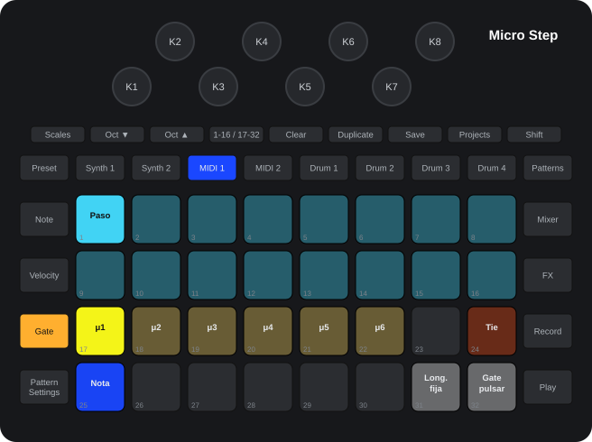
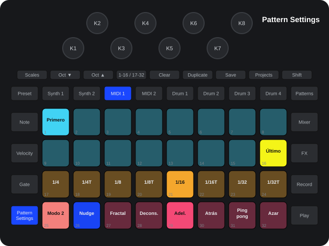
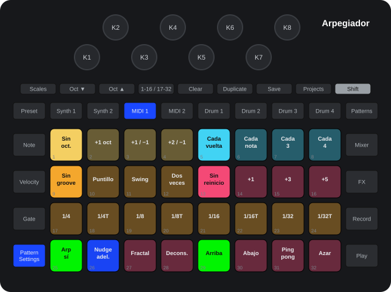
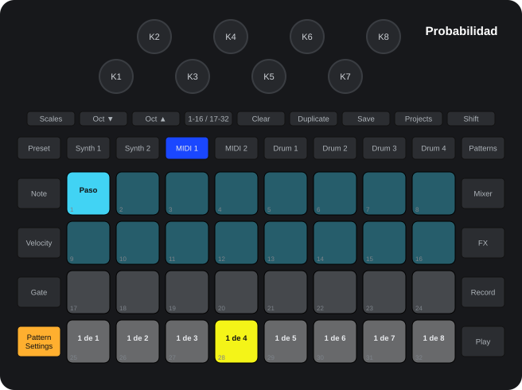
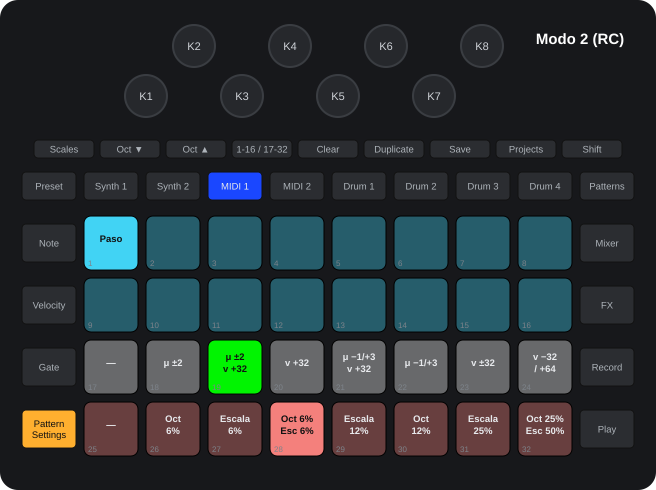
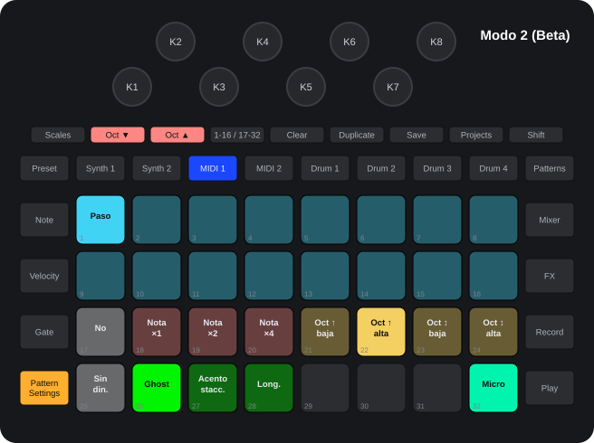

# Usabilidad

*[English version](https://github.com/Ghillermo/CIRCUIT-HACKS-RC/wiki/Usability) · [Inicio](https://github.com/Ghillermo/CIRCUIT-HACKS-RC/wiki/Home#en-español) · [Guía por vistas](https://ghillermo.github.io/CIRCUIT-HACKS-RC/beta/guia.html)*

Las convenciones que hacen el mod previsible, los atajos que valen en todas las vistas y las ayudas para tocar y grabar.

## Convenciones

Cada capítulo es una vista del aparato: cómo se llega, qué hace cada pad, knob y botón, y los submenús que abre.

- **Pads 1-32** de arriba-izquierda a abajo-derecha: fila 1 = 1-8, fila 2 = 9-16, fila 3 = 17-24, fila 4 = 25-32.
- **Knobs K1-K4** arriba, **K5-K8** abajo. «**Shift + X**» = mantener Shift mientras se usa X; lo mismo con Clear y Duplicate.
- Lo que no aparece aquí funciona como en el aparato original (manual oficial de Novation).
- *(desde RC2)* = nuevo desde RC2 (no está en RC0.9 / RC0.9S). La versión más segura, RC4S (y las S anteriores), no escribe nada propio en la tarjeta: lo marcado «escribe en la tarjeta» no hace nada en ella (el LED de Save se pone rojo).
- *(desde RC2.02)* = nuevo en RC2.02 (no está en RC2.01).
- *(desde RC4)* = nuevo en **RC4** (no está en RC2.11 ni en las anteriores).
- *(desde RC4.05)* = arreglo de **RC4.05** (también en RC4.11 y en la Beta 5.64; en RC4.02 y antes no).
- *(solo Beta 5.64)* = solo en la **Beta 5.64** (no está en RC4.11).
- **Las funciones están en el capítulo de la vista donde se usan** (antes, en la lista de características): cada capítulo empieza con el índice de sus funciones, sigue con la vista y termina con cada función en su apartado, con sus dibujos y sus animaciones. El **glosario**, al final, las lista todas con los grupos de la antigua lista (A-E).

## Botones que funcionan en todas las vistas

Shift, Clear, Duplicate, Save y Octave ganan funciones según la vista; aquí, las que valen en casi todas.

| Gesto | Dónde | Qué hace |
|---|---|---|
| **Clear + knob a la derecha** | drums, motor de las pistas MIDI, Master FX | El knob vuelve a su valor por defecto (las dos capas, con y sin Shift). LED **lavanda** = hecho, como en el original. |
| **Clear + knob a la izquierda** | drums (knobs de stock), motor de las pistas MIDI *(desde RC2)* | Borra la automatización de ese knob en el patrón que suena, como el original (LED **rojo**). En el motor MIDI, la de los dos carriles del knob (con y sin Shift) que tengan automatización. |
| **Shift** | todas | Con Shift pulsado, los atajos disponibles se iluminan en **amarillo**; la opción elegida, en otro color. *(solo Beta 5.64)* Además, los ocho **botones de pista** (Synth 1 / 2, MIDI 1 / 2, Drum 1-4) destellan en **blanco** durante 100 ms con cada nota que toca su pista, venga del secuenciador, de los pads, del arpegiador o de MIDI. Una nota ligada es una sola nota: un destello. |
| **Save** | todas | Guarda el proyecto como siempre; además escribe en el pack los samples sustituidos por capturas (Preset de drums) si caben en la memoria de samples *(escribe en la tarjeta)*. |
| **Pulsar el botón de la pista otra vez** | Synth 1 / 2 | Abre la vista de la fuente del sinte (2.3). |
| **Clear + Synth 1 / 2** | su vista | *(desde RC2)* Sus ocho macros a los valores del patch cargado. |
| **Clear + Duplicate dos veces** | cualquier vista de una pista (Preset, Note, Note ampliada, Velocity, Gate, Micro Step, Pattern Settings, probabilidad, la vista cromática de los drums), las ocho pistas | *(solo Beta 5.64)* **Devuelve el patrón a como está guardado en la tarjeta**: el patrón que se ve en esa vista pierde sus cambios desde el último Save. La primera vez **pregunta**: Duplicate parpadea en blanco unos 5 s; **Clear + Duplicate otra vez** en ese tiempo lo hace (en la misma pista y el mismo patrón; pasado ese tiempo, vuelve a preguntar). Vuelven los pasos, la automatización y los ajustes del patrón (primer y último paso, sync rate, dirección, orden fractal / deconstruido; en los drums, la frecuencia y las dinámicas de cada paso); en MIDI 1 / 2 también sus **carriles extra**. No vuelven los ajustes del arpegiador del patrón. **Save en rojo** un momento = no se ha hecho nada: un proyecto nuevo que aún no se ha guardado, un guardado pendiente (el guardado diferido, o uno en curso) o un fichero que no está en la tarjeta. En las demás vistas (Patterns, Mixer, FX…), Clear + Duplicate sigue terminando las listas del pattern mutate. |
| **Shift + Preset** | vistas de Synth 1 / 2 y de MIDI 1 / 2 (con el sinte propio encendido) | *(solo Beta 5.64)* El sonido de esa pista vuelve al del proyecto: Synth 1 / 2, el patch entero tal como está guardado en el proyecto; MIDI 1 / 2, el sinte propio guardado con el proyecto (sin él, sus valores por defecto). Con Shift, Preset se ilumina en **amarillo** donde funciona. |
| **Clear + el botón de un drum** | su vista | *(desde RC2)* Borra la automatización de sus knobs en el patrón que suena y pone sus ocho knobs por defecto. |
| **Dos botones de pista de notas a la vez** | todas | Teclado partido *(desde RC2)*: Synth 1 + Synth 2; *(desde RC2.02)* cualquier par de Synth 1, Synth 2, MIDI 1 y MIDI 2. |
| **Shift + Clear** | todas | Metrónomo en cuatro estados *(desde RC2)*: sin metrónomo → metrónomo → solo cuenta atrás → cuenta atrás y metrónomo. Con Shift pulsado, el LED de Clear enseña el estado: rojo (sin metrónomo) / verde (metrónomo) / magenta (solo cuenta atrás) / verde azulado (las dos). El volumen del clic es el de stock: **Tempo/Swing** y **K5**. *(desde RC4)* Con el modo cue del Mixer, el clic solo en el cue (salida derecha). |
| **Play** con Record armado y la cuenta atrás | parado | Un compás de cuenta atrás (4 clics al tempo del proyecto o, como esclavo, al del reloj externo, sin alinearse con su compás; Record parpadea en rojo) y después arranca la grabación *(desde RC2)*. *(solo Beta 5.64)* Con el volumen del clic a 0 (K5 de Tempo / Swing), Clear destella en naranja en cada clic, también con el metrónomo. Play durante la cuenta la cancela. La cuenta atrás se guarda con el proyecto. |
| **Shift + Play** | todas | *(desde RC2)* **Cuantiza** el patrón que suena en la pista elegida: las notas y los golpes grabados fuera de la rejilla van al paso más cercano (micropasos 1-2 → el inicio de su paso; 3-5 → el del siguiente; los del último paso, al primero). En los drums, un paso con varios golpes (un redoble) se queda. Con Shift el LED de Play se ve amarillo; verde después de cuantizar. Sustituye al Shift + Play del original (otra forma de arrancar). |
| **Shift + Scales** | todas | Editor de la escala propia *(desde RC2)* (2.2). *(desde RC4)*: también **Scales dos veces**. |
| **Velocity dos veces** *(desde RC4)* | vista Velocity | **Velocity fija** encendida / apagada, como el Shift + Velocity del original. |
| **Shift + Synth 1 / 2, Shift + MIDI 1 / 2** *(desde RC4)* | todas | Lo mismo que pulsar el botón dos veces: Synth = la vista de la fuente (2.3), MIDI = su vista Preset. |
| **Mixer dos veces** | todas | Master FX (6.1). *(solo Beta 5.64)* En el Mixer, **Mixer mantenido** ½ s o más = Master FX solo hasta que lo sueltas; en Master FX, mantenido = el Mixer hasta que lo sueltas. |
| **Scales + Preset + Note** al encender | — | Modo de recuperación del bootloader de Novation: permite volver a instalar cualquier firmware. |

- Los LEDs de los knobs enseñan con su **brillo** el valor de las funciones nuevas (más brillo = más valor; en los knobs bipolares, oscuro en el centro). *(solo Beta 5.64)* En los knobs bipolares, **tenue en el centro**, a la derecha su color de siempre y **a la izquierda un tono más claro del mismo color**, cada vez más brillante hacia fuera (motor de MIDI 1 / 2, drums, Digitise K4, la velocidad a tempo de Auto-Filter / Phaser).
- Los colores animados (que pulsan) no se usan para estados fijos.
- **LFO a tempo** *(desde RC4)*: los knobs de **velocidad de LFO** (K7 de la página VCA-VCF del motor de MIDI 1 / 2, Shift + K4 de la matriz, Shift + K7 de los drums, K1 del Auto-Filter y del Phaser en Master FX) son **bipolares**: al centro, el LED tenue; **a la derecha, LFO libre** (más rápido cuanto más a la derecha); **a la izquierda, a tempo**, del centro hacia fuera 1/16T, 1/16, 1/8T, 1/8, 1/4T, 1/4, 1/2T, 1/2, 1 compás T, 1 compás, 2T, 2, 4T, 4, 8T y 8 compases (4 clics cada una), con cada ciclo empezando en el **primer tiempo del compás** (se recoloca en cada tick del secuenciador; parado sigue al tempo). En la matriz, cada forma de Shift + K4 es un tramo con su propio centro. Lo guardado antes con otra velocidad puede sonar distinto.

*[Paso a paso: Grabar con la cuenta atrás (desde RC2)](https://github.com/Ghillermo/CIRCUIT-HACKS-RC/wiki/Step-by-step-ES#grabar-con-la-cuenta-atrás-desde-rc2)*

*[Paso a paso: Cuantizar un patrón (desde RC2)](https://github.com/Ghillermo/CIRCUIT-HACKS-RC/wiki/Step-by-step-ES#cuantizar-un-patrón-desde-rc2)*

## Tocar y grabar

### Vista de pista de Synth 1 / 2 (Note, Velocity, Gate)

*Cómo se llega:* Pulsa **Synth 1** o **Synth 2**. Los pads tocan el sinte como siempre.

- **Vista de la fuente** — el sinte puede procesar una entrada de audio en lugar de su ruido.
- **Teclado partido** *(desde RC2)* — arriba un sinte y abajo el otro, cada uno con su escala, octava y velocity; *(desde RC2.02)* con cualquier par de pistas de notas.

→ [Todo el detalle en la guía](https://ghillermo.github.io/CIRCUIT-HACKS-RC/beta/guia.html#synth-nota)

### Vista Scales y escala propia

*Cómo se llega:* Pulsa **Scales** como siempre (tónica y escala de stock); **Shift + Scales** para la escala propia.

- **Escala propia** *(desde RC2)* — hasta 7 notas sobre la tónica y un periodo libre (por ejemplo, una escala que se repite cada 7 semitonos). La usan los pads de las pistas de notas, el cuantizado y el random-mutate; se guarda con el proyecto.

→ [Todo el detalle en la guía](https://ghillermo.github.io/CIRCUIT-HACKS-RC/beta/guia.html#escalas)

### Vista Micro Step (pistas de notas)

*Cómo se llega:* Pulsa **Gate dos veces** con una pista de notas elegida (Synth 1 / 2, MIDI 1 / 2).

- **Micropasos y Tie (de stock)** — coloca cada nota fuera de la rejilla y enlázala con el paso siguiente.
- **Gate por pulsación** *(desde RC2)* — al introducir notas a mano, lo que mantienes es lo que dura la nota.
- **Longitud fija** *(desde RC2)* — todas las notas que introduces a mano con la misma duración.

→ [Todo el detalle en la guía](https://ghillermo.github.io/CIRCUIT-HACKS-RC/beta/guia.html#micropasos)

*Vista Micro Step (Gate dos veces, pistas de notas): pads 1-16 = los pasos (el elegido brillante), 17-22 = sus 6 micropasos, 24 = Tie, 25-30 = las notas del paso (como en el original); pad 31 = longitud fija (azul = encendida; con los dos apagados abre un selector, pads 17-32 = 1-16 pasos), pad 32 = gate por pulsación (verde = encendido: lo que mantienes los pads es el gate de la nota). Desde RC2; con uno encendido, pulsarlo otra vez lo apaga, pulsar el otro los cambia.*

### Vista Pattern Settings

*Cómo se llega:* Botón **Pattern Settings** con una pista elegida: primer / último paso, sync rate y dirección como siempre, más los pads 25-28 y el arpegiador (Shift).

- **Nudge** — mueve el contenido de los pasos elegidos un paso atrás o adelante.
- **Órdenes fractal y deconstruido** — recorren el patrón de otra forma sin cambiar sus notas.
- **Arpegiador** *(desde RC2)* — los acordes del patrón (y los que tocas) suenan nota a nota, con su orden y su resolución; en los drums, saltando de sample.
- **Dinámicas y random-mutate** (pad 25) — variaciones para que el patrón no suene siempre igual.

→ [Todo el detalle en la guía](https://ghillermo.github.io/CIRCUIT-HACKS-RC/beta/guia.html#pattern-settings)

*Pattern Settings (MIDI 1): pads 1-16 = primer / último paso, 17-24 = sync rate, 29-32 = dirección (como en el original); pad 25 = la vista de probabilidad en modo 2 (dinámicas y random-mutate; Clear + 25 las borra), 26 = Nudge (azul: el contenido del tramo elegido un paso atrás, Shift + 26 un paso adelante), 27 / 28 = orden fractal / deconstruido (excluyentes con 29-32; se guardan con el patrón).*

*Con Shift pulsado (desde RC2): Shift + pad 25 = el arpegiador del patrón sí / no (verde), Shift + 27-32 = el orden del arpegio (fractal, deconstruido, arriba, abajo, ping-pong, aleatorio), Shift + 17-24 = su resolución (lo elegido en verde). Desde RC4, con el arpegiador encendido, Shift + pads 1-16 = sus modificadores: octavas (arena), cuándo cambia la octava (azul cielo), groove (ámbar), reinicio (rosa), la opción elegida brillante. Shift + pad 26 = Nudge un paso adelante.*

### Vista de probabilidad (pistas de notas y drums)

*Cómo se llega:* **Pattern Settings dos veces** o **Shift + Pattern Settings** (modo 1), o el **pad 25** de Pattern Settings (modo 2). Mantén un paso con notas y toca un pad de las filas 3-4.

- **Probabilidad (de stock)** — que un paso suene solo a veces.
- **Frecuencia** *(desde RC2)* — que un paso suene una de cada n vueltas: variaciones que vuelven cada 2, 4 u 8 vueltas.
- **Dinámicas** *(desde RC2)* — pequeñas variaciones de velocity y de posición: un patrón más humano.
- **Random-mutate** *(desde RC2)* — notas que saltan de octava o a otra nota de la escala; en los drums, a otro sample.

→ [Todo el detalle en la guía](https://ghillermo.github.io/CIRCUIT-HACKS-RC/beta/guia.html#probabilidad)

*Vista de probabilidad, modo 1 (Pattern Settings dos veces): mantén un paso (pads 1-16) y toca la fila 3 = su probabilidad (como en el original) o la fila 4 = su frecuencia (desde RC2, amarillo): el paso suena en la última de cada n vueltas (1-8), aquí 1 de 4. En los drums igual.*

*Modo 2 en las RC (pad 25 de Pattern Settings): fila 3 = dinámicas (desde RC2, verde: cambios al azar de micropasos y velocity en 8 niveles), fila 4 = random-mutate (desde RC2, melocotón: la probabilidad de que las notas del paso salten una octava o a otra nota de la escala). Con Record y esta vista en pantalla, lo que suena se escribe en el patrón. En los drums, los pads 25-28 de la fila 4 mutan el sample.*

*Solo Beta 5.56, modo 2: una sola botonera por paso — 17 sin cambio de nota (blanco), 18-20 otra nota de la escala (×1, ×2, ×4; melocotón), 21 / 22 una octava arriba (baja / alta; arena), 23 / 24 una octava arriba o abajo (arena), 25 sin dinámicas (blanco), 26 ghost, 27 accent staccato, 28 longitud (verde), 32 micropasos (verde azulado). Octave ▼ / ▲ = el factor de la pista (×0, ×1, ×2, ×4, ×8), que multiplica todas las probabilidades. En los drums: otro sample en lugar de otra nota.*
