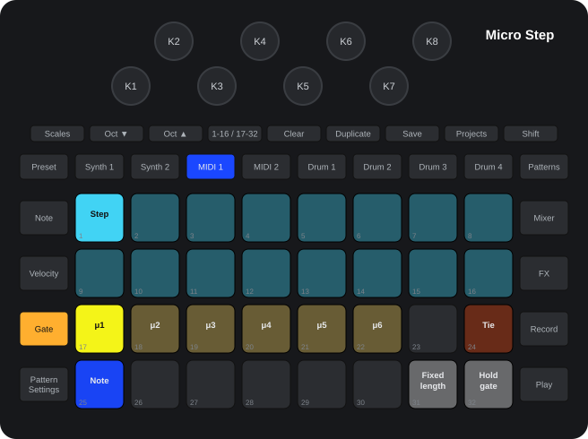
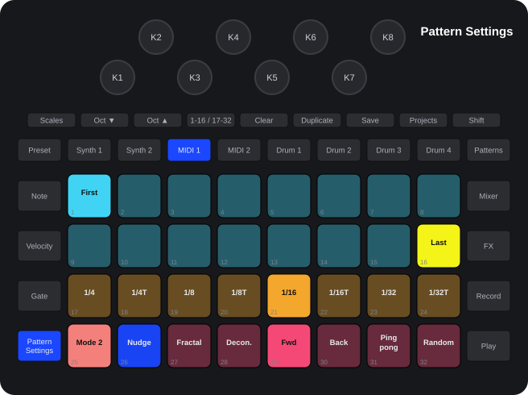
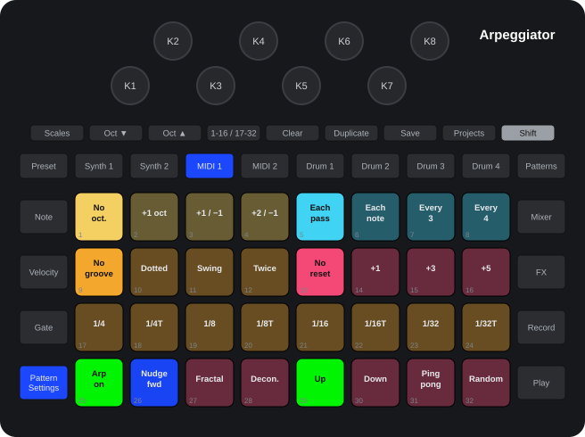
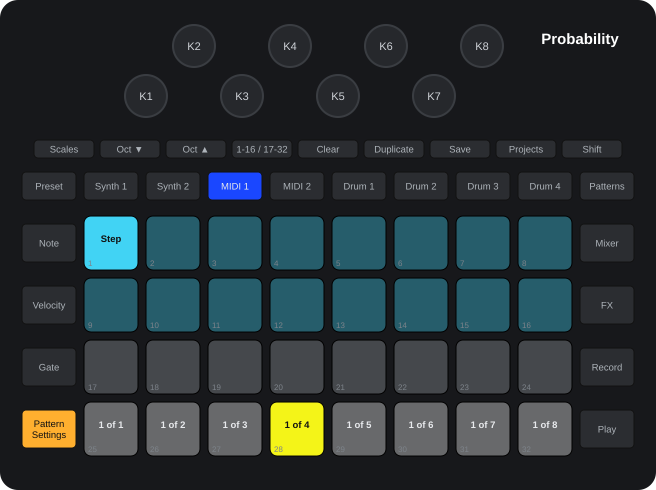
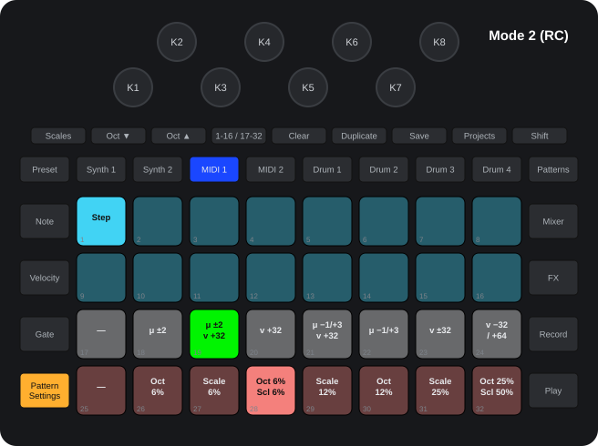
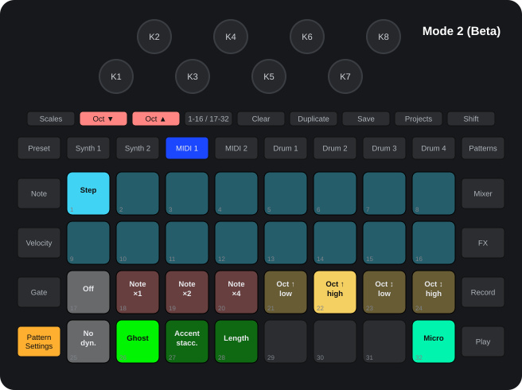

# Usability

*[Versión en español](https://github.com/Ghillermo/CIRCUIT-HACKS-RC/wiki/Usability-ES) · [Home](https://github.com/Ghillermo/CIRCUIT-HACKS-RC/wiki/Home) · [Guide by views](https://ghillermo.github.io/CIRCUIT-HACKS-RC/beta/guide.html)*

The conventions that make the mod predictable, the shortcuts that work in every view, and the playing and recording helpers.

## Conventions

Each chapter is a view of the device: how to get there, what every pad, knob and button does, and the sub-menus it opens.

- **Pads 1-32** from top-left to bottom-right: row 1 = 1-8, row 2 = 9-16, row 3 = 17-24, row 4 = 25-32.
- **Knobs K1-K4** on top, **K5-K8** below. «**Shift + X**» = hold Shift while using X; the same with Clear and Duplicate.
- Anything not described here works as on the original device (Novation's official manual).
- *(since RC2)* = new since RC2 (not in RC0.9 / RC0.9S). The safer build, RC4S (and the earlier S builds), writes nothing of its own to the card: what is marked «writes to the card» does nothing there (the Save LED turns red).
- *(since RC2.02)* = new in RC2.02 (not in RC2.01).
- *(since RC4)* = new in **RC4** (not in RC2.11 or earlier).
- *(since RC4.05)* = a fix of **RC4.05** (in RC4.11 and Beta 5.64 too; not in RC4.02 or earlier).
- *(Beta 5.64 only)* = only in **Beta 5.64** (not in RC4.11).
- **The features are in the chapter of the view where they are used** (before, in the feature list): every chapter starts with the index of its features, goes on with the view and ends with each feature in its own section, with its drawings and animations. The **glossary**, at the end, lists them all under the groups of the former list (A-E).

## Buttons that work in every view

Shift, Clear, Duplicate, Save and Octave gain functions depending on the view; here, the ones valid almost everywhere.

| Gesture | Where | What it does |
|---|---|---|
| **Clear + knob to the right** | drums, MIDI track engine, Master FX | The knob goes back to its default (both layers, with and without Shift). **Lavender** LED = done, as on the original. |
| **Clear + knob to the left** | drums (stock knobs), MIDI track engine *(since RC2)* | Deletes that knob's automation in the playing pattern, as on the original (**red** LED). On the MIDI engine, that of the knob's two lanes (with and without Shift) that have automation. |
| **Shift** | all | While Shift is held, the shortcuts available light **yellow**; the chosen option, another colour. *(Beta 5.64 only)* Also, the eight **track buttons** (Synth 1 / 2, MIDI 1 / 2, Drum 1-4) flash **white** for 100 ms on every note their track plays, from the sequencer, the pads, the arpeggiator or MIDI. A tied note is one note: one flash. |
| **Save** | all | Saves the project as always; it also writes into the pack the samples replaced by captures (drum Preset), if they fit in the sample memory *(writes to the card)*. |
| **Press the track button again** | Synth 1 / 2 | Opens the synth's source view (2.3). |
| **Clear + Synth 1 / 2** | its view | *(since RC2)* Its eight macros back to the loaded patch's values. |
| **Clear + Duplicate twice** | any view of a track (Preset, Note, expanded Note, Velocity, Gate, Micro Step, Pattern Settings, Probability, the drums' chromatic view), all eight tracks | *(Beta 5.64 only)* **Puts the pattern back as it is saved on the card**: the pattern that view shows loses its changes since the last Save. The first time it **asks**: Duplicate blinks white for about 5 s; **Clear + Duplicate again** within that time does it (same track, same pattern; later, it asks again). The steps, the automation and the pattern settings come back (first and last step, sync rate, direction, fractal / deconstructed order; on drums, each step's frequency and dynamics); on MIDI 1 / 2 its **extra lanes** too. The pattern's arpeggiator settings do not. **Save red** for a moment = nothing done: a new project not saved yet, a save pending (the delayed save, or one under way) or a file missing from the card. In the other views (Patterns, Mixer, FX…), Clear + Duplicate still ends the pattern mutate lists. |
| **Shift + Preset** | Synth 1 / 2's and MIDI 1 / 2's views (the own synth on) | *(Beta 5.64 only)* That track's sound back to the project's: Synth 1 / 2, the whole patch as the project saved it; MIDI 1 / 2, the own synth saved with the project (without it, its defaults). With Shift, Preset lights **yellow** where it works. |
| **Clear + a drum's button** | its view | *(since RC2)* Deletes the automation of its knobs in the playing pattern and puts its eight knobs back to their defaults. |
| **Two note-track buttons together** | all | Split keyboard *(since RC2)*: Synth 1 + Synth 2; *(since RC2.02)* any pair of Synth 1, Synth 2, MIDI 1 and MIDI 2. |
| **Shift + Clear** | all | Metronome in four states *(since RC2)*: no metronome → metronome → count-in only → count-in and metronome. While Shift is held the Clear LED shows the state: red (no metronome) / green (metronome) / magenta (count-in only) / teal (both). The click's volume is the stock's: **Tempo/Swing** and **K5**. *(since RC4)* With the Mixer's cue mode, the click in the cue only (right output). |
| **Play** with Record armed and the count-in | stopped | One bar of count-in (4 clicks at the project's tempo or, as a slave, at the external clock's, not aligned to its bar; Record blinks red), then recording starts *(since RC2)*. *(Beta 5.64 only)* With the click's level at 0 (K5 of Tempo / Swing), Clear flashes orange on each click, with the metronome too. Play during the count cancels it. The count-in is saved with the project. |
| **Shift + Play** | all | *(since RC2)* **Quantizes** the pattern the selected track plays: notes and hits recorded off the grid go to the nearest step (micro steps 1-2 → the start of their step; 3-5 → the start of the next; the last step's, to the first). On the drums, a step with several hits (a roll) stays. While Shift is held the Play LED is yellow; green after quantizing. It replaces the original's Shift + Play (another way to start playback). |
| **Shift + Scales** | all | Custom scale editor *(since RC2)* (2.2). *(since RC4)*: also **Scales twice**. |
| **Velocity twice** *(since RC4)* | Velocity view | **Fixed velocity** on / off, like the stock's Shift + Velocity. |
| **Shift + Synth 1 / 2, Shift + MIDI 1 / 2** *(since RC4)* | all | The same as pressing the button twice: Synth = the source view (2.3), MIDI = its Preset view. |
| **Mixer twice** | all | Master FX (6.1). *(Beta 5.64 only)* In the Mixer, **Mixer held** for ½ s or more = Master FX only until you let go; in Master FX, held = the Mixer until you let go. |
| **Scales + Preset + Note** at power-up | — | Novation's bootloader recovery mode: lets you install any firmware again. |

- The knob LEDs show the value of the new functions with their **brightness** (brighter = more; bipolar knobs are dark in the middle). *(Beta 5.64 only)* On bipolar knobs, **dim at the centre**, their usual colour to the right and **a lighter shade of the same colour to the left**, brighter further out (the MIDI 1 / 2 engine, drums, Digitise K4, the synced rate of Auto-Filter / Phaser).
- Animated (pulsing) colours are never used for steady states.
- **LFO synced to the tempo** *(since RC4)*: the **LFO rate** knobs (K7 of the VCA-VCF page of the MIDI 1 / 2 engine, Shift + K4 of the matrix, Shift + K7 of the drums, K1 of the Auto-Filter and of the Phaser in Master FX) are **bipolar**: at the centre the LED is dim; **to the right, a free LFO** (faster further right); **to the left, synced to the tempo**, from the centre outwards 1/16T, 1/16, 1/8T, 1/8, 1/4T, 1/4, 1/2T, 1/2, 1 bar T, 1 bar, 2T, 2, 4T, 4, 8T and 8 bars (4 clicks each), each cycle starting on the **bar's first beat** (it is put back in place on every sequencer tick; stopped, it keeps the tempo). In the matrix, each shape of Shift + K4 is a stretch with its own centre. What was saved before with another rate may sound different.

*[Step by step: Record with the count-in (since RC2)](https://github.com/Ghillermo/CIRCUIT-HACKS-RC/wiki/Step-by-step#record-with-the-count-in-since-rc2)*

*[Step by step: Quantize a pattern (since RC2)](https://github.com/Ghillermo/CIRCUIT-HACKS-RC/wiki/Step-by-step#quantize-a-pattern-since-rc2)*

## Playing and recording

### Synth 1 / 2 track view (Note, Velocity, Gate)

*How to get there:* Press **Synth 1** or **Synth 2**. The pads play the synth as always.

- **Source view** — the synth can process an audio input instead of its noise.
- **Split keyboard** *(since RC2)* — one synth on top and the other below, each with its scale, octave and velocity; *(since RC2.02)* with any pair of note tracks.

→ [Full details in the guide](https://ghillermo.github.io/CIRCUIT-HACKS-RC/beta/guide.html#synth-nota)

### Scales view and custom scale

*How to get there:* Press **Scales** as always (root and stock scale); **Shift + Scales** for the custom scale.

- **Custom scale** *(since RC2)* — up to 7 notes over the root and a free period (for example, a scale that repeats every 7 semitones). The note tracks' pads, the quantising and random-mutate use it; saved with the project.

→ [Full details in the guide](https://ghillermo.github.io/CIRCUIT-HACKS-RC/beta/guide.html#escalas)

### Micro Step view (note tracks)

*How to get there:* Press **Gate twice** with a note track selected (Synth 1 / 2, MIDI 1 / 2).

- **Micro steps and Tie (stock)** — place each note off the grid and tie it to the next step.
- **Gate by holding** *(since RC2)* — when entering notes by hand, how long you hold is how long the note lasts.
- **Fixed length** *(since RC2)* — every note you enter by hand gets the same length.

→ [Full details in the guide](https://ghillermo.github.io/CIRCUIT-HACKS-RC/beta/guide.html#micropasos)

*Micro Step view (Gate twice, note tracks): pads 1-16 = the steps (the chosen one bright), 17-22 = its 6 micro steps, 24 = Tie, 25-30 = the step's notes (as on the original); pad 31 = fixed length (blue = on; with both off it opens a selector, pads 17-32 = 1-16 steps), pad 32 = gate by holding (green = on: how long you hold the pads is the note's gate). Since RC2; with one on, pressing it again turns it off, pressing the other swaps them.*

### Pattern Settings view

*How to get there:* The **Pattern Settings** button with a track selected: first / last step, sync rate and direction as always, plus pads 25-28 and the arpeggiator (Shift).

- **Nudge** — moves the content of the selected steps one step back or forward.
- **Fractal and deconstructed orders** — walk through the pattern another way without changing its notes.
- **Arpeggiator** *(since RC2)* — the pattern's chords (and the ones you play) sound note by note, in their order and resolution; on the drums, jumping from sample to sample.
- **Dynamics and random-mutate** (pad 25) — variations so that the pattern does not always sound the same.

→ [Full details in the guide](https://ghillermo.github.io/CIRCUIT-HACKS-RC/beta/guide.html#pattern-settings)

*Pattern Settings (MIDI 1): pads 1-16 = first / last step, 17-24 = sync rate, 29-32 = direction (as on the original); pad 25 = the probability view in mode 2 (dynamics and random-mutate; Clear + 25 clears them), 26 = Nudge (blue: the selected range's content a step back, Shift + 26 a step forward), 27 / 28 = fractal / deconstructed order (exclusive with 29-32; saved with the pattern).*

*With Shift held (since RC2): Shift + pad 25 = the pattern's arpeggiator on / off (green), Shift + 27-32 = the arpeggio's order (fractal, deconstructed, up, down, ping-pong, random), Shift + 17-24 = its resolution (the chosen ones green). Since RC4, with the arpeggiator on, Shift + pads 1-16 = its modifiers: octaves (sand), when the octave moves (sky blue), groove (amber), reset (pink), the chosen option bright. Shift + pad 26 = Nudge one step forward.*

### Probability view (note tracks and drums)

*How to get there:* **Pattern Settings twice** or **Shift + Pattern Settings** (mode 1), or **pad 25** of Pattern Settings (mode 2). Hold a step with notes and touch a pad of rows 3-4.

- **Probability (stock)** — a step that only plays sometimes.
- **Frequency** *(since RC2)* — a step that plays once every n passes: variations that come back every 2, 4 or 8 passes.
- **Dynamics** *(since RC2)* — small changes of velocity and position: a more human pattern.
- **Random-mutate** *(since RC2)* — notes that jump an octave or to another note of the scale; on the drums, to another sample.

→ [Full details in the guide](https://ghillermo.github.io/CIRCUIT-HACKS-RC/beta/guide.html#probabilidad)

*Probability view, mode 1 (Pattern Settings twice): hold a step (pads 1-16) and touch row 3 = its probability (as on the original) or row 4 = its frequency (since RC2, yellow): the step plays on the last of every n passes (1-8), here 1 of 4. On the drums the same.*

*Mode 2 in the RCs (pad 25 of Pattern Settings): row 3 = dynamics (since RC2, green: random micro-step and velocity changes in 8 levels), row 4 = random-mutate (since RC2, peach: the chance that the step's notes jump an octave or to another note of the scale). With Record and this view on screen, what sounds is written into the pattern. On the drums, row 4's pads 25-28 mutate the sample.*

*Beta 5.56 only, mode 2: one set of pads per step — 17 no note change (white), 18-20 another note of the scale (×1, ×2, ×4; peach), 21 / 22 an octave up (low / high; sand), 23 / 24 an octave up or down (sand), 25 no dynamics (white), 26 ghost, 27 accent staccato, 28 length (green), 32 micro steps (teal). Octave ▼ / ▲ = the track's factor (×0, ×1, ×2, ×4, ×8), which multiplies every chance. On the drums: another sample instead of another note.*
