# Vistas

*[English version](https://github.com/Ghillermo/CIRCUIT-HACKS-RC/wiki/Views) · [Inicio](https://github.com/Ghillermo/CIRCUIT-HACKS-RC/wiki/Home#en-español) · [Guía por vistas](https://ghillermo.github.io/CIRCUIT-HACKS-RC/beta/guia.html)*

Cada vista del aparato y lo que ofrece, con un mapa de sus pads y knobs y, para lo que lleva varios gestos seguidos, una animación que los toca en orden. Cada vista enlaza con su capítulo completo de la [guía por vistas](https://ghillermo.github.io/CIRCUIT-HACKS-RC/beta/guia.html).

**Contenido**

- **[Setup](https://github.com/Ghillermo/CIRCUIT-HACKS-RC/wiki/Views-ES#setup)** — [Vista Setup](https://github.com/Ghillermo/CIRCUIT-HACKS-RC/wiki/Views-ES#vista-setup) · [Vista Advanced Setup](https://github.com/Ghillermo/CIRCUIT-HACKS-RC/wiki/Views-ES#vista-advanced-setup)
- **[Sintes de stock (Synth 1 / 2)](https://github.com/Ghillermo/CIRCUIT-HACKS-RC/wiki/Views-ES#sintes-de-stock-synth-1--2)** — [Vista de pista de Synth 1 / 2 (Note, Velocity, Gate)](https://github.com/Ghillermo/CIRCUIT-HACKS-RC/wiki/Views-ES#vista-de-pista-de-synth-1--2-note-velocity-gate) · [Vista Scales y escala propia](https://github.com/Ghillermo/CIRCUIT-HACKS-RC/wiki/Views-ES#vista-scales-y-escala-propia) · [Vista de la fuente del sinte](https://github.com/Ghillermo/CIRCUIT-HACKS-RC/wiki/Views-ES#vista-de-la-fuente-del-sinte) · [Vista Preset de Synth 1 / 2](https://github.com/Ghillermo/CIRCUIT-HACKS-RC/wiki/Views-ES#vista-preset-de-synth-1--2)
- **[Pistas MIDI (MIDI 1 / 2)](https://github.com/Ghillermo/CIRCUIT-HACKS-RC/wiki/Views-ES#pistas-midi-midi-1--2)** — [Vista Preset de MIDI 1 / 2](https://github.com/Ghillermo/CIRCUIT-HACKS-RC/wiki/Views-ES#vista-preset-de-midi-1--2) · [Voces del sinte propio: polifonía y límite de voces](https://github.com/Ghillermo/CIRCUIT-HACKS-RC/wiki/Views-ES#voces-del-sinte-propio-polifonía-y-límite-de-voces) · [Páginas de knobs del motor de MIDI 1 / 2](https://github.com/Ghillermo/CIRCUIT-HACKS-RC/wiki/Views-ES#páginas-de-knobs-del-motor-de-midi-1--2) · [Matriz de modulación](https://github.com/Ghillermo/CIRCUIT-HACKS-RC/wiki/Views-ES#matriz-de-modulación) · [FM de 4 operadores](https://github.com/Ghillermo/CIRCUIT-HACKS-RC/wiki/Views-ES#fm-de-4-operadores) · [FM de 8 operadores](https://github.com/Ghillermo/CIRCUIT-HACKS-RC/wiki/Views-ES#fm-de-8-operadores) · [Editor de CC de los macros MIDI (pad 25)](https://github.com/Ghillermo/CIRCUIT-HACKS-RC/wiki/Views-ES#editor-de-cc-de-los-macros-midi-pad-25) · [Vista del step-drummer](https://github.com/Ghillermo/CIRCUIT-HACKS-RC/wiki/Views-ES#vista-del-step-drummer) · [Modo muestra y selector de samples](https://github.com/Ghillermo/CIRCUIT-HACKS-RC/wiki/Views-ES#modo-muestra-y-selector-de-samples)
- **[Pattern Settings](https://github.com/Ghillermo/CIRCUIT-HACKS-RC/wiki/Views-ES#pattern-settings)** — [Vista Pattern Settings](https://github.com/Ghillermo/CIRCUIT-HACKS-RC/wiki/Views-ES#vista-pattern-settings) · [Vista Micro Step (pistas de notas)](https://github.com/Ghillermo/CIRCUIT-HACKS-RC/wiki/Views-ES#vista-micro-step-pistas-de-notas) · [Vista de probabilidad (pistas de notas y drums)](https://github.com/Ghillermo/CIRCUIT-HACKS-RC/wiki/Views-ES#vista-de-probabilidad-pistas-de-notas-y-drums)
- **[Drums](https://github.com/Ghillermo/CIRCUIT-HACKS-RC/wiki/Views-ES#drums)** — [Vista de pista de un drum (knobs)](https://github.com/Ghillermo/CIRCUIT-HACKS-RC/wiki/Views-ES#vista-de-pista-de-un-drum-knobs) · [Vista Preset de drums](https://github.com/Ghillermo/CIRCUIT-HACKS-RC/wiki/Views-ES#vista-preset-de-drums) · [Vista cromática y de escala de los drums](https://github.com/Ghillermo/CIRCUIT-HACKS-RC/wiki/Views-ES#vista-cromática-y-de-escala-de-los-drums)
- **[Master FX](https://github.com/Ghillermo/CIRCUIT-HACKS-RC/wiki/Views-ES#master-fx)** — [Master FX](https://github.com/Ghillermo/CIRCUIT-HACKS-RC/wiki/Views-ES#master-fx-1)
- **[FX](https://github.com/Ghillermo/CIRCUIT-HACKS-RC/wiki/Views-ES#fx)** — [Vista FX](https://github.com/Ghillermo/CIRCUIT-HACKS-RC/wiki/Views-ES#vista-fx)
- **[Sidechain](https://github.com/Ghillermo/CIRCUIT-HACKS-RC/wiki/Views-ES#sidechain)** — [Vista Sidechain](https://github.com/Ghillermo/CIRCUIT-HACKS-RC/wiki/Views-ES#vista-sidechain)
- **[Escenas y patterns](https://github.com/Ghillermo/CIRCUIT-HACKS-RC/wiki/Views-ES#escenas-y-patterns)** — [Vista Patterns y cadenas de patrones](https://github.com/Ghillermo/CIRCUIT-HACKS-RC/wiki/Views-ES#vista-patterns-y-cadenas-de-patrones) · [Vista Mixer y escenas](https://github.com/Ghillermo/CIRCUIT-HACKS-RC/wiki/Views-ES#vista-mixer-y-escenas)
- **[Projects y packs](https://github.com/Ghillermo/CIRCUIT-HACKS-RC/wiki/Views-ES#projects-y-packs)** — [Vista Projects](https://github.com/Ghillermo/CIRCUIT-HACKS-RC/wiki/Views-ES#vista-projects) · [Vista de packs](https://github.com/Ghillermo/CIRCUIT-HACKS-RC/wiki/Views-ES#vista-de-packs)

## Setup

### Vista Setup

*Cómo se llega:* Ábrela como en el original. Canales MIDI y opciones del aparato como siempre, más:

- **Canales compartidos (loopback interno)** — una pista MIDI toca un sinte o los drums del propio aparato.
- **Retornos por las tiras 3 / 4** — la reverb y el delay como canales del mixer.
- **Canales de Program Change** *(desde RC2)* — escucha y manda cambios de programa por canales propios.
- **Grabar los ruteos internos** *(desde RC2)* — lo que la pista MIDI toca en un sinte se graba también en él; *(desde RC4)* una pista silenciada en el Mixer no se graba (banco de acordes).
- **Retener knob** *(solo Beta 5.64)* — un knob que giras sigue con lo que hacía aunque cambies de vista o pulses Shift, hasta dejarlo quieto un segundo.

→ [Todo el detalle en la guía](https://ghillermo.github.io/CIRCUIT-HACKS-RC/beta/guia.html#setup)

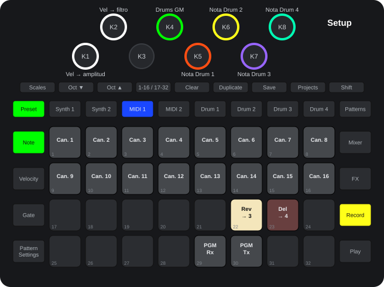

*Vista Setup (MIDI 1 elegida): pads 1-15 = el canal MIDI de la pista, pad 16 = canal 16 (proyecto y FX); pads 22 / 23 = el retorno de reverb / delay por la tira 3 / 4 del mixer (crema / melocotón); pads 29 / 30 = el canal de escucha / salida de los Program Change (desde RC2); Record (amarillo) = grabar los ruteos internos (desde RC2); Note (verde) = un teclado externo por el arpegiador (desde RC4); K4 = drums General MIDI (verde = encendido), K5-K8 = la nota GM de Drum 1-4 (desde RC4). Solo Beta 5.56: Preset (verde) = retener knob; K1 / K2 = velocity → amplitud / velocity → filtro.*


*[Paso a paso: Mandar los drums como notas General MIDI (desde RC4)](https://github.com/Ghillermo/CIRCUIT-HACKS-RC/wiki/Step-by-step-ES#mandar-los-drums-como-notas-general-midi-desde-rc4)*


*[Paso a paso: Elegir los canales de Program Change (desde RC2)](https://github.com/Ghillermo/CIRCUIT-HACKS-RC/wiki/Step-by-step-ES#elegir-los-canales-de-program-change-desde-rc2)*

### Vista Advanced Setup

*Cómo se llega:* Ábrela como en el original. Además de sus ajustes de stock (compresor master, etc.):

- **MIDI Thru, Merge y Filter** *(desde RC2)* — el jack Thru puede mezclar el MIDI de entrada con el del aparato o filtrarlo.
- **Curva de velocity** *(desde RC4)* — K1 hace los pads más sensibles o más duros.

→ [Todo el detalle en la guía](https://ghillermo.github.io/CIRCUIT-HACKS-RC/beta/guia.html#advanced-setup)

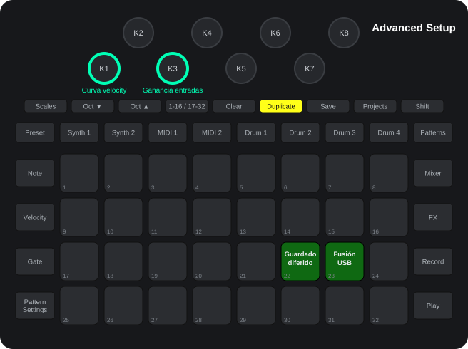

*Advanced Setup: Duplicate = el modo del jack MIDI Thru (desde RC2): Thru (rojo tenue) → Out 2 (verde) → Merge (amarillo) → Filter (azul); pad 22 = guardado diferido (desde RC4.05) y pad 23 = fusión USB (desde RC4), verde encendido / tenue apagado; K1 = la curva de velocity de los pads (desde RC4, en las RC); K3 = la ganancia de las entradas externas (solo Beta 5.56). Sus ajustes de stock, como en el original.*


*[Paso a paso: Elegir el modo del jack MIDI Thru (desde RC2)](https://github.com/Ghillermo/CIRCUIT-HACKS-RC/wiki/Step-by-step-ES#elegir-el-modo-del-jack-midi-thru-desde-rc2)*


*[Paso a paso: Guardar mientras suena sin tropiezos (desde RC4.05)](https://github.com/Ghillermo/CIRCUIT-HACKS-RC/wiki/Step-by-step-ES#guardar-mientras-suena-sin-tropiezos-desde-rc405)*

## Sintes de stock (Synth 1 / 2)

### Vista de pista de Synth 1 / 2 (Note, Velocity, Gate)

*Cómo se llega:* Pulsa **Synth 1** o **Synth 2**. Los pads tocan el sinte como siempre.

- **Vista de la fuente** — el sinte puede procesar una entrada de audio en lugar de su ruido.
- **Teclado partido** *(desde RC2)* — arriba un sinte y abajo el otro, cada uno con su escala, octava y velocity; *(desde RC2.02)* con cualquier par de pistas de notas.

→ [Todo el detalle en la guía](https://ghillermo.github.io/CIRCUIT-HACKS-RC/beta/guia.html#synth-nota)

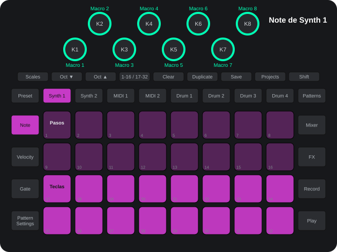

*Vista Note de Synth 1: pads 1-16 = los pasos, 17-32 = el teclado (como en el original). Synth 1 otra vez = su vista de la fuente; Synth 1 mantenido + Synth 2 = el teclado partido (desde RC2); Shift + tecla = latch (desde RC4); Clear + Synth 1 = los macros a los del patch cargado (desde RC2). Solo Beta 5.56: Record mantenido + paso = foto de los macros movidos en ese paso (amarillo mientras lo mantienes); Shift + Preset = vuelve el sonido del proyecto.*

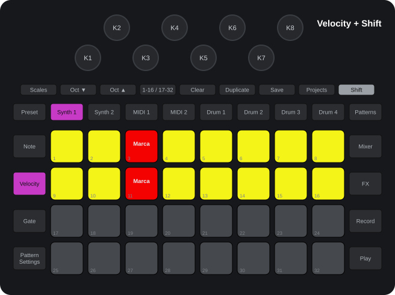

*Vista Velocity con Shift (desde RC4): los pads de paso en amarillo; Shift + paso lo marca (rojo): ahí la automatización se suelta y los parámetros vuelven a los valores del proyecto (otra vez = desmarcar). Solo Beta 5.56: solo los pasos con automatización en amarillo; Shift + un paso amarillo = sus valores en los knobs hasta soltar Shift; un paso amarillo mantenido + otro = un sweep en línea recta entre ellos; Clear + paso borra su automatización de knobs.*

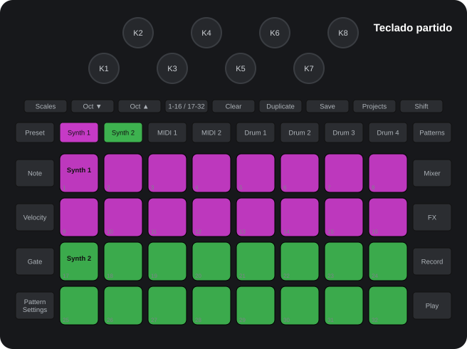

*Teclado partido (desde RC2): mantén Synth 1 y pulsa Synth 2 (desde RC2.02, cualquier par de Synth 1, Synth 2, MIDI 1 y MIDI 2): las dos filas de arriba tocan la pista mantenida primero y las dos de abajo la otra, cada una con su escala, octava y velocity. Desde RC4, mantener un botón de pista da los knobs a esa pista; un toque corto o un botón de vista lo cierra.*

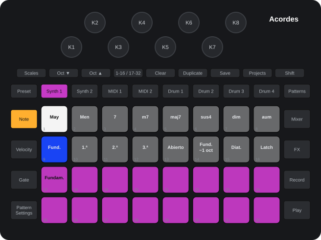

*Pantalla de acordes (desde RC4; Note ampliada, Shift + pad 8): fila 1 = el tipo de acorde (Shift + pads 1-7: sus2, 6, m6, add9, 9, 7sus4, quinta); pads 9-12 = la inversión (azul); 13 = voicing abierto, 14 = la fundamental una octava abajo, 15 = diatónico (la escala del proyecto), 16 = latch del acorde (solo Beta 5.56: acorde inverso), verde encendido; filas 3-4 = las fundamentales: mantén una para tocar su acorde. Shift + fundamental fija el acorde entero.*


*[Paso a paso: Partir el teclado entre dos pistas (desde RC2)](https://github.com/Ghillermo/CIRCUIT-HACKS-RC/wiki/Step-by-step-ES#partir-el-teclado-entre-dos-pistas-desde-rc2)*


*[Paso a paso: Fijar notas (latch) y escribirlas en un paso (desde RC4)](https://github.com/Ghillermo/CIRCUIT-HACKS-RC/wiki/Step-by-step-ES#fijar-notas-latch-y-escribirlas-en-un-paso-desde-rc4)*


*[Paso a paso: Tocar acordes con un pad (desde RC4)](https://github.com/Ghillermo/CIRCUIT-HACKS-RC/wiki/Step-by-step-ES#tocar-acordes-con-un-pad-desde-rc4)*


*[Paso a paso: Hacer que un paso suelte la automatización (desde RC4)](https://github.com/Ghillermo/CIRCUIT-HACKS-RC/wiki/Step-by-step-ES#hacer-que-un-paso-suelte-la-automatización-desde-rc4)*

### Vista Scales y escala propia

*Cómo se llega:* Pulsa **Scales** como siempre (tónica y escala de stock); **Shift + Scales** para la escala propia.

- **Escala propia** *(desde RC2)* — hasta 7 notas sobre la tónica y un periodo libre (por ejemplo, una escala que se repite cada 7 semitonos). La usan los pads de las pistas de notas, el cuantizado y el random-mutate; se guarda con el proyecto.

→ [Todo el detalle en la guía](https://ghillermo.github.io/CIRCUIT-HACKS-RC/beta/guia.html#escalas)

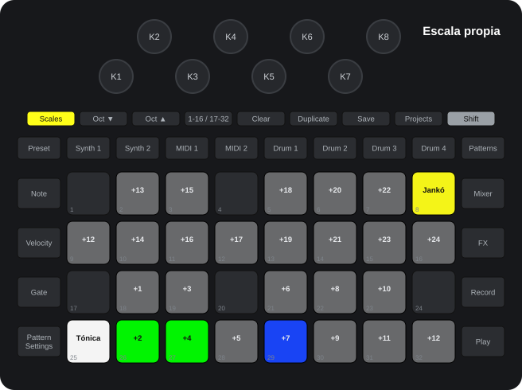

*Editor de la escala propia (desde RC2; Shift + Scales, desde RC4 también Scales dos veces), aquí con Shift pulsado: filas 4 / 3 = las teclas blancas / negras de la primera octava desde la tónica, filas 2 / 1 = la segunda octava. Una tecla pulsada es una nota de la escala (verde, hasta 7); la más alta es el periodo (azul), la tónica de la iteración siguiente; la tónica en blanco, las teclas libres tenues. Esta se repite cada 7 semitonos: tónica, +2, +4, periodo +7. Shift + pad 8 = Jankó (desde RC4; verde azulado encendido).*

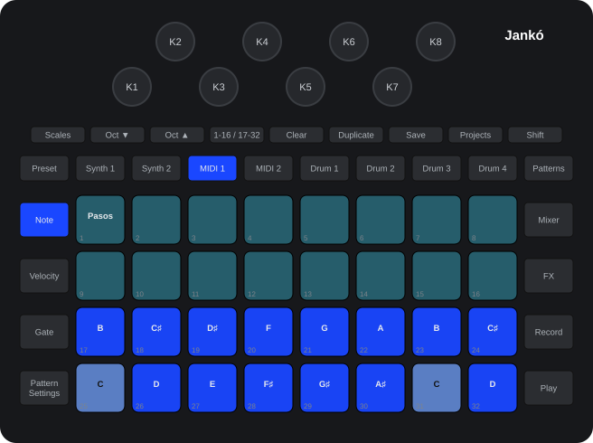

*Disposición Jankó (desde RC4; Shift + pad 8 en el editor) en MIDI 1 con tónica C, vista Note: cada columna sube un tono y la fila de arriba de cada pareja es medio tono más grave, así que cada acorde tiene la misma forma en cualquier tono; los pads de la tónica, en el color de la tónica. Octave: un toque = medio tono, mantenido = una octava.*


*[Paso a paso: Hacer una escala propia (desde RC2)](https://github.com/Ghillermo/CIRCUIT-HACKS-RC/wiki/Step-by-step-ES#hacer-una-escala-propia-desde-rc2)*


*[Paso a paso: Encender la disposición Jankó (desde RC4)](https://github.com/Ghillermo/CIRCUIT-HACKS-RC/wiki/Step-by-step-ES#encender-la-disposición-jankó-desde-rc4)*

### Vista de la fuente del sinte

*Cómo se llega:* Con la vista de Synth 1 / 2 en pantalla, **pulsa su botón otra vez** (*desde RC4*: o **Shift + Synth 1 / 2** desde cualquier vista). Cualquier botón la cierra.

- **Fuente del ruido** — cambia el ruido del patch por la entrada de audio 1 o 2 (normal o invertida): el filtro, las envolventes y los efectos del sinte procesan tu señal externa al ritmo de las notas.
- **Destinos de los macros** *(desde RC2)* — decide qué mueve cada macro knob (hasta 4 destinos por macro, con su tramo y su profundidad) sin pasar por Components.
- **Step-drummer del sinte** — secuencia los macros por pares de pasos: cada knob fija la posición de un macro en dos pasos del patrón.

→ [Todo el detalle en la guía](https://ghillermo.github.io/CIRCUIT-HACKS-RC/beta/guia.html#synth-fuente)

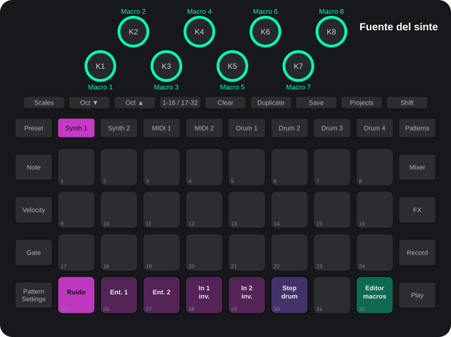

*Vista de la fuente del sinte (Synth 1 / 2 otra vez; desde RC4 también Shift + Synth 1 / 2): pads 25-29 = la fuente del ruido del sinte (ruido; entrada de audio 1 / 2; entrada 1 / 2 con la fase invertida), la elegida brillante — el patch necesita algo de nivel de ruido; pad 30 = el step-drummer del sinte; pad 32 = el editor de los destinos de los macros (desde RC2): un knob elige su macro, Octave ▼ / ▲ = el campo (ranura, inicio, fin, destino, profundidad), los pads dibujan su número. Cualquier otro botón cierra la vista.*


*[Paso a paso: Editar los destinos de los macro knobs (desde RC2)](https://github.com/Ghillermo/CIRCUIT-HACKS-RC/wiki/Step-by-step-ES#editar-los-destinos-de-los-macro-knobs-desde-rc2)*

### Vista Preset de Synth 1 / 2

*Cómo se llega:* Pulsa **Preset** con Synth 1 / 2 elegido. Los pads eligen patch como siempre (4 páginas, 128 patches del pack).

- **Los patches por categoría** *(solo Beta 5.64)* — cada patch en el color de su categoría de Components; la categoría se elige al guardar.
- **Morph de patches** *(solo Beta 5.64)* — mantén varios patches y pasa de uno a otro con un knob, LFO y envolvente.
- **Guardar el patch** *(desde RC2)* — guarda en el pack el sonido tal como lo has dejado (el original solo guarda patches desde Components).
- **Intercambiar y copiar** — reordena los patches del pack o lleva uno a otro pack.

→ [Todo el detalle en la guía](https://ghillermo.github.io/CIRCUIT-HACKS-RC/beta/guia.html#synth-preset)

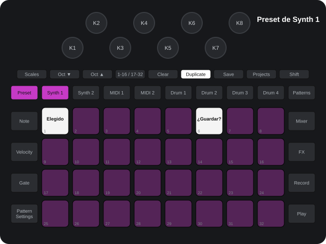

*Vista Preset de Synth 1 (desde RC4.10 los colores del original: los patches en el color de la pista, el elegido en blanco): Clear + pad y Clear + el mismo pad antes de 5 s = guardar el patch tal como suena en ese hueco (parpadea en blanco mientras pregunta; desde RC2); Duplicate + pad A + pad B = intercambiar dos patches; Duplicate + A, otro pack, Duplicate + B = copiar A allí. No en el pack de la memoria interna.*

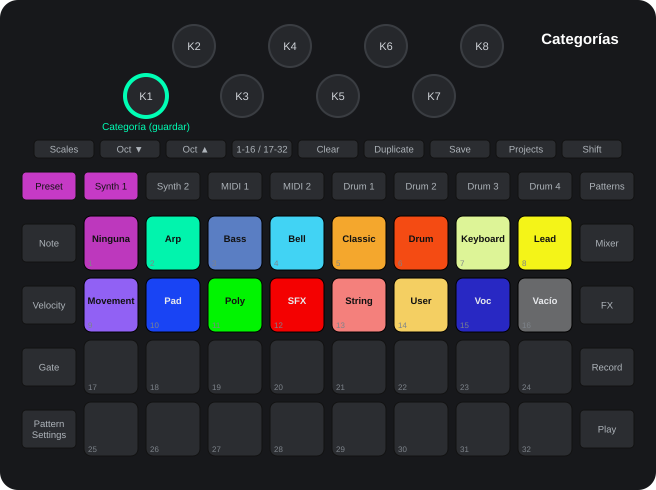

*Solo Beta 5.56: cada patch en el color de su categoría de Components (aquí una de cada; pad 1 = Ninguna, el color de la pista; pad 16 = un hueco vacío, blanco tenue; el elegido en blanco). Mientras un guardado pregunta (Clear + pad), K1 elige la categoría que se guarda, en su color.*

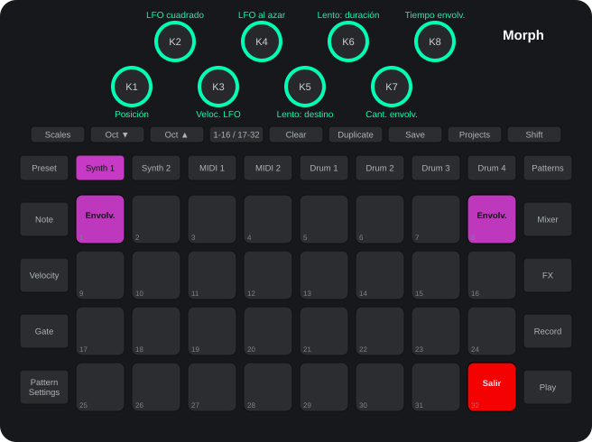

*Solo Beta 5.56: la vista del morph (mantén de dos a cuatro patches 0,4 s): K1 = la posición en la cadena (rojo, amarillo, verde, azul = patches 1-4); K2 = LFO cuadrado, K3 = la velocidad de los dos LFO, K4 = LFO de pasos al azar; K5 / K6 = destino / duración del morph lento; K7 / K8 = cantidad / tiempo de la envolvente. Pads 1 / 8 = la envolvente (mantenidos = sostenida); pad 32 (rojo) = salir; Preset = los patches; Clear + knob = 0.*


*[Paso a paso: Guardar un patch de Synth 1 / 2 (desde RC2)](https://github.com/Ghillermo/CIRCUIT-HACKS-RC/wiki/Step-by-step-ES#guardar-un-patch-de-synth-1--2-desde-rc2)*


*[Paso a paso: Intercambiar dos patches de Synth 1 / 2](https://github.com/Ghillermo/CIRCUIT-HACKS-RC/wiki/Step-by-step-ES#intercambiar-dos-patches-de-synth-1--2)*


*[Paso a paso: Copiar un patch de Synth 1 / 2 a otro pack](https://github.com/Ghillermo/CIRCUIT-HACKS-RC/wiki/Step-by-step-ES#copiar-un-patch-de-synth-1--2-a-otro-pack)*


*[Paso a paso: Hacer morph entre patches (solo Beta 5.56)](https://github.com/Ghillermo/CIRCUIT-HACKS-RC/wiki/Step-by-step-ES#hacer-morph-entre-patches-solo-beta-556)*

## Pistas MIDI (MIDI 1 / 2)

### Vista Preset de MIDI 1 / 2

*Cómo se llega:* Pulsa **MIDI 1** o **MIDI 2** y luego **Preset** (*desde RC4*: o **MIDI 1 / MIDI 2 otra vez** con su vista Note en pantalla, o **Shift + MIDI 1 / 2**). Además de las plantillas de stock, aquí vive el sinte propio de la pista.

- **Un sinte en cada pista MIDI** — MIDI 1 y 2 suenan en el propio aparato con su motor (entrada de línea procesada, oscilador, dos osciladores, VA-drum, granular, modo muestra; *(desde RC4)* FM) y siguen mandando MIDI.
- **Secuenciador de efectos** — un motor que no suena: dispara efectos de Master FX en los pasos que elijas.
- **Patches del sinte propio** *(desde RC2)* — 64 sonidos por pack para esos motores, a un toque.
- **Matriz de modulación** *(desde RC2.02)* — ocho fuentes (velocity, nota, azar, LFO 2, envolvente 2, golpe de un drum, posición del patrón, azar por pasos) que mueven cualquier parámetro del motor.
- **Patch flip** — cada nota manda un cambio de programa: el aparato externo cambia de sonido paso a paso.
- **Secuenciador de saltos** *(solo Beta 5.64)* — las notas de la pista hacen saltar el patrón de otra pista al paso que indican.
- **Editor de CC** — cambia qué CC manda cada knob de la plantilla sin Components.

→ [Todo el detalle en la guía](https://ghillermo.github.io/CIRCUIT-HACKS-RC/beta/guia.html#midi-preset)

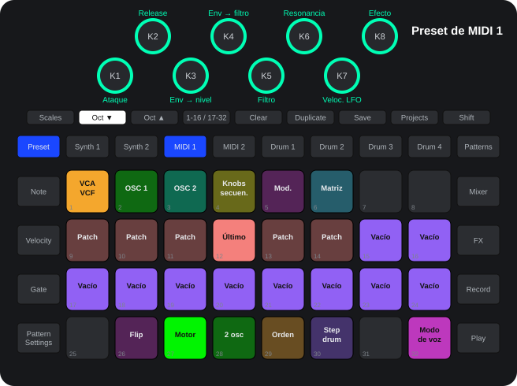

*Vista Preset de MIDI 1 con el motor oscilador, en las RC: pads 1-5 = las páginas de knobs del motor (1 VCA-VCF, 2 OSC 1, 3 OSC 2, 4 knobs secuenciables — Shift + 4 no secuenciables —, 5 modulación; mantenido ½ s = solo mientras lo mantienes), 6 = la matriz de modulación; 9-24 = patches del sinte propio (melocotón tenue = guardado, brillante = el último usado, violeta = vacío; Octave = 8 páginas; un toque carga, Clear + pad dos veces guarda); 26 = patch flip; 27 = el motor (un toque abre la fila de motores); 28 = uno / dos osciladores; 29 = orden de la cadena; 30 = step-drummer; 32 = modo de voz. El pad 31 se enciende con el VA-drum (velocity → sus envolventes).*

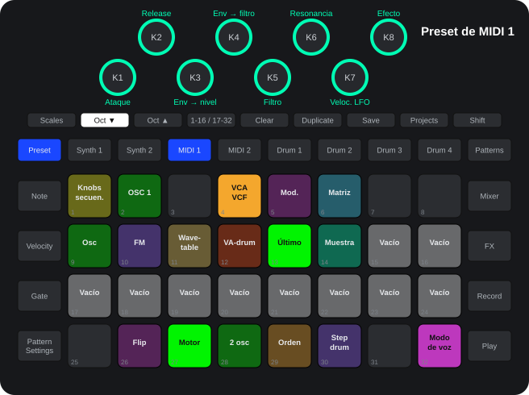

*Solo Beta 5.56, la misma vista: el pad 1 = knobs secuenciables (Shift + 1 = no secuenciables) y el pad 4 = filtro / VCA cambian de sitio; los patches en el color de su motor (vacío = blanco tenue; Duplicate + un hueco vacío guarda ahí); el pad 3 se enciende con dos osciladores; el pad 26 abre la vista de flip; con «sin voz» el pad 31 = el secuenciador de efectos; el orden de fábrica es filtro → VCA → FX (pad 29).*

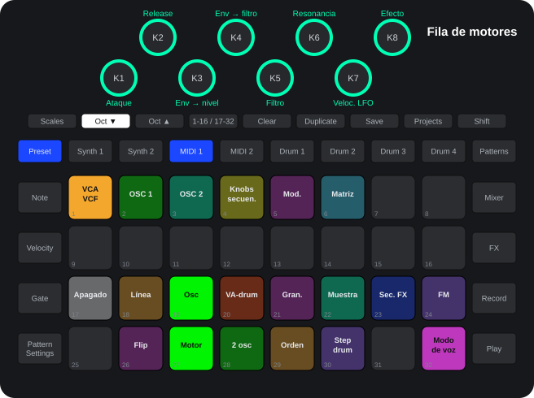

*La fila de motores en las RC (desde RC4; un toque al pad 27): pads 17-24 = apagado, entrada de línea, oscilador, VA-drum, granular, muestra, secuenciador de efectos y FM, el actual brillante; un toque elige uno, el pad 27 otra vez cierra la fila (mientras, los pads 9-24 no cargan patches). Shift + pad 27 pasa al motor siguiente.*

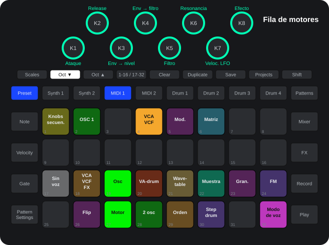

*Solo Beta 5.56, la fila de motores: sin voz, solo VCA / VCF / FX (la entrada de línea), oscilador, VA-drum, wavetable (arena), muestra, granular y FM; el secuenciador de efectos es el pad 31 cuando se elige «sin voz» (azul tenue; un toque lo enciende).*

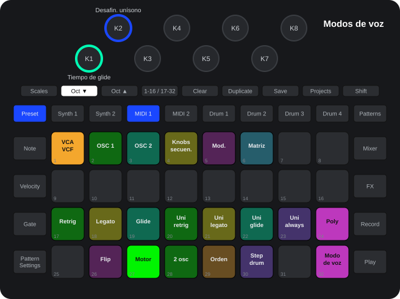

*Modos de voz (desde RC4; un toque al pad 32 con el motor encendido): pads 17-24 = retrigger, legato, glide, uni retrig, uni legato, uni glide, uni always-glide y poly (los que se llaman igual, del mismo color; el actual brillante); K1 = el tiempo del glide (verde azulado), K2 = la desafinación del unísono (azul). Se guardan con el patch y con el proyecto.*

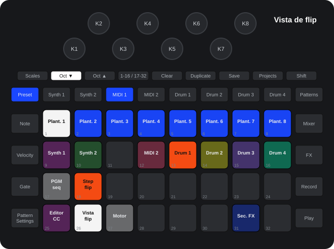

*Solo Beta 5.56: la vista de flip (pad 26, blanco mientras está abierta), MIDI 1 apuntando a Drum 1: fila 3 = el modo, pad 17 patch flip (PGM seq) o pad 18 step flip (en el color del destino; el encendido brillante, un toque lo apaga); fila 2 = las ocho pistas en sus colores, el destino brillante, la propia apagada. Mientras apunta, cada nota de la pista hace saltar a Drum 1 al paso de la nota, y el motor está apagado (pad 27 gris; pads 1-8 = las plantillas de stock).*


*[Paso a paso: Cargar, guardar e intercambiar patches del sinte propio (desde RC2)](https://github.com/Ghillermo/CIRCUIT-HACKS-RC/wiki/Step-by-step-ES#cargar-guardar-e-intercambiar-patches-del-sinte-propio-desde-rc2)*


*[Paso a paso: Copiar un patch del sinte propio a otro pack (desde RC2)](https://github.com/Ghillermo/CIRCUIT-HACKS-RC/wiki/Step-by-step-ES#copiar-un-patch-del-sinte-propio-a-otro-pack-desde-rc2)*


*[Paso a paso: Elegir un motor en la fila de motores (desde RC4)](https://github.com/Ghillermo/CIRCUIT-HACKS-RC/wiki/Step-by-step-ES#elegir-un-motor-en-la-fila-de-motores-desde-rc4)*


*[Paso a paso: Elegir el modo de voz del sinte propio (desde RC4)](https://github.com/Ghillermo/CIRCUIT-HACKS-RC/wiki/Step-by-step-ES#elegir-el-modo-de-voz-del-sinte-propio-desde-rc4)*

### Voces del sinte propio: polifonía y límite de voces

*Cómo se llega:* Con el sinte propio de MIDI 1 / 2 encendido, el **pad 32** de su [vista Preset](https://ghillermo.github.io/CIRCUIT-HACKS-RC/beta/guia.html#midi-preset) elige el modo de voz *(desde RC4)*. Con diagramas y todas las tablas de motores, knobs, guardado y MIDI: [Pistas MIDI y modos de voz](https://ghillermo.github.io/CIRCUIT-HACKS-RC/voces.html). Aquí, cuántas voces da cada modo y cada motor, cómo suenan los acordes y qué hace el aparato cuando el DSP va justo de tiempo.

→ [Todo el detalle en la guía](https://ghillermo.github.io/CIRCUIT-HACKS-RC/beta/guia.html#midi-voces)

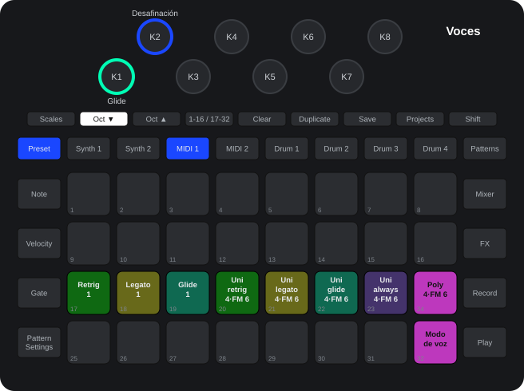

*Un mapa más sencillo (este capítulo es sobre todo tablas): los modos de voz del pad 32 con cuántas voces da cada uno a una pista — 1 en retrigger, legato y glide; 4 en los unísonos y en poly (FM: 6, o 3 cada una con MIDI 1 y MIDI 2 en FM; el unísono del modo muestra: 1; el granular: siempre 1). Cada voz baja según cuántas suenan, para que los acordes no recorten; si el DSP va justo de tiempo, el límite de voces apaga la que suena más baja soltándose.*

### Páginas de knobs del motor de MIDI 1 / 2

*Cómo se llega:* Con el motor encendido, los pads 1-5 de la vista Preset eligen qué hacen los 8 knobs; Shift da una segunda capa.

- **VCA-VCF** — volumen y filtro con su envolvente y su LFO; con Shift, el tipo de filtro y el tipo de efecto.
- **Osciladores** — una forma de onda continua de seno a cuadrada y un segundo oscilador con FM, ring y sync.
- **Granular** — convierte un sample en texturas: granos que lo leen en otra posición, velocidad o dirección para congelarlo, estirarlo o trocearlo.
- **Página 4, knobs secuenciables** — los 8 parámetros que se graban como automatización (*(desde RC4)*: con Shift + knob, cualquiera de los 33; Record + paso = foto de los valores).
- *(desde RC4)* **Shift + pad 4, knobs no secuenciables** — 8 knobs de destino asignable que no se graban.

→ [Todo el detalle en la guía](https://ghillermo.github.io/CIRCUIT-HACKS-RC/beta/guia.html#midi-knobs)

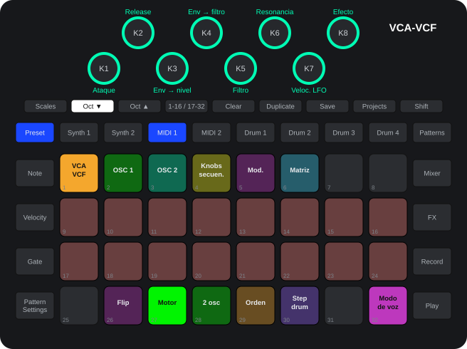

*Página 1, VCA-VCF (pad 1 en las RC; pad 4 en la Beta 5.56): K1 ataque, K2 release, K3 / K4 envolvente → nivel / → filtro, K5 filtro, K6 resonancia, K7 velocidad del LFO (bipolar desde RC4: derecha libre, izquierda a tempo), K8 cantidad de efecto.*

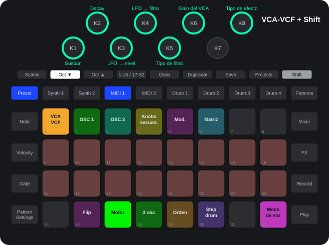

*Página 1 con Shift: K1 sustain, K2 decay, K3 / K4 LFO → nivel / → filtro, K5 tipo de filtro (DJ, LP 12, HP 12, BP, notch, LP 24, HP 24), K6 gain del VCA (hasta +18 dB con saturación), K8 tipo de efecto (suave, dura, plegado, wavefold, ring, comb, chorus). Los knobs de tipo enseñan el tipo con el color y la posición dentro de él con el brillo.*

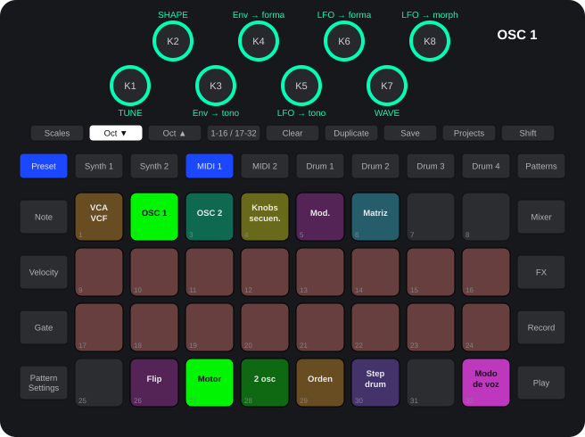

*Página 2, OSC 1 (oscilador y VA-drum), en las RC: K1 TUNE, K2 SHAPE, K3 / K4 envolvente → tono / → forma, K5 / K6 LFO → tono / → forma, K7 WAVE (el morph seno → triángulo → sierra → cuadrada; desde RC4 en el modo muestra, la anchura estéreo), K8 LFO → morph. Con Shift: K1 FINE, K2 MIX OSC 1 ↔ OSC 2, K3 BITSYNC, K8 envolvente → morph.*

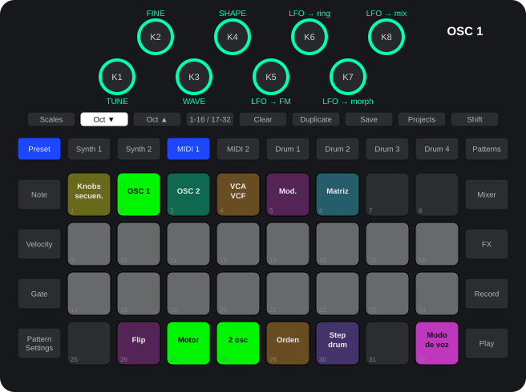

*Solo Beta 5.56, página 2 con el oscilador, el VA-drum y la wavetable: K1 TUNE, K2 FINE, K3 WAVE (la posición en la wavetable; la anchura estéreo del modo muestra), K4 SHAPE (el warp de la wavetable), K5 / K6 / K8 = LFO → FM / → ring / → mix (centro = nada), K7 LFO → morph. Con un solo oscilador K5 = el nivel del sub-oscilador, K6 = el nivel del ruido, K8 = LFO → sub.*

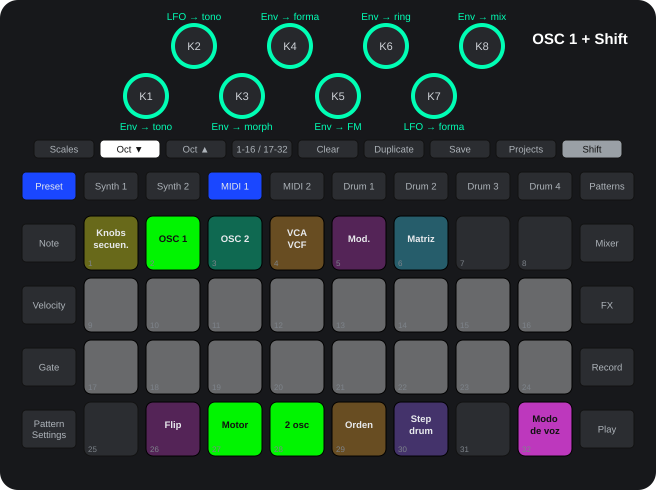

*Solo Beta 5.56, página 2 con Shift: K1 / K2 envolvente / LFO → tono, K3 envolvente → morph, K4 envolvente → forma, K5 / K6 / K8 envolvente → FM / → ring / → mix, K7 LFO → forma. Con un solo oscilador: Shift + K5 / K6 = envolvente → sub / → ruido, Shift + K8 = LFO → ruido.*

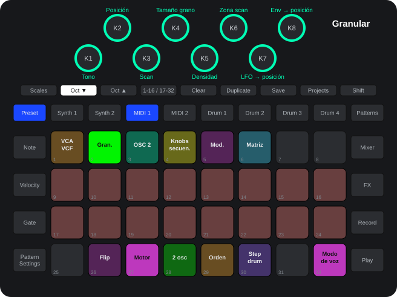

*Página 2 con el motor granular (pad 27 magenta): K1 tono ±24 st, K2 posición en el sample, K3 scan (centro = congelado), K4 tamaño del grano 5-500 ms, K5 densidad 1-16 granos, K6 zona del scan, K7 LFO → posición, K8 envolvente → posición.*

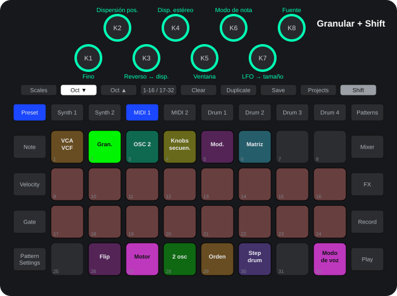

*La página granular con Shift: K1 fino ±1 st, K2 dispersión de la posición, K3 granos al revés (izquierda) / dispersión del tono (derecha; bipolar desde RC4), K4 dispersión estéreo (desde RC4), K5 ventana, K6 modo de nota (tono / slicer / stretch), K7 LFO → tamaño, K8 la fuente: la captura o el sample de un drum (desde RC2).*

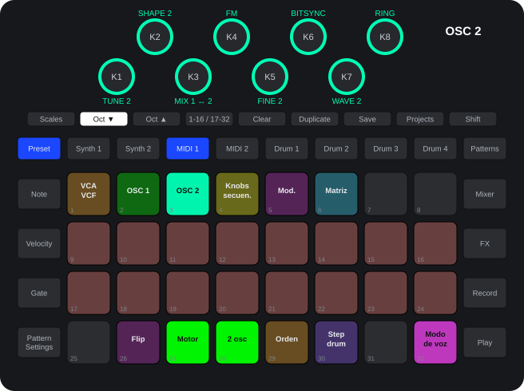

*Página 3, OSC 2, en las RC (desde RC2 los ocho valores sin Shift): K1 TUNE 2, K2 SHAPE 2, K3 MIX OSC 1 ↔ OSC 2, K4 FM, K5 FINE 2, K6 BITSYNC (sync y los modos bit a bit), K7 WAVE 2, K8 RING.*

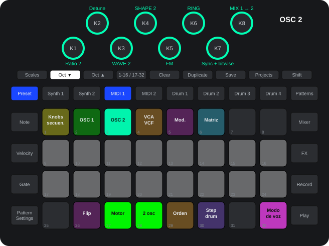

*Solo Beta 5.56, página 3 con el oscilador, el VA-drum y la wavetable: K1 = ratio de OSC 2 respecto a su nota (centro = 1), K2 detune (±50 cents), K3 WAVE 2, K4 SHAPE 2, K5 FM (centro = nada; derecha OSC 2 → OSC 1, izquierda al revés), K6 RING, K7 sync + bitwise, K8 MIX OSC 1 ↔ OSC 2.*

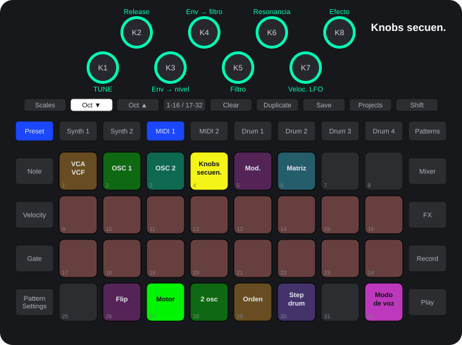

*Página 4, knobs secuenciables (pad 4 en las RC; pad 1 en la Beta 5.56): los ocho valores que se graban como automatización con Record + Play, de fábrica TUNE, release, envolvente → nivel, envolvente → filtro, filtro, resonancia, velocidad del LFO y efecto. Desde RC4, Shift + knob = el destino de ese knob (cualquiera de los 33 parámetros, en el color de su página; Clear mantenido y luego Shift + knob = el de fábrica); Record mantenido + paso = foto de los valores en ese paso.*

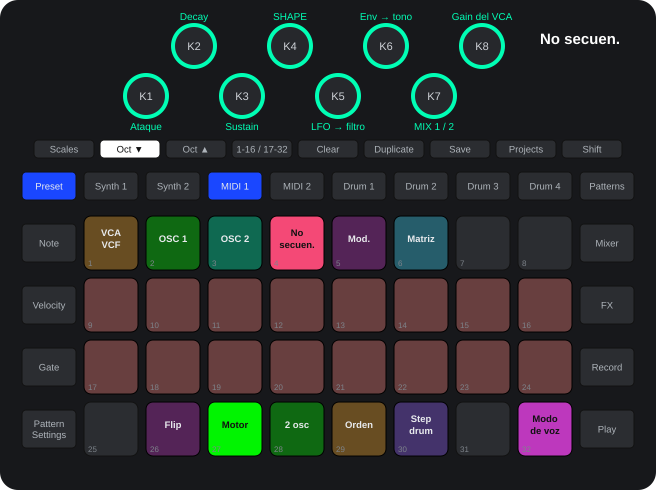

*Knobs no secuenciables (desde RC4; Shift + pad 4 en las RC, Shift + pad 1 en la Beta 5.56; el pad 4 en rosa mientras están en los knobs): ocho knobs de destino asignable que no se graban, de fábrica ataque, decay, sustain, SHAPE, LFO → filtro, envolvente → tono, MIX OSC 1 / 2 y gain del VCA; Shift + knob = el destino, como en la página secuenciable.*

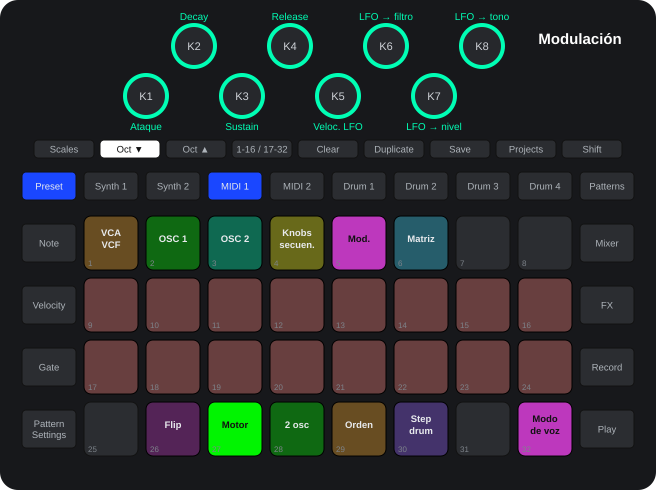

*Página 5, modulación: K1-K4 = ataque, decay, sustain y release de la envolvente; K5-K8 = velocidad del LFO, LFO → filtro, LFO → nivel y LFO → tono. Shift + K8 = la forma del LFO (desde RC2): diente de sierra inverso (azul), diente de sierra (magenta), triángulo (verde, la de fábrica desde RC2.02), cuadrada (rojo), seno (verde azulado), sample & hold (blanco), sample & hold suavizado (violeta).*

*[Paso a paso: Hacer una foto del sonido en un paso (desde RC4)](https://github.com/Ghillermo/CIRCUIT-HACKS-RC/wiki/Step-by-step-ES#hacer-una-foto-del-sonido-en-un-paso-desde-rc4)*

### Matriz de modulación

*Cómo se llega:* *(desde RC2.02)* MIDI 1 / 2 con el motor encendido: vista Preset, **pad 6**. Los 8 knobs pasan a ser 8 fuentes de modulación.

→ [Todo el detalle en la guía](https://ghillermo.github.io/CIRCUIT-HACKS-RC/beta/guia.html#midi-matriz)

*Matriz de modulación (desde RC2.02; pad 6, azul claro): los ocho knobs son fuentes — K1 velocity, K2 la nota, K3 azar (un valor nuevo en cada nota), K4 LFO 2, K5 envolvente 2, K6 golpe de un drum, K7 la posición en el patrón, K8 azar por pasos. La posición de cada knob es su destino y su cantidad: a la izquierda del todo = apagado; girando a la derecha recorre los 33 parámetros del motor, un tramo cada uno, con la cantidad creciendo dentro; el LED en el color de la página del destino, más brillo = más cantidad. Clear + knob = apagado; Clear + pad 6 = todas apagadas.*

*La matriz con Shift: K4 = forma × velocidad del LFO 2 (triángulo verde, diente de sierra magenta, cuadrada rojo, sample & hold blanco, suavizado violeta; desde RC4 la mitad izquierda de cada una a tempo), K5 = ataque × caída de la envolvente 2, K6 = qué drum (Drum 1-4: naranja, amarillo, violeta, verde azulado) × su caída, K8 = cada cuántos pasos (1, 2, 4, 8, 16). Clear + Shift + knob = su parámetro al valor inicial.*

*Mientras gira una fuente (y 1,5 s después) los pads enseñan dónde vive su destino — aquí K1 (velocity) → el filtro: el pad de la página 1 brillante, pads 9-16 = los K1-K8 de esa página y 17-24 = sus Shift + K1-K8 (tenue = tiene parámetro, brillante = el destino); el LED de K1 en el color de la página (ámbar), más brillo = más cantidad. Mientras, los pads 9-24 no cargan patches.*

*[Paso a paso: Llevar una fuente de la matriz a un destino (desde RC2.02)](https://github.com/Ghillermo/CIRCUIT-HACKS-RC/wiki/Step-by-step-ES#llevar-una-fuente-de-la-matriz-a-un-destino-desde-rc202)*

### FM de 4 operadores

*Cómo se llega:* *(desde RC4)* MIDI 1 / 2: vista Preset, un toque al **pad 27** y el **pad 24** de la fila de motores (violeta). El **pad 7** abre su página de knobs (violeta brillante en ella).

→ [Todo el detalle en la guía](https://ghillermo.github.io/CIRCUIT-HACKS-RC/beta/guia.html#midi-fm)

*FM de 4 operadores (desde RC4, en las RC; pad 24 de la fila de motores, violeta; pad 7 = su página): K1-K4 = los ratios de los operadores 1-4 (verde entero, azul claro y medio, verde azulado inarmónico; los clics tras cada ratio exacto lo desafinan), K5-K8 = sus niveles (el volumen de un portador, cuánto modula un modulador). Pad 7 mantenido = los 16 algoritmos, pad 8 mantenido = 16 sonidos de partida; Clear + pad 7 = una voz tocable del algoritmo.*

*FM de 4 operadores con Shift: K1-K4 = la envolvente de cada operador: centro = ataque 0, derecha = su ataque (azul claro), izquierda = percusivo con su propio decay (rojo); K5 = el algoritmo (16, en el color de su familia), K6 = feedback (magenta), K7 = ruido (blanco), K8 = release (ámbar; más largo cuanto más fuerte la nota).*

*Pad 7 mantenido: los 16 algoritmos en los pads 9-24, en el color de su familia (clásicos blanco, percusivos rojo, campanas verde azulado, cuerdas verde), el actual brillante; pulsa uno = elegido, y suena la tónica mientras lo mantienes (Shift + pad: sin sonar). Al soltar el pad 7 vuelven los patches.*

*Pad 8 mantenido (desde RC4): 16 instrumentos de partida en el color de su familia — teclados blanco, pulsados violeta, bajo ámbar, campana verde azulado, cuerdas y pad verde, vientos azul claro, percusión naranja; pulsa uno = se carga entero (algoritmo, ratios, niveles, envolventes) y suena la tónica; el que coincide con la pista, brillante.*

*[Paso a paso: Elegir un algoritmo FM con los pads (desde RC4)](https://github.com/Ghillermo/CIRCUIT-HACKS-RC/wiki/Step-by-step-ES#elegir-un-algoritmo-fm-con-los-pads-desde-rc4)*

*[Paso a paso: Cargar un sonido de partida del FM (desde RC4)](https://github.com/Ghillermo/CIRCUIT-HACKS-RC/wiki/Step-by-step-ES#cargar-un-sonido-de-partida-del-fm-desde-rc4)*

### FM de 8 operadores

*Cómo se llega:* *(solo Beta 5.64)* MIDI 1 / 2: vista Preset, un toque al **pad 27** y el **pad 24** de la fila de motores (violeta); cierra la fila (pad 27) y el **pad 7** abre su página.

→ [Todo el detalle en la guía](https://ghillermo.github.io/CIRCUIT-HACKS-RC/beta/guia.html#midi-fm8)

*Solo Beta 5.56: la página del FM de 8 operadores (pad 7 con la fila de motores cerrada): pads 9-16 = los operadores 1-8 (portadores verdes, moduladores azul claro, el elegido brillante; aquí la pila de cuatro), pad 3 = la envolvente de pitch, pads 17-24 = la fila de motores; K1 ratio, K2 fino, K3 nivel de salida, K4 sensibilidad a la velocity, K5-K8 los rates R1-R4 de la envolvente. Pad 7 = el mapa del algoritmo, Shift + pad 7 mantenido = los 56 algoritmos, pad 8 mantenido = los instrumentos.*

*Solo Beta 5.56, la página FM con Shift: K1 = el algoritmo (56, de todo el motor; los pads los enseñan 1,5 s), K2 = feedback, K3 = rate scaling (las notas agudas más rápidas), K4 = level scaling (centro = ninguno), K5-K8 = los niveles L1-L4 de la envolvente. La envolvente sube por R1 a L1, R2 a L2, R3 a L3, se queda en L3 mientras la nota sigue y al soltar va por R4 a L4.*

*Solo Beta 5.56, la envolvente de pitch (pad 3, violeta, brillante mientras la editas — como un noveno operador): K1 transposición (24 = ninguna), K3 ruido, K4 el operador del ruido, K5-K8 rates R1-R4; con Shift K1 / K2 = algoritmo / feedback y K5-K8 = niveles L1-L4 (50 = sin desplazamiento).*

*Solo Beta 5.56: el mapa del algoritmo (un toque al pad 7), aquí del instrumento Tubular Bell (el algoritmo 5 del DX7): cada fila se lee de izquierda a derecha — una onda modula a la de su derecha y la última de la derecha es una portadora, la que se oye; un hueco oscuro = no interactúan. Color = el ratio (verde entero, verde azulado x,5, naranja otro, rojo fijo), violeta = el operador con feedback; tenue = nivel por debajo de la mitad. Un toque elige un operador, Shift + operador lo calla, uno mantenido + un toque a otro = enlazarlos o desenlazarlos (un algoritmo propio).*

*Solo Beta 5.56, pad 8 mantenido: 24 instrumentos en el color de su tipo (teclados naranja, bajos azul, leads y metales rojo, pads y cuerdas verde, punteados amarillo, percusión blanco, campanas y efectos violeta), el cargado brillante; pulsa uno = se carga y suena. Al cargar uno, la página 4 y Shift + pad 4 pasan a los knobs que convienen a su familia.*

*Solo Beta 5.56, pad 8 mantenido + Octave ▼ = la segunda página: pianos naranja, cuerdas verde (Pizzicato amarillo), vientos verde azulado y cuatro sonidos largos; Octave ▲ vuelve.*

### Editor de CC de los macros MIDI (pad 25)

*Cómo se llega:* Vista Preset de MIDI 1 / 2, **pad 25**: cambia desde el aparato qué CC / NRPN manda cada macro knob de la plantilla.

- **Controlar otro aparato** — elige el número de CC (o NRPN) y el recorrido de cada knob de la plantilla, y guárdalo en ella.

→ [Todo el detalle en la guía](https://ghillermo.github.io/CIRCUIT-HACKS-RC/beta/guia.html#midi-cc)

*Editor de CC de los macros MIDI (pad 25, magenta; con el motor de la pista apagado, pad 27 gris): mueve un knob para elegirlo (su número se dibuja con los pads); Octave ▼ / ▲ = campo siguiente / anterior (número, inicio, fin; en un NRPN también MSB y LSB); gira el knob para cambiar el campo; el pad 26 (u Octave ▼ hasta el paso de guardar, cuando parpadean el pad 26 y Save) guarda y vuelve a la vista Preset; el pad 25, un pad de plantilla o un botón de vista descarta.*

*[Paso a paso: Cambiar el CC que manda un macro knob MIDI](https://github.com/Ghillermo/CIRCUIT-HACKS-RC/wiki/Step-by-step-ES#cambiar-el-cc-que-manda-un-macro-knob-midi)*

### Vista del step-drummer

*Cómo se llega:* MIDI 1 / 2: vista Preset con el motor encendido, **pad 30** (*desde RC4*: con el step-drummer encendido, **Note** pasa por Note → Note ampliada → step-drummer). Synth 1 / 2: vista de la fuente, **pad 30**. Secuencia por pares de pasos sobre el patrón.

- **Parámetros por pares de pasos** — los 8 knobs son 8 pares de pasos del patrón: cada uno mueve un destino (tono, forma, FM, filtro…) solo en esos pasos, para melodías, acentos o cambios de timbre sin automatizar a mano.
- **El LED dice cuánto** *(desde RC2)* — tenue sin modulación, más brillante cuanto más se aleja.
- **Segunda página con destino propio** *(desde RC2)* — la página de velocity mueve otro destino a la vez.
- **Toggle pitch-vel** *(desde RC2)* — la página 1 transpone las notas por grados de la escala y la 2 marca su velocity: una melodía a partir de un solo patrón de notas.
- **En tiempo real** — con Record, tocar un paso lo graba.
- **Secuenciador de efectos** — con ese motor, cada par elige qué hueco de Master FX suena.

→ [Todo el detalle en la guía](https://ghillermo.github.io/CIRCUIT-HACKS-RC/beta/guia.html#step-drummer)

*Step-drummer de MIDI 1 (pad 30 de la vista Preset, violeta), página pitch: pads 1-16 = los pasos por pares (colores alternos; brillante = con nota, blanco = el que suena; Shift + pad = poner / quitar nota), pads 17-24 = el destino de la fila de pitch (tono, OSC 2, WAVE, FM, MIX, envolvente → filtro, SHAPE, decay), K1-K8 = los 8 pares de pasos (centro = sin cambio; desde RC2 más brillo = más lejos de él). Octave ▲ / ▼ = página pitch / velocity; 1-16 / 17-32 = la otra mitad; pad 32 = el toggle pitch-vel (desde RC2). Con Record, tocar un paso lo graba.*

*Con el motor secuenciador de efectos (pad 27 azul), cada knob elige el hueco de la fila inferior de Master FX que dispara su par de pasos: nada, pads 26-30, pad 31 (el gesto) y random (blanco, desde RC2); avanza despacio y su LED enseña el color del efecto. Un hueco sin efecto toca el efecto de arriba de su columna (desde RC4); la pista manda su MIDI como siempre.*

*[Paso a paso: Secuenciar un destino con el step-drummer](https://github.com/Ghillermo/CIRCUIT-HACKS-RC/wiki/Step-by-step-ES#secuenciar-un-destino-con-el-step-drummer)*

### Modo muestra y selector de samples

*Cómo se llega:* *(desde RC2)* MIDI 1 / 2 con el motor en **muestra** (pad 27 verde azulado, tras el granular): **Note dos veces** (vista Note ampliada). La pista toca un sample del pack de un golpe, a la altura de cada nota.

- **Drums con altura en una pista MIDI** — cualquier sample del pack suena a la altura de cada nota, como en una caja de ritmos con samples afinables.
- **Un sample distinto por paso** — el sample flip cambia de sample paso a paso sin otra pista; se graba también en vivo.

→ [Todo el detalle en la guía](https://ghillermo.github.io/CIRCUIT-HACKS-RC/beta/guia.html#midi-muestra)

*Selector de samples (desde RC2; MIDI 1 / 2 con el motor muestra, Note dos veces): pads 17-32 = 16 de los 64 samples del pack (Octave = la página; verde azulado = el sample de la pista, un toque lo elige y suena; desde RC4 Shift + sample = sin sonar, Shift + el elegido = elegir el segundo, sample estéreo); pads 1-16 = los pasos: verde azulado = una nota, melocotón = una nota con sample flip, violeta = un flip sin nota (desde RC4), blanco = el que suena. Mantén un paso + toca un sample = su flip; Clear + paso = quitarlo; 1-16 / 17-32 = la otra mitad.*

*[Paso a paso: Elegir samples y cambiarlos por paso (sample flip) (desde RC2)](https://github.com/Ghillermo/CIRCUIT-HACKS-RC/wiki/Step-by-step-ES#elegir-samples-y-cambiarlos-por-paso-sample-flip-desde-rc2)*

## Pattern Settings

### Vista Pattern Settings

*Cómo se llega:* Botón **Pattern Settings** con una pista elegida: primer / último paso, sync rate y dirección como siempre, más los pads 25-28 y el arpegiador (Shift).

- **Nudge** — mueve el contenido de los pasos elegidos un paso atrás o adelante.
- **Órdenes fractal y deconstruido** — recorren el patrón de otra forma sin cambiar sus notas.
- **Arpegiador** *(desde RC2)* — los acordes del patrón (y los que tocas) suenan nota a nota, con su orden y su resolución; en los drums, saltando de sample.
- **Dinámicas y random-mutate** (pad 25) — variaciones para que el patrón no suene siempre igual.

→ [Todo el detalle en la guía](https://ghillermo.github.io/CIRCUIT-HACKS-RC/beta/guia.html#pattern-settings)

*Pattern Settings (MIDI 1): pads 1-16 = primer / último paso, 17-24 = sync rate, 29-32 = dirección (como en el original); pad 25 = la vista de probabilidad en modo 2 (dinámicas y random-mutate; Clear + 25 las borra), 26 = Nudge (azul: el contenido del tramo elegido un paso atrás, Shift + 26 un paso adelante), 27 / 28 = orden fractal / deconstruido (excluyentes con 29-32; se guardan con el patrón).*

*Con Shift pulsado (desde RC2): Shift + pad 25 = el arpegiador del patrón sí / no (verde), Shift + 27-32 = el orden del arpegio (fractal, deconstruido, arriba, abajo, ping-pong, aleatorio), Shift + 17-24 = su resolución (lo elegido en verde). Desde RC4, con el arpegiador encendido, Shift + pads 1-16 = sus modificadores: octavas (arena), cuándo cambia la octava (azul cielo), groove (ámbar), reinicio (rosa), la opción elegida brillante. Shift + pad 26 = Nudge un paso adelante.*

*[Paso a paso: Encender el arpegiador (desde RC2)](https://github.com/Ghillermo/CIRCUIT-HACKS-RC/wiki/Step-by-step-ES#encender-el-arpegiador-desde-rc2)*

*[Paso a paso: Dar forma al arpegio con sus modificadores (desde RC4)](https://github.com/Ghillermo/CIRCUIT-HACKS-RC/wiki/Step-by-step-ES#dar-forma-al-arpegio-con-sus-modificadores-desde-rc4)*

*[Paso a paso: Mover los pasos de un patrón (Nudge) (desde RC4.05)](https://github.com/Ghillermo/CIRCUIT-HACKS-RC/wiki/Step-by-step-ES#mover-los-pasos-de-un-patrón-nudge-desde-rc405)*

### Vista Micro Step (pistas de notas)

*Cómo se llega:* Pulsa **Gate dos veces** con una pista de notas elegida (Synth 1 / 2, MIDI 1 / 2).

- **Micropasos y Tie (de stock)** — coloca cada nota fuera de la rejilla y enlázala con el paso siguiente.
- **Gate por pulsación** *(desde RC2)* — al introducir notas a mano, lo que mantienes es lo que dura la nota.
- **Longitud fija** *(desde RC2)* — todas las notas que introduces a mano con la misma duración.

→ [Todo el detalle en la guía](https://ghillermo.github.io/CIRCUIT-HACKS-RC/beta/guia.html#micropasos)

*Vista Micro Step (Gate dos veces, pistas de notas): pads 1-16 = los pasos (el elegido brillante), 17-22 = sus 6 micropasos, 24 = Tie, 25-30 = las notas del paso (como en el original); pad 31 = longitud fija (azul = encendida; con los dos apagados abre un selector, pads 17-32 = 1-16 pasos), pad 32 = gate por pulsación (verde = encendido: lo que mantienes los pads es el gate de la nota). Desde RC2; con uno encendido, pulsarlo otra vez lo apaga, pulsar el otro los cambia.*

*[Paso a paso: Gate por pulsación o longitud fija (desde RC2)](https://github.com/Ghillermo/CIRCUIT-HACKS-RC/wiki/Step-by-step-ES#gate-por-pulsación-o-longitud-fija-desde-rc2)*

### Vista de probabilidad (pistas de notas y drums)

*Cómo se llega:* **Pattern Settings dos veces** o **Shift + Pattern Settings** (modo 1), o el **pad 25** de Pattern Settings (modo 2). Mantén un paso con notas y toca un pad de las filas 3-4.

- **Probabilidad (de stock)** — que un paso suene solo a veces.
- **Frecuencia** *(desde RC2)* — que un paso suene una de cada n vueltas: variaciones que vuelven cada 2, 4 u 8 vueltas.
- **Dinámicas** *(desde RC2)* — pequeñas variaciones de velocity y de posición: un patrón más humano.
- **Random-mutate** *(desde RC2)* — notas que saltan de octava o a otra nota de la escala; en los drums, a otro sample.

→ [Todo el detalle en la guía](https://ghillermo.github.io/CIRCUIT-HACKS-RC/beta/guia.html#probabilidad)

*Vista de probabilidad, modo 1 (Pattern Settings dos veces): mantén un paso (pads 1-16) y toca la fila 3 = su probabilidad (como en el original) o la fila 4 = su frecuencia (desde RC2, amarillo): el paso suena en la última de cada n vueltas (1-8), aquí 1 de 4. En los drums igual.*

*Modo 2 en las RC (pad 25 de Pattern Settings): fila 3 = dinámicas (desde RC2, verde: cambios al azar de micropasos y velocity en 8 niveles), fila 4 = random-mutate (desde RC2, melocotón: la probabilidad de que las notas del paso salten una octava o a otra nota de la escala). Con Record y esta vista en pantalla, lo que suena se escribe en el patrón. En los drums, los pads 25-28 de la fila 4 mutan el sample.*

*Solo Beta 5.56, modo 2: una sola botonera por paso — 17 sin cambio de nota (blanco), 18-20 otra nota de la escala (×1, ×2, ×4; melocotón), 21 / 22 una octava arriba (baja / alta; arena), 23 / 24 una octava arriba o abajo (arena), 25 sin dinámicas (blanco), 26 ghost, 27 accent staccato, 28 longitud (verde), 32 micropasos (verde azulado). Octave ▼ / ▲ = el factor de la pista (×0, ×1, ×2, ×4, ×8), que multiplica todas las probabilidades. En los drums: otro sample en lugar de otra nota.*

*[Paso a paso: Hacer que las notas de un paso muten (desde RC2)](https://github.com/Ghillermo/CIRCUIT-HACKS-RC/wiki/Step-by-step-ES#hacer-que-las-notas-de-un-paso-muten-desde-rc2)*

*[Paso a paso: Hacer que un paso suene cada n vueltas (desde RC2)](https://github.com/Ghillermo/CIRCUIT-HACKS-RC/wiki/Step-by-step-ES#hacer-que-un-paso-suene-cada-n-vueltas-desde-rc2)*

## Drums

### Vista de pista de un drum (knobs)

*Cómo se llega:* Pulsa **Drum 1-4**. Cada knob hace lo que dice su etiqueta, con una segunda capa en Shift.

- **Moldear cada drum** — tono exacto, ring mod, ataque y decay, inicio y corte del sample, filtro con varios modos, LFO y distorsión de varios tipos: de un sample salen muchos sonidos.
- **Todo neutro = el original** — con los knobs nuevos en su punto neutro, el sample suena como en el Circuit original.
- **Volver a empezar** *(desde RC2)* — Clear + el botón del drum deja todos sus knobs por defecto.
- **Pareja estéreo** *(desde RC4)* — Drum 1 + Drum 2 (o 3 + 4) tocan un sample estéreo: el de la izquierda manda en los dos y el de la derecha solo matiza.

→ [Todo el detalle en la guía](https://ghillermo.github.io/CIRCUIT-HACKS-RC/beta/guia.html#drum-pista)

*Vista de pista de Drum 1, los knobs (según la serigrafía): K1 pitch, K2 frecuencia del ring mod, K3 decay (izquierda) / ataque (derecha; desde RC2), K4 envolvente → corte, K5 filtro / EQ (de fábrica el EQ tilt de stock), K6 resonancia, K7 cantidad del LFO (derecha trémolo; izquierda, desde RC4, scan del inicio), K8 distorsión (a la izquierda de 0: bitcrush). Todo neutro = el sonido original. Clear + Drum 1 = borra la automatización de sus knobs en el patrón que suena y pone todos sus knobs por defecto (desde RC2). Pads 1-16 = los pasos del drum.*

*Los knobs del drum con Shift: K1 cantidad de la envolvente de tono, K2 cantidad del ring mod, K3 inicio del sample (izquierda) / corte desde el final (derecha; desde RC2), K4 forma de la envolvente, K5 modo de filtro (el color del LED: verde EQ tilt de stock, amarillo paso banda, magenta notch, verde azulado comb, blanco DJ; la Beta 5.56 se salta el comb), K7 velocidad del LFO (bipolar desde RC4: derecha libre, izquierda a tempo), K8 tipo de distorsión (stock, suave, dura, plegada).*

*Pareja estéreo (desde RC4; mantén Drum 1 y pulsa Drum 2, igual para deshacerla): Drum 1 suena a la izquierda y manda en los dos — knobs, patrón, nivel, envíos; Drum 2 toca el sample siguiente a la derecha y sus knobs pasan a ser desviaciones: K1 desafinación (±100 cents), K2 apertura estéreo (blanco), K3 decay, K4 envolvente → corte, K5 filtro / EQ, K6 resonancia, K7 cantidad del LFO. El botón de Drum 2 late en el color de Drum 1; se guarda con el proyecto.*

*Solo Beta 5.56: la vista de automatización del drum (su vista Velocity con Shift, o Velocity otra vez para fijarla): los pasos con automatización en amarillo, los de rampa en amarillo tenue, los marcados en rojo, los demás en su color. Shift + un paso amarillo = sus valores en los knobs hasta soltar Shift; Shift + otro paso = marcarlo (ahí pitch, decay, distorsión y EQ vuelven a los valores del proyecto); Clear + paso = borrar su automatización, dejando el golpe.*

*[Paso a paso: Hacer una pareja estéreo de drums (desde RC4)](https://github.com/Ghillermo/CIRCUIT-HACKS-RC/wiki/Step-by-step-ES#hacer-una-pareja-estéreo-de-drums-desde-rc4)*

### Vista Preset de drums

*Cómo se llega:* Pulsa **Preset** con un drum elegido. Los pads eligen el sample como siempre (Shift + pad = elegir sin que suene).

- **La captura como drum** — graba lo que suena (Master FX) y úsalo como sample de un drum; al guardar el proyecto queda en el pack.
- **Intercambiar y copiar samples** — reordena los samples o trae uno de otro pack.
- **Arpegio de samples** *(desde RC2)* — al mantener varios samples, el drum salta de uno a otro.

→ [Todo el detalle en la guía](https://ghillermo.github.io/CIRCUIT-HACKS-RC/beta/guia.html#drum-preset)

*Vista Preset de Drum 1: los pads eligen el sample (Shift + pad = sin sonar). Clear + pad y Clear + el mismo pad = ese sample pasa a ser la captura de Master FX (se escribe en el pack al guardar el proyecto, si cabe en la memoria de samples); Duplicate (encendido en esta vista) + A + B = intercambiar dos samples (A parpadea en azul), o copiar A a otro pack (escriben en la tarjeta: no en las versiones «S» ni en el pack de la memoria interna); Preset otra vez (desde RC2) o Shift + Preset = la vista cromática; con el arpegiador del drum encendido, varios samples mantenidos = el arpegio de samples (desde RC2).*

*[Paso a paso: Intercambiar dos samples de drum](https://github.com/Ghillermo/CIRCUIT-HACKS-RC/wiki/Step-by-step-ES#intercambiar-dos-samples-de-drum)*

*[Paso a paso: Copiar un sample de drum a otro pack](https://github.com/Ghillermo/CIRCUIT-HACKS-RC/wiki/Step-by-step-ES#copiar-un-sample-de-drum-a-otro-pack)*

*[Paso a paso: Capturar un sample y sustituir un drum por él](https://github.com/Ghillermo/CIRCUIT-HACKS-RC/wiki/Step-by-step-ES#capturar-un-sample-y-sustituir-un-drum-por-él)*

*[Paso a paso: Arpegiar los samples de un drum (desde RC2)](https://github.com/Ghillermo/CIRCUIT-HACKS-RC/wiki/Step-by-step-ES#arpegiar-los-samples-de-un-drum-desde-rc2)*

### Vista cromática y de escala de los drums

*Cómo se llega:* **Shift + Preset** con un drum elegido. Los pads tocan el sample transpuesto según la escala.

- **Un drum como teclado** — el sample transpuesto en la escala del proyecto.
- **Rollers** *(desde RC2)* — repite el drum en los micropasos que mantengas: redobles y ratchets en directo, también parado, y grabados con Record.

→ [Todo el detalle en la guía](https://ghillermo.github.io/CIRCUIT-HACKS-RC/beta/guia.html#drum-cromatica)

*Vista cromática / de escala de Drum 1 (Shift + Preset, o Preset otra vez desde RC2): tres filas de notas en la escala y la tónica del proyecto (aquí C mayor; las tónicas brillantes); cada pad toca el sample transpuesto. K1 = sesgo de tono en semitonos, Shift + K1 = afinación fina en cents. Desde RC4.02, grabando, cada pad graba un golpe con su tono en su paso.*

*Vista Note ampliada de los drums (Note dos veces con un drum): pads 29-32 = Drum 1-4 y pads 25-28 los repiten en espejo (Drum 4 … 1); filas 1-3 = rollers de micropasos (desde RC2): cada columna es el drum de su pad de abajo, su columna izquierda los micropasos 1-3 y la derecha los 4-6. Mientras se mantienen, el drum suena en cada paso en esos micropasos — también parado, al tempo del proyecto — y con Record se graban.*

## Master FX

### Master FX

*Cómo se llega:* **Mixer** y **Mixer** otra vez. Efectos sobre la salida master, el song pointer, el sample capturado y la fila de efectos asignables. Cualquier otro botón de vista sale.

- **Efectos en directo sobre todo el master** — Gater, Auto-Filter, Digitise, Phaser, Glitch y gesto mecánico *(desde RC2)*: mientras mantienes o fijados.
- **Song pointer** — repite o hace bucle de partes del patrón en directo.
- **Captura** — graba hasta 3,5 s de lo que suena para tocarlo, ponerlo en un hueco o usarlo como drum.
- **Huecos** — un efecto con sus ajustes a un toque; el secuenciador de efectos los dispara.
- **Por proyecto** *(desde RC2)* — cada proyecto recuerda sus ajustes de Master FX.

→ [Todo el detalle en la guía](https://ghillermo.github.io/CIRCUIT-HACKS-RC/beta/guia.html#master-fx)

*Master FX (Mixer dos veces), aquí con el pad 1 mantenido: pads 1-6 = los efectos, mantener = activo, Shift + pad = fijado — Gater, Auto-Filter paso bajo / alto, Digitise, Phaser, Glitch (desde RC2); K1-K4 = los ajustes del efecto mantenido (Gater: división, profundidad, ancho, suavizado); pad 7 = tocar el sample capturado (Shift + 7 = un bucle enganchado), pad 32 = grabarlo; pad 8 = apagar todo lo fijado; pads 9-24 = el song pointer (pasos 1-16: uno mantenido = retrigger, dos = un bucle entre ellos); 26-30 = huecos asignables (mantén un efecto + toca un hueco); 31 = el gesto mecánico (desde RC2). Cualquier otro botón de vista sale.*

*[Paso a paso: Poner un efecto en un hueco de Master FX](https://github.com/Ghillermo/CIRCUIT-HACKS-RC/wiki/Step-by-step-ES#poner-un-efecto-en-un-hueco-de-master-fx)*

*[Paso a paso: Repetir pasos en directo con el song pointer](https://github.com/Ghillermo/CIRCUIT-HACKS-RC/wiki/Step-by-step-ES#repetir-pasos-en-directo-con-el-song-pointer)*

*[Paso a paso: Repetir una frase con el modo frase](https://github.com/Ghillermo/CIRCUIT-HACKS-RC/wiki/Step-by-step-ES#repetir-una-frase-con-el-modo-frase)*

## FX

### Vista FX

*Cómo se llega:* Botón **FX**: envíos a reverb y delay por pista, como siempre, más:

- **La reverb y el delay desde el aparato** — tipo, decay, tiempo, feedback…, guardados con el proyecto.
- **Reset rápido** — Duplicate deja los envíos y los efectos a cero.
- **Resonancia del filtro master** — en Shift + Octave ▲ / ▼, de 16 en 16 *(desde RC4; antes, 1-16 / 17-32)*.
- **Filtro master apagado / encendido** — Shift + pad 25, sin perder su posición *(desde RC4)*.

→ [Todo el detalle en la guía](https://ghillermo.github.io/CIRCUIT-HACKS-RC/beta/guia.html#vista-fx)

*Vista FX (botón FX), página de delay: Octave ▲ / ▼ = los knobs son los envíos de delay / reverb de las pistas; Duplicate = reset (envíos a 0, filtro master al centro, Master FX apagado); los pads 1-24 como en el original; la fila inferior como en Master FX: huecos 26-30, el gesto mecánico (31), grabar la captura (32).*

*La vista FX con Shift (página de delay): Shift + knob = los ajustes del delay — K1 time, K2 sync, K3 feedback, K4 width, K5 ratio, K6 slew (en la página de reverb: K1 tipo, K2 decay, K3 damping); se guardan con el proyecto. Shift + Octave ▲ / ▼ = resonancia del filtro master ±16 (desde RC4; amarillo); Shift + pad 25 = filtro master apagado / encendido (desde RC4; amarillo, rojo apagado).*

## Sidechain

### Vista Sidechain

*Cómo se llega:* **Shift + FX**. Los presets de sidechain de cada pista como siempre, más los knobs:

- **El sidechain con knobs** *(desde RC2)* — ataque, hold, decay y profundidad del ducking de cada pista, más allá de los presets.
- **Compresor master** *(desde RC2)* — su ataque y su release.
- **Sidechain entre drums** — que un drum baje el volumen de otro (el bombo al bajo, por ejemplo).
- **Disparado por patrones** *(desde RC2)* — Synth 1 / 2 o MIDI 1 / 2 como fuente: las notas de su patrón agachan otra pista, no solo los drums.

→ [Todo el detalle en la guía](https://ghillermo.github.io/CIRCUIT-HACKS-RC/beta/guia.html#sidechain)

*Vista Sidechain (Shift + FX), el sidechain de Synth 1: K1-K4 = ataque, hold, decay y profundidad del sidechain de la pista del último preset tocado (en su color; desde RC2); K7 / K8 = ataque / release del compresor master (blanco; desde RC2). Fila 1: pads 1-4 = Synth 1, Synth 2, MIDI 1, MIDI 2 como fuente (desde RC2: las notas de su patrón disparan el ducking), pads 5-8 = Drum 1-4: la fuente elegida en el color de la pista del sidechain (aquí MIDI 1, en el magenta de Synth 1), las demás tenues; filas 3-4 = los presets, como en el original.*

*Las páginas de drums (Octave ▼): el sidechain entre drums — fila 1, pads 5-8 = qué drum dispara, filas 3-4 = los presets de ducking de cada drum, como en el original; pads 1-4 = Synth 1, Synth 2, MIDI 1, MIDI 2 como disparo del drum del último preset tocado (desde RC2; el elegido en el color del drum, aquí Drum 2 por Synth 1; no se guarda); K1-K4 = ataque, hold, decay y profundidad de ese drum (en su color; se guardan con el proyecto).*

*[Paso a paso: Sidechain de una pista con el patrón de otra (desde RC2)](https://github.com/Ghillermo/CIRCUIT-HACKS-RC/wiki/Step-by-step-ES#sidechain-de-una-pista-con-el-patrón-de-otra-desde-rc2)*

## Escenas y patterns

### Vista Patterns y cadenas de patrones

*Cómo se llega:* Botón **Patterns**. Columnas = pistas, filas = patrones. Con el **modo cadena** *(desde RC2)*, cada patrón puede llevar una regla «suena n veces, salta a B; la vez siguiente, a C».

- **Cadenas de patrones** *(desde RC2)* — un patrón suena n veces y salta a otro, y la vez siguiente a un tercero: estructuras A A A B sin encadenar a mano.
- **Mutate de patrones** *(solo Beta 5.64)* — Shift + Duplicate: cada pista toca sus patrones en otro orden, y vuelve a la misma lista con la escena.

→ [Todo el detalle en la guía](https://ghillermo.github.io/CIRCUIT-HACKS-RC/beta/guia.html#patterns)

*Vista Patterns (columnas = pistas, filas = patrones) en modo cadena (desde RC2; Shift + Octave ▲, Octave ▲ verde; Shift + Octave ▼ = apagado): en la columna de Synth 1, A (amarillo) suena n veces (A otra vez = una más, hasta 8; los LEDs de los knobs las cuentan), luego salta a B (verde) y la vez siguiente a C (rojo): A A A B A A A C. Clear + patrón quita la regla. El modo se guarda con el proyecto y con cada escena. Solo Beta 5.56: Shift + toque a Duplicate = mutate de patrones.*

*Solo Beta 5.56: los ajustes del mutate de patrones (Shift + Duplicate mantenido en Patterns; melocotón, el valor elegido brillante): columna 1 Length 4 a 1 y columna 2 Length 8 a 5 (de arriba abajo), 3 el tipo de longitud (como la cadena / exacta / al azar), 4-5 Amount (todo, 7/8 … 1/8 de los huecos de la cadena cambian), 6 Repeats sí / no, 7 Keep slot 1 no / sí; los botones de pista brillantes = elegidas. Duplicate cierra.*

*[Paso a paso: Encadenar patrones: A A A B A A A C (desde RC2)](https://github.com/Ghillermo/CIRCUIT-HACKS-RC/wiki/Step-by-step-ES#encadenar-patrones-a-a-a-b-a-a-a-c-desde-rc2)*

### Vista Mixer y escenas

*Cómo se llega:* Botón **Mixer**: niveles (Octave ▲) y panorama (Octave ▼) como siempre; **Mixer otra vez** = Master FX.

- **Nivel a 100 o a 0** — Shift + knob deja una pista a su nivel nominal o en silencio de un gesto.
- **Escenas con cadenas y repeticiones** *(desde RC2)* — una escena puede repetirse n veces y recordar el modo cadena.
- **Entradas y salidas al compás** *(desde RC2)* — Shift + pad de pista silencia o activa la pista justo al empezar el compás siguiente.
- **Modo cue** *(desde RC2)* — la mezcla en mono por la izquierda y, por la derecha, las pistas que quieras escuchar antes de meterlas.

→ [Todo el detalle en la guía](https://ghillermo.github.io/CIRCUIT-HACKS-RC/beta/guia.html#mixer)

*Vista Mixer (página de niveles): pads 1-8 = los mutes de las pistas, pads 17-32 = las 16 escenas (como en el original; una escena guardada en modo cadena se ve melocotón y al cargarla vuelve el modo, desde RC2); Shift + knob a la derecha / izquierda = el nivel de esa pista a 100 / 0; Mixer otra vez = Master FX. Solo Beta 5.56: pad 16 mantenido + pads de pista = solo (pad 16 blanco), un toque al pad 16 sin solo = solo flip (naranja); Mixer mantenido ½ s = Master FX solo mientras lo mantienes.*

*El Mixer con Shift: Shift + pads 1-8 = silenciar / activar esa pista en el compás siguiente (desde RC2; el pad parpadea mientras espera; parado, al momento); Shift + pads 9-16 = las repeticiones de la escena actual (amarillo, la elegida en verde; desde RC4, sonando, la repetición que suena en blanco); Shift + knob = nivel 100 / 0.*

*Modo cue (desde RC2; en la página de panorama, Octave ▼, Shift + knob a la derecha / izquierda = encendido / apagado; Octave ▼ rosa): los knobs de panorama pasan a ser el envío de cada pista al cue (la salida derecha), del centro a la derecha, en rosa y más brillantes con más envío; la salida izquierda sigue con la mezcla en mono. Clear + knob = sin cue; desde RC4 el metrónomo y las escuchas previas suenan solo en el cue.*

*[Paso a paso: Repetir una escena (desde RC2)](https://github.com/Ghillermo/CIRCUIT-HACKS-RC/wiki/Step-by-step-ES#repetir-una-escena-desde-rc2)*

*[Paso a paso: Silenciar una pista en el compás siguiente (desde RC2)](https://github.com/Ghillermo/CIRCUIT-HACKS-RC/wiki/Step-by-step-ES#silenciar-una-pista-en-el-compás-siguiente-desde-rc2)*

*[Paso a paso: Preparar pistas en el cue (desde RC2)](https://github.com/Ghillermo/CIRCUIT-HACKS-RC/wiki/Step-by-step-ES#preparar-pistas-en-el-cue-desde-rc2)*

## Projects y packs

### Vista Projects

*Cómo se llega:* Botón **Projects**: cargar y guardar proyectos como siempre, más copiar.

- **Copiar proyectos** *(desde RC2)* — duplica un proyecto en otro hueco o en otro pack.

→ [Todo el detalle en la guía](https://ghillermo.github.io/CIRCUIT-HACKS-RC/beta/guia.html#projects)

*Vista Projects (copiar desde RC2): Duplicate + pad A = la fuente (amarillo, parpadea; otra vez = olvidarla); Duplicate + pad B = copiarlo ahí — un B vacío se escribe al momento, un B ocupado parpadea en blanco y hay que repetir Duplicate + B antes de ~5 s; nunca sobre el proyecto cargado. A otro pack: elige la fuente, carga el otro pack, vuelve a Projects y Duplicate + B. Se copia el proyecto tal como está guardado en la tarjeta (guárdalo antes); escribe en la tarjeta. Cargar y guardar como en el original.*

*[Paso a paso: Copiar un proyecto (desde RC2)](https://github.com/Ghillermo/CIRCUIT-HACKS-RC/wiki/Step-by-step-ES#copiar-un-proyecto-desde-rc2)*

### Vista de packs

*Cómo se llega:* **Shift + Projects**. Cargar packs como siempre, más borrar.

- **Borrar packs** — libera huecos de pack desde el aparato.
- **Memoria interna protegida** — el mod nunca escribe en el pack interno.

→ [Todo el detalle en la guía](https://ghillermo.github.io/CIRCUIT-HACKS-RC/beta/guia.html#packs)

*Vista de packs (Shift + Projects): Clear (blanco fijo en esta vista), luego un pack (solo ese parpadea; no se carga) y Clear otra vez antes de 5 s = ese pack se borra — nunca el cargado; el hueco se reutiliza tras reiniciar. El primer pack, el de la memoria interna, es de solo lectura para el mod: no se borra y no se escribe en él nada del mod.*

*[Paso a paso: Borrar un pack](https://github.com/Ghillermo/CIRCUIT-HACKS-RC/wiki/Step-by-step-ES#borrar-un-pack)*
