# Views

*[Versión en español](https://github.com/Ghillermo/CIRCUIT-HACKS-RC/wiki/Views-ES) · [Home](https://github.com/Ghillermo/CIRCUIT-HACKS-RC/wiki/Home) · [Guide by views](https://ghillermo.github.io/CIRCUIT-HACKS-RC/beta/guide.html)*

Every view of the device and what it offers, with a map of its pads and knobs and, for what takes several gestures in a row, an animation that plays them in order. Each view links to its full chapter in the [guide by views](https://ghillermo.github.io/CIRCUIT-HACKS-RC/beta/guide.html).

**Contents**

- **[Setup](https://github.com/Ghillermo/CIRCUIT-HACKS-RC/wiki/Views#setup)** — [Setup view](https://github.com/Ghillermo/CIRCUIT-HACKS-RC/wiki/Views#setup-view) · [Advanced Setup view](https://github.com/Ghillermo/CIRCUIT-HACKS-RC/wiki/Views#advanced-setup-view)
- **[Stock synths (Synth 1 / 2)](https://github.com/Ghillermo/CIRCUIT-HACKS-RC/wiki/Views#stock-synths-synth-1--2)** — [Synth 1 / 2 track view (Note, Velocity, Gate)](https://github.com/Ghillermo/CIRCUIT-HACKS-RC/wiki/Views#synth-1--2-track-view-note-velocity-gate) · [Scales view and custom scale](https://github.com/Ghillermo/CIRCUIT-HACKS-RC/wiki/Views#scales-view-and-custom-scale) · [Synth source view](https://github.com/Ghillermo/CIRCUIT-HACKS-RC/wiki/Views#synth-source-view) · [Synth 1 / 2 Preset view](https://github.com/Ghillermo/CIRCUIT-HACKS-RC/wiki/Views#synth-1--2-preset-view)
- **[MIDI tracks (MIDI 1 / 2)](https://github.com/Ghillermo/CIRCUIT-HACKS-RC/wiki/Views#midi-tracks-midi-1--2)** — [MIDI 1 / 2 Preset view](https://github.com/Ghillermo/CIRCUIT-HACKS-RC/wiki/Views#midi-1--2-preset-view) · [Own-synth voices: polyphony and the voice limiter](https://github.com/Ghillermo/CIRCUIT-HACKS-RC/wiki/Views#own-synth-voices-polyphony-and-the-voice-limiter) · [Knob pages of the MIDI 1 / 2 engine](https://github.com/Ghillermo/CIRCUIT-HACKS-RC/wiki/Views#knob-pages-of-the-midi-1--2-engine) · [Mod matrix](https://github.com/Ghillermo/CIRCUIT-HACKS-RC/wiki/Views#mod-matrix) · [4-operator FM](https://github.com/Ghillermo/CIRCUIT-HACKS-RC/wiki/Views#4-operator-fm) · [8-operator FM](https://github.com/Ghillermo/CIRCUIT-HACKS-RC/wiki/Views#8-operator-fm) · [CC editor of the MIDI macros (pad 25)](https://github.com/Ghillermo/CIRCUIT-HACKS-RC/wiki/Views#cc-editor-of-the-midi-macros-pad-25) · [Step-drummer view](https://github.com/Ghillermo/CIRCUIT-HACKS-RC/wiki/Views#step-drummer-view) · [Sample mode and sample picker](https://github.com/Ghillermo/CIRCUIT-HACKS-RC/wiki/Views#sample-mode-and-sample-picker)
- **[Pattern Settings](https://github.com/Ghillermo/CIRCUIT-HACKS-RC/wiki/Views#pattern-settings)** — [Pattern Settings view](https://github.com/Ghillermo/CIRCUIT-HACKS-RC/wiki/Views#pattern-settings-view) · [Micro Step view (note tracks)](https://github.com/Ghillermo/CIRCUIT-HACKS-RC/wiki/Views#micro-step-view-note-tracks) · [Probability view (note tracks and drums)](https://github.com/Ghillermo/CIRCUIT-HACKS-RC/wiki/Views#probability-view-note-tracks-and-drums)
- **[Drums](https://github.com/Ghillermo/CIRCUIT-HACKS-RC/wiki/Views#drums)** — [Drum track view (knobs)](https://github.com/Ghillermo/CIRCUIT-HACKS-RC/wiki/Views#drum-track-view-knobs) · [Drum Preset view](https://github.com/Ghillermo/CIRCUIT-HACKS-RC/wiki/Views#drum-preset-view) · [Chromatic and scale view of the drums](https://github.com/Ghillermo/CIRCUIT-HACKS-RC/wiki/Views#chromatic-and-scale-view-of-the-drums)
- **[Master FX](https://github.com/Ghillermo/CIRCUIT-HACKS-RC/wiki/Views#master-fx)** — [Master FX](https://github.com/Ghillermo/CIRCUIT-HACKS-RC/wiki/Views#master-fx-1)
- **[FX](https://github.com/Ghillermo/CIRCUIT-HACKS-RC/wiki/Views#fx)** — [FX view](https://github.com/Ghillermo/CIRCUIT-HACKS-RC/wiki/Views#fx-view)
- **[Sidechain](https://github.com/Ghillermo/CIRCUIT-HACKS-RC/wiki/Views#sidechain)** — [Sidechain view](https://github.com/Ghillermo/CIRCUIT-HACKS-RC/wiki/Views#sidechain-view)
- **[Scenes and patterns](https://github.com/Ghillermo/CIRCUIT-HACKS-RC/wiki/Views#scenes-and-patterns)** — [Patterns view and pattern chains](https://github.com/Ghillermo/CIRCUIT-HACKS-RC/wiki/Views#patterns-view-and-pattern-chains) · [Mixer view and scenes](https://github.com/Ghillermo/CIRCUIT-HACKS-RC/wiki/Views#mixer-view-and-scenes)
- **[Projects and packs](https://github.com/Ghillermo/CIRCUIT-HACKS-RC/wiki/Views#projects-and-packs)** — [Projects view](https://github.com/Ghillermo/CIRCUIT-HACKS-RC/wiki/Views#projects-view) · [Packs view](https://github.com/Ghillermo/CIRCUIT-HACKS-RC/wiki/Views#packs-view)

## Setup

### Setup view

*How to get there:* Open it as on the original. MIDI channels and device options as always, plus:

- **Shared channels (internal loopback)** — a MIDI track plays a synth or the drums of the unit itself.
- **Returns through strips 3 / 4** — the reverb and the delay as mixer channels.
- **Program Change channels** *(since RC2)* — listens to and sends program changes on channels of their own.
- **Record the internal routings** *(since RC2)* — what the MIDI track plays on a synth is recorded into it too.
- **Knob hold** *(Beta 5.64 only)* — a knob you are turning keeps doing what it did when you change view or press Shift, until you leave it still for a second.

→ [Full details in the guide](https://ghillermo.github.io/CIRCUIT-HACKS-RC/beta/guide.html#setup)

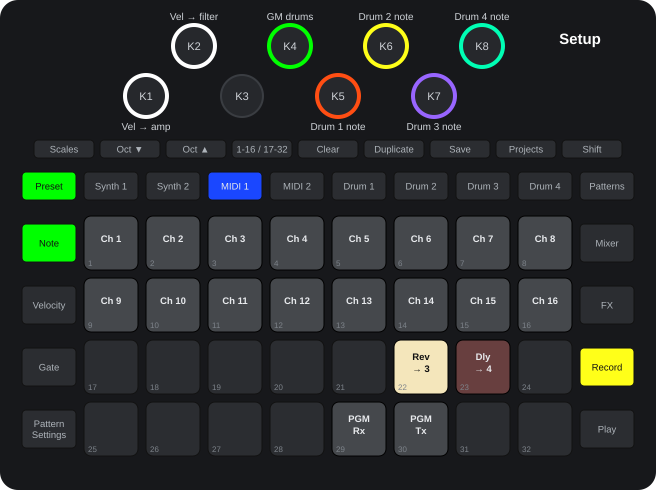

*Setup view (MIDI 1 selected): pads 1-15 = the track's MIDI channel, pad 16 = channel 16 (project and FX); pads 22 / 23 = the reverb / delay return through mixer strip 3 / 4 (cream / peach); pads 29 / 30 = the Program Change listen / output channel (since RC2); Record (yellow) = record the internal routings (since RC2); Note (green) = an external keyboard through the arpeggiator (since RC4); K4 = General MIDI drums (green = on), K5-K8 = the GM note of Drum 1-4 (since RC4). Beta 5.56 only: Preset (green) = knob hold; K1 / K2 = velocity → amplitude / velocity → filter.*


*[Step by step: Send the drums as General MIDI notes (since RC4)](https://github.com/Ghillermo/CIRCUIT-HACKS-RC/wiki/Step-by-step#send-the-drums-as-general-midi-notes-since-rc4)*


*[Step by step: Choose the Program Change channels (since RC2)](https://github.com/Ghillermo/CIRCUIT-HACKS-RC/wiki/Step-by-step#choose-the-program-change-channels-since-rc2)*

### Advanced Setup view

*How to get there:* Open it as on the original. Besides its stock settings (master compressor, etc.):

- **MIDI Thru, Merge and Filter** *(since RC2)* — the Thru jack can merge the incoming MIDI with the unit's own, or filter it.
- **Velocity curve** *(since RC4)* — K1 makes the pads more sensitive or harder.

→ [Full details in the guide](https://ghillermo.github.io/CIRCUIT-HACKS-RC/beta/guide.html#advanced-setup)

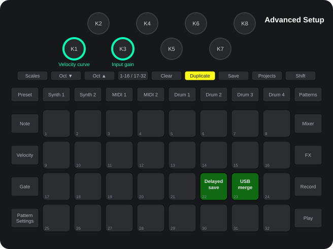

*Advanced Setup: Duplicate = the MIDI Thru jack's mode (since RC2): Thru (dim red) → Out 2 (green) → Merge (yellow) → Filter (blue); pad 22 = delayed save (since RC4.05) and pad 23 = USB merge (since RC4), green on / dim off; K1 = the pads' velocity curve (since RC4, in the RCs); K3 = the external inputs' gain (Beta 5.56 only). Its stock settings work as on the original.*


*[Step by step: Choose the MIDI Thru jack's mode (since RC2)](https://github.com/Ghillermo/CIRCUIT-HACKS-RC/wiki/Step-by-step#choose-the-midi-thru-jacks-mode-since-rc2)*


*[Step by step: Save while playing without a stumble (since RC4.05)](https://github.com/Ghillermo/CIRCUIT-HACKS-RC/wiki/Step-by-step#save-while-playing-without-a-stumble-since-rc405)*

## Stock synths (Synth 1 / 2)

### Synth 1 / 2 track view (Note, Velocity, Gate)

*How to get there:* Press **Synth 1** or **Synth 2**. The pads play the synth as always.

- **Source view** — the synth can process an audio input instead of its noise.
- **Split keyboard** *(since RC2)* — one synth on top and the other below, each with its scale, octave and velocity; *(since RC2.02)* with any pair of note tracks.

→ [Full details in the guide](https://ghillermo.github.io/CIRCUIT-HACKS-RC/beta/guide.html#synth-nota)

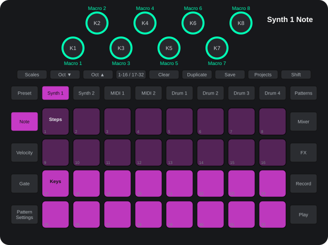

*Synth 1's Note view: pads 1-16 = the steps, 17-32 = the keyboard (as on the original). Synth 1 again = its source view; Synth 1 held + Synth 2 = the split keyboard (since RC2); Shift + a key = latch it (since RC4); Clear + Synth 1 = the macros back to the loaded patch's (since RC2). Beta 5.56 only: Record held + a step = a snapshot of the moved macros into that step (yellow while held); Shift + Preset = the project's sound back.*

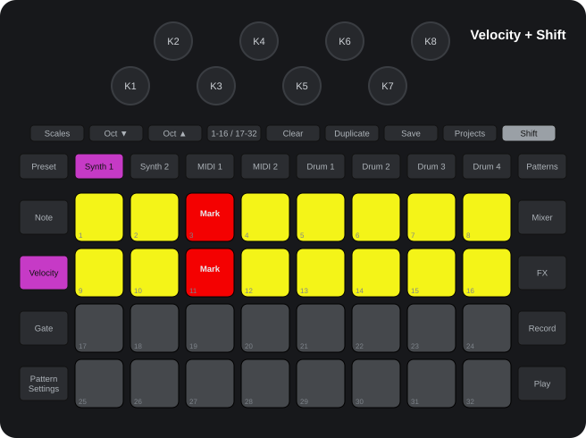

*Velocity view with Shift held (since RC4): the step pads light yellow; Shift + a step marks it (red): there the automation lets go and the parameters go back to the project's values (again = unmark). Beta 5.56 only: only the steps with automation are yellow; Shift + a yellow step = its values on the knobs until Shift is let go; a yellow step held + another = a straight sweep between them; Clear + a step erases its knob automation.*

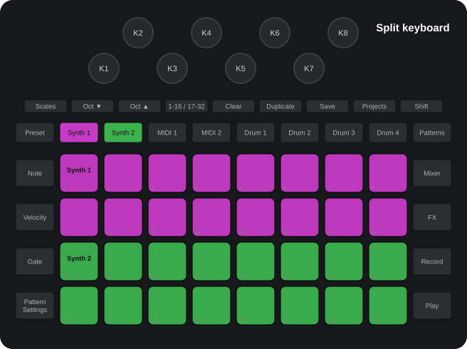

*Split keyboard (since RC2): hold Synth 1 and press Synth 2 (since RC2.02 any pair of Synth 1, Synth 2, MIDI 1 and MIDI 2): the top two rows play the track held first, the bottom two the other, each with its scale, octave and velocity. Since RC4, holding a track button gives the knobs to that track; a short tap or a view button closes it.*

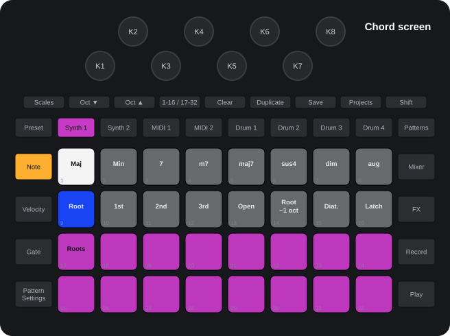

*Chord screen (since RC4; the expanded Note view, Shift + pad 8): row 1 = the chord type (Shift + pads 1-7: sus2, 6, m6, add9, 9, 7sus4, fifth); pads 9-12 = the inversion (blue); 13 = open voicing, 14 = the root an octave down, 15 = diatonic (the project's scale), 16 = chord latch (Beta 5.56 only: inverse chord), green on; rows 3-4 = the roots: hold one to play its chord. Shift + a root latches the whole chord.*


*[Step by step: Split the keyboard between two tracks (since RC2)](https://github.com/Ghillermo/CIRCUIT-HACKS-RC/wiki/Step-by-step#split-the-keyboard-between-two-tracks-since-rc2)*


*[Step by step: Latch notes and write them into a step (since RC4)](https://github.com/Ghillermo/CIRCUIT-HACKS-RC/wiki/Step-by-step#latch-notes-and-write-them-into-a-step-since-rc4)*


*[Step by step: Play chords from one pad (since RC4)](https://github.com/Ghillermo/CIRCUIT-HACKS-RC/wiki/Step-by-step#play-chords-from-one-pad-since-rc4)*


*[Step by step: Make a step let go of the automation (since RC4)](https://github.com/Ghillermo/CIRCUIT-HACKS-RC/wiki/Step-by-step#make-a-step-let-go-of-the-automation-since-rc4)*

### Scales view and custom scale

*How to get there:* Press **Scales** as always (root and stock scale); **Shift + Scales** for the custom scale.

- **Custom scale** *(since RC2)* — up to 7 notes over the root and a free period (for example, a scale that repeats every 7 semitones). The note tracks' pads, the quantising and random-mutate use it; saved with the project.

→ [Full details in the guide](https://ghillermo.github.io/CIRCUIT-HACKS-RC/beta/guide.html#escalas)

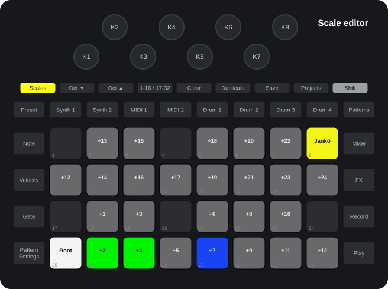

*Custom scale editor (since RC2; Shift + Scales, since RC4 also Scales twice), here with Shift held: rows 4 / 3 = the white / black keys of the first octave from the root, rows 2 / 1 = the second octave. A key pressed is a note of the scale (green, up to 7); the highest one is the period (blue), the root of the next iteration; the root white, free keys dim. This one repeats every 7 semitones: root, +2, +4, period +7. Shift + pad 8 = Jankó (since RC4; teal while on).*

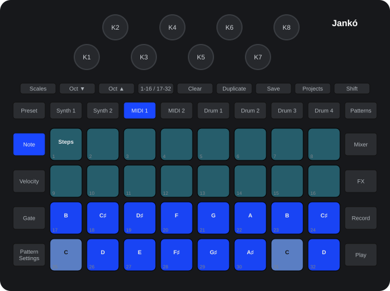

*Jankó layout (since RC4; Shift + pad 8 in the editor) on MIDI 1 with root C, Note view: every column goes up a whole tone and the upper row of each pair is a semitone lower, so every chord has the same shape in any key; the root pads in the root colour. Octave: a tap = a semitone, held = an octave.*


*[Step by step: Make a custom scale (since RC2)](https://github.com/Ghillermo/CIRCUIT-HACKS-RC/wiki/Step-by-step#make-a-custom-scale-since-rc2)*


*[Step by step: Switch on the Jankó layout (since RC4)](https://github.com/Ghillermo/CIRCUIT-HACKS-RC/wiki/Step-by-step#switch-on-the-jankó-layout-since-rc4)*

### Synth source view

*How to get there:* With the Synth 1 / 2 view on screen, **press its button again** (*since RC4*: or **Shift + Synth 1 / 2** from any view). Any button closes it.

- **Noise source** — replaces the patch's noise with audio input 1 or 2 (normal or inverted): the synth's filter, envelopes and effects process your outside signal in time with the notes.
- **Macro destinations** *(since RC2)* — decide what each macro knob moves (up to 4 destinations a macro, with their range and depth) without Components.
- **The synth's step-drummer** — sequences the macros by pairs of steps: each knob sets a macro's position on two steps of the pattern.

→ [Full details in the guide](https://ghillermo.github.io/CIRCUIT-HACKS-RC/beta/guide.html#synth-fuente)

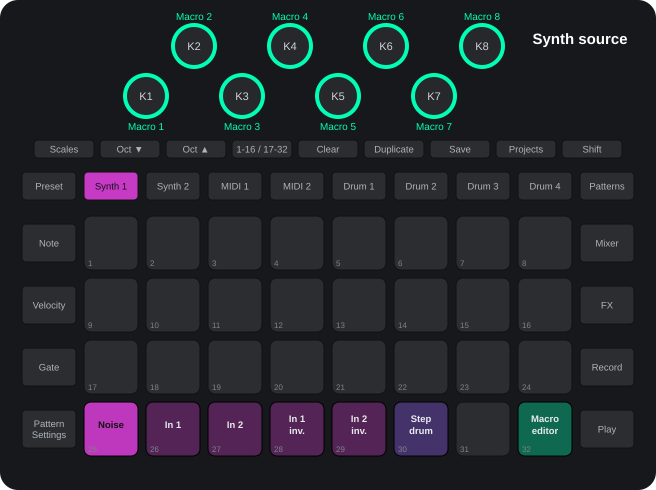

*Synth source view (Synth 1 / 2 pressed again; since RC4 also Shift + Synth 1 / 2): pads 25-29 = the source of the synth's noise (noise; audio input 1 / 2; input 1 / 2 phase-inverted), the chosen one bright — the patch needs some noise level; pad 30 = the synth's step-drummer; pad 32 = the macro destination editor (since RC2): a knob picks its macro, Octave ▼ / ▲ = the field (slot, start, end, destination, depth), the pads draw its number. Any other button closes the view.*


*[Step by step: Edit the macro knobs' destinations (since RC2)](https://github.com/Ghillermo/CIRCUIT-HACKS-RC/wiki/Step-by-step#edit-the-macro-knobs-destinations-since-rc2)*

### Synth 1 / 2 Preset view

*How to get there:* Press **Preset** with Synth 1 / 2 selected. The pads pick a patch as always (4 pages, the pack's 128 patches).

- **Patches by category** *(Beta 5.64 only)* — each patch in the colour of its Components category; the category is picked when saving.
- **Patch morph** *(Beta 5.64 only)* — hold several patches and move between them with a knob, LFOs and an envelope.
- **Save the patch** *(since RC2)* — stores the sound as you left it into the pack (the original only saves patches from Components).
- **Swap and copy** — reorder the pack's patches or take one to another pack.

→ [Full details in the guide](https://ghillermo.github.io/CIRCUIT-HACKS-RC/beta/guide.html#synth-preset)

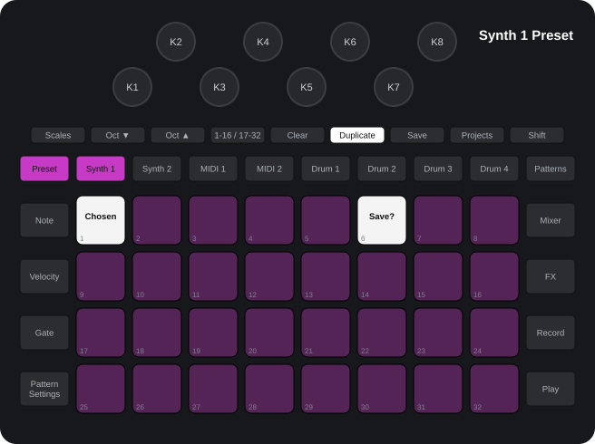

*Synth 1's Preset view (since RC4.10 the original's colours: the patches in the track colour, the chosen one white): Clear + pad, then Clear + the same pad within 5 s = save the patch as it sounds into that slot (it blinks white while asking; since RC2); Duplicate + pad A + pad B = swap two patches; Duplicate + A, another pack, Duplicate + B = copy A there. Not in the internal memory's pack.*

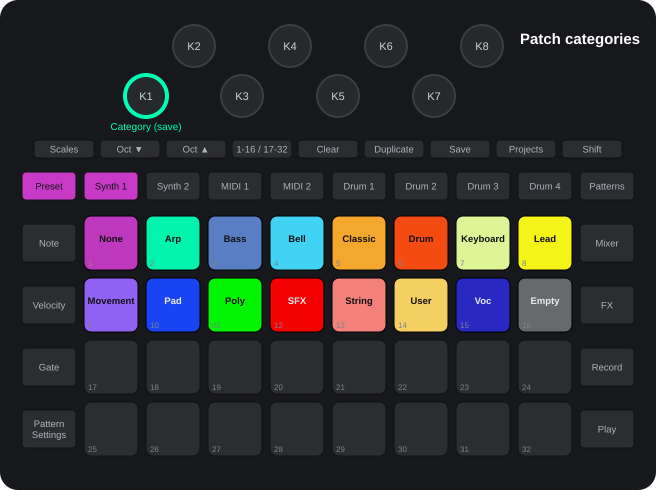

*Beta 5.56 only: each patch in the colour of its Components category (here one of each; pad 1 = None, the track colour; pad 16 = an empty slot, dim white; the chosen one white). While a save asks (Clear + pad), K1 picks the category to save, in its colour.*

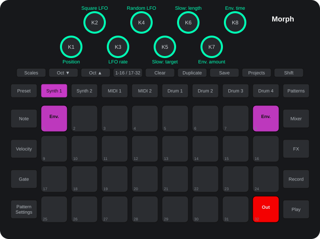

*Beta 5.56 only: the morph view (hold two to four patches for 0.4 s): K1 = the position along the chain (red, yellow, green, blue = patches 1-4); K2 = square LFO, K3 = both LFOs' rate, K4 = random-step LFO; K5 / K6 = the slow morph's destination / length; K7 / K8 = envelope amount / time. Pads 1 / 8 = the envelope (held = sustained); pad 32 (red) = out; Preset = the patches; Clear + knob = 0.*


*[Step by step: Save a Synth 1 / 2 patch (since RC2)](https://github.com/Ghillermo/CIRCUIT-HACKS-RC/wiki/Step-by-step#save-a-synth-1--2-patch-since-rc2)*


*[Step by step: Swap two Synth 1 / 2 patches](https://github.com/Ghillermo/CIRCUIT-HACKS-RC/wiki/Step-by-step#swap-two-synth-1--2-patches)*


*[Step by step: Copy a Synth 1 / 2 patch to another pack](https://github.com/Ghillermo/CIRCUIT-HACKS-RC/wiki/Step-by-step#copy-a-synth-1--2-patch-to-another-pack)*


*[Step by step: Morph between patches (Beta 5.56 only)](https://github.com/Ghillermo/CIRCUIT-HACKS-RC/wiki/Step-by-step#morph-between-patches-beta-556-only)*

## MIDI tracks (MIDI 1 / 2)

### MIDI 1 / 2 Preset view

*How to get there:* Press **MIDI 1** or **MIDI 2**, then **Preset** (*since RC4*: or **MIDI 1 / MIDI 2 again** with its Note view on the screen, or **Shift + MIDI 1 / 2**). Besides the stock templates, the track's own synth lives here.

- **A synth on each MIDI track** — MIDI 1 and 2 sound on the unit itself with their engine (processed line input, oscillator, two oscillators, VA-drum, granular, sample mode; *(since RC4)* FM) and still send MIDI.
- **FX sequencer** — an engine with no sound: it triggers Master FX effects on the steps you choose.
- **Own-synth patches** *(since RC2)* — 64 sounds a pack for those engines, one touch away.
- **Mod matrix** *(since RC2.02)* — eight sources (velocity, note, random, LFO 2, envelope 2, a drum hit, the pattern position, stepped random) that move any parameter of the engine.
- **Patch flip** — every note sends a program change: the outside gear changes sound step by step.
- **Jump sequencer** *(Beta 5.64 only)* — the track's notes make another track's pattern jump to the step they indicate.
- **CC editor** — changes which CC each knob of the template sends, without Components.

→ [Full details in the guide](https://ghillermo.github.io/CIRCUIT-HACKS-RC/beta/guide.html#midi-preset)

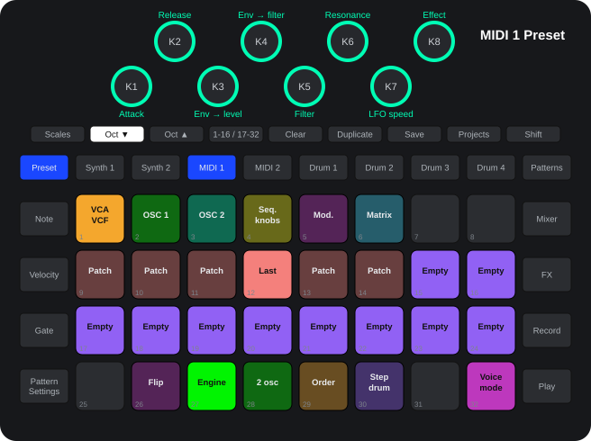

*MIDI 1's Preset view with the oscillator engine, in the RCs: pads 1-5 = the engine's knob pages (1 VCA-VCF, 2 OSC 1, 3 OSC 2, 4 sequenceable knobs — Shift + 4 non-sequenceable —, 5 modulation; held ½ s = only while held), 6 = the mod matrix; 9-24 = own-synth patches (dim peach = saved, bright = the last used, violet = empty; Octave = 8 pages; a tap loads, Clear + pad twice saves); 26 = patch flip; 27 = the engine (a tap opens the engine row); 28 = one / two oscillators; 29 = chain order; 30 = step-drummer; 32 = voice mode. Pad 31 lights with the VA-drum (velocity → its envelopes).*

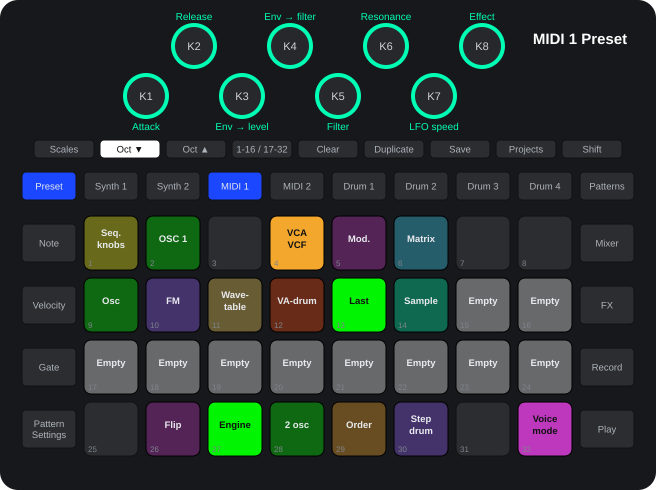

*Beta 5.56 only, the same view: pad 1 = sequenceable knobs (Shift + 1 = non-sequenceable) and pad 4 = filter / VCA swap places; the patches show their engine's colour (empty = dim white; Duplicate + an empty slot saves there); pad 3 lights with two oscillators; pad 26 opens the flip view; with «no voice» pad 31 = the FX sequencer; filter → VCA → FX is the default order (pad 29).*

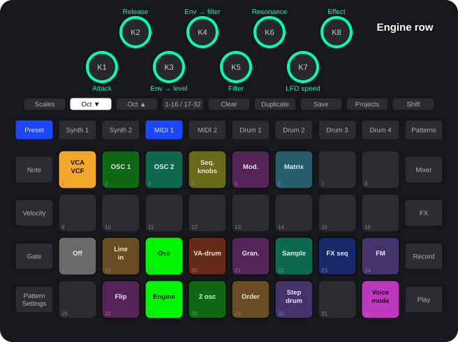

*The engine row in the RCs (since RC4; a tap on pad 27): pads 17-24 = off, line input, oscillator, VA-drum, granular, sample, FX sequencer and FM, the current one bright; a tap picks one, pad 27 again closes the row (meanwhile pads 9-24 load no patches). Shift + pad 27 steps to the next engine.*

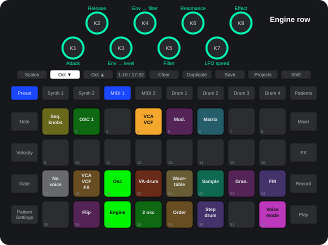

*Beta 5.56 only, the engine row: no voice, VCA / VCF / FX only (the line input), oscillator, VA-drum, wavetable (sand), sample, granular and FM; the FX sequencer is pad 31 once «no voice» is chosen (dim blue; a tap turns it on).*

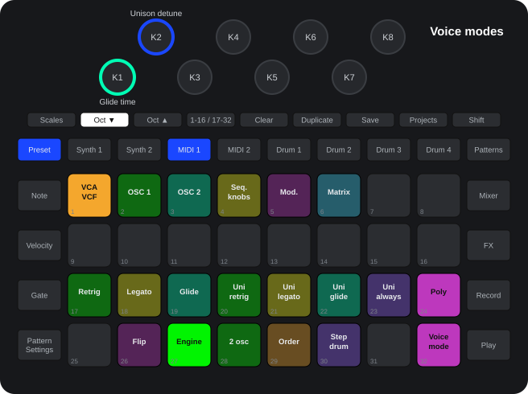

*Voice modes (since RC4; a tap on pad 32 with the engine on): pads 17-24 = retrigger, legato, glide, uni retrig, uni legato, uni glide, uni always-glide and poly (modes with the same name share a colour; the current one bright); K1 = the glide's time (teal), K2 = the unison's detune (blue). Saved with the patch and the project.*

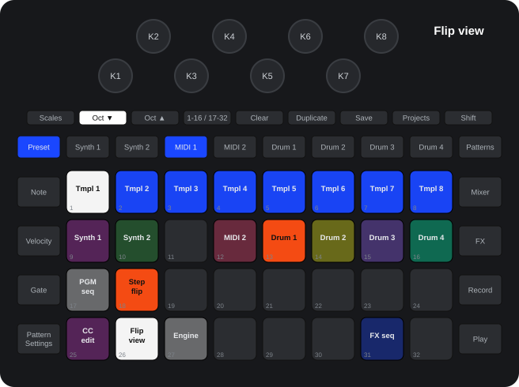

*Beta 5.56 only: the flip view (pad 26, white while open), MIDI 1 pointing at Drum 1: row 3 = the mode, pad 17 patch flip (PGM seq) or pad 18 step flip (in the target's colour; the one on bright, a tap on it turns it off); row 2 = the eight tracks in their colours, the target bright, the track itself dark. While pointing, each note of the track makes Drum 1 jump to the note's step, and the engine is off (pad 27 grey; pads 1-8 = the stock templates).*


*[Step by step: Load, save and swap own-synth patches (since RC2)](https://github.com/Ghillermo/CIRCUIT-HACKS-RC/wiki/Step-by-step#load-save-and-swap-own-synth-patches-since-rc2)*


*[Step by step: Copy an own-synth patch to another pack (since RC2)](https://github.com/Ghillermo/CIRCUIT-HACKS-RC/wiki/Step-by-step#copy-an-own-synth-patch-to-another-pack-since-rc2)*


*[Step by step: Choose an engine on the engine row (since RC4)](https://github.com/Ghillermo/CIRCUIT-HACKS-RC/wiki/Step-by-step#choose-an-engine-on-the-engine-row-since-rc4)*


*[Step by step: Choose the own synth's voice mode (since RC4)](https://github.com/Ghillermo/CIRCUIT-HACKS-RC/wiki/Step-by-step#choose-the-own-synths-voice-mode-since-rc4)*

### Own-synth voices: polyphony and the voice limiter

*How to get there:* With the MIDI 1 / 2 own synth on, **pad 32** of its [Preset view](https://ghillermo.github.io/CIRCUIT-HACKS-RC/beta/guide.html#midi-preset) picks the voice mode *(since RC4)*. With diagrams and every table of engines, knobs, saving and MIDI: [MIDI tracks and voice modes](https://ghillermo.github.io/CIRCUIT-HACKS-RC/voices.html). Here: how many voices each mode and engine gives, how chords sound and what the device does when the DSP is short of time.

→ [Full details in the guide](https://ghillermo.github.io/CIRCUIT-HACKS-RC/beta/guide.html#midi-voces)

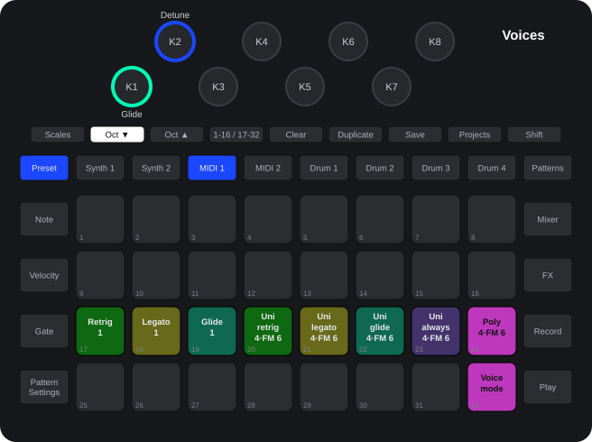

*A simpler map (this chapter is mostly tables): the voice modes of pad 32 with how many voices each gives a track — 1 in retrigger, legato and glide; 4 in the unison modes and poly (FM: 6, or 3 each with MIDI 1 and MIDI 2 both in FM; the sample mode's unison: 1; the granular: always 1). Each voice is turned down by how many sound, so chords do not clip; when the DSP is short of time, the voice limiter switches off the quietest one ringing out.*

### Knob pages of the MIDI 1 / 2 engine

*How to get there:* With the engine on, pads 1-5 of the Preset view pick what the 8 knobs do; Shift gives a second layer.

- **VCA-VCF** — level and filter with their envelope and LFO; with Shift, the filter type and the effect type.
- **Oscillators** — a waveform that morphs from sine to square, and a second oscillator with FM, ring and sync.
- **Granular** — turns a sample into textures: grains that read it at another place, speed or direction, to freeze, stretch or slice it.
- **Page 4, sequenceable knobs** — the 8 parameters that can be recorded as automation (*(since RC4)*: with Shift + knob, any of the 33; Record + step = a snapshot of the values).
- *(since RC4)* **Shift + pad 4, non-sequenceable knobs** — 8 knobs with an assignable destination that are not recorded.

→ [Full details in the guide](https://ghillermo.github.io/CIRCUIT-HACKS-RC/beta/guide.html#midi-knobs)

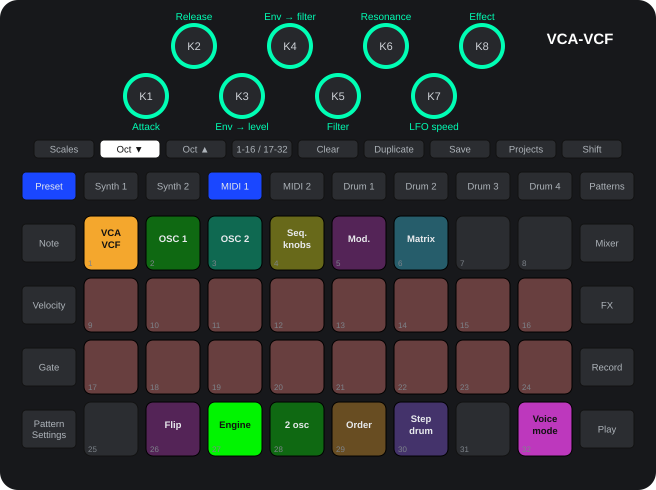

*Page 1, VCA-VCF (pad 1 in the RCs; pad 4 in Beta 5.56): K1 attack, K2 release, K3 / K4 envelope → level / → filter, K5 filter, K6 resonance, K7 LFO speed (bipolar since RC4: right free, left synced to the tempo), K8 effect amount.*

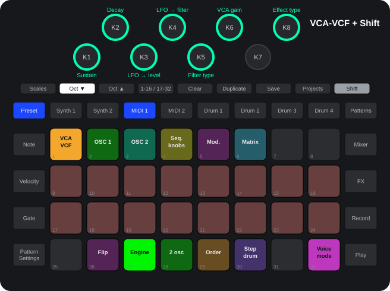

*Page 1 with Shift: K1 sustain, K2 decay, K3 / K4 LFO → level / → filter, K5 filter type (DJ, LP 12, HP 12, BP, notch, LP 24, HP 24), K6 VCA gain (up to +18 dB with saturation), K8 effect type (soft, hard, fold, wavefold, ring, comb, chorus). Type knobs show the type as a colour and the position within it as brightness.*

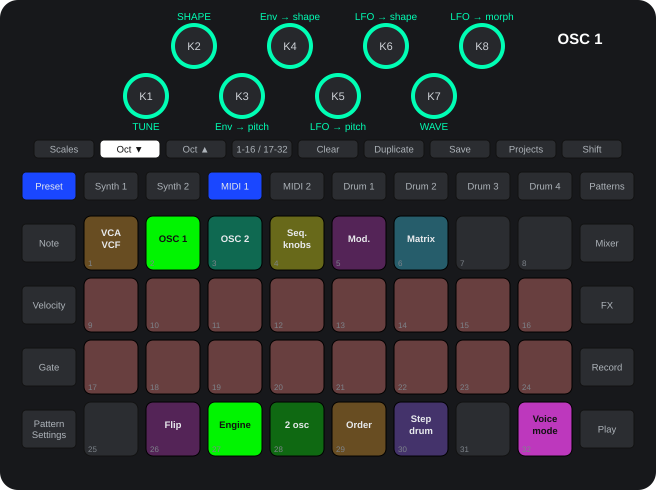

*Page 2, OSC 1 (oscillator and VA-drum), in the RCs: K1 TUNE, K2 SHAPE, K3 / K4 envelope → pitch / → shape, K5 / K6 LFO → pitch / → shape, K7 WAVE (the morph sine → triangle → saw → square; since RC4 in the sample mode, the stereo width), K8 LFO → morph. With Shift: K1 FINE, K2 MIX OSC 1 ↔ OSC 2, K3 BITSYNC, K8 envelope → morph.*

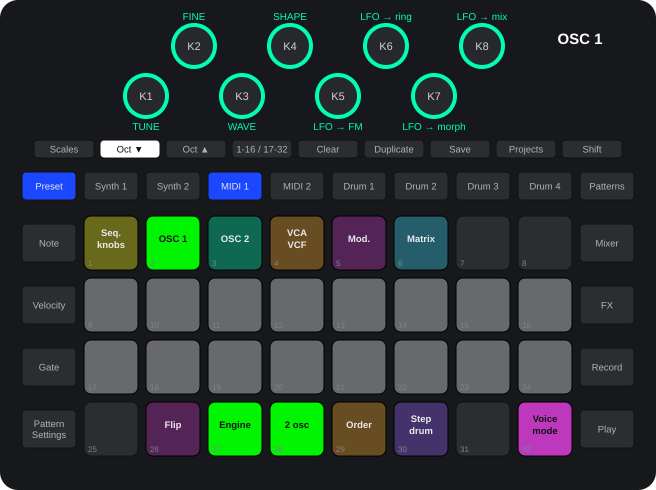

*Beta 5.56 only, page 2 with the oscillator, the VA-drum and the wavetable: K1 TUNE, K2 FINE, K3 WAVE (the wavetable's position; the sample mode's stereo width), K4 SHAPE (the wavetable's warp), K5 / K6 / K8 = LFO → FM / → ring / → mix (centre = none), K7 LFO → morph. With a single oscillator K5 = the sub-oscillator's level, K6 = the noise level, K8 = LFO → sub.*

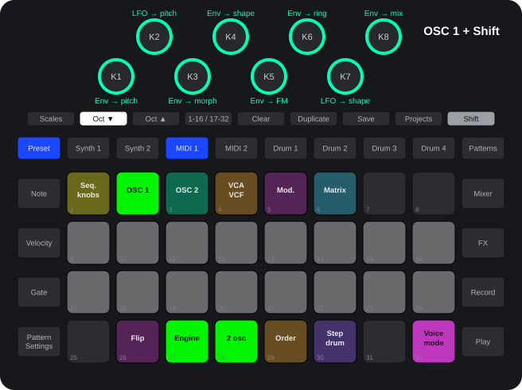

*Beta 5.56 only, page 2 with Shift: K1 / K2 envelope / LFO → pitch, K3 envelope → morph, K4 envelope → shape, K5 / K6 / K8 envelope → FM / → ring / → mix, K7 LFO → shape. With a single oscillator: Shift + K5 / K6 = envelope → sub / → noise, Shift + K8 = LFO → noise.*

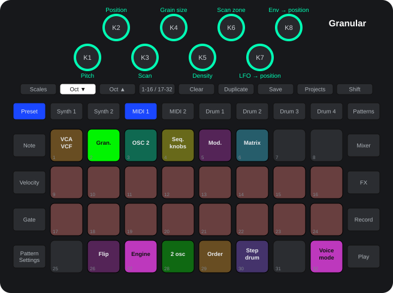

*Page 2 with the granular engine (pad 27 magenta): K1 pitch ±24 st, K2 position in the sample, K3 scan (centre = frozen), K4 grain size 5-500 ms, K5 density 1-16 grains, K6 scan zone, K7 LFO → position, K8 envelope → position.*

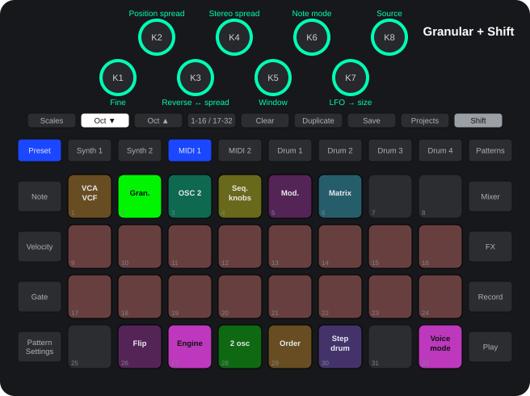

*The granular page with Shift: K1 fine ±1 st, K2 position spread, K3 reverse grains (left) / pitch spread (right; bipolar since RC4), K4 stereo spread (since RC4), K5 window, K6 note mode (pitch / slicer / stretch), K7 LFO → size, K8 the source: the capture or a drum's sample (since RC2).*

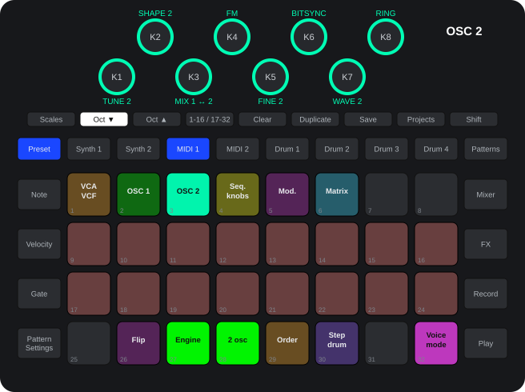

*Page 3, OSC 2, in the RCs (since RC2 the eight values without Shift): K1 TUNE 2, K2 SHAPE 2, K3 MIX OSC 1 ↔ OSC 2, K4 FM, K5 FINE 2, K6 BITSYNC (sync and the bitwise modes), K7 WAVE 2, K8 RING.*

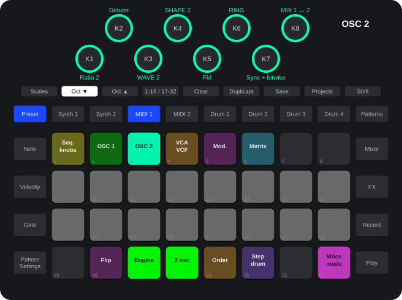

*Beta 5.56 only, page 3 with the oscillator, the VA-drum and the wavetable: K1 = OSC 2's ratio to its note (centre = 1), K2 detune (±50 cents), K3 WAVE 2, K4 SHAPE 2, K5 FM (centre = none; right OSC 2 → OSC 1, left the other way), K6 RING, K7 sync + bitwise, K8 MIX OSC 1 ↔ OSC 2.*

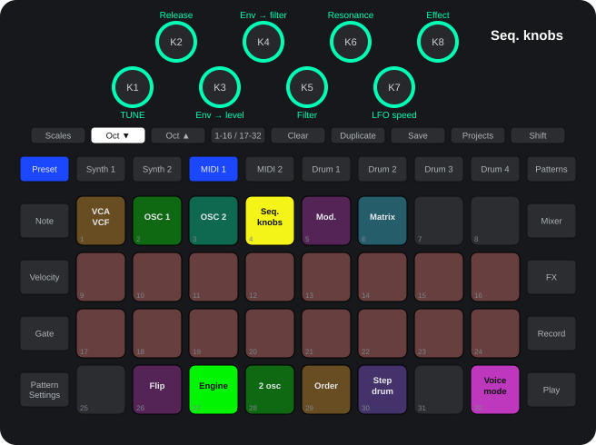

*Page 4, sequenceable knobs (pad 4 in the RCs; pad 1 in Beta 5.56): the eight values recorded as automation with Record + Play, by default TUNE, release, envelope → level, envelope → filter, filter, resonance, LFO speed and effect. Since RC4, Shift + knob = that knob's destination (any of the 33 parameters, in its page's colour; Clear held, then Shift + knob = the factory one); Record held + a step = a snapshot of the values into that step.*

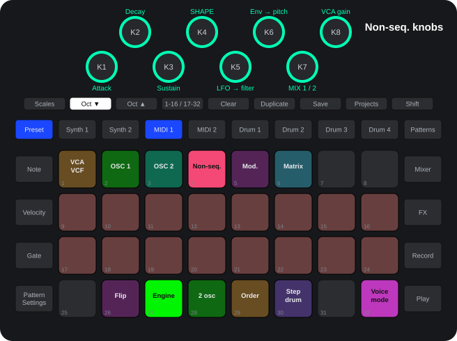

*Non-sequenceable knobs (since RC4; Shift + pad 4 in the RCs, Shift + pad 1 in Beta 5.56; pad 4 pink while they are on the knobs): eight knobs with an assignable destination that are not recorded, by default attack, decay, sustain, SHAPE, LFO → filter, envelope → pitch, MIX OSC 1 / 2 and VCA gain; Shift + knob = the destination, as on the sequenceable page.*

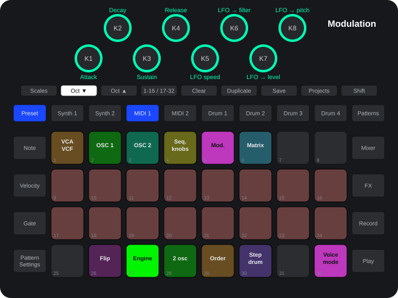

*Page 5, modulation: K1-K4 = the envelope's attack, decay, sustain and release; K5-K8 = LFO speed, LFO → filter, LFO → level and LFO → pitch. Shift + K8 = the LFO's shape (since RC2): reverse saw (blue), saw (magenta), triangle (green, the default since RC2.02), square (red), sine (teal), sample & hold (white), slewed sample & hold (violet).*

*[Step by step: Snapshot the sound into a step (since RC4)](https://github.com/Ghillermo/CIRCUIT-HACKS-RC/wiki/Step-by-step#snapshot-the-sound-into-a-step-since-rc4)*

### Mod matrix

*How to get there:* *(since RC2.02)* MIDI 1 / 2 with the engine on: Preset view, **pad 6**. The 8 knobs become 8 modulation sources.

→ [Full details in the guide](https://ghillermo.github.io/CIRCUIT-HACKS-RC/beta/guide.html#midi-matriz)

*Mod matrix (since RC2.02; pad 6, light blue): the eight knobs are sources — K1 velocity, K2 the note, K3 random (a new value each note), K4 LFO 2, K5 envelope 2, K6 a drum hit, K7 the pattern position, K8 stepped random. Each knob's position is its destination and amount: fully left = off; turning right walks the engine's 33 parameters, one stretch each, the amount growing inside it; the LED in the destination page's colour, brighter = more. Clear + knob = off; Clear + pad 6 = all off.*

*The matrix with Shift: K4 = LFO 2's shape × rate (triangle green, saw magenta, square red, sample & hold white, slewed violet; since RC4 the left half of each one synced to the tempo), K5 = envelope 2's attack × decay, K6 = which drum (Drum 1-4: orange, yellow, violet, teal) × its decay, K8 = every how many steps (1, 2, 4, 8, 16). Clear + Shift + knob = its parameter back to the default.*

*While a source turns (and 1.5 s after) the pads show where its destination lives — here K1 (velocity) → the filter: page 1's pad bright, pads 9-16 = that page's K1-K8 and 17-24 = its Shift + K1-K8 (dim = has a parameter, bright = the destination); K1's LED in the page's colour (amber), brighter = more. Meanwhile pads 9-24 load no patches.*

*[Step by step: Send a mod matrix source to a destination (since RC2.02)](https://github.com/Ghillermo/CIRCUIT-HACKS-RC/wiki/Step-by-step#send-a-mod-matrix-source-to-a-destination-since-rc202)*

### 4-operator FM

*How to get there:* *(since RC4)* MIDI 1 / 2: Preset view, a tap on **pad 27** and **pad 24** of the engine row (violet). **Pad 7** opens its knob page (bright violet on it).

→ [Full details in the guide](https://ghillermo.github.io/CIRCUIT-HACKS-RC/beta/guide.html#midi-fm)

*4-operator FM (since RC4, in the RCs; pad 24 of the engine row, violet; pad 7 = its page): K1-K4 = the ratios of operators 1-4 (green whole, light blue and a half, teal inharmonic; the clicks after each exact ratio detune it), K5-K8 = their levels (a carrier's loudness, how much a modulator modulates). Pad 7 held = the 16 algorithms, pad 8 held = 16 starter sounds; Clear + pad 7 = a playable voice of the algorithm.*

*4-operator FM with Shift: K1-K4 = each operator's envelope: centre = attack 0, right = its attack (light blue), left = percussive with its own decay (red); K5 = the algorithm (16, in its family's colour), K6 = feedback (magenta), K7 = noise (white), K8 = release (amber; longer the harder the note).*

*Pad 7 held: the 16 algorithms on pads 9-24, in their family's colour (classic white, percussive red, bells teal, strings green), the current one bright; press one = chosen, and the tonic sounds while held (Shift + pad: silent). Letting go of pad 7 brings the patches back.*

*Pad 8 held (since RC4): 16 starter instruments in their family's colour — keys white, plucked violet, bass amber, bell teal, strings and pad green, winds light blue, drums orange; press one = it loads whole (algorithm, ratios, levels, envelopes) and the tonic sounds; the one matching the track bright.*

*[Step by step: Pick an FM algorithm from the pads (since RC4)](https://github.com/Ghillermo/CIRCUIT-HACKS-RC/wiki/Step-by-step#pick-an-fm-algorithm-from-the-pads-since-rc4)*

*[Step by step: Load an FM starter sound (since RC4)](https://github.com/Ghillermo/CIRCUIT-HACKS-RC/wiki/Step-by-step#load-an-fm-starter-sound-since-rc4)*

### 8-operator FM

*How to get there:* *(Beta 5.64 only)* MIDI 1 / 2: Preset view, a tap on **pad 27** and **pad 24** of the engine row (violet); close the row (pad 27) and **pad 7** opens its page.

→ [Full details in the guide](https://ghillermo.github.io/CIRCUIT-HACKS-RC/beta/guide.html#midi-fm8)

*Beta 5.56 only: the 8-operator FM page (pad 7 with the engine row closed): pads 9-16 = operators 1-8 (carriers green, modulators light blue, the picked one bright; here the four-operator stack), pad 3 = the pitch envelope, pads 17-24 = the engine row; K1 ratio, K2 fine, K3 output level, K4 velocity sensitivity, K5-K8 the envelope's rates R1-R4. Pad 7 = the algorithm map, Shift + pad 7 held = the 56 algorithms, pad 8 held = the instruments.*

*Beta 5.56 only, the FM page with Shift: K1 = the algorithm (56, for the whole engine; the pads show them for 1.5 s), K2 = feedback, K3 = rate scaling (higher notes faster), K4 = level scaling (centre = none), K5-K8 = the envelope's levels L1-L4. The envelope rises at R1 to L1, R2 to L2, R3 to L3, stays at L3 while the note is held and on release goes at R4 to L4.*

*Beta 5.56 only, the pitch envelope (pad 3, violet, bright while edited — like a ninth operator): K1 transpose (24 = none), K3 noise, K4 the noise's operator, K5-K8 rates R1-R4; with Shift K1 / K2 = algorithm / feedback and K5-K8 = levels L1-L4 (50 = no shift).*

*Beta 5.56 only: the algorithm map (a tap on pad 7), here of the Tubular Bell instrument (the DX7's algorithm 5): each row reads left to right — a wave modulates the one on its right and the last on the right is a carrier, the one you hear; a dark gap = no interaction. Colour = the ratio (green whole, teal x.5, orange other, red fixed), violet = the feedback operator; dim = level under half. A tap picks an operator, Shift + operator mutes it, one held + a tap on another = link or unlink them (an own algorithm).*

*Beta 5.56 only, pad 8 held: 24 instruments in their type's colour (keys orange, basses blue, leads and brass red, pads and strings green, plucks yellow, percussion white, bells and fx violet), the loaded one bright; press one = loaded, and it sounds. Loading one also sets page 4 and Shift + pad 4 to the knobs that suit its family.*

*Beta 5.56 only, pad 8 held + Octave ▼ = the second page: pianos orange, strings green (Pizzicato yellow), winds teal and four long sounds; Octave ▲ goes back.*

### CC editor of the MIDI macros (pad 25)

*How to get there:* MIDI 1 / 2 Preset view, **pad 25**: change on the device which CC / NRPN each macro knob of the template sends.

- **Control other gear** — pick the CC (or NRPN) number and the range of each knob of the template, and save it there.

→ [Full details in the guide](https://ghillermo.github.io/CIRCUIT-HACKS-RC/beta/guide.html#midi-cc)

*CC editor of the MIDI macros (pad 25, magenta; shown with the track's engine off, pad 27 grey): move a knob to pick it (its number is drawn on the pads); Octave ▼ / ▲ = next / previous field (number, start, end; for an NRPN also MSB and LSB); turn the knob to change the field; pad 26 (or Octave ▼ up to the save step, when pad 26 and Save blink) saves and goes back to the Preset view; pad 25, a template pad or a view button discards.*

*[Step by step: Change the CC a MIDI macro knob sends](https://github.com/Ghillermo/CIRCUIT-HACKS-RC/wiki/Step-by-step#change-the-cc-a-midi-macro-knob-sends)*

### Step-drummer view

*How to get there:* MIDI 1 / 2: Preset view with the engine on, **pad 30** (*since RC4*: with the step-drummer on, **Note** goes Note → expanded Note → step-drummer). Synth 1 / 2: source view, **pad 30**. Sequencing by step pairs over the pattern.

- **Parameters by pairs of steps** — the 8 knobs are 8 pairs of steps of the pattern: each one moves a destination (pitch, shape, FM, filter…) on those steps only, for melodies, accents or timbre changes without drawing automation.
- **The LED tells how much** *(since RC2)* — dim with no modulation, brighter the further it goes.
- **A second page with its own destination** *(since RC2)* — the velocity page moves another destination at the same time.
- **Pitch-vel toggle** *(since RC2)* — page 1 transposes the notes in degrees of the scale and page 2 sets their velocity: a melody from a single pattern of notes.
- **In real time** — with Record, touching a step records it.
- **FX sequencer** — with that engine, each pair picks which Master FX slot sounds.

→ [Full details in the guide](https://ghillermo.github.io/CIRCUIT-HACKS-RC/beta/guide.html#step-drummer)

*Step-drummer of MIDI 1 (pad 30 of the Preset view, violet), pitch page: pads 1-16 = the steps by pairs (alternating colours; bright = has a note, white = playing; Shift + pad = set / clear a note), pads 17-24 = the pitch row's destination (pitch, OSC 2, WAVE, FM, MIX, envelope → filter, SHAPE, decay), K1-K8 = the 8 step pairs (centre = no change; since RC2 brighter = further from it). Octave ▲ / ▼ = pitch / velocity page; 1-16 / 17-32 = the other half; pad 32 = the pitch-vel toggle (since RC2). With Record, touching a step records it.*

*With the FX sequencer engine (pad 27 blue), each knob picks the Master FX bottom-row slot its pair of steps triggers: none, pads 26-30, pad 31 (the gesture) and random (white, since RC2); it moves slowly and its LED shows the effect's colour. A slot with no effect plays the effect at the top of its column (since RC4); the track sends its MIDI as always.*

*[Step by step: Sequence a destination with the step-drummer](https://github.com/Ghillermo/CIRCUIT-HACKS-RC/wiki/Step-by-step#sequence-a-destination-with-the-step-drummer)*

### Sample mode and sample picker

*How to get there:* *(since RC2)* MIDI 1 / 2 with the engine on **sample** (pad 27 teal, after the granular): **Note twice** (expanded Note view). The track plays a pack sample one-shot, at the pitch of each note.

- **Pitched drums on a MIDI track** — any pack sample plays at the pitch of each note, like a drum machine with tunable samples.
- **A different sample per step** — the sample flip changes sample step by step with no other track; it can be recorded live too.

→ [Full details in the guide](https://ghillermo.github.io/CIRCUIT-HACKS-RC/beta/guide.html#midi-muestra)

*Sample picker (since RC2; MIDI 1 / 2 with the sample engine, Note twice): pads 17-32 = 16 of the pack's 64 samples (Octave = the page; teal = the track's sample, a touch picks it and it sounds; since RC4 Shift + sample = silently, Shift + the chosen one = pick the second, stereo sample); pads 1-16 = the steps: teal = a note, peach = a note with a sample flip, violet = a flip without a note (since RC4), white = playing. Hold a step + touch a sample = its flip; Clear + step = remove it; 1-16 / 17-32 = the other half.*

*[Step by step: Pick samples and flip them by step (since RC2)](https://github.com/Ghillermo/CIRCUIT-HACKS-RC/wiki/Step-by-step#pick-samples-and-flip-them-by-step-since-rc2)*

## Pattern Settings

### Pattern Settings view

*How to get there:* The **Pattern Settings** button with a track selected: first / last step, sync rate and direction as always, plus pads 25-28 and the arpeggiator (Shift).

- **Nudge** — moves the content of the selected steps one step back or forward.
- **Fractal and deconstructed orders** — walk through the pattern another way without changing its notes.
- **Arpeggiator** *(since RC2)* — the pattern's chords (and the ones you play) sound note by note, in their order and resolution; on the drums, jumping from sample to sample.
- **Dynamics and random-mutate** (pad 25) — variations so that the pattern does not always sound the same.

→ [Full details in the guide](https://ghillermo.github.io/CIRCUIT-HACKS-RC/beta/guide.html#pattern-settings)

*Pattern Settings (MIDI 1): pads 1-16 = first / last step, 17-24 = sync rate, 29-32 = direction (as on the original); pad 25 = the probability view in mode 2 (dynamics and random-mutate; Clear + 25 clears them), 26 = Nudge (blue: the selected range's content a step back, Shift + 26 a step forward), 27 / 28 = fractal / deconstructed order (exclusive with 29-32; saved with the pattern).*

*With Shift held (since RC2): Shift + pad 25 = the pattern's arpeggiator on / off (green), Shift + 27-32 = the arpeggio's order (fractal, deconstructed, up, down, ping-pong, random), Shift + 17-24 = its resolution (the chosen ones green). Since RC4, with the arpeggiator on, Shift + pads 1-16 = its modifiers: octaves (sand), when the octave moves (sky blue), groove (amber), reset (pink), the chosen option bright. Shift + pad 26 = Nudge one step forward.*

*[Step by step: Switch the arpeggiator on (since RC2)](https://github.com/Ghillermo/CIRCUIT-HACKS-RC/wiki/Step-by-step#switch-the-arpeggiator-on-since-rc2)*

*[Step by step: Shape the arpeggio with its modifiers (since RC4)](https://github.com/Ghillermo/CIRCUIT-HACKS-RC/wiki/Step-by-step#shape-the-arpeggio-with-its-modifiers-since-rc4)*

*[Step by step: Nudge the steps of a pattern (since RC4.05)](https://github.com/Ghillermo/CIRCUIT-HACKS-RC/wiki/Step-by-step#nudge-the-steps-of-a-pattern-since-rc405)*

### Micro Step view (note tracks)

*How to get there:* Press **Gate twice** with a note track selected (Synth 1 / 2, MIDI 1 / 2).

- **Micro steps and Tie (stock)** — place each note off the grid and tie it to the next step.
- **Gate by holding** *(since RC2)* — when entering notes by hand, how long you hold is how long the note lasts.
- **Fixed length** *(since RC2)* — every note you enter by hand gets the same length.

→ [Full details in the guide](https://ghillermo.github.io/CIRCUIT-HACKS-RC/beta/guide.html#micropasos)

*Micro Step view (Gate twice, note tracks): pads 1-16 = the steps (the chosen one bright), 17-22 = its 6 micro steps, 24 = Tie, 25-30 = the step's notes (as on the original); pad 31 = fixed length (blue = on; with both off it opens a selector, pads 17-32 = 1-16 steps), pad 32 = gate by holding (green = on: how long you hold the pads is the note's gate). Since RC2; with one on, pressing it again turns it off, pressing the other swaps them.*

*[Step by step: Set the gate by holding, or a fixed length (since RC2)](https://github.com/Ghillermo/CIRCUIT-HACKS-RC/wiki/Step-by-step#set-the-gate-by-holding-or-a-fixed-length-since-rc2)*

### Probability view (note tracks and drums)

*How to get there:* **Pattern Settings twice** or **Shift + Pattern Settings** (mode 1), or **pad 25** of Pattern Settings (mode 2). Hold a step with notes and touch a pad of rows 3-4.

- **Probability (stock)** — a step that only plays sometimes.
- **Frequency** *(since RC2)* — a step that plays once every n passes: variations that come back every 2, 4 or 8 passes.
- **Dynamics** *(since RC2)* — small changes of velocity and position: a more human pattern.
- **Random-mutate** *(since RC2)* — notes that jump an octave or to another note of the scale; on the drums, to another sample.

→ [Full details in the guide](https://ghillermo.github.io/CIRCUIT-HACKS-RC/beta/guide.html#probabilidad)

*Probability view, mode 1 (Pattern Settings twice): hold a step (pads 1-16) and touch row 3 = its probability (as on the original) or row 4 = its frequency (since RC2, yellow): the step plays on the last of every n passes (1-8), here 1 of 4. On the drums the same.*

*Mode 2 in the RCs (pad 25 of Pattern Settings): row 3 = dynamics (since RC2, green: random micro-step and velocity changes in 8 levels), row 4 = random-mutate (since RC2, peach: the chance that the step's notes jump an octave or to another note of the scale). With Record and this view on screen, what sounds is written into the pattern. On the drums, row 4's pads 25-28 mutate the sample.*

*Beta 5.56 only, mode 2: one set of pads per step — 17 no note change (white), 18-20 another note of the scale (×1, ×2, ×4; peach), 21 / 22 an octave up (low / high; sand), 23 / 24 an octave up or down (sand), 25 no dynamics (white), 26 ghost, 27 accent staccato, 28 length (green), 32 micro steps (teal). Octave ▼ / ▲ = the track's factor (×0, ×1, ×2, ×4, ×8), which multiplies every chance. On the drums: another sample instead of another note.*

*[Step by step: Let a step's notes mutate (since RC2)](https://github.com/Ghillermo/CIRCUIT-HACKS-RC/wiki/Step-by-step#let-a-steps-notes-mutate-since-rc2)*

*[Step by step: Play a step every n passes (since RC2)](https://github.com/Ghillermo/CIRCUIT-HACKS-RC/wiki/Step-by-step#play-a-step-every-n-passes-since-rc2)*

## Drums

### Drum track view (knobs)

*How to get there:* Press **Drum 1-4**. Every knob does what its label says, with a second layer on Shift.

- **Shape each drum** — exact pitch, ring mod, attack and decay, sample start and cut, a filter with several modes, LFO and several kinds of distortion: many sounds from one sample.
- **All neutral = the original** — with the new knobs at their neutral point, the sample sounds as on the original Circuit.
- **Start over** *(since RC2)* — Clear + the drum's button puts all its knobs back to their defaults.
- **Stereo pair** *(since RC4)* — Drum 1 + Drum 2 (or 3 + 4) play a stereo sample: the left one drives both, the right one only fine-tunes.

→ [Full details in the guide](https://ghillermo.github.io/CIRCUIT-HACKS-RC/beta/guide.html#drum-pista)

*Drum 1's track view, the knobs (as printed on the panel): K1 pitch, K2 ring mod frequency, K3 decay (left) / attack (right; since RC2), K4 envelope → cutoff, K5 filter / EQ (the stock tilt EQ by default), K6 resonance, K7 LFO amount (right tremolo; left, since RC4, start scan), K8 distortion (left of 0: bitcrush). All neutral = the original sound. Clear + Drum 1 = its knobs' automation in the playing pattern erased and all its knobs to their defaults (since RC2). Pads 1-16 = the drum's steps.*

*The drum knobs with Shift: K1 pitch envelope amount, K2 ring mod amount, K3 sample start (left) / cut from the end (right; since RC2), K4 envelope shape, K5 filter mode (the LED's colour: green stock EQ tilt, yellow band pass, magenta notch, teal comb, white DJ; Beta 5.56 skips the comb), K7 LFO speed (bipolar since RC4: right free, left synced), K8 distortion type (stock, soft, hard, fold).*

*Stereo pair (since RC4; hold Drum 1 and press Drum 2, the same to undo): Drum 1 plays the left side and drives both — knobs, pattern, level, sends; Drum 2 plays the next sample on the right and its knobs become deviations: K1 detune (±100 cents), K2 stereo width (white), K3 decay, K4 envelope → cutoff, K5 filter / EQ, K6 resonance, K7 LFO amount. Drum 2's button pulses in Drum 1's colour; saved with the project.*

*Beta 5.56 only: the drum's automation view (its Velocity view with Shift held, or Velocity again to latch it): steps with automation yellow, ramp steps dim yellow, marked steps red, the others their colour. Shift + a yellow step = its values on the knobs until Shift is let go; Shift + another step = mark it (there the pitch, decay, distortion and EQ go back to the project's values); Clear + a step = erase its automation, keeping the hit.*

*[Step by step: Make a stereo drum pair (since RC4)](https://github.com/Ghillermo/CIRCUIT-HACKS-RC/wiki/Step-by-step#make-a-stereo-drum-pair-since-rc4)*

### Drum Preset view

*How to get there:* Press **Preset** with a drum selected. The pads pick the sample as always (Shift + pad = pick without sound).

- **The capture as a drum** — record what is playing (Master FX) and use it as a drum's sample; saving the project puts it in the pack.
- **Swap and copy samples** — reorder the samples or bring one from another pack.
- **Sample arpeggio** *(since RC2)* — holding several samples makes the drum jump from one to the next.

→ [Full details in the guide](https://ghillermo.github.io/CIRCUIT-HACKS-RC/beta/guide.html#drum-preset)

*Drum 1's Preset view: the pads pick the sample (Shift + pad = silently). Clear + pad, then Clear + the same pad = that sample becomes Master FX's capture (written into the pack when the project is saved, if it fits in the sample memory); Duplicate (lit in this view) + A + B = swap two samples (A blinks blue), or copy A into another pack (they write to the card: not in the «S» versions nor in the internal memory's pack); Preset again (since RC2) or Shift + Preset = the chromatic view; with the drum's arpeggiator on, several samples held = the sample arpeggio (since RC2).*

*[Step by step: Swap two drum samples](https://github.com/Ghillermo/CIRCUIT-HACKS-RC/wiki/Step-by-step#swap-two-drum-samples)*

*[Step by step: Copy a drum sample to another pack](https://github.com/Ghillermo/CIRCUIT-HACKS-RC/wiki/Step-by-step#copy-a-drum-sample-to-another-pack)*

*[Step by step: Capture a sample and replace a drum with it](https://github.com/Ghillermo/CIRCUIT-HACKS-RC/wiki/Step-by-step#capture-a-sample-and-replace-a-drum-with-it)*

*[Step by step: Arpeggiate a drum's samples (since RC2)](https://github.com/Ghillermo/CIRCUIT-HACKS-RC/wiki/Step-by-step#arpeggiate-a-drums-samples-since-rc2)*

### Chromatic and scale view of the drums

*How to get there:* **Shift + Preset** with a drum selected. The pads play the sample transposed along the scale.

- **A drum as a keyboard** — the sample transposed in the project's scale.
- **Rollers** *(since RC2)* — repeat the drum on the micro steps you hold: rolls and ratchets live, stopped too, and recorded with Record.

→ [Full details in the guide](https://ghillermo.github.io/CIRCUIT-HACKS-RC/beta/guide.html#drum-cromatica)

*Drum 1's chromatic / scale view (Shift + Preset, or Preset again since RC2): three rows of notes in the project's scale and root (here C major; the roots bright); each pad plays the sample transposed. K1 = pitch offset in semitones, Shift + K1 = fine tuning in cents. Since RC4.02, while recording each pad records a hit with its pitch on its own step.*

*The drums' expanded Note view (Note twice with a drum): pads 29-32 = Drum 1-4 and pads 25-28 repeat them mirrored (Drum 4 … 1); rows 1-3 = micro-step rollers (since RC2): each column is the drum of its pad below, its left column micro steps 1-3 and its right one 4-6. While held, the drum plays on every step at those micro steps — stopped too, at the project's tempo — and with Record they are recorded.*

## Master FX

### Master FX

*How to get there:* **Mixer**, then **Mixer** again. Effects on the master output, the song pointer, the captured sample and the row of assignable effects. Any other view button leaves.

- **Live effects on the whole master** — Gater, Auto-Filter, Digitise, Phaser, Glitch and the mechanical gesture *(since RC2)*: while held or latched.
- **Song pointer** — repeats or loops parts of the pattern live.
- **Capture** — records up to 3.5 s of what is playing, to play it, put it in a slot or use it as a drum.
- **Slots** — an effect with its settings one touch away; the FX sequencer triggers them.
- **Per project** *(since RC2)* — each project remembers its Master FX settings.

→ [Full details in the guide](https://ghillermo.github.io/CIRCUIT-HACKS-RC/beta/guide.html#master-fx)

*Master FX (Mixer twice), here with pad 1 held: pads 1-6 = the effects, hold = on, Shift + pad = latched — Gater, Auto-Filter low / high pass, Digitise, Phaser, Glitch (since RC2); K1-K4 = the held effect's settings (Gater: division, depth, width, smoothing); pad 7 = play the captured sample (Shift + 7 = a latched loop), pad 32 = record it; pad 8 = release everything latched; pads 9-24 = the song pointer (steps 1-16: one held = retrigger, two = a loop between them); 26-30 = assignable slots (hold an effect + touch a slot); 31 = the mechanical gesture (since RC2). Any other view button leaves.*

*[Step by step: Put an effect on a slot of Master FX](https://github.com/Ghillermo/CIRCUIT-HACKS-RC/wiki/Step-by-step#put-an-effect-on-a-slot-of-master-fx)*

*[Step by step: Repeat steps live with the song pointer](https://github.com/Ghillermo/CIRCUIT-HACKS-RC/wiki/Step-by-step#repeat-steps-live-with-the-song-pointer)*

*[Step by step: Loop a phrase with phrase mode](https://github.com/Ghillermo/CIRCUIT-HACKS-RC/wiki/Step-by-step#loop-a-phrase-with-phrase-mode)*

## FX

### FX view

*How to get there:* The **FX** button: reverb and delay sends per track, as always, plus:

- **The reverb and delay from the unit** — type, decay, time, feedback…, saved with the project.
- **Quick reset** — Duplicate puts the sends and the effects back to zero.
- **Master filter resonance** — on Shift + Octave ▲ / ▼, in steps of 16 *(since RC4; before, 1-16 / 17-32)*.
- **Master filter off / on** — Shift + pad 25, keeping its position *(since RC4)*.

→ [Full details in the guide](https://ghillermo.github.io/CIRCUIT-HACKS-RC/beta/guide.html#vista-fx)

*FX view (the FX button), delay page: Octave ▲ / ▼ = the knobs are the tracks' delay / reverb sends; Duplicate = reset (sends to 0, master filter centred, Master FX off); pads 1-24 as on the original; the bottom row as in Master FX: slots 26-30, the mechanical gesture (31), record the capture (32).*

*The FX view with Shift (delay page): Shift + knob = the delay's settings — K1 time, K2 sync, K3 feedback, K4 width, K5 ratio, K6 slew (on the reverb page: K1 type, K2 decay, K3 damping); saved with the project. Shift + Octave ▲ / ▼ = master filter resonance ±16 (since RC4; yellow); Shift + pad 25 = master filter off / on (since RC4; yellow, red while off).*

## Sidechain

### Sidechain view

*How to get there:* **Shift + FX**. Each track's sidechain presets as always, plus the knobs:

- **Sidechain with knobs** *(since RC2)* — attack, hold, decay and depth of each track's ducking, beyond the presets.
- **Master compressor** *(since RC2)* — its attack and release.
- **Sidechain between drums** — one drum ducks another (the kick ducking the bass, for example).
- **Triggered by patterns** *(since RC2)* — Synth 1 / 2 or MIDI 1 / 2 as the source: their pattern notes duck another track, not only the drums.

→ [Full details in the guide](https://ghillermo.github.io/CIRCUIT-HACKS-RC/beta/guide.html#sidechain)

*Sidechain view (Shift + FX), Synth 1's sidechain: K1-K4 = attack, hold, decay and depth of the sidechain of the track whose preset was touched last (in its colour; since RC2); K7 / K8 = the master compressor's attack / release (white; since RC2). Row 1: pads 1-4 = Synth 1, Synth 2, MIDI 1, MIDI 2 as the source (since RC2: their pattern notes fire the ducking), pads 5-8 = Drum 1-4: the chosen source in the colour of the ducked track (here MIDI 1, in Synth 1's magenta), the others dim; rows 3-4 = the presets, as on the original.*

*The drum pages (Octave ▼): the sidechain between drums — row 1 pads 5-8 = which drum triggers, rows 3-4 = the ducking presets per drum, as on the original; pads 1-4 = Synth 1, Synth 2, MIDI 1, MIDI 2 as the trigger of the drum whose preset was touched last (since RC2; the chosen one in the drum's colour, here Drum 2 by Synth 1; not saved); K1-K4 = that drum's attack, hold, decay and depth (in its colour; saved with the project).*

*[Step by step: Duck a track with another track's pattern (since RC2)](https://github.com/Ghillermo/CIRCUIT-HACKS-RC/wiki/Step-by-step#duck-a-track-with-another-tracks-pattern-since-rc2)*

## Scenes and patterns

### Patterns view and pattern chains

*How to get there:* The **Patterns** button. Columns = tracks, rows = patterns. With the **chain mode** *(since RC2)*, each pattern can carry a rule «play n times, jump to B; next time, to C».

- **Pattern chains** *(since RC2)* — a pattern plays n times and jumps to another, and the next time to a third: A A A B structures without chaining by hand.
- **Pattern mutate** *(Beta 5.64 only)* — Shift + Duplicate: each track plays its patterns in another order, and the scene brings the same list back.

→ [Full details in the guide](https://ghillermo.github.io/CIRCUIT-HACKS-RC/beta/guide.html#patterns)

*Patterns view (columns = tracks, rows = patterns) in chain mode (since RC2; Shift + Octave ▲, Octave ▲ green; Shift + Octave ▼ = off): in Synth 1's column, A (yellow) plays n times (A again = one more, up to 8; the knob LEDs count them), then jumps to B (green), the next time to C (red): A A A B A A A C. Clear + pattern removes the rule. The mode is saved with the project and each scene. Beta 5.56 only: Shift + a Duplicate tap = pattern mutate.*

*Beta 5.56 only: pattern mutate's settings (Shift + Duplicate held in Patterns; peach, the chosen value bright): column 1 Length 4 to 1 and column 2 Length 8 to 5 (from the top), 3 the length type (as the chain / exact / random), 4-5 Amount (all, 7/8 … 1/8 of the chain's slots change), 6 Repeats on / off, 7 Keep slot 1 off / on; the track buttons bright = selected. Duplicate closes.*

*[Step by step: Chain patterns: A A A B A A A C (since RC2)](https://github.com/Ghillermo/CIRCUIT-HACKS-RC/wiki/Step-by-step#chain-patterns-a-a-a-b-a-a-a-c-since-rc2)*

### Mixer view and scenes

*How to get there:* The **Mixer** button: levels (Octave ▲) and pan (Octave ▼) as always; **Mixer again** = Master FX.

- **Level to 100 or 0** — Shift + knob puts a track at its nominal level or silent in one move.
- **Scenes with chains and repeats** *(since RC2)* — a scene can repeat n times and remember chain mode.
- **Drop-ins on the bar** *(since RC2)* — Shift + a track pad mutes or unmutes the track right as the next bar starts.
- **Cue mode** *(since RC2)* — the mix in mono on the left and, on the right, the tracks you want to hear before bringing them in.

→ [Full details in the guide](https://ghillermo.github.io/CIRCUIT-HACKS-RC/beta/guide.html#mixer)

*Mixer view (levels page): pads 1-8 = the tracks' mutes, pads 17-32 = the 16 scenes (as on the original; a scene saved in chain mode shows peach and brings the mode back, since RC2); Shift + knob right / left = that track's level to 100 / 0; Mixer again = Master FX. Beta 5.56 only: pad 16 held + track pads = solo (pad 16 white), a tap on pad 16 with no solo = solo flip (orange); Mixer held ½ s = Master FX only while held.*

*The Mixer with Shift: Shift + pads 1-8 = mute / unmute that track on the next bar (since RC2; the pad blinks while it waits; stopped, at once); Shift + pads 9-16 = the current scene's repeats (yellow, the chosen one green; since RC4, while playing the repeat now playing is white); Shift + knob = level 100 / 0.*

*Cue mode (since RC2; on the pan page, Octave ▼, Shift + knob right / left = on / off; Octave ▼ pink): the pan knobs become each track's send to the cue (the right output), from the centre to the right, pink and brighter with more send; the left output keeps the mix in mono. Clear + knob = no cue; since RC4 the metronome and the previews sound in the cue only.*

*[Step by step: Repeat a scene (since RC2)](https://github.com/Ghillermo/CIRCUIT-HACKS-RC/wiki/Step-by-step#repeat-a-scene-since-rc2)*

*[Step by step: Mute a track on the next bar (since RC2)](https://github.com/Ghillermo/CIRCUIT-HACKS-RC/wiki/Step-by-step#mute-a-track-on-the-next-bar-since-rc2)*

*[Step by step: Prepare tracks in the cue (since RC2)](https://github.com/Ghillermo/CIRCUIT-HACKS-RC/wiki/Step-by-step#prepare-tracks-in-the-cue-since-rc2)*

## Projects and packs

### Projects view

*How to get there:* The **Projects** button: loading and saving projects as always, plus copying.

- **Copy projects** *(since RC2)* — duplicates a project into another slot or another pack.

→ [Full details in the guide](https://ghillermo.github.io/CIRCUIT-HACKS-RC/beta/guide.html#projects)

*Projects view (copying since RC2): Duplicate + pad A = the source (yellow, blinks; again = forget it); Duplicate + pad B = copy it there — an empty B is written at once, a used B blinks white and needs Duplicate + B again within ~5 s; never over the loaded project. To another pack: pick the source, load the other pack, come back to Projects and Duplicate + B. What is copied is the project as saved on the card (save it first); it writes to the card. Loading and saving as on the original.*

*[Step by step: Copy a project (since RC2)](https://github.com/Ghillermo/CIRCUIT-HACKS-RC/wiki/Step-by-step#copy-a-project-since-rc2)*

### Packs view

*How to get there:* **Shift + Projects**. Loading packs as always, plus deleting.

- **Delete packs** — frees pack slots from the unit.
- **Protected internal memory** — the mod never writes to the internal pack.

→ [Full details in the guide](https://ghillermo.github.io/CIRCUIT-HACKS-RC/beta/guide.html#packs)

*Packs view (Shift + Projects): Clear (steady white in this view), then a pack (only that one blinks; it is not loaded), then Clear again within 5 s = that pack is deleted — never the loaded one; the slot can be reused after a restart. The first pack, the internal memory's, is read-only for the mod: it cannot be deleted and nothing of the mod is written into it.*

*[Step by step: Delete a pack](https://github.com/Ghillermo/CIRCUIT-HACKS-RC/wiki/Step-by-step#delete-a-pack)*
